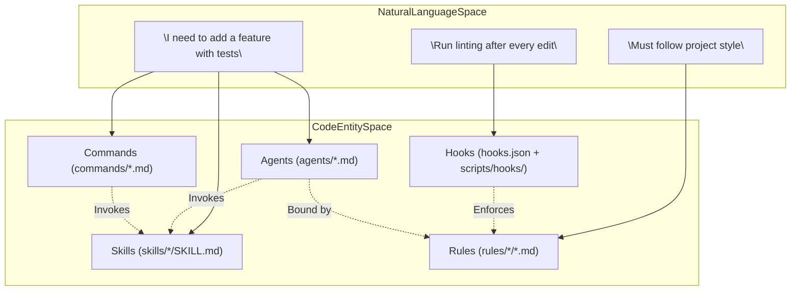
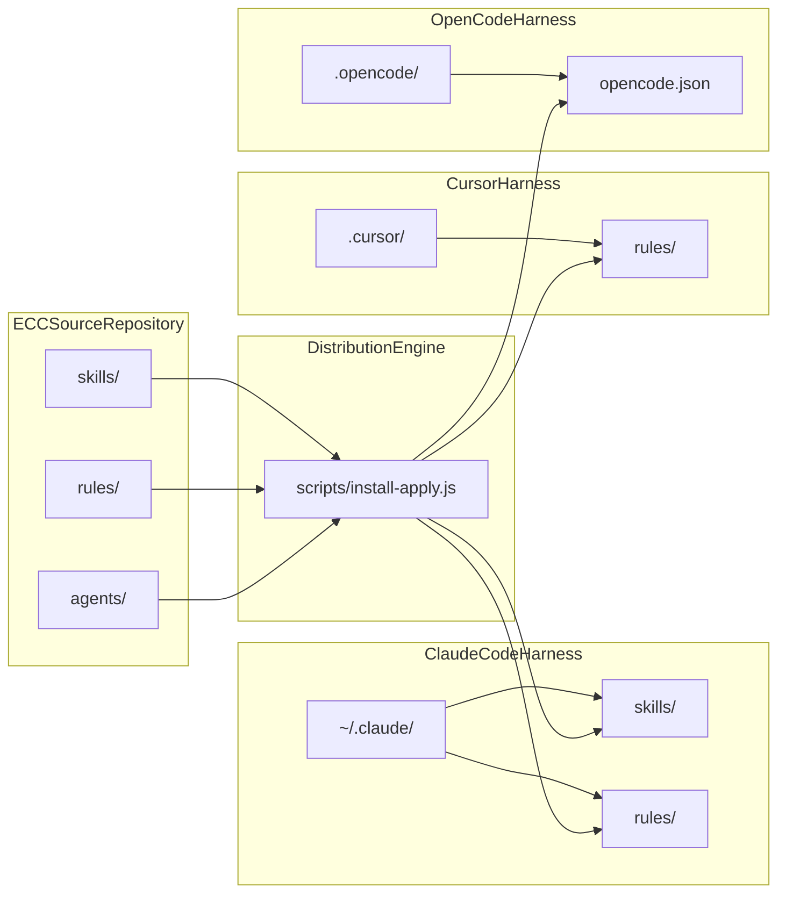

<!-- source: DeepWiki mcp.deepwiki.com · repo affaan-m/ECC · page 1.2 Core Concepts & Terminology · fetched 2026-10-30 -->

# Core Concepts & Terminology

Relevant source files

The following files were used as context for generating this wiki page:

- [.claude-plugin/marketplace.json](.claude-plugin/marketplace.json)
- [.claude-plugin/plugin.json](.claude-plugin/plugin.json)
- [AGENTS.md](AGENTS.md)
- [README.md](README.md)
- [README.zh-CN.md](README.zh-CN.md)
- [agent.yaml](agent.yaml)
- [docs/tr/AGENTS.md](docs/tr/AGENTS.md)
- [docs/zh-CN/AGENTS.md](docs/zh-CN/AGENTS.md)
- [docs/zh-CN/README.md](docs/zh-CN/README.md)
- [examples/user-CLAUDE.md](examples/user-CLAUDE.md)
- [manifests/install-modules.json](manifests/install-modules.json)
- [package.json](package.json)
- [rules/common/code-review.md](rules/common/code-review.md)
- [rules/common/coding-style.md](rules/common/coding-style.md)
- [rules/common/development-workflow.md](rules/common/development-workflow.md)
- [rules/common/patterns.md](rules/common/patterns.md)
- [rules/common/security.md](rules/common/security.md)
- [rules/common/testing.md](rules/common/testing.md)
- [skills/backend-patterns/SKILL.md](skills/backend-patterns/SKILL.md)
- [skills/clickhouse-io/SKILL.md](skills/clickhouse-io/SKILL.md)
- [skills/coding-standards/SKILL.md](skills/coding-standards/SKILL.md)
- [skills/continuous-learning/SKILL.md](skills/continuous-learning/SKILL.md)
- [skills/django-verification/SKILL.md](skills/django-verification/SKILL.md)
- [skills/eval-harness/SKILL.md](skills/eval-harness/SKILL.md)
- [skills/frontend-patterns/SKILL.md](skills/frontend-patterns/SKILL.md)
- [skills/iterative-retrieval/SKILL.md](skills/iterative-retrieval/SKILL.md)
- [skills/prisma-patterns/SKILL.md](skills/prisma-patterns/SKILL.md)
- [skills/search-first/SKILL.md](skills/search-first/SKILL.md)
- [skills/security-review/SKILL.md](skills/security-review/SKILL.md)

Everything Claude Code (ECC) is a harness-native agent operating system designed to extend AI coding assistants with production-ready engineering workflows [package.json:2-4](). This page defines the fundamental building blocks that comprise the ECC ecosystem—Skills, Agents, Hooks, Rules, Commands, Instincts, and Harnesses—and explains their technical implementation, data flow, and interrelationships across supported harnesses.

## System Hierarchy

The ECC architecture is built on a layered model where high-level **Agents** (`agents/*.md`) orchestrate **Skills** (`skills/*/SKILL.md`), which are governed by **Rules** (`rules/*/*.md`), automated by **Hooks** (`hooks/`, `scripts/hooks/`), and manually invoked via **Commands** (`commands/*.md`) [manifests/install-modules.json:1-120](), [package.json:53-110]().

### Bridge: Natural Language to Code Entity Space

The following diagram maps the conceptual "Natural Language" requirements of an engineer to the specific "Code Entities" defined in the ECC repository structure.

Sources: [AGENTS.md:1-15](), [.claude-plugin/plugin.json:40-45](), [manifests/install-modules.json:1-118]()

---

## 1. Agents

**Agents** represent the "who" within ECC: specialized, persona-driven AI assistants embodied as modular Markdown files. They define roles such as `planner`, `architect`, `code-reviewer`, and `security-reviewer`, tailoring AI behavior and expertise to discrete engineering functions [AGENTS.md:15-51]().

- **Implementation:** Defined as `.md` files stored in the top-level `agents/` directory, containing frontmatter metadata specifying the agent name, description, assigned tools (e.g., `Read`, `Edit`, `Bash`), and model parameters [AGENTS.md:15-51](), [.claude-plugin/plugin.json:40-45]().
- **Data Flow:** Agents are invoked either directly via slash commands or automatically by the orchestration engine based on context—for instance, `ecc:planner` triggers for complex feature planning, while `ecc:code-reviewer` activates post-modification [AGENTS.md:52-63]().
- **Key Functions:** Agents coordinate underlying **Skills** to fulfill domain-specific tasks. For example, `ecc:build-error-resolver` performs iterative error diagnosis and correction using compiler and linter message skills [AGENTS.md:26]().

### Agent Roles Snapshot

| Agent Name            | Purpose                                | Trigger Scenario                    |
|-----------------------|--------------------------------------|-----------------------------------|
| `ecc:planner`         | Implementation planning               | Complex features, refactoring     |
| `ecc:architect`         | System architecture decisions         | Architectural design phases       |
| `ecc:tdd-guide`         | Test-driven development guidance      | New feature or bug fix cycles     |
| `ecc:code-reviewer`     | Code quality and maintainability review | After code writing or modification|
| `ecc:security-reviewer` | Security vulnerability scanning       | Before commits or on sensitive code |
| `ecc:loop-operator`     | Autonomous monitoring of task loops   | Running and supervising loops     |
| `ecc:harness-optimizer` | Optimize harness configuration for reliability and cost | Performance tuning phase |

Sources: [AGENTS.md:15-63](), [agent.yaml:1-285]()

---

## 2. Skills

**Skills** encapsulate domain-specific, context-driven knowledge and workflow patterns representing "how to" accomplish tasks. They contain stepwise processes, architectural patterns, and example-driven guidance [package.json:178-226]().

- **Implementation:** Each skill resides as a directory under `skills/`, containing a `SKILL.md` file with structured documentation and frontmatter metadata (`name`, `description`) for harness auto-activation and discovery [package.json:178-226]().
- **Structure:** A typical `SKILL.md` details "When to Activate," "Core Concepts," and "Code Examples" for automated comprehension by ECC agents and workflows.
- **Relationship to Agents:** Agents invoke skills as atomic work units. Slash **Commands** serve as thin wrappers mapping directly onto underlying skills to execute workflows [AGENTS.md:1-97]().

Sources: [package.json:178-226](), [manifests/install-modules.json:184-246]()

---

## 3. Rules

**Rules** provide immutable, always-active constraints governing code style, architecture, security, and operational policies that all code and agent interactions must obey [rules/common/coding-style.md:1-97]().

- **Implementation:** Reside in `rules/`, split into universal `common/` rules and language-specific extension subdirectories (e.g., `rules/typescript/`, `rules/python/`, `rules/rust/`) ensuring fine-grained control [manifests/install-modules.json:5-30]().
- **Enforcement:** Rules are injected into system prompts or mounted in harness-specific configuration paths (e.g., `.cursor/rules/`) enforcing critical policies like **Immutability** (`ALWAYS create new objects, NEVER mutate existing ones`) [rules/common/coding-style.md:3-14]().

Sources: [manifests/install-modules.json:5-30](), [rules/common/coding-style.md:1-97]()

---

## 4. Hooks

**Hooks** automate lifecycle event handling and custom workflow automation, triggered by file edits, commands, session starts/stops, or other tooling events [manifests/install-modules.json:99-118]().

- **Implementation:** Defined declaratively in configuration files and implemented through shell or JavaScript scripts under `scripts/hooks/` and `hooks/` directories [manifests/install-modules.json:99-118]().
- **Lifecycle Events:** Common hooks include session lifecycle (`SessionStart`, `Stop`), pre- and post-tool invocations (`PreToolUse`, `PostToolUse`), enabling integration around ECC workflows [.claude-plugin/plugin.json:25-38]().
- **Runtime Configuration:** Execution behavior is controlled via plugin config and environment variables such as `ECC_HOOK_PROFILE` (`minimal`, `standard`, `strict`) to gate operational modes [.claude-plugin/plugin.json:25-38]().

Sources: [manifests/install-modules.json:99-118](), [.claude-plugin/plugin.json:25-38]()

---

## 5. Commands

**Commands** expose user-facing slash commands (e.g., `/plan`, `/tdd`, `/code-review`) serving as explicit entrypoints to execute ECC workflows or underlying skills [agent.yaml:180-277]().

- **Implementation:** Defined as Markdown files in the `commands/` directory with execution logic in supporting scripts, and enumerated in `agent.yaml` [package.json:82](), [agent.yaml:180-277]().
- **Compatibility:** Commands act as compatibility shims forwarding to canonical skills, maintaining user familiarity while backing a skill-first architecture [AGENTS.md:1-97]().

Sources: [package.json:82](), [agent.yaml:180-277](), [AGENTS.md:1-97]()

---

## 6. Instincts (Continuous Learning)

**Instincts** are emergent project-specific behavioral learnings captured dynamically by the Continuous Learning v2 system to continuously evolve ECC workflows [README.zh-CN.md:74-75]().

- **Implementation:** Observed via hook scripts, processed by skills under `skills/continuous-learning-v2/`, and managed via CLI tools, applying scoped analysis via Homunculus directories [package.json:215]().
- **Lifecycle & Operations:** Insights are scored for confidence, promoted into stable skills, and operated via commands like `/learn`, `/promote`, and `/instinct-status` [agent.yaml:196-220]().

Sources: [README.zh-CN.md:74-75](), [package.json:215](), [agent.yaml:196-220]()

---

## 7. Harnesses

A **Harness** is the AI assistant runtime environment where ECC operates (e.g., Claude Code, Codex, OpenCode, Cursor, Gemini). ECC is engineered for **Cross-Harness Portability**, ensuring consistent operation across diverse platforms [package.json:2-15](), [manifests/install-modules.json:1-175]().

- **Supported Harnesses:** Claude Code, Codex, OpenCode, Cursor, Gemini, Kiro, Zed, Antigravity, and Kimi [manifests/install-modules.json:1-175]().
- **Adaptation Engine:** The installation pipeline (`scripts/install-apply.js`, `scripts/harness-adapter-compliance.js`) maps canonical ECC modules to target-specific harness directory layouts and configuration conventions [package.json:139,151]().

### Harness Integration Map

The diagram below maps how ECC core source assets flow through the distribution and adaptation engine into target harness environments.

Sources: [manifests/install-modules.json:1-175](), [package.json:43-57,139,151]()

---

## Technical Summary Table

| Concept    | Repository Path          | Storage Format      | Primary Role                              |
|------------|-------------------------|---------------------|------------------------------------------|
| **Agent**  | `agents/*.md`           | Markdown (`.md`)    | Specialized AI persona / behavioral module |
| **Skill**  | `skills/*/SKILL.md`      | Directory + Markdown | Domain workflow knowledge, stepwise processes |
| **Rule**   | `rules/*/*.md`           | Markdown (`.md`)    | Universal or language-specific constraints |
| **Hook**   | `hooks/`, `scripts/hooks/` | JSON + Shell/JS    | Automated lifecycle and event-driven scripting |
| **Command**| `commands/*.md`           | Markdown (`.md`)    | User-facing command entry points wrapping skills |
| **Instinct** | `skills/continuous-learning-v2/` | JSON / Markdown  | Adaptive, project-learned behavioral patterns |
| **Harness** | External environment     | Runtime environment | Host AI assistant platform (Claude, Codex, etc.) |

Sources: [package.json:4-115](), [manifests/install-modules.json:1-175](), [AGENTS.md:1-97](), [.claude-plugin/plugin.json:1-46](), [agent.yaml:1-285]()

---

