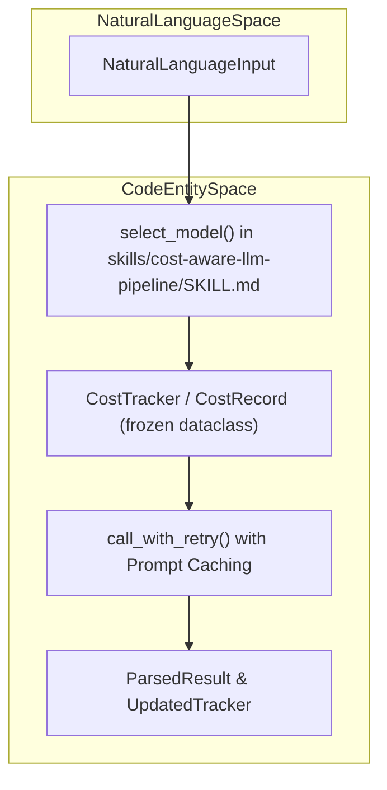
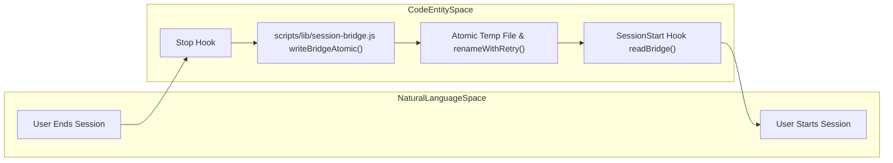

<!-- source: DeepWiki mcp.deepwiki.com · repo affaan-m/ECC · page 1.3 User Guides (Shortform & Longform) · fetched 2026-10-30 -->

# User Guides (Shortform & Longform)

<details>
<summary>Relevant source files</summary>

The following files were used as context for generating this wiki page:

- [.claude/rules/node.md](.claude/rules/node.md)
- [.cursor/rules/common-performance.md](.cursor/rules/common-performance.md)
- [CODE_OF_CONDUCT.md](CODE_OF_CONDUCT.md)
- [COMMANDS-QUICK-REF.md](COMMANDS-QUICK-REF.md)
- [agents/react-build-resolver.md](agents/react-build-resolver.md)
- [agents/react-reviewer.md](agents/react-reviewer.md)
- [agents/typescript-reviewer.md](agents/typescript-reviewer.md)
- [assets/images/shortform/00-header.png](assets/images/shortform/00-header.png)
- [docs/COMMAND-AGENT-MAP.md](docs/COMMAND-AGENT-MAP.md)
- [docs/es/rules/common/performance.md](docs/es/rules/common/performance.md)
- [docs/examples/project-guidelines-template.md](docs/examples/project-guidelines-template.md)
- [docs/ja-JP/rules/common/performance.md](docs/ja-JP/rules/common/performance.md)
- [docs/ja-JP/skills/cost-aware-llm-pipeline/SKILL.md](docs/ja-JP/skills/cost-aware-llm-pipeline/SKILL.md)
- [docs/ja-JP/skills/django-security/SKILL.md](docs/ja-JP/skills/django-security/SKILL.md)
- [docs/ja-JP/skills/project-guidelines-example/SKILL.md](docs/ja-JP/skills/project-guidelines-example/SKILL.md)
- [docs/ko-KR/rules/performance.md](docs/ko-KR/rules/performance.md)
- [docs/pt-BR/rules/performance.md](docs/pt-BR/rules/performance.md)
- [docs/token-optimization.md](docs/token-optimization.md)
- [docs/tr/rules/common/performance.md](docs/tr/rules/common/performance.md)
- [docs/tr/the-longform-guide.md](docs/tr/the-longform-guide.md)
- [docs/tr/the-security-guide.md](docs/tr/the-security-guide.md)
- [docs/tr/the-shortform-guide.md](docs/tr/the-shortform-guide.md)
- [docs/zh-CN/CODE_OF_CONDUCT.md](docs/zh-CN/CODE_OF_CONDUCT.md)
- [docs/zh-CN/commands/orchestrate.md](docs/zh-CN/commands/orchestrate.md)
- [docs/zh-CN/commands/plan.md](docs/zh-CN/commands/plan.md)
- [docs/zh-CN/commands/python-review.md](docs/zh-CN/commands/python-review.md)
- [docs/zh-CN/commands/tdd.md](docs/zh-CN/commands/tdd.md)
- [docs/zh-CN/rules/common/performance.md](docs/zh-CN/rules/common/performance.md)
- [docs/zh-CN/skills/cost-aware-llm-pipeline/SKILL.md](docs/zh-CN/skills/cost-aware-llm-pipeline/SKILL.md)
- [docs/zh-CN/the-longform-guide.md](docs/zh-CN/the-longform-guide.md)
- [docs/zh-CN/the-shortform-guide.md](docs/zh-CN/the-shortform-guide.md)
- [docs/zh-TW/agents/database-reviewer.md](docs/zh-TW/agents/database-reviewer.md)
- [docs/zh-TW/rules/performance.md](docs/zh-TW/rules/performance.md)
- [docs/zh-TW/skills/project-guidelines-example/SKILL.md](docs/zh-TW/skills/project-guidelines-example/SKILL.md)
- [examples/statusline.json](examples/statusline.json)
- [rules/common/performance.md](rules/common/performance.md)
- [rules/typescript/security.md](rules/typescript/security.md)
- [scripts/lib/session-bridge.js](scripts/lib/session-bridge.js)
- [skills/cost-aware-llm-pipeline/SKILL.md](skills/cost-aware-llm-pipeline/SKILL.md)
- [skills/osint-investigation/SKILL.md](skills/osint-investigation/SKILL.md)
- [tests/docs/mcp-management-docs.test.js](tests/docs/mcp-management-docs.test.js)
- [the-longform-guide.md](the-longform-guide.md)
- [the-shortform-guide.md](the-shortform-guide.md)

</details>


This page provides practical daily-usage guides for Everything Claude Code (ECC) workflows. It focuses on maximizing productivity through strategic command chaining, efficient agent orchestration, token optimization, and robust session persistence. These guides synthesize the operational patterns detailed in `the-shortform-guide.md` and `the-longform-guide.md`, transitioning the user from interactive prompting to advanced software engineering automation.

Sources: [the-shortform-guide.md:1-173](), [the-longform-guide.md:1-122]()

---

## 1. Core Workflow Surface: Skills & Commands

The primary interaction layer in ECC consists of modular **Skills** and legacy **Commands**.

### 1.1 Skills vs. Commands
*   **Skills** (`~/.claude/skills/`): The canonical workflow definitions. They encapsulate reusable prompts, modular structures, and supporting assets or codemaps that allow agents to navigate codebases without burning context tokens on exploration [the-shortform-guide.md:13-26]().
*   **Commands** (`~/.claude/commands/`): Legacy slash-entry shims maintained for backward compatibility during migration. Durable execution logic resides within the skill layer [the-shortform-guide.md:22-26]().

### 1.2 Common Development Chaining
For complex engineering tasks, slash commands and underlying skills can be chained sequentially to ensure quality gates are met:
1.  `/plan`: Establish the implementation roadmap [the-shortform-guide.md:13-20]().
2.  `/tdd`: Implement following Test-Driven Development loops [the-shortform-guide.md:17]().
3.  `/refactor-clean`: Clean up dead code and loose files post-implementation [the-shortform-guide.md:17]().

Sources: [the-shortform-guide.md:13-34](), [the-longform-guide.md:12-18]()

---

## 2. Token Economics & Optimization

Token management is critical for maintaining long-running, coherent sessions without triggering context rot or performance degradation.

### 2.1 Configuration and Model Routing
To control token consumption and manage cost limits, ECC integrates recommended settings and programmatic pipeline patterns. Settings such as `CLAUDE_CODE_EFFORT_LEVEL` and `CLAUDE_CODE_SUBAGENT_MODEL` in `~/.claude/settings.json` delegate lightweight exploration tasks to Haiku while reserving Sonnet or Opus for complex reasoning [docs/token-optimization.md:9-23]().

Programmatically, the `cost-aware-llm-pipeline` skill (`skills/cost-aware-llm-pipeline/SKILL.md`) implements model routing by task complexity, immutable cost tracking via frozen dataclasses (`CostTracker`, `CostRecord`), narrow retry logic (`call_with_retry`), and prompt caching [skills/cost-aware-llm-pipeline/SKILL.md:21-127]().

```python
def select_model(text_length: int, item_count: int, force_model: str | None = None) -> str:
    if force_model is not None:
        return force_model
    if text_length >= 10_000 or item_count >= 30:
        return "claude-sonnet-5"
    return "claude-haiku-4-5-20251001"
```

Sources: [docs/token-optimization.md:9-50](), [skills/cost-aware-llm-pipeline/SKILL.md:21-43]()

### 2.2 CLI Over Heavy MCP Wrappers
Many Model Context Protocol (MCP) servers wrap existing version control, database, or deployment CLIs (e.g., GitHub, Supabase, Vercel) [the-longform-guide.md:24-27](). While convenient for autonomous access, loading many MCPs severely reduces your usable context window in Claude Code [the-longform-guide.md:26-30]().

To optimize tokens, users replace heavy MCPs by wrapping CLI functionality into lightweight skills or commands [the-longform-guide.md:28-33]().

Sources: [the-longform-guide.md:24-33]()

---

## 3. Memory & Session Persistence

Preserving state across restarts prevents context degradation and supports seamless continuation across multi-day workflows.

### 3.1 Dynamic System Prompt Injection
Instead of polluting persistent user or project-wide configuration files with transient context, ECC users can inject session-specific context dynamically on startup via CLI flags [the-longform-guide.md:54-62]():

```bash
claude --system-prompt "$(cat ~/.claude/contexts/dev.md)"
```

### 3.2 Session Bridge & Persistence Hooks
Session state is coordinated via utility scripts like `scripts/lib/session-bridge.js`, which provides atomic file locking and safe JSON read/write operations (`readBridge`, `writeBridgeAtomic`, `renameWithRetry`) across concurrent hook executions [scripts/lib/session-bridge.js:45-129]().

ECC leverages lifecycle hooks to automate memory persistence:
- **PreCompact Hook**: Saves vital state prior to context compaction [the-longform-guide.md:81]().
- **Stop Hook (Session End)**: Automatically writes learnings and progress summaries to session files when the session ends [the-longform-guide.md:82]().
- **SessionStart Hook**: Loads previous context automatically on session start [the-longform-guide.md:83]().

Sources: [scripts/lib/session-bridge.js:1-148](), [the-longform-guide.md:38-86]()

---

## 4. Architectural Data Flow & Component Mapping

The following diagrams bridge natural language intents with concrete code artifacts and functional components in ECC.

### Diagram 1: Token Routing Pipeline
**Title: "NaturalLanguageToCodeExecutionForCostAwareLLM"**



Sources: [skills/cost-aware-llm-pipeline/SKILL.md:21-153]()

---

### Diagram 2: Session Bridge & Persistence Flow
**Title: "NaturalLanguageSessionEndToBridgeStorage"**



Sources: [scripts/lib/session-bridge.js:45-129](), [the-longform-guide.md:78-86]()

---

## 5. Summary of Key Interaction Patterns

| Pattern | Code Entity / Mechanism | Benefit |
|---------|-------------------------|---------|
| **Trigger-Based Loading** | `skills/` directory scanning | Loads workflow bundles on demand to reduce baseline context overhead [the-shortform-guide.md:13-26]() |
| **Subagent Architecture** | `agents/` configuration and orchestration | Delegates task types to specialized models to optimize token cost & latency [the-longform-guide.md:107-124]() |
| **CLI Wrapper Substitution** | Custom commands replacing heavy MCPs | Minimizes context window depletion by avoiding MCP tool-load overhead [the-longform-guide.md:24-33]() |
| **Lifecycle Hooks & Bridge** | `scripts/lib/session-bridge.js` & hooks | Automates atomic memory persistence for seamless session continuity [scripts/lib/session-bridge.js:74-84]() |

Sources: [the-shortform-guide.md:13-26](), [scripts/lib/session-bridge.js:74-84](), [the-longform-guide.md:24-124]()

---

