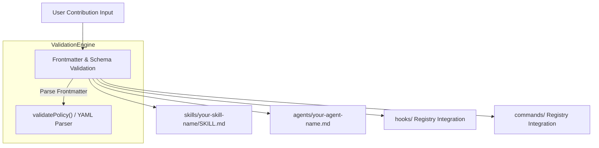
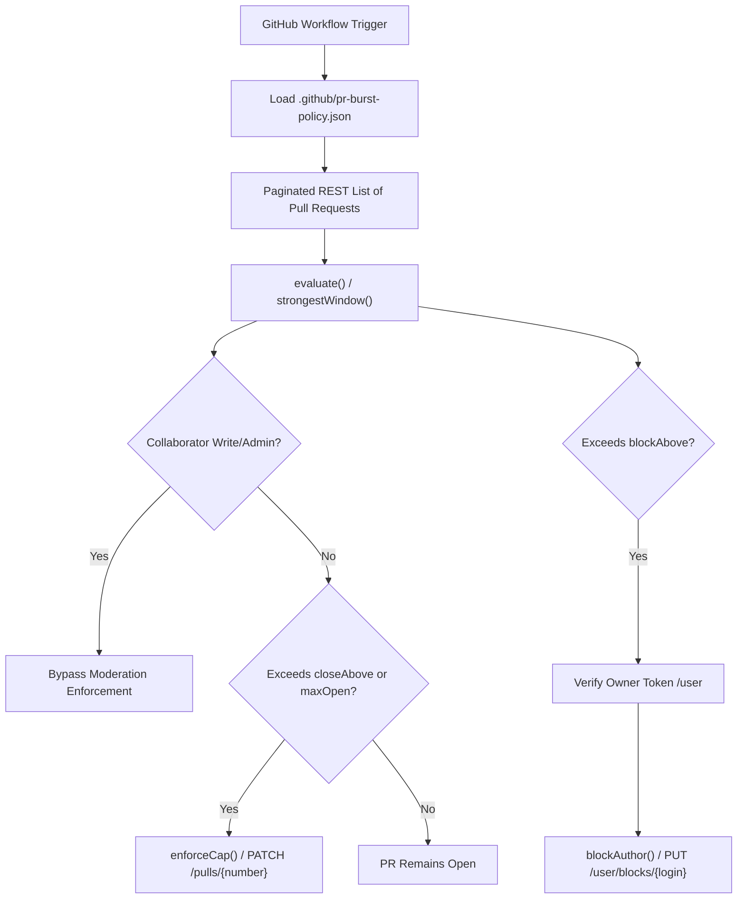

<!-- source: DeepWiki mcp.deepwiki.com · repo affaan-m/ECC · page 1.4 Contributing & Community Governance · fetched 2026-10-30 -->

# Contributing & Community Governance

Relevant source files

The following files were used as context for generating this wiki page:

- [.claude-plugin/README.md](.claude-plugin/README.md)
- [.github/ISSUE_MODERATION.md](.github/ISSUE_MODERATION.md)
- [.github/PR_MODERATION.md](.github/PR_MODERATION.md)
- [.github/issue-submission-policy.json](.github/issue-submission-policy.json)
- [.github/pr-burst-policy.json](.github/pr-burst-policy.json)
- [.github/workflows/issue-submission-guard.yml](.github/workflows/issue-submission-guard.yml)
- [.github/workflows/pr-burst-guard.yml](.github/workflows/pr-burst-guard.yml)
- [.kimi/README.md](.kimi/README.md)
- [CONTRIBUTING.md](CONTRIBUTING.md)
- [SPONSORS.md](SPONSORS.md)
- [assets/images/guides/longform-guide.png](assets/images/guides/longform-guide.png)
- [assets/images/guides/shorthand-guide.png](assets/images/guides/shorthand-guide.png)
- [assets/images/sponsors/atlascloud-dark.svg](assets/images/sponsors/atlascloud-dark.svg)
- [assets/images/sponsors/atlascloud.svg](assets/images/sponsors/atlascloud.svg)
- [assets/images/sponsors/coderabbit.png](assets/images/sponsors/coderabbit.png)
- [assets/images/sponsors/greptile.png](assets/images/sponsors/greptile.png)
- [assets/images/sponsors/moonshot-dark.png](assets/images/sponsors/moonshot-dark.png)
- [assets/images/sponsors/moonshot.png](assets/images/sponsors/moonshot.png)
- [docs/ATLAS-CLOUD-GUIDE.md](docs/ATLAS-CLOUD-GUIDE.md)
- [docs/uk-UA/README.md](docs/uk-UA/README.md)
- [scripts/ci/issue-submission-guard.js](scripts/ci/issue-submission-guard.js)
- [scripts/ci/pr-burst-guard.js](scripts/ci/pr-burst-guard.js)
- [scripts/lib/compute-sponsor.js](scripts/lib/compute-sponsor.js)
- [src/llm/cli/selector.py](src/llm/cli/selector.py)
- [tests/ci/issue-submission-guard-workflow.test.js](tests/ci/issue-submission-guard-workflow.test.js)
- [tests/ci/issue-submission-guard.test.js](tests/ci/issue-submission-guard.test.js)
- [tests/ci/pr-burst-guard-workflow.test.js](tests/ci/pr-burst-guard-workflow.test.js)
- [tests/ci/pr-burst-guard.test.js](tests/ci/pr-burst-guard.test.js)
- [tests/scripts/ito-compute-sponsor.test.js](tests/scripts/ito-compute-sponsor.test.js)

## Purpose & Scope

This page documents the technical workflows, moderation policies, asset compliance requirements, and community governance structures established in the Everything Claude Code (ECC) codebase. It details the contribution pipeline defined in `CONTRIBUTING.md`, the automated metadata-only moderation engines (`pr-burst-guard` and `issue-submission-guard`), skill adaptation policies, and the sponsorship and compute-integration architecture centered around Itô compute.

Sources: `CONTRIBUTING.md:1-50`, `.github/PR_MODERATION.md:1-20`, `SPONSORS.md:1-25`.

---

## Contribution Workflow & Asset Guidelines

ECC welcomes community contributions across four primary component families: Agents, Skills, Hooks, and Commands (`CONTRIBUTING.md:24-52`). 

### Quick Start & Branch Isolation
Contributors fork the repository, create topic branches (`feat/my-contribution`), develop assets locally within appropriate subdirectories, and submit pull requests (`CONTRIBUTING.md:55-73`). Assets must be validated locally against Claude Code or target harness environments prior to submission (`CONTRIBUTING.md:67-71`).

### Skill Adaptation & Frontmatter Constraints
When porting concepts from external repositories or prompt packs, contributors must adhere to the **Skill Adaptation Policy** (`CONTRIBUTING.md:152-162`):
- Copy underlying architectural concepts rather than external product identities.
- Rename skills if ECC materially expands or alters the surface area.
- Prefer ECC-native rules, skills, scripts, and Model Context Protocol (MCP) servers over introducing unvetted external dependencies.

Furthermore, skill frontmatter metadata must use inline strings or folded scalar blocks (`>`) for the `description:` field (`CONTRIBUTING.md:175`). Literal scalar blocks (`|`, `|-`, `|+`) preserve internal newlines that break flat-table renderers.

### Contribution Architecture
The following diagram illustrates how natural language contributions map to concrete codebase entities and validation entry points.

*Figure 1: Contribution Asset Routing and Validation Pipeline.*

Sources: `CONTRIBUTING.md:55-180`, `.claude-plugin/README.md:1-10`.

---

## PR Moderation & Guard Subsystems

To protect maintainer review capacity without performing subjective patch evaluations, ECC implements an automated metadata-only moderation engine termed the **PR Burst Guard** (`.github/PR_MODERATION.md:1-5`, `scripts/ci/pr-burst-guard.js:1-2`).

### Policy Configuration & Enforcement
Governance rules are governed by `.github/pr-burst-policy.json` and executed via GitHub Actions workflow definitions (`.github/workflows/pr-burst-guard.yml`):
- **Burst Allowance:** Maximum of 5 PR creations per author within a rolling 20-minute window (`.github/PR_MODERATION.md:11`). Exceeding this closes and locks excess PRs (`scripts/ci/pr-burst-guard.js:60`).
- **Severe Burst:** More than 10 creations within 20 minutes triggers automated account blocking (via `PR_MODERATION_BLOCK_TOKEN`) and maintainer escalation alerts (`.github/PR_MODERATION.md:12`, `scripts/ci/pr-burst-guard.js:61`).
- **Open-PR Cap (`maxOpen`):** Capped at 10 open PRs per author (`.github/PR_MODERATION.md:13`). When breached, the newest PRs are closed with an explanatory comment (`scripts/ci/pr-burst-guard.js:91-114`).
- **Trusted Contributors:** Users possessing live repository write, maintain, or admin permissions are explicitly exempt from burst limits (`.github/PR_MODERATION.md:15`, `tests/ci/pr-burst-guard.test.js:102-107`).

### Core Moderation Functions
The moderation engine executes through several key JavaScript functions defined in `scripts/ci/pr-burst-guard.js`:
- `validatePolicy(policy)`: Enforces safe integer bounds on `windowMinutes`, `closeAbove`, `blockAbove`, and `maxOpen` (`scripts/ci/pr-burst-guard.js:8-19`).
- `evaluate(rows, current, policy, end)`: Scans historical creation timestamps to isolate recent pull requests by stable user ID (`scripts/ci/pr-burst-guard.js:52-64`).
- `strongestWindow(rows, current, policy, eventTime)`: Recalculates historical burst peaks across sliding windows to prevent out-of-order delivery evasion (`scripts/ci/pr-burst-guard.js:66-87`).
- `capExcess(openRows, current, policy, alreadyClosed)`: Identifies open PRs exceeding `maxOpen` based on creation timestamp ordering (`scripts/ci/pr-burst-guard.js:91-98`).
- `blockAuthor(blockAPI, owner, login)`: Validates repository owner identity against `/user` before calling `PUT /user/blocks/{login}` (`scripts/ci/pr-burst-guard.js:116-129`).

### Moderation Data Flow
The sequence from webhook event trigger to enforcement action is structured as follows:

*Figure 2: PR Burst Guard Evaluation and Enforcement Control Flow.*

Sources: `.github/PR_MODERATION.md:1-100`, `scripts/ci/pr-burst-guard.js:1-130`, `.github/pr-burst-policy.json:1-9`, `tests/ci/pr-burst-guard.test.js:1-60`.

---

## Sponsors Program & Compute-Sponsor Integration

ECC’s sustainability model relies on community sponsorships and strategic partnerships defined in `SPONSORS.md`. 

### Sponsorship Tiers
The project maintains distinct sponsorship levels ranging from Supporter ($10/mo) to Strategic Sponsor ($3,700/mo), funding independent maintenance, AgentShield, and weekly multi-harness updates (`SPONSORS.md:5-65`, `SPONSORS.md:73-81`).

### Compute-Sponsor Integration (`Itô`)
Itô is documented as ECC's preferred compute partner (`SPONSORS.md:21`, `.claude-plugin/README.md:19`). The integration architecture enforces a strict separation between passive promotional links and active execution:
- **Passive Dashboard Links:** References to `https://compute.itomarkets.com` in documentation and UI selectors are passive; they do not invoke RFQs, provision compute, or alter Claude Code transport settings (`SPONSORS.md:21`, `src/llm/cli/selector.py:34-50`).
- **Active CLI Bridge (`ecc ito find`):** An opt-in command bridge that invokes the canonical Itô CLI to submit authenticated requests without reserving background capacity (`SPONSORS.md:21`, `tests/scripts/ito-compute-sponsor.test.js:1-22`).

Sources: `SPONSORS.md:1-89`, `tests/scripts/ito-compute-sponsor.test.js:1-105`, `src/llm/cli/selector.py:34-50`.

---

