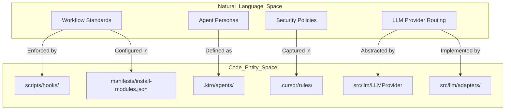
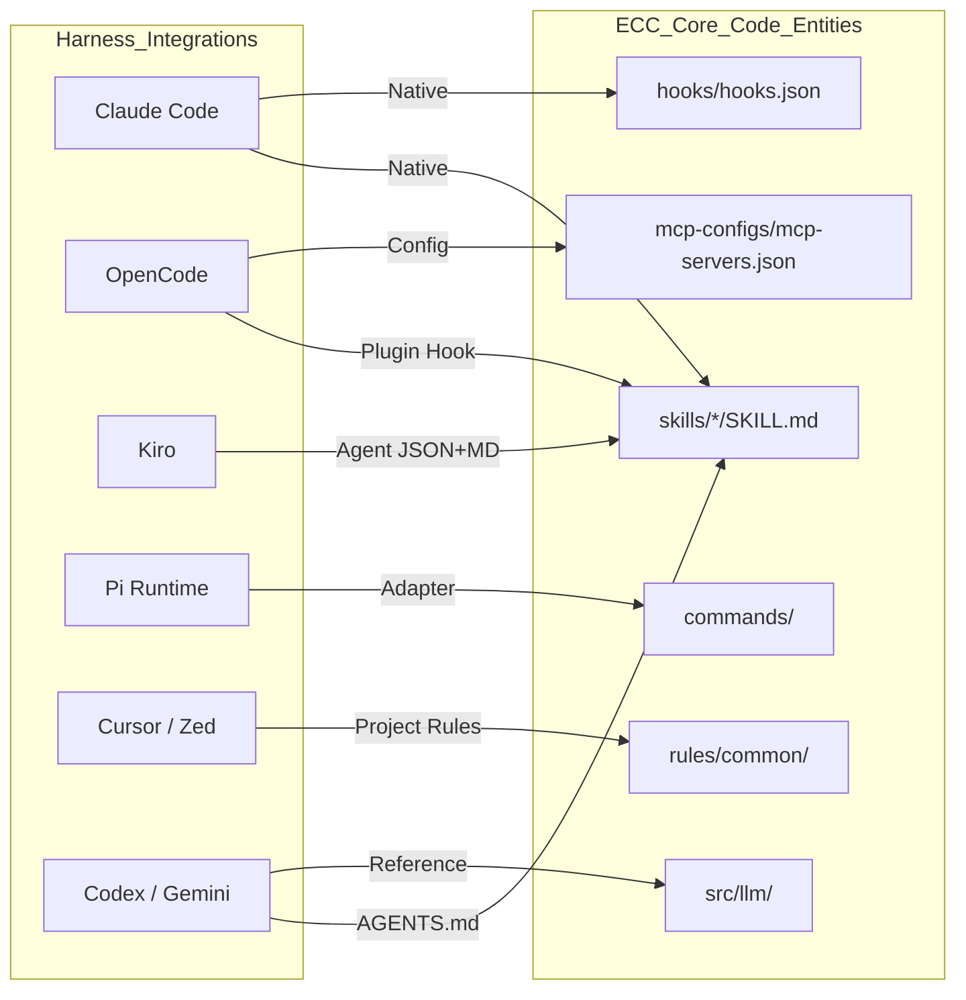

<!-- source: DeepWiki mcp.deepwiki.com · repo affaan-m/ECC · page 10 Harness-Specific Integrations · fetched 2026-10-30 -->

# Harness-Specific Integrations

Relevant source files

The following files were used as context for generating this wiki page:

- [.claude-plugin/marketplace.json](.claude-plugin/marketplace.json)
- [.claude-plugin/plugin.json](.claude-plugin/plugin.json)
- [.pi/README.md](.pi/README.md)
- [.pi/extensions/hook-runtime.js](.pi/extensions/hook-runtime.js)
- [.pi/extensions/index.ts](.pi/extensions/index.ts)
- [AGENTS.md](AGENTS.md)
- [README.md](README.md)
- [README.zh-CN.md](README.zh-CN.md)
- [agent.yaml](agent.yaml)
- [docs/architecture/cross-harness.md](docs/architecture/cross-harness.md)
- [docs/architecture/harness-adapter-compliance.md](docs/architecture/harness-adapter-compliance.md)
- [docs/architecture/platform-value-loop.md](docs/architecture/platform-value-loop.md)
- [docs/releases/2.0.0-rc.1/ito-prediction-market-skill-pack.md](docs/releases/2.0.0-rc.1/ito-prediction-market-skill-pack.md)
- [docs/tr/AGENTS.md](docs/tr/AGENTS.md)
- [docs/zh-CN/AGENTS.md](docs/zh-CN/AGENTS.md)
- [docs/zh-CN/README.md](docs/zh-CN/README.md)
- [manifests/install-modules.json](manifests/install-modules.json)
- [package.json](package.json)
- [schemas/agent.schema.json](schemas/agent.schema.json)
- [scripts/lib/agent-emit-pi.js](scripts/lib/agent-emit-pi.js)
- [scripts/lib/agent-ir.js](scripts/lib/agent-ir.js)
- [scripts/lib/agent-tool-map.js](scripts/lib/agent-tool-map.js)
- [scripts/lib/harness-adapter-compliance.js](scripts/lib/harness-adapter-compliance.js)
- [tests/docs/harness-adapter-compliance.test.js](tests/docs/harness-adapter-compliance.test.js)
- [tests/docs/platform-value-loop.test.js](tests/docs/platform-value-loop.test.js)
- [tests/pi/agent-emit.test.js](tests/pi/agent-emit.test.js)
- [tests/pi/pi-extension-adapter.test.js](tests/pi/pi-extension-adapter.test.js)
- [tests/pi/pi-hook-runtime.test.js](tests/pi/pi-hook-runtime.test.js)
- [tests/pi/pi-package-manifest.test.js](tests/pi/pi-package-manifest.test.js)

Everything Claude Code (ECC) functions as a harness-native agent operating system designed to treat heterogeneous AI coding environments as execution surfaces [README.md:1-4, package.json:1-5](). While Claude Code serves as the primary native runtime [docs/architecture/harness-adapter-compliance.md:39-40](), ECC supports a wide variety of adjacent harnesses—including OpenCode, Kiro, Cursor, Codex, Gemini, Zed, and Antigravity—by maintaining a unified core of durable assets and adapting them at the integration edge.

This page provides a high-level parent overview of ECC's multi-harness portability model, compliance taxonomy, and integration surfaces. For deep implementation details, operators and developers should consult the dedicated child pages linked below.

---

## Portability Model & Core Asset Architecture

ECC separates durable agent logic from harness-specific event lifecycles. All core engineering standards, workflows, and prompts are defined once in shared directories and reused across target platforms:

- **Skills**: Canonical workflow packages in `skills/` [manifests/install-modules.json:184-246]()
- **Rules**: Universal and language-specific guidelines in `rules/` [manifests/install-modules.json:1-30]()
- **Commands**: Slash-command libraries in `commands/` [manifests/install-modules.json:62-97]()
- **Hooks & Automation**: Event dispatchers in `hooks/` and `scripts/hooks/` [manifests/install-modules.json:99-118]()
- **MCP Configurations**: Standard server catalogs in `mcp-configs/` [manifests/install-modules.json:137-182]()

Harness-specific integration packages only map event schemas, command names, or packaging metadata without duplicating business logic [docs/architecture/harness-adapter-compliance.md:8-20]().

### Diagram: Natural Language Space to Code Entity Space

Sources: [docs/architecture/cross-harness.md:3-46](), [docs/architecture/harness-adapter-compliance.md:8-50](), [manifests/install-modules.json:1-182]()

---

## Compliance States and Supported Harnesses

ECC categorizes target harnesses into distinct compliance tiers based on the depth of native hook enforcement, session access, and installer integration supported by the host platform [docs/architecture/harness-adapter-compliance.md:21-29]().

| Harness or Runtime | Compliance State | Supported Assets | Verification Command |
|-------------------|------------------|------------------|----------------------|
| **Claude Code** | Native | Plugin assets, skills, commands, hooks, MCP, rules | `npm run harness:audit -- --format json` [docs/architecture/harness-adapter-compliance.md:39-40]() |
| **OpenCode** | Adapter-backed | Package metadata, shared skills, MCP config, event adapter | `node tests/scripts/build-opencode.test.js` [docs/architecture/harness-adapter-compliance.md:41-42]() |
| **Kiro** | Adapter-backed | Agent JSON+MD, skills, steering files, IDE & CLI hooks | `npm run harness:adapters -- --check` [docs/architecture/harness-adapter-compliance.md:25-28]() |
| **Pi** | Adapter-backed | Pi package manifest, skill mirrors, rule injection, session hook adapter | `node tests/pi/pi-package-manifest.test.js` [docs/architecture/harness-adapter-compliance.md:42-43]() |
| **Cursor** | Adapter-backed | Cursor rules, project-local skills, hook adapter, shared scripts | `node tests/lib/install-targets.test.js` [docs/architecture/harness-adapter-compliance.md:43-44]() |
| **Zed** | Adapter-backed | Zed project settings, flattened rules, skills, commands, agents | `npm run harness:audit -- --format json` [docs/architecture/harness-adapter-compliance.md:45-46]() |
| **Codex** | Instruction-backed | `AGENTS.md`, plugin metadata, skills, MCP reference config | `npm run harness:audit -- --format json` [docs/architecture/harness-adapter-compliance.md:40-41]() |
| **Gemini** | Instruction-backed | Project instructions, shared skills, rules, compatibility docs | `node tests/lib/install-targets.test.js` [docs/architecture/harness-adapter-compliance.md:44-45]() |

Sources: [docs/architecture/harness-adapter-compliance.md:23-51]()

---

## OpenCode Integration

OpenCode provides an extensible CLI and plugin system supporting rich event hook subscriptions [docs/architecture/harness-adapter-compliance.md:41-42](). ECC bridges Claude Code lifecycle events into OpenCode's event model via TypeScript plugin logic and manifest mappings (`.opencode/`) [package.json:35-36](). 

For full architectural details, installation workflows, custom tools, and migration paths, see the child page:
- **[OpenCode Integration](#10.1)**

Sources: [.opencode/dist/index.js](), [docs/architecture/harness-adapter-compliance.md:41-42]()

---

## Kiro Integration

Kiro structures agent capabilities using JSON and Markdown artifact pairs alongside steering configurations [docs/architecture/harness-adapter-compliance.md:42-43](). ECC integrates seamlessly by packaging core skills, steering directives, and IDE/CLI hooks into the `.kiro/` directory structure [package.json:67]().

For detailed instructions on agent structures, script execution, and installation procedures, see the child page:
- **[Kiro Integration](#10.2)**

Sources: [.kiro/](), [docs/architecture/harness-adapter-compliance.md:42-43]()

---

## Cursor, Codex & Other Harnesses

In addition to OpenCode and Kiro, ECC ships adapters and scaffold configurations for Cursor, OpenAI Codex, Gemini, Zed, Trae, CodeBuddy, Qwen, Kimi, Antigravity, and `.pi` runtime extensions [package.json:54-70, docs/architecture/harness-adapter-compliance.md:40-46](). These integrations ensure uniform coding standards and skill accessibility regardless of the underlying developer toolchain.

For complete coverage of project rules, git hooks, sync scripts, and scaffold targets, see the child page:
- **[Cursor, Codex & Other Harnesses](#10.3)**

Sources: [.cursor/](), [.codex/](), [.gemini/](), [.zed/](), [docs/architecture/harness-adapter-compliance.md:40-46]()

---

## Python LLM Abstraction Layer (`src/llm`)

ECC includes a robust Python-based LLM abstraction layer in `src/llm/` that decouples agent orchestration from specific model providers. It provides a standardized `LLMProvider` interface, backend adapters (OpenAI, Claude, AstraFlow, Atlas Cloud, Ollama), reasoning support, prompt builders, and tool registries [package.json:1-12]().

For deeper technical documentation on providers, tool execution, and pyproject packaging, see the child page:
- **[Python LLM Abstraction Layer (src/llm)](#10.4)**

Sources: [src/llm/](), [package.json:1-12]()

---

### Diagram: Harness Integration vs Code Entities

Sources: [docs/architecture/cross-harness.md:1-50](), [docs/architecture/harness-adapter-compliance.md:39-46](), [manifests/install-modules.json:1-182]()

---

## Child Pages

For detailed technical specifications, configuration files, and implementation guides, refer to the child pages:

1. **[OpenCode Integration](#10.1)** — TypeScript plugin architecture, custom tools, prompts, and config migration.
2. **[Kiro Integration](#10.2)** — Agent JSON/MD structures, steering files, and CLI automation.
3. **[Cursor, Codex & Other Harnesses](#10.3)** — Cursor rules, Codex sync scripts, Gemini/Zed setups, and `.pi` extensions.
4. **[Python LLM Abstraction Layer (src/llm)](#10.4)** — `LLMProvider` interface, adapters, prompt builder, and tool execution engine.

Sources: [docs/architecture/harness-adapter-compliance.md:1-107](), [package.json:1-150]()

---

