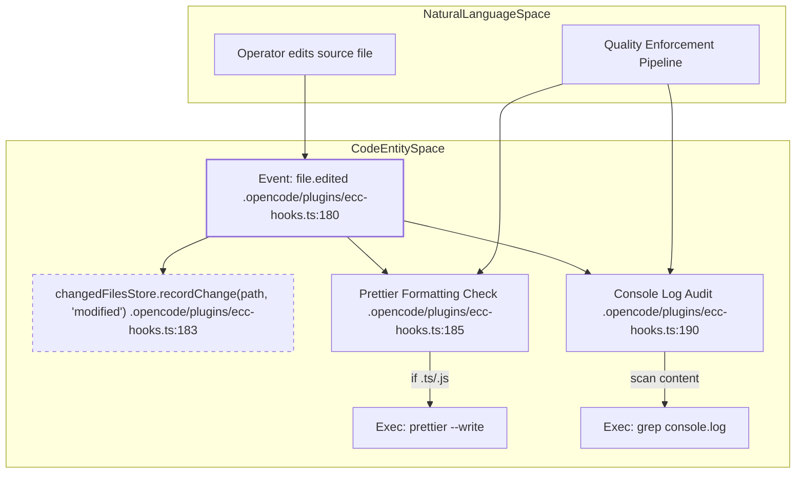
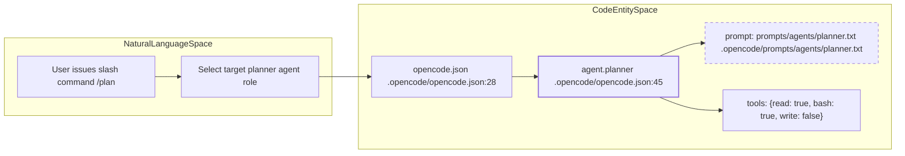

<!-- source: DeepWiki mcp.deepwiki.com · repo affaan-m/ECC · page 10.1 OpenCode Integration · fetched 2026-10-30 -->

# OpenCode Integration

Relevant source files

The following files were used as context for generating this wiki page:

- [.opencode/MIGRATION.md](.opencode/MIGRATION.md)
- [.opencode/README.md](.opencode/README.md)
- [.opencode/index.ts](.opencode/index.ts)
- [.opencode/opencode.json](.opencode/opencode.json)
- [.opencode/package-lock.json](.opencode/package-lock.json)
- [.opencode/package.json](.opencode/package.json)
- [.opencode/plugins/ecc-hooks.ts](.opencode/plugins/ecc-hooks.ts)
- [.opencode/plugins/index.ts](.opencode/plugins/index.ts)
- [.opencode/tools/changed-files.ts](.opencode/tools/changed-files.ts)
- [.opencode/tools/check-coverage.ts](.opencode/tools/check-coverage.ts)
- [.opencode/tools/dependency-analyzer.ts](.opencode/tools/dependency-analyzer.ts)
- [.opencode/tools/format-code.ts](.opencode/tools/format-code.ts)
- [.opencode/tools/git-summary.ts](.opencode/tools/git-summary.ts)
- [.opencode/tools/index.ts](.opencode/tools/index.ts)
- [.opencode/tools/lint-check.ts](.opencode/tools/lint-check.ts)
- [.opencode/tools/run-tests.ts](.opencode/tools/run-tests.ts)
- [.opencode/tools/security-audit.ts](.opencode/tools/security-audit.ts)
- [.opencode/tools/tool.ts](.opencode/tools/tool.ts)
- [.opencode/tsconfig.json](.opencode/tsconfig.json)
- [manifests/install-assets/commonjs-scripts-package.json](manifests/install-assets/commonjs-scripts-package.json)
- [package-lock.json](package-lock.json)
- [scripts/lib/install-lifecycle.js](scripts/lib/install-lifecycle.js)
- [scripts/lib/install/apply.js](scripts/lib/install/apply.js)
- [scripts/lib/install/hook-consent.js](scripts/lib/install/hook-consent.js)
- [scripts/lib/install/opencode-legacy-migration.js](scripts/lib/install/opencode-legacy-migration.js)
- [scripts/lib/install/opencode-script-boundary.js](scripts/lib/install/opencode-script-boundary.js)
- [tests/lib/github-coordination-branches.test.js](tests/lib/github-coordination-branches.test.js)
- [tests/lib/github-coordination-policy.test.js](tests/lib/github-coordination-policy.test.js)
- [tests/lib/github-coordination-store.test.js](tests/lib/github-coordination-store.test.js)
- [tests/lib/guarded-write.test.js](tests/lib/guarded-write.test.js)
- [tests/lib/helpers/assert-file-postimage.js](tests/lib/helpers/assert-file-postimage.js)
- [tests/lib/helpers/load-with-file-system.js](tests/lib/helpers/load-with-file-system.js)
- [tests/lib/helpers/mini-test-runner.js](tests/lib/helpers/mini-test-runner.js)
- [tests/lib/hook-consent.test.js](tests/lib/hook-consent.test.js)
- [tests/lib/install-executor.test.js](tests/lib/install-executor.test.js)
- [tests/lib/install-lifecycle.test.js](tests/lib/install-lifecycle.test.js)
- [tests/lib/opencode-consent-legacy-lock.test.js](tests/lib/opencode-consent-legacy-lock.test.js)
- [tests/lib/opencode-hook-consent-safety.test.js](tests/lib/opencode-hook-consent-safety.test.js)
- [tests/lib/opencode-legacy-migration.test.js](tests/lib/opencode-legacy-migration.test.js)
- [tests/lib/opencode-script-boundary.test.js](tests/lib/opencode-script-boundary.test.js)
- [tests/opencode-config.test.js](tests/opencode-config.test.js)
- [tests/opencode-plugin-hooks.test.js](tests/opencode-plugin-hooks.test.js)
- [tests/opencode-tools.test.js](tests/opencode-tools.test.js)
- [tests/scripts/build-opencode.test.js](tests/scripts/build-opencode.test.js)
- [tests/scripts/command-runtime.test.js](tests/scripts/command-runtime.test.js)
- [tests/scripts/opencode-modular-telemetry.test.js](tests/scripts/opencode-modular-telemetry.test.js)
- [yarn.lock](yarn.lock)

Everything Claude Code (ECC) provides a comprehensive integration layer for **OpenCode**, an AI-native development harness. This integration translates ECC's core capabilities—such as lifecycle hooks, security validation, specialized agents, slash commands, and skillsets—into OpenCode's native TypeScript plugin architecture and event system, which supports over 20 distinct execution lifecycle events [`.opencode/README.md:1-6`](), [`.opencode/plugins/ecc-hooks.ts:1-15`]().

---

## 1. Installation, Structure, and Layout

ECC supports two primary distribution paths for OpenCode integration: as an npm package (`ecc-universal`) or via direct repository clone for local extension development [`.opencode/README.md:8-21`](). The `.opencode/` directory governs this integration through configuration manifests, type-safe plugins, custom tools, and prompt definitions [`.opencode/README.md:22-72`]().

### 1.1. Canonical Path and Configuration
Starting with ECC 2.2.0+, the canonical installation target path is `~/.config/opencode` [`.opencode/README.md:60-68`](). The setup relies on `opencode.json`, which defines registered plugins, agent descriptors, custom instructions, and tool bindings [`.opencode/opencode.json:1-27`]().

The file layout within the `.opencode/` workspace includes:
- **`opencode.json`**: Main configuration manifest [`.opencode/opencode.json:1-27`]().
- **`plugins/ecc-hooks.ts`**: Core TypeScript plugin bridging Claude Code hooks to OpenCode event emitters [`.opencode/plugins/ecc-hooks.ts:1-35`]().
- **`tools/*.ts`**: Custom TypeScript utilities exposed to agents and commands [`.opencode/tools/index.ts:1-35`]().
- **`commands/`**: Slash command definitions [`.opencode/README.md:106-136`]().
- **`prompts/agents/`**: Declarative system prompt templates for agent roles [`.opencode/README.md:75-105`]().

**Sources:**  
[`.opencode/README.md:1-72`](),  
[`.opencode/opencode.json:1-27`](),  
[`.opencode/plugins/ecc-hooks.ts:1-35`](),  
[`.opencode/tools/index.ts:1-35`]()

---

## 2. The Hook System (`ecc-hooks.ts`)

The core plugin logic resides in `ECCHooksPlugin` inside [`.opencode/plugins/ecc-hooks.ts:153-158`](). It maps traditional Claude Code phases (`PreToolUse`, `PostToolUse`, `Stop`, `SessionStart`, `SessionEnd`) to OpenCode's granular event types [`.opencode/plugins/ecc-hooks.ts:1-14`]().

### 2.1. Event Mapping Table

| Claude Code Phase | OpenCode Event | Implementation Target |
|---|---|---|
| `PreToolUse` | `tool.execute.before` | Security filters, credential guards, and pre-execution checks [`.opencode/plugins/ecc-hooks.ts:223-298`]() |
| `PostToolUse` | `tool.execute.after` | Post-execution validation, formatting, and typechecking [`.opencode/plugins/ecc-hooks.ts:203-211`]() |
| `Stop` | `session.idle` / `session.status` | Audit modified files for debug statements and trigger desktop notifications [`.opencode/plugins/ecc-hooks.ts:213-221`]() |
| `SessionStart` | `session.created` | Load session context and project environment [`.opencode/plugins/ecc-hooks.ts:300-300`]() |
| `SessionEnd` | `session.deleted` | Cleanup session telemetry and persistent stores [`.opencode/plugins/ecc-hooks.ts:13-14`]() |
| N/A | `file.edited` | Auto-format via Prettier and run linter/type checks [`.opencode/plugins/ecc-hooks.ts:180-201`]() |

### 2.2. Runtime Controls
Execution respects runtime profile gating and environment variables configured prior to startup [`.opencode/plugins/ecc-hooks.ts:143-149`]():
- `ECC_HOOK_PROFILE`: Determines active rigor level (`minimal`, `standard`, `strict`) [`.opencode/plugins/ecc-hooks.ts:143-143`]().
- `ECC_DISABLED_HOOKS`: Comma-separated list of hook identifiers to disable selectively [`.opencode/plugins/ecc-hooks.ts:144-149`]().

---

### Diagram: Hook Data Flow from File Edit to Internal Logic

**Sources:**  
[`.opencode/plugins/ecc-hooks.ts:153-221`](),  
[`.opencode/README.md:137-156`]()

---

## 3. Custom Tools, Agents, and Configuration (`opencode.json`)

ECC extends OpenCode with bundled custom tools implemented in TypeScript under `.opencode/tools/` and exposes them via `opencode.json` [`.opencode/README.md:157-169`]().

### 3.1. Custom Tools Suite
- **`run-tests`**: Executes test runners with configured options [`.opencode/tools/run-tests.ts:1-25`]().
- **`check-coverage`**: Computes test coverage bounds [`.opencode/tools/check-coverage.ts:1-25`]().
- **`security-audit`**: Performs vulnerability scanning [`.opencode/tools/security-audit.ts:1-25`]().
- **`changed-files`**: Tracks modified files in the active session [`.opencode/tools/changed-files.ts:1-30`]().
- **`dependency-analyzer`**: Scans package dependency health [`.opencode/tools/dependency-analyzer.ts:1-30`]().

### 3.2. Agent Definitions
Agents are declared in `opencode.json` with associated prompt templates and scoped tools, remaining model-agnostic [`.opencode/opencode.json:28-210`](), [tests/opencode-config.test.js:32-47]().

---

### Diagram: Agent Invocation and Prompt Mapping for `/plan`

**Sources:**  
[`.opencode/opencode.json:28-210`](),  
[`.opencode/README.md:75-169`](),  
[tests/opencode-config.test.js:32-47]()

---

## 4. Migration, Maintenance, and Build Lifecycle

### 4.1. Canonical Path and Legacy Migration
ECC implements automated migration from legacy configurations to the canonical `~/.config/opencode` path [`.opencode/MIGRATION.md:1-80`](), [scripts/lib/install/opencode-legacy-migration.js:1-100]().
- **Integrity Validation**: Uses SHA-256 digests to inspect existing files before migration [tests/lib/opencode-legacy-migration.test.js:20-190]().
- **Fail-Closed Preservation**: Preserves user-modified files to prevent unintended data loss [scripts/lib/install/opencode-legacy-migration.js:45-75]().

### 4.2. Build Artifact Verification
OpenCode requires compilation of TypeScript assets into `.opencode/dist/` prior to home installation [`.opencode/README.md:60-72`](), [scripts/lib/install-lifecycle.js:149-156](). The installer and `build-opencode.js` execute compilation checks, failing fast if `.opencode/dist/index.js` is missing [tests/scripts/build-opencode.test.js:112-119]().

**Sources:**  
[`.opencode/MIGRATION.md:1-80`](),  
[`.opencode/README.md:60-72`](),  
[scripts/lib/install/opencode-legacy-migration.js:1-100](),  
[scripts/lib/install-lifecycle.js:149-156](),  
[tests/scripts/build-opencode.test.js:112-119]()

---

