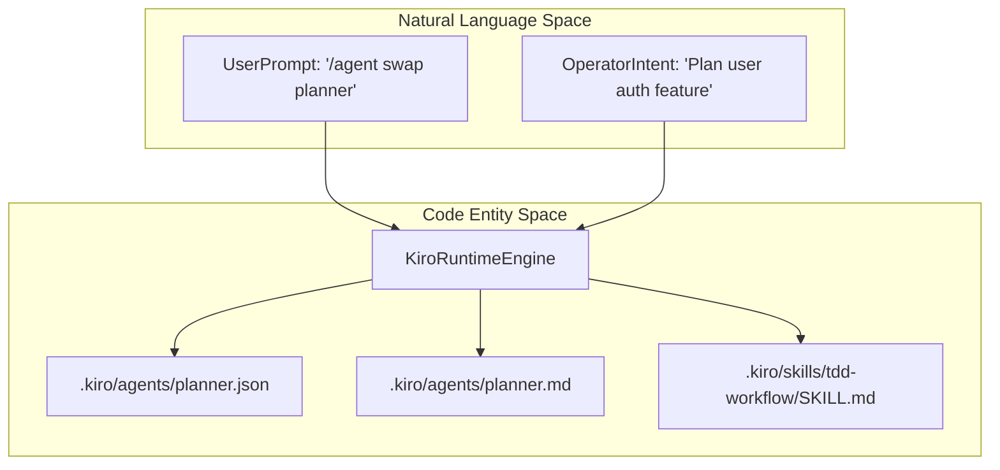
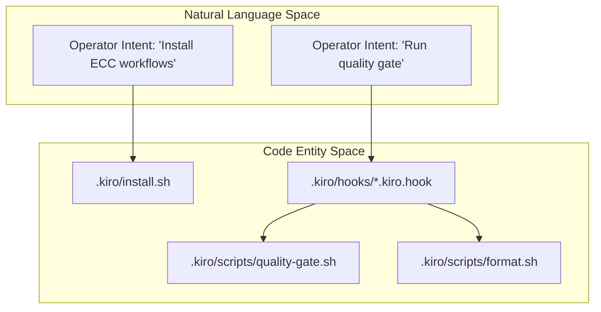

<!-- source: DeepWiki mcp.deepwiki.com · repo affaan-m/ECC · page 10.2 Kiro Integration · fetched 2026-10-30 -->

# Kiro Integration

<details>
<summary>Relevant source files</summary>

The following files were used as context for generating this wiki page:

- [.kiro/README.md](.kiro/README.md)
- [.kiro/docs/longform-guide.md](.kiro/docs/longform-guide.md)
- [.kiro/docs/security-guide.md](.kiro/docs/security-guide.md)
- [.kiro/docs/shortform-guide.md](.kiro/docs/shortform-guide.md)
- [.kiro/install.sh](.kiro/install.sh)
- [.kiro/steering/coding-style.md](.kiro/steering/coding-style.md)
- [.kiro/steering/development-workflow.md](.kiro/steering/development-workflow.md)
- [.kiro/steering/git-workflow.md](.kiro/steering/git-workflow.md)
- [.kiro/steering/lessons-learned.md](.kiro/steering/lessons-learned.md)
- [.kiro/steering/patterns.md](.kiro/steering/patterns.md)
- [.kiro/steering/performance.md](.kiro/steering/performance.md)
- [.kiro/steering/security.md](.kiro/steering/security.md)
- [.kiro/steering/testing.md](.kiro/steering/testing.md)

</details>


The Kiro integration provides a specialized adapter environment for executing Everything Claude Code (ECC) assets within the Kiro AI harness (`kiro.dev`). This integration centers around the `.kiro/` directory, which houses dual-format agent definitions (JSON and Markdown), skills, steering files, IDE hooks, shell scripts, and the `install.sh` setup utility.

Sources: `[.kiro/README.md:1-4]()`, `[.kiro/install.sh:3-5]()`

---

## 1. Directory Structure and Component Inventory

The `.kiro/` directory maps ECC's generic capabilities into Kiro-specific runtime files and structures. The inventory includes agents, skills, steering files, hooks, and operational scripts.

| Component | Count | Location | Purpose |
|---|---|---|---|
| **Agents (JSON)** | 33 | `.kiro/agents/*.json` | CLI agent metadata and tool configurations (`/agent swap`) |
| **Agents (MD)** | 33 | `.kiro/agents/*.md` | IDE system prompts and behavioral instructions |
| **Skills** | 43 | `.kiro/skills/*/SKILL.md` | On-demand workflows invocable via the `/` menu |
| **Steering Files** | 22 | `.kiro/steering/*.md` | Global LLM behavior conditioning and rules |
| **IDE Hooks** | 13 | `.kiro/hooks/*.kiro.hook` | Lifecycle event automation triggered by IDE or CLI actions |
| **Scripts** | 2 | `.kiro/scripts/*.sh` | Operational scripts for formatting and quality gates |
| **MCP Config** | 1 | `.kiro/settings/mcp.json.example` | MCP server connection templates |

Sources: `[.kiro/README.md:23-35]()`

---

## 2. Installation and Setup Mechanics (`install.sh`)

Setup for the Kiro integration is driven by `.kiro/install.sh`, a bash utility designed for non-destructive, additive-only asset deployment into target projects or global environments (`~/.kiro/`).

```bash
# Install to current project directory
./install.sh

# Install to a specific project path
./install.sh /path/to/your/project

# Install globally
./install.sh ~
```

### Installation Pipeline
1. **Target Resolution**: Evaluates arguments, resolves `~` to `$HOME`, and normalizes absolute paths (`[.kiro/install.sh:26-34]()`).
2. **Directory Initialization**: Creates required subdirectories (`agents`, `skills`, `steering`, `hooks`, `scripts`, `settings`) (`[.kiro/install.sh:44-49]()`).
3. **Additive Copy Guard**: Iterates through source assets, copying only files that do not already exist in the target directory (`if [ ! -f "$TARGET/.kiro/.../$local_name" ]`) (`[.kiro/install.sh:58-62]()`). This ensures local modifications are never overwritten.
4. **Execution Permissions**: Grants executable permissions to all shell scripts in `.kiro/scripts/` (`[.kiro/install.sh:108-108]()`).

Sources: `[.kiro/README.md:5-22]()`, `[.kiro/install.sh:1-124]`, `[.kiro/steering/lessons-learned.md:46-49]()`

---

## 3. Steering Files and Global Context

Steering files located in `.kiro/steering/` inject persistent rules, constraints, and operational patterns into Kiro sessions using YAML frontmatter with `inclusion: always` or conditional matchers.

* **`git-workflow.md`**: Enforces conventional commits (`<type>: <description>`) and PR workflows (`[.kiro/steering/git-workflow.md:1-30]()`).
* **`performance.md`**: Defines model tiering strategies (Claude Haiku 4.5 vs Sonnet 5 vs Opus 5) and context window management guidelines (`[.kiro/steering/performance.md:1-55]()`).
* **`development-workflow.md`**: Outlines the feature pipeline: Plan First (`planner`), TDD Approach (`tdd-guide`), Code Review (`code-reviewer`), and Commit (`[.kiro/steering/development-workflow.md:1-35]()`).
* **`lessons-learned.md`**: Captures project-specific patterns, Kiro hook behaviors, and architecture decisions (`[.kiro/steering/lessons-learned.md:1-85]()`).
* **`coding-style.md`**, **`security.md`**, **`testing.md`**, **`patterns.md`**: Enforce immutability, security checks, 80%+ test coverage, and design patterns (`[.kiro/steering/coding-style.md:1-55]`, `[.kiro/steering/security.md:1-36]`, `[.kiro/steering/testing.md:1-33]`, `[.kiro/steering/patterns.md:1-37]()`).

Sources: `[.kiro/steering/git-workflow.md:1-30]`, `[.kiro/steering/performance.md:1-56]`, `[.kiro/steering/development-workflow.md:1-36]`, `[.kiro/steering/lessons-learned.md:1-85]()`

---

## 4. Dual-Format Agents and Skill Resolution

### Agent Representation
Kiro supports dual-format agent packaging to serve both IDE and CLI interaction models:
* **CLI Format (`.json`)**: Accessed via `/agent swap` or `kiro-cli --agent <name>` (`[.kiro/README.md:42-45]()`).
* **IDE Format (`.md`)**: Automatically selected or explicitly invoked via `/` in Kiro chat sessions (`[.kiro/README.md:42-43]()`).

### Skill Integration
Skills reside under `.kiro/skills/*/SKILL.md` and are indexed by Kiro's runtime for on-demand invocation via the `/` menu or `#skill-name` syntax (`[.kiro/README.md:29-29]`, `[.kiro/docs/shortform-guide.md:50-54]()`).

Sources: `[.kiro/README.md:38-46]`, `[.kiro/docs/shortform-guide.md:50-54]()`

---

## 5. Bridging Natural Language Space to Code Entity Space

The following diagrams illustrate how high-level operator intents in natural language map directly to concrete code entities, files, and scripts within the Kiro integration.

### Diagram: Operator Intent to Kiro Agent and Skill Execution



Sources: `[.kiro/README.md:38-46]`, `[.kiro/docs/shortform-guide.md:21-24]()`

### Diagram: Hook Events to Installer and Script Automation



Sources: `[.kiro/install.sh:1-124]`, `[.kiro/docs/shortform-guide.md:132-142]()`

---

