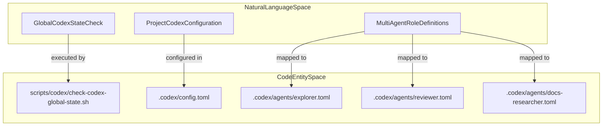
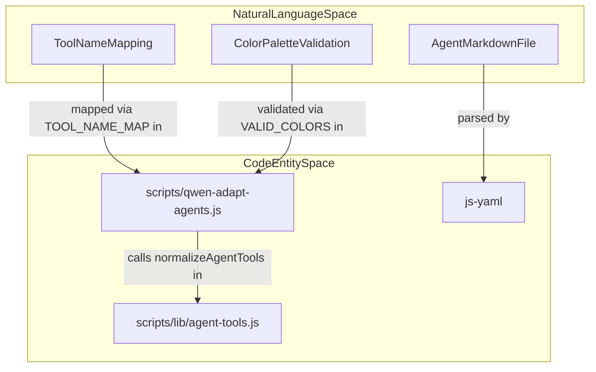

<!-- source: DeepWiki mcp.deepwiki.com · repo affaan-m/ECC · page 10.3 Cursor, Codex & Other Harnesses · fetched 2026-10-30 -->

# Cursor, Codex & Other Harnesses

Relevant source files

The following files were used as context for generating this wiki page:

- [.agents/skills/skill-host-compat/SKILL.md](.agents/skills/skill-host-compat/SKILL.md)
- [.agents/skills/skill-host-compat/agents/openai.yaml](.agents/skills/skill-host-compat/agents/openai.yaml)
- [.codex/AGENTS.md](.codex/AGENTS.md)
- [.codex/agents/docs-researcher.toml](.codex/agents/docs-researcher.toml)
- [.codex/agents/explorer.toml](.codex/agents/explorer.toml)
- [.codex/agents/reviewer.toml](.codex/agents/reviewer.toml)
- [.codex/config.toml](.codex/config.toml)
- [.codex/strict.config.toml](.codex/strict.config.toml)
- [.codex/user-config.example.toml](.codex/user-config.example.toml)
- [.codex/yolo.config.toml](.codex/yolo.config.toml)
- [.cursor/hooks.json](.cursor/hooks.json)
- [.cursor/hooks/adapter.js](.cursor/hooks/adapter.js)
- [.cursor/hooks/before-read-file.js](.cursor/hooks/before-read-file.js)
- [.cursor/hooks/before-shell-execution.js](.cursor/hooks/before-shell-execution.js)
- [.cursor/hooks/before-tab-file-read.js](.cursor/hooks/before-tab-file-read.js)
- [.cursor/hooks/session-start.js](.cursor/hooks/session-start.js)
- [.cursor/hooks/stop.js](.cursor/hooks/stop.js)
- [.qwen/QWEN.md](.qwen/QWEN.md)
- [.trae/README.md](.trae/README.md)
- [.trae/README.zh-CN.md](.trae/README.zh-CN.md)
- [.trae/install.sh](.trae/install.sh)
- [.trae/uninstall.sh](.trae/uninstall.sh)
- [docs/ANTIGRAVITY-GUIDE.md](docs/ANTIGRAVITY-GUIDE.md)
- [docs/CODEX-NAVIGATION-GUIDE.md](docs/CODEX-NAVIGATION-GUIDE.md)
- [docs/QWEN-GUIDE.md](docs/QWEN-GUIDE.md)
- [docs/releases/2.2.0/launch-runbook.md](docs/releases/2.2.0/launch-runbook.md)
- [docs/releases/2.2.0/release-notes.md](docs/releases/2.2.0/release-notes.md)
- [scripts/agent-convert.js](scripts/agent-convert.js)
- [scripts/ci/validate-skill-host-compat.js](scripts/ci/validate-skill-host-compat.js)
- [scripts/codex/check-codex-global-state.sh](scripts/codex/check-codex-global-state.sh)
- [scripts/codex/merge-codex-config.js](scripts/codex/merge-codex-config.js)
- [scripts/hooks/config-protection.js](scripts/hooks/config-protection.js)
- [scripts/hooks/post-edit-accumulator.js](scripts/hooks/post-edit-accumulator.js)
- [scripts/hooks/pre-bash-dev-server-block.js](scripts/hooks/pre-bash-dev-server-block.js)
- [scripts/hooks/session-end-marker.js](scripts/hooks/session-end-marker.js)
- [scripts/hooks/stop-format-typecheck.js](scripts/hooks/stop-format-typecheck.js)
- [scripts/lib/hook-session.js](scripts/lib/hook-session.js)
- [scripts/lib/install-targets/qwen-home.js](scripts/lib/install-targets/qwen-home.js)
- [scripts/lib/install/codex-user-config.js](scripts/lib/install/codex-user-config.js)
- [scripts/lib/nasiko-release.js](scripts/lib/nasiko-release.js)
- [scripts/lib/resolve-formatter.js](scripts/lib/resolve-formatter.js)
- [scripts/lib/shell-split.js](scripts/lib/shell-split.js)
- [scripts/nasiko.js](scripts/nasiko.js)
- [scripts/qwen-adapt-agents.js](scripts/qwen-adapt-agents.js)
- [skills/nasiko-control-plane/SKILL.md](skills/nasiko-control-plane/SKILL.md)
- [skills/nasiko-control-plane/agents/openai.yaml](skills/nasiko-control-plane/agents/openai.yaml)
- [skills/skill-host-compat/SKILL.md](skills/skill-host-compat/SKILL.md)
- [tests/ci/nasiko-control-plane.test.js](tests/ci/nasiko-control-plane.test.js)
- [tests/ci/validate-skill-host-compat.test.js](tests/ci/validate-skill-host-compat.test.js)
- [tests/codex-config.test.js](tests/codex-config.test.js)
- [tests/docs/antigravity-guide.test.js](tests/docs/antigravity-guide.test.js)
- [tests/hooks/config-protection.test.js](tests/hooks/config-protection.test.js)
- [tests/hooks/cursor-block-no-verify.test.js](tests/hooks/cursor-block-no-verify.test.js)
- [tests/hooks/cursor-hook-dispatchers.test.js](tests/hooks/cursor-hook-dispatchers.test.js)
- [tests/hooks/observer-session-lifecycle.test.js](tests/hooks/observer-session-lifecycle.test.js)
- [tests/hooks/pre-bash-dev-server-block.test.js](tests/hooks/pre-bash-dev-server-block.test.js)
- [tests/hooks/stop-format-typecheck.test.js](tests/hooks/stop-format-typecheck.test.js)
- [tests/lib/hook-session.test.js](tests/lib/hook-session.test.js)
- [tests/lib/install-codex-config-preservation.test.js](tests/lib/install-codex-config-preservation.test.js)
- [tests/lib/resolve-formatter.test.js](tests/lib/resolve-formatter.test.js)
- [tests/lib/shell-split.test.js](tests/lib/shell-split.test.js)
- [tests/pi/agent-convert.test.js](tests/pi/agent-convert.test.js)
- [tests/scripts/qwen-adapt-agents.test.js](tests/scripts/qwen-adapt-agents.test.js)

Everything Claude Code (ECC) is designed around a harness-agnostic philosophy: the same core assets (skills, rules, agents) and automation extend across multiple AI development harnesses. This page documents the technical implementation and data flow for integration layers supporting Cursor, Codex, and other harnesses like Gemini, Zed, Trae, CodeBuddy, Qwen, Kimi, and the Antigravity 2.0 native layout (`.agents/`), alongside `.pi` extensions, legacy command shims, and scaffolds.

---

## Purpose and Scope

ECC achieves multi-harness portability by adapting its canonical repository structures (`rules/`, `commands/`, `skills/`, `agents/`) into target-specific layout conventions. This page breaks down the integration architecture, sync pipelines, adaptation scripts, and global validation hooks for each supported harness.

Sources:
- [docs/ANTIGRAVITY-GUIDE.md:1-162]()
- [scripts/codex/check-codex-global-state.sh:1-213]()

---

## Codex Integration Architecture

Codex is a mature non-Claude harness in ECC, featuring a native plugin manifest (`.codex-plugin/plugin.json`), project-scoped configurations (`.codex/config.toml`), multi-agent explorer/reviewer definitions, and global state verification (`scripts/codex/check-codex-global-state.sh`) [.codex/config.toml:1-41](), [scripts/codex/check-codex-global-state.sh:1-213]().

### Global State Validation and Configuration

ECC validates global ~/.codex state using `scripts/codex/check-codex-global-state.sh`, ensuring that `config.toml`, `AGENTS.md`, required skill directories, and prompt manifests are correctly positioned [scripts/codex/check-codex-global-state.sh:1-213](). Project-level Codex configuration is managed via `.codex/config.toml`, which enables multi-agent features (`multi_agent = true`), sets agent limits (`max_threads = 6`), and registers specialized roles such as `explorer`, `reviewer`, and `docs_researcher` [.codex/config.toml:1-41]().

Title: Codex Natural Language to Code Entity Mapping

Sources:
- [.codex/config.toml:1-41]()
- [scripts/codex/check-codex-global-state.sh:1-213]()

---

## Antigravity 2.0 Integration (.agents/)

Google Antigravity 2.0 discovers workspace customizations from the project-local `.agents/` directory [docs/ANTIGRAVITY-GUIDE.md:1-5](). ECC provides native installation into `.agents/` for ECC 2.2.0 and newer, mapping core assets into structured subdirectories [docs/ANTIGRAVITY-GUIDE.md:7-10]().

### Native Install Mapping

| ECC Source Location | Antigravity Destination | Purpose |
|---|---|---|
| `rules/` | `.agents/rules/` | Workspace rules, flattened with collision-safe names [docs/ANTIGRAVITY-GUIDE.md:49-51]() |
| `commands/` | `.agents/workflows/` | User-invoked slash workflows [docs/ANTIGRAVITY-GUIDE.md:49-52]() |
| `skills/<name>/` | `.agents/skills/<name>/` | Agent Skills with a required `SKILL.md` [docs/ANTIGRAVITY-GUIDE.md:49-53]() |
| `agents/<name>.md` | `.agents/agents/<name>.md` | Custom main agents and subagents [docs/ANTIGRAVITY-GUIDE.md:49-54]() |

When installing into Antigravity, custom agent frontmatter is adapted: Claude model tiers are mapped to `flash` or `pro`, and unsupported tool identifiers are filtered out to prevent execution hangups [docs/ANTIGRAVITY-GUIDE.md:60-63]().

Sources:
- [docs/ANTIGRAVITY-GUIDE.md:1-162]()

---

## Qwen Code Agent Adaptation Layer

Qwen Code is a Gemini CLI descendant that requires tool ID remapping and frontmatter normalization [scripts/qwen-adapt-agents.js:1-35](). ECC automates this via `scripts/qwen-adapt-agents.js` and validates it with `tests/scripts/qwen-adapt-agents.test.js` [scripts/qwen-adapt-agents.js:1-189](), [tests/scripts/qwen-adapt-agents.test.js:1-212]().

### Adaptation Pipeline

The adaptation script loads agent markdown files, parses YAML frontmatter using `js-yaml`, normalizes tool definitions via `normalizeAgentTools`, maps Claude/Gemini tool names to Qwen equivalents, and remaps out-of-palette colors (e.g., `teal` to `cyan`) [scripts/qwen-adapt-agents.js:1-190]().

Title: Qwen Agent Adaptation Pipeline

Sources:
- [scripts/qwen-adapt-agents.js:1-189]()
- [tests/scripts/qwen-adapt-agents.test.js:1-212]()

---

## Cursor, Trae & Other Harnesses

### Cursor Harness
ECC installs project-specific rules into `.cursor/rules/` and configures hooks under `.cursor/hooks/` to run validation checks and gate file edits or shell executions.

### Trae Harness
Trae is integrated via managed scripts (`.trae/install.sh`, `.trae/uninstall.sh`) and localized documentation (`.trae/README.md`, `.trae/README.zh-CN.md`), deploying adapted agent and skill frameworks into the Trae environment.

### Other Harnesses & Extensions
- **Gemini, Zed, CodeBuddy, Kimi:** Integrated through capability adapters and installation scripts managed by the `ecc-install` CLI.
- **`.pi` Extensions:** Project-specific interface extensions for supported terminal harnesses.
- **Legacy Command Shims & Scaffolds:** Maintained under `legacy-command-shims/` and `scaffolds/` to ensure backward compatibility during workspace upgrades.

Sources:
- [docs/ANTIGRAVITY-GUIDE.md:1-162]()
- [scripts/codex/check-codex-global-state.sh:1-213]()

---

