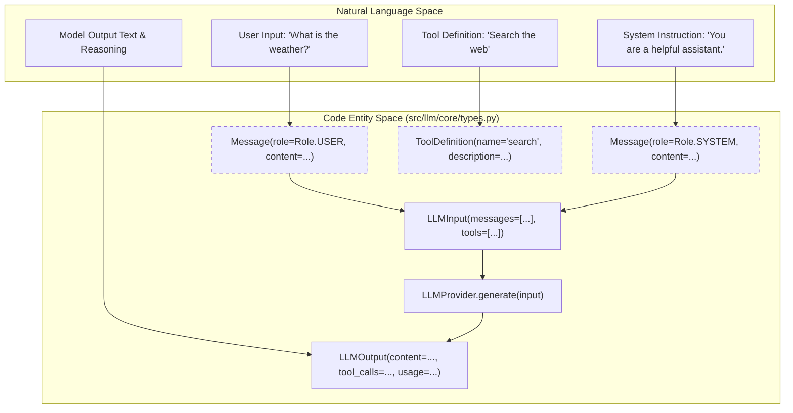
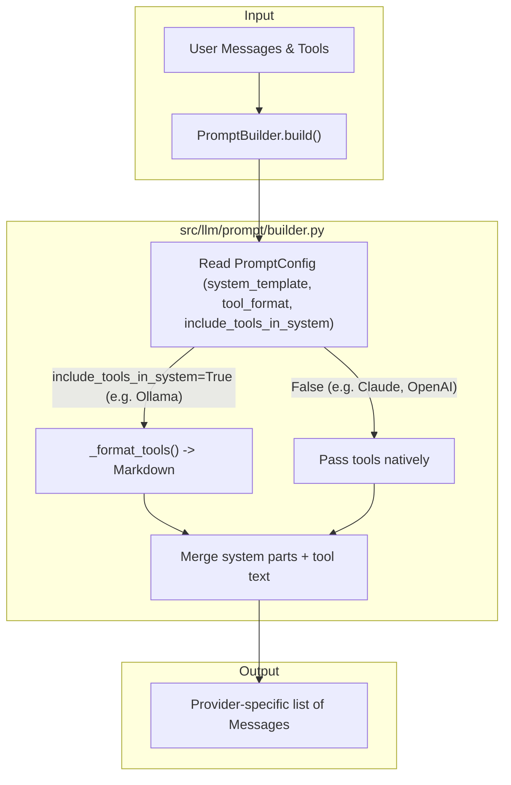
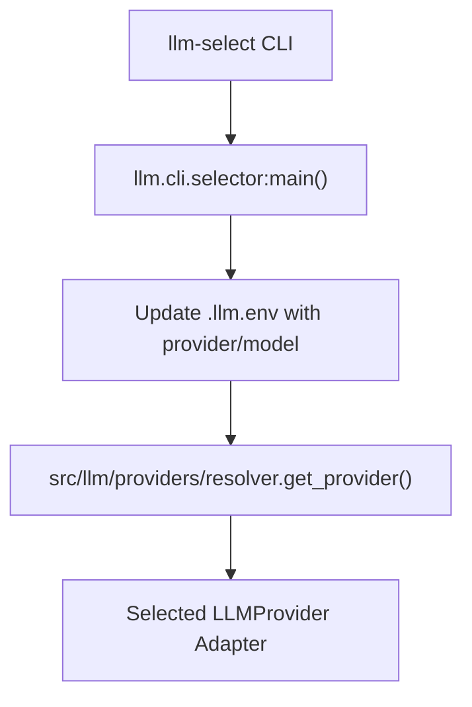

<!-- source: DeepWiki mcp.deepwiki.com · repo affaan-m/ECC · page 10.4 Python LLM Abstraction Layer (src/llm) · fetched 2026-10-30 -->

# Python LLM Abstraction Layer (src/llm)

<details>
<summary>Relevant source files</summary>

The following files were used as context for generating this wiki page:

- [pyproject.toml](pyproject.toml)
- [src/llm/__init__.py](src/llm/__init__.py)
- [src/llm/core/types.py](src/llm/core/types.py)
- [src/llm/prompt/__init__.py](src/llm/prompt/__init__.py)
- [src/llm/prompt/builder.py](src/llm/prompt/builder.py)
- [src/llm/providers/__init__.py](src/llm/providers/__init__.py)
- [src/llm/providers/astraflow.py](src/llm/providers/astraflow.py)
- [src/llm/providers/atlas.py](src/llm/providers/atlas.py)
- [src/llm/providers/claude.py](src/llm/providers/claude.py)
- [src/llm/providers/constants.py](src/llm/providers/constants.py)
- [src/llm/providers/model_config.py](src/llm/providers/model_config.py)
- [src/llm/providers/ollama.py](src/llm/providers/ollama.py)
- [src/llm/providers/openai.py](src/llm/providers/openai.py)
- [src/llm/providers/openai_compat.py](src/llm/providers/openai_compat.py)
- [src/llm/providers/reasoning.py](src/llm/providers/reasoning.py)
- [src/llm/providers/resolver.py](src/llm/providers/resolver.py)
- [src/llm/tools/executor.py](src/llm/tools/executor.py)
- [tests/test_astraflow_provider.py](tests/test_astraflow_provider.py)
- [tests/test_atlas_provider.py](tests/test_atlas_provider.py)
- [tests/test_builder.py](tests/test_builder.py)
- [tests/test_claude_provider.py](tests/test_claude_provider.py)
- [tests/test_executor.py](tests/test_executor.py)
- [tests/test_provider_tools.py](tests/test_provider_tools.py)
- [tests/test_reasoning.py](tests/test_reasoning.py)
- [tests/test_resolver.py](tests/test_resolver.py)
- [tests/test_types.py](tests/test_types.py)

</details>


The `src/llm` package implements a provider-agnostic Large Language Model (LLM) abstraction layer in Python. It abstracts away differences between multiple backend LLM providers—such as OpenAI, Anthropic Claude, Ollama, AstraFlow (global and CN regions), and Atlas Cloud—by normalizing inputs, outputs, tool integrations, reasoning blocks, and error handling. This abstraction empowers the Everything Claude Code (ECC) system and other components to seamlessly switch or support multiple LLM providers with consistent interfaces and tooling.

---

## Overview and Purpose

The main goals of the `src/llm` package include:

- Defining a unified **`LLMProvider` interface** that standardizes interaction with any backend LLM provider [src/llm/core/interface.py:8-16]().
- Providing robust **adapters** for each supported LLM backend (`OpenAIProvider`, `ClaudeProvider`, `AstraflowProvider`, `AstraflowCNProvider`, `AtlasProvider`, `OllamaProvider`) [pyproject.toml:1-49](), [src/llm/providers/resolver.py:17-24]().
- Enabling **prompt building and normalization** via `PromptBuilder` and provider-specific templates [src/llm/prompt/builder.py:1-132]().
- Managing **tools** that LLMs can invoke via a centralized **tool registry and executor** system [src/llm/tools/executor.py:1-181]().
- Handling **model reasoning text** via dedicated strip and prefill heuristics for self-hosted and reasoning-heavy models [src/llm/providers/reasoning.py:1-73]().
- Offering an **interactive CLI selector** (`llm-select`) for choosing the active LLM provider and model, configured via `.llm.env` or environment variables [pyproject.toml:41-43](), [src/llm/providers/resolver.py:36-92]().

**Sources:** [pyproject.toml:1-49](), [src/llm/core/interface.py:8-16](), [src/llm/providers/resolver.py:17-92](), [src/llm/providers/reasoning.py:1-73]()

---

## Architecture Overview

At the core of this package lies the `LLMProvider` interface (an abstract base class). Each provider adapter implements the core contract methods:

- `generate(input: LLMInput) -> LLMOutput` to send a prompt and receive a normalized response.
- `list_models() -> list[ModelInfo]` to list supported models and capabilities.
- `validate_config() -> bool` to check if credentials or configurations are valid.
- `get_default_model() -> str` to obtain the default model name.

Providers internally translate generic `LLMInput` messages and tool definitions to provider-specific request formats, and map provider responses back to the common `LLMOutput` type. Provider selection is handled by a resolver that inspects environment variables (`LLM_PROVIDER`, `LLM_MODEL`) or configuration files (`.llm.env`), defaulting to Claude if unspecified.

### Natural Language to Code Entity Mapping: Core Types



This mapping shows the flow from natural language prompts and available tools into the typed `LLMInput` sent to the provider, and the provider's structured `LLMOutput` response.

**Sources:** [src/llm/core/types.py:1-167](), [src/llm/core/interface.py:1-20]()

---

## Core Components

### 1. Provider Interface & Resolver

- **`LLMProvider`** is the abstract base interface that all adapter implementations extend [src/llm/core/interface.py:8-16]().
- The **resolver function** (`get_provider`) dynamically instantiates the correct backend adapter by:
  - Inspecting explicit function keyword arguments.
  - Checking the `LLM_PROVIDER` and provider-specific model environment variables (e.g., `OLLAMA_MODEL`, `ASTRAFLOW_MODEL`, `ATLAS_MODEL`) [src/llm/providers/resolver.py:61-92]().
  - Falling back to a saved `.llm.env` configuration file in the working directory [src/llm/providers/resolver.py:46-58]().
  - Defaulting to Claude (`claude`) if no provider configuration is discovered [src/llm/providers/resolver.py:61-75]().

**Sources:** [src/llm/core/interface.py:8-16](), [src/llm/providers/resolver.py:1-123]()

---

### 2. Supported Providers and Adapters

| Provider     | Adapter Class        | Features & Details                                                                                            |
|--------------|---------------------|--------------------------------------------------------------------------------------------------------------|
| **Claude**   | `ClaudeProvider`     | Anthropic API client integration; adaptive thinking support on `claude-opus-4-7`/`4-8` models; ephemeral prompt caching control; native tool definitions; context windows up to 1M tokens. [src/llm/providers/claude.py:26-148]() |
| **OpenAI**   | `OpenAIProvider`     | OpenAI SDK integration; GPT-4o, GPT-4o-mini, GPT-3.5-turbo support; native tool calls; vision capabilities; exception translation. [src/llm/providers/openai.py:29-159]()          |
| **AstraFlow**| `AstraflowProvider` & `AstraflowCNProvider` | OpenAI-compatible endpoints for UModelVerse global (`api.umodelverse.ai`) and China (`api.modelverse.cn`) regions; supports native tool calls and argument parsing. [src/llm/providers/astraflow.py:41-153]() |
| **Atlas Cloud** | `AtlasProvider`    | OpenAI-compatible adapter for Atlas Cloud (`api.atlascloud.ai`) exposing 300+ hosted models; includes automatic `max_tokens` flooring (`DEFAULT_ATLAS_MAX_TOKENS = 512`) for reasoning models. [src/llm/providers/atlas.py:42-149]() |
| **Ollama**   | `OllamaProvider`    | Local LLM REST API client (`/api/chat`, `/api/show`); dynamic capability checking (`model_supports_tools`); text-based or native tool handling; configurable leading and prefilled reasoning stripping. [src/llm/providers/ollama.py:55-232]()     |

**Sources:** [src/llm/providers/claude.py:26-148](), [src/llm/providers/openai.py:29-159](), [src/llm/providers/astraflow.py:41-153](), [src/llm/providers/atlas.py:42-149](), [src/llm/providers/ollama.py:55-232]()

---

## Reasoning Support Subsystem

Many self-hosted or reasoning-optimized models (such as DeepSeek or local reasoning models via Ollama/OpenAI-compatible endpoints) emit chain-of-thought tokens inside the message `content` enclosed in `` tags. The `src/llm/providers/reasoning.py` module provides robust utilities to strip or preserve reasoning text cleanly [src/llm/providers/reasoning.py:1-73]().

- **`strip_reasoning()`**: Inspects model output text and strips leading or prefilled thinking blocks based on configuration flags (`leading=True` or `prefilled=True`) [src/llm/providers/reasoning.py:19-53]().
- **JSON & Literal Guard**: Preserves literal XML/JSON documents and prevents stripping when strings contain complete JSON objects or arrays via `_is_json_document()` [src/llm/providers/reasoning.py:55-73]().
- **Environment Flags**: Controlled via environment variables such as `OPENAI_PREFILLED_REASONING`, `OLLAMA_PREFILLED_REASONING`, `OPENAI_LEADING_REASONING`, and `OLLAMA_LEADING_REASONING` [src/llm/providers/ollama.py:62-78](), [src/llm/providers/openai.py:37-53](), [src/llm/providers/reasoning.py:14-16]().

**Sources:** [src/llm/providers/reasoning.py:1-73](), [src/llm/providers/openai.py:37-53](), [src/llm/providers/ollama.py:62-78]()

---

## Prompt Building & Normalization

The `PromptBuilder` class in `src/llm/prompt/builder.py` manages prompt construction and message adaptation across providers:

- Combines system prompt components and injects tool descriptions in text format when required by the target provider [tests/test_builder.py:58-69]().
- `adapt_messages_for_provider()` normalizes message structures for specific backends [tests/test_builder.py:71-96]().



**Sources:** [src/llm/prompt/builder.py:1-132](), [tests/test_builder.py:1-96]()

---

## Tool Registry and Execution Framework

The abstraction layer supports advanced tooling integration:

- **`ToolDefinition`**: Describes a callable tool with a name, description, and JSON schema parameters, offering serialization helpers (`to_openai_tool()`, `to_anthropic_tool()`) [tests/test_provider_tools.py:22-27]().
- **`ToolRegistry`**: Allows registration and lookup of Python callables bound to tool descriptors [tests/test_provider_tools.py:19]().
- **`ToolExecutor`**: Safely executes tool functions given tool calls produced by the LLM, handling errors gracefully and logging failures [tests/test_provider_tools.py:19]().
- **`ReActAgent`**: Implements an iterative agent loop that invokes the LLM, executes returned tool calls, augments context messages with tool outputs, and loops until completion or iteration limits [tests/test_provider_tools.py:19]().

```mermaid
graph LR
    TC[ToolCall from LLMOutput] -->|execute(tool_name, args)| TE[ToolExecutor]
    TE -->|result| TR[ToolResult]
    LLM[LLMProvider.generate()] -->|LLMOutput with ToolCalls| TC
    ReActAgent --> LLM
    ReActAgent --> TE
```

**Sources:** [pyproject.toml:41-43](), [tests/test_provider_tools.py:1-205]()

---

## CLI Selector (`llm-select`)

The package bundles a command-line interface tool configured in `pyproject.toml` [pyproject.toml:41-43]():

- **Command Name:** `llm-select`
- **Entrypoint:** `llm.cli.selector:main`
- **Functionality:** Allows interactive selection of the active LLM provider and model, persisting choices in `.llm.env` or environment variables for seamless switching across tools [tests/test_resolver.py:128-143]().



**Sources:** [pyproject.toml:41-43](), [src/llm/providers/resolver.py:36-120](), [tests/test_resolver.py:128-143]()

---

## Summary

The `src/llm` package delivers a comprehensive Python abstraction layer for interacting with multiple LLM backends consistently. It incorporates robust adapters for Claude, OpenAI, AstraFlow (Global/CN), Atlas Cloud, and Ollama, integrated reasoning-stripping heuristics, universal prompt building, a tool execution framework, and the interactive `llm-select` utility. This layer underpins ECC’s cross-provider flexibility while maintaining uniform developer APIs.

---

## References and Sources

- [pyproject.toml:1-49]()
- [src/llm/core/interface.py:1-20]()
- [src/llm/core/types.py:1-167]()
- [src/llm/providers/openai.py:29-159]()
- [src/llm/providers/claude.py:26-148]()
- [src/llm/providers/ollama.py:55-232]()
- [src/llm/providers/astraflow.py:41-153]()
- [src/llm/providers/atlas.py:42-149]()
- [src/llm/providers/reasoning.py:1-73]()
- [src/llm/providers/resolver.py:1-123]()
- [src/llm/prompt/builder.py:1-132]()
- [tests/test_provider_tools.py:1-205]()
- [tests/test_reasoning.py:1-192]()
- [tests/test_resolver.py:1-177]()
- [tests/test_builder.py:1-96]()

---

