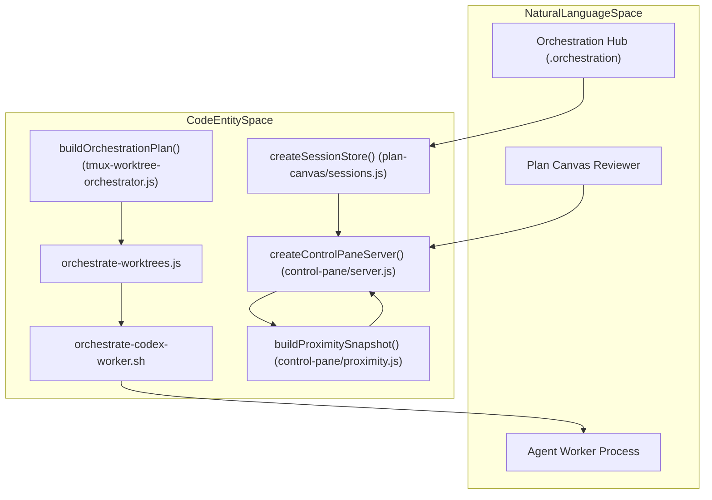
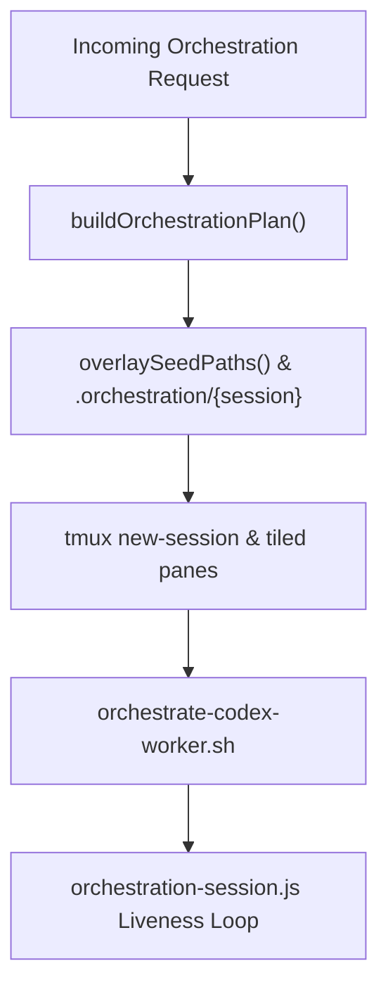
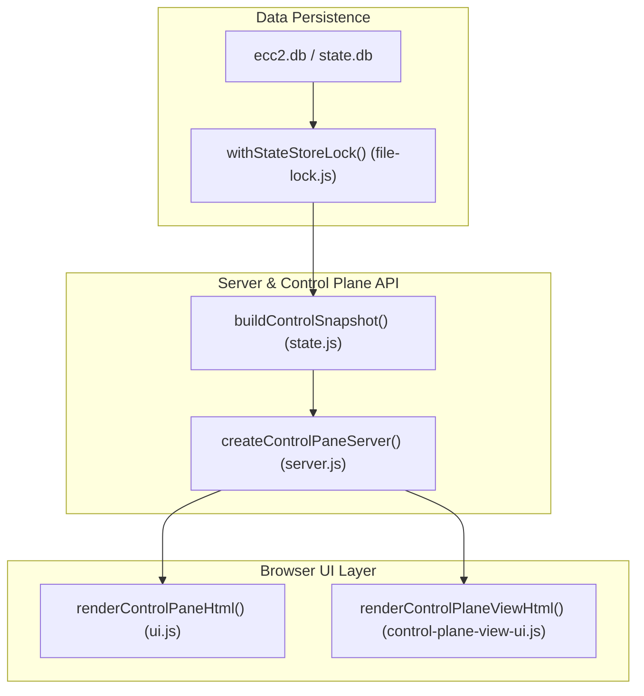

<!-- source: DeepWiki mcp.deepwiki.com · repo affaan-m/ECC · page 11.1 Tmux & Worktree Orchestration · fetched 2026-10-30 -->

# Tmux & Worktree Orchestration

Relevant source files

The following files were used as context for generating this wiki page:

- [.agents/skills/crosspost/SKILL.md](.agents/skills/crosspost/SKILL.md)
- [.agents/skills/exa-search/SKILL.md](.agents/skills/exa-search/SKILL.md)
- [.agents/skills/plan-canvas/SKILL.md](.agents/skills/plan-canvas/SKILL.md)
- [.agents/skills/x-api/SKILL.md](.agents/skills/x-api/SKILL.md)
- [docs/architecture/hud-status-session-control.md](docs/architecture/hud-status-session-control.md)
- [docs/control-plane/TCAS-HOOK.md](docs/control-plane/TCAS-HOOK.md)
- [docs/control-plane/VIEW-CONTRACT.md](docs/control-plane/VIEW-CONTRACT.md)
- [docs/design/agent-proximity.md](docs/design/agent-proximity.md)
- [scripts/control-pane.js](scripts/control-pane.js)
- [scripts/lib/agent-proximity/distance.js](scripts/lib/agent-proximity/distance.js)
- [scripts/lib/agent-proximity/index.js](scripts/lib/agent-proximity/index.js)
- [scripts/lib/agent-proximity/projection.js](scripts/lib/agent-proximity/projection.js)
- [scripts/lib/agent-proximity/shadow-trail.js](scripts/lib/agent-proximity/shadow-trail.js)
- [scripts/lib/control-pane/control-plane-view-ui.js](scripts/lib/control-pane/control-plane-view-ui.js)
- [scripts/lib/control-pane/control-plane-view.js](scripts/lib/control-pane/control-plane-view.js)
- [scripts/lib/control-pane/proximity-viz.js](scripts/lib/control-pane/proximity-viz.js)
- [scripts/lib/control-pane/proximity.js](scripts/lib/control-pane/proximity.js)
- [scripts/lib/control-pane/server.js](scripts/lib/control-pane/server.js)
- [scripts/lib/control-pane/state.js](scripts/lib/control-pane/state.js)
- [scripts/lib/control-pane/ui.js](scripts/lib/control-pane/ui.js)
- [scripts/lib/control-pane/work-item-mutations.js](scripts/lib/control-pane/work-item-mutations.js)
- [scripts/lib/control-pane/work-item-runner.js](scripts/lib/control-pane/work-item-runner.js)
- [scripts/lib/control-pane/work-item-worker.js](scripts/lib/control-pane/work-item-worker.js)
- [scripts/lib/orchestration-session.js](scripts/lib/orchestration-session.js)
- [scripts/lib/plan-canvas/server.js](scripts/lib/plan-canvas/server.js)
- [scripts/lib/plan-canvas/ui.js](scripts/lib/plan-canvas/ui.js)
- [scripts/lib/platform-launch.js](scripts/lib/platform-launch.js)
- [scripts/lib/state-store/file-lock.js](scripts/lib/state-store/file-lock.js)
- [scripts/lib/state-store/index.js](scripts/lib/state-store/index.js)
- [scripts/lib/tmux-worktree-orchestrator.js](scripts/lib/tmux-worktree-orchestrator.js)
- [scripts/orchestrate-worktrees.js](scripts/orchestrate-worktrees.js)
- [scripts/orchestration-status.js](scripts/orchestration-status.js)
- [scripts/plan-canvas.js](scripts/plan-canvas.js)
- [scripts/work-items.js](scripts/work-items.js)
- [skills/crosspost/SKILL.md](skills/crosspost/SKILL.md)
- [skills/dmux-workflows/SKILL.md](skills/dmux-workflows/SKILL.md)
- [skills/exa-search/SKILL.md](skills/exa-search/SKILL.md)
- [skills/fal-ai-media/SKILL.md](skills/fal-ai-media/SKILL.md)
- [skills/plan-canvas/SKILL.md](skills/plan-canvas/SKILL.md)
- [skills/x-api/SKILL.md](skills/x-api/SKILL.md)
- [tests/lib/agent-proximity-projection.test.js](tests/lib/agent-proximity-projection.test.js)
- [tests/lib/agent-proximity-shadow-trail.test.js](tests/lib/agent-proximity-shadow-trail.test.js)
- [tests/lib/agent-proximity.test.js](tests/lib/agent-proximity.test.js)
- [tests/lib/control-pane-contention.test.js](tests/lib/control-pane-contention.test.js)
- [tests/lib/control-pane-proximity.test.js](tests/lib/control-pane-proximity.test.js)
- [tests/lib/control-pane-state.test.js](tests/lib/control-pane-state.test.js)
- [tests/lib/control-pane-ui.test.js](tests/lib/control-pane-ui.test.js)
- [tests/lib/control-plane-view-ui-a11y.test.js](tests/lib/control-plane-view-ui-a11y.test.js)
- [tests/lib/control-plane-view-ui.test.js](tests/lib/control-plane-view-ui.test.js)
- [tests/lib/helpers/control-pane-contention-server.js](tests/lib/helpers/control-pane-contention-server.js)
- [tests/lib/helpers/state-store-worker.js](tests/lib/helpers/state-store-worker.js)
- [tests/lib/orchestration-session.test.js](tests/lib/orchestration-session.test.js)
- [tests/lib/platform-launch.test.js](tests/lib/platform-launch.test.js)
- [tests/lib/proximity-viz-a11y.test.js](tests/lib/proximity-viz-a11y.test.js)
- [tests/lib/state-store-concurrency.test.js](tests/lib/state-store-concurrency.test.js)
- [tests/lib/state-store-persistence.test.js](tests/lib/state-store-persistence.test.js)
- [tests/lib/state-store-read-cache.test.js](tests/lib/state-store-read-cache.test.js)
- [tests/lib/tmux-worktree-orchestrator.test.js](tests/lib/tmux-worktree-orchestrator.test.js)
- [tests/lib/work-item-runner.test.js](tests/lib/work-item-runner.test.js)
- [tests/scripts/control-pane.test.js](tests/scripts/control-pane.test.js)
- [tests/scripts/plan-canvas.test.js](tests/scripts/plan-canvas.test.js)
- [tests/scripts/work-items.test.js](tests/scripts/work-items.test.js)

## Purpose and Scope

Everything Claude Code (ECC) employs a robust orchestration layer designed to coordinate multiple agent workflows operating concurrently within a single code repository. This leaf page details the implementation, data flow, key functions, and classes governing tmux multiplexing, Git worktree isolation, the Plan Canvas review server, agent-proximity collision avoidance, and the ECC2 control pane server and live user interfaces.

The primary modules and scripts covered include:
- `scripts/lib/tmux-worktree-orchestrator.js`
- `scripts/lib/orchestration-session.js`
- `scripts/orchestrate-worktrees.js`
- `scripts/plan-canvas.js`
- `scripts/lib/plan-canvas/server.js`
- `scripts/control-pane.js`
- `scripts/lib/control-pane/server.js`
- `scripts/lib/control-pane/ui.js`
- `scripts/lib/control-pane/control-plane-view-ui.js`
- `scripts/lib/control-pane/proximity.js`

Sources: `scripts/lib/tmux-worktree-orchestrator.js` [1-50](), `scripts/plan-canvas.js` [1-50](), `scripts/lib/control-pane/server.js` [1-50]()

---

## 1. Orchestration Architecture & Natural-Language Mapping

The orchestration subsystem uses a hub-and-spoke model. A coordination hub directory located at `.orchestration/{session-name}` acts as the communication and state persistence area, while agent workers operate inside uniquely branched Git worktrees. Tmux sessions and panes visualize and control multiple agents simultaneously.

The following diagram bridges conceptual orchestration elements with their corresponding code modules, illustrating the pipeline from plan generation to worker execution and dashboard monitoring.

Sources: `scripts/lib/tmux-worktree-orchestrator.js` [1-250](), `scripts/orchestrate-worktrees.js` [1-100](), `scripts/lib/control-pane/server.js` [1-200](), `scripts/lib/control-pane/proximity.js` [1-180]()

---

## 2. Worktree Lifecycle & Plan Materialization

ECC ensures that each agent's workspace is an isolated environment using Git worktrees branched off a common base commit.

### Lifecycle Implementation

- **Plan Composition**: `buildOrchestrationPlan()` composes an orchestration plan containing worker identifiers, Git branches, worktree directories, tmux pane layouts, and seed overlays [scripts/lib/tmux-worktree-orchestrator.js:175-250]().
- **File Materialization**: Task specifications (`task.md`), handoff logs (`handoff.md`), and status indicators (`status.md`) are written into `.orchestration/{session}` [scripts/lib/tmux-worktree-orchestrator.js:86-106]().
- **Workspace Sanitization**: Slugification helpers ensure that session and worker names translate safely into branch names and directory tokens without shell injection risks.

Sources: `scripts/lib/tmux-worktree-orchestrator.js` [7-106, 175-250](), `scripts/lib/orchestration-session.js` [131-216]()

---

## 3. Plan Canvas Subsystem

The **Plan Canvas** (`scripts/plan-canvas.js`) opens plan artifacts in a browser-based review canvas, blocking agent execution until human feedback or a verdict is returned [scripts/plan-canvas.js:1-18]().

### Server & Long-Poll API

- **Detached Server Management**: `ensureServer()` checks health endpoints, verifying version parity before launching a background HTTP listener [scripts/plan-canvas.js:174-195]().
- **Safe Request Routing**: Endpoints are strictly validated against root-relative paths such as `/`, `/health`, `/shutdown`, `/api/await`, `/api/sessions`, and `/api/end`, alongside parameterized session reply paths [scripts/plan-canvas.js:40-48]().
- **Agent Blocking (`await`)**: Agents invoke `await` to long-poll the local loopback server until feedback or replies are committed by the operator via the browser UI.

Sources: `scripts/plan-canvas.js` [1-199](), `scripts/lib/plan-canvas/server.js` (implied)

---

## 4. Control Pane Server, View, & UI

The control pane architecture (`scripts/control-pane.js`) serves local web dashboards and API snapshots derived from SQLite persistence stores (`ecc2.db` and `state.db`) [tests/scripts/control-pane.test.js:131-160]().

### Pipeline Bridge: State Storage to Live UI

- **File Locking Mechanics**: `withStateStoreLock()` in `scripts/lib/state-store/file-lock.js` handles exclusive access using platform-specific locking (`wx` flags, `Atomics.wait`, and Windows pending-delete EPERM retry handling) [scripts/lib/state-store/file-lock.js:43-120]().
- **UI Renderers**: `renderControlPaneHtml()` (`scripts/lib/control-pane/ui.js`) and `renderControlPlaneViewHtml()` (`scripts/lib/control-pane/control-plane-view-ui.js`) provide self-contained, offline-capable dark mode dashboards with responsive canvas projections and aria-live announcements [scripts/lib/control-pane/ui.js:1-30](), [scripts/lib/control-pane/control-plane-view-ui.js:1-75]().

Sources: `scripts/lib/state-store/file-lock.js` [1-148](), `scripts/lib/control-pane/ui.js` [1-100](), `scripts/lib/control-pane/control-plane-view-ui.js` [1-75]()

---

## 5. Agent-Proximity Collision Avoidance

To prevent concurrent agents from corrupting overlapping code regions, ECC integrates an airspace scan (`scripts/lib/control-pane/proximity.js` and `scripts/lib/agent-proximity/index.js`) [scripts/lib/control-pane/proximity.js:1-16]().

### Diff Parsing & Proximity Scoring

- **`parseDiffRanges()`**: Decodes git diff outputs (`--unified=0`), extracting changed line ranges on the new side (`+c,d`) so that edits to the same file in different functions do not trigger false positive collisions [scripts/lib/control-pane/proximity.js:55-77]().
- **Working Set Mapping**: `sessionsToAgents()` maps active session worktrees into agent objects with tracked, staged, unstaged, and untracked files [scripts/lib/control-pane/proximity.js:148-162]().
- **Advisory Thresholds**: The proximity engine computes risk levels categorized as `clear`, `traffic` (transmit advisory), or `resolution` (steer/collision advisory) [scripts/lib/control-pane/control-plane-view-ui.js:103-107]().

Sources: `scripts/lib/control-pane/proximity.js` [1-180](), `scripts/lib/control-pane/control-plane-view-ui.js` [100-115]()

---

