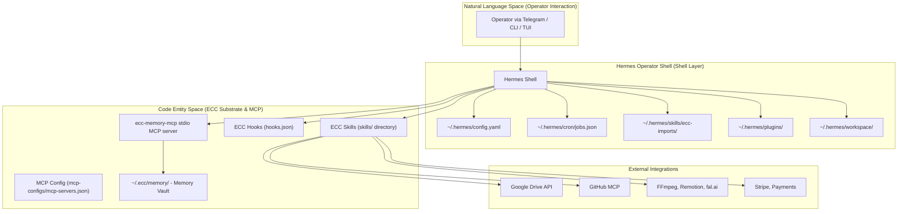
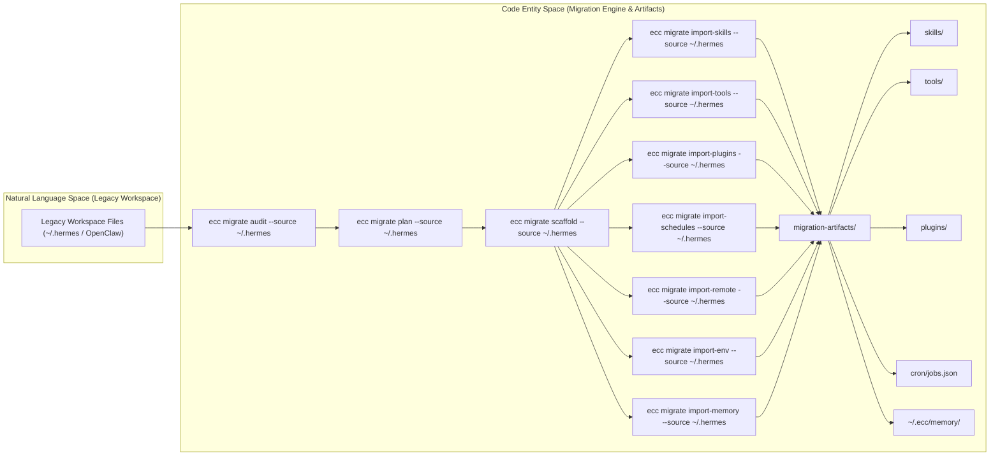

<!-- source: DeepWiki mcp.deepwiki.com · repo affaan-m/ECC · page 11.2 Hermes Operator Shell · fetched 2026-10-30 -->

# Hermes Operator Shell

<details>
<summary>Relevant source files</summary>

The following files were used as context for generating this wiki page:

- [docs/HERMES-HOOKS.md](docs/HERMES-HOOKS.md)
- [docs/HERMES-OPENCLAW-MIGRATION.md](docs/HERMES-OPENCLAW-MIGRATION.md)
- [docs/HERMES-SETUP.md](docs/HERMES-SETUP.md)
- [docs/tr/CHANGELOG.md](docs/tr/CHANGELOG.md)
- [docs/zh-CN/CHANGELOG.md](docs/zh-CN/CHANGELOG.md)
- [docs/zh-CN/commands/harness-audit.md](docs/zh-CN/commands/harness-audit.md)
- [ecc2/Cargo.lock](ecc2/Cargo.lock)
- [ecc2/Cargo.toml](ecc2/Cargo.toml)
- [ecc2/src/comms/mod.rs](ecc2/src/comms/mod.rs)
- [ecc2/src/config/mod.rs](ecc2/src/config/mod.rs)
- [ecc2/src/main.rs](ecc2/src/main.rs)
- [ecc2/src/notifications.rs](ecc2/src/notifications.rs)
- [ecc2/src/observability/mod.rs](ecc2/src/observability/mod.rs)
- [ecc2/src/session/daemon.rs](ecc2/src/session/daemon.rs)
- [ecc2/src/session/manager.rs](ecc2/src/session/manager.rs)
- [ecc2/src/session/mod.rs](ecc2/src/session/mod.rs)
- [ecc2/src/session/output.rs](ecc2/src/session/output.rs)
- [ecc2/src/session/runtime.rs](ecc2/src/session/runtime.rs)
- [ecc2/src/session/store.rs](ecc2/src/session/store.rs)
- [ecc2/src/tui/app.rs](ecc2/src/tui/app.rs)
- [ecc2/src/tui/dashboard.rs](ecc2/src/tui/dashboard.rs)
- [ecc2/src/tui/widgets.rs](ecc2/src/tui/widgets.rs)
- [ecc2/src/worktree/mod.rs](ecc2/src/worktree/mod.rs)
- [hooks/hermes/check-console-log.py](hooks/hermes/check-console-log.py)
- [hooks/hermes/config-protection.py](hooks/hermes/config-protection.py)
- [scripts/hooks/session-activity-tracker.js](scripts/hooks/session-activity-tracker.js)
- [scripts/lib/claude-plugin-setup.js](scripts/lib/claude-plugin-setup.js)
- [scripts/lib/claude-scope-migration.js](scripts/lib/claude-scope-migration.js)
- [tests/hermes-hooks.test.js](tests/hermes-hooks.test.js)
- [tests/hooks/session-activity-tracker.test.js](tests/hooks/session-activity-tracker.test.js)
- [tests/lib/claude-plugin-setup.test.js](tests/lib/claude-plugin-setup.test.js)
- [tests/lib/claude-scope-migration.test.js](tests/lib/claude-scope-migration.test.js)
- [tests/lib/helpers/windows-test-env.js](tests/lib/helpers/windows-test-env.js)
- [tests/lib/npm-pack-output.js](tests/lib/npm-pack-output.js)
- [tests/lib/npm-pack-output.test.js](tests/lib/npm-pack-output.test.js)
- [tests/lib/windows-test-env.test.js](tests/lib/windows-test-env.test.js)
- [tests/scripts/ecc-universal-bin.test.js](tests/scripts/ecc-universal-bin.test.js)
- [tests/scripts/eval-harness-package.test.js](tests/scripts/eval-harness-package.test.js)
- [tests/scripts/setup.test.js](tests/scripts/setup.test.js)

</details>


The **Hermes Operator Shell** acts as the unified operational layer and front door above the Everything Claude Code (ECC) reusable engineering substrate. Hermes provides a terminal-native surface for running chat interactions, cron automations, workspace memory management, and orchestrating multi-agent workflows. It embraces the Hermes boundary sanitization standard to maintain operator privacy while building on reusable ECC skills, hooks, MCP connectors, and memory vaults [docs/HERMES-SETUP.md:1-6]().

---

## Role and Architecture

Hermes is designed as an operator shell that consolidates multiple interaction modalities (Telegram, CLI, TUI) into one surface, sitting atop ECC skills, hooks, MCP servers, and shared memory components. ECC supplies reusable skills, agents, commands, and hooks implementing domain logic, while Hermes coordinates these components into executable operator workflows [docs/HERMES-SETUP.md:3-6]().

### Detailed Architecture and Data Flow



This architecture highlights that:
- **Hermes shell** manages operator input/output, configuration, scheduling, skill invocation, and plugin extensions.
- **ECC** provides stable skill implementations, MCP communication patterns, rule enforcement via hooks, and shared memory.
- **Memory Vault** serves as the common file-first, cross-harness memory handoff layer.
- External APIs (Google Drive, GitHub, media and finance tools) are integrated via ECC skills.

Sources: [docs/HERMES-SETUP.md:16-28](), [docs/HERMES-SETUP.md:34-52]()

---

## Hermes Boundary Sanitization Standard

The **Hermes Boundary** is a critical architectural concept: it enforces strict sanitization standards that ensure no sensitive, operator-private information (tokens, secrets, personal data) leaks into the public ECC repository or shared artifacts [docs/HERMES-SETUP.md:14-15]().

- The boundary is enforced by policy and automated checks during workspace export and public skill releases.
- `scripts/preview-pack-smoke.js` runs verification pipelines confirming:
  - Only sanitized release candidate surfaces ship publicly.
  - Private tokens and secrets are scrubbed.
  - Workspace exports do not include raw `~/.hermes` directories containing private operator state.

Sources: [docs/HERMES-SETUP.md:14-15](), [docs/HERMES-OPENCLAW-MIGRATION.md:130-145]()

---

## Shared Memory Vault Integration

Hermes uses ECC's **Memory Vault** as its cross-harness durable memory layer, replacing separate inbox/transcript stores with a unified file-first context [docs/HERMES-SETUP.md:53-56]().

### Memory Vault Setup and Usage

1. Install the ECC memory tool globally:
   ```bash
   npm install -g ecc-universal
   ```
2. Initialize vault scopes:
   ```bash
   ecc memory init --scope project --scope team
   ```
3. Memory scopes:
   - `project`: repository-local shared context
   - `team`: shared context for human-inspected, committed knowledge
   - `user`: private operator context following the user across repos (requires explicit opt-in) [docs/HERMES-SETUP.md:72-76]()

4. Hermes accesses the memory vault via the `ecc-memory-mcp` stdio server, launched with a unique lowercase harness identity `ECC_MEMORY_HARNESS=hermes` to avoid impersonation. Each harness (Hermes, Codex, Claude) runs its own instance [docs/HERMES-SETUP.md:79-85]().

### Memory Handoff Example

Hermes can hand off knowledge to Codex with:

```bash
printf '%s\n' 'Research is complete. Verify the cited sources and implement the parser.' |
  ecc memory handoff \
    --from hermes \
    --target codex \
    --title "Implement the research parser" \
    --tag research \
    --stdin
```

Codex then retrieves it via:

```bash
ecc memory search "research parser" --target-harness codex
ecc memory read <memory-id>
```

Sources: [docs/HERMES-SETUP.md:53-119]()

---

## Migration from Legacy Hermes / OpenClaw Workspaces

ECC provides a comprehensive migration framework for transforming legacy Hermes or OpenClaw operator setups into ECC 2.0's modern architecture.

### Migration Process Overview

| Legacy Component | ECC Equivalent | Notes |
|------------------|----------------|-------|
| Scheduler / Cron layer | ECC autonomous scheduling & commands | Translate python cron/scheduler.py into ECC |
| Gateway / Dispatch layer | ECC session adapters, multi-session orchestration | Replace Hermes gateway with ECC TUI/session |
| Memory Tool | ECC Memory Vault / Knowledge Base | Move local memory to vault and KB-backed docs |
| Hermes Skills | ECC-native skills and hooks | Convert repeated workflows to ECC skills |
| Custom Wrappers / Tools | ECC MCP server configuration and plugins | Translate API services to MCP-backed tools |

### Migration Pipeline and Code Entity Mapping



Sources: [docs/HERMES-OPENCLAW-MIGRATION.md:1-221]()

---

## Hermes Hooks and Configuration Protection

Hermes integrates specialized hook scripts located under `hooks/hermes/` to enforce safety, protect configurations, and monitor execution states [hooks/hermes/config-protection.py:1-50](), [hooks/hermes/check-console-log.py:1-50]().

- `hooks/hermes/config-protection.py`: Prevents destructive overwrites or unauthorized modifications to sensitive Hermes and ECC configuration files.
- `hooks/hermes/check-console-log.py`: Scans edited scripts and code files for disallowed console statements or logging patterns before execution gates pass [docs/HERMES-HOOKS.md:1-40]().

Sources: [docs/HERMES-HOOKS.md:1-40](), [hooks/hermes/config-protection.py:1-50](), [hooks/hermes/check-console-log.py:1-50]()

---

## Importing ECC Skills into Hermes

Hermes leverages the extensive ecosystem of ECC skills by importing them as native skill sets into `~/.hermes/skills/ecc-imports/` [docs/HERMES-SETUP.md:38-40]().

- **OpenClaw Persona Forge**: Generates AI agent personas with prompts for identity and avatar (`skills/openclaw-persona-forge/SKILL.md:1-3]`, `skills/openclaw-persona-forge/gacha.py:1-6]`).
- **Skill Stocktake**: Provides audit tooling for Claude skills and commands (`skills/skill-stocktake/SKILL.md:1-40]`, `skills/skill-stocktake/scripts/save-results.sh:1-56]`).

Sources: [docs/HERMES-SETUP.md:38-40](), [skills/openclaw-persona-forge/SKILL.md:1-3](), [skills/skill-stocktake/SKILL.md:1-40]()

---

