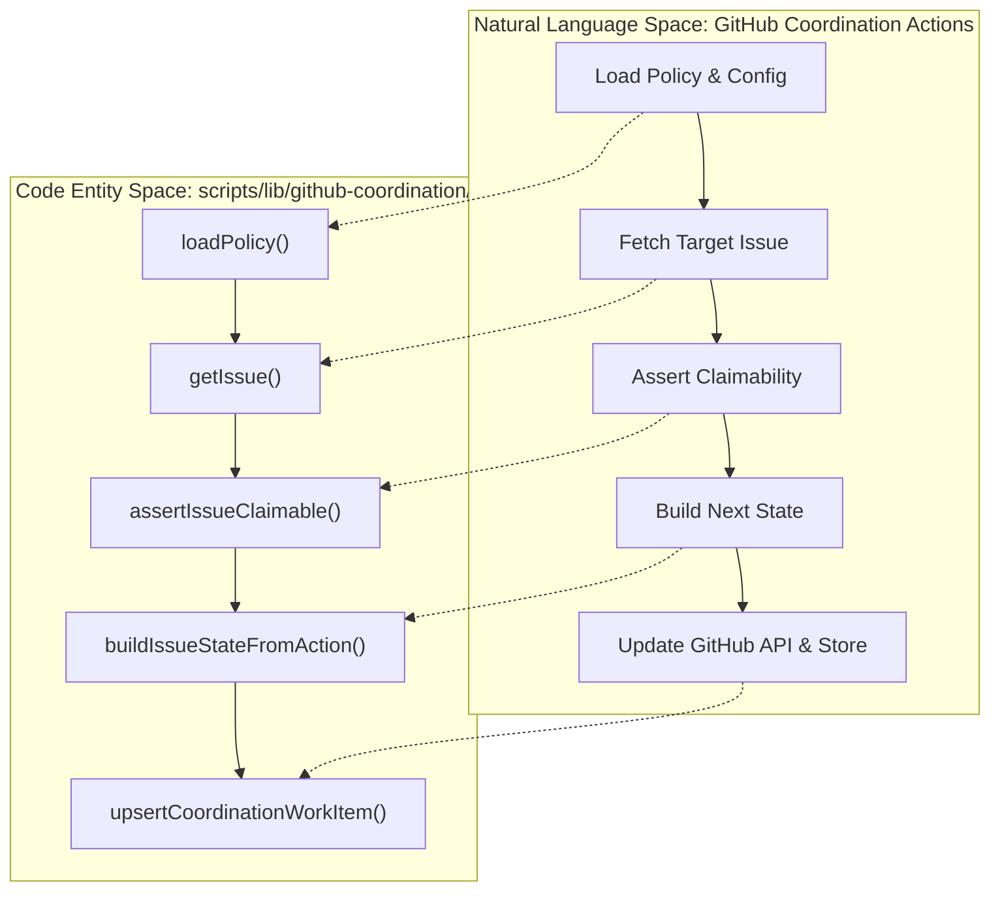

<!-- source: DeepWiki mcp.deepwiki.com · repo affaan-m/ECC · page 11.3 GitHub Coordination & Autonomous Loops · fetched 2026-10-30 -->

# GitHub Coordination & Autonomous Loops

<details>
<summary>Relevant source files</summary>

The following files were used as context for generating this wiki page:

- [.github/CODEOWNERS](.github/CODEOWNERS)
- [.opencode/commands/harness-audit.md](.opencode/commands/harness-audit.md)
- [commands/harness-audit.md](commands/harness-audit.md)
- [commands/loop-start.md](commands/loop-start.md)
- [commands/loop-status.md](commands/loop-status.md)
- [commands/model-route.md](commands/model-route.md)
- [docs/releases/2.0.0-rc.1/operator-readiness-dashboard-2026-05-15.md](docs/releases/2.0.0-rc.1/operator-readiness-dashboard-2026-05-15.md)
- [docs/releases/2.0.0-rc.1/publication-evidence-2026-05-15.md](docs/releases/2.0.0-rc.1/publication-evidence-2026-05-15.md)
- [docs/security/supply-chain-incident-response.md](docs/security/supply-chain-incident-response.md)
- [scripts/ci/scan-supply-chain-iocs.js](scripts/ci/scan-supply-chain-iocs.js)
- [scripts/github-coordination.js](scripts/github-coordination.js)
- [scripts/harness-audit.js](scripts/harness-audit.js)
- [scripts/lib/github-coordination.js](scripts/lib/github-coordination.js)
- [scripts/lib/github-coordination/actions.js](scripts/lib/github-coordination/actions.js)
- [scripts/lib/github-coordination/gh-api.js](scripts/lib/github-coordination/gh-api.js)
- [scripts/lib/github-coordination/parsing.js](scripts/lib/github-coordination/parsing.js)
- [scripts/lib/github-coordination/policy.js](scripts/lib/github-coordination/policy.js)
- [scripts/lib/github-coordination/state.js](scripts/lib/github-coordination/state.js)
- [scripts/lib/github-coordination/store.js](scripts/lib/github-coordination/store.js)
- [scripts/lib/harness-audit-consumer.js](scripts/lib/harness-audit-consumer.js)
- [scripts/loop-status.js](scripts/loop-status.js)
- [skills/frontend-slides/scripts/export-pdf.sh](skills/frontend-slides/scripts/export-pdf.sh)
- [tests/ci/scan-supply-chain-iocs.test.js](tests/ci/scan-supply-chain-iocs.test.js)
- [tests/ci/supply-chain-watch-workflow.test.js](tests/ci/supply-chain-watch-workflow.test.js)
- [tests/lib/github-coordination-gh-api.test.js](tests/lib/github-coordination-gh-api.test.js)
- [tests/lib/github-coordination.test.js](tests/lib/github-coordination.test.js)
- [tests/scripts/github-coordination.test.js](tests/scripts/github-coordination.test.js)
- [tests/scripts/harness-audit.test.js](tests/scripts/harness-audit.test.js)
- [tests/scripts/loop-status.test.js](tests/scripts/loop-status.test.js)
- [tests/skills/frontend-slides-export-pdf.test.js](tests/skills/frontend-slides-export-pdf.test.js)
- [workflows/README.md](workflows/README.md)
- [workflows/orch-review.workflow.js](workflows/orch-review.workflow.js)

</details>


## Purpose & Scope

This leaf page details the implementation of ECC's GitHub coordination subsystem, autonomous execution loops (`loop-start` and `loop-status`), deterministic harness auditing, and workflow orchestration scripts. These components bridge external developer platforms (GitHub Issues, pull requests, and project boards) with autonomous agent runtimes, enabling continuous execution loops and multi-agent coordination under strict safety and observability policies.

---

## 1. GitHub Coordination Library (`github-coordination`)

The `github-coordination` library (`scripts/lib/github-coordination/`) provides a robust state-machine engine for managing GitHub issues as autonomous work items. It synchronizes issue bodies, enforces validation dependencies, handles label lifecycles, and interacts with GitHub APIs.

### Core Modules and Architecture

The subsystem comprises several specialized modules:
- `gh-api.js`: Low-level wrapper around the `gh` CLI and GitHub API endpoints (`getIssue`, `listIssues`, `editIssue`, `commentIssue`) [scripts/lib/github-coordination/actions.js:5-5]().
- `policy.js`: Loads repository-level configuration policies via `loadPolicy()` [scripts/lib/github-coordination/actions.js:3-3]().
- `state.js`: Computes coordination state from issue metadata, validates claimability (`assertIssueClaimable`), and manages transition rules [scripts/lib/github-coordination/actions.js:7-15]().
- `store.js`: Persists coordination work items locally via `upsertCoordinationWorkItem()` [scripts/lib/github-coordination/actions.js:16-16]().
- `actions.js`: Implements high-level transaction primitives like `applyClaim()`, `applySync()`, and `applyValidate()` [scripts/lib/github-coordination/actions.js:38-167]().
- `parsing.js`: Handles markdown section parsing, task extraction, and body normalization (`mergeIssueBody`, `normalizeBodyForComparison`) [scripts/lib/github-coordination/actions.js:4-17]().

### Action Execution Pipeline

When an agent or operator invokes a coordination action (such as claiming or syncing an issue), the `actions.js` workflow executes a structured read-validate-write sequence:

1. **Policy Loading**: Resolves policy rules using `loadPolicy()` [scripts/lib/github-coordination/actions.js:49-49]().
2. **State Resolution**: Fetches the issue and derives current coordination metadata using `getCoordinationState()` [scripts/lib/github-coordination/actions.js:52-52]().
3. **Assertion**: Verifies issue preconditions (e.g., whether it is unassigned/claimable) via `assertIssueClaimable()` [scripts/lib/github-coordination/actions.js:54-54]().
4. **State Transition**: Computes the next state via `buildIssueStateFromAction()` [scripts/lib/github-coordination/actions.js:56-63]().
5. **Persistence**: Updates GitHub issue metadata (labels, body, comments) and upserts local work item snapshots via `upsertCoordinationWorkItem()` [scripts/lib/github-coordination/actions.js:70-78]().



Sources:
- `scripts/lib/github-coordination/actions.js` [scripts/lib/github-coordination/actions.js:1-167]()
- `scripts/lib/github-coordination/store.js` [scripts/lib/github-coordination/store.js:1-1]()
- `scripts/lib/github-coordination/policy.js` [scripts/lib/github-coordination/policy.js:1-1]()
- `scripts/lib/github-coordination/gh-api.js` [scripts/lib/github-coordination/gh-api.js:1-1]()
- `scripts/lib/github-coordination/state.js` [scripts/lib/github-coordination/state.js:1-1]()
- `scripts/lib/github-coordination/parsing.js` [scripts/lib/github-coordination/parsing.js:1-1]()

---

## 2. Autonomous Loops (`loop-start` & `loop-status`)

Autonomous execution loops allow agents to run continuously across tool executions with safety watchdogs. The `loop-status` CLI (`scripts/loop-status.js`) inspects local Claude Code execution transcripts to detect idle sessions, overdue wakeups, or stuck shell processes.

### Transcript Analysis & Signal Detection

The `loop-status` script scans JSONL transcript files located under `~/.claude/projects/**` [commands/loop-status.md:17-19](). It parses assistant tool invocations and user tool results to identify specific operational signals:

- **Overdue Wakeups**: Flags sessions where a `ScheduleWakeup` tool call has exceeded its scheduled delay multiplier (`--wake-grace-multiplier`) [tests/scripts/loop-status.test.js:144-165]().
- **Stale Tool Uses**: Identifies `Bash` tool execution blocks that lack a corresponding `tool_result` entry past the timeout threshold (`--bash-timeout-seconds`, default 1800s) [tests/scripts/loop-status.test.js:191-214]().

### Watch Mode & Snapshot Persistence

When executed with `--watch`, the script periodically re-evaluates transcripts and emits JSON streams [commands/loop-status.md:56-60](). When combined with `--write-dir <dir>`, it maintains an `index.json` registry alongside per-session JSON snapshot files (`<session-id>.json`) for external watchdogs and operator terminals [commands/loop-status.md:52-55]().

```mermaid
graph TD
    subgraph "Natural Language Space: Loop Observation"
        TS["Claude Transcript Directory"] --> W["Walk JSONL Files"]
        W --> AT["Analyze Transcript Entries"]
        AT --> SF["Evaluate Signals: Overdue Wake / Stale Bash"]
        SF --> JSON["Emit JSON Stream or Write Snapshots"]
    end

    subgraph "Code Entity Space: scripts/loop-status.js"
        DIR["~/.claude/projects/**"] --> WJF["walkJsonlFiles()"]
        WJF --> AN[analysistranscript()]
        AN --> BS["buildStatus()"]
        BS --> WSS["writeStatusSnapshots()"]
    end

    TS -.-> DIR
    W -.-> WJF
    AT -.-> AN
    SF -.-> BS
    JSON -.-> WSS
```

Sources:
- `scripts/loop-status.js` [scripts/loop-status.js:1-820]()
- `tests/scripts/loop-status.test.js` [tests/scripts/loop-status.test.js:1-223]()
- `commands/loop-status.md` [commands/loop-status.md:1-77]()

---

## 3. Harness Audit Consumer (`harness-audit.js`)

The harness audit engine (`scripts/harness-audit.js`) performs deterministic evaluations of repository configuration, tool coverage, memory persistence, quality gates, and platform integrations [scripts/harness-audit.js:12-28]().

### Scoring Categories & Rubric Version

The audit evaluates against a versioned rubric (`RUBRIC_VERSION = '2026-05-19'`) across fixed evaluation categories [scripts/harness-audit.js:12-27]():
- `Tool Coverage`
- `Context Efficiency`
- `Quality Gates`
- `Memory Persistence`
- `Eval Coverage`
- `Security Guardrails`
- `Cost Efficiency`
- `GitHub Integration`
- Cloud Provider Integrations (`Vercel`, `Netlify`, `Cloudflare`, `Fly`) [scripts/harness-audit.js:21-25]()

### Target Modes

The script automatically detects whether it is running inside the ECC development repository (`repo` mode) or inside an external consumer repository (`consumer` mode), adjusting applicable categories and weight thresholds accordingly [scripts/harness-audit.js:222-239]().

Sources:
- `scripts/harness-audit.js` [scripts/harness-audit.js:1-1095]()
- `tests/scripts/harness-audit.test.js` [tests/scripts/harness-audit.test.js:1-173]()

---

## 4. Orchestration Workflows (`workflows/`)

The `workflows/` directory contains orchestration workflow scripts and pipeline definitions that coordinate multi-agent reviews, validation suites, and integration jobs [workflows/README.md]().

### Workflow Scripts

Workflows such as `workflows/orch-review.workflow.js` act as executable pipeline definitions. They interface with the core ECC runtime and GitHub coordination layer to automate code review assignments, verify build artifacts, and gate pull request merging based on automated compliance scans.

Sources:
- `workflows/orch-review.workflow.js` [workflows/orch-review.workflow.js:1-1]()
- `workflows/README.md` [workflows/README.md:1-1]()

---

