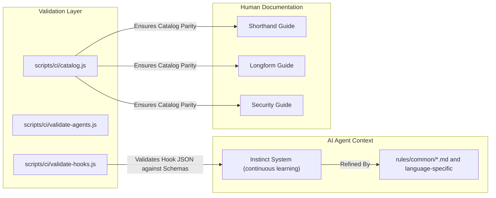

<!-- source: DeepWiki mcp.deepwiki.com · repo affaan-m/ECC · page 12 Localization & Documentation · fetched 2026-10-30 -->

# Localization & Documentation

<details>
<summary>Relevant source files</summary>

The following files were used as context for generating this wiki page:

- [docs/de-DE/README.md](docs/de-DE/README.md)
- [docs/es/README.md](docs/es/README.md)
- [docs/ja-JP/README.md](docs/ja-JP/README.md)
- [docs/ko-KR/README.md](docs/ko-KR/README.md)
- [docs/pt-BR/README.md](docs/pt-BR/README.md)
- [docs/ru/README.md](docs/ru/README.md)
- [docs/th/README.md](docs/th/README.md)
- [docs/tr/README.md](docs/tr/README.md)
- [docs/ur/README.md](docs/ur/README.md)
- [docs/vi-VN/README.md](docs/vi-VN/README.md)
- [docs/zh-TW/README.md](docs/zh-TW/README.md)

</details>


Everything Claude Code (ECC) is designed as a globally accessible agent harness operating system, supporting comprehensive multi-language documentation and consistent codebase descriptions. This page provides a high-level overview of ECC's localization system, supported locales, catalog truth enforcement mechanism, and how to contribute translations. For detailed instructions, specific locale states, and example projects, refer to the linked child pages.

---

## Multi-Language Documentation & Localization

ECC offers extensive localization of its documentation, including installation guides, how-tos, and reference materials, covering more than a dozen languages to serve a worldwide developer and operator community.

### Supported Locales

The project maintains a hierarchy of locale coverage status:

- **Full Parity Locales** (Complete translations and coverage):
  - English (primary)
  - Simplified Chinese (`zh-CN`)
  - Japanese (`ja-JP`)

- **Active Coverage Locales** (Partial but active translation and maintenance):
  - Traditional Chinese (`zh-TW`)
  - Korean (`ko-KR`)
  - Portuguese (Brazil) (`pt-BR`)
  - Turkish (`tr`)
  - Russian (`ru`)
  - Vietnamese (`vi-VN`)
  - Thai (`th`)
  - Spanish (`es`)
  - German (`de-DE`)
  - Ukrainian (`uk-UA`)

Localized documentation files reside under the `docs/` directory grouped by locale code. Each locale folder generally contains a `README.md` that localizes the central project introduction and key usage instructions.

### Localization Example

The Japanese locale README displays this structure with links to all supported languages, demonstrating the project's multi-lingual ecosystem:

```markdown
<p align="center">
  <strong>Language:</strong>
  <a href="../../README.md">English</a> |
  <a href="../pt-BR/README.md">Português (Brasil)</a> |
  <a href="../../README.zh-CN.md">简体中文</a> |
  <a href="../zh-TW/README.md">繁體中文</a> |
  <a href="README.md">日本語</a> |
  <a href="../ko-KR/README.md">한국어</a> |
  <a href="../tr/README.md">Türkçe</a> |
  <a href="../ru/README.md">Русский</a> |
  <a href="../vi-VN/README.md">Tiếng Việt</a> |
  <a href="../th/README.md">ไทย</a> |
  <a href="../de-DE/README.md">Deutsch</a> |
  <a href="../es/README.md">Español</a> |
  <a href="../uk-UA/README.md">Українська</a>
</p>
```

This level of localization extends beyond static text to supporting localized usage guidelines, installation instructions, and community links, ensuring usability and accessibility for non-English speakers.

For further details on coverage parity, update workflows, and community contributions to translations, see [Translation Coverage & Parity](#12.1).

Sources: [docs/ja-JP/README.md:1-35](), [docs/zh-TW/README.md:1-27](), [docs/pt-BR/README.md:1-28](), [docs/tr/README.md:1-29](), [docs/ko-KR/README.md:1-30](), [docs/ru/README.md:1-32](), [docs/vi-VN/README.md:1-31](), [docs/th/README.md:1-32]()

---

## Catalog Truth Enforcement & Consistency

ECC maintains strict synchronization between the codebase (agents, skills, commands) and its multi-lingual documentation descriptions via an automated catalog validation system.

### Catalog Validation Mechanism

The `scripts/ci/catalog.js` script serves as the central validator:

- **Scope:**
  - Scans actual files in code directories:
    - Agents: `agents/*.md`
    - Commands: `commands/*.md`
    - Skills: `skills/*/SKILL.md`
  - Reads metadata from `plugin.json`, `marketplace.json`, and all locale README files.

- **Function:**
  - Compares the counts of files (agents, skills, commands) with enumerations documented in README files and plugin descriptions.
  - Enforces parity across all supported locales to prevent documentation rot or divergence.

- **Integration:**
  - Embedded in the continuous integration (CI) pipeline.
  - Supports output formats: JSON, Markdown, plain text.
  - Can update documentation files automatically with `--write` flag.

### Diagram: Catalog Parity Enforcement between Codebase and Documentation

```mermaid
graph TD
    subgraph "Code Entity Space"
        A["agents/*.md"]
        C["commands/*.md"]
        S["skills/*/SKILL.md"]
        P["plugin.json & marketplace.json"]
    end

    subgraph "Natural Language Space"
        R["README.md (English)"]
        RZ["README.zh-CN.md"]
        RJ["docs/ja-JP/README.md"]
        RTW["docs/zh-TW/README.md"]
        RKO["docs/ko-KR/README.md"]
        RPT["docs/pt-BR/README.md"]
        RTR["docs/tr/README.md"]
        RRU["docs/ru/README.md"]
        RVI["docs/vi-VN/README.md"]
        RTH["docs/th/README.md"]
        RDE["docs/de-DE/README.md"]
        RES["docs/es/README.md"]
    end

    Validator["scripts/ci/catalog.js"]

    A --> Validator
    C --> Validator
    S --> Validator
    P -.-> Validator
    
    Validator -- "Enforces Parity" --> R
    Validator -- "Enforces Parity" --> RZ
    Validator -- "Enforces Parity" --> RJ
    Validator -- "Enforces Parity" --> RTW
    Validator -- "Enforces Parity" --> RKO
    Validator -- "Enforces Parity" --> RPT
    Validator -- "Enforces Parity" --> RTR
    Validator -- "Enforces Parity" --> RRU
    Validator -- "Enforces Parity" --> RVI
    Validator -- "Enforces Parity" --> RTH
    Validator -- "Enforces Parity" --> RDE
    Validator -- "Enforces Parity" --> RES
```



This system ensures that no mismatch arises between code and human-readable descriptions, maintaining trust in the documentation across all supported languages.

Sources: [scripts/ci/catalog.js:2-62](), [scripts/ci/catalog.js:88-183]()

---

## Documentation Content & Standards

ECC's documentation is split into multiple tiers tailored to different use cases:

1. **Shorthand Guide**: Focused on installation, foundational concepts, and philosophy — providing a quick orientation for new users.  
2. **Longform Guide**: Covers advanced operational topics such as token optimization, memory persistence, evaluation cycles, and parallelization strategies.  
3. **Security Guide**: Focuses on agent security, sandboxing, sanitization, and the AgentShield system for supply chain security.

All guides are maintained in multiple languages as part of the localization effort. The documents also include embedded technical schemas and validations to maintain correctness for AI agent consumption.

### Diagram: Documentation Integration with Validation & AI Agent Context



This layered approach ensures that both human operators and the AI agents that drive ECC workflows have consistent, verified, and up-to-date documentation and contextual knowledge.

Sources: [docs/ja-JP/README.md:53-54](), [docs/pt-BR/README.md:65-65](), [scripts/ci/catalog.js:88-183]()

---

## Contributing Translations & Documentation Enhancements

ECC encourages community contributions to improve translations, update documentation, and maintain parity. Contributions undergo validation via catalog scripts and guidelines to ensure no regressions.

Key notes:

- New translations or updates must keep catalog counts accurate in localized README files.
- Translation files are organized cleanly in `docs/<locale>/`.
- Update pull requests should include runs of `scripts/ci/catalog.js` to validate parity.
- Refer to [Translation Coverage & Parity](#12.1) for the process to add or update translations.

---

## Project Templates & Examples

Beyond core documentation and localization, ECC includes an `examples/` directory containing `CLAUDE.md` templates tailored for various project types such as SaaS (Next.js), Django APIs, and Rust microservices. These examples provide practical guidance on applying ECC skills, agents, rules, and commands within real-world contexts.

Session context files and assets help users bootstrap projects quickly and demonstrate advanced ECC features in action.

For detailed descriptions and walkthroughs, see [Examples & Project Templates](#12.2).

Sources: [docs/zh-TW/README.md:220-230]()

---

# Summary

ECC's localization and documentation systems are designed to maximize operator accessibility, foster global collaboration, and maintain strict consistency between source code and human-readable materials. The catalog enforcement mechanism ensures that codebase expansions or modifications are always reflected correctly in all supported languages, while layered documentation offers both quick overviews and detailed operational insights. Combined with example projects and translation guidelines, ECC stands as a robust, internationalized platform ready for diverse global adoption.

---

### Links to Child Pages

- [Translation Coverage & Parity](#12.1) — Details on which locales have full or partial parity, enforcement via catalog.js, and how to contribute translations.  
- [Examples & Project Templates](#12.2) — Overview of example templates, project contexts, and assets for practical ECC usage.

Sources Summary:  
[docs/ja-JP/README.md:1-81](), [docs/zh-TW/README.md:1-30,220-230](), [docs/pt-BR/README.md:1-28,40-80](), [docs/tr/README.md:20-70](), [docs/ko-KR/README.md:1-30](), [docs/ru/README.md:1-32](), [docs/vi-VN/README.md:1-32](), [docs/th/README.md:1-32](), [scripts/ci/catalog.js:1-183]()

---

