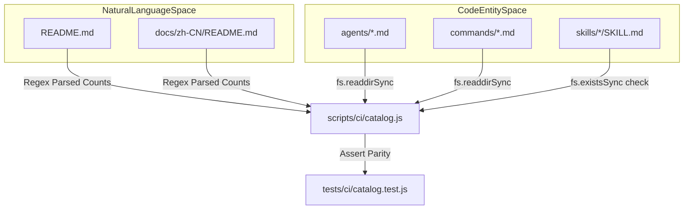
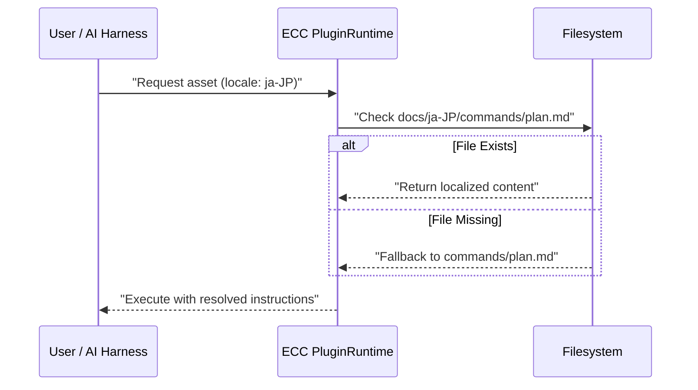
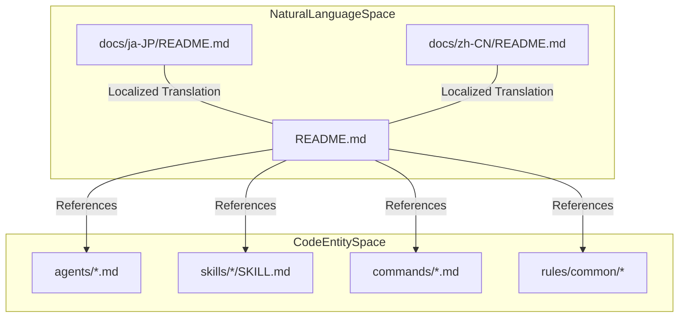
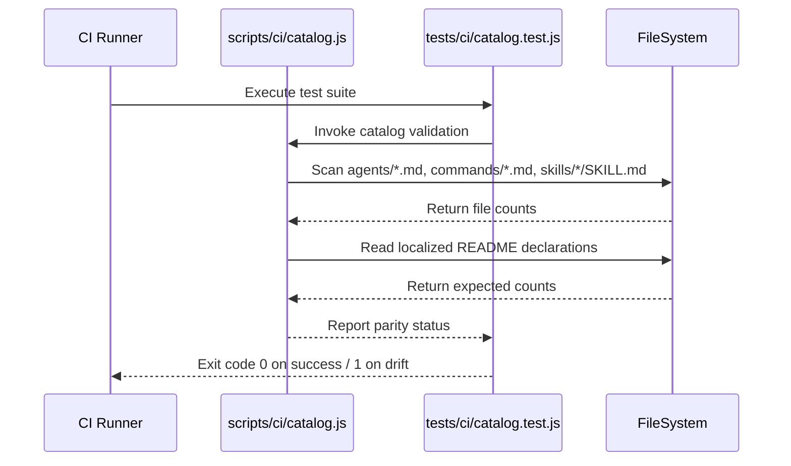

<!-- source: DeepWiki mcp.deepwiki.com · repo affaan-m/ECC · page 12.1 Translation Coverage & Parity · fetched 2026-10-30 -->

# Translation Coverage & Parity

Relevant source files

The following files were used as context for generating this wiki page:

- [.gitignore](.gitignore)
- [agents/vue-reviewer.md](agents/vue-reviewer.md)
- [commands/vue-review.md](commands/vue-review.md)
- [docs/de-DE/README.md](docs/de-DE/README.md)
- [docs/es/README.md](docs/es/README.md)
- [docs/ja-JP/README.md](docs/ja-JP/README.md)
- [docs/ja-JP/agents/opensource-sanitizer.md](docs/ja-JP/agents/opensource-sanitizer.md)
- [docs/ja-JP/commands/rules-distill.md](docs/ja-JP/commands/rules-distill.md)
- [docs/ja-JP/skills/skill-scout/SKILL.md](docs/ja-JP/skills/skill-scout/SKILL.md)
- [docs/ja-JP/skills/swift-actor-persistence/SKILL.md](docs/ja-JP/skills/swift-actor-persistence/SKILL.md)
- [docs/ja-JP/skills/tinystruct-patterns/SKILL.md](docs/ja-JP/skills/tinystruct-patterns/SKILL.md)
- [docs/ja-JP/skills/tinystruct-patterns/references/database.md](docs/ja-JP/skills/tinystruct-patterns/references/database.md)
- [docs/ja-JP/skills/ui-to-vue/SKILL.md](docs/ja-JP/skills/ui-to-vue/SKILL.md)
- [docs/ja-JP/skills/videodb/reference/api-reference.md](docs/ja-JP/skills/videodb/reference/api-reference.md)
- [docs/ja-JP/skills/vite-patterns/SKILL.md](docs/ja-JP/skills/vite-patterns/SKILL.md)
- [docs/ja-JP/skills/windows-desktop-e2e/SKILL.md](docs/ja-JP/skills/windows-desktop-e2e/SKILL.md)
- [docs/ko-KR/README.md](docs/ko-KR/README.md)
- [docs/pt-BR/README.md](docs/pt-BR/README.md)
- [docs/ru/README.md](docs/ru/README.md)
- [docs/th/README.md](docs/th/README.md)
- [docs/tr/README.md](docs/tr/README.md)
- [docs/ur/README.md](docs/ur/README.md)
- [docs/vi-VN/README.md](docs/vi-VN/README.md)
- [docs/zh-TW/README.md](docs/zh-TW/README.md)
- [hooks/README.md](hooks/README.md)
- [hooks/hooks.json](hooks/hooks.json)
- [schemas/hooks.schema.json](schemas/hooks.schema.json)
- [scripts/ci/catalog.js](scripts/ci/catalog.js)
- [scripts/ci/generate-command-registry.js](scripts/ci/generate-command-registry.js)
- [scripts/ci/validate-agents.js](scripts/ci/validate-agents.js)
- [scripts/ci/validate-hooks.js](scripts/ci/validate-hooks.js)
- [scripts/hooks/check-console-log.js](scripts/hooks/check-console-log.js)
- [scripts/hooks/evaluate-session.js](scripts/hooks/evaluate-session.js)
- [scripts/hooks/post-edit-console-warn.js](scripts/hooks/post-edit-console-warn.js)
- [scripts/hooks/post-edit-format.js](scripts/hooks/post-edit-format.js)
- [scripts/hooks/post-edit-typecheck.js](scripts/hooks/post-edit-typecheck.js)
- [scripts/hooks/session-end.js](scripts/hooks/session-end.js)
- [scripts/hooks/session-start.js](scripts/hooks/session-start.js)
- [scripts/hooks/suggest-compact.js](scripts/hooks/suggest-compact.js)
- [scripts/lib/package-manager.d.ts](scripts/lib/package-manager.d.ts)
- [scripts/lib/package-manager.js](scripts/lib/package-manager.js)
- [scripts/lib/session-aliases.d.ts](scripts/lib/session-aliases.d.ts)
- [scripts/lib/session-aliases.js](scripts/lib/session-aliases.js)
- [scripts/lib/session-manager.d.ts](scripts/lib/session-manager.d.ts)
- [scripts/lib/session-manager.js](scripts/lib/session-manager.js)
- [scripts/lib/utils.d.ts](scripts/lib/utils.d.ts)
- [scripts/lib/utils.js](scripts/lib/utils.js)
- [skills/windows-desktop-e2e/SKILL.md](skills/windows-desktop-e2e/SKILL.md)
- [tests/ci/catalog.test.js](tests/ci/catalog.test.js)
- [tests/ci/command-registry.test.js](tests/ci/command-registry.test.js)
- [tests/ci/validators.test.js](tests/ci/validators.test.js)
- [tests/hooks/hooks.test.js](tests/hooks/hooks.test.js)
- [tests/integration/hooks.test.js](tests/integration/hooks.test.js)
- [tests/lib/package-manager.test.js](tests/lib/package-manager.test.js)
- [tests/lib/session-aliases.test.js](tests/lib/session-aliases.test.js)
- [tests/lib/session-manager.test.js](tests/lib/session-manager.test.js)
- [tests/lib/utils.test.js](tests/lib/utils.test.js)

This page documents the status of Everything Claude Code (ECC) localization, the mechanisms used to enforce parity between the English source and localized variants, and the technical workflow for maintaining the supported language ecosystems.

Sources: 
[docs/ja-JP/README.md:1-38](), 
[docs/zh-TW/README.md:1-25]()

---

## 1. Localization Status & Coverage

ECC maintains various levels of translation maturity across its supported locales. Translation coverage is classified into two main categories:

- **Full Parity:** The locale has translation coverage for all critical components including agents, skills, commands, rules, and the complete documentation set like the README.
- **Partial Coverage:** The locale includes translations for essential documentation such as the README and selected high-traffic assets, but some components like commands or specific skills may remain untranslated.

### 1.1 Parity Matrix

| Locale                  | Code    | Coverage Level  | Scope                                      |
|-------------------------|---------|-----------------|--------------------------------------------|
| **English**             | `en`    | **Source**      | 100% (Source of Truth)                      |
| **Simplified Chinese**  | `zh-CN` | **Full Parity** | Agents, Commands, Skills, Rules, README    |
| **Japanese**            | `ja-JP` | **Full Parity** | 80+ files including core logic and UI      |
| **Traditional Chinese** | `zh-TW` | Partial         | README, Core Agents, Core Skills            |
| **Korean**              | `ko-KR` | Partial         | README, Install Guides, v1.8.0 Features    |
| **Portuguese (BR)**     | `pt-BR` | Partial         | README, v2.2.0 Guides, Security docs       |
| **Turkish**             | `tr`    | Partial         | README, v2.1.0/2.2.0 release docs          |
| **Russian**             | `ru`    | Partial         | README, v2.0.0-rc.1 Features, GUI docs     |
| **German**              | `de-DE` | Partial         | README, v2.0.0-rc.1 features                |
| **Thai**                | `th`    | Partial         | README, Manual Install Guides               |
| **Vietnamese**          | `vi-VN` | Partial         | README, Core Workflow Shims                 |
| **Ukrainian**           | `uk-UA` | Partial         | README                                       |
| **Spanish**             | `es`    | Partial         | README, v2.0.0-rc.1 features                |

Sources:  
[docs/ja-JP/README.md:1-38](),  
[docs/zh-TW/README.md:1-25](),  
[docs/pt-BR/README.md:1-38](),  
[docs/tr/README.md:1-38](),  
[docs/ko-KR/README.md:1-38](),  
[docs/ru/README.md:1-42](),  
[docs/de-DE/README.md:1-43](),  
[docs/th/README.md:1-33](),  
[docs/vi-VN/README.md:1-32](),  
[docs/es/README.md:1-33]()

---

## 2. Parity Enforcement: `catalog.js`

To maintain consistency and prevent documentation drift, ECC employs a parity enforcement mechanism implemented in `scripts/ci/catalog.js` and verified by `tests/ci/catalog.test.js`. This module performs automated validation of translation coverage by comparing declared counts in documentation files against the actual files present in the repository.

### 2.1 Catalog Discovery Logic

`scripts/ci/catalog.js` enumerates canonical ECC components by scanning the source tree:
- **Agents:** Lists Markdown files in `/agents/` matching `*.md`.
- **Commands:** Lists Markdown files under `/commands/` matching `*.md`.
- **Skills:** Recursively scans skill directories and counts those containing a `SKILL.md` file.

Sources:  
[scripts/ci/catalog.js:1-55](),  
[tests/ci/catalog.test.js:1-180]()

### 2.2 Validation Flow

The validator extracts declared counts of agents, skills, and commands from locale-specific README files using regular expressions. It then compares these expected counts with the actual counts obtained from the filesystem scan, failing the validation step if a mismatch is detected.

Sources:  
[scripts/ci/catalog.js:56-120](),  
[tests/ci/catalog.test.js:178-195]()

### 2.3 Natural Language Space to Code Entity Space: Catalog Validation Diagram

Title: Catalog Validation Data Flow

Sources:  
[scripts/ci/catalog.js:1-120](),  
[tests/ci/catalog.test.js:1-195]()

---

## 3. Localization Architecture

ECC organizes localized content under the `docs/` directory, where each locale has a dedicated subfolder named after its locale code (e.g., `docs/ja-JP/`, `docs/zh-TW/`). The Simplified Chinese documentation resides at `README.zh-CN.md` for root discoverability.

### 3.1 Runtime Locale Resolution

When an AI harness or user requests a localized asset, the runtime attempts to locate the file in the specific locale subdirectory. If the file is missing, it falls back to the English source repository root.

Sources:  
[docs/ja-JP/README.md:1-24]()

### 3.2 Locale Resolution Sequence Diagram

Title: Runtime Locale Resolution Flow

Sources:  
[docs/ja-JP/README.md:1-24]()

---

## 4. Maintenance Process

### 4.1 Adding a New Locale

1. **Create Directory:** Add a new directory under `docs/` (e.g., `docs/fr-FR/`).
2. **Translate Assets:** Provide translated documentation and README files.
3. **Register in Catalog:** Update `scripts/ci/catalog.js` to include the new locale path in the parser configuration.

Sources:  
[scripts/ci/catalog.js:1-80]()

### 4.2 Updating Translations

- Keep translation files synchronized with the English source of truth (`README.md`, `/agents/`, `/skills/`, `/commands/`).
- Run `node tests/ci/catalog.test.js` to verify that all counts remain accurate.

Sources:  
[scripts/ci/catalog.js:81-195](),  
[tests/ci/catalog.test.js:1-195]()

---

## 5. Diagrams Connecting Localization to Code Entities

### 5.1 Documentation to Code Entities Map

Title: Documentation to Code Entity Mapping

Sources:  
[docs/ja-JP/README.md:1-38](),  
[scripts/ci/catalog.js:50-60]()

### 5.2 Verification Pipeline

Title: Catalog Verification Pipeline

Sources:  
[scripts/ci/catalog.js:1-195](),  
[tests/ci/catalog.test.js:1-195]()

---

