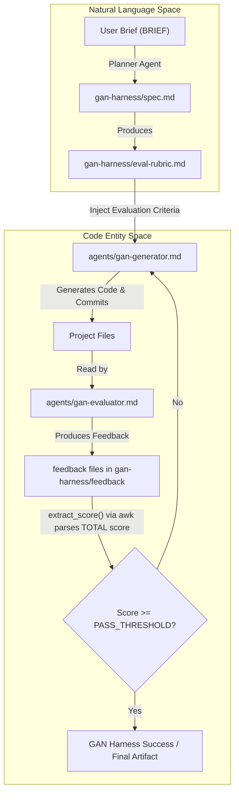
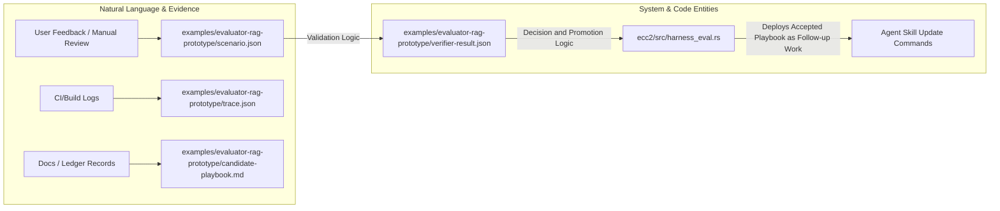

<!-- source: DeepWiki mcp.deepwiki.com · repo affaan-m/ECC · page 12.2 Examples & Project Templates · fetched 2026-10-30 -->

# Examples & Project Templates

Relevant source files

The following files were used as context for generating this wiki page:

- [docs/architecture/evaluator-rag-prototype.md](docs/architecture/evaluator-rag-prototype.md)
- [docs/ja-JP/skills/gan-style-harness/SKILL.md](docs/ja-JP/skills/gan-style-harness/SKILL.md)
- [docs/zh-CN/skills/csharp-testing/SKILL.md](docs/zh-CN/skills/csharp-testing/SKILL.md)
- [docs/zh-CN/skills/dart-flutter-patterns/SKILL.md](docs/zh-CN/skills/dart-flutter-patterns/SKILL.md)
- [docs/zh-CN/skills/dashboard-builder/SKILL.md](docs/zh-CN/skills/dashboard-builder/SKILL.md)
- [docs/zh-CN/skills/design-system/SKILL.md](docs/zh-CN/skills/design-system/SKILL.md)
- [docs/zh-CN/skills/dotnet-patterns/SKILL.md](docs/zh-CN/skills/dotnet-patterns/SKILL.md)
- [docs/zh-CN/skills/gan-style-harness/SKILL.md](docs/zh-CN/skills/gan-style-harness/SKILL.md)
- [docs/zh-CN/skills/laravel-plugin-discovery/SKILL.md](docs/zh-CN/skills/laravel-plugin-discovery/SKILL.md)
- [docs/zh-CN/skills/manim-video/SKILL.md](docs/zh-CN/skills/manim-video/SKILL.md)
- [docs/zh-CN/skills/nestjs-patterns/SKILL.md](docs/zh-CN/skills/nestjs-patterns/SKILL.md)
- [docs/zh-CN/skills/nodejs-keccak256/SKILL.md](docs/zh-CN/skills/nodejs-keccak256/SKILL.md)
- [docs/zh-CN/skills/remotion-video-creation/SKILL.md](docs/zh-CN/skills/remotion-video-creation/SKILL.md)
- [ecc2/README.md](ecc2/README.md)
- [ecc2/src/harness_eval.rs](ecc2/src/harness_eval.rs)
- [examples/evaluator-rag-prototype/deep-analyzer-evidence/candidate-playbook.md](examples/evaluator-rag-prototype/deep-analyzer-evidence/candidate-playbook.md)
- [examples/evaluator-rag-prototype/deep-analyzer-evidence/report.json](examples/evaluator-rag-prototype/deep-analyzer-evidence/report.json)
- [examples/evaluator-rag-prototype/deep-analyzer-evidence/scenario.json](examples/evaluator-rag-prototype/deep-analyzer-evidence/scenario.json)
- [examples/evaluator-rag-prototype/deep-analyzer-evidence/trace.json](examples/evaluator-rag-prototype/deep-analyzer-evidence/trace.json)
- [examples/evaluator-rag-prototype/deep-analyzer-evidence/verifier-result.json](examples/evaluator-rag-prototype/deep-analyzer-evidence/verifier-result.json)
- [examples/evaluator-rag-prototype/skill-quality-evidence/candidate-playbook.md](examples/evaluator-rag-prototype/skill-quality-evidence/candidate-playbook.md)
- [examples/evaluator-rag-prototype/skill-quality-evidence/report.json](examples/evaluator-rag-prototype/skill-quality-evidence/report.json)
- [examples/evaluator-rag-prototype/skill-quality-evidence/scenario.json](examples/evaluator-rag-prototype/skill-quality-evidence/scenario.json)
- [examples/evaluator-rag-prototype/skill-quality-evidence/trace.json](examples/evaluator-rag-prototype/skill-quality-evidence/trace.json)
- [examples/evaluator-rag-prototype/skill-quality-evidence/verifier-result.json](examples/evaluator-rag-prototype/skill-quality-evidence/verifier-result.json)
- [examples/gan-harness/README.md](examples/gan-harness/README.md)
- [examples/user-CLAUDE.md](examples/user-CLAUDE.md)
- [rules/common/code-review.md](rules/common/code-review.md)
- [rules/common/coding-style.md](rules/common/coding-style.md)
- [rules/common/development-workflow.md](rules/common/development-workflow.md)
- [rules/common/patterns.md](rules/common/patterns.md)
- [rules/common/security.md](rules/common/security.md)
- [rules/common/testing.md](rules/common/testing.md)
- [scripts/gan-harness.sh](scripts/gan-harness.sh)
- [skills/backend-patterns/SKILL.md](skills/backend-patterns/SKILL.md)
- [skills/clickhouse-io/SKILL.md](skills/clickhouse-io/SKILL.md)
- [skills/coding-standards/SKILL.md](skills/coding-standards/SKILL.md)
- [skills/continuous-learning/SKILL.md](skills/continuous-learning/SKILL.md)
- [skills/django-verification/SKILL.md](skills/django-verification/SKILL.md)
- [skills/eval-harness/SKILL.md](skills/eval-harness/SKILL.md)
- [skills/frontend-patterns/SKILL.md](skills/frontend-patterns/SKILL.md)
- [skills/gan-style-harness/SKILL.md](skills/gan-style-harness/SKILL.md)
- [skills/iterative-retrieval/SKILL.md](skills/iterative-retrieval/SKILL.md)
- [skills/prisma-patterns/SKILL.md](skills/prisma-patterns/SKILL.md)
- [skills/search-first/SKILL.md](skills/search-first/SKILL.md)
- [skills/security-review/SKILL.md](skills/security-review/SKILL.md)
- [tests/docs/evaluator-rag-prototype.test.js](tests/docs/evaluator-rag-prototype.test.js)
- [tests/gan-harness.test.js](tests/gan-harness.test.js)

## Purpose and Scope

This section documents the `examples/` and `contexts/` directories within ECC. These resources provide pre-configured templates for various project types, advanced generator-evaluator harness prototypes, and lightweight session context files designed to bootstrap agent productivity.

Sources: [docs/architecture/evaluator-rag-prototype.md:1-26](), [examples/user-CLAUDE.md:1-10](), [scripts/gan-harness.sh:1-23]()

---

## Project Templates (`CLAUDE.md`)

ECC provides tailored `CLAUDE.md` files that serve as project templates defined under the `examples/` directory. These templates act as foundational prompts and environment configs for Claude and compatible agents, encapsulating build, test, and coding standards specific to different technology stacks. They guide agents in build orchestration, test execution, and adherence to project-specific coding standards [examples/user-CLAUDE.md:1-39]().

### Supported Templates Overview

| Template Type       | Primary Focus                         | Key Commands                                    |
|---------------------|-------------------------------------|------------------------------------------------|
| **SaaS Next.js**    | Full-stack React, Tailwind, Shadcn  | `npm run dev`, `npm run test`                   |
| **Django API**       | Python REST frameworks, migrations  | `python manage.py runserver`, `pytest`          |
| **Go Microservice**  | Static typing, concurrency, performance | `go build`, `go test ./...`                   |
| **Laravel API**      | PHP, Eloquent, Artisan workflows    | `php artisan serve`, `php artisan test`         |
| **Rust API**         | Safety, Cargo, crates ecosystem     | `cargo build`, `cargo test`                      |
| **HarmonyOS**        | ArkTS, mobile component architecture | `ohpm install`, `hvigorw`                      |

These templates provide agents structured workflows, from build commands to testing and deployment patterns, ensuring consistent project maintenance and extensibility.

Sources: [examples/user-CLAUDE.md:1-39](), [rules/common/coding-style.md:1-43]()

---

## GAN-Style Harness

The GAN-style harness is a specialized iterative orchestrator inspired by machine learning adversarial training principles, adapted to agent-driven software development. It pits a **Generator** agent against an **Evaluator** agent in a closed loop to progressively improve software until it meets or exceeds a specified evaluation rubric [scripts/gan-harness.sh:1-24]().

### Architecture and Data Flow

The harness operates in three main phases:

1. **Planning Phase**  
   A Planner agent reads the project brief and composes the product specification (`spec.md`) and evaluation rubric (`eval-rubric.md`) [tests/gan-harness.test.js:90-94]().

2. **Generator-Evaluator Loop**  
   For a configurable maximum number of iterations (default 15), the Generator produces code iterations aiming to satisfy spec requirements, commits them, and redeploys. The Evaluator scores the outputs against the rubric, producing feedback which is fed back into the Generator [scripts/gan-harness.sh:29-38](), [tests/gan-harness.test.js:95-98]().

3. **Score Extraction and Termination**  
   Scores are extracted using the `extract_score()` function defined in the harness script, assessing if the weighted pass threshold (default 7.0) is met. If so, the loop terminates successfully; otherwise, it continues iterating [scripts/gan-harness.sh:30-31](), [scripts/gan-harness.sh:62-92]().

### Key Scripts and Functions

- `scripts/gan-harness.sh` defines the entire orchestration logic, including environment configuration, score extraction using awk patterns, and iterative generation/evaluation loop [scripts/gan-harness.sh:1-199]().

- `extract_score()` parses evaluation feedback files to find a "TOTAL" score or fallback verdict using regex to differentiate meaningful scores from thresholds [scripts/gan-harness.sh:62-92]().

- The loop commits changes with descriptive iteration-based commit messages, enabling traceability and rollback.

### GAN Harness Iteration Flow Diagram

Sources: [scripts/gan-harness.sh:1-199](), [tests/gan-harness.test.js:64-177](), [scripts/gan-harness.sh:62-92]()

---

## Evaluator RAG Prototype

The Evaluator Retrieval-Augmented Generation (RAG) prototype is an experimental harness that supports an evidence-driven, read-only evaluation loop. It compares operator-supplied candidate artifacts against immutable historical evidence without executing write actions prematurely, enforcing strict correctness and safety policies for promotion decisions [docs/architecture/evaluator-rag-prototype.md:1-41]().

### Artifact Contract and Components

The prototype enforces a five-artifact contract, all stored as JSON or Markdown fixtures in `examples/evaluator-rag-prototype/`:

| Artifact            | Filename                          | Purpose                                                                                       |
|---------------------|---------------------------------|-----------------------------------------------------------------------------------------------|
| **Scenario Spec**     | `scenario.json`                  | Declares evaluation objective, allowed evidence types, and forbidden actions (e.g., no PR merges) [tests/docs/evaluator-rag-prototype.test.js:60-74](). |
| **Trace**             | `trace.json`                     | Captures all phases of the evaluator loop: observation, retrieval, proposal, verification, promotion [tests/docs/evaluator-rag-prototype.test.js:76-85](). |
| **Report**            | `report.json`                    | Summarizes evidence coverage, risk scores, and suggested next steps [docs/architecture/evaluator-rag-prototype.md:46-52](). |
| **Candidate Playbook**| `candidate-playbook.md`          | Describes the proposed user workflow or code modifications for maintainers [tests/docs/evaluator-rag-prototype.test.js:117-131](). |
| **Verifier Result**   | `verifier-result.json`           | Final accept/reject decision with detailed reasoning and rollback instructions [tests/docs/evaluator-rag-prototype.test.js:103-115](). |

### Corpus Expansion Scenarios

The prototype corpus includes multiple specialized scenario subdirectories:
- `stale-pr-salvage-maintainer-branch`: recovers useful closed PR work through maintainer-owned branches [docs/architecture/evaluator-rag-prototype.md:72-89]().
- `billing-marketplace-readiness`: verifies billing and Marketplace launch claims [docs/architecture/evaluator-rag-prototype.md:109-110]().
- `ci-failure-diagnosis`: requires failed-job logs and command specifications for red checks [docs/architecture/evaluator-rag-prototype.md:111-112]().
- `harness-config-quality`: validates MCP, hook, and adapter recommendations [docs/architecture/evaluator-rag-prototype.md:113-115]().
- `agentshield-policy-exception`: gates security exceptions on SARIF evidence and owner fields [docs/architecture/evaluator-rag-prototype.md:116-118]().
- `skill-quality-evidence`: requires observed failure evidence before skill amendments [docs/architecture/evaluator-rag-prototype.md:119-122]().
- `deep-analyzer-evidence`: requires corpus cases and risk-taxonomy proof [docs/architecture/evaluator-rag-prototype.md:123-125]().

### Evaluator RAG Evidence to Code Mapping Diagram

Sources: [docs/architecture/evaluator-rag-prototype.md:1-138](), [tests/docs/evaluator-rag-prototype.test.js:39-172]()

---

## Session Contexts

Within the `contexts/` directory, ECC provides lightweight Markdown-based session contexts designed to bootstrap agents with relevant project and task-specific information quickly. Unlike full skills loaded dynamically, these contexts serve to tailor agent initial states for improved output relevance.

### Common Contexts

- **`dev.md`**: Focuses agents on active development details such as current build outputs, active Git worktrees, and immediate TODOs to prioritize [examples/user-CLAUDE.md:60-88]().

- **`research.md`**: Steers agents towards in-depth research tasks, architectural exploration, and data gathering, aligning specifically with the `search-first` skill's workflow of researching before coding [skills/search-first/SKILL.md:1-20]().

- **`review.md`**: Used by review agents to emphasize security-critical (CRITICAL and HIGH) issues and logic errors over stylistic nits [examples/user-CLAUDE.md:46-57]().

Sources: [examples/user-CLAUDE.md:46-88](), [skills/search-first/SKILL.md:1-20]()

---

## Assets

The `assets/` directory contains static resources used by ECC, including visual assets like `hero.png` and vector graphics `hero.svg`. These are used for branding and documentation visuals enhancing the UI/UX of integrated tooling environments.

Sources: [docs/architecture/evaluator-rag-prototype.md:1-10]()

---

# Summary

This page covers practical launch points for users and integrators of ECC including:

- Tailored project starter templates (`CLAUDE.md`) per major technology stack to speed up onboarding and standardize builds/tests.
- The GAN-style generator-evaluator harness as an advanced pattern for iterative agent-driven development with measurable pass/fail criteria.
- The evidence-based Evaluator RAG prototype emphasizing immutable scenario artifacts for deterministic evaluation and safe promotion decisions across expanded corpus scenarios.
- Lightweight, task-specific session context files that steer agent behavior for dev, research, and review scenarios.
- Essential static assets that support ECC’s documentation and UI presentation.

Sources: [examples/user-CLAUDE.md:1-109](), [scripts/gan-harness.sh:1-199](), [docs/architecture/evaluator-rag-prototype.md:1-138]()

---

