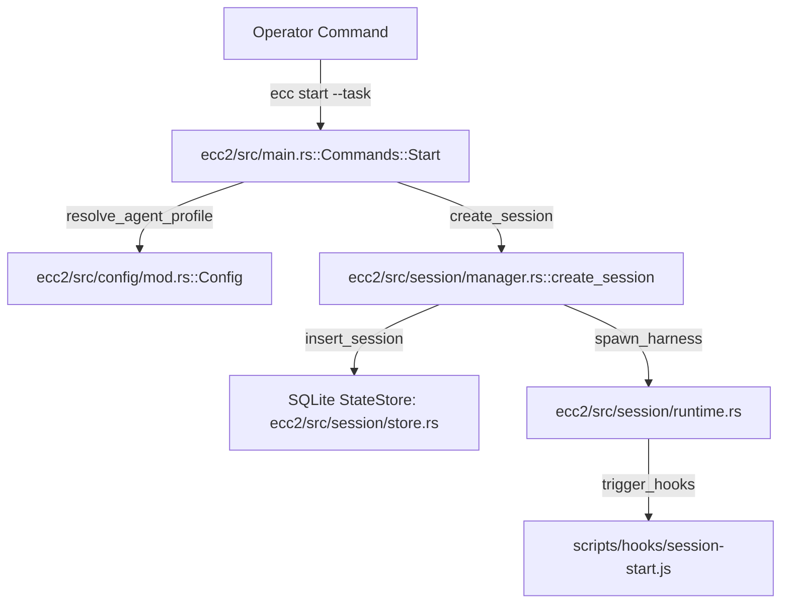
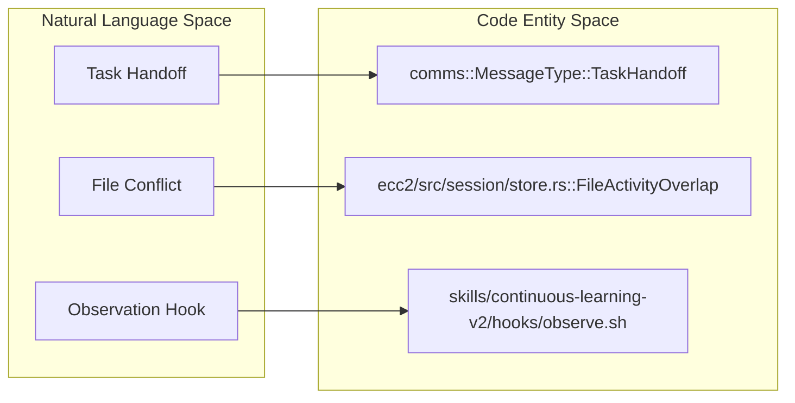

<!-- source: DeepWiki mcp.deepwiki.com · repo affaan-m/ECC · page 13 Glossary · fetched 2026-10-30 -->

# Glossary

Relevant source files

The following files were used as context for generating this wiki page:

- [.claude-plugin/marketplace.json](.claude-plugin/marketplace.json)
- [.claude-plugin/plugin.json](.claude-plugin/plugin.json)
- [AGENTS.md](AGENTS.md)
- [README.md](README.md)
- [README.zh-CN.md](README.zh-CN.md)
- [agent.yaml](agent.yaml)
- [docs/HERMES-OPENCLAW-MIGRATION.md](docs/HERMES-OPENCLAW-MIGRATION.md)
- [docs/HERMES-SETUP.md](docs/HERMES-SETUP.md)
- [docs/MIGRATION-1X-TO-2.0.md](docs/MIGRATION-1X-TO-2.0.md)
- [docs/TROUBLESHOOTING.md](docs/TROUBLESHOOTING.md)
- [docs/gateguard/design-notes.md](docs/gateguard/design-notes.md)
- [docs/hook-bug-workarounds.md](docs/hook-bug-workarounds.md)
- [docs/ja-JP/skills/gateguard/SKILL.md](docs/ja-JP/skills/gateguard/SKILL.md)
- [docs/tr/AGENTS.md](docs/tr/AGENTS.md)
- [docs/tr/CHANGELOG.md](docs/tr/CHANGELOG.md)
- [docs/zh-CN/AGENTS.md](docs/zh-CN/AGENTS.md)
- [docs/zh-CN/CHANGELOG.md](docs/zh-CN/CHANGELOG.md)
- [docs/zh-CN/README.md](docs/zh-CN/README.md)
- [docs/zh-CN/commands/harness-audit.md](docs/zh-CN/commands/harness-audit.md)
- [docs/zh-CN/skills/continuous-learning-v2/agents/observer.md](docs/zh-CN/skills/continuous-learning-v2/agents/observer.md)
- [docs/zh-CN/skills/gateguard/SKILL.md](docs/zh-CN/skills/gateguard/SKILL.md)
- [ecc2/Cargo.lock](ecc2/Cargo.lock)
- [ecc2/Cargo.toml](ecc2/Cargo.toml)
- [ecc2/src/comms/mod.rs](ecc2/src/comms/mod.rs)
- [ecc2/src/config/mod.rs](ecc2/src/config/mod.rs)
- [ecc2/src/main.rs](ecc2/src/main.rs)
- [ecc2/src/notifications.rs](ecc2/src/notifications.rs)
- [ecc2/src/observability/mod.rs](ecc2/src/observability/mod.rs)
- [ecc2/src/session/daemon.rs](ecc2/src/session/daemon.rs)
- [ecc2/src/session/manager.rs](ecc2/src/session/manager.rs)
- [ecc2/src/session/mod.rs](ecc2/src/session/mod.rs)
- [ecc2/src/session/output.rs](ecc2/src/session/output.rs)
- [ecc2/src/session/runtime.rs](ecc2/src/session/runtime.rs)
- [ecc2/src/session/store.rs](ecc2/src/session/store.rs)
- [ecc2/src/tui/app.rs](ecc2/src/tui/app.rs)
- [ecc2/src/tui/dashboard.rs](ecc2/src/tui/dashboard.rs)
- [ecc2/src/tui/widgets.rs](ecc2/src/tui/widgets.rs)
- [ecc2/src/worktree/mod.rs](ecc2/src/worktree/mod.rs)
- [manifests/context-packs/skill-triggers@1.json](manifests/context-packs/skill-triggers@1.json)
- [manifests/install-modules.json](manifests/install-modules.json)
- [package.json](package.json)
- [scripts/hooks/gateguard-fact-force.js](scripts/hooks/gateguard-fact-force.js)
- [scripts/hooks/session-activity-tracker.js](scripts/hooks/session-activity-tracker.js)
- [skills/continuous-learning-v2/SKILL.md](skills/continuous-learning-v2/SKILL.md)
- [skills/continuous-learning-v2/agents/observer.md](skills/continuous-learning-v2/agents/observer.md)
- [skills/continuous-learning-v2/agents/start-observer.sh](skills/continuous-learning-v2/agents/start-observer.sh)
- [skills/continuous-learning-v2/hooks/observe.sh](skills/continuous-learning-v2/hooks/observe.sh)
- [skills/continuous-learning-v2/scripts/detect-project.sh](skills/continuous-learning-v2/scripts/detect-project.sh)
- [skills/continuous-learning-v2/scripts/instinct-cli.py](skills/continuous-learning-v2/scripts/instinct-cli.py)
- [skills/continuous-learning-v2/scripts/test_parse_instinct.py](skills/continuous-learning-v2/scripts/test_parse_instinct.py)
- [skills/gateguard/SKILL.md](skills/gateguard/SKILL.md)
- [tests/hooks/continuous-learning-shebang-consistency.test.js](tests/hooks/continuous-learning-shebang-consistency.test.js)
- [tests/hooks/detect-project-nongit.test.js](tests/hooks/detect-project-nongit.test.js)
- [tests/hooks/detect-project-worktree.test.js](tests/hooks/detect-project-worktree.test.js)
- [tests/hooks/gateguard-fact-force.test.js](tests/hooks/gateguard-fact-force.test.js)
- [tests/hooks/observe-nosurvive-warning.test.js](tests/hooks/observe-nosurvive-warning.test.js)
- [tests/hooks/observe-signal-counter-race.test.js](tests/hooks/observe-signal-counter-race.test.js)
- [tests/hooks/observe-subdirectory-detection.test.js](tests/hooks/observe-subdirectory-detection.test.js)
- [tests/hooks/session-activity-tracker.test.js](tests/hooks/session-activity-tracker.test.js)
- [tests/scripts/instinct-cli-projects.test.js](tests/scripts/instinct-cli-projects.test.js)
- [tests/skills/observer-status-instinct-count.test.js](tests/skills/observer-status-instinct-count.test.js)

This glossary defines technical terms, jargon, abbreviations, and domain concepts specific to the **Everything Claude Code (ECC)** platform (`https://github.com/affaan-m/ECC`). It covers architectural primitives, orchestration logic, and domain-specific terminology introduced across ECC releases, including key concepts such as Plan Canvas, Kimi harness, Itô compute, Nasiko CLI bridge, Antigravity 2.0, MCP connector policy, staged dist-tag, agent-proximity, Homunculus, GateGuard, TCAS leases, and Pi core curation.

Sources: [README.md:1-70](), [package.json:1-40]()

---

## Core System Terminology

### Agent
A specialized AI persona configured with specific tools, model preferences, and domain expertise. ECC provides over 70 agents such as `planner`, `architect`, `tdd-guide`, and language-specific reviewers to handle distinct phases in the software development lifecycle.

- **Implementation:** Agent definitions reside under `.agents/` and `agents/` directories [package.json:55-81]().
- **Orchestration Lifecycle:** Agents follow a **Plan-Execute-Review** pattern to manage tasks autonomously.
- **Common agent classes:** Examples include `ecc:planner` for implementation planning and `ecc:loop-operator` for autonomous loop execution [AGENTS.md:15-50]().

Sources: [AGENTS.md:15-50](), [package.json:55-81]()

### Skill
Structured workflow modules and actionable engineering patterns stored in the `skills/` directory. Skills encapsulate domain-specific how-tos rather than runtime AI roles.

- **Key Usage:** Skills cover diverse areas like `tdd-workflow`, `healthcare-phi-compliance`, and `mcp-server-patterns` [manifests/install-modules.json:184-246]().
- **Distinction:** Unlike agents which act autonomously, skills provide reusable knowledge and scripts invoked by agents or commands.

Sources: [package.json:146-236](), [manifests/install-modules.json:184-246]()

### Hook
Event-triggered automation scripts tied to lifecycle events (e.g., `SessionStart`, `PostToolUse`).

- **Registration:** Hooks are registered in `hooks/hooks.json` and activated via plugin bootstrap for local lifecycle automation [manifests/install-modules.json:99-118]().
- **Purpose:** Enforce quality gates, security policies (e.g., `GateGuard`), and context persistence [scripts/hooks/gateguard-fact-force.js:1-21]().

Sources: [manifests/install-modules.json:99-118](), [scripts/hooks/gateguard-fact-force.js:1-21]()

### Harness
The AI environment or IDE platform where ECC operates.

- **Supported Harnesses:** Claude Code, Codex, Cursor, OpenCode, Gemini, Kimi, Antigravity, and others [package.json:4-4]().
- **Adaptation:** Each harness adapter logic transforms ECC assets (skills, commands, hooks, rules) into the harness-native format.

Sources: [package.json:4-4](), [package.json:53-71]()

---

## Advanced Concepts & Platform Architecture

### Plan Canvas
A visual planning and review tool part of the `ecc2` orchestration features.

- **Use:** Operators inspect and approve complex multi-agent execution graphs before committing worktree changes.
- **Implementation:** Orchestrated through the `orchestrate-worktrees.js` scheduler and `plan-canvas.js` utilities [package.json:159-162]().
- **Role:** Ensures high-level plan visibility and governance in multi-agent workflows.

Sources: [package.json:159-162]()

### Kimi Harness
Dedicated support and configuration for the Moonshot AI Kimi harness.

- **Native Config:** Stored under the `.kimi/` directory [package.json:64-64]().
- **Function:** Enables ECC agents and skills to operate seamlessly in the Kimi IDE environment as a first-class harness.

Sources: [package.json:64-64]()

### Itô Compute
A high-performance compute pattern skill specialized for financial modeling and stochastic calculus.

- **Core File:** `scripts/ito.js` [package.json:154-154]()
- **Scope:** Enables implementing Itô stochastic differential equation based computations within ECC workflows.

Sources: [package.json:154-154]()

### Nasiko CLI Bridge
The interoperability layer enabling communication between the Rust control plane (`ecc2`) and the JavaScript plugin environment.

- **File:** `scripts/nasiko.js` [package.json:155-155]()
- **Role:** Allows `ecc2` Rust binaries to invoke JS CLI commands, facilitating orchestrated execution of JS-powered skills, hooks, and commands.

Sources: [package.json:155-155]()

### Antigravity 2.0
An installation and integration layer specifically for the Antigravity IDE.

- **Directory:** Uses `.agents/` and associated platform configuration manifests [manifests/install-modules.json:36-55]().
- **Cross-Harness Strategy:** Part of the larger multi-harness compatibility and portability approach [manifests/install-modules.json:1-30]().

Sources: [manifests/install-modules.json:1-55]()

### MCP Connector Policy
The governance rules dictating which Model Context Protocol (MCP) connectors are enabled by default.

- **Config Location:** Defined in `mcp-configs/mcp-servers.json` and managed during plugin install [package.json:71-71]().
- **Purpose:** Enforces least-privilege principles on external data model integrations.

Sources: [package.json:71-71]()

### Staged Dist-tag
A release engineering paradigm for managing stable release readiness through npm package distribution tags.

- **Process:** Promotion gated by automated tests, operator readiness reports, and controlled publishing workflows.
- **Tools:** `operator-readiness-dashboard.js` automates visibility and gating metrics [package.json:143-143]().

Sources: [package.json:143-143]()

### Agent-Proximity
A concurrency and collision avoidance subsystem within the `ecc2` orchestration core.

- **Purpose:** Avoids agents working simultaneously on overlapping or dependent files/projects.
- **Implementation:** Uses `FileActivityOverlap` and session leasing under `ecc2/src/session/store.rs` [ecc2/src/session/store.rs:65-72]().

Sources: [ecc2/src/session/store.rs:65-72]()

### Homunculus
A directory scoping mechanism associated with the Instinct System (Continuous Learning v2).

- **Role:** Defines directory boundaries within which an Observer agent observes and extracts recurring patterns.
- **Implementation:** Controlled within `skills/continuous-learning-v2/` and related scripts [package.json:215-215]().

Sources: [package.json:215-215]()

### GateGuard
A security hook enforcing fact-force policies to prevent unauthorized or blind automated edits.

- **Hook File:** `scripts/hooks/gateguard-fact-force.js` [tests/hooks/gateguard-fact-force.test.js:11-11]()
- **Behavior:** On every attempted Edit tool invocation, verifies if the file was "fact-forced" (reviewed/approved) in current session state [scripts/hooks/gateguard-fact-force.js:1-21]().
- **Test Coverage:** Validated in `tests/hooks/gateguard-fact-force.test.js` [tests/hooks/gateguard-fact-force.test.js:1-15]()

Sources: [scripts/hooks/gateguard-fact-force.js:1-21](), [tests/hooks/gateguard-fact-force.test.js:1-15]()

### TCAS Leases (Touched-path Conflict Avoidance System)
A worktree lease and locking mechanism to prevent conflicting parallel mutability on files.

- **Concept:** Tracks concurrent file access/edits to serialize merges and avoid conflicts.
- **Data Structure:** `FileActivityOverlap` struct persists leases with fields for session, branch, touched paths, heartbeat, owner, and epoch [ecc2/src/session/store.rs:65-72]().

Sources: [ecc2/src/session/store.rs:65-72]()

### Pi Core Curation
A curated subset of skills and commands specifically packaged for lightweight deployment targets.

- **Manifest:** Defined in manifests such as `manifests/pi-core.json` (or `.pi` extensions runtime) [package.json:67-67]().
- **Scope:** Enforces strict exclusion rules (`CURATION.md`) to maintain minimal resource consumption in constrained runner environments.

Sources: [package.json:67-67]()

---

## Technical Architecture & Data Flows

### ECC Control Plane Session Initiation Flow

Sources: [ecc2/src/main.rs:117-136](), [ecc2/src/session/manager.rs:26-44](), [ecc2/src/session/store.rs:1-40]()

### Natural Language to Code Entity Space: Orchestration & Instincts

Sources: [ecc2/src/session/store.rs:65-72](), [skills/continuous-learning-v2/hooks/observe.sh:1-10]()

---

## Summary Jargon & Abbreviations

| Term | Definition | Context & File References |
|---|---|---|
| **AgentShield** | Security policy and scanning system protecting agent workflows against unsafe inputs. | Integrated with hooks [package.json:56-56]() |
| **IOC Scanning** | Indicators of Compromise scanning for malicious package dependencies. | `scripts/ci/scan-supply-chain-iocs.js` [package.json:115-115]() |
| **MCP** | Model Context Protocol: standard for connecting AI models with external data sources. | Governs cross-harness connectors [package.json:24-24]() |
| **TCAS** | Touched-path Conflict Avoidance System: prevents simultaneous conflicting file edits. | `FileActivityOverlap` in `ecc2/src/session/store.rs` [ecc2/src/session/store.rs:65-72]() |
| **Fact-Force** | GateGuard security term requiring explicit review before automated edits. | `scripts/hooks/gateguard-fact-force.js` [scripts/hooks/gateguard-fact-force.js:1-21]() |

Sources: [package.json:24-115](), [ecc2/src/session/store.rs:65-72](), [scripts/hooks/gateguard-fact-force.js:1-21]()

---

## Summary of Terms and Corresponding Code Entities

| Term | Code Location | Description |
|---|---|---|
| Plan Canvas | `scripts/plan-canvas.js` | Multi-agent plan visualization and review [package.json:159-162]() |
| Kimi Harness | `.kimi/`, `package.json` | Configuration and integration for Moonshot AI Kimi [package.json:64-64]() |
| Itô Compute | `scripts/ito.js` | High-performance stochastic finance skill [package.json:154-154]() |
| Nasiko CLI Bridge | `scripts/nasiko.js` | Rust→JS bridge for invoking plugin commands from `ecc2` [package.json:155-155]() |
| Antigravity 2.0 | `.agents/` directory | Antigravity IDE integration layer [manifests/install-modules.json:36-55]() |
| MCP Connector Policy | `mcp-configs/mcp-servers.json` | Governance of MCP integrations [package.json:71-71]() |
| Staged Dist-tag | `scripts/operator-readiness-dashboard.js` | Controlled npm package promotion [package.json:143-143]() |
| Agent-Proximity | `ecc2/src/session/store.rs` | Collision avoidance in orchestration engine [ecc2/src/session/store.rs:65-72]() |
| Homunculus | `skills/continuous-learning-v2/` | Directory scoping for continuous learning [package.json:215-215]() |
| GateGuard | `scripts/hooks/gateguard-fact-force.js` | Security hook enforcing review-before-edit policy [scripts/hooks/gateguard-fact-force.js:1-21]() |
| TCAS Leases | `ecc2/src/session/store.rs` | Worktree lease mechanism preventing concurrent edits [ecc2/src/session/store.rs:65-72]() |
| Pi Core Curation | `.pi/`, `manifests/` | Curated subset of skills for lightweight targets [package.json:67-67]() |

Sources: [package.json:64-162](), [ecc2/src/session/store.rs:65-72](), [scripts/hooks/gateguard-fact-force.js:1-21](), [manifests/install-modules.json:36-55]()