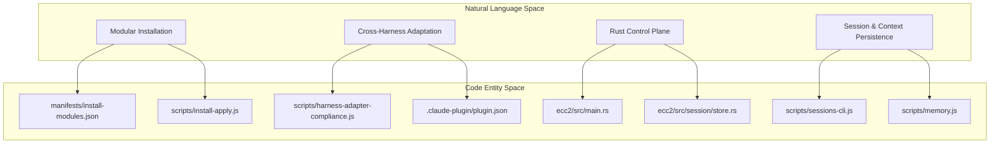
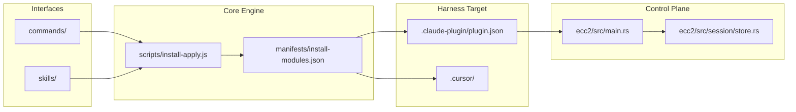

<!-- source: DeepWiki mcp.deepwiki.com · repo affaan-m/ECC · page 2 Core Architecture · fetched 2026-10-30 -->

# Core Architecture

Relevant source files

The following files were used as context for generating this wiki page:

- [.claude-plugin/marketplace.json](.claude-plugin/marketplace.json)
- [.claude-plugin/plugin.json](.claude-plugin/plugin.json)
- [AGENTS.md](AGENTS.md)
- [README.md](README.md)
- [README.zh-CN.md](README.zh-CN.md)
- [agent.yaml](agent.yaml)
- [docs/ECC-2.0-GA-ROADMAP.md](docs/ECC-2.0-GA-ROADMAP.md)
- [docs/architecture/agentshield-enterprise-research-roadmap.md](docs/architecture/agentshield-enterprise-research-roadmap.md)
- [docs/drafts/release-1.10.1-announcement.md](docs/drafts/release-1.10.1-announcement.md)
- [docs/releases/2.0.0-rc.1/naming-and-publication-matrix.md](docs/releases/2.0.0-rc.1/naming-and-publication-matrix.md)
- [docs/releases/2.0.0-rc.1/operator-readiness-dashboard-2026-05-18.md](docs/releases/2.0.0-rc.1/operator-readiness-dashboard-2026-05-18.md)
- [docs/releases/2.0.0-rc.1/operator-readiness-dashboard-2026-05-19.md](docs/releases/2.0.0-rc.1/operator-readiness-dashboard-2026-05-19.md)
- [docs/releases/2.0.0-rc.1/operator-readiness-dashboard-2026-05-20.md](docs/releases/2.0.0-rc.1/operator-readiness-dashboard-2026-05-20.md)
- [docs/releases/2.0.0-rc.1/owner-approval-packet-2026-05-19.md](docs/releases/2.0.0-rc.1/owner-approval-packet-2026-05-19.md)
- [docs/releases/2.0.0-rc.1/preview-pack-manifest.md](docs/releases/2.0.0-rc.1/preview-pack-manifest.md)
- [docs/releases/2.0.0-rc.1/publication-evidence-2026-05-16.md](docs/releases/2.0.0-rc.1/publication-evidence-2026-05-16.md)
- [docs/releases/2.0.0-rc.1/publication-evidence-2026-05-18.md](docs/releases/2.0.0-rc.1/publication-evidence-2026-05-18.md)
- [docs/releases/2.0.0-rc.1/publication-evidence-2026-05-19.md](docs/releases/2.0.0-rc.1/publication-evidence-2026-05-19.md)
- [docs/releases/2.0.0-rc.1/publication-readiness.md](docs/releases/2.0.0-rc.1/publication-readiness.md)
- [docs/releases/2.0.0-rc.1/release-name-plugin-publication-checklist-2026-05-18.md](docs/releases/2.0.0-rc.1/release-name-plugin-publication-checklist-2026-05-18.md)
- [docs/releases/2.0.0-rc.1/release-url-ledger-2026-05-18.md](docs/releases/2.0.0-rc.1/release-url-ledger-2026-05-18.md)
- [docs/releases/2.0.0-rc.1/release-url-ledger-2026-05-19.md](docs/releases/2.0.0-rc.1/release-url-ledger-2026-05-19.md)
- [docs/tr/AGENTS.md](docs/tr/AGENTS.md)
- [docs/zh-CN/AGENTS.md](docs/zh-CN/AGENTS.md)
- [docs/zh-CN/README.md](docs/zh-CN/README.md)
- [manifests/install-modules.json](manifests/install-modules.json)
- [package.json](package.json)
- [scripts/operator-readiness-dashboard.js](scripts/operator-readiness-dashboard.js)
- [scripts/platform-audit.js](scripts/platform-audit.js)
- [scripts/preview-pack-smoke.js](scripts/preview-pack-smoke.js)
- [tests/docs/ecc2-release-surface.test.js](tests/docs/ecc2-release-surface.test.js)
- [tests/scripts/operator-readiness-dashboard.test.js](tests/scripts/operator-readiness-dashboard.test.js)
- [tests/scripts/platform-audit.test.js](tests/scripts/platform-audit.test.js)

## Purpose and Scope

This page provides a high-level overview of the internal architecture of Everything Claude Code (ECC), acting as a harness-native agent operating system [package.json:2-4](). It bridges natural language intent with concrete code entities across a modular installation engine, cross-harness portability adapters, a high-performance Rust control plane (`ecc2`), and advanced context and session management systems [manifests/install-modules.json:1-150](), [docs/ECC-2.0-GA-ROADMAP.md:38-51]().

As a parent page, this document outlines the macro-level system design and links directly to detailed child pages for each architectural subsystem.

---

## System Overview & Component Mapping

ECC divides its operational concerns between a high-level JavaScript/TypeScript runtime that coordinates harness interactions, skills, and hooks, and a robust Rust control plane responsible for background daemon execution, session storage, and worktree isolation [README.zh-CN.md:97-101]().

### Diagram: Macro Architecture to Code Entities

Sources: [manifests/install-modules.json:1-150](), [scripts/install-apply.js:1-120](), [ecc2/src/main.rs](), [scripts/sessions-cli.js]()

---

## Major Architectural Subsystems

### 2.1 Plugin & Manifest System

The plugin and manifest system governs how components are registered, verified, and installed across target environments. Manifests such as `install-modules.json` define discrete component families (`rules-core`, `agents-core`, `commands-core`, `hooks-runtime`) alongside their dependencies and target harnesses [manifests/install-modules.json:1-118](). The installation pipeline (`install-apply.js`) coordinates profile selection, Nasiko CLI lifecycle integration, and repair/doctor workflows [scripts/install-apply.js:1-120]().

For detailed coverage of manifests, profiles, component families, and lifecycle management, see [Plugin & Manifest System](#2.1).

Sources: [manifests/install-modules.json:1-118](), [scripts/install-apply.js:1-120]()

---

### 2.2 Cross-Harness Portability

ECC assets are designed to execute seamlessly across diverse AI coding assistants and harnesses. The cross-harness portability model utilizes compliance validators (`harness-adapter-compliance.js`) and adapter scripts to transform rules, prompts, and tool definitions into formats native to Claude Code, Cursor, OpenCode, Codex, Gemini, Zed, and other supported platforms [package.json:2-4](), [manifests/install-modules.json:11-25]().

For adapter compliance matrices and portability policies, see [Cross-Harness Portability](#2.2).

Sources: [package.json:2-4](), [manifests/install-modules.json:11-25]()

---

### 2.3 ECC 2.0 Rust Control Plane (`ecc2`)

The `ecc2` directory houses the high-performance Rust control plane, engineered to manage long-running daemon tasks, SQLite-backed session data, worktree isolation, and inter-agent coordination [docs/ECC-2.0-GA-ROADMAP.md:38-51](). It provides a terminal user interface (TUI) dashboard and structured telemetry export while isolating agentic loops from transient runtime constraints.

For in-depth technical documentation on the Rust codebase, daemon lifecycles, and worktree isolation, see [ECC 2.0 Rust Control Plane (ecc2)](#2.3).

Sources: [docs/ECC-2.0-GA-ROADMAP.md:38-51]()

---

### 2.4 Session Management & Persistence

Session continuity across restarts is managed via dedicated start/end hooks, file-locking state stores, and session adapter contracts [README.zh-CN.md:100-112](). The subsystem incorporates stale-replay guards, context injection routines, and alias resolution to maintain coherent execution state over multi-step development sessions.

For details on session persistence and file-lock state stores, see [Session Management & Persistence](#2.4).

Sources: [README.zh-CN.md:100-112]()

---

### 2.5 MCP Server Integration

Model Context Protocol (MCP) servers expand agent capabilities through standardized connectors defined in `mcp-servers.json` [manifests/install-modules.json:122-129](). The integration subsystem handles opt-in server policies, configuration merging during installation, health-check hooks (`mcp-health-check`), and specialized memory MCP servers for cross-session knowledge retrieval [README.zh-CN.md:104-131]().

For configuration policies and MCP server setups, see [MCP Server Integration](#2.5).

Sources: [manifests/install-modules.json:122-129](), [README.zh-CN.md:104-131]()

---

### 2.6 Context Packs, Profiles & Carriers

Context selection and routing are handled via context-pack registries, profile compilation engines, and carrier closure validation [package.json:90-93](). This layer optimizes token budgets through specialized skills and provides isolated evaluation environments within the `docker/context-profiles` testing lab.

For information on context compilation, budgets, and evaluation labs, see [Context Packs, Profiles & Carriers](#2.6).

Sources: [package.json:90-93]()

---

## Architectural Component Flow

Sources: [manifests/install-modules.json:1-151](), [scripts/install-apply.js:1-120](), [.claude-plugin/plugin.json:1-46]()

---

