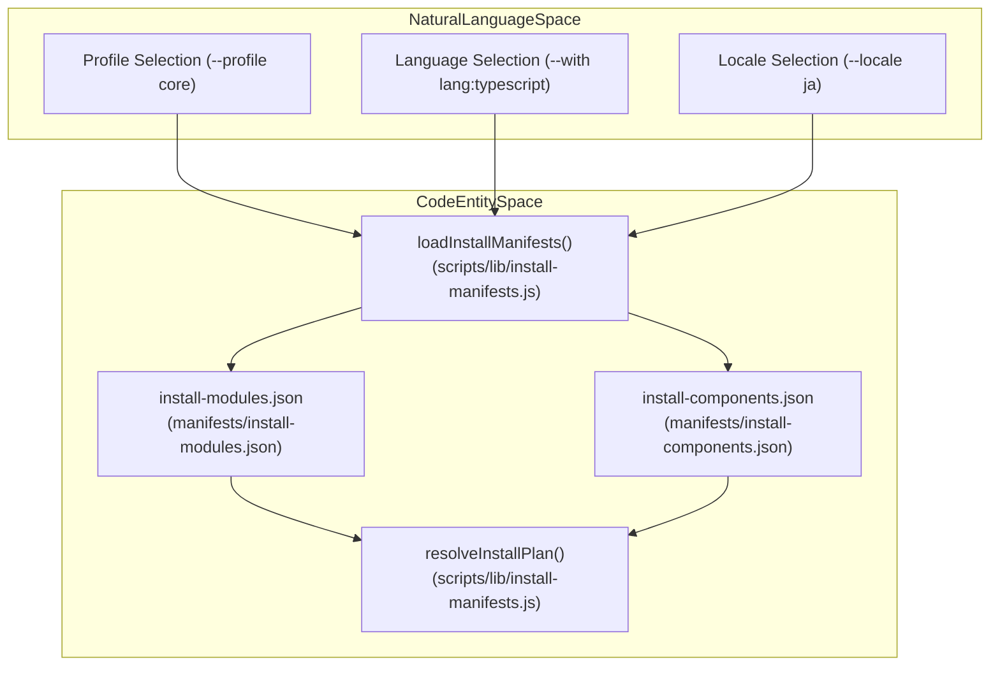
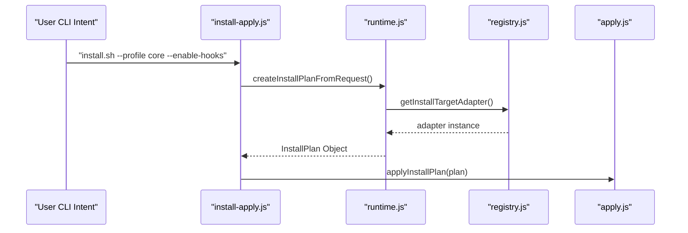

<!-- source: DeepWiki mcp.deepwiki.com · repo affaan-m/ECC · page 2.1 Plugin & Manifest System · fetched 2026-10-30 -->

# Plugin & Manifest System

Relevant source files

The following files were used as context for generating this wiki page:

- [.agents/plugins/marketplace.json](.agents/plugins/marketplace.json)
- [.codex-plugin/README.md](.codex-plugin/README.md)
- [.codex-plugin/plugin.json](.codex-plugin/plugin.json)
- [manifests/install-components.json](manifests/install-components.json)
- [plugins/ecc/.codex-plugin/plugin.json](plugins/ecc/.codex-plugin/plugin.json)
- [schemas/ecc-install-config.schema.json](schemas/ecc-install-config.schema.json)
- [schemas/install-modules.schema.json](schemas/install-modules.schema.json)
- [schemas/install-state.schema.json](schemas/install-state.schema.json)
- [scripts/install-apply.js](scripts/install-apply.js)
- [scripts/lib/atomic-write.js](scripts/lib/atomic-write.js)
- [scripts/lib/install-executor.js](scripts/lib/install-executor.js)
- [scripts/lib/install-lifecycle.js](scripts/lib/install-lifecycle.js)
- [scripts/lib/install-manifests.js](scripts/lib/install-manifests.js)
- [scripts/lib/install-state.js](scripts/lib/install-state.js)
- [scripts/lib/install-targets/claude-home.js](scripts/lib/install-targets/claude-home.js)
- [scripts/lib/install-targets/codex-home.js](scripts/lib/install-targets/codex-home.js)
- [scripts/lib/install-targets/cursor-project.js](scripts/lib/install-targets/cursor-project.js)
- [scripts/lib/install-targets/helpers.js](scripts/lib/install-targets/helpers.js)
- [scripts/lib/install-targets/registry.js](scripts/lib/install-targets/registry.js)
- [scripts/lib/install/apply.js](scripts/lib/install/apply.js)
- [scripts/lib/install/claude-settings-lock.js](scripts/lib/install/claude-settings-lock.js)
- [scripts/lib/install/claude-settings.js](scripts/lib/install/claude-settings.js)
- [scripts/lib/install/hook-consent.js](scripts/lib/install/hook-consent.js)
- [scripts/lib/install/inventory.js](scripts/lib/install/inventory.js)
- [scripts/lib/install/opencode-legacy-migration.js](scripts/lib/install/opencode-legacy-migration.js)
- [scripts/lib/install/request.js](scripts/lib/install/request.js)
- [scripts/lib/install/runtime.js](scripts/lib/install/runtime.js)
- [scripts/release.sh](scripts/release.sh)
- [tests/lib/atomic-write.test.js](tests/lib/atomic-write.test.js)
- [tests/lib/claude-config-tilde.test.js](tests/lib/claude-config-tilde.test.js)
- [tests/lib/claude-settings-lock.test.js](tests/lib/claude-settings-lock.test.js)
- [tests/lib/claude-settings.test.js](tests/lib/claude-settings.test.js)
- [tests/lib/extracted-resolver-wsl.test.js](tests/lib/extracted-resolver-wsl.test.js)
- [tests/lib/guarded-write.test.js](tests/lib/guarded-write.test.js)
- [tests/lib/helpers/assert-file-postimage.js](tests/lib/helpers/assert-file-postimage.js)
- [tests/lib/helpers/load-with-file-system.js](tests/lib/helpers/load-with-file-system.js)
- [tests/lib/helpers/session-alias-worker.js](tests/lib/helpers/session-alias-worker.js)
- [tests/lib/helpers/settings-lock-worker.js](tests/lib/helpers/settings-lock-worker.js)
- [tests/lib/hook-consent.test.js](tests/lib/hook-consent.test.js)
- [tests/lib/inline-fallback-shell.test.js](tests/lib/inline-fallback-shell.test.js)
- [tests/lib/install-executor.test.js](tests/lib/install-executor.test.js)
- [tests/lib/install-lifecycle.test.js](tests/lib/install-lifecycle.test.js)
- [tests/lib/install-manifests.test.js](tests/lib/install-manifests.test.js)
- [tests/lib/install-request.test.js](tests/lib/install-request.test.js)
- [tests/lib/install-state.test.js](tests/lib/install-state.test.js)
- [tests/lib/install-targets.test.js](tests/lib/install-targets.test.js)
- [tests/lib/opencode-consent-legacy-lock.test.js](tests/lib/opencode-consent-legacy-lock.test.js)
- [tests/lib/opencode-hook-consent-safety.test.js](tests/lib/opencode-hook-consent-safety.test.js)
- [tests/lib/opencode-legacy-migration.test.js](tests/lib/opencode-legacy-migration.test.js)
- [tests/lib/serialized-hook-wsl.test.js](tests/lib/serialized-hook-wsl.test.js)
- [tests/lib/session-aliases-concurrency.test.js](tests/lib/session-aliases-concurrency.test.js)
- [tests/lib/session-aliases-read.test.js](tests/lib/session-aliases-read.test.js)
- [tests/plugin-manifest.test.js](tests/plugin-manifest.test.js)
- [tests/scripts/auto-update.test.js](tests/scripts/auto-update.test.js)
- [tests/scripts/install-apply.test.js](tests/scripts/install-apply.test.js)
- [tests/scripts/install-dry-run.test.js](tests/scripts/install-dry-run.test.js)
- [tests/scripts/manual-hook-install-docs.test.js](tests/scripts/manual-hook-install-docs.test.js)

The Plugin & Manifest System is the foundational modular installation, configuration, and harness-adaptation engine for Everything Claude Code (ECC). It transitions the codebase from a monolithic collection of shell scripts into a deterministic, manifest-driven architecture supporting multiple AI code harnesses (including Claude Code, Cursor, OpenCode, Antigravity, and Codex) via a unified resolution and execution pipeline.

---

## 1. Manifest Hierarchy & Component Families

ECC manages its extensive library of skills, agents, commands, and rules through structured JSON manifests located in the `manifests/` directory.

### Manifest Components
- **`install-modules.json`**: Defines the atomic modules of installation, mapping module IDs to source paths, compatible targets, and dependencies `[scripts/lib/install-manifests.js:52-115]()`.
- **`install-profiles.json`**: Groups modules into curated installation profiles (`minimal`, `core`, `full`) `[manifests/install-profiles.json]()`.
- **`install-components.json`**: Exposes user-facing component families (`baseline:`, `lang:`, `framework:`, `capability:`, `agent:`, `skill:`, `locale:`) that map human-readable features to underlying modules `[scripts/lib/install-manifests.js:9-43]()`.

### Natural Language Space to Code Entity Space: Manifest Resolution
The following diagram maps high-performance installation intent to specific code entities within the manifest subsystem.

**Sources:** `[scripts/lib/install-manifests.js:1-100]`, `[tests/lib/install-manifests.test.js:75-142]()`

---

## 2. Installation Pipeline & Guided Multi-Harness Setup

The installation runtime is coordinated by `scripts/install-apply.js` and backed by `scripts/lib/install/apply.js` and `scripts/lib/install/runtime.js`.

### Execution Flow
1. **Request Normalization**: CLI flags and config files are parsed via `parseInstallArgs` in `scripts/lib/install/request.js` `[scripts/install-apply.js:15-19]()`.
2. **Plan Creation**: `createInstallPlanFromRequest` resolves dependency closures and selects target adapters from `scripts/lib/install-targets/registry.js` `[scripts/lib/install/runtime.js:1-67]()`.
3. **Execution**: `applyInstallPlan` carries out operations atomically with dry-run support, link rewriting, and state persistence `[scripts/lib/install/apply.js:1-71]()`.

### Natural Language Space to Code Entity Space: Execution Pipeline

**Sources:** `[scripts/install-apply.js:1-156]`, `[scripts/lib/install/apply.js:1-75]`, `[scripts/lib/install/runtime.js:1-59]()`

---

## 3. Install State Ledger & Drift Detection

Every successful installation persists an installation state file (e.g., `install-state.json` or `ecc-install-state.json`) containing cryptographic records of all managed files `[scripts/lib/install-state.js:1-50]()`.

- **Cryptographic Digests**: During application, `stateWithContentDigests` computes SHA-256 hashes of installed file contents (`contentSha256`) using no-follow file descriptors `[scripts/lib/install/apply.js:151-183]()`.
- **Drift Tracking**: This ledger allows ECC to distinguish between user-owned files and managed assets during updates or audits.

**Sources:** `[scripts/lib/install-state.js:1-50]`, `[scripts/lib/install/apply.js:151-183]()`

---

## 4. Doctor, Repair, and Uninstall Lifecycle

Lifecycle operations are implemented in `scripts/lib/install-lifecycle.js`:

- **Doctor (`buildDoctorReport`)**: Scans the filesystem against the `install-state.json` ledger to identify missing files, deleted assets, or unexpected content modifications `[scripts/lib/install-lifecycle.js:12-13]()`.
- **Repair (`repairInstalledStates`)**: Re-applies managed file operations for corrupted or missing assets while protecting user-modified code `[scripts/lib/install-lifecycle.js:15-16]()`.
- **Uninstall (`uninstallInstalledStates`)**: Removes all assets registered as managed under the install state, cleaning up empty parent directories while preserving unmanaged user data `[scripts/lib/install-lifecycle.js:16]()`.
- **Nasiko CLI Lifecycle Bridge**: Synchronizes ECC's deployment state with Nasiko's CLI lifecycle management through dedicated control plane components `[manifests/install-components.json:206-212]()`.

**Sources:** `[scripts/lib/install-lifecycle.js:1-190]`, `[tests/lib/install-lifecycle.test.js:1-150]()`

---

## 5. Implementation Details: Link Rewriting & Path Safety

- **Link Rewriting**: When rules are installed into namespaced subdirectories (e.g., `.claude/rules/ecc/`), relative documentation links are automatically remapped using `buildLinkIndexForPlan` and `rewriteRelativeLinks` `[scripts/lib/install/apply.js:63-84]()`.
- **Path Safety**: Path traversals are blocked using `assertWithinTrustedRoot`, and file inspections use `readInstalledFileNoFollow` with `O_NOFOLLOW` flags to prevent symlink race attacks during integrity verification `[scripts/lib/install/apply.js:24-33]`, `[scripts/lib/install/apply.js:114-149]()`.

**Sources:** `[scripts/lib/install/apply.js:24-149]()`

---

