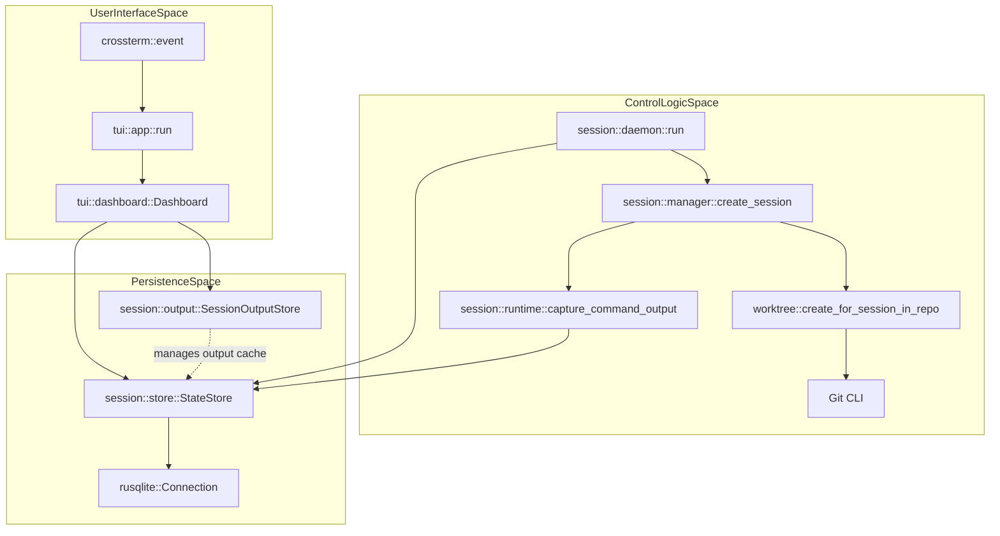
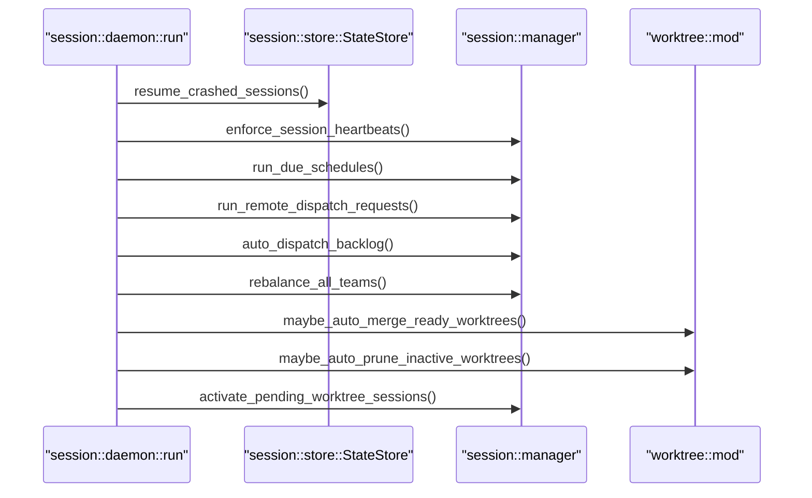
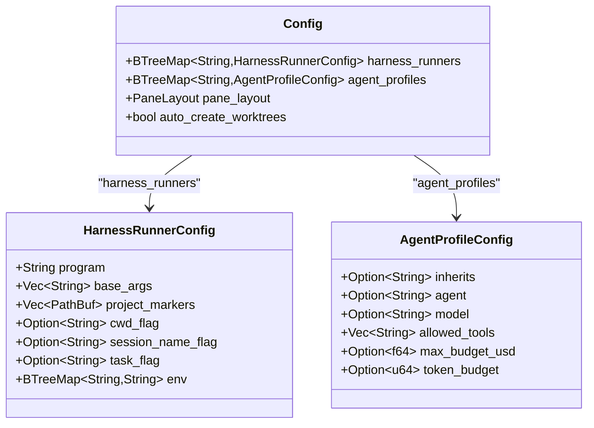

<!-- source: DeepWiki mcp.deepwiki.com · repo affaan-m/ECC · page 2.3 ECC 2.0 Rust Control Plane (ecc2) · fetched 2026-10-30 -->

# ECC 2.0 Rust Control Plane (ecc2)

Relevant source files

The following files were used as context for generating this wiki page:

- [docs/HERMES-OPENCLAW-MIGRATION.md](docs/HERMES-OPENCLAW-MIGRATION.md)
- [docs/HERMES-SETUP.md](docs/HERMES-SETUP.md)
- [docs/architecture/evaluator-rag-prototype.md](docs/architecture/evaluator-rag-prototype.md)
- [docs/tr/CHANGELOG.md](docs/tr/CHANGELOG.md)
- [docs/zh-CN/CHANGELOG.md](docs/zh-CN/CHANGELOG.md)
- [docs/zh-CN/commands/harness-audit.md](docs/zh-CN/commands/harness-audit.md)
- [ecc2/Cargo.lock](ecc2/Cargo.lock)
- [ecc2/Cargo.toml](ecc2/Cargo.toml)
- [ecc2/README.md](ecc2/README.md)
- [ecc2/src/comms/mod.rs](ecc2/src/comms/mod.rs)
- [ecc2/src/config/mod.rs](ecc2/src/config/mod.rs)
- [ecc2/src/harness_eval.rs](ecc2/src/harness_eval.rs)
- [ecc2/src/main.rs](ecc2/src/main.rs)
- [ecc2/src/notifications.rs](ecc2/src/notifications.rs)
- [ecc2/src/observability/mod.rs](ecc2/src/observability/mod.rs)
- [ecc2/src/session/daemon.rs](ecc2/src/session/daemon.rs)
- [ecc2/src/session/manager.rs](ecc2/src/session/manager.rs)
- [ecc2/src/session/mod.rs](ecc2/src/session/mod.rs)
- [ecc2/src/session/output.rs](ecc2/src/session/output.rs)
- [ecc2/src/session/runtime.rs](ecc2/src/session/runtime.rs)
- [ecc2/src/session/store.rs](ecc2/src/session/store.rs)
- [ecc2/src/tui/app.rs](ecc2/src/tui/app.rs)
- [ecc2/src/tui/dashboard.rs](ecc2/src/tui/dashboard.rs)
- [ecc2/src/tui/widgets.rs](ecc2/src/tui/widgets.rs)
- [ecc2/src/worktree/mod.rs](ecc2/src/worktree/mod.rs)
- [examples/evaluator-rag-prototype/deep-analyzer-evidence/candidate-playbook.md](examples/evaluator-rag-prototype/deep-analyzer-evidence/candidate-playbook.md)
- [examples/evaluator-rag-prototype/deep-analyzer-evidence/report.json](examples/evaluator-rag-prototype/deep-analyzer-evidence/report.json)
- [examples/evaluator-rag-prototype/deep-analyzer-evidence/scenario.json](examples/evaluator-rag-prototype/deep-analyzer-evidence/scenario.json)
- [examples/evaluator-rag-prototype/deep-analyzer-evidence/trace.json](examples/evaluator-rag-prototype/deep-analyzer-evidence/trace.json)
- [examples/evaluator-rag-prototype/deep-analyzer-evidence/verifier-result.json](examples/evaluator-rag-prototype/deep-analyzer-evidence/verifier-result.json)
- [examples/evaluator-rag-prototype/skill-quality-evidence/candidate-playbook.md](examples/evaluator-rag-prototype/skill-quality-evidence/candidate-playbook.md)
- [examples/evaluator-rag-prototype/skill-quality-evidence/report.json](examples/evaluator-rag-prototype/skill-quality-evidence/report.json)
- [examples/evaluator-rag-prototype/skill-quality-evidence/scenario.json](examples/evaluator-rag-prototype/skill-quality-evidence/scenario.json)
- [examples/evaluator-rag-prototype/skill-quality-evidence/trace.json](examples/evaluator-rag-prototype/skill-quality-evidence/trace.json)
- [examples/evaluator-rag-prototype/skill-quality-evidence/verifier-result.json](examples/evaluator-rag-prototype/skill-quality-evidence/verifier-result.json)
- [scripts/hooks/session-activity-tracker.js](scripts/hooks/session-activity-tracker.js)
- [tests/docs/evaluator-rag-prototype.test.js](tests/docs/evaluator-rag-prototype.test.js)
- [tests/hooks/session-activity-tracker.test.js](tests/hooks/session-activity-tracker.test.js)

The ECC 2.0 Rust Control Plane (`ecc2`) is a high-performance, asynchronous orchestration engine designed to manage the lifecycle of AI agent sessions. It features a rich Terminal User Interface (TUI) dashboard (`tui::dashboard::Dashboard`) for real-time monitoring, a persistent background daemon (`session::daemon::run`) performing continuous maintenance, and a robust SQLite-based state store (`session::store::StateStore`). To ensure isolated development environments, `ecc2` utilizes Git worktree isolation per session via the `worktree` module. Additionally, it facilitates inter-agent messaging for task delegation and coordination, and includes observability tooling for detailed insight into system operations.

Sources: [ecc2/Cargo.toml:2-5](), [ecc2/src/main.rs:60-60](), [ecc2/src/tui/dashboard.rs:107](), [ecc2/src/session/daemon.rs:20](), [ecc2/src/session/store.rs:27](), [ecc2/src/worktree/mod.rs:96]()

---

## System Architecture & Concurrency Model

The `ecc2` control plane is implemented in Rust leveraging the **Tokio** async runtime (`tokio`) for concurrent event-driven execution [ecc2/Cargo.toml:20-20](), [ecc2/src/main.rs:1-8](). It employs multi-threading to partition TUI rendering, background daemon loops, and SQLite database interactions, ensuring responsive UI and robust background operation.

- **Persistence Layer:** Wrapped by `StateStore`, a persistent SQLite connection (`rusqlite::Connection`) with foreign key enforcement and busy timeouts manages session and messaging state [ecc2/src/session/store.rs:27-29]().
- **Session Management:** Session lifecycle control and logic reside in `session::manager`, which handles creation (`create_session`), scheduling (`run_due_schedules`), and delegation of agent sessions [ecc2/src/session/manager.rs:26-156]().
- **Background Operations:** The daemon (`session::daemon::run`) continuously monitors session heartbeats, performs crash recovery (`resume_crashed_sessions`), scheduled task dispatch, and backlog coordination [ecc2/src/session/daemon.rs:20-56]().
- **Git Worktree Isolation:** Managed via `worktree::create_for_session_in_repo`, agent sessions operate within dedicated Git worktrees to avoid cross-session file conflicts [ecc2/src/worktree/mod.rs:96-149]().
- **TUI Dashboard:** Implemented with `ratatui` and `crossterm`, `tui::app::run` drives the `Dashboard` state machine for monitoring sessions, logs, metrics, and output streams [ecc2/src/tui/dashboard.rs:107](), [ecc2/src/tui/app.rs:15-26]().

### Diagram: Control Plane Code Entity Architecture

Sources: [ecc2/src/main.rs:1-8](), [ecc2/src/tui/app.rs:15-23](), [ecc2/src/session/manager.rs:26-32](), [ecc2/src/session/store.rs:27-29](), [ecc2/src/session/output.rs](), [ecc2/src/session/daemon.rs:20-56](), [ecc2/src/worktree/mod.rs:96-128]()

---

## Session Lifecycle Management

Sessions are the fundamental units of work, representing AI agent tasks that execute via various harnesses (`HarnessKind`) such as Claude, Codex, OpenCode, etc. [ecc2/src/session/mod.rs:16-31](). Each session is associated with a task description, agent type, optional profile, working directory, and optional Git worktree.

### Session State Machine

Session state transitions (`SessionState`) are strictly controlled via `StateStore`, with validation and repair performed by the background daemon (`session::daemon::resume_crashed_sessions`) [ecc2/src/session/store.rs](), [ecc2/src/session/daemon.rs:58-92]().

| State        | Allowed Next States                      | Description                                |
|--------------|----------------------------------------|--------------------------------------------|
| `Pending`    | `Running`, `Failed`, `Stopped`          | Queued for execution, pre-start            |
| `Running`    | `Idle`, `Completed`, `Failed`, `Stopped` | Active agent process with a PID           |
| `Idle`       | `Running`, `Completed`, `Stopped`       | Process alive but waiting for input       |
| `Completed`  | *Terminal*                              | Successfully finished task                 |
| `Failed`     | `Pending` (retry)                      | Crashed or non-zero exit                   |
| `Stopped`    | *Terminal*                              | Manually stopped                           |

The daemon detects crashed sessions by verifying PID liveness (`session::daemon::resume_crashed_sessions_with`), marking stale running sessions as `Failed` on startup [ecc2/src/session/daemon.rs:58-92]().

### Session Creation & Delegation

Sessions are created via async functions like `manager::create_session_with_profile_and_grouping` in `session::manager`, taking parameters:
- `task`: Task description string
- `agent_type`: Agent harness name
- `use_worktree`: Whether to use worktree isolation
- `profile_name`: Optional named agent profile (`SessionAgentProfile`)
- `grouping`: Project/task-group metadata (`SessionGrouping`)

Delegation chains are supported where a session can be spawned from a source session (`create_session_from_source_with_profile_and_grouping`), inheriting context or continuing work [ecc2/src/session/manager.rs:26-114]().

Sources: [ecc2/src/session/manager.rs:26-114](), [ecc2/src/session/store.rs](), [ecc2/src/session/daemon.rs:58-92](), [ecc2/src/session/mod.rs:16-31]()

---

## Git Worktree Isolation

To maintain environment isolation and prevent file pollution or conflicts, each agent session optionally runs inside a dedicated Git worktree managed by the `worktree` module.

- **Worktree Creation:** The function `worktree::create_for_session_in_repo` computes a session-specific branch name (`worktree::branch_name_for_session`) using a configured prefix plus the session ID, then invokes `git worktree add -b <branch>` [ecc2/src/worktree/mod.rs:96-149]().
- **Shared Dependency Sync:** Upon worktree creation, `worktree::sync_shared_dependency_dirs_in_repo` synchronizes shared dependency directories into the new worktree to optimize caching [ecc2/src/worktree/mod.rs:141-147]().
- **Worktree Removal:** The daemon periodically calls `worktree::remove` on `WorktreeInfo` instances from inactive sessions, which safely removes the worktree directory and deletes the corresponding Git branch [ecc2/src/worktree/mod.rs:178-227](), [ecc2/src/session/daemon.rs:46-48]().

Sources: [ecc2/src/worktree/mod.rs:96-227](), [ecc2/src/session/daemon.rs:46-48]()

---

## Background Daemon

The background daemon (`session::daemon::run`) runs indefinitely as a Tokio async task responsible for monitoring session states, heartbeats, scheduling, backlog management, and cleanup operations [ecc2/src/session/daemon.rs:20-56]().

Its main loop performs:
1. **Crash Recovery:** Calls `session::daemon::resume_crashed_sessions` on startup [ecc2/src/session/daemon.rs:22, 58-92]().
2. **Session Heartbeats:** Calls `manager::enforce_session_heartbeats` [ecc2/src/session/daemon.rs:95-97]().
3. **Scheduled Task Dispatch:** Calls `manager::run_due_schedules` [ecc2/src/session/daemon.rs:100-106]().
4. **Remote Dispatch Handling:** Calls `manager::run_remote_dispatch_requests` [ecc2/src/session/daemon.rs:108-125]().
5. **Backlog Coordination:** Executes `maybe_auto_dispatch` and `manager::rebalance_all_teams` [ecc2/src/session/daemon.rs:145-184]().
6. **Auto Merging & Pruning:** Calls `maybe_auto_merge_ready_worktrees` and `maybe_auto_prune_inactive_worktrees` [ecc2/src/session/daemon.rs:42-48]().
7. **Activating Worktrees:** Calls `manager::activate_pending_worktree_sessions` [ecc2/src/session/daemon.rs:50-52]().

### Diagram: Daemon Execution Loop (Code Entity Flow)

Sources: [ecc2/src/session/daemon.rs:20-56](), [ecc2/src/session/manager.rs:116-156](), [ecc2/src/session/store.rs:125-196]()

---

## TUI Dashboard & Observability

The TUI dashboard provides an interactive terminal UI for real-time insight into sessions, output logs, metrics, and tools usage. It leverages `ratatui` for UI rendering and `crossterm` for terminal event handling (`tui::app::run`) [ecc2/src/tui/dashboard.rs:1-197](), [ecc2/src/tui/app.rs:1-28]().

### Dashboard Architecture

The `Dashboard` struct encapsulates cached sessions, output line records (`session::output::OutputLine`), harness metadata, filters, cursor state, pane layout modes, and notification drivers (`DesktopNotifier`, `WebhookNotifier`) [ecc2/src/tui/dashboard.rs:107-183](). Output records are processed using bounded ring buffers via `append_output_records` [ecc2/src/tui/dashboard.rs:82-105]().

### Observability Features

- **Token & Cost Metering:** Displays token usage and estimated cost per session with live updating (`tui::widgets::TokenMeter`) [ecc2/src/tui/widgets.rs](), [ecc2/src/tui/dashboard.rs:14]().
- **Output Buffering:** Session output lines are held in a capped ring buffer (`OUTPUT_BUFFER_LIMIT`) to enable performant scrolling and incremental updates [ecc2/src/session/output.rs:20-70](), [ecc2/src/tui/dashboard.rs:97]().
- **Tool Activity Logs:** `ToolLogEntry` entities collected in `observability` provide detailed audit trails of tool invocation parameters and risk ratings [ecc2/src/observability::ToolLogEntry](), visible via the log pane.
- **Search & Filters:** Scopes and agent filters enable operators to drill down into session outputs and messages [ecc2/src/tui/dashboard.rs:150-174]().

Sources: [ecc2/src/tui/dashboard.rs:10-197](), [ecc2/src/tui/app.rs:15-128](), [ecc2/src/session/output.rs:20-70](), [ecc2/src/observability/mod.rs](), [ecc2/src/tui/widgets.rs:14-16]()

---

## Inter-Agent Messaging (Comms)

The `comms` module handles asynchronous inter-agent communication following a structured message protocol persisted in SQLite via `StateStore` [ecc2/src/comms/mod.rs](), [ecc2/src/session/store.rs]().

Core message types include:
- `TaskHandoff`: Delegates a sub-task from a lead session to a child [ecc2/src/comms/mod.rs]()
- `Query`: Requests context or verification information [ecc2/src/comms/mod.rs]()
- `Response`: Replies to a `Query` message [ecc2/src/comms/mod.rs]()
- `Conflict`: Reports file or logical conflicts between sessions [ecc2/src/comms/mod.rs]()

Messaging is crucial for orchestrating multi-agent workflows, managing delegated task handoffs, and resolving conflicts between parallel edits.

Sources: [ecc2/src/comms/mod.rs](), [ecc2/src/session/store.rs:65-97]()

---

## Configuration Engine

The configuration system defines runtime behavior through `ecc2.toml`, with schema and structs established in the `config` module (`config::Config`) [ecc2/src/config/mod.rs:1-111]().

Key configurations include:
- **Harness Runners:** `HarnessRunnerConfig` defines external harness executable programs, CLI argument templates, and environment variables [ecc2/src/config/mod.rs:94-111]().
- **Agent Profiles:** `AgentProfileConfig` and `ResolvedAgentProfile` specify resource limits (max budget in USD, token quotas), allowed/disallowed tools, and system prompt extensions [ecc2/src/config/mod.rs:65-90]().
- **Layout Settings:** `PaneLayout` defines TUI pane layouts (`Horizontal`, `Vertical`, `Grid`) [ecc2/src/config/mod.rs:12-20]().
- **Conflict Resolution:** `ConflictResolutionConfig` defines strategies (`Escalate`, `LastWriteWins`, `Merge`) for conflicting file edits [ecc2/src/config/mod.rs:38-51]().

### Diagram: Configuration Schema Hierarchy

Sources: [ecc2/src/config/mod.rs:1-111]()

---

# Summary

The ECC 2.0 Rust Control Plane (`ecc2`) is a sophisticated orchestrator blending async concurrency, embedded terminal UI, persistent SQLite state, and Git-worktree isolation to provide a robust foundation for AI agent lifecycle management. Its modular design includes:
- Session lifecycle management with precise state control and delegation (`session::manager`, `session::store`)
- Worktree isolation to avoid file conflicts (`worktree`)
- A vigilant background daemon performing maintenance, scheduling, and backlog coordination (`session::daemon`)
- A multi-pane TUI dashboard displaying live metrics, logs, session outputs, and diffs (`tui::dashboard`)
- Inter-agent messaging infrastructure for delegated workflows and conflict reporting (`comms`)
- A flexible configuration engine governing harness runners and agent profiles (`config`)

Sources: [ecc2/src/session/manager.rs](), [ecc2/src/session/store.rs](), [ecc2/src/session/daemon.rs](), [ecc2/src/tui/dashboard.rs](), [ecc2/src/comms/mod.rs](), [ecc2/src/config/mod.rs]()

---

# References

- `ecc2/src/main.rs`
- `ecc2/src/session/manager.rs`
- `ecc2/src/session/store.rs`
- `ecc2/src/session/daemon.rs`
- `ecc2/src/tui/dashboard.rs`
- `ecc2/src/tui/app.rs`
- `ecc2/src/session/output.rs`
- `ecc2/src/observability/mod.rs`
- `ecc2/src/worktree/mod.rs`
- `ecc2/src/comms/mod.rs`
- `ecc2/src/config/mod.rs`

---

