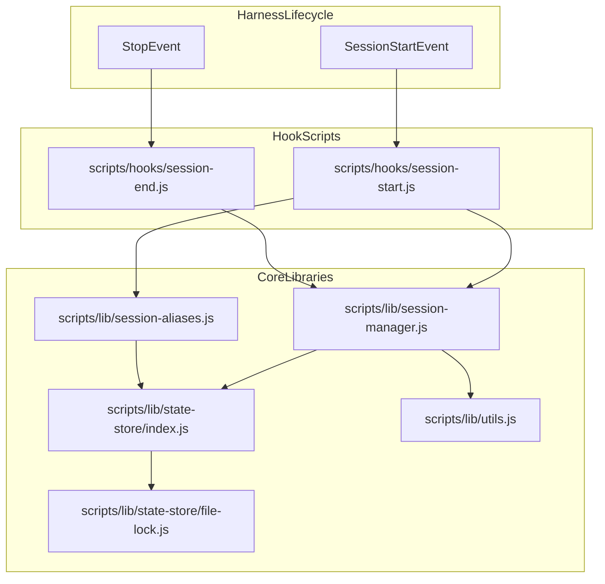
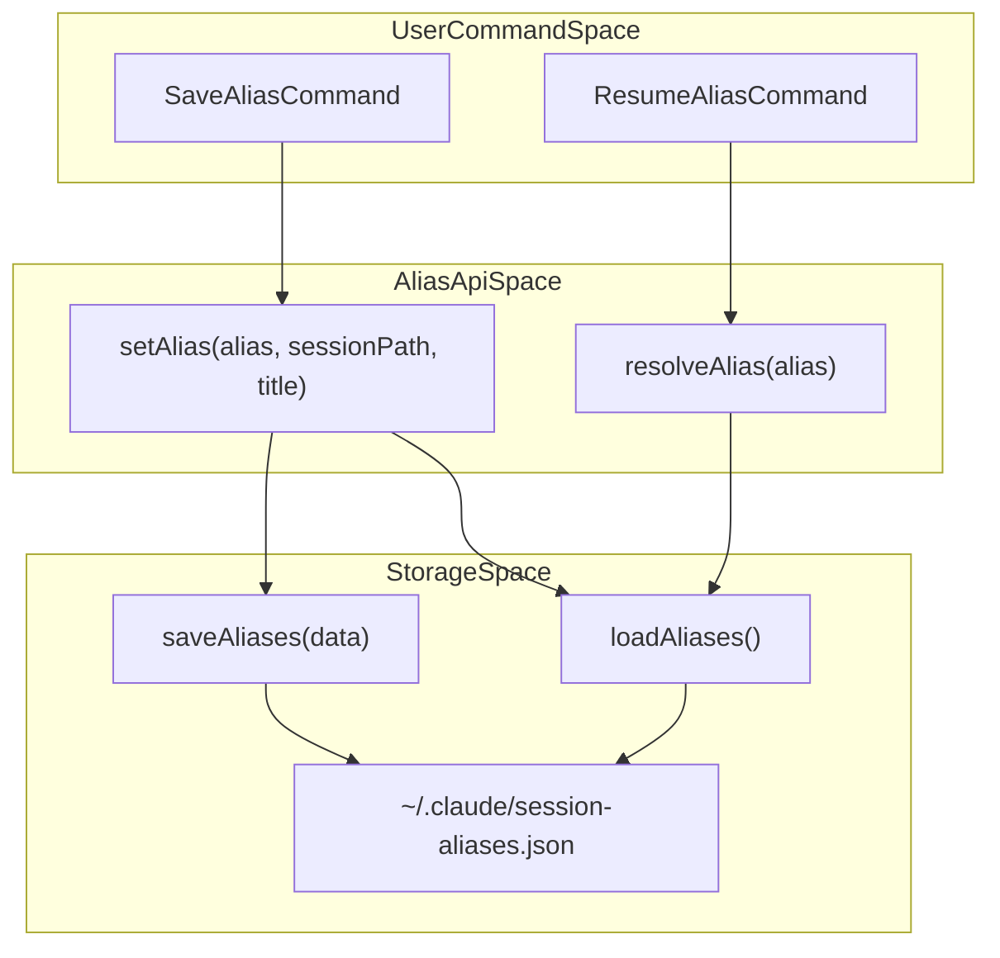

<!-- source: DeepWiki mcp.deepwiki.com · repo affaan-m/ECC · page 2.4 Session Management & Persistence · fetched 2026-10-30 -->

# Session Management & Persistence

<details>
<summary>Relevant source files</summary>

The following files were used as context for generating this wiki page:

- [.gitignore](.gitignore)
- [agents/vue-reviewer.md](agents/vue-reviewer.md)
- [commands/resume-session.md](commands/resume-session.md)
- [commands/save-session.md](commands/save-session.md)
- [commands/vue-review.md](commands/vue-review.md)
- [docs/architecture/hud-status-session-control.md](docs/architecture/hud-status-session-control.md)
- [hooks/README.md](hooks/README.md)
- [hooks/hooks.json](hooks/hooks.json)
- [schemas/hooks.schema.json](schemas/hooks.schema.json)
- [scripts/ci/catalog.js](scripts/ci/catalog.js)
- [scripts/ci/generate-command-registry.js](scripts/ci/generate-command-registry.js)
- [scripts/ci/validate-agents.js](scripts/ci/validate-agents.js)
- [scripts/ci/validate-hooks.js](scripts/ci/validate-hooks.js)
- [scripts/hooks/check-console-log.js](scripts/hooks/check-console-log.js)
- [scripts/hooks/evaluate-session.js](scripts/hooks/evaluate-session.js)
- [scripts/hooks/hook-input.js](scripts/hooks/hook-input.js)
- [scripts/hooks/lifecycle-hook-bootstrap.js](scripts/hooks/lifecycle-hook-bootstrap.js)
- [scripts/hooks/post-edit-console-warn.js](scripts/hooks/post-edit-console-warn.js)
- [scripts/hooks/post-edit-format.js](scripts/hooks/post-edit-format.js)
- [scripts/hooks/post-edit-typecheck.js](scripts/hooks/post-edit-typecheck.js)
- [scripts/hooks/session-end.js](scripts/hooks/session-end.js)
- [scripts/hooks/session-start.js](scripts/hooks/session-start.js)
- [scripts/hooks/suggest-compact.js](scripts/hooks/suggest-compact.js)
- [scripts/lib/control-pane/work-item-runner.js](scripts/lib/control-pane/work-item-runner.js)
- [scripts/lib/control-pane/work-item-worker.js](scripts/lib/control-pane/work-item-worker.js)
- [scripts/lib/llm-summary.js](scripts/lib/llm-summary.js)
- [scripts/lib/package-manager.d.ts](scripts/lib/package-manager.d.ts)
- [scripts/lib/package-manager.js](scripts/lib/package-manager.js)
- [scripts/lib/session-adapters/canonical-session.js](scripts/lib/session-adapters/canonical-session.js)
- [scripts/lib/session-adapters/claude-history.js](scripts/lib/session-adapters/claude-history.js)
- [scripts/lib/session-adapters/dmux-tmux.js](scripts/lib/session-adapters/dmux-tmux.js)
- [scripts/lib/session-adapters/registry.js](scripts/lib/session-adapters/registry.js)
- [scripts/lib/session-aliases.d.ts](scripts/lib/session-aliases.d.ts)
- [scripts/lib/session-aliases.js](scripts/lib/session-aliases.js)
- [scripts/lib/session-manager.d.ts](scripts/lib/session-manager.d.ts)
- [scripts/lib/session-manager.js](scripts/lib/session-manager.js)
- [scripts/lib/skill-improvement/amendify.js](scripts/lib/skill-improvement/amendify.js)
- [scripts/lib/skill-improvement/evaluate.js](scripts/lib/skill-improvement/evaluate.js)
- [scripts/lib/skill-improvement/health.js](scripts/lib/skill-improvement/health.js)
- [scripts/lib/state-store/file-lock.js](scripts/lib/state-store/file-lock.js)
- [scripts/lib/state-store/index.js](scripts/lib/state-store/index.js)
- [scripts/lib/utils.d.ts](scripts/lib/utils.d.ts)
- [scripts/lib/utils.js](scripts/lib/utils.js)
- [scripts/session-inspect.js](scripts/session-inspect.js)
- [tests/ci/catalog.test.js](tests/ci/catalog.test.js)
- [tests/ci/command-registry.test.js](tests/ci/command-registry.test.js)
- [tests/ci/validators.test.js](tests/ci/validators.test.js)
- [tests/fixtures/session-start-alias-read-preload.cjs](tests/fixtures/session-start-alias-read-preload.cjs)
- [tests/hooks/hooks.test.js](tests/hooks/hooks.test.js)
- [tests/hooks/session-end.test.js](tests/hooks/session-end.test.js)
- [tests/hooks/session-start-alias-unavailable.test.js](tests/hooks/session-start-alias-unavailable.test.js)
- [tests/integration/hooks.test.js](tests/integration/hooks.test.js)
- [tests/lib/claude-history-alias-unavailable.test.js](tests/lib/claude-history-alias-unavailable.test.js)
- [tests/lib/control-pane-contention.test.js](tests/lib/control-pane-contention.test.js)
- [tests/lib/helpers/control-pane-contention-server.js](tests/lib/helpers/control-pane-contention-server.js)
- [tests/lib/helpers/state-store-worker.js](tests/lib/helpers/state-store-worker.js)
- [tests/lib/llm-summary.test.js](tests/lib/llm-summary.test.js)
- [tests/lib/package-manager.test.js](tests/lib/package-manager.test.js)
- [tests/lib/session-adapters-codex.test.js](tests/lib/session-adapters-codex.test.js)
- [tests/lib/session-adapters-opencode.test.js](tests/lib/session-adapters-opencode.test.js)
- [tests/lib/session-adapters.test.js](tests/lib/session-adapters.test.js)
- [tests/lib/session-aliases.test.js](tests/lib/session-aliases.test.js)
- [tests/lib/session-manager.test.js](tests/lib/session-manager.test.js)
- [tests/lib/skill-improvement.test.js](tests/lib/skill-improvement.test.js)
- [tests/lib/state-store-concurrency.test.js](tests/lib/state-store-concurrency.test.js)
- [tests/lib/state-store-persistence.test.js](tests/lib/state-store-persistence.test.js)
- [tests/lib/state-store-read-cache.test.js](tests/lib/state-store-read-cache.test.js)
- [tests/lib/utils.test.js](tests/lib/utils.test.js)
- [tests/lib/work-item-runner.test.js](tests/lib/work-item-runner.test.js)
- [tests/scripts/instinct-cli-evolve-generate.test.js](tests/scripts/instinct-cli-evolve-generate.test.js)
- [tests/scripts/instinct-cli-evolve.test.js](tests/scripts/instinct-cli-evolve.test.js)
- [tests/scripts/session-inspect.test.js](tests/scripts/session-inspect.test.js)

</details>


Everything Claude Code (ECC) implements a robust session management and state persistence subsystem designed to maintain continuity across AI harness restarts. It utilizes a lifecycle-driven approach, capturing state during active sessions, serializing state safely through a JS state-store with file locking, and re-injecting relevant context upon initialization. The system is governed by the `ecc.session.v1` contract and adapter interfaces, ensuring portability and consistent behavior across different environments.

Sources: `[scripts/hooks/session-start.js:1-191]()`, `[scripts/lib/state-store/index.js]()`, `[scripts/lib/session-manager.js:1-149]()`.

---

## Architecture & Data Flow

Session management is coordinated through lifecycle hooks (`SessionStart` and `Stop`/`SessionEnd`), the JS state-store, and session management libraries.

### Core Lifecycle Flow

1. **`SessionStart` Hook (`scripts/hooks/session-start.js`)**: Triggered when the AI harness initializes a new session. It scans configured session storage directories using `getSessionSearchDirs()` [scripts/lib/utils.js:70-72](), finds recent session files via `dedupeRecentSessions()` [scripts/hooks/session-start.js:64-91](), applies stale-replay guards, and loads summaries into context.
2. **Active Session Interaction**: As the AI assistant interacts with the user, tools and modified files are tracked continuously via `scripts/hooks/session-end.js` [scripts/hooks/session-end.js:47-74]().
3. **`SessionEnd` Hook (`scripts/hooks/session-end.js`)**: Runs after each assistant response (Stop event). It parses the current session transcript JSONL log via `extractSessionSummary()` [scripts/hooks/session-end.js:83-111]() to extract user requests, tools used, and files modified, updating persistent markdown session files.
4. **State-Store & File Locks**: Concurrent reads and writes to session state and shared registers are arbitrated by the JS state store (`scripts/lib/state-store/index.js`) using atomic file locking primitives (`scripts/lib/state-store/file-lock.js`).

---

### Lifecycle Dispatch to Code Entities



This diagram bridges natural language concepts (Harness Lifecycle, Core Libraries) to exact code entities (`scripts/hooks/session-start.js`, `scripts/lib/state-store/index.js`, etc.).

Sources: `[scripts/hooks/session-start.js:1-191]`, `[scripts/hooks/session-end.js:1-182]`, `[scripts/lib/state-store/index.js]`, `[scripts/lib/state-store/file-lock.js]`, `[scripts/lib/utils.js:56-79]`.

---

## Data Storage Layout & JS State Store with File Locks

ECC stores persistent data under a centralized directory (defaulting to `~/.claude/` or overridden by `ECC_AGENT_DATA_HOME`).

| Directory / File                   | Purpose                                        | Code Reference                      |
|------------------------------------|------------------------------------------------|-------------------------------------|
| `~/.claude/session-data/`          | Canonical storage for `.tmp` session files     | `[scripts/lib/utils.js:56-58]()`    |
| `~/.claude/sessions/`              | Legacy storage for older ECC versions          | `[scripts/lib/utils.js:63-65]()`    |
| `~/.claude/session-aliases.json`   | Registry file for named session shortcuts      | `[scripts/lib/session-aliases.js:17-19]()` |
| `~/.claude/skills/learned/`        | Persisted autonomous skill learnings           | `[scripts/lib/utils.js:77-79]()`    |

### JS State Store & File Locks (`scripts/lib/state-store/`)

To prevent race conditions during concurrent multi-agent worktree execution or parallel hook execution, ECC provides a file-locked state store (`scripts/lib/state-store/index.js` backed by `scripts/lib/state-store/file-lock.js`).

- **Atomic Access**: Acquires exclusive file locks before reading or writing JSON state payloads.
- **Concurrency Control**: Implements retry/backoff mechanisms for lock contention, tested via `tests/lib/state-store-concurrency.test.js` and `tests/lib/state-store-persistence.test.js`.

Sources: `[scripts/lib/utils.js:56-79]`, `[scripts/lib/state-store/index.js]`, `[scripts/lib/state-store/file-lock.js]`.

---

## Session Data & Aliases

### Session Filename Format & Sanitization

Sessions are stored as files named using a date-centric and optionally unique ID format:

```
YYYY-MM-DD-[shortId]-session.tmp
```

- **Short ID**: Derived from the last 8 characters of `CLAUDE_SESSION_ID` or project names using `sanitizeSessionId()` [scripts/lib/utils.js:157-180]().
- **Validation & Parsing**: Filenames are parsed by `parseSessionFilename()` in `scripts/lib/session-manager.js` to extract dates and short IDs [scripts/lib/session-manager.js:46-73]().

### Session Aliases

Aliases offer friendly human-readable names mapped to specific session files, allowing users to easily resume sessions via commands like `/resume-session`.

- Management functions `setAlias(alias, sessionPath, title)` and `resolveAlias(alias)` handle reading, validating, and writing alias mappings (`scripts/lib/session-aliases.js`) [scripts/lib/session-aliases.js:88-126](), [scripts/lib/session-aliases.js:158-179]().
- Validation restricts alias names to alphanumeric characters, dashes, and underscores, forbids reserved keywords (`list`, `help`, `delete`), and enforces a 128-character length limit.

### Alias Persistence & Resolution Flow



Sources: `[scripts/lib/session-aliases.js:17-19]`, `[scripts/lib/session-aliases.js:88-126]`, `[scripts/lib/session-aliases.js:158-179]`.

---

## Context Injection Pipeline & Stale-Replay Guard

### Session Search & Deduplication

At session start (`scripts/hooks/session-start.js`), the system performs the following checks:
- **Directory Search**: Iterates over search directories returned by `getSessionSearchDirs()` [scripts/lib/utils.js:70-72]().
- **Deduplication**: `dedupeRecentSessions()` compares file modification times (`mtime`) and directory precedence to identify unique sessions [scripts/hooks/session-start.js:64-91]().
- **Character Capping**: Respects size boundaries defined by `ECC_SESSION_START_MAX_CHARS` to prevent prompt overflow [scripts/hooks/session-start.js:118-124]().

### Metadata Parsing & Stale-Replay Guard

- Session content is parsed via `parseSessionMetadata()` to extract completion status, active tasks, and context blocks [tests/lib/session-manager.test.js:90-130]().
- **Stale-Replay Guard**: Filters out outdated, cross-project, or foreign worktree sessions by comparing repository identities (`sameRepoIdentity`) [scripts/hooks/session-start.js:113-116](), [scripts/lib/utils.js:194-206]().

Sources: `[scripts/hooks/session-start.js:1-191]`, `[scripts/lib/utils.js:70-72]`, `[scripts/lib/utils.js:194-206]`.

---

## Session Adapter Contract (`ecc.session.v1`)

ECC abstracts interactions with underlying AI harness storage through the `ecc.session.v1` adapter contract.

| Adapter Name       | Target Environment           | Module Path                                       |
|--------------------|------------------------------|---------------------------------------------------|
| **Canonical**      | ECC Internal Runtime         | `scripts/lib/session-adapters/canonical-session.js` |
| **Claude History** | Claude Code CLI Logs         | `scripts/lib/session-adapters/claude-history.js`   |

Each adapter implements a uniform interface to:
- Read and translate harness-specific session logs (JSONL, CLI history).
- Expose a normalized session data structure to the session manager and hooks.
- Support session resume operations and summary generation.

Sources: `[scripts/lib/session-adapters/canonical-session.js]`, `[scripts/lib/session-adapters/claude-history.js]`.

---

# Summary

Everything Claude Code's session management and persistence subsystem ensures continuity across restarts through:
- Canonical file storage and JSON state-stores with robust file locking.
- Session alias mapping with strict validation.
- Intelligent context injection guarded by stale-replay and repository identity checks.
- Pluggable adapter contracts (`ecc.session.v1`) for cross-harness portability.

Sources: `[scripts/hooks/session-start.js]`, `[scripts/hooks/session-end.js]`, `[scripts/lib/session-manager.js]`, `[scripts/lib/session-aliases.js]`, `[scripts/lib/state-store/index.js]`.

---

