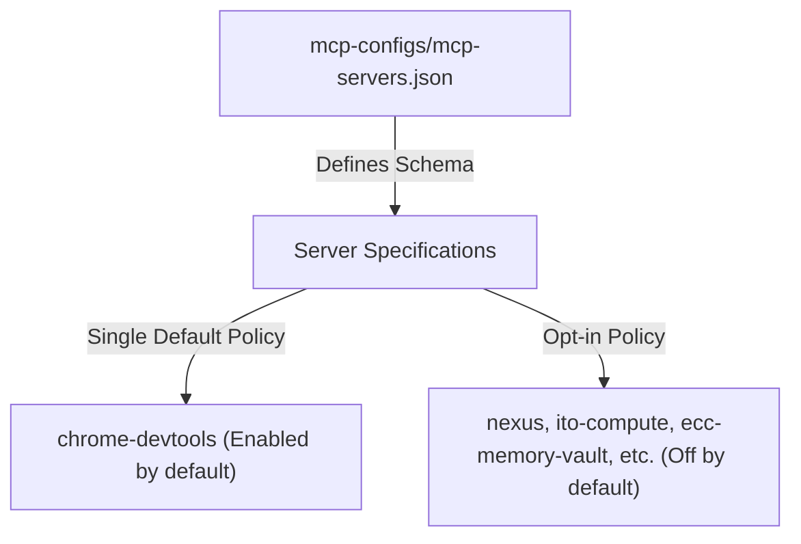
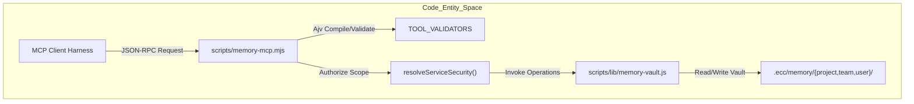
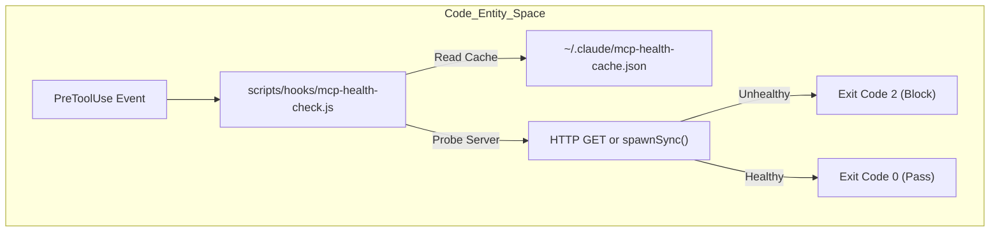
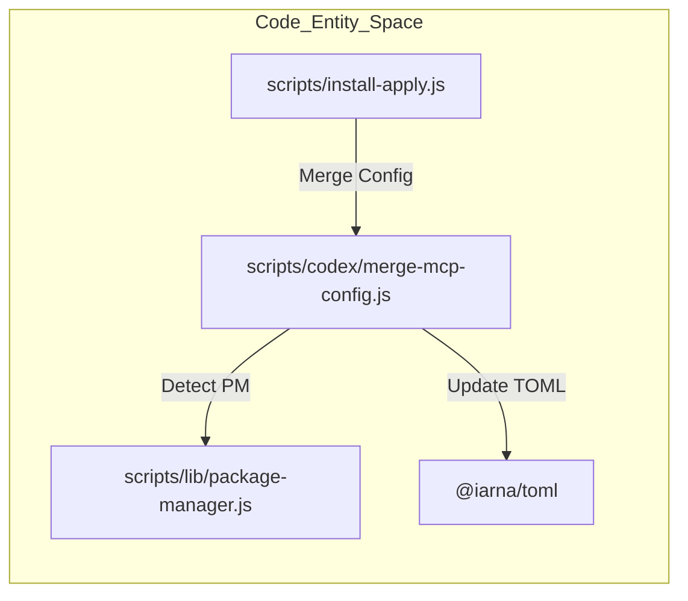

<!-- source: DeepWiki mcp.deepwiki.com · repo affaan-m/ECC · page 2.5 MCP Server Integration · fetched 2026-10-30 -->

# MCP Server Integration

Relevant source files

The following files were used as context for generating this wiki page:

- [.agents/skills/unified-memory/SKILL.md](.agents/skills/unified-memory/SKILL.md)
- [.agents/skills/unified-memory/agents/openai.yaml](.agents/skills/unified-memory/agents/openai.yaml)
- [.cursor/skills/unified-memory/SKILL.md](.cursor/skills/unified-memory/SKILL.md)
- [.mcp.json](.mcp.json)
- [docs/design/ecc-ito-compute-integration.md](docs/design/ecc-ito-compute-integration.md)
- [docs/design/ecc-memory-vault.md](docs/design/ecc-memory-vault.md)
- [install.ps1](install.ps1)
- [install.sh](install.sh)
- [mcp-configs/mcp-servers.json](mcp-configs/mcp-servers.json)
- [rules/README.md](rules/README.md)
- [scripts/claw.js](scripts/claw.js)
- [scripts/codex-git-hooks/pre-commit](scripts/codex-git-hooks/pre-commit)
- [scripts/codex-git-hooks/pre-push](scripts/codex-git-hooks/pre-push)
- [scripts/codex/install-global-git-hooks.sh](scripts/codex/install-global-git-hooks.sh)
- [scripts/codex/merge-mcp-config.js](scripts/codex/merge-mcp-config.js)
- [scripts/hooks/desktop-notify.js](scripts/hooks/desktop-notify.js)
- [scripts/hooks/mcp-health-check.js](scripts/hooks/mcp-health-check.js)
- [scripts/hooks/run-with-flags-shell.sh](scripts/hooks/run-with-flags-shell.sh)
- [scripts/ito.js](scripts/ito.js)
- [scripts/lib/ito-environment.js](scripts/lib/ito-environment.js)
- [scripts/lib/memory-vault.js](scripts/lib/memory-vault.js)
- [scripts/memory-mcp.mjs](scripts/memory-mcp.mjs)
- [skills/ito-compute/SKILL.md](skills/ito-compute/SKILL.md)
- [skills/ito-compute/agents/openai.yaml](skills/ito-compute/agents/openai.yaml)
- [skills/laravel-plugin-discovery/SKILL.md](skills/laravel-plugin-discovery/SKILL.md)
- [skills/unified-memory/SKILL.md](skills/unified-memory/SKILL.md)
- [tests/ci/ito-compute-skill.test.js](tests/ci/ito-compute-skill.test.js)
- [tests/hooks/mcp-health-check.test.js](tests/hooks/mcp-health-check.test.js)
- [tests/lib/memory-read-completeness.test.js](tests/lib/memory-read-completeness.test.js)
- [tests/lib/memory-vault.test.js](tests/lib/memory-vault.test.js)
- [tests/scripts/claw.test.js](tests/scripts/claw.test.js)
- [tests/scripts/codex-hooks.test.js](tests/scripts/codex-hooks.test.js)
- [tests/scripts/install-ps1.test.js](tests/scripts/install-ps1.test.js)
- [tests/scripts/install-readme-clarity.test.js](tests/scripts/install-readme-clarity.test.js)
- [tests/scripts/install-sh.test.js](tests/scripts/install-sh.test.js)
- [tests/scripts/ito-cli-bridge.test.js](tests/scripts/ito-cli-bridge.test.js)
- [tests/scripts/memory-mcp.test.js](tests/scripts/memory-mcp.test.js)

The Model Context Protocol (MCP) server integration in Everything Claude Code (ECC) provides a standardized protocol and ecosystem for AI harnesses (such as Claude Code, Codex, Cursor, OpenCode, and others) to invoke external services, tools, and databases in a consistent, secure, and extensible manner. This page details the components, policies, and implementation patterns that define how ECC manages MCP servers and their integration.

The scope includes managing the `mcp-servers.json` registry, enforcing the single MCP connector policy, coordinating opt-in servers (such as `ito-compute` and the `ecc-memory-vault`), merging MCP configurations during install, monitoring MCP server health via a dedicated hook, and a local persistent memory MCP server implementation.

---

## 1. MCP Connector Policy & MCP Servers Registry

### Single Default Connector Policy

ECC enforces a strict **single default MCP connector** policy to reduce the attack surface and system complexity. The default connector `chrome-devtools` is the *only* MCP server enabled automatically for most harnesses.

All other MCP servers—which include a broad collection of specialized MCP servers—are **off by default** and require explicit opt-in by the operator. This ensures tight control over permissions and resource use across tools.

### MCP Servers Registry: `mcp-servers.json`

The centralized registry of canonical MCP server definitions lives in `mcp-configs/mcp-servers.json`. This JSON file lists server entries indexed by server name, each defining:

- `command` and `args`: The executable and argument list to spawn for the MCP server.
- `type` and `url` (optional): For HTTP-based MCP servers.
- Optional environment variables needed by the server.
- A clear textual `description` of the server’s purpose and usage notes.

The file includes definitions like `nexus`, `ito-compute`, `jira`, `github`, `firecrawl`, `supabase`, `ecc-memory-vault`, `memory`, `omega-memory`, `longhand`, and `sequential-thinking` [mcp-configs/mcp-servers.json:1-142](). This JSON registry provides a single source of truth for all supported MCP servers, which can be referred to or customized by the operator in each harness’s config [mcp-configs/mcp-servers.json:1-142]().

Sources: [mcp-configs/mcp-servers.json:1-142]()

---

## 2. Memory MCP Server: `ecc-memory-mcp`

ECC provides an opt-in **memory MCP server** implemented in Node.js (`scripts/memory-mcp.mjs`) that enables persistent memory storage accessible simultaneously by multiple AI harnesses over standard I/O streams (stdio) using JSON-RPC 2.0 [scripts/memory-mcp.mjs:1-148]().

### 2.1. Security & Harness Identification

- The server requires the environment variable `ECC_MEMORY_HARNESS`, which identifies the owner harness in lowercase slug form (`resolveServiceSecurity`) [scripts/memory-mcp.mjs:174-186]().
- It optionally permits or denies access to the `user` memory scope based on `ECC_MEMORY_ALLOW_USER_SCOPE` (disabled by default) [scripts/memory-mcp.mjs:174-186]().
- These constraints ensure memory data isolation and security boundaries between harnesses [scripts/memory-mcp.mjs:174-186]().

### 2.2. Validated Tools Surface

The memory MCP exposes core tools (`memory_save`, `memory_search`, `memory_read`, `memory_doctor`) validated using Ajv schemas (`TOOL_VALIDATORS`, `TOOL_DEFINITIONS`) to sanitize inputs, whitelist permitted scopes, kinds, and tags [scripts/memory-mcp.mjs:53-147]().

### 2.3. Trusted Storage Locations

ECC manages trusted filesystem locations for storing memory under project, team, and user scopes via `scripts/lib/memory-vault.js`. These roots verify trusted boundaries, reject symlinks, and enforce file permissions [scripts/lib/memory-vault.js:41-114]().

### 2.4. Data Flow Diagram for Memory MCP

Sources: [scripts/memory-mcp.mjs:1-148](), [scripts/lib/memory-vault.js:41-114]()

---

## 3. MCP Health Check Hook

ECC includes a dedicated lifecycle hook `scripts/hooks/mcp-health-check.js` to monitor and manage the health of configured MCP servers, protecting harnesses from hanging or degraded behavior [scripts/hooks/mcp-health-check.js:4-55]().

### 3.1. Hook Invocation Points

- **PreToolUse**: Probes target server status before tool execution. If unhealthy and cache TTL has not expired, prevents tool invocation with exit code `2` [scripts/hooks/mcp-health-check.js:4-55]().
- **PostToolUseFailure**: On failed MCP calls, marks the server unhealthy, timestamps state, and computes backoff delay [scripts/hooks/mcp-health-check.js:4-55]().

### 3.2. Health State Persistence

Health states are cached in a local JSON file at `~/.claude/mcp-health-cache.json` (`stateFilePath`) to avoid repeated failure cascades [scripts/hooks/mcp-health-check.js:23-26, 54-96]().

### 3.3. Data Flow Diagram for MCP Health Check Hook

Sources: [scripts/hooks/mcp-health-check.js:4-96](), [tests/hooks/mcp-health-check.test.js:1-50]()

---

## 4. Configuration Merging and MCP Discovery Paths

ECC supports automatic merging of MCP server configurations during installation or updates (`scripts/codex/merge-mcp-config.js`) [scripts/codex/merge-mcp-config.js:1-177]().

### 4.1. Merge Strategy

- **Add-Only by Default**: Appends missing ECC-recommended servers to the harness's MCP config TOML file without removing user-managed entries [scripts/codex/merge-mcp-config.js:1-177]().
- **Drift Warnings & Repairs**: Emits warnings on config drift and repairs known-invalid legacy fields (such as `RETIRED_INVALID_URL_SERVERS`) [scripts/codex/merge-mcp-config.js:105-107]().
- **Package Manager Integration**: Respects the user's configured package manager (`npm`, `pnpm`, `yarn`, `bun`) via `getPackageManager()` [scripts/codex/merge-mcp-config.js:37-45]().

### 4.2. MCP Config Discovery Paths

MCP clients and hooks discover configuration files in priority order (`configPaths`):
1. `ECC_MCP_CONFIG_PATH` environment override
2. `./.claude.json` (project-local)
3. `./.claude/settings.json` (project-local)
4. `~/.claude.json` (user-global)
5. `~/.claude/settings.json` (user-global) [scripts/hooks/mcp-health-check.js:57-75]()

Sources: [scripts/codex/merge-mcp-config.js:1-177](), [scripts/hooks/mcp-health-check.js:57-75]()

---

## References & Source Files

- `[mcp-configs/mcp-servers.json:1-142]()`
- `[scripts/memory-mcp.mjs:1-148]()`
- `[scripts/lib/memory-vault.js:41-114]()`
- `[scripts/hooks/mcp-health-check.js:4-96]()`
- `[scripts/codex/merge-mcp-config.js:1-177]()`
- `[tests/hooks/mcp-health-check.test.js:1-50]()`

---

