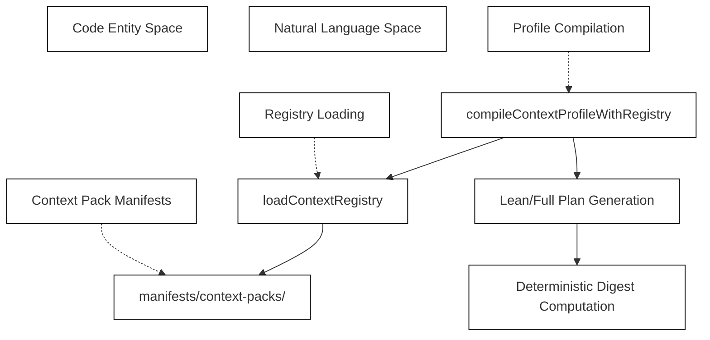
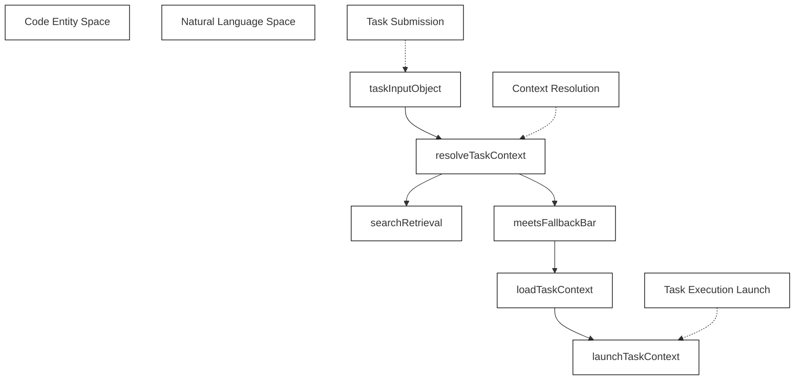
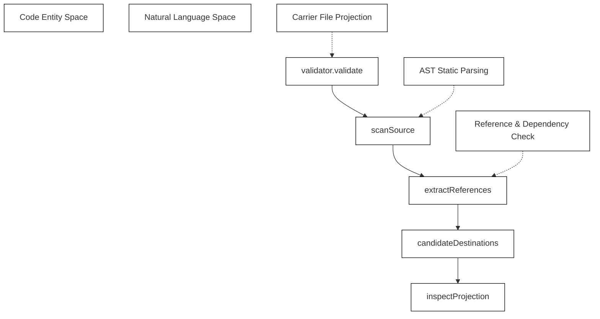

<!-- source: DeepWiki mcp.deepwiki.com · repo affaan-m/ECC · page 2.6 Context Packs, Profiles & Carriers · fetched 2026-10-30 -->

# Context Packs, Profiles & Carriers

Relevant source files

The following files were used as context for generating this wiki page:

- [docker/context-profiles/ai-eval-lib.js](docker/context-profiles/ai-eval-lib.js)
- [docker/context-profiles/ai-eval.js](docker/context-profiles/ai-eval.js)
- [docker/context-profiles/complex-eval/DESIGN.md](docker/context-profiles/complex-eval/DESIGN.md)
- [docs/design/context-carriers.tdd.md](docs/design/context-carriers.tdd.md)
- [docs/design/context-profile-delivery.md](docs/design/context-profile-delivery.md)
- [docs/design/context-profile-delivery.tdd.md](docs/design/context-profile-delivery.tdd.md)
- [eslint.config.js](eslint.config.js)
- [legacy-command-shims/commands/context-budget.md](legacy-command-shims/commands/context-budget.md)
- [pi/core/skills/docker-patterns/SKILL.md](pi/core/skills/docker-patterns/SKILL.md)
- [scripts/ci/validate-carrier-closure.js](scripts/ci/validate-carrier-closure.js)
- [scripts/dev/generate-skill-triggers.js](scripts/dev/generate-skill-triggers.js)
- [scripts/hooks/context-prompt-suggestions.js](scripts/hooks/context-prompt-suggestions.js)
- [scripts/hooks/context-routing-index.js](scripts/hooks/context-routing-index.js)
- [scripts/lib/context-profile-commands.js](scripts/lib/context-profile-commands.js)
- [scripts/lib/context-profile-interactive.js](scripts/lib/context-profile-interactive.js)
- [scripts/lib/context-profile-launch.js](scripts/lib/context-profile-launch.js)
- [scripts/lib/context-profile-native-executable.js](scripts/lib/context-profile-native-executable.js)
- [scripts/lib/context-profile-native.js](scripts/lib/context-profile-native.js)
- [scripts/lib/context-profile-support.js](scripts/lib/context-profile-support.js)
- [scripts/lib/context-profiles.js](scripts/lib/context-profiles.js)
- [scripts/lib/context-retrieval.js](scripts/lib/context-retrieval.js)
- [scripts/lib/context-routing-index.js](scripts/lib/context-routing-index.js)
- [scripts/lib/context-selection.js](scripts/lib/context-selection.js)
- [scripts/lib/install/contained-fs.js](scripts/lib/install/contained-fs.js)
- [scripts/lib/install/json-ops.js](scripts/lib/install/json-ops.js)
- [scripts/orchestrate-codex-worker.sh](scripts/orchestrate-codex-worker.sh)
- [scripts/profile.js](scripts/profile.js)
- [skills/context-budget/SKILL.md](skills/context-budget/SKILL.md)
- [skills/token-budget-advisor/SKILL.md](skills/token-budget-advisor/SKILL.md)
- [tests/fixtures/context-selection/routing-prompts.json](tests/fixtures/context-selection/routing-prompts.json)
- [tests/hooks/context-prompt-suggestions.test.js](tests/hooks/context-prompt-suggestions.test.js)
- [tests/lib/context-profile-eval.test.js](tests/lib/context-profile-eval.test.js)
- [tests/lib/context-profile-launch.test.js](tests/lib/context-profile-launch.test.js)
- [tests/lib/context-profile-native.test.js](tests/lib/context-profile-native.test.js)
- [tests/lib/context-routing-index.test.js](tests/lib/context-routing-index.test.js)
- [tests/lib/context-selection.test.js](tests/lib/context-selection.test.js)
- [tests/scripts/generate-skill-triggers.test.js](tests/scripts/generate-skill-triggers.test.js)
- [tests/scripts/orchestrate-codex-worker.test.js](tests/scripts/orchestrate-codex-worker.test.js)
- [tests/scripts/repair.test.js](tests/scripts/repair.test.js)
- [tests/scripts/validate-carrier-closure.test.js](tests/scripts/validate-carrier-closure.test.js)
- [tests/skills/context-budget.test.js](tests/skills/context-budget.test.js)
- [tests/skills/desk-pattern-skills.test.js](tests/skills/desk-pattern-skills.test.js)
- [tests/test_model_config.py](tests/test_model_config.py)

## Purpose and Scope

The context selection and routing subsystem in ECC manages how skills, agents, rules, and resources are cataloged, compiled into profiles, projected into isolated runtime carriers, and dynamically selected for tasks. This page covers the architectural implementation of the context-pack registry, profile compilation, deterministic carrier closure validation, token/context budget skills, and the `docker/context-profiles` AI evaluation lab.

---

## 1. Context-Pack Registry and Profile Compilation

The registry parses modular manifests (`manifests/context-packs/`) and indexes component metadata, dependency closures, and required resource paths. Profile compilation reads the registry to generate deterministic distributions for target harnesses (e.g., `lean@1` and `full@1`) [scripts/ci/validate-carrier-closure.js:24]().

Key components:
- `loadContextRegistry`: Reads and verifies context packs and skill manifests from the workspace root.
- `compileContextProfileWithRegistry`: Merges pack registrations with inclusion/exclusion filters to compute deterministic target manifests and resource digests [scripts/lib/context-selection.js:5]().

**Sources:** `scripts/lib/context-pack-registry.js`, `scripts/lib/context-profiles.js`, `scripts/ci/validate-carrier-closure.js:20-25` [scripts/ci/validate-carrier-closure.js:20-25]()

---

## 2. Context Selection, Routing, and Launch Subsystem

The runtime task-routing engine [scripts/lib/context-selection.js:8-12]() matches incoming natural-language queries against indexed context elements using BM25 retrieval and structural triggers [scripts/lib/context-retrieval.js]().

### Selection Modes
- **Manual**: Requires explicit IDs (`explicitIds`) provided in the task payload.
- **Suggest**: Computes ranking suggestions and returns candidate identifiers without injecting bodies.
- **Auto**: Automatically admits matching skills if they clear scoring thresholds and explicit admission guards [scripts/lib/context-selection.js:18-28]().

### Task Context Lifecycle

`resolveTaskContext` enforces strict validation rules, rejecting tasks if source files drift during selection or if authority-bearing metadata violates invocation policies [tests/lib/context-selection.test.js:63-96](). `launchTaskContext` executes tasks under isolated provider environments (`claude --print`, `codex exec -`) with dedicated home directories and environment sanitization [tests/lib/context-profile-launch.test.js:8-31]().

**Sources:** `scripts/lib/context-selection.js:1-112` [scripts/lib/context-selection.js:1-112](), `scripts/lib/context-profile-launch.js` [tests/lib/context-profile-launch.test.js:8-9](), `tests/lib/context-selection.test.js:63-96` [tests/lib/context-selection.test.js:63-96]()

---

## 3. Context Carriers and Closure Validation

Context carriers package profiles and dependencies into read-only file projections for distribution. The closure validator (`scripts/ci/validate-carrier-closure.js`) ensures that all script dependencies inside a carrier resolve strictly within the planned file set without escaping to host filesystem locations or performing unallowed dynamic requires [scripts/ci/validate-carrier-closure.js:3-13]().

### Static Analysis and AST Scanning
The validator parses JavaScript source files using the TypeScript compiler API (`ts.createSourceFile`) without evaluating them [scripts/ci/validate-carrier-closure.js:34-44]() to extract literal `require` and `import` specifiers via `extractReferences` [scripts/ci/validate-carrier-closure.js:47-88]().

**Sources:** `scripts/ci/validate-carrier-closure.js:1-145` [scripts/ci/validate-carrier-closure.js:1-145](), `tests/scripts/validate-carrier-closure.test.js:35-52` [tests/scripts/validate-carrier-closure.test.js:35-52]()

---

## 4. Token and Context Budget Skills

ECC provides self-contained skills that guide token utilization and estimate context overhead.

### Token Budget Advisor (`token-budget-advisor`)
Intercepts the response flow to offer response depth options (25%, 50%, 75%, 100%) before answering [skills/token-budget-advisor/SKILL.md:1-10]() by estimating prompt input tokens and applying complexity multipliers [skills/token-budget-advisor/SKILL.md:23-47]().

### Context Budget (`context-budget`)
Routes live context checks directly to native provider meters (`/status` in Codex, `/context` in Claude Code) without scanning local files [skills/context-budget/SKILL.md:13-35](). It restricts static configuration audits to explicit opt-in flags (`--audit`) with strict read-only boundaries [skills/context-budget/SKILL.md:41-57]().

**Sources:** `skills/token-budget-advisor/SKILL.md:1-67` [skills/token-budget-advisor/SKILL.md:1-67](), `skills/context-budget/SKILL.md:1-82` [skills/context-budget/SKILL.md:1-82]()

---

## 5. AI Evaluation Lab (`docker/context-profiles`)

The `docker/context-profiles/` directory serves as an isolated evaluation lab for testing context routing quality, profile compilation correctness, and token conservation [docs/design/context-profile-delivery.md:1-15]().

It contains evaluation harness scripts (`ai-eval.js`, `ai-eval-lib.js`) that run automated verification suites inside clean container environments (Podman/Docker), verifying packed carrier integrity, managed store rollbacks, and resolver accuracy across distinct profile configurations [docs/design/context-profile-delivery.tdd.md:34-52]().

**Sources:** `docker/context-profiles/ai-eval.js`, `docker/context-profiles/ai-eval-lib.js`, `docs/design/context-profile-delivery.md:1-64` [docs/design/context-profile-delivery.md:1-64]()

---

