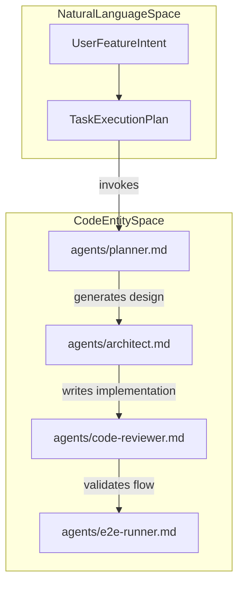
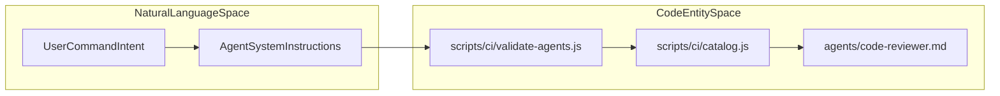

<!-- source: DeepWiki mcp.deepwiki.com · repo affaan-m/ECC · page 3 Agents · fetched 2026-10-30 -->

# Agents

<details>
<summary>Relevant source files</summary>

The following files were used as context for generating this wiki page:

- [agents/architect.md](agents/architect.md)
- [agents/build-error-resolver.md](agents/build-error-resolver.md)
- [agents/code-reviewer.md](agents/code-reviewer.md)
- [agents/database-reviewer.md](agents/database-reviewer.md)
- [agents/doc-updater.md](agents/doc-updater.md)
- [agents/e2e-runner.md](agents/e2e-runner.md)
- [agents/go-build-resolver.md](agents/go-build-resolver.md)
- [agents/go-reviewer.md](agents/go-reviewer.md)
- [agents/planner.md](agents/planner.md)
- [agents/python-reviewer.md](agents/python-reviewer.md)
- [agents/refactor-cleaner.md](agents/refactor-cleaner.md)
- [agents/security-reviewer.md](agents/security-reviewer.md)
- [agents/tdd-guide.md](agents/tdd-guide.md)
- [commands/go-build.md](commands/go-build.md)
- [commands/go-review.md](commands/go-review.md)
- [commands/go-test.md](commands/go-test.md)
- [examples/django-api-CLAUDE.md](examples/django-api-CLAUDE.md)
- [examples/saas-nextjs-CLAUDE.md](examples/saas-nextjs-CLAUDE.md)
- [scripts/setup-package-manager.js](scripts/setup-package-manager.js)
- [skills/cpp-testing/SKILL.md](skills/cpp-testing/SKILL.md)
- [skills/e2e-testing/SKILL.md](skills/e2e-testing/SKILL.md)
- [skills/golang-patterns/SKILL.md](skills/golang-patterns/SKILL.md)
- [skills/golang-testing/SKILL.md](skills/golang-testing/SKILL.md)
- [skills/postgres-patterns/SKILL.md](skills/postgres-patterns/SKILL.md)
- [tests/ci/code-reviewer-false-positive-guard.test.js](tests/ci/code-reviewer-false-positive-guard.test.js)

</details>


ECC features a catalog of specialized agents `[scripts/ci/catalog.js:51]()` designed to handle specific engineering and operational domains. These agents are not general-purpose assistants; instead, each agent is constrained by explicit roles, toolsets, and preferred models to ensure precise and reliable outcomes within complex workflows.

Agents operate within a defined orchestration lifecycle that typically follows a **Plan-Execute-Review** pattern, often involving collaboration among multiple agents within a single session or distributed across git worktrees managed by the control plane.

This page provides a high-level overview of ECC's agent ecosystem. As a parent page, it introduces the core architecture and categories while delegating deep technical details to the child pages:
- [Core Development Agents](#3.1) — covers foundational agents such as `planner`, `architect`, `tdd-guide`, `code-reviewer`, `security-reviewer`, `build-error-resolver`, `refactor-cleaner`, `doc-updater`, `e2e-runner`, and `loop-operator`.
- [Language & Framework Specialist Agents](#3.2) — explores agents tailored to specific languages and frameworks that extend the base `code-reviewer` pattern with ecosystem-specific tooling.
- [Specialized & Domain Agents](#3.3) — details agents focusing on accessibility (`a11y-architect`), SEO, healthcare compliance, machine learning review, networking design, PyTorch build resolution, chief-of-staff coordination, GAN adversarial testing, and agent evaluation.

---

## Agent Orchestration Lifecycle

ECC agents engage in a structured lifecycle orchestrated by the Rust control plane (`ecc2`) combined with the JS runtime. This lifecycle facilitates breaking down complex tasks into manageable subtasks, assigning specialized agents to implement and verify components, and ensuring high quality through iterative collaboration.

### Typical Workflow

The common lifecycle pattern is **Plan → Architect → Generate → Review → Done**, which can involve concurrency and delegation among specialized agents.

Title: Agent Orchestration Lifecycle Mapping

Sources: `[agents/planner.md](), [agents/architect.md](), [agents/code-reviewer.md](), [agents/e2e-runner.md]()`

This model illustrates how each agent represents a code entity with a defined responsibility triggered from a natural language user intent. For example, the `planner` agent structures a user feature request into actionable steps, the `architect` converts these into a technical design, and the `code-reviewer` validates the output before completing the task.

---

## Agent Definition Format

Agents in ECC are authored as Markdown files in the `agents/` directory, each with carefully crafted YAML frontmatter describing their role, model usage, and permitted tools `[scripts/ci/catalog.js:51]()`.

### Required Frontmatter Fields

The ECC CI validates each agent definition to ensure consistency and correct runtime behavior `[scripts/ci/validate-agents.js:95-100]()`.

| Field    | Description                 | Supported Values                          |
| -------- | --------------------------- | --------------------------------------- |
| `name`   | Unique agent identifier      | e.g., `code-reviewer`, `doc-updater`    |
| `model`  | Preferred large language model | `haiku`, `sonnet`, `opus` (varies by agent role) |
| `tools`  | Comma-separated list of allowed tools | `Read`, `Write`, `Bash`, `Grep`, `Glob`, `Edit`, etc. |

### Example: `doc-updater` Agent Frontmatter

```markdown
---
name: doc-updater
description: Documentation and codemap specialist.
tools: Read, Write, Edit, Bash, Grep, Glob
model: haiku
---
```

Each agent's Markdown file also includes core behavioral instructions, security baseline, and operational workflow.

Sources: `[scripts/ci/catalog.js:51](), [scripts/ci/validate-agents.js:95-100](), [agents/doc-updater.md:1-6]()`

---

## Agent Categories

ECC organizes agents into functional categories based on their intended usage and specialization to streamline team workflows and delegation.

### Core Development Agents

These agents cover the primary software lifecycle areas such as planning, architecture, testing, code review, security assessment, build troubleshooting, refactoring, documentation updates, and end-to-end testing. For details, see [Core Development Agents](#3.1).

Sources: `[rules/common/agents.md](), [agents/planner.md](), [agents/code-reviewer.md](), [agents/tdd-guide.md](), [agents/e2e-runner.md](), [agents/doc-updater.md]()`

### Language & Framework Specialist Agents

Building atop the `code-reviewer` template, these agents provide focused review and build resolution tailored to specific programming languages and frameworks (`python-reviewer`, `go-reviewer`, `go-build-resolver`, etc.). For details, see [Language & Framework Specialist Agents](#3.2).

Sources: `[agents/go-reviewer.md](), [agents/go-build-resolver.md]()`

### Specialized & Domain Agents

ECC also includes agents focused on specific domains or specialized tasks, such as `a11y-architect`, `seo-specialist`, `database-reviewer`, `mle-reviewer`, and `chief-of-staff`. For complete details, see [Specialized & Domain Agents](#3.3).

Sources: `[agents/database-reviewer.md](), [agents/chief-of-staff.md]()`

---

## Invocation & Tools

Agents are invoked primarily via slash commands or through subagent delegation hooks integrated into workflows and CI.

### Tool Access and Security Baseline

Each agent is granted explicit tool permissions appropriate for its role (e.g., `Read`, `Write`, `Bash`, `Grep`, `Glob`). Furthermore, all agents inherit a **Prompt Defense Baseline** that protects against prompt injection, information leakage, and unsafe output `[agents/code-reviewer.md:9-15]()`.

### Bridging Natural Language to Code Entities

ECC ensures robust mapping between user intents expressed in natural language and code entity executions via its strict invocation and validation pipeline:

Title: Natural Language to Agent Code Entity Mapping

Sources: `[scripts/ci/catalog.js:51](), [scripts/ci/validate-agents.js:95-100](), [agents/code-reviewer.md:1-15]()`

This pipeline ensures agents operate within defined boundaries, supporting repeatable, secure, and predictable agent executions.

---

## Summary

ECC agents encapsulate critical engineering roles within specialized, constrained AI modules designed to deliver precision in software development and related domains. 

**Next Steps:**
- Explore core development agents in [Core Development Agents](#3.1).
- Dive into language and framework-specific agent extensions in [Language & Framework Specialist Agents](#3.2).
- Discover vertical and specialized agents in [Specialized & Domain Agents](#3.3).

---

# References

- `[scripts/ci/catalog.js:51]()`
- `[scripts/ci/validate-agents.js:95-100]()`
- `[agents/planner.md]()`
- `[agents/architect.md]()`
- `[agents/code-reviewer.md:1-15]()`
- `[agents/tdd-guide.md]()`
- `[agents/doc-updater.md]()`
- `[agents/e2e-runner.md]()`
- `[agents/go-reviewer.md]()`
- `[agents/go-build-resolver.md]()`
- `[agents/database-reviewer.md]()`

---

