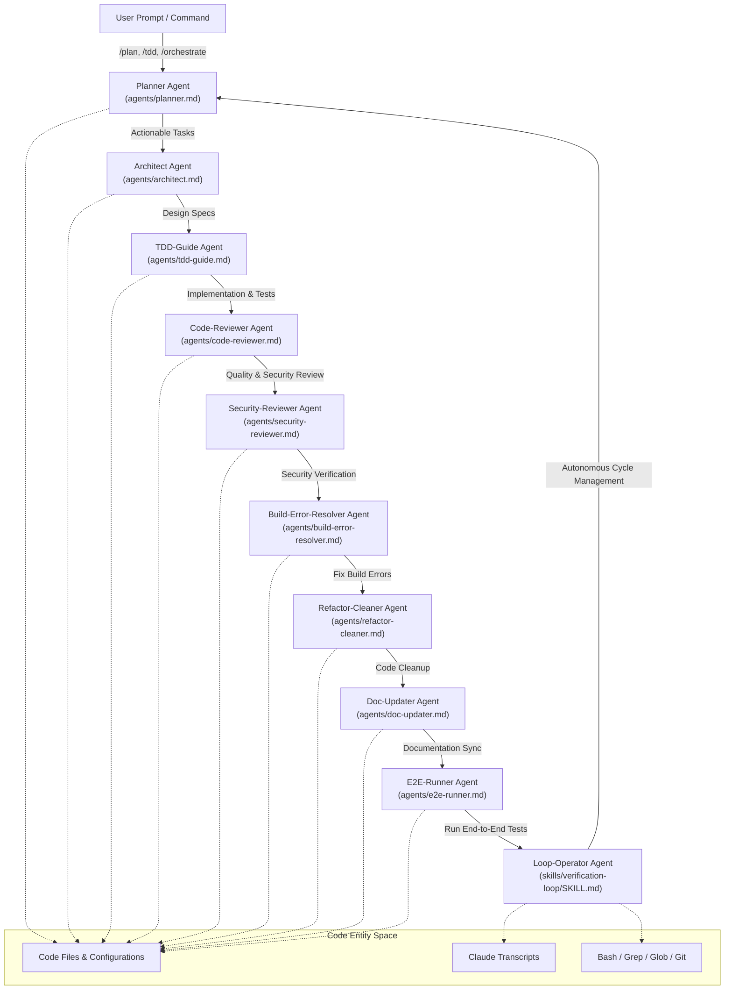
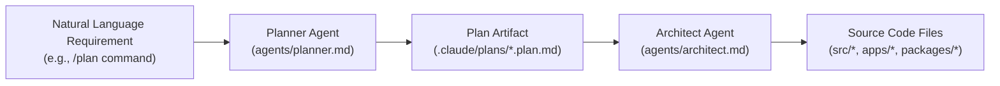
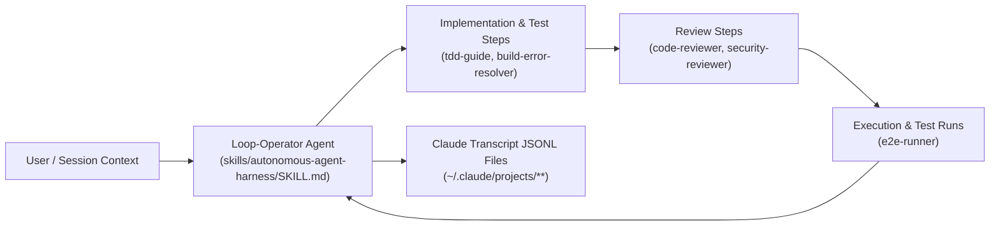

<!-- source: DeepWiki mcp.deepwiki.com · repo affaan-m/ECC · page 3.1 Core Development Agents · fetched 2026-10-30 -->

# Core Development Agents

<details>
<summary>Relevant source files</summary>

The following files were used as context for generating this wiki page:

- [.agents/skills/api-design/SKILL.md](.agents/skills/api-design/SKILL.md)
- [.agents/skills/backend-patterns/SKILL.md](.agents/skills/backend-patterns/SKILL.md)
- [.agents/skills/coding-standards/SKILL.md](.agents/skills/coding-standards/SKILL.md)
- [.agents/skills/e2e-testing/SKILL.md](.agents/skills/e2e-testing/SKILL.md)
- [.agents/skills/eval-harness/SKILL.md](.agents/skills/eval-harness/SKILL.md)
- [.agents/skills/frontend-patterns/SKILL.md](.agents/skills/frontend-patterns/SKILL.md)
- [.agents/skills/security-review/SKILL.md](.agents/skills/security-review/SKILL.md)
- [.agents/skills/strategic-compact/SKILL.md](.agents/skills/strategic-compact/SKILL.md)
- [.agents/skills/tdd-workflow/SKILL.md](.agents/skills/tdd-workflow/SKILL.md)
- [.agents/skills/verification-loop/SKILL.md](.agents/skills/verification-loop/SKILL.md)
- [.kiro/skills/strategic-compact/SKILL.md](.kiro/skills/strategic-compact/SKILL.md)
- [agents/architect.md](agents/architect.md)
- [agents/build-error-resolver.md](agents/build-error-resolver.md)
- [agents/code-reviewer.md](agents/code-reviewer.md)
- [agents/database-reviewer.md](agents/database-reviewer.md)
- [agents/doc-updater.md](agents/doc-updater.md)
- [agents/e2e-runner.md](agents/e2e-runner.md)
- [agents/go-build-resolver.md](agents/go-build-resolver.md)
- [agents/go-reviewer.md](agents/go-reviewer.md)
- [agents/planner.md](agents/planner.md)
- [agents/python-reviewer.md](agents/python-reviewer.md)
- [agents/refactor-cleaner.md](agents/refactor-cleaner.md)
- [agents/security-reviewer.md](agents/security-reviewer.md)
- [agents/tdd-guide.md](agents/tdd-guide.md)
- [commands/go-build.md](commands/go-build.md)
- [commands/go-review.md](commands/go-review.md)
- [commands/go-test.md](commands/go-test.md)
- [docs/ja-JP/skills/strategic-compact/SKILL.md](docs/ja-JP/skills/strategic-compact/SKILL.md)
- [docs/zh-CN/skills/strategic-compact/SKILL.md](docs/zh-CN/skills/strategic-compact/SKILL.md)
- [docs/zh-TW/skills/strategic-compact/SKILL.md](docs/zh-TW/skills/strategic-compact/SKILL.md)
- [examples/django-api-CLAUDE.md](examples/django-api-CLAUDE.md)
- [examples/saas-nextjs-CLAUDE.md](examples/saas-nextjs-CLAUDE.md)
- [scripts/setup-package-manager.js](scripts/setup-package-manager.js)
- [skills/autonomous-agent-harness/SKILL.md](skills/autonomous-agent-harness/SKILL.md)
- [skills/cpp-testing/SKILL.md](skills/cpp-testing/SKILL.md)
- [skills/defi-amm-security/SKILL.md](skills/defi-amm-security/SKILL.md)
- [skills/e2e-testing/SKILL.md](skills/e2e-testing/SKILL.md)
- [skills/golang-patterns/SKILL.md](skills/golang-patterns/SKILL.md)
- [skills/golang-testing/SKILL.md](skills/golang-testing/SKILL.md)
- [skills/postgres-patterns/SKILL.md](skills/postgres-patterns/SKILL.md)
- [skills/strategic-compact/SKILL.md](skills/strategic-compact/SKILL.md)
- [skills/tdd-workflow/SKILL.md](skills/tdd-workflow/SKILL.md)
- [tests/ci/agent-instruction-safety.test.js](tests/ci/agent-instruction-safety.test.js)
- [tests/ci/code-reviewer-false-positive-guard.test.js](tests/ci/code-reviewer-false-positive-guard.test.js)
- [tests/docs/autonomous-harness-setup.test.js](tests/docs/autonomous-harness-setup.test.js)

</details>


This page documents the primary development agents in Everything Claude Code (ECC). These agents represent the "inner loop" of the development lifecycle — planning, architecting, implementing, reviewing, and verifying code changes.

Sources: `[agents/code-reviewer.md:1-28]`, `[agents/planner.md:1-10]`, `[agents/architect.md:1-10]`, `[agents/tdd-guide.md:1-25]`

---

## Overview and Orchestration

ECC agents are specialized personas designed to handle specific phases of the software development life cycle (SDLC). They are typically invoked via specific commands (e.g., `/plan`, `/tdd`, `/code-review`) or triggered automatically during multi-agent workflows.

Agents bridge the gap between natural language user intents and concrete codebase modifications, leveraging tools such as `Read`, `Write`, `Edit`, `Bash`, `Grep`, and `Glob` to interact with the code and environment (`[agents/code-reviewer.md:4]`, `[agents/doc-updater.md:4]`, `[agents/e2e-runner.md:4]`).

### Diagram: Development Agent Data Flow



Sources: `[agents/code-reviewer.md:17-28]()`, `[agents/planner.md:1-10]()`, `[agents/architect.md:1-10]()`, `[agents/tdd-guide.md:1-25]()`, `[agents/e2e-runner.md:1-45]()`, `[agents/build-error-resolver.md:1-10]()`, `[agents/refactor-cleaner.md:1-10]()`, `[agents/doc-updater.md:1-35]()`, `[skills/tdd-workflow/SKILL.md:1-20]()`

---

## Planning & Architecture Agents (`planner`, `architect`)

These agents initiate feature development by converting high-level user requirements into actionable plans and code architecture.

### Planner Agent

- **Role**: Decomposes user stories or feature requests into discrete tasks or user stories.
- **Tools**: Uses `Read`, `Write`, and `Bash` to inspect project files and generate plans.
- **Output**: Generates `.plan.md` artifacts stored in `.claude/plans/` to guide downstream agents.

### Architect Agent

- **Role**: Takes the planner's tasks and creates detailed design specifications, architecture diagrams, interface definitions, and data flow plans.
- **Focus Areas**:
  - Dependency analysis across code modules
  - Workspace/package detection
  - API and background worker entry point identification
- **Tools**: Primarily uses `Read` and `Grep` alongside knowledge of the repo structure.

### Diagram: Planning to Code Entity Mapping



Sources: `[agents/planner.md:1-10]()`, `[agents/architect.md:1-10]()`

---

## Implementation & Verification Agents (`tdd-guide`, `e2e-runner`)

These agents ensure code correctness and maintainability by enforcing test-driven development and running end-to-end testing.

### TDD-Guide Agent

- **Role**: Implements Test-Driven Development (TDD) workflow (`[skills/tdd-workflow/SKILL.md:1-115]()`).
- **Workflow**:
  1. Define function signatures and interfaces (`[skills/tdd-workflow/SKILL.md:41-45]()`).
  2. Write tests that initially fail ("Red") (`[skills/tdd-workflow/SKILL.md:80]()`).
  3. Implement minimal code to pass tests ("Green") (`[skills/tdd-workflow/SKILL.md:81]()`).
  4. Refactor code while maintaining passing tests (`[skills/tdd-workflow/SKILL.md:82]()`).
- **Test Patterns by Language**:

| Language   | Test Pattern               | Coverage Target      |
|------------|----------------------------|---------------------|
| Go         | Table-driven `t.Run`       | 80%+ (`[commands/go-test.md:1-16]()`) |
| TypeScript | Jest/Vitest Suites         | 90%+ (logic focused) |
| Python     | Pytest Fixtures            | 80%+                |

### E2E-Runner Agent

- **Role**: Manages end-to-end tests ensuring critical user flows work (`[agents/e2e-runner.md:17-29]()`).
- **Primary Tool**: Vercel Agent Browser with fallback to Playwright (`[agents/e2e-runner.md:30-58]()`).
- **Capabilities**:
  - Test journey creation and maintenance
  - Handling flaky tests (quarantine) (`[agents/e2e-runner.md:88-100]()`)
  - Artifact collection (screenshots, videos, traces)
  - Integration in CI/CD pipelines
- **Best Practices**:
  - Use semantic locators (e.g., `data-testid`) (`[agents/e2e-runner.md:81]()`)
  - Prefer auto-waiting locators over fixed sleeps (`[agents/e2e-runner.md:82-83]()`)
  - Isolate tests to avoid state contamination (`[agents/e2e-runner.md:84]()`)

Sources: `[commands/go-test.md:9-16]()`, `[agents/tdd-guide.md:1-50]()`, `[agents/e2e-runner.md:1-45]()`, `[skills/tdd-workflow/SKILL.md:1-115]()`

---

## Review & Security Gate Agents (`code-reviewer`, `security-reviewer`)

These agents provide critical quality gates to ensure code health and security before merging or deploying.

### Code-Reviewer Agent

- **Role**: Senior-level code reviewer for quality, maintainability, and logic (`[agents/code-reviewer.md:17-28]()`).
- **Process**:
  1. Gather context from git diffs or recent commits (`[agents/code-reviewer.md:23]()`).
  2. Understand change scope and impacted files (`[agents/code-reviewer.md:24]()`).
  3. Read surrounding code to confirm impacts (`[agents/code-reviewer.md:25]()`).
  4. Apply a confidence-filtered checklist from HIGH/CRITICAL to LOW severity (`[agents/code-reviewer.md:26-27]()`).
  5. Report only high-confidence issues to avoid noise (`[agents/code-reviewer.md:31-38]()`).
- **Confidence Filtering**:
  - Reports only findings with >80% confidence (`[agents/code-reviewer.md:33]()`).
  - Skips stylistic nits not breaking conventions (`[agents/code-reviewer.md:34]()`).
  - Skips unchanged code unless critical (`[agents/code-reviewer.md:35]()`).
  - Requires proof (exact snippet, line number, scenario) for HIGH/CRITICAL issues (`[agents/code-reviewer.md:55-64]()`).

### Security-Reviewer Agent

- **Role**: Specialized in identifying security vulnerabilities.
- **Focus Areas**:
  - Hardcoded credentials or secrets (`[agents/code-reviewer.md:119]()`)
  - SQL injection risks (`[agents/code-reviewer.md:120]()`)
  - Cross-site scripting (XSS) (`[agents/code-reviewer.md:121]()`)
  - Path traversal and CSRF issues (`[agents/code-reviewer.md:122-123]()`)
  - Authentication bypass, insecure dependencies (`[agents/code-reviewer.md:124-125]()`)
  - Exposure of secrets in logs (`[agents/code-reviewer.md:126]()`)

### Common False Positives Ignored by Code-Reviewer

- Missing `await` on deliberate fire-and-forget calls (`[agents/code-reviewer.md:99-101]()`).
- Magic numbers for common constants (e.g., `404`, `200`) (`[agents/code-reviewer.md:86-88]()`).
- Flagging `Math.random()` in non-cryptographic use (`[agents/code-reviewer.md:106-108]()`).
- Flagging errors based on speculation without code evidence (`[agents/code-reviewer.md:72-74]()`).

Sources: `[agents/code-reviewer.md:17-128]()`, `[agents/security-reviewer.md:1-30]()`

---

## Remediation & Maintenance Agents (`build-error-resolver`, `refactor-cleaner`, `doc-updater`)

These agents focus on fixing issues, maintaining code quality, and ensuring documentation fidelity.

### Build-Error-Resolver Agent

- **Role**: Fixes compile or build errors by analyzing compiler output and suggesting minimal code changes (`[agents/build-error-resolver.md:17-28]()`).
- **Invocation**: Via `/build-fix` or language-specific build commands (`[agents/go-build-resolver.md:1-40]()`).

### Refactor-Cleaner Agent

- **Role**: Focuses on reducing technical debt by removing dead code, consolidating duplicates, and improving code structure (`[agents/refactor-cleaner.md:1-10]()`).
- **Approach**: Applies consistent refactoring patterns while preserving tests and functionality.

### Doc-Updater Agent

- **Role**: Keeps documentation, codemaps, and architectural guides synchronized with actual code (`[agents/doc-updater.md:17-28]()`).
- **Techniques**:
  - Uses TypeScript compiler API for AST analysis (`[agents/doc-updater.md:25]()`).
  - Extracts exports, imports, route definitions, DB schema info (`[agents/doc-updater.md:45-46]()`).
  - Generates markdown codemaps under `docs/CODEMAPS/` (`[agents/doc-updater.md:52-59]()`).
- **Outputs**:
  - README refreshes (`[agents/doc-updater.md:24]()`)
  - Code map files reflecting live structure (`[agents/doc-updater.md:48-59]()`)
  - Dependency diagrams (`[agents/doc-updater.md:33]()`)

### Doc-Updater Codemap Example Structure

```
docs/CODEMAPS/
├── INDEX.md          # Overview of all areas
├── frontend.md       # Frontend structure
├── backend.md        # Backend/API structure
├── database.md       # Database schema
├── integrations.md   # External service integrations
└── workers.md        # Background jobs and workers
```

Sources: `[agents/build-error-resolver.md:1-28]()`, `[agents/refactor-cleaner.md:1-10]()`, `[agents/doc-updater.md:17-59]()`, `[agents/go-build-resolver.md:1-40]()`

---

## Execution & Autonomous Control (`loop-operator`)

The **Loop-Operator** manages the autonomous execution cycle of ECC development workflows. It orchestrates repeated cycles of implementation, testing, building, and reviewing until the desired quality levels or success criteria are reached (`[skills/autonomous-agent-harness/SKILL.md:1-30]()`).

- **Primary Skill**: `verification-loop`
- **Triggered by**: `/loop-start` command or orchestrated multi-agent workflows
- **Functionality**:
  - Replays known sequences of steps to convergence
  - Watches for build/test failures
  - Decides when to continue, pause, or stop based on signals
  - Reads Claude transcripts for progress state

### Diagram: Loop Operator Cycle Integration



Sources: `[skills/autonomous-agent-harness/SKILL.md:1-37]()`, `[skills/tdd-workflow/SKILL.md:88-115]()`

---

# Summary Table of Core Development Agents

| Agent Name           | Purpose                                                          | Model    | Tools                         | Key Files                          |
|----------------------|------------------------------------------------------------------|----------|-------------------------------|----------------------------------|
| **Planner**          | Break down feature requests into task plans                      | sonnet   | Read, Write, Bash             | `agents/planner.md`               |
| **Architect**        | Generate design specs and architectural plans                   | sonnet   | Read, Grep                   | `agents/architect.md`             |
| **TDD-Guide**        | Enforce Test-Driven Development workflow                        | sonnet   | Read, Write, Edit, Bash       | `agents/tdd-guide.md`             |
| **Code-Reviewer**    | Automated code quality and security review                       | sonnet   | Read, Grep, Glob, Bash        | `agents/code-reviewer.md`         |
| **Security-Reviewer**| Security vulnerability detection and scanning                   | sonnet   | Read, Bash                  | `agents/security-reviewer.md`     |
| **Build-Error-Resolver**| Resolve build and compile errors                              | sonnet   | Read, Edit, Bash              | `agents/build-error-resolver.md` |
| **Refactor-Cleaner** | Code refactoring and technical debt reduction                    | sonnet   | Read, Edit, Bash              | `agents/refactor-cleaner.md`      |
| **Doc-Updater**      | Documentation synchronization and codemap generation            | haiku    | Read, Write, Edit, Bash, Grep | `agents/doc-updater.md`           |
| **E2E-Runner**       | End-to-end testing with artifact management                      | sonnet   | Read, Write, Edit, Bash       | `agents/e2e-runner.md`            |
| **Loop-Operator**    | Autonomous orchestration of the verification loop                | Skill    | See `verification-loop` skill | `skills/autonomous-agent-harness/SKILL.md` |

Sources: `[agents/planner.md:1-10]()`, `[agents/architect.md:1-10]()`, `[agents/tdd-guide.md:1-25]()`, `[agents/code-reviewer.md:1-6]`, `[agents/security-reviewer.md:1-10]()`, `[agents/build-error-resolver.md:1-10]()`, `[agents/refactor-cleaner.md:1-10]()`, `[agents/doc-updater.md:1-6]`, `[agents/e2e-runner.md:1-6]`, `[skills/autonomous-agent-harness/SKILL.md:1-37]()`

---

# Concluding Notes

The core agents collectively cover the comprehensive development lifecycle from initial planning through architecture, coding, testing, review, maintenance, documentation, and finally continuous autonomous orchestration. Their design enforces best practices in software engineering by tightly coupling natural language instructions to strict workflows with automated quality controls and feedback loops (`[skills/tdd-workflow/SKILL.md:11-40]`).

This architecture improves code quality, security, and maintainability while supporting complex autonomous multi-agent collaboration.

Sources: `[skills/tdd-workflow/SKILL.md:11-40]()`, `[skills/autonomous-agent-harness/SKILL.md:1-37]()`

---

