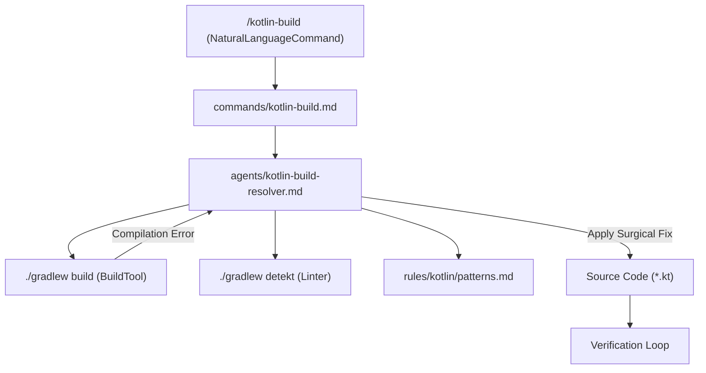
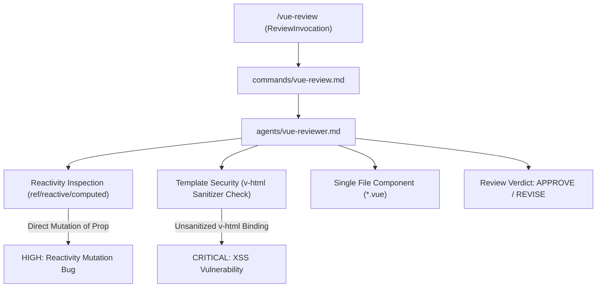

<!-- source: DeepWiki mcp.deepwiki.com · repo affaan-m/ECC · page 3.2 Language & Framework Specialist Agents · fetched 2026-10-30 -->

# Language & Framework Specialist Agents

Relevant source files

The following files were used as context for generating this wiki page:

- [.claude/rules/node.md](.claude/rules/node.md)
- [COMMANDS-QUICK-REF.md](COMMANDS-QUICK-REF.md)
- [agents/architect.md](agents/architect.md)
- [agents/bengali-reviewer.md](agents/bengali-reviewer.md)
- [agents/build-error-resolver.md](agents/build-error-resolver.md)
- [agents/code-reviewer.md](agents/code-reviewer.md)
- [agents/database-reviewer.md](agents/database-reviewer.md)
- [agents/doc-updater.md](agents/doc-updater.md)
- [agents/e2e-runner.md](agents/e2e-runner.md)
- [agents/go-build-resolver.md](agents/go-build-resolver.md)
- [agents/go-reviewer.md](agents/go-reviewer.md)
- [agents/planner.md](agents/planner.md)
- [agents/python-reviewer.md](agents/python-reviewer.md)
- [agents/react-build-resolver.md](agents/react-build-resolver.md)
- [agents/react-reviewer.md](agents/react-reviewer.md)
- [agents/refactor-cleaner.md](agents/refactor-cleaner.md)
- [agents/security-reviewer.md](agents/security-reviewer.md)
- [agents/tdd-guide.md](agents/tdd-guide.md)
- [agents/typescript-reviewer.md](agents/typescript-reviewer.md)
- [commands/go-build.md](commands/go-build.md)
- [commands/go-review.md](commands/go-review.md)
- [commands/go-test.md](commands/go-test.md)
- [docs/COMMAND-AGENT-MAP.md](docs/COMMAND-AGENT-MAP.md)
- [docs/ar/GLOSSARY.md](docs/ar/GLOSSARY.md)
- [docs/ar/README.md](docs/ar/README.md)
- [docs/bn/README.md](docs/bn/README.md)
- [examples/django-api-CLAUDE.md](examples/django-api-CLAUDE.md)
- [examples/saas-nextjs-CLAUDE.md](examples/saas-nextjs-CLAUDE.md)
- [pi/core/skills/bengali-nlp/SKILL.md](pi/core/skills/bengali-nlp/SKILL.md)
- [pi/core/skills/mybatis-patterns/SKILL.md](pi/core/skills/mybatis-patterns/SKILL.md)
- [scripts/setup-package-manager.js](scripts/setup-package-manager.js)
- [skills/bengali-nlp/SKILL.md](skills/bengali-nlp/SKILL.md)
- [skills/cpp-testing/SKILL.md](skills/cpp-testing/SKILL.md)
- [skills/e2e-testing/SKILL.md](skills/e2e-testing/SKILL.md)
- [skills/golang-patterns/SKILL.md](skills/golang-patterns/SKILL.md)
- [skills/golang-testing/SKILL.md](skills/golang-testing/SKILL.md)
- [skills/mybatis-patterns/SKILL.md](skills/mybatis-patterns/SKILL.md)
- [skills/osint-investigation/SKILL.md](skills/osint-investigation/SKILL.md)
- [skills/postgres-patterns/SKILL.md](skills/postgres-patterns/SKILL.md)
- [tests/ci/bengali-language-surface.test.js](tests/ci/bengali-language-surface.test.js)
- [tests/ci/code-reviewer-false-positive-guard.test.js](tests/ci/code-reviewer-false-positive-guard.test.js)

Language & Framework Specialist Agents are domain-specific extensions of ECC's core `code-reviewer` and `build-error-resolver` agent patterns [agents/code-reviewer.md:1-6](), [agents/build-error-resolver.md:1-6](). These agents encapsulate idiomatic language constructs, framework-specific best practices (such as Kotlin Multiplatform, Jetpack Compose, and Vue.js Composition API), and integrate language- and toolchain-specific diagnostic commands. They deliver precise, minimal-impact fixes and high-fidelity code reviews that generic reviewers might misinterpret or overlook.

These specialists inherit and extend the fundamental **Prompt Defense Baseline** established in the base code-reviewer pattern [agents/code-reviewer.md:8-16](), enforcing strict boundaries between language ecosystems and review lanes.

Sources: [agents/code-reviewer.md:1-16](), [agents/build-error-resolver.md:1-6]()

---

## Architecture & Extension Model

ECC employs a layered and modular agent design. Specialist agents extend the base architectural patterns by binding natural language operator commands directly to specialized markdown agent files, diagnostic toolchains, and rules repositories.

- Specialist agents extend the **Prompt Defense Baseline** with language- and framework-specific roles and constraints [agents/kotlin-build-resolver.md:8-16](), [agents/vue-reviewer.md:8-16]().
- They invoke language-specific linters, typecheckers, test runners, and build tools as diagnostic primitives [agents/kotlin-build-resolver.md:20-35](), [agents/go-build-resolver.md:20-40]().
- They implement review and fix logic tailored to idioms, patterns, and error semantics unique to each technology [agents/vue-reviewer.md:17-35]().
- They cooperate with generic or adjacent language agents for comprehensive coverage (e.g., `vue-reviewer` collaborates with `typescript-reviewer` for `.vue` and `.ts` files) [commands/vue-review.md:1-30]().

### Diagram: Natural Language Space to Code Entity Space (Kotlin Build Resolution)

The following diagram bridges the natural language command space to the concrete code entity space, mapping operator input through command files, agent definitions, and diagnostic tools to source artifacts.

Sources: [commands/kotlin-build.md:1-25](), [agents/kotlin-build-resolver.md:1-60](), [rules/kotlin/patterns.md:1-20]()

---

## Specialist Agent Categories

### 1. Build & Error Resolvers

Build-resolver agents specialize in resolving compilation, build, and static analysis errors incrementally, leveraging language-specific tooling diagnostics [agents/build-error-resolver.md:1-25](). They execute surgical fixes that strictly address errors one at a time to prevent destabilizing the codebase.

- **Examples:**
  - `kotlin-build-resolver` fixes Kotlin/Gradle compile errors, detekt warnings, and dependency mismatches [agents/kotlin-build-resolver.md:1-50]().
  - `go-build-resolver` addresses Go compilation errors, `go vet` warnings, and module dependency graph issues [agents/go-build-resolver.md:1-45]().

- **Core Responsibilities:**
  - Diagnose error messages parsed from native build tools or linters [agents/kotlin-build-resolver.md:20-40]().
  - Inspect relevant source files and apply minimal corrective edits [agents/build-error-resolver.md:20-35]().
  - Rerun build and test commands post-fix to verify correctness [commands/go-test.md:10-25]().
  - Halt execution on persistent errors or if fixes introduce regression failures [agents/build-error-resolver.md:40-55]().

Sources: [agents/build-error-resolver.md:1-55](), [agents/kotlin-build-resolver.md:1-50](), [agents/go-build-resolver.md:1-45]()

---

### 2. Specialized Reviewers

Specialized reviewers extend the generic code-reviewer pattern with idiomatic and framework-specific rules and inspection routines tailored to their language ecosystem [agents/code-reviewer.md:17-30](), [agents/vue-reviewer.md:17-35]().

- They combine static analysis, best practice enforcement, security audits, and architectural pattern awareness [agents/database-reviewer.md:21-29](), [agents/vue-reviewer.md:20-30]().
- They cooperate with adjacent language reviewers for hybrid codebases (e.g., Vue projects invoke `vue-reviewer` alongside `typescript-reviewer`) [commands/vue-review.md:1-30]().

### Diagram: Natural Language Space to Code Entity Space (Vue Review Pipeline)

The following diagram bridges the review invocation space to concrete code entities and inspection modules for the Vue framework specialist.

Sources: [agents/vue-reviewer.md:17-55](), [commands/vue-review.md:1-30]()

---

## Language-Specific Implementation Details

### Kotlin, Android & Kotlin Multiplatform (KMP)

The Kotlin specialist ecosystem comprises:

- Error and build resolution integrating Gradle, detekt, and ktlint diagnostics [commands/kotlin-build.md:1-40](), [agents/kotlin-build-resolver.md:1-127]().
- Idiomatic concurrency and structured concurrency patterns (`viewModelScope`, `supervisorScope`, `StateFlow`) [skills/kotlin-coroutines-flows/SKILL.md:20-43]().
- Compose Multiplatform UI conventions and lifecycle correctness [skills/compose-multiplatform-patterns/SKILL.md:57-68]().
- Test writing patterns leveraging Kotest, MockK, and Turbine adhering to the TDD workflow with code coverage verification [skills/kotlin-testing/SKILL.md:8-100]().
- Architectural guidance for `expect`/`actual` platform declarations and dependency injection via Koin or Hilt [rules/kotlin/patterns.md:10-90]().

| Aspect | Key Artifacts & Code Entities | Reference |
| :--- | :--- | :--- |
| Build & Error Resolution | `agents/kotlin-build-resolver.md`, `./gradlew build` | [commands/kotlin-build.md:11-15]() |
| Concurrency Patterns | `skills/kotlin-coroutines-flows/SKILL.md` | [skills/kotlin-coroutines-flows/SKILL.md:20-43]() |
| UI Frameworks | Compose Multiplatform idioms | [skills/compose-multiplatform-patterns/SKILL.md:57-68]() |
| Testing Patterns | Kotest, MockK, TDD workflow | [skills/kotlin-testing/SKILL.md:8-100]() |

Sources: [commands/kotlin-build.md:1-40](), [agents/kotlin-build-resolver.md:1-127](), [skills/kotlin-coroutines-flows/SKILL.md:20-43](), [skills/compose-multiplatform-patterns/SKILL.md:57-68](), [skills/kotlin-testing/SKILL.md:8-100](), [rules/kotlin/patterns.md:10-90]()

---

### Vue.js & Nuxt Framework

The Vue specialist agents enforce correctness and security across frontend components:

- Review Composition API reactivity correctness, including proper instantiation and usage of `ref()`, `reactive()`, and lifecycle watchers [agents/vue-reviewer.md:53-82]().
- Enforce template security by flagging dangerous bindings such as raw `v-html` insertions without DOMPurify sanitization [agents/vue-reviewer.md:55-62]().
- Validate composables for side-effect isolation and lifecycle resource cleanup [agents/vue-reviewer.md:73-81]().
- Assess Vue Router navigation guards, Pinia store conventions, accessibility (ARIA, semantic markup), performance metrics, and Server-Side Rendering (SSR) safety for Nuxt targets [agents/vue-reviewer.md:30-34]().

Vue reviews execute in conjunction with `typescript-reviewer` when inspecting mixed TypeScript and Vue codebases to provide comprehensive coverage of script and template layers [commands/vue-review.md:5-9]().

Sources: [agents/vue-reviewer.md:30-82](), [commands/vue-review.md:1-30]()

---

## Workflow & Verification

Language and framework specialists are invoked through:

- Operator slash commands (e.g., `/kotlin-build`, `/vue-review`) that dispatch directly to the corresponding agent definition [commands/kotlin-build.md:7-15](), [commands/vue-review.md:5-8]().
- Delegation by core orchestrator agents like `planner` and `architect` during autonomous multi-agent development loops [docs/COMMAND-AGENT-MAP.md:25-30]().

All fixes and reviews undergo strict verification loops:

- For build resolvers, native build tools and test suites are re-executed after every discrete fix to confirm error resolution and prevent regressions [commands/go-test.md:10-25]().
- For code reviewers, static analysis output, linter results, and type-checker feedback corroborate all review findings before reporting [agents/code-reviewer.md:19-28]().
- Summary reports categorize findings by severity levels (CRITICAL, HIGH, MEDIUM, LOW) and isolate unresolved warnings [agents/vue-reviewer.md:28-35]().

Sources: [commands/kotlin-build.md:7-15](), [commands/vue-review.md:5-8](), [docs/COMMAND-AGENT-MAP.md:25-30](), [commands/go-test.md:10-25](), [agents/code-reviewer.md:19-28](), [agents/vue-reviewer.md:28-35]()

---

## Sources

- [agents/code-reviewer.md:1-30]()
- [agents/build-error-resolver.md:1-55]()
- [agents/kotlin-build-resolver.md:1-127]()
- [agents/go-build-resolver.md:1-45]()
- [agents/vue-reviewer.md:1-82]()
- [agents/database-reviewer.md:21-29]()
- [commands/kotlin-build.md:1-40]()
- [commands/go-build.md:1-25]()
- [commands/vue-review.md:1-30]()
- [commands/go-test.md:10-25]()
- [rules/kotlin/patterns.md:1-90]()
- [skills/kotlin-coroutines-flows/SKILL.md:20-43]()
- [skills/compose-multiplatform-patterns/SKILL.md:57-68]()
- [skills/kotlin-testing/SKILL.md:8-100]()
- [docs/COMMAND-AGENT-MAP.md:25-30]()

---

