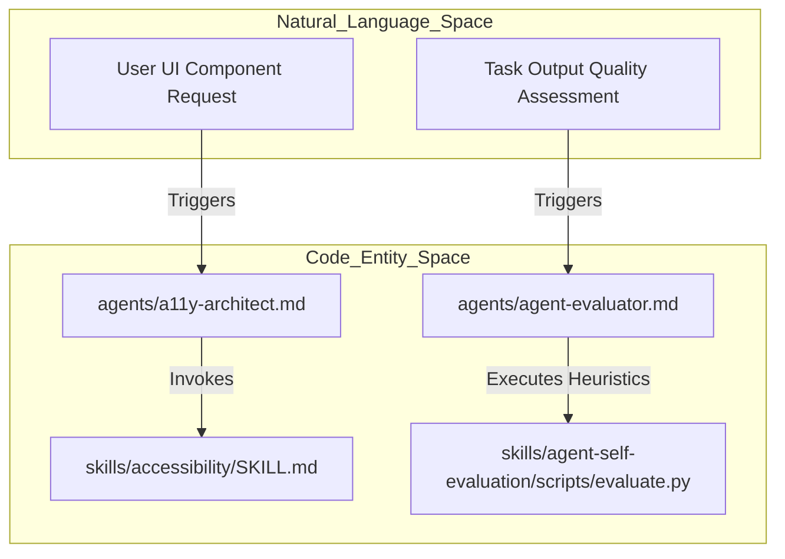
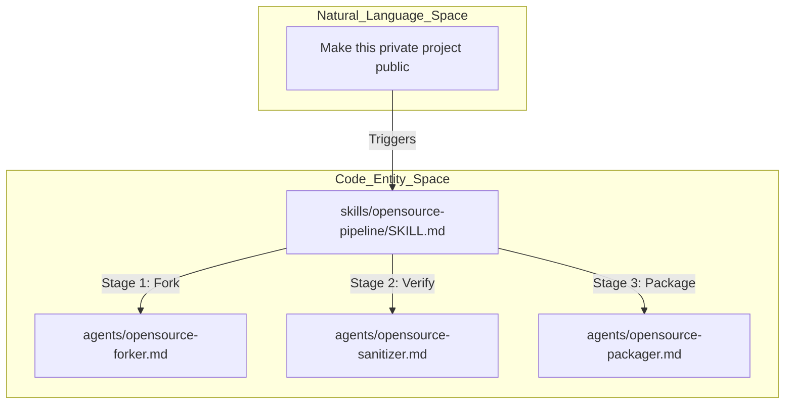

<!-- source: DeepWiki mcp.deepwiki.com · repo affaan-m/ECC · page 3.3 Specialized & Domain Agents · fetched 2026-10-30 -->

# Specialized & Domain Agents

Relevant source files

The following files were used as context for generating this wiki page:

- [agents/a11y-architect.md](agents/a11y-architect.md)
- [agents/agent-evaluator.md](agents/agent-evaluator.md)
- [agents/opensource-forker.md](agents/opensource-forker.md)
- [agents/opensource-packager.md](agents/opensource-packager.md)
- [agents/opensource-sanitizer.md](agents/opensource-sanitizer.md)
- [agents/pytorch-build-resolver.md](agents/pytorch-build-resolver.md)
- [agents/seo-specialist.md](agents/seo-specialist.md)
- [docker/gateguard-effectiveness/scenarios-intent/csv-export-delimiter/grader.cjs](docker/gateguard-effectiveness/scenarios-intent/csv-export-delimiter/grader.cjs)
- [docs/ja-JP/skills/gan-style-harness/SKILL.md](docs/ja-JP/skills/gan-style-harness/SKILL.md)
- [docs/zh-CN/skills/csharp-testing/SKILL.md](docs/zh-CN/skills/csharp-testing/SKILL.md)
- [docs/zh-CN/skills/dart-flutter-patterns/SKILL.md](docs/zh-CN/skills/dart-flutter-patterns/SKILL.md)
- [docs/zh-CN/skills/dashboard-builder/SKILL.md](docs/zh-CN/skills/dashboard-builder/SKILL.md)
- [docs/zh-CN/skills/design-system/SKILL.md](docs/zh-CN/skills/design-system/SKILL.md)
- [docs/zh-CN/skills/dotnet-patterns/SKILL.md](docs/zh-CN/skills/dotnet-patterns/SKILL.md)
- [docs/zh-CN/skills/gan-style-harness/SKILL.md](docs/zh-CN/skills/gan-style-harness/SKILL.md)
- [docs/zh-CN/skills/laravel-plugin-discovery/SKILL.md](docs/zh-CN/skills/laravel-plugin-discovery/SKILL.md)
- [docs/zh-CN/skills/manim-video/SKILL.md](docs/zh-CN/skills/manim-video/SKILL.md)
- [docs/zh-CN/skills/nestjs-patterns/SKILL.md](docs/zh-CN/skills/nestjs-patterns/SKILL.md)
- [docs/zh-CN/skills/nodejs-keccak256/SKILL.md](docs/zh-CN/skills/nodejs-keccak256/SKILL.md)
- [docs/zh-CN/skills/remotion-video-creation/SKILL.md](docs/zh-CN/skills/remotion-video-creation/SKILL.md)
- [examples/gan-harness/README.md](examples/gan-harness/README.md)
- [pi/core/skills/agent-self-evaluation/scripts/evaluate.py](pi/core/skills/agent-self-evaluation/scripts/evaluate.py)
- [scripts/gan-harness.sh](scripts/gan-harness.sh)
- [skills/accessibility/SKILL.md](skills/accessibility/SKILL.md)
- [skills/agent-self-evaluation/SKILL.md](skills/agent-self-evaluation/SKILL.md)
- [skills/agent-self-evaluation/examples/high-score-example.md](skills/agent-self-evaluation/examples/high-score-example.md)
- [skills/agent-self-evaluation/examples/low-score-example.md](skills/agent-self-evaluation/examples/low-score-example.md)
- [skills/agent-self-evaluation/references/evaluation-criteria.md](skills/agent-self-evaluation/references/evaluation-criteria.md)
- [skills/agent-self-evaluation/references/hook-integration.md](skills/agent-self-evaluation/references/hook-integration.md)
- [skills/agent-self-evaluation/scripts/evaluate.py](skills/agent-self-evaluation/scripts/evaluate.py)
- [skills/agent-self-evaluation/templates/evaluation-report.md](skills/agent-self-evaluation/templates/evaluation-report.md)
- [skills/gan-style-harness/SKILL.md](skills/gan-style-harness/SKILL.md)
- [skills/opensource-pipeline/SKILL.md](skills/opensource-pipeline/SKILL.md)
- [skills/seo/SKILL.md](skills/seo/SKILL.md)
- [skills/skill-comply/tests/test_runner.py](skills/skill-comply/tests/test_runner.py)
- [tests/gan-harness.test.js](tests/gan-harness.test.js)
- [tests/skills/opensource-forker-history.test.js](tests/skills/opensource-forker-history.test.js)
- [tests/skills/opensource-pipeline-publish-guard.test.js](tests/skills/opensource-pipeline-publish-guard.test.js)
- [tests/skills/sanitizer-unreadable.test.js](tests/skills/sanitizer-unreadable.test.js)
- [tests/test_agent_self_evaluation.py](tests/test_agent_self_evaluation.py)

This page documents the domain-specific and specialized agents within the Everything Claude Code (ECC) ecosystem. Unlike general core development agents, these specialized entities possess deep expertise in specific industry compliance, technical standards, machine learning frameworks, infrastructure, open-source sanitization, quality evaluation, and advanced multi-agent harnesses [agents/a11y-architect.md:2-3](), [skills/opensource-pipeline/SKILL.md:1-10]().

---

## 1. Accessibility, SEO & Quality Evaluation Specialists

These agents validate digital products against strict web standards, search engine optimization metrics, and multi-axis quality rubrics.

### a11y-architect

The `a11y-architect` agent functions as a Senior Accessibility Architect with deep specialization in WCAG 2.2 Level AA compliance across Web and Native platforms [agents/a11y-architect.md:2-3](). It is proactively invoked during UI design, component creation, or accessibility audits to enforce inclusivity via Perceivable, Operable, Understandable, and Robust (POUR) principles [agents/a11y-architect.md:17-18]().

- **Implementation Details**: The agent leverages the `accessibility` skill, which codifies WCAG 2.2 standards into platform-specific implementations for Web (WAI-ARIA), iOS (SwiftUI accessibility traits), and Android (Jetpack Compose semantics) [skills/accessibility/SKILL.md:1-79]().
- **Compliance Enforcements**: Enforces minimum touch target sizes (24x24 CSS pixels for web, 44x44 points for native), keyboard navigation, focus management, and color contrast ratios [agents/a11y-architect.md:38-39]().

### seo-specialist

This agent focuses on technical SEO validation including meta-tag hierarchies, crawlability checks, and Core Web Vitals optimization [agents/seo-specialist.md:2-3](). It categorizes findings by severity, prioritizing critical crawl blockers and flagging metadata inconsistencies.

### agent-evaluator

The `agent-evaluator` performs objective quality assessments of agent outputs after any substantial task completion, scoring across five axes: Accuracy, Completeness, Clarity, Actionability, and Conciseness [agents/agent-evaluator.md:2-3]().

- **Implementation Details**: It executes heuristics and structural checks aligning with the rubric enforced by the `agent-self-evaluation` skill's Python evaluator script [skills/agent-self-evaluation/scripts/evaluate.py:1-180](). This evaluator requires concrete evidence citations whenever any score is below perfect, adhering to the evidence rule [agents/agent-evaluator.md:12-16]().
- **Key Classes**:
  - `AxisScore`: A dataclass capturing each axis's score, evidence, and improvement notes [skills/agent-self-evaluation/scripts/evaluate.py:35-46]().
- **Constraints**: Uses safe `Bash` commands restricted to read-only operations for verification [agents/agent-evaluator.md:32-35]().

#### Diagram: Natural Language to Code Mapping for Accessibility & Evaluation

Sources: [agents/a11y-architect.md:1-52](), [skills/accessibility/SKILL.md:1-79](), [agents/seo-specialist.md:1-50](), [agents/agent-evaluator.md:1-45](), [skills/agent-self-evaluation/scripts/evaluate.py:1-180]()

---

## 2. Open-Source Pipeline Agents

The open-source pipeline safely prepares private or internal projects for public release through a three-stage automated workflow: Fork → Sanitize → Package [skills/opensource-pipeline/SKILL.md:1-10]().

### opensource-forker

The `opensource-forker` agent copies a project to a staging directory, strips secrets and credentials using over 20 regex patterns, replaces internal references and domains with placeholders, generates `.env.example`, and initializes a clean git history [agents/opensource-forker.md:2-29]().

- **Workflow**: Analyzes dependencies, rsyncs project files while excluding build artifacts and private directories, detects API keys/AWS/database URLs/JWTs/private keys, and amends commits to ensure a single pristine initial commit [agents/opensource-forker.md:32-156]().

### opensource-sanitizer

The `opensource-sanitizer` agent acts as an independent auditor that verifies a forked project is fully sanitized [agents/opensource-sanitizer.md:17-19](). It **never trusts the forker's work** and performs independent deep scans [agents/opensource-sanitizer.md:17-19]().

- **Scans**: Executes secret scans, PII scans, internal reference checks, dangerous file checks (e.g., verifying `.env` or private keys do not exist), configuration completeness checks, and full git history audits (`git log -p --all`) to ensure no leaked credentials exist in past commits [agents/opensource-sanitizer.md:32-151]().

### opensource-packager

The `opensource-packager` agent generates public release packaging including `CLAUDE.md`, a one-command bootstrap script (`setup.sh`), enhanced `README.md`, license files, `CONTRIBUTING.md`, and standard GitHub issue templates [skills/opensource-pipeline/SKILL.md:163-186]().

#### Diagram: Natural Language to Code Mapping for Open-Source Pipeline

Sources: [skills/opensource-pipeline/SKILL.md:1-186](), [agents/opensource-forker.md:1-181](), [agents/opensource-sanitizer.md:1-166]()

---

## 3. Healthcare Domain Agents

Healthcare domain agents enforce zero-tolerance safety policies for clinical decision support systems (CDSS), protected health information (PHI) exposure, and medical record workflows.

### healthcare-reviewer

The `healthcare-reviewer` agent validates clinical software components against stringent regulatory and clinical safety requirements, including HIPAA, DISHA, and GDPR standards [skills/healthcare-eval-harness/SKILL.md:1-11]().

- **Evaluation Harness**: Orchestrates automated execution of five test categories, with the first three defined as CRITICAL gates requiring 100% pass-rates blocking deployment on failure [skills/healthcare-eval-harness/SKILL.md:24-88]():
  1. **CDSS Accuracy (CRITICAL)**: Validates drug interaction pairs, dose validations, and clinical scoring logic [skills/healthcare-eval-harness/SKILL.md:32-38]().
  2. **PHI Exposure (CRITICAL)**: Ensures no patient-identifiable data leaks via API errors, console logs, or storage [skills/healthcare-eval-harness/SKILL.md:40-46]().
  3. **Data Integrity (CRITICAL)**: Checks audit logs are tamper-proof and encounters are locked post-signature [skills/healthcare-eval-harness/SKILL.md:48-54]().
  4. **Clinical Workflow (HIGH)**: Validates encounter lifecycle completeness [skills/healthcare-eval-harness/SKILL.md:56-71]().
  5. **Integration Compliance (HIGH)**: Validates HL7 v2.x and FHIR message parsing correctness [skills/healthcare-eval-harness/SKILL.md:73-88]().

Sources: [skills/healthcare-eval-harness/SKILL.md:1-100](), [skills/healthcare-phi-compliance/SKILL.md:1-55](), [skills/healthcare-cdss-patterns/SKILL.md:1-40]()

---

## 4. GAN (Generative Adversarial Network) Agents

ECC incorporates a GAN-style multi-agent harness modeled on Anthropic's research designed for iterative generator-evaluator collaboration, fostering continual improvement through adversarial feedback loops [agents/gan-evaluator.md:18-22]().

### The GAN Orchestration Lifecycle

Coordinated by the shell script `scripts/gan-harness.sh`, this lifecycle iterates over three specialized agents:
1. **gan-planner**: Drafts a detailed specification in `spec.md` and an evaluation rubric in `eval-rubric.md` using the user's brief [scripts/gan-harness.sh:145-169]().
2. **gan-generator**: Reads `spec.md` and improves/generates application code, committing iterative states [agents/gan-generator.md:22-31]().
3. **gan-evaluator**: Runs integration tests and user interaction automation via Playwright MCP tools, scoring the current build against specific quality axes [agents/gan-evaluator.md:22-35]().

- **Key Functions**:
  - `extract_score()`: Parses evaluation feedback files to extract weighted numeric score values [scripts/gan-harness.sh:61-91]().
  - `score_passes()`: Evaluates whether the generated score meets or exceeds the pass threshold [scripts/gan-harness.sh:93-97]().

Sources: [scripts/gan-harness.sh:1-200](), [agents/gan-generator.md:1-140](), [agents/gan-evaluator.md:1-184]()

---

## 5. Operations, ML & Infrastructure Agents

### chief-of-staff

The `chief-of-staff` agent manages multi-channel communications across Email, Slack, LINE, and Messenger platforms [agents/chief-of-staff.md:2-3](). It classifies incoming messages into distinct tiers (`skip`, `info_only`, `meeting_info`, and `action_required`) and utilizes deterministic scheduling algorithms via `calendar-suggest.js` [agents/chief-of-staff.md:28-30, 142-143]().

### pytorch-build-resolver, mle-reviewer & network-architect

- **pytorch-build-resolver**: Diagnoses and resolves PyTorch build issues, CUDA device placement errors, autograd anomalies, and environment library mismatches [agents/pytorch-build-resolver.md:2-28]().
- **mle-reviewer**: Reviews machine learning experiment scripts, validating pipeline data integrity, hyperparameter search spaces, and evaluation metrics.
- **network-architect**: Designs secure network topologies, VPC configurations, and zero-trust service mesh rules.

Sources: [agents/chief-of-staff.md:1-160](), [agents/pytorch-build-resolver.md:1-125]()

---

# Summary Table of Specialized & Domain Agents

| Agent Name           | Domain                      | Role & Capabilities                                                                           | Key Files                                  |
|----------------------|-----------------------------|----------------------------------------------------------------------------------------------|--------------------------------------------|
| a11y-architect       | Accessibility & WCAG 2.2     | WCAG 2.2 compliance, multiplatform accessible UI design & audit                             | `agents/a11y-architect.md`                  |
| seo-specialist       | SEO Optimization             | Technical SEO audits, meta-tag correctness, Core Web Vitals                                  | `agents/seo-specialist.md`                  |
| agent-evaluator      | Quality Evaluation           | Multi-axis self-evaluation with evidence-based scoring                                      | `agents/agent-evaluator.md`, `evaluate.py` |
| opensource-forker    | Open-Source Pipeline        | Copies project, strips secrets (20+ patterns), normalizes paths, cleans git history         | `agents/opensource-forker.md`               |
| opensource-sanitizer | Open-Source Pipeline        | Independent auditor verifying sanitization, PII, history leaks, and unreadable files        | `agents/opensource-sanitizer.md`            |
| opensource-packager  | Open-Source Pipeline        | Generates CLAUDE.md, setup.sh, README, LICENSE, and issue templates                         | `skills/opensource-pipeline/SKILL.md`       |
| healthcare-reviewer  | Healthcare Compliance        | Healthcare app safety gating, CDSS correctness, PHI exposure, audit & workflow integrity    | `skills/healthcare-eval-harness/SKILL.md`  |
| gan-planner          | GAN Harness Planning         | Specification & rubric generation for GAN cycle                                             | `scripts/gan-harness.sh`                   |
| gan-generator        | GAN Harness Generation      | Application code generation, iterative refinement                                           | `agents/gan-generator.md`                    |
| gan-evaluator        | GAN Harness Evaluation       | Automated testing & scoring of builds using Playwright and heuristic scoring                | `agents/gan-evaluator.md`                    |
| chief-of-staff       | Communications Management     | Multichannel prioritization, scheduling, action item triage                                | `agents/chief-of-staff.md`                   |
| pytorch-build-resolver | Machine Learning Operations  | Diagnoses PyTorch and CUDA runtime/build issues                                            | `agents/pytorch-build-resolver.md`           |
| mle-reviewer         | Machine Learning Evaluation   | Reviews ML training scripts, pipelines, and metrics                                        | Not fully detailed                           |
| network-architect    | Infrastructure Architecture   | Designs secure, scalable network topologies and zero-trust meshes                          | Not fully detailed                           |

Sources: [agents/a11y-architect.md:1-52](), [skills/accessibility/SKILL.md:1-79](), [agents/seo-specialist.md:1-50](), [agents/agent-evaluator.md:1-45](), [skills/agent-self-evaluation/scripts/evaluate.py:1-180](), [skills/opensource-pipeline/SKILL.md:1-186](), [agents/opensource-forker.md:1-181](), [agents/opensource-sanitizer.md:1-166](), [skills/healthcare-eval-harness/SKILL.md:1-100](), [scripts/gan-harness.sh:1-200](), [agents/chief-of-staff.md:1-160](), [agents/pytorch-build-resolver.md:1-125]()

---

