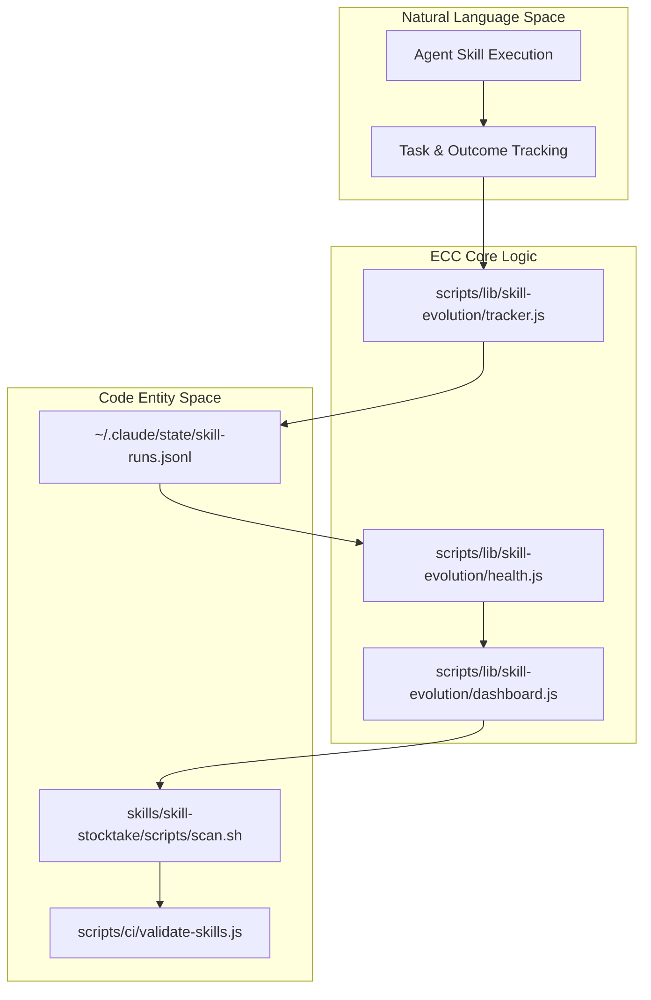
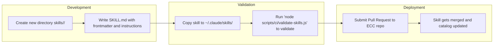

<!-- source: DeepWiki mcp.deepwiki.com · repo affaan-m/ECC · page 4 Skills · fetched 2026-10-30 -->

# Skills

<details>
<summary>Relevant source files</summary>

The following files were used as context for generating this wiki page:

- [scripts/ci/validate-skills.js](scripts/ci/validate-skills.js)
- [scripts/hooks/skill-run-tracker.js](scripts/hooks/skill-run-tracker.js)
- [scripts/lib/skill-evolution/dashboard.js](scripts/lib/skill-evolution/dashboard.js)
- [scripts/lib/skill-evolution/health.js](scripts/lib/skill-evolution/health.js)
- [scripts/lib/skill-evolution/index.js](scripts/lib/skill-evolution/index.js)
- [scripts/lib/skill-evolution/provenance.js](scripts/lib/skill-evolution/provenance.js)
- [scripts/lib/skill-evolution/tracker.js](scripts/lib/skill-evolution/tracker.js)
- [scripts/skills-health.js](scripts/skills-health.js)
- [skills/skill-comply/pyproject.toml](skills/skill-comply/pyproject.toml)
- [skills/skill-stocktake/SKILL.md](skills/skill-stocktake/SKILL.md)
- [skills/skill-stocktake/scripts/quick-diff.sh](skills/skill-stocktake/scripts/quick-diff.sh)
- [skills/skill-stocktake/scripts/save-results.sh](skills/skill-stocktake/scripts/save-results.sh)
- [skills/skill-stocktake/scripts/scan.sh](skills/skill-stocktake/scripts/scan.sh)
- [tests/ci/gateguard-env-documented.test.js](tests/ci/gateguard-env-documented.test.js)
- [tests/hooks/skill-run-tracker.test.js](tests/hooks/skill-run-tracker.test.js)
- [tests/lib/skill-dashboard.test.js](tests/lib/skill-dashboard.test.js)
- [tests/lib/skill-evolution.test.js](tests/lib/skill-evolution.test.js)
- [tests/lib/skill-tracker-timestamps.test.js](tests/lib/skill-tracker-timestamps.test.js)
- [tests/scripts/skill-stocktake-discovery.test.js](tests/scripts/skill-stocktake-discovery.test.js)
- [tests/scripts/skill-stocktake-save-results.test.js](tests/scripts/skill-stocktake-save-results.test.js)

</details>


Everything Claude Code (ECC) features a library of over 600+ skill files. Skills are modular knowledge units that provide Claude with actionable patterns, idioms, and workflows. Unlike **Agents**, which are autonomous actors, or **Commands**, which are specific entry points, Skills serve as the mental model or reference manual that the AI uses to ensure high-quality, idiomatic output.

For a comprehensive guide on writing effective skills, refer to `docs/SKILL-DEVELOPMENT-GUIDE.md`.

Sources: [CONTRIBUTING.md:1-10](), [docs/SKILL-DEVELOPMENT-GUIDE.md:20-30]()

## High-Level Overview

Skills are defined as Markdown files named `SKILL.md` located inside dedicated directories under `skills/`. Each `SKILL.md` follows a precise format with YAML frontmatter (including `name`, `description`, and metadata), explicit activation criteria, and detailed instructions or patterns. This standard structure enables automatic validation and supports multi-harness portability, letting ECC surface the right skills contextually to the AI across different projects and AI platforms.

The skills library currently comprises over 600+ curated skills covering diverse engineering workflows, languages, domains, and continuous learning subsystems.

### Skill Integration Lifecycle

The following diagram illustrates how natural language intents map through ECC’s core logic and skill infrastructure into concrete code artifacts and tooling:

```mermaid
graph TD
    subgraph "Natural Language Space"
        UserIntent[""User Intent (e.g., 'Implement TDD Workflow')""]
        AutoActivate[""Auto-Activation & Dispatch""]
    end

    subgraph "ECC Core Logic"
        SkillRegistry[""Skill Registry (skills/*)""]
        Frontmatter[""SKILL.md Frontmatter (name, description)""]
    end

    subgraph "Code Entity Space"
        TDDSkill[""skills/tdd-workflow/SKILL.md""]
        ScanScript[""skills/skill-stocktake/scripts/scan.sh""]
        ValidateScript[""scripts/ci/validate-skills.js""]
    end

    UserIntent --> AutoActivate
    AutoActivate --> SkillRegistry
    SkillRegistry --> Frontmatter
    Frontmatter --> TDDSkill
    TDDSkill --> ScanScript
    ScanScript --> ValidateScript
```

Sources: [CONTRIBUTING.md:73-99](), [scripts/ci/validate-skills.js:1-25](), [skills/skill-stocktake/scripts/scan.sh:1-15]()

## The SKILL.md Format

Every skill follows a mandatory, standardized Markdown format with key components verified by ECC’s continuous integration system:

| Component           | Requirement                           | Purpose                                            |
|---------------------|-------------------------------------|----------------------------------------------------|
| **Frontmatter**     | YAML block at top                   | Declares `name`, `description`, `origin` metadata |
| **Name**            | Matches skill directory             | Internal referencing, AI skill activation label   |
| **Description**     | Inline YAML string (no block scalar) | Concise natural language description for AI       |
| **Activation**      | Explicit "When to Activate" section | Specifies activation triggers and intended uses   |
| **Core Principles** | Structured explanatory sections     | Elaborates skill “what” and “why”                  |
| **Examples**        | Code or procedural instructions    | Practical guidance and patterns to follow          |

Inline descriptions must avoid multi-line block scalars and maintain a flat simple structure to ensure compatibility with flat-table renderers and frontmatter parsers.

Sources: [CONTRIBUTING.md:92-135](), [scripts/ci/validate-skills.js:6-18]()

## Skill Discovery, Validation & Health Tooling

ECC provides sophisticated internal tooling to track skill availability, validate their conformity, and monitor health across global and project-local skill sets:

- **Skill Stocktake & Quick Diff**: The `skill-stocktake` skill runs scan scripts (`skills/skill-stocktake/scripts/scan.sh`) that enumerate all `SKILL.md` files under global and project-level directories, extracting frontmatter fields, modification times (`mtime`), and tool-use observations [skills/skill-stocktake/SKILL.md:14-75](). Quick scans use `quick-diff.sh` to target only changed files [skills/skill-stocktake/scripts/quick-diff.sh:1-60]().
- **Validation**: `scripts/ci/validate-skills.js` validates that curated skill directories contain a non-empty `SKILL.md`, check YAML frontmatter fields (`name`, `description`), and reject block-scalar descriptions that break flat tables [scripts/ci/validate-skills.js:1-57]().
- **Evolution & Health Dashboard**: The skill evolution subsystem (`scripts/lib/skill-evolution/`) tracks execution outcomes (`tracker.js`), provenance metadata (`provenance.js`), version snapshots (`versioning.js`), and health metrics (`health.js` / `dashboard.js`) to report declining or unmeasured skills [tests/lib/skill-evolution.test.js:13-17]().

### Skill Evolution & Health Pipeline



Sources: [scripts/lib/skill-evolution/tracker.js:1-45](), [scripts/lib/skill-evolution/health.js:31-60](), [scripts/ci/validate-skills.js:1-25](), [skills/skill-stocktake/SKILL.md:1-50]()

## Skill Categories & Child Pages

Skills are organized into six primary categories. Each has a dedicated child page covering deep technical details:

### 4.1 [Workflow & Engineering Skills](#4.1)
Covers essential developer workflows and engineering best practices such as `tdd-workflow`, `verification-loop`, `coding-standards`, `search-first`, backend/frontend patterns, git-workflow, `eval-harness`, autonomous loops, strategic compact, delivery gate, and story lifecycle. For details, see [Workflow & Engineering Skills](#4.1).

### 4.2 [Language & Framework Skills](#4.2)
Language- and framework-specific skills (Python, Go, Kotlin, Java, Rust, Swift, C++, PHP, Ruby, TypeScript, Angular, Perl, tinystruct) providing idiomatic patterns that complement rules. For details, see [Language & Framework Skills](#4.2).

### 4.3 [Domain & Integration Skills](#4.3)
Domain and integration skills for healthcare, supply chain/logistics, DeFi/x402, media (VideoDB, Remotion, fal.ai, TasteForge), MCP patterns, external APIs, social/market research, Itô compute, Nasiko, council, and living-docs. For details, see [Domain & Integration Skills](#4.3).

### 4.4 [Continuous Learning v2 (Instinct System)](#4.4)
Enables continuous learning via the `observe.sh` hook, Observer agent and observer-loop, instinct lifecycle, `instinct-cli.py`, Homunculus directory scoping, and throttling. For details, see [Continuous Learning v2 (Instinct System)](#4.4).

### 4.5 [Skill Quality, Evolution & Compliance Tooling](#4.5)
Covers skill evolution trackers, versioning, health reporting, dashboards (`scripts/lib/skill-evolution/dashboard.js`), `skill-run-tracker` hook, `skill-stocktake` scan, `validate-skills`/`skill-host-compat`, `skill-comply` classifier and runner, docs-governance auditing, and agent self-evaluation. For details, see [Skill Quality, Evolution & Compliance Tooling](#4.5).

### 4.6 [Pi Core Curated Profile & Harness Skill Mirrors](#4.6)
Covers the `pi/core` curated subset (132 skills / 24 commands), `CURATION.md` exclusion rules, `manifests/pi-core.json`, `.pi` extensions runtime, and mirrored copies in `.agents/`, `.cursor/skills`, `.kiro/skills`. For details, see [Pi Core Curated Profile & Harness Skill Mirrors](#4.6).

Sources: [CONTRIBUTING.md:30-48](), [scripts/lib/skill-evolution/dashboard.js:1-30](), [scripts/ci/validate-skills.js:1-30]()

## Creating and Contributing Skills

Adding new skills to ECC involves a straightforward workflow:



- Create a uniquely named folder inside `skills/`.
- Follow the `SKILL.md` format strictly, defining `name`, `description`, activation criteria, and guidance.
- Test the skill locally by copying it to `~/.claude/skills/`.
- Run validation scripts (`validate-skills.js`) to ensure frontmatter conformity.
- Submit a Pull Request for code review.

Sources: [CONTRIBUTING.md:51-69](), [scripts/ci/validate-skills.js:1-25]()

---

This page serves as the high-level introduction to ECC Skills. For technical details and examples, visit the child pages listed above.

# End of Skills

---

