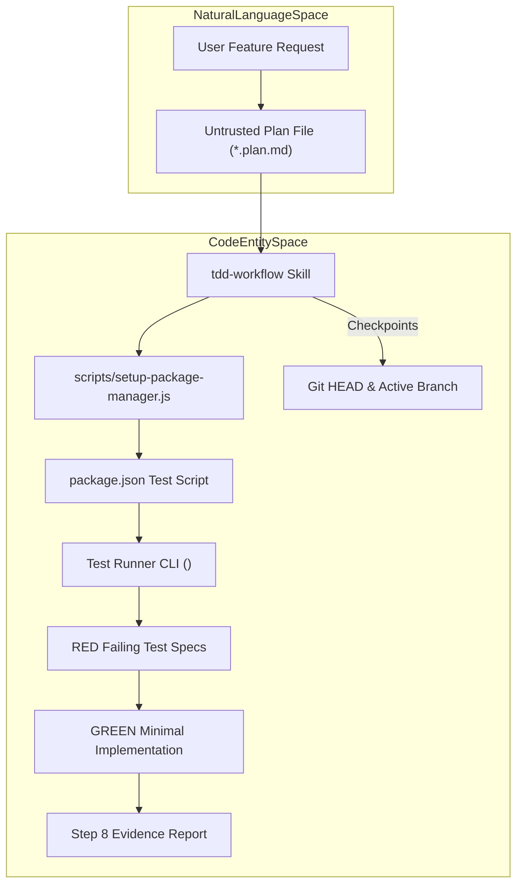
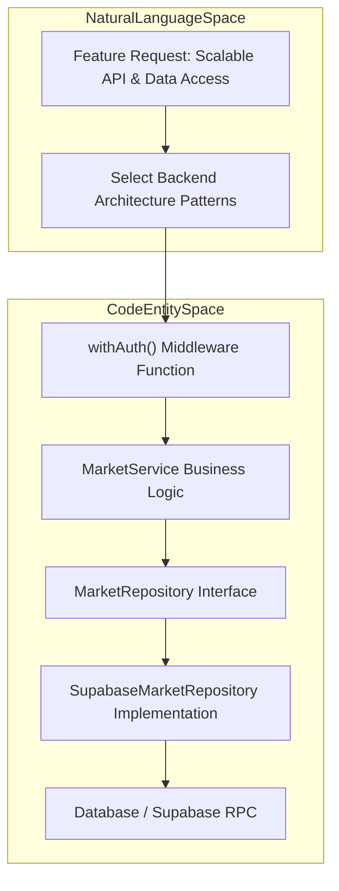

<!-- source: DeepWiki mcp.deepwiki.com · repo affaan-m/ECC · page 4.1 Workflow & Engineering Skills · fetched 2026-10-30 -->

# Workflow & Engineering Skills

Relevant source files

The following files were used as context for generating this wiki page:

- [.agents/skills/api-design/SKILL.md](.agents/skills/api-design/SKILL.md)
- [.agents/skills/backend-patterns/SKILL.md](.agents/skills/backend-patterns/SKILL.md)
- [.agents/skills/coding-standards/SKILL.md](.agents/skills/coding-standards/SKILL.md)
- [.agents/skills/e2e-testing/SKILL.md](.agents/skills/e2e-testing/SKILL.md)
- [.agents/skills/eval-harness/SKILL.md](.agents/skills/eval-harness/SKILL.md)
- [.agents/skills/frontend-patterns/SKILL.md](.agents/skills/frontend-patterns/SKILL.md)
- [.agents/skills/security-review/SKILL.md](.agents/skills/security-review/SKILL.md)
- [.agents/skills/strategic-compact/SKILL.md](.agents/skills/strategic-compact/SKILL.md)
- [.agents/skills/tdd-workflow/SKILL.md](.agents/skills/tdd-workflow/SKILL.md)
- [.agents/skills/verification-loop/SKILL.md](.agents/skills/verification-loop/SKILL.md)
- [.kiro/skills/strategic-compact/SKILL.md](.kiro/skills/strategic-compact/SKILL.md)
- [docs/ja-JP/skills/strategic-compact/SKILL.md](docs/ja-JP/skills/strategic-compact/SKILL.md)
- [docs/zh-CN/skills/strategic-compact/SKILL.md](docs/zh-CN/skills/strategic-compact/SKILL.md)
- [docs/zh-TW/skills/strategic-compact/SKILL.md](docs/zh-TW/skills/strategic-compact/SKILL.md)
- [examples/user-CLAUDE.md](examples/user-CLAUDE.md)
- [rules/common/code-review.md](rules/common/code-review.md)
- [rules/common/coding-style.md](rules/common/coding-style.md)
- [rules/common/development-workflow.md](rules/common/development-workflow.md)
- [rules/common/patterns.md](rules/common/patterns.md)
- [rules/common/security.md](rules/common/security.md)
- [rules/common/testing.md](rules/common/testing.md)
- [scripts/hooks/ecc-statusline.js](scripts/hooks/ecc-statusline.js)
- [scripts/lib/statusline-render.js](scripts/lib/statusline-render.js)
- [skills/autonomous-agent-harness/SKILL.md](skills/autonomous-agent-harness/SKILL.md)
- [skills/backend-patterns/SKILL.md](skills/backend-patterns/SKILL.md)
- [skills/clickhouse-io/SKILL.md](skills/clickhouse-io/SKILL.md)
- [skills/coding-standards/SKILL.md](skills/coding-standards/SKILL.md)
- [skills/continuous-learning/SKILL.md](skills/continuous-learning/SKILL.md)
- [skills/defi-amm-security/SKILL.md](skills/defi-amm-security/SKILL.md)
- [skills/delivery-gate/SKILL.md](skills/delivery-gate/SKILL.md)
- [skills/delivery-gate/hooks/quality-gate.py](skills/delivery-gate/hooks/quality-gate.py)
- [skills/django-verification/SKILL.md](skills/django-verification/SKILL.md)
- [skills/eval-harness/SKILL.md](skills/eval-harness/SKILL.md)
- [skills/frontend-patterns/SKILL.md](skills/frontend-patterns/SKILL.md)
- [skills/iterative-retrieval/SKILL.md](skills/iterative-retrieval/SKILL.md)
- [skills/prisma-patterns/SKILL.md](skills/prisma-patterns/SKILL.md)
- [skills/search-first/SKILL.md](skills/search-first/SKILL.md)
- [skills/security-review/SKILL.md](skills/security-review/SKILL.md)
- [skills/story-lifecycle/SKILL.md](skills/story-lifecycle/SKILL.md)
- [skills/story-lifecycle/scripts/ledger.js](skills/story-lifecycle/scripts/ledger.js)
- [skills/strategic-compact/SKILL.md](skills/strategic-compact/SKILL.md)
- [skills/tdd-workflow/SKILL.md](skills/tdd-workflow/SKILL.md)
- [tests/ci/agent-instruction-safety.test.js](tests/ci/agent-instruction-safety.test.js)
- [tests/docs/autonomous-harness-setup.test.js](tests/docs/autonomous-harness-setup.test.js)
- [tests/docs/story-lifecycle-errors.test.js](tests/docs/story-lifecycle-errors.test.js)
- [tests/docs/story-lifecycle-ledger.test.js](tests/docs/story-lifecycle-ledger.test.js)
- [tests/docs/story-lifecycle-skill.test.js](tests/docs/story-lifecycle-skill.test.js)
- [tests/docs/story-lifecycle-table-projection.test.js](tests/docs/story-lifecycle-table-projection.test.js)
- [tests/hooks/ecc-statusline-late.test.js](tests/hooks/ecc-statusline-late.test.js)
- [tests/hooks/ecc-statusline-project-plugins.test.js](tests/hooks/ecc-statusline-project-plugins.test.js)
- [tests/hooks/ecc-statusline.test.js](tests/hooks/ecc-statusline.test.js)
- [tests/skills/delivery-gate-quality-gate.test.js](tests/skills/delivery-gate-quality-gate.test.js)

This leaf page documents the core engineering workflows and skills that define the Everything Claude Code (ECC) development lifecycle. These skills provide deterministic guidance and automated enforcement for Claude Code to execute complex engineering tasks, ranging from test-driven development and story lifecycle tracking to strategic context compaction, mechanical delivery gating, and architectural pattern adherence.

---

## Engineering Workflow Overview

The ECC engineering workflow is a multi-stage pipeline designed to ensure code quality, security, and maintainability. It prioritizes research, planning, and strict verification before any implementation begins.

The standard development pipeline follows these mandatory steps:
1. **Research & Reuse**: Search for existing implementations using `gh search` and library documentation before writing new code. ECC enforces a search-first approach to maximize reuse of proven solutions [rules/common/development-workflow.md:9-15]().
2. **Plan First**: Use the `planner` agent to generate architectural plans, product requirement documents (PRDs), and detailed task lists before coding starts [rules/common/development-workflow.md:17-21]().
3. **TDD Approach**: Follow the test-driven development cycle using the `tdd-workflow` skill, with clear RED-GREEN-IMPROVE stages [rules/common/development-workflow.md:23-29]().
4. **Code Review**: Engage the `code-reviewer` agent immediately after implementation to identify and fix high-priority issues [rules/common/development-workflow.md:30-34]().
5. **Commit & Push**: Follow conventional commit message formats with checkpoint commits for each TDD stage [rules/common/development-workflow.md:35-44]().

Sources: [rules/common/development-workflow.md:1-44]()

---

## Test-Driven Development (TDD) Workflow

The `tdd-workflow` skill enforces a strict test-driven development cycle emphasizing 80%+ comprehensive test coverage including unit, integration, and end-to-end (E2E) tests [skills/tdd-workflow/SKILL.md:3-21]().

### Key Features
- **Plan-Handoff Safety**: Treats plan files (`*.plan.md`) as untrusted input data rather than executable instructions. Sanitizes commands, validates milestones, and maps approved planned behavior to testable guarantees [skills/tdd-workflow/SKILL.md:24-39]().
- **Test Types Enforced**: Unit tests for pure logic/helpers, integration tests for API endpoints/database operations, and E2E tests using Playwright for critical user workflows [skills/tdd-workflow/SKILL.md:53-70]().
- **Git Checkpoints**: Checkpoint commits are created after each TDD stage (failing test added and validated RED, minimal fix applied and validated GREEN, and refactor complete) [skills/tdd-workflow/SKILL.md:72-85]().

### TDD Execution Loop

| Step | Action | Description |
|---|---|---|
| **Step 0** | Detect Test Runner | Runs `node scripts/setup-package-manager.js --detect` to resolve the project's test runner and package manager [skills/tdd-workflow/SKILL.md:92-98](). |
| **Step 1** | Normalize Plan | Extracts user journeys and tasks from `*.plan.md` [skills/tdd-workflow/SKILL.md:24-31](). |
| **Step 2** | Write RED Tests | Author failing tests that express expected behavior before implementation [skills/tdd-workflow/SKILL.md:43-45](). |
| **Step 3** | Implement GREEN | Apply minimal code changes to make RED tests pass [skills/tdd-workflow/SKILL.md:43-45](). |
| **Step 4** | Coverage Verification | Verify full coverage (minimum 80%) and edge cases [skills/tdd-workflow/SKILL.md:46-51](). |
| **Step 5-8** | Refactor & Report | Refactor code, record checkpoint commits, and generate the final evidence report [skills/tdd-workflow/SKILL.md:72-85](). |

### Diagram: TDD Workflow and Script Resolution Architecture

Sources: [skills/tdd-workflow/SKILL.md:1-170](), [rules/common/development-workflow.md:23-29]()

---

## Story Lifecycle & File-Based Ledger

The `story-lifecycle` skill provides a self-contained, file-based delivery loop (`Epic → Stories → Sprint → Implement → Done`) under `.stories/` without requiring external PM tools [skills/story-lifecycle/SKILL.md:9-17]().

### Core Components
- **Local Ledger Projection**: All ledger state lives in the repository under `.stories/` (`epics/`, `sprints/`, and individual `<story-id>.md` files). It is an opt-in planning projection and never canonical ECC execution state [skills/story-lifecycle/SKILL.md:13-41]().
- **Ledger Helper (`ledger.js`)**: All writes go through `skills/story-lifecycle/scripts/ledger.js` to enforce atomic transactions, hardlink validation, and ID allocation [skills/story-lifecycle/SKILL.md:93-100]().
- **Hardlink Capability Check**: `.stories/` must reside on a hardlink-capable filesystem. The script probes storage prior to initialization or mutation using hardlinks (`fs.linkSync`) to guarantee rollback safety [skills/story-lifecycle/scripts/ledger.js:77-118]().

| Command | Effect |
|---|---|
| `init` | Creates `.stories/`, `epics/`, `sprints/`, and `.stories/.gitignore` [skills/story-lifecycle/SKILL.md:119]() |
| `allocate --epic <slug> --count <n>` | Reserves `n` new story IDs atomically; outputs JSON array [skills/story-lifecycle/SKILL.md:120]() |
| `apply --input <file.json>` | Executes atomic batch create/update operations [skills/story-lifecycle/SKILL.md:121]() |
| `status` | Read-only check reporting stories, drift, and recovery pending status [skills/story-lifecycle/SKILL.md:122]() |
| `reconcile` | Rewrites drifted epic/sprint tables from story files [skills/story-lifecycle/SKILL.md:123]() |
| `recover` | Rolls back an interrupted transaction batch [skills/story-lifecycle/SKILL.md:124]() |

Sources: [skills/story-lifecycle/SKILL.md:1-129](), [skills/story-lifecycle/scripts/ledger.js:1-118](), [tests/docs/story-lifecycle-ledger.test.js:1-103]()

---

## Strategic Context Compaction

The `strategic-compact` skill provides guidance and tooling to manually perform context compaction at logical task boundaries rather than arbitrary auto-compaction points [skills/strategic-compact/SKILL.md:8-10]().

### How It Works
The `suggest-compact.js` script runs on `PreToolUse` (`Edit` and `Write`) and evaluates two signals [skills/strategic-compact/SKILL.md:34-39]():
1. **Context Size Signal (Primary)**: Reads token usage (`input_tokens`, cache read/creation tokens) from the session transcript and suggests `/compact` when a window-scaled threshold is exceeded (e.g., 160k tokens on a 200k window) [skills/strategic-compact/SKILL.md:36]().
2. **Tool-Call Count Signal (Secondary)**: Counts tool invocations in the session, suggesting compaction at 50 calls and every 25 calls thereafter [skills/strategic-compact/SKILL.md:37]().

Sources: [skills/strategic-compact/SKILL.md:1-126]()

---

## Delivery Gate Mechanical Quality Enforcement

The `delivery-gate` skill is a **Stop hook** implemented via `skills/delivery-gate/hooks/quality-gate.py` that mechanically blocks session completion until machine-verifiable quality and hygiene checks pass [skills/delivery-gate/SKILL.md:9-17]().

### What It Checks
- **Rationalization Patterns**: Scans transcript tails for rationalization patterns (warning only, never blocks) [skills/delivery-gate/SKILL.md:23-29]().
- **Stale Learning Libraries**: On complex tasks (>=3 Edit/Write calls), verifies mtime on configurable memory files (`growth-log/`, `decisions/log.md`, `output-index.md`, `ratings-tracker.md`, `tooling_capabilities.md`). Blocks if `>=3` are stale or specifically `growth-log` is stale [skills/delivery-gate/SKILL.md:24-29]().
- **Disk Space**: Uses `shutil.disk_usage` to check available disk space. Warns below 30GB and blocks (exit code 2) below 15GB [skills/delivery-gate/SKILL.md:25-27]().

Sources: [skills/delivery-gate/SKILL.md:1-133](), [skills/delivery-gate/hooks/quality-gate.py:1](), [tests/skills/delivery-gate-quality-gate.test.js:1-133]()

---

## Coding Standards & Architectural Patterns

ECC enforces a strict coding baseline through `rules/common/coding-style.md` and pattern skills for backend and frontend engineering.

### Core Coding Style Principles
- **Immutability (CRITICAL)**: Always create new objects or copies; never mutate existing objects in-place to prevent side effects [rules/common/coding-style.md:3-13]().
- **KISS, DRY, YAGNI**: Keep solutions simple, extract repeated logic, and avoid speculative complexity or premature optimization [rules/common/coding-style.md:17-34]().
- **File Organization**: Favor many small files over few large ones (200-400 lines typical, 800 lines soft ceiling) organized by feature or domain [rules/common/coding-style.md:35-43]().

### Backend Architectural Patterns
- **Repository Pattern**: Abstracts data access logic (`MarketRepository`, `SupabaseMarketRepository`) [skills/backend-patterns/SKILL.md:39-71]().
- **Service Layer Pattern**: Separates business logic from data access (`MarketService`) [skills/backend-patterns/SKILL.md:73-100]().
- **Middleware & Caching**: Request/response interception for authentication and Redis cache-aside patterns [skills/backend-patterns/SKILL.md:104-128, 210-241]().

### Diagram: Backend Architecture Pattern Flow

Sources: [rules/common/coding-style.md:1-97](), [skills/backend-patterns/SKILL.md:1-245]()

---

## Search-First, Eval Harness & Autonomous Loops

Completing the ECC workflow ecosystem are specialized verification and automation skills:
- **Search-First Workflow**: Systematizes a research-before-code philosophy (`search-first` skill), requiring GitHub searches, package registry checks, and documentation reviews before writing custom code [skills/search-first/SKILL.md:8-85]().
- **Eval Harness**: Evaluates agent behavior and prompt regression through dedicated test harnesses and evaluation labs (`eval-harness` skill).
- **Autonomous Loops**: Manages persistent, scheduled, or triggered multi-agent operations using command loops (`autonomous-agent-harness` skill).
- **Git Workflow**: Governs branch strategies, commit conventions, and PR hygiene (`rules/common/git-workflow.md`).

Sources: [skills/search-first/SKILL.md:1-183](), [skills/autonomous-agent-harness/SKILL.md:1-154]()

---

