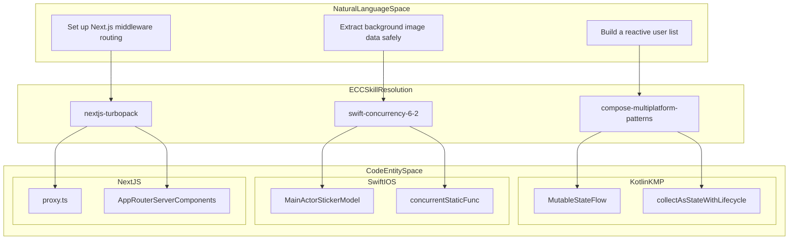
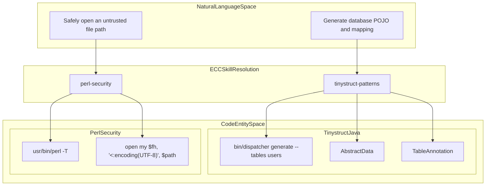

<!-- source: DeepWiki mcp.deepwiki.com · repo affaan-m/ECC · page 4.2 Language & Framework Skills · fetched 2026-10-30 -->

# Language & Framework Skills

Relevant source files

The following files were used as context for generating this wiki page:

- [.agents/skills/bun-runtime/SKILL.md](.agents/skills/bun-runtime/SKILL.md)
- [.agents/skills/documentation-lookup/SKILL.md](.agents/skills/documentation-lookup/SKILL.md)
- [.agents/skills/nextjs-turbopack/SKILL.md](.agents/skills/nextjs-turbopack/SKILL.md)
- [.cursor/skills/bun-runtime/SKILL.md](.cursor/skills/bun-runtime/SKILL.md)
- [.cursor/skills/documentation-lookup/SKILL.md](.cursor/skills/documentation-lookup/SKILL.md)
- [.cursor/skills/nextjs-turbopack/SKILL.md](.cursor/skills/nextjs-turbopack/SKILL.md)
- [.kiro/skills/django-security/SKILL.md](.kiro/skills/django-security/SKILL.md)
- [agents/kotlin-reviewer.md](agents/kotlin-reviewer.md)
- [agents/rust-reviewer.md](agents/rust-reviewer.md)
- [commands/gradle-build.md](commands/gradle-build.md)
- [commands/santa-loop.md](commands/santa-loop.md)
- [docs/ja-JP/commands/santa-loop.md](docs/ja-JP/commands/santa-loop.md)
- [docs/ja-JP/skills/bun-runtime/SKILL.md](docs/ja-JP/skills/bun-runtime/SKILL.md)
- [docs/zh-CN/commands/santa-loop.md](docs/zh-CN/commands/santa-loop.md)
- [docs/zh-CN/skills/bun-runtime/SKILL.md](docs/zh-CN/skills/bun-runtime/SKILL.md)
- [pi/core/skills/django-security/SKILL.md](pi/core/skills/django-security/SKILL.md)
- [pi/core/skills/python-testing/SKILL.md](pi/core/skills/python-testing/SKILL.md)
- [rules/kotlin/coding-style.md](rules/kotlin/coding-style.md)
- [rules/kotlin/patterns.md](rules/kotlin/patterns.md)
- [rules/kotlin/security.md](rules/kotlin/security.md)
- [rules/kotlin/testing.md](rules/kotlin/testing.md)
- [scripts/lib/agent-compress.js](scripts/lib/agent-compress.js)
- [scripts/lib/inspection.js](scripts/lib/inspection.js)
- [skills/android-clean-architecture/SKILL.md](skills/android-clean-architecture/SKILL.md)
- [skills/bun-runtime/SKILL.md](skills/bun-runtime/SKILL.md)
- [skills/compose-multiplatform-patterns/SKILL.md](skills/compose-multiplatform-patterns/SKILL.md)
- [skills/django-patterns/SKILL.md](skills/django-patterns/SKILL.md)
- [skills/django-security/SKILL.md](skills/django-security/SKILL.md)
- [skills/django-tdd/SKILL.md](skills/django-tdd/SKILL.md)
- [skills/documentation-lookup/SKILL.md](skills/documentation-lookup/SKILL.md)
- [skills/kotlin-coroutines-flows/SKILL.md](skills/kotlin-coroutines-flows/SKILL.md)
- [skills/nextjs-turbopack/SKILL.md](skills/nextjs-turbopack/SKILL.md)
- [skills/python-patterns/SKILL.md](skills/python-patterns/SKILL.md)
- [skills/python-testing/SKILL.md](skills/python-testing/SKILL.md)
- [skills/tinystruct-patterns/SKILL.md](skills/tinystruct-patterns/SKILL.md)
- [skills/tinystruct-patterns/references/architecture.md](skills/tinystruct-patterns/references/architecture.md)
- [skills/tinystruct-patterns/references/data-handling.md](skills/tinystruct-patterns/references/data-handling.md)
- [skills/tinystruct-patterns/references/database.md](skills/tinystruct-patterns/references/database.md)
- [skills/tinystruct-patterns/references/routing.md](skills/tinystruct-patterns/references/routing.md)
- [skills/tinystruct-patterns/references/system-usage.md](skills/tinystruct-patterns/references/system-usage.md)
- [skills/tinystruct-patterns/references/testing.md](skills/tinystruct-patterns/references/testing.md)
- [tests/commands/santa-loop.test.js](tests/commands/santa-loop.test.js)
- [tests/lib/agent-compress.test.js](tests/lib/agent-compress.test.js)
- [tests/lib/inspection.test.js](tests/lib/inspection.test.js)

## Purpose and Scope

This page details Everything Claude Code's (ECC) language-specific intelligence layer, which translates high-level natural language requests into concrete, idiomatic code across multiple technology stacks (Kotlin, Swift, Python, Java/tinystruct, Perl, TypeScript/Next.js, etc.). These skills complement the project-wide Rules System by providing actionable patterns, architectural constraints, and security best practices tailored to each runtime ecosystem.

---

## Overview of Language Support & Code Entity Mapping

ECC's language skills enforce modern ecosystem standards (such as Swift 6.2, Perl 5.36+, tinystruct Java framework, and Next.js 16+) to ensure that generated code incorporates proper safety, performance, and concurrency idioms.

### Natural Language to Code Entity Mapping: Mobile & Web

The following diagram illustrates how user intent for asynchronous and reactive UI features is mapped directly to concrete code entities across Kotlin, Swift, and Next.js stacks using ECC skills.

**Diagram: Natural Language to Code Entity Mapping (Mobile & Web)**

Sources: `skills/compose-multiplatform-patterns/SKILL.md:22-62`(), `skills/swift-concurrency-6-2/SKILL.md:42-158`(), `skills/nextjs-turbopack/SKILL.md:41-52`()

---

## Kotlin & Android/KMP Patterns

ECC emphasizes **Structured Concurrency** and **Unidirectional Data Flow (UDF)** for Kotlin development across Android and Kotlin Multiplatform (KMP) targets.

### State Management & Coroutines

ECC mandates the use of `StateFlow` to represent UI state as a single immutable data class within `ViewModel` subclasses. These `ViewModel`s expose state flows (`StateFlow<T>`) that Composable UI layers or other consumers collect reactively.

Key implementation elements:
- `MutableStateFlow` holds internal mutable UI state (`rules/kotlin/patterns.md:39-41`)
- Event handling is implemented via a sealed interface pattern as an event sink function (`onEvent`) (`rules/kotlin/patterns.md:43-48`)
- Coroutine dispatching uses structured concurrency with `viewModelScope` and `coroutineScope` (`rules/kotlin/patterns.md:113-115`)

Sources: `rules/kotlin/patterns.md:1-116`(), `skills/compose-multiplatform-patterns/SKILL.md:22-104`()

---

## Swift 6.2 & iOS Intelligence

ECC configures agents to adopt Swift 6.2's updated concurrency model along with iOS 26's Liquid Glass design system and Apple FoundationModels on-device AI framework.

### Concurrency Model

Swift 6.2 enforces that async functions remain on the calling actor by default, eliminating pervasive data-race bugs caused by implicit background thread offloading. Key concurrency features include:
- **Single-threaded by default**: Async functions run on the caller's actor unless annotated otherwise (`skills/swift-concurrency-6-2/SKILL.md:8-38`)
- **`@concurrent` annotation**: For explicit background thread offloading (`skills/swift-concurrency-6-2/SKILL.md:135-158`)
- **Isolated conformances**: Allows `MainActor`-isolated types to conform safely to non-isolated protocols (`skills/swift-concurrency-6-2/SKILL.md:53-69`)

Sources: `skills/swift-concurrency-6-2/SKILL.md:8-170`(), `skills/foundation-models-on-device/SKILL.md:19-100`()

---

## Java & tinystruct Framework Patterns

For Java projects utilizing the lightweight **tinystruct** framework, ECC provides specialized guidance treating CLI and HTTP as equal citizens with zero mandatory `main()` methods (`skills/tinystruct-patterns/SKILL.md:9-15`).

### Primary Development Tool: `bin/dispatcher`

`bin/dispatcher` (or `bin/dispatcher.cmd` on Windows) is the default entry point for running `@Action`-annotated methods, starting servers, and managing modules (`skills/tinystruct-patterns/SKILL.md:17-40`).

- **Dual-Mode Actions**: Every `@Action` method is designed to run from both the terminal and the web browser without modification (`skills/tinystruct-patterns/SKILL.md:13-15`).
- **Database Persistence**: Object relational mapping via `AbstractData` subclassing, XML mapping files (`*.map.xml`), or `@Table`/`@Column` annotations (`skills/tinystruct-patterns/references/database.md:1-122`).
- **Auto-Creation**: Enabling `database.autocreate=true` in `application.properties` automatically invokes `CREATE TABLE IF NOT EXISTS` on first instantiation (`skills/tinystruct-patterns/references/database.md:136-148`).

Sources: `skills/tinystruct-patterns/SKILL.md:1-83`(), `skills/tinystruct-patterns/references/database.md:1-158`()

---

## Natural Language to Code Entity Mapping: Java & Perl

This diagram shows how user requests for database code generation in tinystruct or secure file handling in Perl map to concrete code entities.

**Diagram: Natural Language to Code Entity Mapping (Java/tinystruct & Perl)**

Sources: `skills/tinystruct-patterns/SKILL.md:41-54`(), `skills/tinystruct-patterns/references/database.md:103-121`(), `skills/perl-security/SKILL.md:25-44`(), `skills/perl-security/SKILL.md:162-182`()

---

## Python Testing & TDD Patterns

ECC enforces rigorous Test-Driven Development (TDD) and testing strategies for Python using `pytest` (`skills/python-testing/SKILL.md:10-28`).

### Core Testing Specifications

- **TDD Cycle**: Always follow Red -> Green -> Refactor (`skills/python-testing/SKILL.md:21-28`).
- **Coverage**: Target 80%+ code coverage, with 100% required on critical paths, measured via `pytest --cov` (`skills/python-testing/SKILL.md:42-50`).
- **Fixtures & Parametrization**: Extensive use of `@pytest.fixture` with setup/teardown yields and `@pytest.mark.parametrize` for data-driven test coverage (`skills/python-testing/SKILL.md:117-264`).

Sources: `skills/python-testing/SKILL.md:1-283`()

---

## Modern Perl (5.36+) & Security

ECC enforces modern Perl idioms and security best practices to replace legacy code antipatterns.

### Idiomatic Standards & Security

- Use `use v5.36` to unify strictness, warnings, and subroutine signatures (`skills/perl-patterns/SKILL.md:26-48`).
- Taint Mode enabled (`-T`) for external inputs (`skills/perl-security/SKILL.md:25-44`).
- Use the three-argument `open` variant for file operations to prevent shell injection (`skills/perl-security/SKILL.md:162-182`).

Sources: `skills/perl-patterns/SKILL.md:26-117](), [skills/perl-security/SKILL.md:25-182`()

---

## Web Frameworks: Next.js & Turbopack

ECC tracks modern Next.js releases (16+) and bundler conventions.

### Key Framework Knowledge

- **Turbopack**: Default incremental bundler in Next.js 16+ for development, utilizing file-system caching for faster startup and HMR (`skills/nextjs-turbopack/SKILL.md:10-26`).
- **Middleware Naming**: Next.js 16 introduced `proxy.ts` as the middleware filename, replacing `middleware.ts` at the project root (`skills/nextjs-turbopack/SKILL.md:41-52`).

Sources: `skills/nextjs-turbopack/SKILL.md:1-59`()

---

## Live Documentation Integration (Context7)

ECC leverages the Context7 MCP ecosystem to retrieve up-to-date framework and library documentation (`skills/documentation-lookup/SKILL.md:10-57`).

### Integration Flow
1. Agents call `resolve-library-id` MCP tool with library name and query (`skills/documentation-lookup/SKILL.md:31-39`).
2. Best match is selected based on benchmark score and source reputation (`skills/documentation-lookup/SKILL.md:40-48`).
3. The `query-docs` MCP tool fetches targeted API references (`skills/documentation-lookup/SKILL.md:49-57`).

Sources: `skills/documentation-lookup/SKILL.md:1-57`()

---

## Summary Table of Language & Framework Skills and Rule Complementarity

| Language / Framework | Key Skills Provided | How Skills Complement Rules |
|----------------------|---------------------|-----------------------------|
| Kotlin (Android/KMP) | `compose-multiplatform-patterns`, `kotlin-coroutines-flows` | Enforce idiomatic concurrency & UI patterns; rules enforce style and structural boundaries |
| Swift 6.2 & iOS 26 | `swift-concurrency-6-2`, `liquid-glass-design`, `foundation-models-on-device` | Skills enforce safe concurrency & design idioms; rules enforce naming and async safety contracts |
| Java (tinystruct) | `tinystruct-patterns` | Skills guide dual-mode `@Action` routing, `bin/dispatcher` usage, and `AbstractData` ORM |
| Python | `python-testing`, `python-patterns` | Skills enforce pytest structures, TDD cycles, and 80%+ coverage metrics |
| Perl 5.36+ | `perl-patterns`, `perl-security` | Skills ensure modern signatures, taint mode (`-T`), and safe three-argument `open` |
| Next.js & Turbopack | `nextjs-turbopack` | Skills provide version-specific bundler and `proxy.ts` middleware patterns |
| Live Docs | `documentation-lookup` | Augments static language rules with current live API documentation |

Sources: `skills/compose-multiplatform-patterns/SKILL.md:22-104]`, `skills/swift-concurrency-6-2/SKILL.md:8-170`, `skills/tinystruct-patterns/SKILL.md:9-40`, `skills/python-testing/SKILL.md:10-50`, `skills/perl-security/SKILL.md:25-44`, `skills/nextjs-turbopack/SKILL.md:10-52`

# End of 4.2 Language & Framework Skills

---

