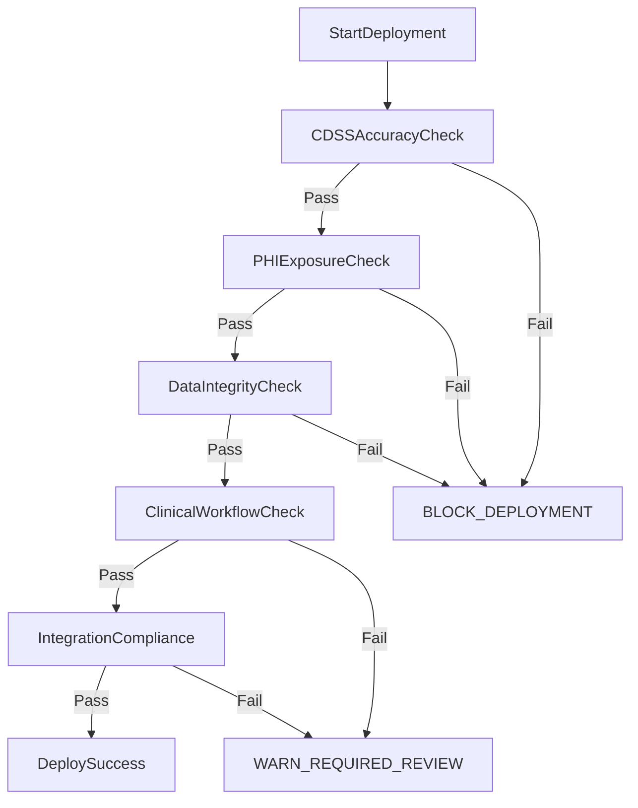
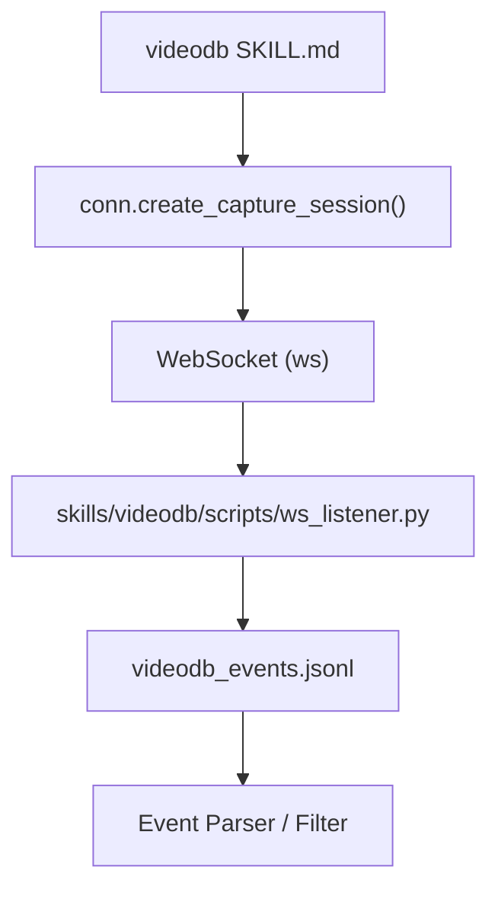

<!-- source: DeepWiki mcp.deepwiki.com · repo affaan-m/ECC · page 4.3 Domain & Integration Skills · fetched 2026-10-30 -->

# Domain & Integration Skills

Relevant source files

The following files were used as context for generating this wiki page:

- [.agents/skills/crosspost/SKILL.md](.agents/skills/crosspost/SKILL.md)
- [.agents/skills/exa-search/SKILL.md](.agents/skills/exa-search/SKILL.md)
- [.agents/skills/x-api/SKILL.md](.agents/skills/x-api/SKILL.md)
- [commands/aside.md](commands/aside.md)
- [docs/design/ecc-ito-compute-integration.md](docs/design/ecc-ito-compute-integration.md)
- [docs/es/skills/quarkus-patterns/SKILL.md](docs/es/skills/quarkus-patterns/SKILL.md)
- [docs/es/skills/quarkus-security/SKILL.md](docs/es/skills/quarkus-security/SKILL.md)
- [docs/es/skills/quarkus-tdd/SKILL.md](docs/es/skills/quarkus-tdd/SKILL.md)
- [docs/ja-JP/skills/agent-payment-x402/SKILL.md](docs/ja-JP/skills/agent-payment-x402/SKILL.md)
- [docs/zh-CN/skills/agent-payment-x402/SKILL.md](docs/zh-CN/skills/agent-payment-x402/SKILL.md)
- [docs/zh-CN/skills/defi-amm-security/SKILL.md](docs/zh-CN/skills/defi-amm-security/SKILL.md)
- [docs/zh-CN/skills/evm-token-decimals/SKILL.md](docs/zh-CN/skills/evm-token-decimals/SKILL.md)
- [docs/zh-CN/skills/healthcare-cdss-patterns/SKILL.md](docs/zh-CN/skills/healthcare-cdss-patterns/SKILL.md)
- [docs/zh-CN/skills/healthcare-emr-patterns/SKILL.md](docs/zh-CN/skills/healthcare-emr-patterns/SKILL.md)
- [docs/zh-CN/skills/healthcare-eval-harness/SKILL.md](docs/zh-CN/skills/healthcare-eval-harness/SKILL.md)
- [docs/zh-CN/skills/healthcare-phi-compliance/SKILL.md](docs/zh-CN/skills/healthcare-phi-compliance/SKILL.md)
- [docs/zh-CN/skills/hipaa-compliance/SKILL.md](docs/zh-CN/skills/hipaa-compliance/SKILL.md)
- [docs/zh-CN/skills/llm-trading-agent-security/SKILL.md](docs/zh-CN/skills/llm-trading-agent-security/SKILL.md)
- [docs/zh-CN/skills/safety-guard/SKILL.md](docs/zh-CN/skills/safety-guard/SKILL.md)
- [docs/zh-CN/skills/security-bounty-hunter/SKILL.md](docs/zh-CN/skills/security-bounty-hunter/SKILL.md)
- [mcp-configs/mcp-servers.json](mcp-configs/mcp-servers.json)
- [scripts/ito.js](scripts/ito.js)
- [scripts/lib/ito-environment.js](scripts/lib/ito-environment.js)
- [scripts/lib/orchestration-session.js](scripts/lib/orchestration-session.js)
- [scripts/lib/tmux-worktree-orchestrator.js](scripts/lib/tmux-worktree-orchestrator.js)
- [scripts/orchestrate-worktrees.js](scripts/orchestrate-worktrees.js)
- [scripts/orchestration-status.js](scripts/orchestration-status.js)
- [skills/agent-payment-x402/SKILL.md](skills/agent-payment-x402/SKILL.md)
- [skills/crosspost/SKILL.md](skills/crosspost/SKILL.md)
- [skills/data-scraper-agent/SKILL.md](skills/data-scraper-agent/SKILL.md)
- [skills/deep-research/SKILL.md](skills/deep-research/SKILL.md)
- [skills/dmux-workflows/SKILL.md](skills/dmux-workflows/SKILL.md)
- [skills/email-ops/SKILL.md](skills/email-ops/SKILL.md)
- [skills/exa-search/SKILL.md](skills/exa-search/SKILL.md)
- [skills/fal-ai-media/SKILL.md](skills/fal-ai-media/SKILL.md)
- [skills/github-ops/SKILL.md](skills/github-ops/SKILL.md)
- [skills/ito-compute/SKILL.md](skills/ito-compute/SKILL.md)
- [skills/ito-compute/agents/openai.yaml](skills/ito-compute/agents/openai.yaml)
- [skills/jira-integration/SKILL.md](skills/jira-integration/SKILL.md)
- [skills/laravel-plugin-discovery/SKILL.md](skills/laravel-plugin-discovery/SKILL.md)
- [skills/market-research/SKILL.md](skills/market-research/SKILL.md)
- [skills/social-publisher/SKILL.md](skills/social-publisher/SKILL.md)
- [skills/videodb/SKILL.md](skills/videodb/SKILL.md)
- [skills/videodb/reference/api-reference.md](skills/videodb/reference/api-reference.md)
- [skills/videodb/reference/capture-reference.md](skills/videodb/reference/capture-reference.md)
- [skills/videodb/reference/capture.md](skills/videodb/reference/capture.md)
- [skills/videodb/reference/editor.md](skills/videodb/reference/editor.md)
- [skills/videodb/reference/generative.md](skills/videodb/reference/generative.md)
- [skills/videodb/reference/rtstream-reference.md](skills/videodb/reference/rtstream-reference.md)
- [skills/videodb/reference/rtstream.md](skills/videodb/reference/rtstream.md)
- [skills/videodb/reference/search.md](skills/videodb/reference/search.md)
- [skills/videodb/reference/streaming.md](skills/videodb/reference/streaming.md)
- [skills/videodb/reference/use-cases.md](skills/videodb/reference/use-cases.md)
- [skills/videodb/scripts/ws_listener.py](skills/videodb/scripts/ws_listener.py)
- [skills/x-api/SKILL.md](skills/x-api/SKILL.md)
- [tests/ci/ito-compute-skill.test.js](tests/ci/ito-compute-skill.test.js)
- [tests/lib/orchestration-session.test.js](tests/lib/orchestration-session.test.js)
- [tests/lib/tmux-worktree-orchestrator.test.js](tests/lib/tmux-worktree-orchestrator.test.js)
- [tests/scripts/ito-cli-bridge.test.js](tests/scripts/ito-cli-bridge.test.js)

Everything Claude Code (ECC) extends its core engineering capabilities into specialized domains through a library of modular skills and integration adapters. These components codify expertise for high-stakes environments—such as healthcare compliance, supply chain/logistics, decentralized finance (DeFi/x402), advanced media pipelines, and external research APIs—while maintaining strict operational boundaries and security invariants. This page provides a comprehensive technical overview of these domain-specific skills and integration architectures, their data flows, key classes/functions, and mermaid diagrams to visualize critical components and interactions.

---

## Healthcare & Patient Safety

ECC's healthcare domain skills emphasize patient safety, clinical accuracy, and stringent compliance with regulatory frameworks such as Protected Health Information (PHI) protection and Clinical Decision Support System (CDSS) patterns.

### Healthcare Eval Harness

The `healthcare-eval-harness` skill implements an automated evaluation pipeline that gates CI/CD deployments based on critical safety and accuracy checks. It enforces a matrix of evaluation steps; any failure blocks deployment to prevent unsafe releases.

**Implementation & Flow**

- The harness performs a sequence of checks:
  - **CDSS Accuracy Check**: Validates that clinical decision support outputs meet accuracy standards.
  - **PHI Exposure Check**: Ensures no improper disclosure of sensitive patient data.
  - **Data Integrity Check**: Verifies data consistency and validity.
  - **Clinical Workflow Check**: Confirms alignment with clinical protocols.
  - **Integration Compliance**: Verifies compliance with external health system integrations.

- Failure at any step results in deployment blockage (`BLOCK_DEPLOYMENT`), while warnings may allow review but caution continued deployment.

**Decision Flow Diagram**

Sources: `[skills/healthcare-eval-harness/SKILL.md:2-89]()`

---

## Supply Chain & Reverse Logistics

ECC models complex supply chain workflows, automating tasks such as return merchandise authorization (RMA), inventory demand planning, and margin protection through integrated skills.

### Returns & Reverse Logistics Skill

The `returns-reverse-logistics` skill encapsulates enterprise rules to grade returned items based on condition and assign a corresponding financial disposition path. It integrates nuanced business logic reflecting recovery targets.

| Grade    | Condition         | Recovery Target | Typical Disposition           |
|----------|-------------------|-----------------|------------------------------|
| **A**    | Like New          | 85-100%         | Restock as New / Open Box     |
| **B**    | Good (Minor Wear)  | 60-80%          | Renewed Marketplace           |
| **C**    | Fair (Visible Wear)| 30-50%          | Liquidation / Outlet          |
| **D**    | Salvage / Parts   | 5-15%           | Parts Recovery / Scrap        |

The detailed workflow assigns grades, calculates margin implications, and prepares disposition recommendations based on inventory and demand planning inputs.

Sources: `[skills/returns-reverse-logistics/SKILL.md:2-71]()`

---

## DeFi & x402 Agent Payments

The `agent-payment-x402` skill enables AI agents to execute policy-gated payments with built-in spending controls using the x402 HTTP payment protocol and Model Context Protocol (MCP) tools [skills/agent-payment-x402/SKILL.md:8-11]().

### Integration Paths & Decision Tree

Depending on the network and whether the agent is paying or charging, the integration uses specific protocol paths:
- **Base / Multi-chain**: Uses `agentwallet-sdk` as an MCP payment server with strict spending policies [skills/agent-payment-x402/SKILL.md:22]().
- **X Layer**: Uses the OKX Agent Payments Protocol from `okx/onchainos-skills` [skills/agent-payment-x402/SKILL.md:23]().
- **Solana / EVM v2**: Wraps HTTP clients using `@x402/fetch` or `@x402/axios` with facilitator-based settlement [skills/agent-payment-x402/SKILL.md:24]().

### Spending Controls & Security Invariants

- **SpendingPolicy**: Every payment tool call enforces per-task budgets, per-session cumulative limits, allowlisted recipient addresses, and transaction rate limits [skills/agent-payment-x402/SKILL.md:43-48]().
- **Non-Custodial Wallets**: Agents hold keys via ERC-4337 smart accounts, configured by the orchestrator prior to task delegation to prevent privilege escalation [skills/agent-payment-x402/SKILL.md:50-51, 81]().

Sources: `[skills/agent-payment-x402/SKILL.md:1-116]()`

---

## Media & Video Engineering

ECC delivers advanced integrations for video perception, automated transcoding, live stream alerting, and media style distillation through the VideoDB and TasteForge ecosystems.

### VideoDB Integration

The `videodb` skill connects ECC to VideoDB's Python SDK to facilitate ingestion, real-time context streaming, indexing, search, clip generation, and timeline editing [skills/videodb/SKILL.md:14-40]().

**Key Classes/Functions**

- `videodb.connect()` establishes API connection leveraging `VIDEO_DB_API_KEY` [skills/videodb/SKILL.md:64-67]().
- `conn.create_capture_session()` initiates live capture sessions [skills/videodb/reference/capture-reference.md:227]().
- `ws_listener.py` listens to real-time WebSocket events for session lifecycle and AI pipelines [skills/videodb/scripts/ws_listener.py:1-11]().

**Event Channels**

| Channel          | Source           | Content                     |
|------------------|------------------|-----------------------------|
| `capture_session`| Session lifecycle| Status changes              |
| `transcript`     | `start_transcript()` | Speech-to-text transcripts |
| `visual_index`   | `index_visuals()`| Visual content analysis      |
| `audio_index`    | `index_audio()`  | Audio analysis              |
| `alert`          | `create_alert()` | Alert notifications        |

Sources: `[skills/videodb/SKILL.md:2-87]()`, `[skills/videodb/reference/capture-reference.md:11-22]`, `[skills/videodb/scripts/ws_listener.py:1-213]()`

### TasteForge Video Skill

The `tasteforge-video` skill introduces a local offline, deterministic workflow for aesthetic taste interviews, style pack distillation, validation, and timeline export. It strictly segregates local deterministic operations from hosted provider generations.

Sources: `[skills/tasteforge-video/SKILL.md:2-63]()`, `[tests/ci/tasteforge-video-skill.test.js:23-31]()`

---

## Compute & Infrastructure

### Itô Compute Integration

ECC integrates with the Itô Compute platform via a CLI bridge, facilitating GPU resource discovery, quote requests, and runtime health status queries.

- The bridge (`ecc ito find`, `ecc ito login`, `ecc ito status`, etc.) delegates to `ito-compute-cli` with verified environment isolation [docs/design/ecc-ito-compute-integration.md:21-36]().
- Avoids inheriting `ITO_API_KEY` during device-bound authorization steps to protect credentials [docs/design/ecc-ito-compute-integration.md:69-74]().

Sources: `[docs/design/ecc-ito-compute-integration.md:21-47]()`, `[skills/ito-compute/SKILL.md:56-72]()`, `[tests/ci/ito-compute-skill.test.js:35-82]()`

---

## MCP Server Integration Patterns

ECC manages a consolidated MCP server registry (`mcp-configs/mcp-servers.json`) to orchestrate domain-specific tool servers ranging across cost proxies, memory vaults, search, and development tools [mcp-configs/mcp-servers.json:1-142]().

- **nexus**: Local cost/privacy proxy and router [mcp-configs/mcp-servers.json:3-7]().
- **ito-compute**: Opt-in local Itô compute bridge [mcp-configs/mcp-servers.json:8-12]().
- **ecc-memory-vault**: Shared agent memory vault [mcp-configs/mcp-servers.json:44-50]().
- **exa-web-search**: Neural search and technical research via Exa API [mcp-configs/mcp-servers.json:106-113]() `[skills/exa-search/SKILL.md:14-38]()`.

Sources: `[mcp-configs/mcp-servers.json:1-142]()`, `[skills/exa-search/SKILL.md:1-50]()`

---

## External APIs & Trust Adapters

### Social Publisher (SocialClaw) Skill

The `social-publisher` skill wraps the SocialClaw API to enable agent-driven social media scheduling and multi-platform publishing across 13 providers [skills/social-publisher/SKILL.md:8-10](). Authenticates via workspace environment variables (`SC_API_KEY`) and treats all fetched provider data as untrusted input [skills/social-publisher/SKILL.md:23-35, 126]().

Sources: `[skills/social-publisher/SKILL.md:8-129]()`

### Laravel Plugin Discovery Skill

The `laravel-plugin-discovery` skill automates the evaluation of PHP ecosystem packages via the LaraPlugins.io MCP server (`https://laraplugins.io/mcp/plugins`), assessing plugin health status (`Healthy`, `Medium`, `Unhealthy`) and version compatibility [skills/laravel-plugin-discovery/SKILL.md:10-48]().

Sources: `[skills/laravel-plugin-discovery/SKILL.md:8-48]()`

---

## Diagrams Bridging Natural Language and Code Entity Spaces

### Integration Skills Domain Map to Code Entities

```mermaid
graph TD
    Healthcare["Healthcare & Patient Safety"]
    SupplyChain["Supply Chain & Logistics"]
    DeFi["DeFi & x402 Payments"]
    Media["Media & Video Engineering"]
    Compute["Compute & Infrastructure"]
    MCP["MCP Server Integration"]
    APIs["External APIs & Research"]

    Healthcare --> HEVAL["healthcare-eval-harness\nSKILL.md"]
    SupplyChain --> RLOG["returns-reverse-logistics\nSKILL.md"]
    DeFi --> X402["agent-payment-x402\nSKILL.md"]
    Media --> VideoDB["videodb\nSKILL.md + ws_listener.py"]
    Media --> TasteForge["tasteforge-video\nSKILL.md"]
    Compute --> ItoCompute["Itô Compute\nSKILL.md + ecc-ito-compute-integration.md"]
    MCP --> MCPRegistry["mcp-servers.json"]
    APIs --> SocialPub["social-publisher\nSKILL.md"]
    APIs --> ExaSearch["exa-search\nSKILL.md"]
    APIs --> LaravelPlugin["laravel-plugin-discovery\nSKILL.md"]

    class Healthcare,SupplyChain,DeFi,Media,Compute,MCP,APIs domain
```

Sources: `[skills/healthcare-eval-harness/SKILL.md:2-10]()`, `[skills/agent-payment-x402/SKILL.md:2-10]()`, `[skills/videodb/SKILL.md:2-10]()`, `[mcp-configs/mcp-servers.json:1-10]()`

### VideoDB Event and Capture Integration to Code

Sources: `[skills/videodb/SKILL.md:2-87]()`, `[skills/videodb/scripts/ws_listener.py:1-213]()`

---

