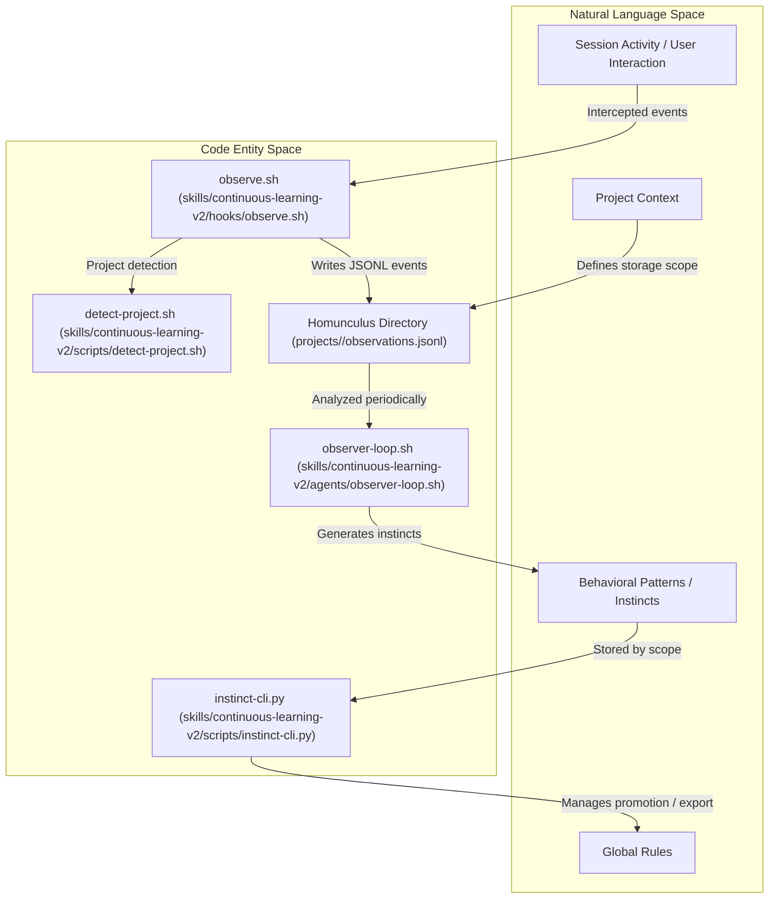
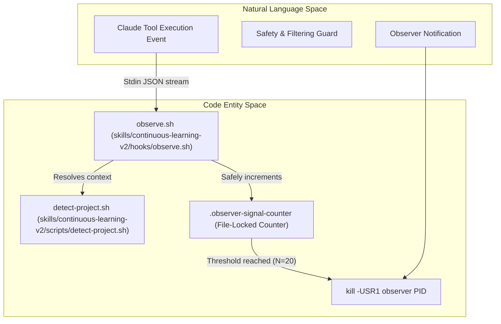
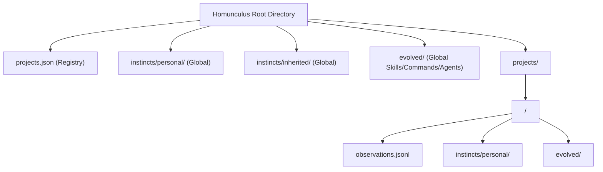

<!-- source: DeepWiki mcp.deepwiki.com · repo affaan-m/ECC · page 4.4 Continuous Learning v2 (Instinct System) · fetched 2026-10-30 -->

# Continuous Learning v2 (Instinct System)

Relevant source files

The following files were used as context for generating this wiki page:

- [docs/MIGRATION-1X-TO-2.0.md](docs/MIGRATION-1X-TO-2.0.md)
- [docs/TROUBLESHOOTING.md](docs/TROUBLESHOOTING.md)
- [docs/hook-bug-workarounds.md](docs/hook-bug-workarounds.md)
- [docs/zh-CN/skills/continuous-learning-v2/agents/observer.md](docs/zh-CN/skills/continuous-learning-v2/agents/observer.md)
- [scripts/lib/observer-sessions.js](scripts/lib/observer-sessions.js)
- [skills/continuous-learning-v2/SKILL.md](skills/continuous-learning-v2/SKILL.md)
- [skills/continuous-learning-v2/agents/observer-loop.sh](skills/continuous-learning-v2/agents/observer-loop.sh)
- [skills/continuous-learning-v2/agents/observer.md](skills/continuous-learning-v2/agents/observer.md)
- [skills/continuous-learning-v2/agents/session-guardian.sh](skills/continuous-learning-v2/agents/session-guardian.sh)
- [skills/continuous-learning-v2/agents/start-observer.sh](skills/continuous-learning-v2/agents/start-observer.sh)
- [skills/continuous-learning-v2/hooks/observe.sh](skills/continuous-learning-v2/hooks/observe.sh)
- [skills/continuous-learning-v2/scripts/detect-project.sh](skills/continuous-learning-v2/scripts/detect-project.sh)
- [skills/continuous-learning-v2/scripts/instinct-cli.py](skills/continuous-learning-v2/scripts/instinct-cli.py)
- [skills/continuous-learning-v2/scripts/lib/homunculus-dir.sh](skills/continuous-learning-v2/scripts/lib/homunculus-dir.sh)
- [skills/continuous-learning-v2/scripts/migrate-homunculus.sh](skills/continuous-learning-v2/scripts/migrate-homunculus.sh)
- [skills/continuous-learning-v2/scripts/test_parse_instinct.py](skills/continuous-learning-v2/scripts/test_parse_instinct.py)
- [tests/hooks/continuous-learning-shebang-consistency.test.js](tests/hooks/continuous-learning-shebang-consistency.test.js)
- [tests/hooks/detect-project-nongit.test.js](tests/hooks/detect-project-nongit.test.js)
- [tests/hooks/detect-project-worktree.test.js](tests/hooks/detect-project-worktree.test.js)
- [tests/hooks/migrate-homunculus-home-escape.test.js](tests/hooks/migrate-homunculus-home-escape.test.js)
- [tests/hooks/observe-nosurvive-warning.test.js](tests/hooks/observe-nosurvive-warning.test.js)
- [tests/hooks/observe-signal-counter-race.test.js](tests/hooks/observe-signal-counter-race.test.js)
- [tests/hooks/observe-subdirectory-detection.test.js](tests/hooks/observe-subdirectory-detection.test.js)
- [tests/hooks/observer-loop-archive.test.js](tests/hooks/observer-loop-archive.test.js)
- [tests/hooks/observer-memory.test.js](tests/hooks/observer-memory.test.js)
- [tests/scripts/instinct-cli-projects.test.js](tests/scripts/instinct-cli-projects.test.js)
- [tests/skills/observer-status-instinct-count.test.js](tests/skills/observer-status-instinct-count.test.js)

The Continuous Learning v2 (CLv2) subsystem is an autonomous knowledge extraction engine designed to convert Claude Code session interactions into reusable atomic knowledge units called **Instincts**. Unlike static documentation, CLv2 runs background agents to observe tool usage, identify repeated patterns, and codify them into confidence-weighted, scoped rules that guide future agent behavior. Version 2.1 enhances the system with project-scoped instincts, preventing cross-project contamination and enabling finer context-specific learning [skills/continuous-learning-v2/SKILL.md:9-14](), [skills/continuous-learning-v2/hooks/observe.sh:1-181]().

---

## 1. System Architecture & Data Flow

The CLv2 system operates as a decoupled pipeline composed of several key components arranged to safely observe, store, analyze, and evolve learning from sessions:

### 1.1 Data Flow Pipeline

1. **Observation Hook (`observe.sh`):** Intercepts tool usage lifecycle events (`PreToolUse` and `PostToolUse`) in Claude Code processes. It reads JSON event data from `stdin`, detects project context, applies safety throttling, and appends project-scoped observations for later analysis [skills/continuous-learning-v2/hooks/observe.sh:10-180]().
2. **Project Scoping (`detect-project.sh`):** A shared helper script used by the hook and observer initializes and resolves the current project context based on environment variables and Git metadata to create unique scoped storage paths [skills/continuous-learning-v2/scripts/detect-project.sh:1-197]().
3. **Observation Storage:** Observations are appended as JSON lines to files scoped per project under the Homunculus directory (`projects/<project-hash>/observations.jsonl`), segregating learning by project [skills/continuous-learning-v2/SKILL.md:89-92]().
4. **Background Observer Agent (`observer-loop.sh`):** A daemon process triggered at intervals or via signals analyzes recent observation samples, detects patterns, and outputs structured instincts in YAML/Markdown format to project-specific directories [skills/continuous-learning-v2/agents/observer-loop.sh:1-231]().
5. **Instinct CLI (`instinct-cli.py`):** Provides commands to view, export/import, evolve, prune, and promote instincts. It validates input paths and manages global versus project scope of instincts [skills/continuous-learning-v2/scripts/instinct-cli.py:8-197]().

### 1.2 Concept-to-Code Entity Mapping Diagram

Sources:  
[skills/continuous-learning-v2/SKILL.md:83-125](),  
[skills/continuous-learning-v2/hooks/observe.sh:10-181](),  
[skills/continuous-learning-v2/scripts/detect-project.sh:1-197](),  
[skills/continuous-learning-v2/agents/observer-loop.sh:1-231](),  
[skills/continuous-learning-v2/scripts/instinct-cli.py:1-197]()

---

## 2. Observation Mechanism (`observe.sh`)

The `observe.sh` script acts as an execution hook invoked by Claude Code on tool use events. Its responsibilities include:

- Reading event JSON from standard input [skills/continuous-learning-v2/hooks/observe.sh:34-40]().
- Detecting current project context to scope data correctly [skills/continuous-learning-v2/hooks/observe.sh:106-126]().
- Resolving a Python interpreter safely (avoiding Windows App Installer stubs via `_is_windows_app_installer_stub` and `resolve_python_cmd`) [skills/continuous-learning-v2/hooks/observe.sh:42-86]().
- Enforcing multilayer entry guards to prevent infinite loops or observation of automated sessions [skills/continuous-learning-v2/hooks/observe.sh:148-180]().
- Throttling signals to the observer agent to prevent excessive triggering using a file-locked counter [skills/continuous-learning-v2/hooks/observe.sh:60-180](), [tests/hooks/observe-signal-counter-race.test.js:1-19]().
- Writing observations to project-scoped JSONL files for later analysis.

### 2.1 Project Detection Logic

`observe.sh` sources the `detect-project.sh` script to establish project boundaries:

- Checks `CLAUDE_PROJECT_DIR` environment variable (explicit override) [skills/continuous-learning-v2/scripts/detect-project.sh:109-126]().
- Attempts to resolve Git remote URL and normalize it, hashing with SHA256 via Python to create a consistent project ID [skills/continuous-learning-v2/scripts/detect-project.sh:155-193]().
- Falls back to Git repository root directory if no remote URL [skills/continuous-learning-v2/scripts/detect-project.sh:175-180]().
- Defaults to a global context if no Git or override is found [skills/continuous-learning-v2/scripts/detect-project.sh:136-144]().

### 2.2 Entry Guards & Signal Throttling

To avoid CPU or memory exhaustion, self-observation, and observing non-human or subagent sessions, `observe.sh` applies multiple safety layers:

| Layer | Purpose | Mechanism |
|-------|---------|-----------|
| 1 | Entrypoint filtering | Only allows interactive entrypoints (`cli`, `sdk-ts`, `sdk-cli`, `claude-desktop`, `claude-vscode`) [skills/continuous-learning-v2/hooks/observe.sh:157-160]() |
| 2 | Hook profile suppression | Skips if `ECC_HOOK_PROFILE` is `minimal` [skills/continuous-learning-v2/hooks/observe.sh:163]() |
| 3 | Cooperative skip environment variable | Respects `ECC_SKIP_OBSERVE=1` to disable observation [skills/continuous-learning-v2/hooks/observe.sh:166]() |
| 4 | Subagent session filtering | Skips if `agent_id` is set in input JSON (indicating automated tool invocation) [skills/continuous-learning-v2/hooks/observe.sh:169-170]() |
| 5 | Path-based exclusions | Skips projects/paths matching `ECC_OBSERVE_SKIP_PATHS` (default: `observer-sessions,.claude-mem`) [skills/continuous-learning-v2/hooks/observe.sh:173-180]() |

Additionally, the script counts observations and only signals the observer process (via `kill -USR1`) after reaching a configurable threshold (`ECC_OBSERVER_SIGNAL_EVERY_N`, default 20), implementing a file-backed counter (`.observer-signal-counter`) protected by an OS file lock to prevent race conditions during concurrent tool executions [skills/continuous-learning-v2/hooks/observe.sh:60-180](), [tests/hooks/observe-signal-counter-race.test.js:1-19]().

### 2.3 Natural Language to Code Entity Mapping: Observation Flow

Sources:  
[skills/continuous-learning-v2/hooks/observe.sh:1-181](),  
[skills/continuous-learning-v2/scripts/detect-project.sh:1-197](),  
[tests/hooks/observe-signal-counter-race.test.js:1-19]()

---

## 3. Observer Agent (`observer-loop.sh` and `start-observer.sh`)

The observer agent is a persistent background daemon responsible for analyzing observation data and generating instincts.

### 3.1 Lifecycle and Main Loop

- Runs as a daemon in the project-scoped directory, launched via `start-observer.sh` [skills/continuous-learning-v2/agents/start-observer.sh:1-217]().
- Listens for `SIGUSR1` signals to trigger on-demand analysis runs via `observer-loop.sh` [skills/continuous-learning-v2/agents/observer-loop.sh:1-231]().
- Maintains its own cooldown (`ANALYSIS_COOLDOWN`, default 60 seconds) to avoid rapid repeated analyses [skills/continuous-learning-v2/agents/observer-loop.sh:23-24]().
- Periodically wakes up on a configured interval (`OBSERVER_INTERVAL_SECONDS`) [skills/continuous-learning-v2/agents/start-observer.sh:112]().
- Exits when idle beyond a configured timeout (`IDLE_TIMEOUT_SECONDS`, default 1800 seconds) and no active session leases are present [skills/continuous-learning-v2/agents/observer-loop.sh:25](), [skills/continuous-learning-v2/agents/observer-loop.sh:160-174]().

### 3.2 Re-entrancy Guard and Cooldown Throttle

To prevent overlapping executions and potential memory bloat:

- The flag `ANALYZING` guards against concurrent processing triggered by signals [skills/continuous-learning-v2/agents/observer-loop.sh:21](), [tests/hooks/observer-memory.test.js:99-120]().
- Deferred analysis tasks are remembered via `PENDING_ANALYSIS=1` and run in the next loop iteration if a prior analysis is in progress [skills/continuous-learning-v2/agents/observer-loop.sh:20](), [tests/hooks/observer-memory.test.js:105-110]().
- The timestamp `LAST_ANALYSIS_EPOCH` ensures the cooldown period is respected before starting new analysis [skills/continuous-learning-v2/agents/observer-loop.sh:22]().
- The loop samples observation tails rather than loading the entire file to cap memory and payload sizes [skills/continuous-learning-v2/agents/observer-loop.sh:226-231]().

### 3.3 Configuration via `start-observer.sh`

`start-observer.sh` parses `config.json` to configure parameters such as `run_interval_minutes` (default 5) and `min_observations_to_analyze` (default 20), ensuring the observer only runs when enabled (`observer.enabled: true`) [skills/continuous-learning-v2/agents/start-observer.sh:80-111]().

Sources:  
[skills/continuous-learning-v2/agents/observer-loop.sh:1-231](),  
[skills/continuous-learning-v2/agents/start-observer.sh:1-217](),  
[tests/hooks/observer-memory.test.js:1-150]()

---

## 4. Instinct Management CLI (`instinct-cli.py`)

The `instinct-cli.py` Python script provides comprehensive management of instincts, supporting commands to audit, import/export, evolve, promote, prune, and display instincts scoped both globally and per project [skills/continuous-learning-v2/scripts/instinct-cli.py:8-16]().

### 4.1 Core Commands and Features

| Command | Description |
|---|---|
| `status` | Lists all instincts (global + project) with confidence and summary summary bars [skills/continuous-learning-v2/scripts/instinct-cli.py:9]() |
| `import` | Load instincts from local files or HTTPS URLs with URL validation [skills/continuous-learning-v2/scripts/instinct-cli.py:10](), [skills/continuous-learning-v2/scripts/instinct-cli.py:189-197]() |
| `export` | Save instincts to a file [skills/continuous-learning-v2/scripts/instinct-cli.py:11]() |
| `evolve` | Cluster related instincts into draft skills, commands, or agents [skills/continuous-learning-v2/scripts/instinct-cli.py:12]() |
| `promote` | Promote project-scoped instincts to global scope based on recurrence across projects [skills/continuous-learning-v2/scripts/instinct-cli.py:13]() |
| `projects` | Lists all known projects and instinct counts [skills/continuous-learning-v2/scripts/instinct-cli.py:14]() |
| `prune` | Deletes pending instincts older than TTL (default 30 days) [skills/continuous-learning-v2/scripts/instinct-cli.py:15](), [skills/continuous-learning-v2/scripts/instinct-cli.py:133]() |

### 4.2 Path Validation and Security

`instinct-cli.py` includes robust validation functions (`_validate_file_path`, `_validate_instinct_id`, `_validate_import_url`) to block path traversal attempts, reject unsafe file names, and enforce HTTPS-only remote instinct imports [skills/continuous-learning-v2/scripts/instinct-cli.py:149-197]().

Sources:  
[skills/continuous-learning-v2/scripts/instinct-cli.py:1-197]()

---

## 5. Homunculus Directory Scoping & Throttling

The Homunculus directory encapsulates all continuous learning data, isolating project scopes to prevent leakage or contamination of instincts across projects.

### 5.1 Directory Resolution (`_resolve_homunculus_dir`)

Defined in `instinct-cli.py` and `homunculus-dir.sh`, the resolution priority is:
1. `CLV2_HOMUNCULUS_DIR` environment variable (if absolute) [skills/continuous-learning-v2/scripts/instinct-cli.py:54-58]()
2. `$XDG_DATA_HOME/ecc-homunculus` [skills/continuous-learning-v2/scripts/instinct-cli.py:60-64]()
3. `$HOME/.local/share/ecc-homunculus` [skills/continuous-learning-v2/scripts/instinct-cli.py:67]()

### 5.2 Storage Layout

Sources:  
[skills/continuous-learning-v2/scripts/instinct-cli.py:54-143](),  
[skills/continuous-learning-v2/SKILL.md:138-150]()

---

# References and Source Files

- Observation hook: `skills/continuous-learning-v2/hooks/observe.sh`  
- Observer agent loop: `skills/continuous-learning-v2/agents/observer-loop.sh`  
- Observer agent launcher: `skills/continuous-learning-v2/agents/start-observer.sh`  
- Project detection helper: `skills/continuous-learning-v2/scripts/detect-project.sh`  
- Instinct CLI: `skills/continuous-learning-v2/scripts/instinct-cli.py`  
- Skill metadata and data flow overview: `skills/continuous-learning-v2/SKILL.md`  
- Tests for stability and concurrency guards: `tests/hooks/observer-memory.test.js`, `tests/hooks/observe-signal-counter-race.test.js`, `tests/hooks/detect-project-worktree.test.js`

---

