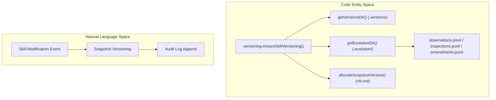
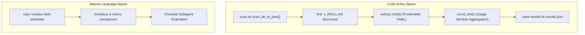

<!-- source: DeepWiki mcp.deepwiki.com · repo affaan-m/ECC · page 4.5 Skill Quality, Evolution & Compliance Tooling · fetched 2026-10-30 -->

# Skill Quality, Evolution & Compliance Tooling

Relevant source files

The following files were used as context for generating this wiki page:

- [.agents/skills/docs-governance/SKILL.md](.agents/skills/docs-governance/SKILL.md)
- [.agents/skills/docs-governance/agents/openai.yaml](.agents/skills/docs-governance/agents/openai.yaml)
- [.agents/skills/docs-governance/references/artifact-role-contract.md](.agents/skills/docs-governance/references/artifact-role-contract.md)
- [.agents/skills/docs-governance/scripts/audit-docs.py](.agents/skills/docs-governance/scripts/audit-docs.py)
- [.agents/skills/docs-governance/scripts/markdown_links.py](.agents/skills/docs-governance/scripts/markdown_links.py)
- [.opencode/commands/instinct-status.md](.opencode/commands/instinct-status.md)
- [docs/ja-JP/commands/auto-update.md](docs/ja-JP/commands/auto-update.md)
- [docs/ja-JP/commands/instinct-status.md](docs/ja-JP/commands/instinct-status.md)
- [docs/ja-JP/commands/skill-health.md](docs/ja-JP/commands/skill-health.md)
- [docs/tr/commands/instinct-status.md](docs/tr/commands/instinct-status.md)
- [docs/zh-CN/commands/auto-update.md](docs/zh-CN/commands/auto-update.md)
- [docs/zh-CN/commands/instinct-status.md](docs/zh-CN/commands/instinct-status.md)
- [docs/zh-CN/commands/skill-health.md](docs/zh-CN/commands/skill-health.md)
- [manifests/pi-core.json](manifests/pi-core.json)
- [pi/core/CURATION.md](pi/core/CURATION.md)
- [pi/core/README.md](pi/core/README.md)
- [pi/core/commands/code-review.md](pi/core/commands/code-review.md)
- [pi/core/skills/docs-governance/SKILL.md](pi/core/skills/docs-governance/SKILL.md)
- [pi/core/skills/docs-governance/references/artifact-role-contract.md](pi/core/skills/docs-governance/references/artifact-role-contract.md)
- [pi/core/skills/docs-governance/scripts/audit-docs.py](pi/core/skills/docs-governance/scripts/audit-docs.py)
- [pi/core/skills/docs-governance/scripts/markdown_links.py](pi/core/skills/docs-governance/scripts/markdown_links.py)
- [scripts/ci/validate-skills.js](scripts/ci/validate-skills.js)
- [scripts/hooks/skill-run-tracker.js](scripts/hooks/skill-run-tracker.js)
- [scripts/lib/skill-evolution/dashboard.js](scripts/lib/skill-evolution/dashboard.js)
- [scripts/lib/skill-evolution/health.js](scripts/lib/skill-evolution/health.js)
- [scripts/lib/skill-evolution/index.js](scripts/lib/skill-evolution/index.js)
- [scripts/lib/skill-evolution/provenance.js](scripts/lib/skill-evolution/provenance.js)
- [scripts/lib/skill-evolution/tracker.js](scripts/lib/skill-evolution/tracker.js)
- [scripts/lib/skill-evolution/versioning.js](scripts/lib/skill-evolution/versioning.js)
- [scripts/skill-create-output.js](scripts/skill-create-output.js)
- [scripts/skills-health.js](scripts/skills-health.js)
- [skills/docs-governance/SKILL.md](skills/docs-governance/SKILL.md)
- [skills/docs-governance/scripts/audit-docs.py](skills/docs-governance/scripts/audit-docs.py)
- [skills/docs-governance/scripts/markdown_links.py](skills/docs-governance/scripts/markdown_links.py)
- [skills/skill-comply/pyproject.toml](skills/skill-comply/pyproject.toml)
- [skills/skill-comply/scripts/classifier.py](skills/skill-comply/scripts/classifier.py)
- [skills/skill-comply/scripts/parser.py](skills/skill-comply/scripts/parser.py)
- [skills/skill-comply/scripts/run.py](skills/skill-comply/scripts/run.py)
- [skills/skill-comply/scripts/runner.py](skills/skill-comply/scripts/runner.py)
- [skills/skill-comply/scripts/scenario_generator.py](skills/skill-comply/scripts/scenario_generator.py)
- [skills/skill-comply/scripts/spec_generator.py](skills/skill-comply/scripts/spec_generator.py)
- [skills/skill-comply/tests/test_classifier.py](skills/skill-comply/tests/test_classifier.py)
- [skills/skill-comply/tests/test_utf8.py](skills/skill-comply/tests/test_utf8.py)
- [skills/skill-stocktake/SKILL.md](skills/skill-stocktake/SKILL.md)
- [skills/skill-stocktake/scripts/quick-diff.sh](skills/skill-stocktake/scripts/quick-diff.sh)
- [skills/skill-stocktake/scripts/save-results.sh](skills/skill-stocktake/scripts/save-results.sh)
- [skills/skill-stocktake/scripts/scan.sh](skills/skill-stocktake/scripts/scan.sh)
- [tests/ci/gateguard-env-documented.test.js](tests/ci/gateguard-env-documented.test.js)
- [tests/hooks/evaluate-session.test.js](tests/hooks/evaluate-session.test.js)
- [tests/hooks/skill-run-tracker.test.js](tests/hooks/skill-run-tracker.test.js)
- [tests/lib/copilot-install-target.test.js](tests/lib/copilot-install-target.test.js)
- [tests/lib/skill-dashboard.test.js](tests/lib/skill-dashboard.test.js)
- [tests/lib/skill-evolution-storage.test.js](tests/lib/skill-evolution-storage.test.js)
- [tests/lib/skill-evolution.test.js](tests/lib/skill-evolution.test.js)
- [tests/lib/skill-tracker-timestamps.test.js](tests/lib/skill-tracker-timestamps.test.js)
- [tests/scripts/setup-package-manager.test.js](tests/scripts/setup-package-manager.test.js)
- [tests/scripts/skill-create-output.test.js](tests/scripts/skill-create-output.test.js)
- [tests/scripts/skill-stocktake-discovery.test.js](tests/scripts/skill-stocktake-discovery.test.js)
- [tests/scripts/skill-stocktake-save-results.test.js](tests/scripts/skill-stocktake-save-results.test.js)
- [tests/skills/docs-governance.test.js](tests/skills/docs-governance.test.js)
- [tests/test_docs_governance_audit.py](tests/test_docs_governance_audit.py)
- [tests/test_invariant_runner.py](tests/test_invariant_runner.py)

## Purpose and Scope

This page documents the tooling suite responsible for skill quality assurance, evolutionary versioning, runtime tracking, stocktaking, validation, compliance testing, and documentation governance in the ECC repository. These subsystems ensure that over 600+ user-facing and curated skills remain version-controlled, compatible across AI execution hosts, behaviorally compliant via simulated sandboxed test runs, and free of documentation regression.

Sources: `skills/skill-stocktake/SKILL.md` [skills/skill-stocktake/SKILL.md:1-246](), `scripts/lib/skill-evolution/versioning.js` [scripts/lib/skill-evolution/versioning.js:1-185]()

---

## 1. Skill Evolution, Provenance & Versioning Engine

The skill evolution subsystem manages the lineage, version snapshots, provenance tracking, and health metrics of skills under development. It resides primarily under `scripts/lib/skill-evolution/`.

### Provenance Classification

Skills are classified into three types by `provenance.getSkillRoots()` and `provenance.classifySkillPath()`:
- **Curated**: Managed directly within the repository root `skills/`. These do not require external provenance metadata [tests/lib/skill-evolution.test.js:89-119]().
- **Learned**: Discovered or evolved locally under `~/.claude/skills/learned/`. These require valid `.provenance.json` metadata files [tests/lib/skill-evolution.test.js:89-119]().
- **Imported**: Ingested from external sources under `~/.claude/skills/imported/`, requiring verification of confidence ratings, authors, and source URLs [tests/lib/skill-evolution.test.js:121-157]().

### Versioning and Evolution Logs

The versioning module (`scripts/lib/skill-evolution/versioning.js`) maintains snapshot directories (`.versions/`) and append-only evolution audit logs (`.evolution/`) containing JSONL streams for `observations.jsonl`, `inspections.jsonl`, and `amendments.jsonl` [scripts/lib/skill-evolution/versioning.js:8-14, 58-78]().

Sources: `scripts/lib/skill-evolution/versioning.js` [scripts/lib/skill-evolution/versioning.js:1-185](), `tests/lib/skill-evolution.test.js` [tests/lib/skill-evolution.test.js:74-184]()

---

## 2. Skill Run Tracking & Telemetry Sink

The skill execution tracker (`scripts/lib/skill-evolution/tracker.js`) records runtime telemetry for skill invocations, tracking success metrics, duration, token usage, and user feedback [scripts/lib/skill-evolution/tracker.js:45-97]().

### Record Normalization and Retention

Records are normalized through `normalizeExecutionRecord()`, validating that `skill_id`, `skill_version`, `task_description`, and `outcome` (restricted to `success`, `failure`, or `partial`) conform to strict schemas [scripts/lib/skill-evolution/tracker.js:45-97](). 

Data is appended to `~/.claude/state/skill-runs.jsonl` with `0600` file permissions [scripts/lib/skill-evolution/tracker.js:18-30, 128-143](). To prevent unbounded file growth, `pruneRunRecords()` enforces a sliding retention bound of `MAX_RUN_RECORDS` (default: 5000 records) [scripts/lib/skill-evolution/tracker.js:12-16, 148-162]().

Sources: `scripts/lib/skill-evolution/tracker.js` [scripts/lib/skill-evolution/tracker.js:1-199](), `tests/lib/skill-evolution-storage.test.js` [tests/lib/skill-evolution-storage.test.js:1-137]()

---

## 3. Skill Stocktake & Inventory Scanning

The `/skill-stocktake` command audits Claude skills and commands using quality checklists and holistic AI evaluation, supporting both Quick Scan (changed skills only) and Full Stocktake modes [skills/skill-stocktake/SKILL.md:1-46]().

### Scanning Pipeline

The inventory scan script (`skills/skill-stocktake/scripts/scan.sh`) enumerates skill directories, extracts frontmatter fields (`name`, `description`), collects UTC modification times (`mtime`), and aggregates Read usage telemetry from `~/.claude/observations.jsonl` [skills/skill-stocktake/scripts/scan.sh:1-120]().

Sources: `skills/skill-stocktake/SKILL.md` [skills/skill-stocktake/SKILL.md:1-134](), `skills/skill-stocktake/scripts/scan.sh` [skills/skill-stocktake/scripts/scan.sh:1-190]()

---

## 4. Validation & Host Compatibility Tooling

Skills and host compatibility are validated in CI via `scripts/ci/validate-skills.js`. This script checks frontmatter integrity, required metadata keys, valid Markdown structures, and host cross-compatibility rules across the `.agents/`, `.cursor/`, and `.kiro/` mirrors.

Sources: `scripts/ci/validate-skills.js` [scripts/ci/validate-skills.js:1-100]()

---

## 5. Skill Compliance Testing: Runner & Classifier

The `skill-comply` tool suite runs sandboxed evaluation scenarios against skills to verify tool-use compliance, grading agent behaviors against formal specifications [skills/skill-comply/scripts/runner.py:1-44]().

### Execution Flow and Classification

```mermaid
graph TD
    subgraph "Code Entity Space"
        R["runner.py run_scenario()"] --> SB["_setup_sandbox()"]
        SB --> CL["claude -p (stream-json)"]
        CL --> P["parser.py _parse_stream_json()"]
        P --> CF["classifier.py classify_events()"]
        CF --> G["grader.py grade()"]
    end
    subgraph "Natural Language Space"
        NL1["Scenario Specification"] --> NL2["Sandboxed Agent Execution"]
        NL2 --> NL3["Tool Call Trace Classification"]
        NL3 --> NL4["Compliance Scorecard Generation"]
    end
```

- **Runner (`skills/skill-comply/scripts/runner.py`)**: Sets up a sandboxed temporary directory (`/tmp/skill-comply-sandbox`), executes setup commands using allowlisted executables (`git`, `npm`, `pip`, etc.), invokes `claude -p` with stream-json output, and redacts home paths to maintain portability [skills/skill-comply/scripts/runner.py:17-174]().
- **Classifier (`skills/skill-comply/scripts/classifier.py`)**: Uses an LLM pass (`classify_events`) to map observed tool calls against expected compliance specification steps, returning structured JSON mapping step IDs to event indices [skills/skill-comply/scripts/classifier.py:21-65]().
- **Parser Robustness (`skills/skill-comply/scripts/classifier.py`)**: Strips markdown code fences, enforces strict `dict` and `list` validation, and prevents parsing exploits from boolean or fractional indices [skills/skill-comply/scripts/classifier.py:67-95]().

Sources: `skills/skill-comply/scripts/runner.py` [skills/skill-comply/scripts/runner.py:1-180](), `skills/skill-comply/scripts/classifier.py` [skills/skill-comply/scripts/classifier.py:1-95](), `skills/skill-comply/tests/test_classifier.py` [skills/skill-comply/tests/test_classifier.py:1-75]()

---

## 6. Documentation Governance Auditing

Documentation governance is enforced by `skills/docs-governance/scripts/audit-docs.py` and `skills/docs-governance/scripts/markdown_links.py`, ensuring all internal Markdown links, references, and relative paths resolve correctly within project bounds [skills/docs-governance/scripts/markdown_links.py:1-202]().

### Link Resolution and Security Boundaries

The parser strips fenced code blocks (`without_fenced_code`) and inline code (`without_inline_code`) before extracting inline and reference link targets [skills/docs-governance/scripts/markdown_links.py:27-49, 152-177](). Path normalizers reject links that attempt to escape the project root or resolve via unauthorized symlinks outside the repository [skills/docs-governance/scripts/markdown_links.py:180-202](), as validated by `tests/test_docs_governance_audit.py` [tests/test_docs_governance_audit.py:39-111]().

Sources: `skills/docs-governance/scripts/markdown_links.py` [skills/docs-governance/scripts/markdown_links.py:1-202](), `tests/test_docs_governance_audit.py` [tests/test_docs_governance_audit.py:1-120]()

---

## 7. Agent Self-Evaluation & Health Dashboards

Agent self-evaluation integrates run telemetry, stocktake results, and compliance scorecards into unified health dashboards (`scripts/lib/skill-evolution/health.js` and `dashboard.js`). These dashboards compute success rates, pending evolution amendments, and degradation warnings across global and project-level skill sets.

Sources: `scripts/lib/skill-evolution/health.js` [scripts/lib/skill-evolution/health.js:1-100](), `scripts/lib/skill-evolution/dashboard.js` [scripts/lib/skill-evolution/dashboard.js:1-100]()

---

