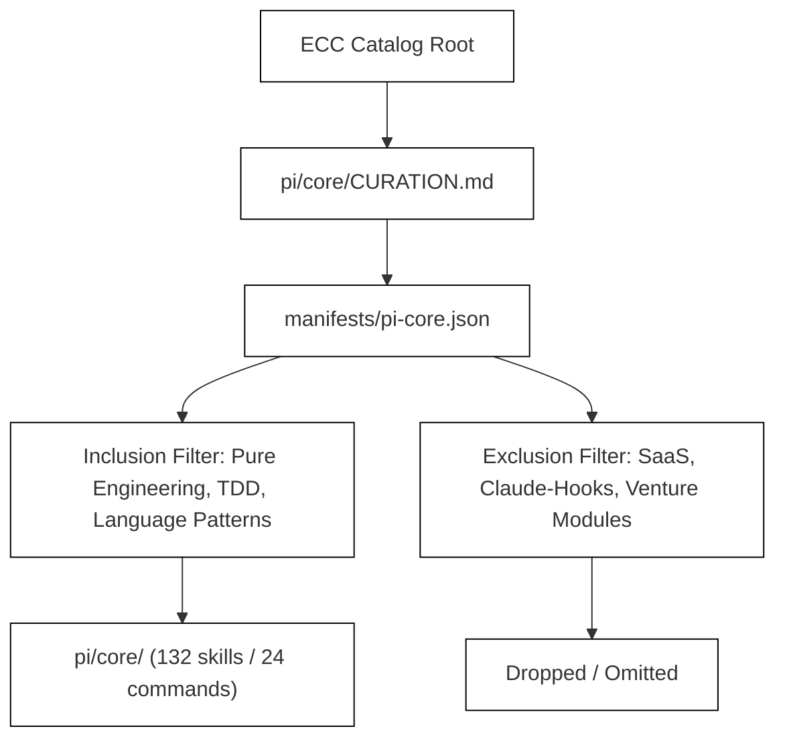

<!-- source: DeepWiki mcp.deepwiki.com · repo affaan-m/ECC · page 4.6 Pi Core Curated Profile & Harness Skill Mirrors · fetched 2026-10-30 -->

# Pi Core Curated Profile & Harness Skill Mirrors

<details>
<summary>Relevant source files</summary>

The following files were used as context for generating this wiki page:

- [.agents/skills/docs-governance/SKILL.md](.agents/skills/docs-governance/SKILL.md)
- [.agents/skills/docs-governance/agents/openai.yaml](.agents/skills/docs-governance/agents/openai.yaml)
- [.agents/skills/docs-governance/references/artifact-role-contract.md](.agents/skills/docs-governance/references/artifact-role-contract.md)
- [.agents/skills/docs-governance/scripts/audit-docs.py](.agents/skills/docs-governance/scripts/audit-docs.py)
- [.agents/skills/docs-governance/scripts/markdown_links.py](.agents/skills/docs-governance/scripts/markdown_links.py)
- [.agents/skills/skill-host-compat/SKILL.md](.agents/skills/skill-host-compat/SKILL.md)
- [.agents/skills/skill-host-compat/agents/openai.yaml](.agents/skills/skill-host-compat/agents/openai.yaml)
- [.pi/README.md](.pi/README.md)
- [.pi/extensions/hook-runtime.js](.pi/extensions/hook-runtime.js)
- [.pi/extensions/index.ts](.pi/extensions/index.ts)
- [.qwen/QWEN.md](.qwen/QWEN.md)
- [docs/QWEN-GUIDE.md](docs/QWEN-GUIDE.md)
- [docs/architecture/cross-harness.md](docs/architecture/cross-harness.md)
- [docs/architecture/harness-adapter-compliance.md](docs/architecture/harness-adapter-compliance.md)
- [docs/architecture/platform-value-loop.md](docs/architecture/platform-value-loop.md)
- [docs/releases/2.0.0-rc.1/ito-prediction-market-skill-pack.md](docs/releases/2.0.0-rc.1/ito-prediction-market-skill-pack.md)
- [manifests/pi-core.json](manifests/pi-core.json)
- [pi/core/CURATION.md](pi/core/CURATION.md)
- [pi/core/README.md](pi/core/README.md)
- [pi/core/commands/code-review.md](pi/core/commands/code-review.md)
- [pi/core/skills/docs-governance/SKILL.md](pi/core/skills/docs-governance/SKILL.md)
- [pi/core/skills/docs-governance/references/artifact-role-contract.md](pi/core/skills/docs-governance/references/artifact-role-contract.md)
- [pi/core/skills/docs-governance/scripts/audit-docs.py](pi/core/skills/docs-governance/scripts/audit-docs.py)
- [pi/core/skills/docs-governance/scripts/markdown_links.py](pi/core/skills/docs-governance/scripts/markdown_links.py)
- [schemas/agent.schema.json](schemas/agent.schema.json)
- [scripts/agent-convert.js](scripts/agent-convert.js)
- [scripts/ci/validate-skill-host-compat.js](scripts/ci/validate-skill-host-compat.js)
- [scripts/lib/agent-emit-pi.js](scripts/lib/agent-emit-pi.js)
- [scripts/lib/agent-ir.js](scripts/lib/agent-ir.js)
- [scripts/lib/agent-tool-map.js](scripts/lib/agent-tool-map.js)
- [scripts/lib/harness-adapter-compliance.js](scripts/lib/harness-adapter-compliance.js)
- [scripts/lib/install-targets/qwen-home.js](scripts/lib/install-targets/qwen-home.js)
- [scripts/qwen-adapt-agents.js](scripts/qwen-adapt-agents.js)
- [skills/docs-governance/SKILL.md](skills/docs-governance/SKILL.md)
- [skills/docs-governance/scripts/audit-docs.py](skills/docs-governance/scripts/audit-docs.py)
- [skills/docs-governance/scripts/markdown_links.py](skills/docs-governance/scripts/markdown_links.py)
- [skills/skill-host-compat/SKILL.md](skills/skill-host-compat/SKILL.md)
- [tests/ci/validate-skill-host-compat.test.js](tests/ci/validate-skill-host-compat.test.js)
- [tests/docs/harness-adapter-compliance.test.js](tests/docs/harness-adapter-compliance.test.js)
- [tests/docs/platform-value-loop.test.js](tests/docs/platform-value-loop.test.js)
- [tests/lib/copilot-install-target.test.js](tests/lib/copilot-install-target.test.js)
- [tests/pi/agent-convert.test.js](tests/pi/agent-convert.test.js)
- [tests/pi/agent-emit.test.js](tests/pi/agent-emit.test.js)
- [tests/pi/pi-extension-adapter.test.js](tests/pi/pi-extension-adapter.test.js)
- [tests/pi/pi-hook-runtime.test.js](tests/pi/pi-hook-runtime.test.js)
- [tests/pi/pi-package-manifest.test.js](tests/pi/pi-package-manifest.test.js)
- [tests/scripts/qwen-adapt-agents.test.js](tests/scripts/qwen-adapt-agents.test.js)
- [tests/skills/docs-governance.test.js](tests/skills/docs-governance.test.js)
- [tests/test_docs_governance_audit.py](tests/test_docs_governance_audit.py)

</details>


## Purpose and Scope

This document details the architecture, curation boundaries, runtime execution model, and cross-harness mirroring strategy for the Pi Core profile within Everything Claude Code (ECC). The Pi Core profile provides a portable subset comprising 132 skills and 24 commands extracted from the broader ECC catalog. This section examines the governing rules in `pi/core/CURATION.md`, the manifest definition in `manifests/pi-core.json`, the `.pi` extensions runtime implementation (`.pi/extensions/index.ts` and `.pi/extensions/hook-runtime.js`), and how skill mirrors are maintained across `.agents/`, `.cursor/skills`, and `.kiro/skills`.

Sources: `manifests/pi-core.json:1-32`, `pi/core/CURATION.md:1-17`, `docs/architecture/harness-adapter-compliance.md:42-45`

---

## 1. The Pi Core Curation Architecture (`CURATION.md` & `manifests/pi-core.json`)

The Pi Core subset is governed by strict deterministic curation rules defined in `pi/core/CURATION.md` and codified in `manifests/pi-core.json`. The curation mechanism divides the comprehensive ECC skill and command catalog into portable subsets by separating pure engineering patterns from harness-dependent infrastructure.

### Inclusion Criteria
* Language and framework-specific guidelines (`skills/python-patterns/`, `skills/golang-patterns/`, etc.)
* Universal engineering workflows: testing, TDD, code review, non-offensive security review, planning, and refactoring
* Documentation management and Git/PR workflows
* Pure prompt commands that operate as standalone text workflows (`commands/`)

### Exclusion Criteria
* Network-dependent executions or runtime installations requiring `npx`, `pip install`, or `curl|sh`
* Third-party SaaS wrappers (e.g., Exa, Context7, Fal.ai, VideoDB, social/marketing APIs)
* Proprietary commercial integrations (ECC Tools, AgentShield, custom billing operations)
* Claude-Code-specific mechanics: hooks, continuous learning loops, hookify rules, cost tracking, session state persistence, and `gateguard`
* Venture-specific modules (`ito-*`, prediction markets, Hermes, Nasiko, OpenClaw, x402)
* Niche domain packs (healthcare/HIPAA, supply chain logistics, homelab orchestration, offensive security bug bounties)



Sources: `pi/core/CURATION.md:1-18`, `manifests/pi-core.json:1-32`

---

## 2. The `.pi` Extensions Runtime & Hook Architecture

Pi extensions are executed within an environment possessing full user permissions. Unlike Claude Code hooks that run within a shell context tied to project paths, Pi hooks execute directly within the extension runtime and resolve against the installed package path (`.pi/extensions/index.ts` and `.pi/extensions/hook-runtime.js`).

### Runtime Mechanics
* **System Prompt Injection:** Canonical engineering rules from `rules/common/` are compiled and injected directly into the Pi system prompt.
* **Commands and Skills:** Canonical skills (`skills/`) and commands (`commands/`) are loaded as prompt templates without generating duplicate file trees inside `.pi/`.
* **Diagnostics:** System diagnostics are exposed via the `/ecc-doctor` command handler integrated into the extension entrypoint.

```mermaid
sequenceDiagram
    participant PiRuntime as PiRuntimeEngine
    participant ExtIndex as .pi/extensions/index.ts
    participant HookRuntime as .pi/extensions/hook-runtime.js
    participant CoreRules as rules/common/

    PiRuntime->>ExtIndex: Initialize Extension Module
    ExtIndex->>CoreRules: Read Engineering Rules
    CoreRules--Returned-->ExtIndex: Inject System Prompt Rules
    PiRuntime->>HookRuntime: Trigger Lifecycle Hook Event
    HookRuntime-->>PiRuntime: Execute Stateless Hook Logic
    PiRuntime->>ExtIndex: Invoke /ecc-doctor
    ExtIndex--Return-->PiRuntime: Render Diagnostic Report
```

Sources: `.pi/extensions/index.ts:1-50`, `.pi/extensions/hook-runtime.js:1-40`, `docs/architecture/harness-adapter-compliance.md:42-45`

---

## 3. Harness Skill Mirrors & Portability (`.agents/`, `.cursor/`, `.kiro/`)

To support multi-harness development, ECC maintains synchronized skill mirrors across various agent directories, including `.agents/`, `.cursor/skills/`, and `.kiro/skills/`.

### Portability Layer & Conversion Pipeline
* **Shared Source Authority:** All durable assets remain in centralized source trees (`skills/*/SKILL.md`, `rules/`, `commands/`).
* **Agent Conversion:** The IR (Intermediate Representation) translation subsystem (`scripts/agent-convert.js`, `scripts/lib/agent-ir.js`, `scripts/lib/agent-emit-pi.js`) transforms Claude-native agent definitions into target-compatible frontmatter and execution blocks.
* **Compliance Validation:** Automated test suites (`tests/pi/pi-package-manifest.test.js`, `tests/pi/pi-extension-adapter.test.js`, `tests/pi/agent-convert.test.js`) verify that mirrored copies conform to host-specific requirements without drifting from canonical definitions.

Sources: `scripts/agent-convert.js:1-60`, `scripts/lib/agent-ir.js:1-40`, `docs/architecture/harness-adapter-compliance.md:40-48`

---

