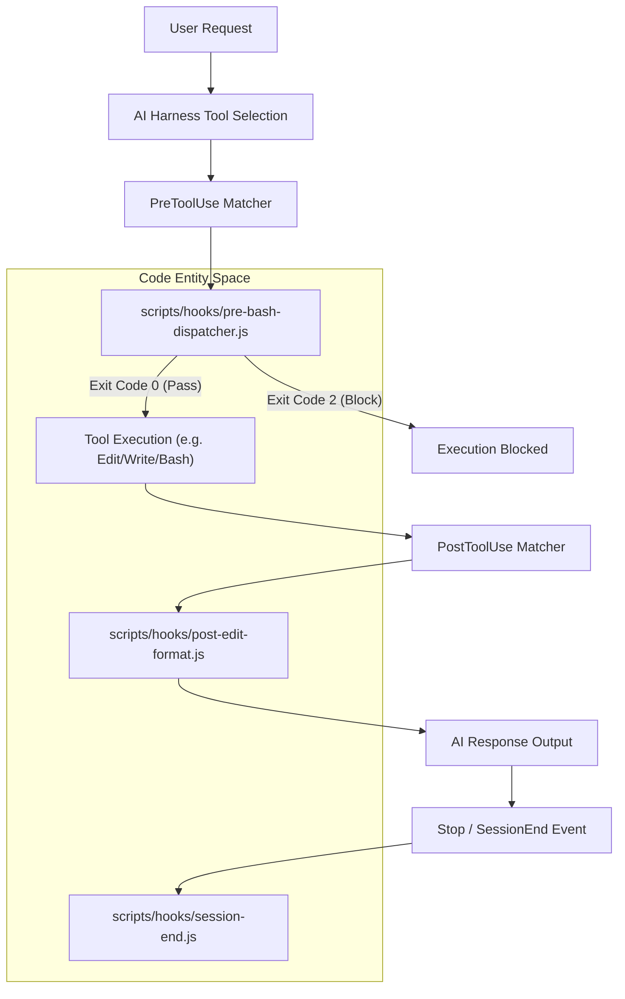
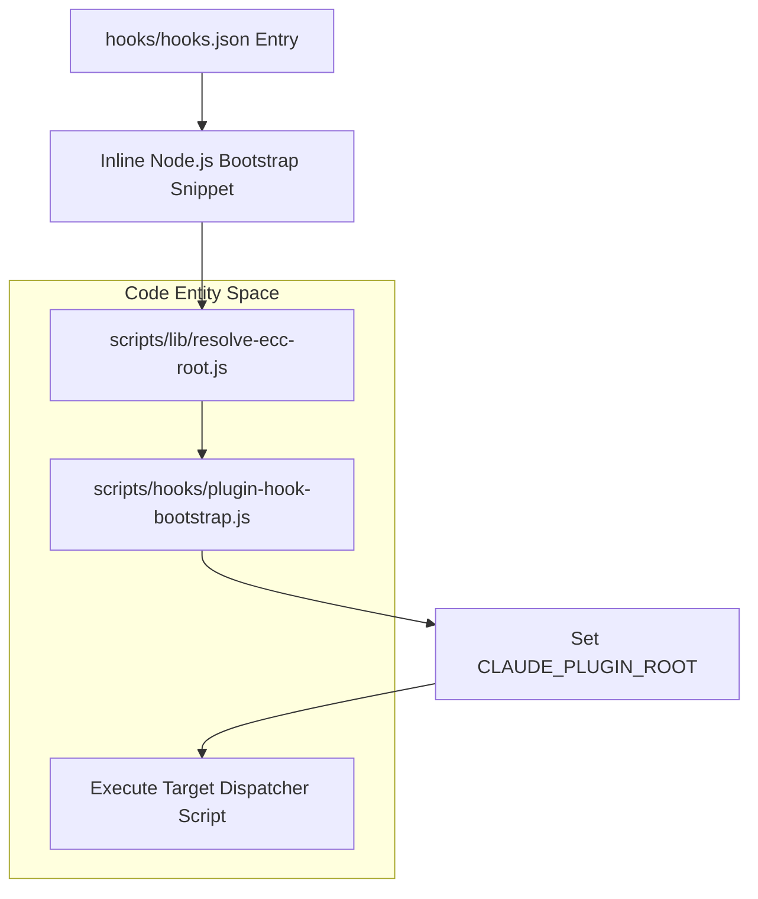

<!-- source: DeepWiki mcp.deepwiki.com · repo affaan-m/ECC · page 5 Hooks & Automation · fetched 2026-10-30 -->

# Hooks & Automation

Relevant source files

The following files were used as context for generating this wiki page:

- [.gitignore](.gitignore)
- [agents/vue-reviewer.md](agents/vue-reviewer.md)
- [commands/vue-review.md](commands/vue-review.md)
- [hooks/README.md](hooks/README.md)
- [hooks/hooks.json](hooks/hooks.json)
- [schemas/hooks.schema.json](schemas/hooks.schema.json)
- [scripts/ci/catalog.js](scripts/ci/catalog.js)
- [scripts/ci/generate-command-registry.js](scripts/ci/generate-command-registry.js)
- [scripts/ci/validate-agents.js](scripts/ci/validate-agents.js)
- [scripts/ci/validate-hooks.js](scripts/ci/validate-hooks.js)
- [scripts/hooks/check-console-log.js](scripts/hooks/check-console-log.js)
- [scripts/hooks/evaluate-session.js](scripts/hooks/evaluate-session.js)
- [scripts/hooks/insaits-security-monitor.py](scripts/hooks/insaits-security-monitor.py)
- [scripts/hooks/insaits-security-wrapper.js](scripts/hooks/insaits-security-wrapper.js)
- [scripts/hooks/observe-runner.js](scripts/hooks/observe-runner.js)
- [scripts/hooks/plugin-hook-bootstrap.js](scripts/hooks/plugin-hook-bootstrap.js)
- [scripts/hooks/post-edit-console-warn.js](scripts/hooks/post-edit-console-warn.js)
- [scripts/hooks/post-edit-format.js](scripts/hooks/post-edit-format.js)
- [scripts/hooks/post-edit-typecheck.js](scripts/hooks/post-edit-typecheck.js)
- [scripts/hooks/run-with-flags.js](scripts/hooks/run-with-flags.js)
- [scripts/hooks/session-end.js](scripts/hooks/session-end.js)
- [scripts/hooks/session-start.js](scripts/hooks/session-start.js)
- [scripts/hooks/suggest-compact.js](scripts/hooks/suggest-compact.js)
- [scripts/lib/hook-flags.js](scripts/lib/hook-flags.js)
- [scripts/lib/package-manager.d.ts](scripts/lib/package-manager.d.ts)
- [scripts/lib/package-manager.js](scripts/lib/package-manager.js)
- [scripts/lib/session-aliases.d.ts](scripts/lib/session-aliases.d.ts)
- [scripts/lib/session-aliases.js](scripts/lib/session-aliases.js)
- [scripts/lib/session-manager.d.ts](scripts/lib/session-manager.d.ts)
- [scripts/lib/session-manager.js](scripts/lib/session-manager.js)
- [scripts/lib/utils.d.ts](scripts/lib/utils.d.ts)
- [scripts/lib/utils.js](scripts/lib/utils.js)
- [scripts/lib/windows-bash.js](scripts/lib/windows-bash.js)
- [tests/ci/catalog.test.js](tests/ci/catalog.test.js)
- [tests/ci/command-registry.test.js](tests/ci/command-registry.test.js)
- [tests/ci/validators.test.js](tests/ci/validators.test.js)
- [tests/hooks/hook-flags.test.js](tests/hooks/hook-flags.test.js)
- [tests/hooks/hooks.test.js](tests/hooks/hooks.test.js)
- [tests/hooks/insaits-security-monitor.test.js](tests/hooks/insaits-security-monitor.test.js)
- [tests/hooks/insaits-security-wrapper.test.js](tests/hooks/insaits-security-wrapper.test.js)
- [tests/hooks/plugin-hook-bootstrap-no-echo.test.js](tests/hooks/plugin-hook-bootstrap-no-echo.test.js)
- [tests/hooks/plugin-hook-bootstrap.test.js](tests/hooks/plugin-hook-bootstrap.test.js)
- [tests/hooks/stop-hooks-stdout.test.js](tests/hooks/stop-hooks-stdout.test.js)
- [tests/integration/hooks.test.js](tests/integration/hooks.test.js)
- [tests/lib/dry-run.test.js](tests/lib/dry-run.test.js)
- [tests/lib/package-manager.test.js](tests/lib/package-manager.test.js)
- [tests/lib/session-aliases.test.js](tests/lib/session-aliases.test.js)
- [tests/lib/session-manager.test.js](tests/lib/session-manager.test.js)
- [tests/lib/utils.test.js](tests/lib/utils.test.js)
- [tests/lib/windows-bash.test.js](tests/lib/windows-bash.test.js)

The Everything Claude Code (ECC) hook system is an event-driven automation framework integral to ECC’s operation. It intercepts AI tool executions and session lifecycle events, enabling enforcement of code quality, security safeguards, and persistent context management across sessions.

---

## Hook System Architecture

Hooks in ECC are declared centrally in `hooks/hooks.json` [hooks/hooks.json:1-45](). This registry defines normalized hook event names, matchers (specifying which tools or commands they apply to), and the executable commands or scripts to invoke.

To maintain consistent operation across diverse installation contexts (npm package, plugin marketplace, or local clone), ECC employs a **plugin-hook-bootstrap** script invoked inline within `hooks.json` [hooks/hooks.json:6-40](), [scripts/hooks/plugin-hook-bootstrap.js:1-50](). This bootstrap dynamically resolves paths and environments, ensuring hooks use the correct runtime root.

### Lifecycle Events

ECC defines the following key lifecycle hook events:

| Event          | Identifier     | Timing & Behavior                                                                                                   |
|----------------|----------------|--------------------------------------------------------------------------------------------------------------------|
| **Pre-Tool Use** | `PreToolUse`   | Runs before the matched tool runs (examples: `Bash`, `PowerShell`, `Write`, `Edit`). Can block (exit code 2) or warn via stderr. |
| **Post-Tool Use**| `PostToolUse`  | Runs after tool execution; used for formatting, linting, and reporting. Cannot block execution.                    |
| **Stop**        | `Stop`         | Executes after each AI response to persist session state and track activity [scripts/hooks/session-end.js:1-20]().    |
| **SessionStart**| `SessionStart` | Triggers when a new CLI session is created; injects previous session context and learned skills [scripts/hooks/session-start.js:1-25](). |
| **SessionEnd**  | `SessionEnd`   | Runs at session termination for final state persistence and cleanup [scripts/hooks/session-end.js:1-20]().         |
| **PreCompact**  | `PreCompact`   | Invoked before context window compaction to save critical state.                                                  |

Examples of hooks registered for these events include `pre-bash-dispatcher.js` for `PreToolUse`, `post-edit-format.js` for `PostToolUse`, `session-start.js` for `SessionStart`, and `session-end.js` for `Stop` and `SessionEnd` [hooks/hooks.json:3-45](), [scripts/hooks/session-start.js:1-30](), [scripts/hooks/session-end.js:1-25]().

### Hook Invocation Flow & Code Entities

Title: "Hook Execution Flow across Code Entities"

Sources: [hooks/hooks.json:3-45](), [scripts/hooks/pre-bash-dispatcher.js:1-35](), [scripts/hooks/post-edit-format.js:1-50](), [scripts/hooks/session-end.js:1-30]()

---

## The Plugin Hook Bootstrap Mechanism

To abstract over installation paths and ensure robust environment setup, ECC uses an inline Node.js bootstrap snippet embedded within every hook command in `hooks/hooks.json` [hooks/hooks.json:6-40](). This bootstrap:

1. Locates the ECC plugin root by probing standard directories (`~/.claude/plugins`, caches, or environment variables).
2. Loads `scripts/hooks/plugin-hook-bootstrap.js` which configures `CLAUDE_PLUGIN_ROOT`.
3. Resumes execution of the target hook script within the resolved environment.

Title: "Plugin Hook Bootstrapping Pipeline"

Sources: [hooks/hooks.json:6-40](), [scripts/hooks/plugin-hook-bootstrap.js:1-50]()

---

## Session Lifecycle & Context Persistence

One of ECC’s core responsibilities is preserving context and state across multi-turn AI sessions, chiefly handled by `SessionStart`, `Stop`, and `SessionEnd` hooks [scripts/hooks/session-start.js:1-30](), [scripts/hooks/session-end.js:1-25]().

### Session Start

- The `session-start.js` hook searches recent session summaries in canonical session directories (`~/.claude/session-data`) and legacy paths, selecting the freshest entry [scripts/hooks/session-start.js:65-90]().
- It injects a curated summary of prior work including project metadata, recent tasks, and learned instincts [scripts/hooks/session-start.js:145-175]().
- Users can also use session aliases (named shortcuts for saved context) to resume specific workstreams via `scripts/lib/session-aliases.js` [scripts/lib/session-aliases.js:90-110]().

### Stop (Incremental Persistence)

- The `session-end.js` hook reads the conversation transcript to extract user requests, tools used, and files modified [scripts/hooks/session-end.js:75-115]().
- It generates a summary comment block, which is merged or appended to session files, ensuring continuity across sessions [scripts/hooks/session-end.js:150-180]().

Sources: [scripts/hooks/session-start.js:65-175](), [scripts/hooks/session-end.js:75-180](), [scripts/lib/session-aliases.js:90-110]()

---

## Configuration & Runtime Gating

Hook behavior is controlled via profiles and environment variables, enabling flexible automation tailored to developer workflows:

- **Hook Profiles (`ECC_HOOK_PROFILE`)**: `minimal` (essential safety checks), `standard` (default, balanced checks), and `strict` (aggressive enforcement) [hooks/README.md:116-117]().
- **Enable/Disable (`ECC_HOOKS_ENABLED`)**: Master toggle for all hooks [hooks/README.md:114]().
- **Selective Disable (`ECC_DISABLED_HOOKS`)**: Comma-separated list of hook identifiers to skip.
- Other runtime controls include session context injection caps (`ECC_SESSION_START_MAX_CHARS`), session retention windows (`ECC_SESSION_RETENTION_DAYS`), and filtering thresholds for automated instinct injection (`ECC_INSTINCT_CONFIDENCE_THRESHOLD`) [scripts/hooks/session-start.js:100-170]().

Sources: [hooks/README.md:110-118](), [scripts/hooks/session-start.js:100-170]()

---

## Hook Categories (Child Pages)

ECC’s hooks are logically grouped into focused subdomains with dedicated child pages providing implementation details, individual hook lists, and behavior specifics:

### [Quality & Code Enforcement Hooks](#5.1)
For details on auto-formatting (`post-edit-format.js`), type checking (`post-edit-typecheck.js`), console warning detection (`post-edit-console-warn.js`), pre-commit quality gating, deferred batch accumulators, doc-file warnings, bash dispatchers, and the hookify rule engine, see [Quality & Code Enforcement Hooks](#5.1).

### [Security & Safety Hooks](#5.2)
For details on InsAIts security monitoring (`insaits-security-monitor.py`), PowerShell destructive-command classifiers, config protection, dev-server blocking, activity tracking with redaction, fail-open vs fail-closed policies, and GateGuard fact-forcing integration, see [Security & Safety Hooks](#5.2).

### [Metrics, Observability & Context Hooks](#5.3)
For details on the ECC metrics bridge, statusline integration, context monitors, cost trackers (`cost-tracker.js`), strategic compact suggestion hooks (`suggest-compact.js`), transcript context extraction, and governance capture, see [Metrics, Observability & Context Hooks](#5.3).

Sources: [scripts/hooks/post-edit-format.js:1-50](), [scripts/hooks/post-edit-typecheck.js:1-50](), [scripts/hooks/post-edit-console-warn.js:1-50](), [scripts/hooks/insaits-security-monitor.py:1-50](), [scripts/hooks/cost-tracker.js:1-50](), [scripts/hooks/suggest-compact.js:1-50]()

---

