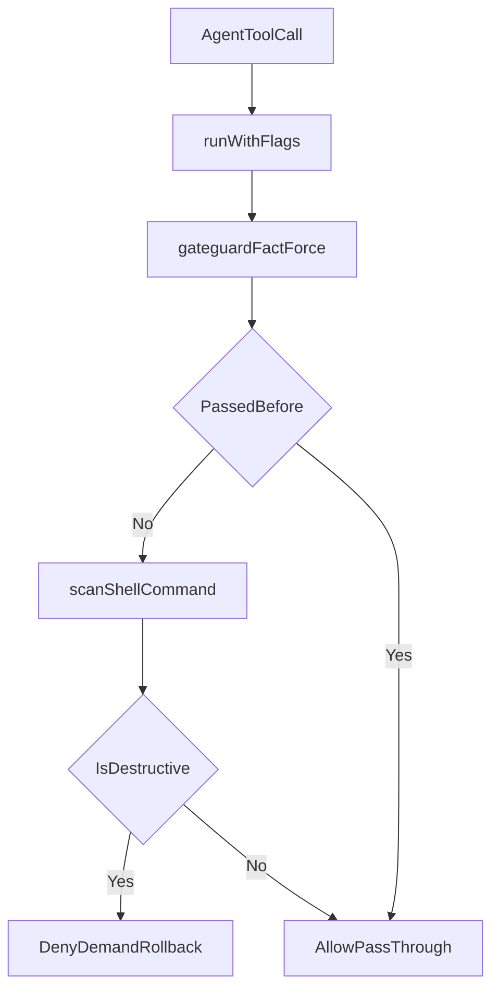
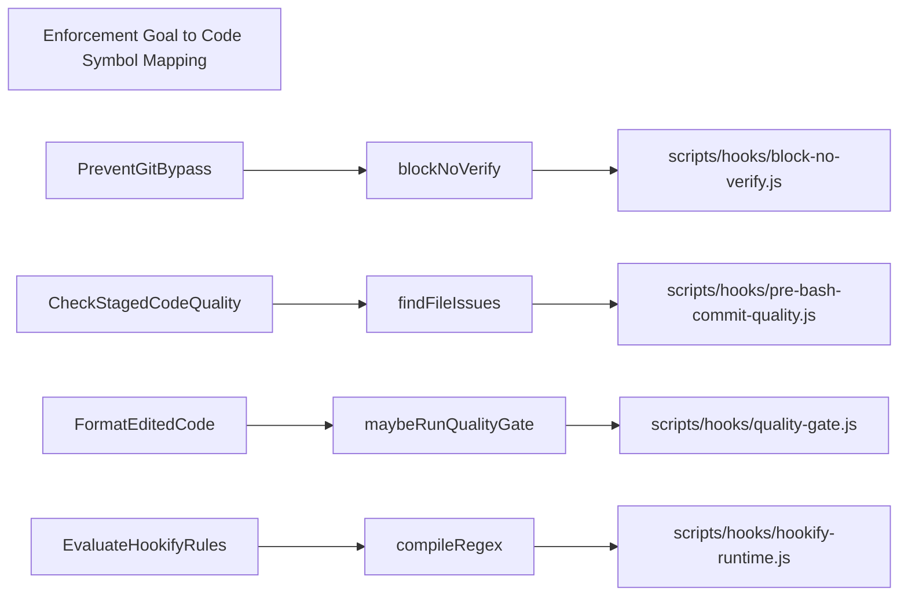
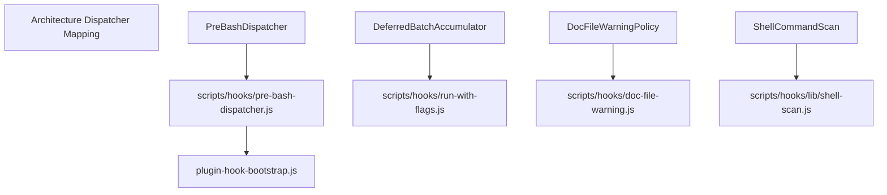

<!-- source: DeepWiki mcp.deepwiki.com · repo affaan-m/ECC · page 5.1 Quality & Code Enforcement Hooks · fetched 2026-10-30 -->

# Quality & Code Enforcement Hooks

Relevant source files

The following files were used as context for generating this wiki page:

- [commands/hookify-help.md](commands/hookify-help.md)
- [commands/hookify.md](commands/hookify.md)
- [scripts/hooks/auto-tmux-dev.js](scripts/hooks/auto-tmux-dev.js)
- [scripts/hooks/bash-hook-dispatcher.js](scripts/hooks/bash-hook-dispatcher.js)
- [scripts/hooks/block-no-verify.js](scripts/hooks/block-no-verify.js)
- [scripts/hooks/doc-file-warning.js](scripts/hooks/doc-file-warning.js)
- [scripts/hooks/gateguard-heredoc.js](scripts/hooks/gateguard-heredoc.js)
- [scripts/hooks/hookify-runtime.js](scripts/hooks/hookify-runtime.js)
- [scripts/hooks/lib/shell-scan.js](scripts/hooks/lib/shell-scan.js)
- [scripts/hooks/post-bash-build-complete.js](scripts/hooks/post-bash-build-complete.js)
- [scripts/hooks/post-bash-dispatcher.js](scripts/hooks/post-bash-dispatcher.js)
- [scripts/hooks/post-bash-pr-created.js](scripts/hooks/post-bash-pr-created.js)
- [scripts/hooks/posttooluse-dispatcher.js](scripts/hooks/posttooluse-dispatcher.js)
- [scripts/hooks/pre-bash-commit-quality.js](scripts/hooks/pre-bash-commit-quality.js)
- [scripts/hooks/pre-bash-dispatcher.js](scripts/hooks/pre-bash-dispatcher.js)
- [scripts/hooks/pre-bash-git-push-reminder.js](scripts/hooks/pre-bash-git-push-reminder.js)
- [scripts/hooks/pre-bash-tmux-reminder.js](scripts/hooks/pre-bash-tmux-reminder.js)
- [scripts/hooks/pre-compact.js](scripts/hooks/pre-compact.js)
- [scripts/hooks/pre-write-doc-warn.js](scripts/hooks/pre-write-doc-warn.js)
- [scripts/hooks/pretooluse-visible-output.js](scripts/hooks/pretooluse-visible-output.js)
- [scripts/hooks/quality-gate.js](scripts/hooks/quality-gate.js)
- [scripts/lib/project-detect.js](scripts/lib/project-detect.js)
- [scripts/lib/shell-substitution.js](scripts/lib/shell-substitution.js)
- [skills/hookify-rules/SKILL.md](skills/hookify-rules/SKILL.md)
- [tests/hooks/auto-tmux-dev.test.js](tests/hooks/auto-tmux-dev.test.js)
- [tests/hooks/bash-hook-dispatcher.test.js](tests/hooks/bash-hook-dispatcher.test.js)
- [tests/hooks/block-no-verify.test.js](tests/hooks/block-no-verify.test.js)
- [tests/hooks/doc-file-warning.test.js](tests/hooks/doc-file-warning.test.js)
- [tests/hooks/hookify-file-race.test.js](tests/hooks/hookify-file-race.test.js)
- [tests/hooks/hookify-registration.test.js](tests/hooks/hookify-registration.test.js)
- [tests/hooks/hookify-runtime.test.js](tests/hooks/hookify-runtime.test.js)
- [tests/hooks/hookify-security.test.js](tests/hooks/hookify-security.test.js)
- [tests/hooks/posttooluse-dispatcher.test.js](tests/hooks/posttooluse-dispatcher.test.js)
- [tests/hooks/pre-bash-commit-quality.test.js](tests/hooks/pre-bash-commit-quality.test.js)
- [tests/hooks/pre-bash-reminders.test.js](tests/hooks/pre-bash-reminders.test.js)
- [tests/hooks/pre-bash-tmux-reminder.test.js](tests/hooks/pre-bash-tmux-reminder.test.js)
- [tests/hooks/pre-compact.test.js](tests/hooks/pre-compact.test.js)
- [tests/hooks/quality-gate.test.js](tests/hooks/quality-gate.test.js)
- [tests/lib/project-detect.test.js](tests/lib/project-detect.test.js)
- [tests/lib/shell-substitution.test.js](tests/lib/shell-substitution.test.js)

ECC employs a collection of automation hooks focused on preserving code quality, enforcing project policies, and preventing common AI-induced regression patterns. These hooks are integrated into the lifecycle of tool execution as `PreToolUse`, `PostToolUse`, and `Stop` hooks, providing a layered enforcement and feedback mechanism.

This page details the implementations, data flow, and orchestration of quality and code enforcement hooks: formatting, typechecking, console statement warnings, commit quality checks, gating destructive commands, the hookify rule engine, and the dispatchers and accumulators that drive their coordinated execution.

---

## Formatting & Typechecking Pipeline

Quality hooks that automatically format and verify code syntactic integrity immediately after editing maintain a clean development workspace and prevent errors from escalating undetected.

### post-edit-format Hook

The `post-edit-format` hook runs right after the `Edit` tool modifies a file. It performs automatic code formatting on JS/TS files using an intelligently selected formatter:

- Detects whether the project uses Biome or Prettier by scanning for their respective configuration files starting from the edited file's directory upward [scripts/hooks/post-edit-format.js:8-13]().
- Prefers local binaries in `node_modules/.bin` rather than invoking via `npx` to avoid extra process overhead, saving ~200-500ms per call [scripts/hooks/post-edit-format.js:14-15]().
- For Biome, it executes `check --write` to combine formatting and linting in a single command, optimizing performance [scripts/hooks/post-edit-format.js:52-54]().
- On Windows, it disallows invocation if file paths contain shell metacharacters, preventing command injection risks when calling `.cmd` executables [scripts/hooks/post-edit-format.js:56-61]().
- Failures in formatting or missing formatters do not block further processing, allowing a best-effort formatting approach [scripts/hooks/post-edit-format.js:78-81]().

### post-edit-typecheck Hook

The `post-edit-typecheck` hook targets TypeScript files (`.ts`/`.tsx`). After an edit:

- It walks up to find the nearest `tsconfig.json` config file, capping the search depth to 20 directories to avoid infinite loops [scripts/hooks/post-edit-typecheck.js:48-58]().
- Executes `tsc --noEmit` using `npx` to run the TypeScript compiler in check-only mode, preventing actual output [scripts/hooks/post-edit-typecheck.js:64-70]().
- If compile errors occur, the hook filters output messages to only include those related to the edited file by matching relative and absolute file paths [scripts/hooks/post-edit-typecheck.js:73-89]().
- It outputs relevant errors to `stderr` to alert the agent and user about type issues focused on current edits, reducing noise from unrelated errors [scripts/hooks/post-edit-typecheck.js:91-96]().

### post-edit-console-warn Hook

This lightweight hook scans edited JavaScript/TypeScript files for any `console.log` statements that may have been left in as debug code:

- Parses the edited file and locates up to 5 lines containing `console.log` with their line numbers [scripts/hooks/post-edit-console-warn.js:24-28]().
- Emits warnings via `stderr` with an explicit message advising removal before committing [scripts/hooks/post-edit-console-warn.js:30-33]().
- Runs immediately after edits to help maintain clean debug-free code prior to commit.

Sources: [scripts/hooks/post-edit-format.js:1-118](), [scripts/hooks/post-edit-typecheck.js:1-105](), [scripts/hooks/post-edit-console-warn.js:1-75]()

---

## GateGuard: Fact-Forcing Destructive Command Enforcement

The GateGuard hooks implement a **fact-forcing** strategy that denies execution of potentially destructive actions unless the agent supplies proof of investigation and rollback plans.

### Operation Overview

GateGuard hooks intercept key lifecycle events such as first-time file edits, writes, and potentially destructive bash commands (`rm -rf`, `git reset --hard`, `drop table`). They maintain state in a local file (`~/.gateguard`) to track if a file or command has passed the gate before, avoiding repeated friction on subsequent safe attempts [scripts/hooks/gateguard-fact-force.js:28-33]().

### Command & Payload Analysis

- The hook parses shell commands rigorously, including nested command substitutions, arithmetic subshells, and heredocs (via `gateguard-heredoc.js` and `shell-substitution.js`), to detect destructive patterns hidden inside complex bash constructs [scripts/hooks/gateguard-heredoc.js:15-23](), [scripts/lib/shell-substitution.js:87-95]().
- It safely strips quoted text to avoid false positives triggered by flags or commit messages [scripts/hooks/gateguard-fact-force.js:155-157]().
- If a destructive pattern is detected, the hook returns a deny result, requesting the agent provide affected targets, rollback instructions, and relevant facts [skills/gateguard/SKILL.md:78-83]().

Title: GateGuard Fact-Forcing Flow

Sources: [scripts/hooks/gateguard-fact-force.js:1-200](), [scripts/hooks/gateguard-heredoc.js:1-265](), [scripts/lib/shell-substitution.js:1-356]()

---

## Git & Commit Quality Enforcement

ECC enforces project-level policies that ensure committed code does not contain hidden debug code, secrets, or bypass quality checks.

### block-no-verify Hook

This `PreToolUse` hook intercepts bash commands intended for git and blocks attempts to bypass hook execution by:

- Detecting `--no-verify` flags or their shorthands `-n`, including within combined options (e.g. `-sn`) [scripts/hooks/block-no-verify.js:136-157]().
- Detecting the use of `-c core.hooksPath=...` overrides that can disable hooks [scripts/hooks/block-no-verify.js:28-36]().
- Bounded shell scanning via `createBudget()` in `scripts/hooks/lib/shell-scan.js` prevents catastrophic backtracking or unbounded execution on complex inputs [scripts/hooks/lib/shell-scan.js:6-12]().
- If bypass flags or config overrides are found, the hook emits a blocking message on `stderr` and exits with code `2`, canceling the commit or push operation [scripts/hooks/block-no-verify.js:11-14]().

### pre-bash-commit-quality Hook

This comprehensive quality gate runs before executing `git commit` commands to catch potential issues in files staged for commit:

- Detects the list of staged files via `git diff --cached` to inspect only what will actually be committed [scripts/hooks/pre-bash-commit-quality.js:28-37]().
- Checks staged file contents for:
  - Debugging primitives like `console.log` or `debugger;` statements [scripts/hooks/pre-bash-commit-quality.js:101-119]().
  - Hardcoded API keys or secrets (Anthropic, OpenAI, GitHub PAT, AWS keys) using regex patterns, while filtering false positives from obvious placeholders via `isPlaceholderSecret()` [scripts/hooks/pre-bash-commit-quality.js:71-81](), [scripts/hooks/pre-bash-commit-quality.js:133-160]().
  - TODO or FIXME comments without issue references [scripts/hooks/pre-bash-commit-quality.js:121-130]().
- Validates commit message format (if provided) against conventional commit standards, warning on capitalized subjects or trailing periods [scripts/hooks/pre-bash-commit-quality.js:174-177]().
- Issues warnings (`exitCode = 0`) or blocks (`exitCode = 2`) commit based on severity of issues found.

Sources: [scripts/hooks/block-no-verify.js:1-1254](), [scripts/hooks/pre-bash-commit-quality.js:1-556](), [scripts/hooks/lib/shell-scan.js:1-539]()

---

## Hookify Rule Engine & Custom Local Rules

The ECC-native Hookify runtime (`scripts/hooks/hookify-runtime.js`) allows projects to define local markdown-based enforcement rules containing YAML frontmatter.

- **Loading & Parsing:** Scans project directories for Hookify rules, validating frontmatter attributes against restricted schemas using `parseRuleFrontmatter()` [scripts/hooks/hookify-runtime.js:18]().
- **Safety Bounds:** Enforces strict limits on rule payload sizes (`MAX_RULE_BYTES = 64 * 1024`), maximum rule counts (`MAX_RULES = 100`), regex source patterns (`MAX_PATTERN_CHARS = 512`), and evaluation times via `vm` scripts with strict timeouts (`REGEX_TIMEOUT_MS = 25`) to prevent ReDoS vulnerabilities [scripts/hooks/hookify-runtime.js:22-30](), [scripts/hooks/hookify-runtime.js:114-142]().
- **Action Handling:** Evaluates conditions against Claude Code lifecycle payloads (`bash`, `file`, `stop`, `prompt`) and executes configured actions (`warn` or `block`) [scripts/hooks/hookify-runtime.js:32-41](), [scripts/hooks/hookify-runtime.js:164-185]().

Sources: [scripts/hooks/hookify-runtime.js:1-784]()

---

## Deferred Batch Accumulator Pattern & Hook Dispatchers

### run-with-flags.js

ECC centrally manages hook activation and execution via `run-with-flags.js`:

- Checks if a hook is enabled by profile gating and feature flags before execution.
- Supports a **deferred batch accumulator** mode for `PreToolUse` hooks that accumulate warnings or facts, injecting them as `additionalContext` into the agent prompt for user visibility (e.g., GateGuard facts).
- Optimizes performance by requiring hook script modules with `run()` exports directly, avoiding the overhead of spawning child processes.
- Sanitizes and handles large or truncated inputs to avoid blocking or unsafe partial validation.

### Bash & PowerShell Dispatchers

ECC uses dispatcher hooks configured in `hooks/hooks.json` to orchestrate multiple preflight checks:

- `pre:bash:dispatcher` implements coalesced preflight hooks including quality gate, tmux reminders, push reminders, and GateGuard [hooks/hooks.json:9-14](). Implemented by `scripts/hooks/pre-bash-dispatcher.js` using `plugin-hook-bootstrap.js` to determine the ECC root [scripts/hooks/pre-bash-dispatcher.js:1-42]().
- `pre:powershell:gateguard-fact-force` runs on PowerShell tool calls but excludes unrelated preflight hooks, focusing on fact-forcing destructive command enforcement [hooks/hooks.json:20-22]().

### doc-file-warning Hook

This `PreToolUse` hook emits warnings (but never blocks) when files with ad-hoc names like `NOTES.md`, `TODO.md`, or `SCRATCH.txt` are created outside known structured directories (`docs/`, `skills/`, `.claude/`, etc.) [scripts/hooks/doc-file-warning.js:21-38]().

### quality-gate Hook

The `quality-gate` hook triggers after file edits to scan modified JS/TS/Go/Python files using configured formatters (Biome, Prettier, gofmt, Ruff), logging warnings or running fixes when `ECC_QUALITY_GATE_FIX` is enabled [scripts/hooks/quality-gate.js:5-13](), [scripts/hooks/quality-gate.js:70-135]().

Sources: [scripts/hooks/doc-file-warning.js:1-116](), [scripts/hooks/quality-gate.js:1-172](), [hooks/hooks.json:1-30]()

---

## Code Entity Mapping: Natural Language to Code Symbols

Title: Enforcement Goal to Code Symbol Mapping

Title: Architecture Dispatcher Mapping

Sources: [scripts/hooks/block-no-verify.js:1-1254](), [scripts/hooks/pre-bash-commit-quality.js:1-556](), [scripts/hooks/quality-gate.js:1-172](), [scripts/hooks/hookify-runtime.js:1-784](), [scripts/hooks/doc-file-warning.js:1-116](), [scripts/hooks/lib/shell-scan.js:1-539]()

---

# Summary

This suite of hooks enforces quality, security, and operational policies through automated checks, warnings, and gatekeeping to:

- Ensure all edited JavaScript/TypeScript files are formatted and type-checked before proceeding.
- Warn on leftover debug statements (`console.log`).
- Prevent git commits that contain debugging or secret leakage.
- Block git commands that attempt to bypass hooks using `--no-verify` or `core.hooksPath`.
- Demand rigorous investigation of potentially destructive shell commands with a fact-forcing mechanism.
- Centralize hook execution and performance optimizations through dispatchers and direct module loading.
- Evaluate custom markdown-based local enforcement rules via the Hookify runtime.

---

## Sources

- [scripts/hooks/post-edit-format.js:1-118]()
- [scripts/hooks/post-edit-typecheck.js:1-105]()
- [scripts/hooks/post-edit-console-warn.js:1-75]()
- [scripts/hooks/gateguard-fact-force.js:1-200]()
- [scripts/hooks/gateguard-heredoc.js:1-265]()
- [scripts/lib/shell-substitution.js:1-356]()
- [scripts/hooks/block-no-verify.js:1-1254]()
- [scripts/hooks/pre-bash-commit-quality.js:1-556]()
- [scripts/hooks/lib/shell-scan.js:1-539]()
- [scripts/hooks/hookify-runtime.js:1-784]()
- [scripts/hooks/doc-file-warning.js:1-116]()
- [scripts/hooks/quality-gate.js:1-172]()
- [hooks/hooks.json:1-30]()

---

