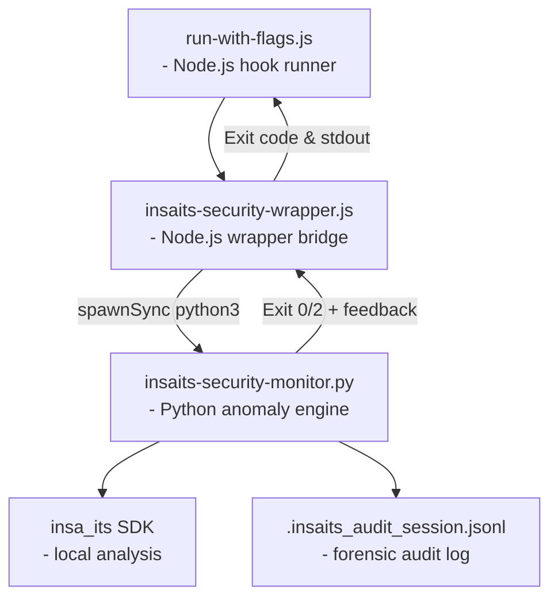
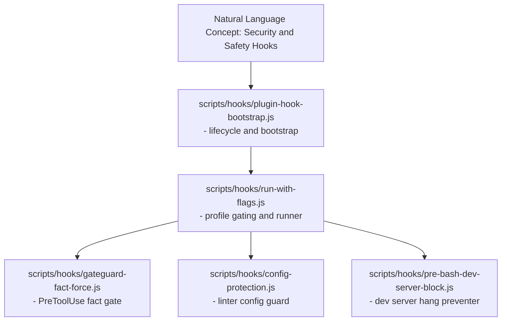
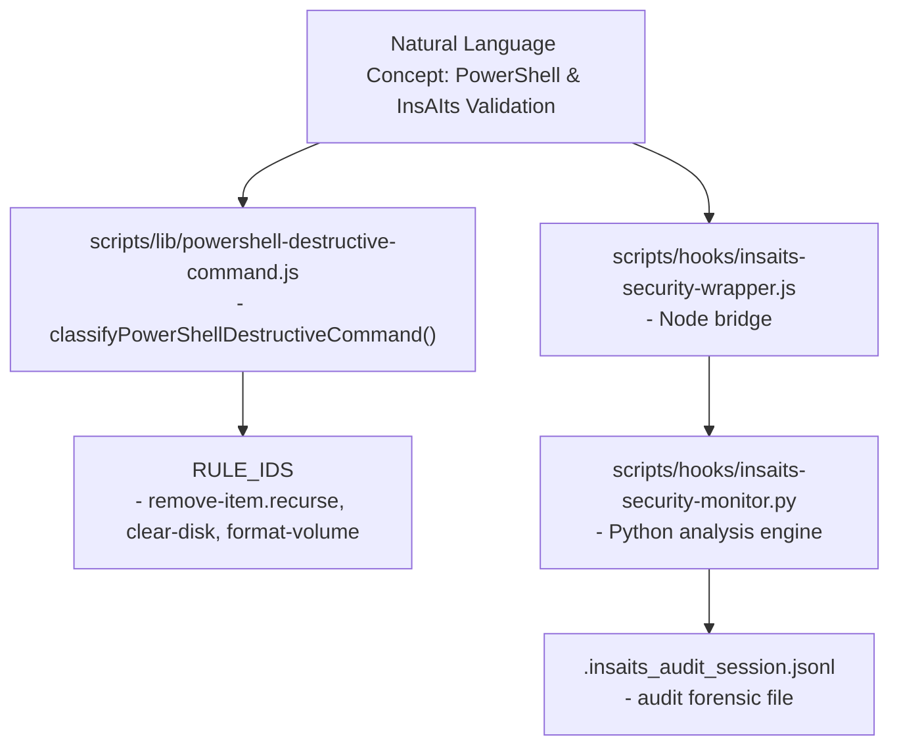

<!-- source: DeepWiki mcp.deepwiki.com · repo affaan-m/ECC · page 5.2 Security & Safety Hooks · fetched 2026-10-30 -->

# Security & Safety Hooks

Relevant source files

The following files were used as context for generating this wiki page:

- [.cursor/hooks.json](.cursor/hooks.json)
- [.cursor/hooks/adapter.js](.cursor/hooks/adapter.js)
- [.cursor/hooks/before-read-file.js](.cursor/hooks/before-read-file.js)
- [.cursor/hooks/before-shell-execution.js](.cursor/hooks/before-shell-execution.js)
- [.cursor/hooks/before-tab-file-read.js](.cursor/hooks/before-tab-file-read.js)
- [.cursor/hooks/session-start.js](.cursor/hooks/session-start.js)
- [.cursor/hooks/stop.js](.cursor/hooks/stop.js)
- [.trae/README.md](.trae/README.md)
- [.trae/README.zh-CN.md](.trae/README.zh-CN.md)
- [.trae/install.sh](.trae/install.sh)
- [.trae/uninstall.sh](.trae/uninstall.sh)
- [CLAUDE.md](CLAUDE.md)
- [docs/SKILL-PLACEMENT-POLICY.md](docs/SKILL-PLACEMENT-POLICY.md)
- [docs/releases/2.2.1/patch-execution.md](docs/releases/2.2.1/patch-execution.md)
- [docs/releases/2.2.1/release-notes.md](docs/releases/2.2.1/release-notes.md)
- [docs/security/ecc-039-powershell-gateguard-plan.md](docs/security/ecc-039-powershell-gateguard-plan.md)
- [schemas/provenance.schema.json](schemas/provenance.schema.json)
- [scripts/hooks/config-protection.js](scripts/hooks/config-protection.js)
- [scripts/hooks/governance-capture.js](scripts/hooks/governance-capture.js)
- [scripts/hooks/insaits-security-monitor.py](scripts/hooks/insaits-security-monitor.py)
- [scripts/hooks/insaits-security-wrapper.js](scripts/hooks/insaits-security-wrapper.js)
- [scripts/hooks/observe-runner.js](scripts/hooks/observe-runner.js)
- [scripts/hooks/plugin-hook-bootstrap.js](scripts/hooks/plugin-hook-bootstrap.js)
- [scripts/hooks/post-edit-accumulator.js](scripts/hooks/post-edit-accumulator.js)
- [scripts/hooks/pre-bash-dev-server-block.js](scripts/hooks/pre-bash-dev-server-block.js)
- [scripts/hooks/run-with-flags.js](scripts/hooks/run-with-flags.js)
- [scripts/hooks/session-end-marker.js](scripts/hooks/session-end-marker.js)
- [scripts/hooks/stop-format-typecheck.js](scripts/hooks/stop-format-typecheck.js)
- [scripts/lib/hook-flags.js](scripts/lib/hook-flags.js)
- [scripts/lib/hook-session.js](scripts/lib/hook-session.js)
- [scripts/lib/install/ownership-guard.js](scripts/lib/install/ownership-guard.js)
- [scripts/lib/multi-harness-setup.js](scripts/lib/multi-harness-setup.js)
- [scripts/lib/powershell-destructive-command.js](scripts/lib/powershell-destructive-command.js)
- [scripts/lib/resolve-formatter.js](scripts/lib/resolve-formatter.js)
- [scripts/lib/shell-split.js](scripts/lib/shell-split.js)
- [scripts/lib/windows-bash.js](scripts/lib/windows-bash.js)
- [tests/ci/run-all.test.js](tests/ci/run-all.test.js)
- [tests/hooks/config-protection.test.js](tests/hooks/config-protection.test.js)
- [tests/hooks/cursor-block-no-verify.test.js](tests/hooks/cursor-block-no-verify.test.js)
- [tests/hooks/cursor-hook-dispatchers.test.js](tests/hooks/cursor-hook-dispatchers.test.js)
- [tests/hooks/governance-capture.test.js](tests/hooks/governance-capture.test.js)
- [tests/hooks/hook-flags.test.js](tests/hooks/hook-flags.test.js)
- [tests/hooks/insaits-security-monitor.test.js](tests/hooks/insaits-security-monitor.test.js)
- [tests/hooks/insaits-security-wrapper.test.js](tests/hooks/insaits-security-wrapper.test.js)
- [tests/hooks/observer-session-lifecycle.test.js](tests/hooks/observer-session-lifecycle.test.js)
- [tests/hooks/plugin-hook-bootstrap-no-echo.test.js](tests/hooks/plugin-hook-bootstrap-no-echo.test.js)
- [tests/hooks/plugin-hook-bootstrap.test.js](tests/hooks/plugin-hook-bootstrap.test.js)
- [tests/hooks/pre-bash-dev-server-block.test.js](tests/hooks/pre-bash-dev-server-block.test.js)
- [tests/hooks/stop-format-typecheck.test.js](tests/hooks/stop-format-typecheck.test.js)
- [tests/hooks/stop-hooks-stdout.test.js](tests/hooks/stop-hooks-stdout.test.js)
- [tests/lib/claude-settings-array.test.js](tests/lib/claude-settings-array.test.js)
- [tests/lib/dry-run.test.js](tests/lib/dry-run.test.js)
- [tests/lib/hook-session.test.js](tests/lib/hook-session.test.js)
- [tests/lib/install-claude-skill-migration.test.js](tests/lib/install-claude-skill-migration.test.js)
- [tests/lib/multi-harness-setup.test.js](tests/lib/multi-harness-setup.test.js)
- [tests/lib/powershell-destructive-command.test.js](tests/lib/powershell-destructive-command.test.js)
- [tests/lib/resolve-formatter.test.js](tests/lib/resolve-formatter.test.js)
- [tests/lib/shell-split.test.js](tests/lib/shell-split.test.js)
- [tests/lib/windows-bash.test.js](tests/lib/windows-bash.test.js)
- [tests/run-all.js](tests/run-all.js)
- [tests/scripts/ownership-guard.test.js](tests/scripts/ownership-guard.test.js)

Everything Claude Code (ECC) implements a multi-layered security and safety architecture using `PreToolUse` and `PostToolUse` hooks (`[scripts/hooks/plugin-hook-bootstrap.js:1-76]()`, `[scripts/hooks/run-with-flags.js:1-349]()`). These hooks act as a programmable firewall between the AI agent and the host system, enforcing fact-based investigation, secret redaction, linter configuration protection, destructive command classification, and behavioral monitoring.

---

## 1. GateGuard Link & Overview

GateGuard is ECC's core `PreToolUse` fact-forcing gate subsystem (`[scripts/hooks/gateguard-fact-force.js:1-155]()`), detailed fully in [Section 8.3 (GateGuard Fact-Forcing Gate)](). Security hooks on this page (such as the PowerShell destructive command classifier and heredoc guards) directly support or integrate with GateGuard's decision pipeline.

Sources: `[scripts/hooks/gateguard-fact-force.js:1-155]()`

---

## 2. InsAIts Security Monitor & Fail-Open/Closed Semantics

The InsAIts Security Monitor provides real-time security anomaly detection for tool inputs (`[scripts/hooks/insaits-security-monitor.py:1-207]()`). It inspects tool inputs for credential leakage, prompt injection, behavioral anomalies, and hallucination chains locally without external network transmission.

### Bridge Architecture & Data Flow

Because ECC hook execution is orchestrated through Node.js (`[scripts/hooks/run-with-flags.js:1-192]()`), a lightweight Node wrapper invokes the Python-based InsAIts SDK monitor:

Sources: `[scripts/hooks/insaits-security-monitor.py:1-146]()`, `[scripts/hooks/run-with-flags.js:1-192]()`

### Fail-Open vs. Fail-Closed Semantics

ECC hooks distinguish between operational errors, missing SDKs, and payload truncation to determine whether to fail **open** or **closed**:
- **Fail-Open (Default):** If the InsAIts Python package is missing (`INSAITS_AVAILABLE = false`) or non-fatal SDK runtime exceptions occur, the hook logs a warning to `stderr` and exits with code `0`, allowing developer workflows to proceed unhindered (`[scripts/hooks/insaits-security-monitor.py:204-207]()`).
- **Fail-Closed on Truncation / Policy:** High-security hooks (such as `gateguard-fact-force` and `mcp-health-check`) evaluate payload sizes against `ECC_HOOK_INPUT_MAX_BYTES` (`[scripts/hooks/run-with-flags.js:20-142](), [scripts/hooks/config-protection.js:19-20]()`). When an upstream payload exceeds length limits and becomes truncated, these hooks reject the input with exit code `2` rather than risking silent bypasses on malformed JSON (`[scripts/hooks/run-with-flags.js:120-142]()`).

Sources: `[scripts/hooks/insaits-security-monitor.py:200-207](), [scripts/hooks/run-with-flags.js:20-142]()`

---

## 3. PowerShell Destructive-Command Classifier

PowerShell environments on Windows introduce unique risks regarding recursive deletions, disk formatting, and obfuscated commands. ECC provides a pure-parser classifier in `[scripts/lib/powershell-destructive-command.js:1-212]()` that evaluates commands without invoking an external PowerShell interpreter.

### Classification Rules & Rule IDs

| Rule ID | Target API / Construct | Severity |
| :--- | :--- | :--- |
| `powershell.remove-item.recurse` | `Remove-Item` / aliases (`rm`, `rd`, `del`) with `-Recurse` | Critical |
| `powershell.remove-item.force` | `Remove-ItemProperty` or `Remove-Item` with `-Force` | High |
| `powershell.remove-item.wildcard` | Wildcards (`*`, `?`) targeting root directories or build outputs | High |
| `powershell.remove-item.splat` | Splatted parameter tables (`@deleteParams`) | Warning |
| `powershell.clear-content` | `Clear-Content` on sensitive logs or files | Warning |
| `powershell.clear-disk` / `format-volume` | Disk-level destructive commands (`Clear-Disk`, `Format-Volume`) | Critical |
| `powershell.dotnet.directory-delete` | `[System.IO.Directory]::Delete(...)` with recursive flag | Critical |
| `powershell.cmd.recursive-delete` | Wrapped `cmd /c rd /s /q` or `del /s /q` operations | Critical |

The parser normalizes smart quotes (`[scripts/lib/powershell-destructive-command.js:80-85]()`), strips backtick obfuscation (`[scripts/lib/powershell-destructive-command.js:169]()`), and tracks inert regions (comments, strings, braced variables) to prevent evasion (`[scripts/lib/powershell-destructive-command.js:116-204]()`).

Sources: `[scripts/lib/powershell-destructive-command.js:12-26](), [tests/lib/powershell-destructive-command.test.js:71-184]()`

---

## 4. Configuration Protection

AI agents frequently attempt to bypass strict linting or formatting rules by modifying linter configuration files (e.g., weakening `.eslintrc.js` or `.prettierrc` rules instead of fixing code errors). The configuration protection hook prevents this (`[scripts/hooks/config-protection.js:1-179](), [tests/hooks/config-protection.test.js:1-129]()`).

### Protected Configuration Inventory

- **ESLint & Prettier:** `.eslintrc`, `.eslintrc.*`, `eslint.config.*`, `.prettierrc`, `.prettierrc.*`, `prettier.config.*` (`[scripts/hooks/config-protection.js:22-46]()`).
- **Biome & Ruff:** `biome.json`, `biome.jsonc`, `.ruff.toml`, `ruff.toml` (`[scripts/hooks/config-protection.js:48-54]()`).
- **Stylelint & Markdownlint:** `.stylelintrc*`, `stylelint.config.*`, `.markdownlint*`, `.markdownlint-cli2.*` (`[scripts/hooks/config-protection.js:59-87]()`).
- **Ignore Files:** `.eslintignore`, `.prettierignore`, `.stylelintignore`, `.markdownlintignore` (`[scripts/hooks/config-protection.js:93-96]()`).

### Bootstrap and Creation Exemption

The hook evaluates incoming `Write` or `Edit` tool calls (`[scripts/hooks/config-protection.js:148-179]()`):
- **Modification Attempt:** If the target configuration file **already exists** on disk (`fs.lstatSync`), the edit is blocked with exit code `2` (`[scripts/hooks/config-protection.js:171-200]()`).
- **First-Time Creation:** If the file does not exist (`ENOENT`), the write is permitted (`exit code 0`), enabling legitimate project bootstrapping and scaffolding (`[scripts/hooks/config-protection.js:172-175]()`).

Sources: `[scripts/hooks/config-protection.js:1-179](), [tests/hooks/config-protection.test.js:1-185]()`

---

## 5. Dev-Server Block

Agents running interactive command loops frequently launch long-running development servers (`npm run dev`, `pnpm dev`, `yarn dev`, `bun run dev`) directly in the main CLI session, hanging the interaction loop (`[scripts/hooks/pre-bash-dev-server-block.js:12-182](), [tests/hooks/pre-bash-dev-server-block.test.js:45-90]()`).

### Detection and Exemptions

- **Blocked Patterns:** Matches unshielded dev server execution commands (`npm run dev`, `pnpm dev`, `yarn dev`, `bun run dev`, including colon variants like `npm run dev:ssr`) across shell segments, subshells `(...)`, and command substitutions `$(...)` (`[scripts/hooks/pre-bash-dev-server-block.js:67-214]()`).
- **Allowed Contexts:** 
  - Launches wrapped in `tmux` panes (e.g., `tmux new-session -d -s dev "npm run dev"`) where output is captured without blocking the main harness (`[scripts/hooks/pre-bash-dev-server-block.test.js:96-127]()`).
  - Distinct helper scripts with suffixes like `npm run dev-setup`, `pnpm run dev-docs`, or `yarn dev-build` (`[scripts/hooks/pre-bash-dev-server-block.test.js:145-160]()`).

Sources: `[scripts/hooks/pre-bash-dev-server-block.js:1-231](), [tests/hooks/pre-bash-dev-server-block.test.js:45-166]()`

---

## 6. Activity Tracker & Governance Capture

The activity tracking subsystem records sensitive agent interactions, approval requirements, and security events while scrubbing secrets and personal paths (`[scripts/hooks/governance-capture.js:1-100]()`). It writes redacted audit summaries to session storage for post-session governance evaluation without leaking tokens or environment variables into shared transcripts.

Sources: `[scripts/hooks/governance-capture.js:1-100]()`

---

## 7. Diagrams Bridging Natural Language to Code Entities

### GateGuard & Safety Hook Orchestration

Sources: `[scripts/hooks/plugin-hook-bootstrap.js:1-76]()`, `[scripts/hooks/run-with-flags.js:1-150]()`, `[scripts/hooks/config-protection.js:1-150]()`

### PowerShell Classifier & InsAIts Monitor Architecture

Sources: `[scripts/lib/powershell-destructive-command.js:1-30]()`, `[scripts/hooks/insaits-security-monitor.py:1-145]()`, `[scripts/hooks/insaits-security-wrapper.js:1-100]()`

---

