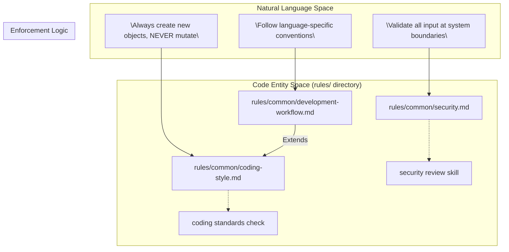
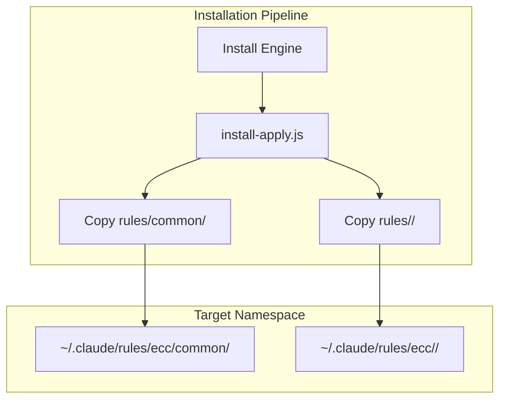

<!-- source: DeepWiki mcp.deepwiki.com · repo affaan-m/ECC · page 6 Rules System · fetched 2026-10-30 -->

# Rules System

Relevant source files

The following files were used as context for generating this wiki page:

- [examples/user-CLAUDE.md](examples/user-CLAUDE.md)
- [rules/common/code-review.md](rules/common/code-review.md)
- [rules/common/coding-style.md](rules/common/coding-style.md)
- [rules/common/development-workflow.md](rules/common/development-workflow.md)
- [rules/common/patterns.md](rules/common/patterns.md)
- [rules/common/security.md](rules/common/security.md)
- [rules/common/testing.md](rules/common/testing.md)
- [skills/backend-patterns/SKILL.md](skills/backend-patterns/SKILL.md)
- [skills/clickhouse-io/SKILL.md](skills/clickhouse-io/SKILL.md)
- [skills/coding-standards/SKILL.md](skills/coding-standards/SKILL.md)
- [skills/continuous-learning/SKILL.md](skills/continuous-learning/SKILL.md)
- [skills/django-verification/SKILL.md](skills/django-verification/SKILL.md)
- [skills/eval-harness/SKILL.md](skills/eval-harness/SKILL.md)
- [skills/frontend-patterns/SKILL.md](skills/frontend-patterns/SKILL.md)
- [skills/iterative-retrieval/SKILL.md](skills/iterative-retrieval/SKILL.md)
- [skills/prisma-patterns/SKILL.md](skills/prisma-patterns/SKILL.md)
- [skills/search-first/SKILL.md](skills/search-first/SKILL.md)
- [skills/security-review/SKILL.md](skills/security-review/SKILL.md)

The Rules System in Everything Claude Code (ECC) provides a structured, layered framework for enforcing coding standards, workflows, and security practices across different programming languages and environments [rules/common/coding-style.md:1-15](). Unlike Skills, which provide actionable "how-to" guidance, **Rules** define the "what"—the mandatory constraints and checklists that the AI must follow during development [skills/coding-standards/SKILL.md:1-17]().

## Architectural Overview

Rules are organized into a hierarchical structure consisting of a **common** layer and **language-specific** overrides. This allows ECC to maintain universal engineering principles while respecting the unique idioms of different ecosystems [rules/common/coding-style.md:60-64]().

### Layered Configuration Model

1. **Common Layer (`rules/common/`)**: Contains universal, language-agnostic principles such as immutability, KISS/DRY/YAGNI, and basic security hygiene [rules/common/coding-style.md:1-34](). These are installed as the foundational baseline across projects [examples/user-CLAUDE.md:25-40]().

2. **Language Layer (`rules/<language>/`)**: Extends or overrides the common rules with language-specific patterns, tools, and idiomatic code examples relevant to each programming environment [rules/common/coding-style.md:60-64]().

### Rule Priority

In case of conflicts between common and language-specific rules, **language-specific rules have precedence**. This layered override resembles configuration patterns such as CSS specificity or `.gitignore` precedence [rules/common/coding-style.md:60-64](). For example, while strict immutability is enforced in common rules, language-specific rules may adapt casing, constants, or pointer mutation behaviors [rules/common/coding-style.md:60-64]().

### Mapping Rules to Code Entities

The diagram below maps natural language constraints through rules documents to underlying code entities and workflows in ECC.

#### Rules System Mapping Diagram

**Sources:** [rules/common/coding-style.md:1-34](), [rules/common/development-workflow.md:1-5]()

## Rules vs. Skills

A critical distinction: **rules define mandatory standards** and constraints, whereas **skills provide procedural knowledge and actionable workflows**. Both coexist but serve distinct roles [skills/coding-standards/SKILL.md:1-17]().

| Feature | Rules (`rules/`) | Skills (`skills/`) |
| :--- | :--- | :--- |
| **Purpose** | Standards, conventions, and checklists that must be followed to maintain quality and security [rules/common/coding-style.md:88-97]() | Actionable reference material guiding how to do tasks (e.g., development workflows, language idioms) [skills/coding-standards/SKILL.md:1-17]() |
| **Nature** | Passive constraints ("The What") enforcing compliance at all times [rules/common/coding-style.md:1-34]() | Active guidance ("The How") providing tactical knowledge, usually context-activated or user-invoked [skills/coding-standards/SKILL.md:1-26]() |
| **Activation** | Always-on or gated by install profiles | Invoked interactively or by workflow conditions |
| **Examples** | `coding-style.md`, `code-review.md`, `development-workflow.md` [rules/common/coding-style.md:1-15]() | `coding-standards`, `backend-patterns`, `search-first` [skills/coding-standards/SKILL.md:1-17]() |

**Sources:** [rules/common/coding-style.md:1-34](), [skills/coding-standards/SKILL.md:1-17]()

## Installation and Namespace

Rules are installed into a dedicated ECC namespace folder—typically `~/.claude/rules/ecc/` for user-level or `.claude/rules/ecc/` for local project installs [examples/user-CLAUDE.md:25-40](). This isolation prevents collisions with other rulesets and facilitates multi-language layering [examples/user-CLAUDE.md:1-10]().

#### Installation Namespace Diagram

**Sources:** [examples/user-CLAUDE.md:25-40](), [rules/common/development-workflow.md:1-15]()

## Adding New Rule Sets

To add support for a new language or domain (e.g., Rust or web):

1. **Create a new directory:** For example, `rules/rust/`.
2. **Implement standard rule files:** Include core rule documents such as `coding-style.md`, `testing.md`, `patterns.md`, and `security.md` [rules/common/coding-style.md:1-34]().
3. **Extend common rules:** Ensure language-specific rule files reference the common version appropriately [rules/common/development-workflow.md:1-5]().

**Sources:** [rules/common/coding-style.md:60-64](), [rules/common/development-workflow.md:1-5]()

## Related Pages

For detailed coverage of rule categories, see the following child pages:

- [Common Rules](#6.1) — Universal rules in `rules/common/`: coding-style, git-workflow, testing, performance, patterns, hooks, agents, security, code-review, development-workflow [rules/common/coding-style.md:1-34]().
- [Language-Specific Rules](#6.2) — Language rule directories (TS, Python, Go, Kotlin, Java, Rust, Swift, PHP, Ruby, Angular, C++, C#, Dart, F#, ArkTS, Perl, Web, Vue, Nuxt, React Native) and how they extend common rules [rules/common/coding-style.md:60-64]().

**Sources:** [rules/common/coding-style.md:1-64](), [examples/user-CLAUDE.md:25-40]()

---

