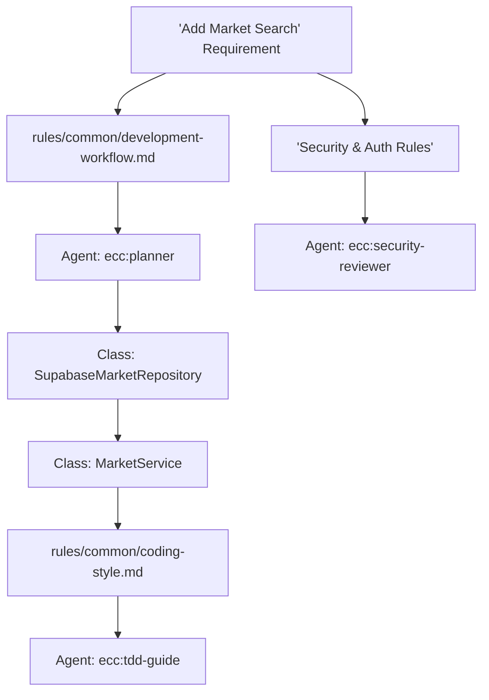
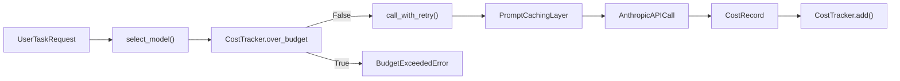

<!-- source: DeepWiki mcp.deepwiki.com · repo affaan-m/ECC · page 6.1 Common Rules · fetched 2026-10-30 -->

# Common Rules

Relevant source files

The following files were used as context for generating this wiki page:

- [.cursor/rules/common-performance.md](.cursor/rules/common-performance.md)
- [docs/es/rules/common/performance.md](docs/es/rules/common/performance.md)
- [docs/examples/project-guidelines-template.md](docs/examples/project-guidelines-template.md)
- [docs/ja-JP/rules/common/performance.md](docs/ja-JP/rules/common/performance.md)
- [docs/ja-JP/skills/cost-aware-llm-pipeline/SKILL.md](docs/ja-JP/skills/cost-aware-llm-pipeline/SKILL.md)
- [docs/ja-JP/skills/project-guidelines-example/SKILL.md](docs/ja-JP/skills/project-guidelines-example/SKILL.md)
- [docs/ko-KR/rules/performance.md](docs/ko-KR/rules/performance.md)
- [docs/pt-BR/rules/performance.md](docs/pt-BR/rules/performance.md)
- [docs/token-optimization.md](docs/token-optimization.md)
- [docs/tr/rules/common/performance.md](docs/tr/rules/common/performance.md)
- [docs/zh-CN/rules/common/performance.md](docs/zh-CN/rules/common/performance.md)
- [docs/zh-CN/skills/cost-aware-llm-pipeline/SKILL.md](docs/zh-CN/skills/cost-aware-llm-pipeline/SKILL.md)
- [docs/zh-TW/rules/performance.md](docs/zh-TW/rules/performance.md)
- [docs/zh-TW/skills/project-guidelines-example/SKILL.md](docs/zh-TW/skills/project-guidelines-example/SKILL.md)
- [examples/statusline.json](examples/statusline.json)
- [examples/user-CLAUDE.md](examples/user-CLAUDE.md)
- [rules/common/code-review.md](rules/common/code-review.md)
- [rules/common/coding-style.md](rules/common/coding-style.md)
- [rules/common/development-workflow.md](rules/common/development-workflow.md)
- [rules/common/patterns.md](rules/common/patterns.md)
- [rules/common/performance.md](rules/common/performance.md)
- [rules/common/security.md](rules/common/security.md)
- [rules/common/testing.md](rules/common/testing.md)
- [rules/typescript/security.md](rules/typescript/security.md)
- [scripts/lib/session-bridge.js](scripts/lib/session-bridge.js)
- [skills/backend-patterns/SKILL.md](skills/backend-patterns/SKILL.md)
- [skills/clickhouse-io/SKILL.md](skills/clickhouse-io/SKILL.md)
- [skills/coding-standards/SKILL.md](skills/coding-standards/SKILL.md)
- [skills/continuous-learning/SKILL.md](skills/continuous-learning/SKILL.md)
- [skills/cost-aware-llm-pipeline/SKILL.md](skills/cost-aware-llm-pipeline/SKILL.md)
- [skills/django-verification/SKILL.md](skills/django-verification/SKILL.md)
- [skills/eval-harness/SKILL.md](skills/eval-harness/SKILL.md)
- [skills/frontend-patterns/SKILL.md](skills/frontend-patterns/SKILL.md)
- [skills/iterative-retrieval/SKILL.md](skills/iterative-retrieval/SKILL.md)
- [skills/prisma-patterns/SKILL.md](skills/prisma-patterns/SKILL.md)
- [skills/search-first/SKILL.md](skills/search-first/SKILL.md)
- [skills/security-review/SKILL.md](skills/security-review/SKILL.md)
- [tests/docs/mcp-management-docs.test.js](tests/docs/mcp-management-docs.test.js)

This page details the universal ruleset located in `rules/common/`. These rules establish the baseline coding style, git workflows, testing, performance, architectural patterns, hooks, agent usage, security, code reviews, and development workflows applicable across all Everything Claude Code (ECC) projects, regardless of the active programming language or framework [rules/common/development-workflow.md:1-5](), [rules/common/coding-style.md:1-13]().

---

## 1. Development & Feature Workflow

The ECC feature development pipeline enforces a strict progression through research, planning, testing, review, and committing [rules/common/development-workflow.md:5-44]().

### Feature Implementation Pipeline

Before code is marked ready for pull requests, contributors must advance through five mandatory phases:

1. **Research & Reuse:** Execute code and repository searches using GitHub CLI (`gh search repos`, `gh search code`), review library documentation via Context7 or vendor docs, and scan package registries (npm, PyPI, crates.io) before writing custom code [rules/common/development-workflow.md:9-15](), [skills/search-first/SKILL.md:1-101]().
2. **Plan First:** Invoke the `ecc:planner` agent to produce implementation blueprints, including PRDs, architecture documents, system designs, and structured task lists [rules/common/development-workflow.md:17-21]().
3. **TDD Approach:** Engage the `ecc:tdd-guide` agent to execute Red-Green-Refactor cycles, targeting at least 80% test coverage [rules/common/development-workflow.md:23-28]().
4. **Code Review:** Run the `ecc:code-reviewer` agent immediately following code authorship to resolve CRITICAL and HIGH severity findings [rules/common/development-workflow.md:30-33]().
5. **Commit & Push:** Apply conventional commit message formatting and verify that all automated CI/CD pipeline checks pass [rules/common/development-workflow.md:35-44]().

Sources: [rules/common/development-workflow.md:7-44](), [skills/search-first/SKILL.md:1-101]()

---

## 2. Coding Standards & Style

Core styling rules prioritize immutability, readability, and clean architecture boundaries [rules/common/coding-style.md:1-97]().

### Core Style Constraints

- **Immutability (CRITICAL):** Always instantiate new objects or data structures rather than mutating existing references in-place. This mitigates side effects and guarantees concurrency safety [rules/common/coding-style.md:3-13](), [skills/coding-standards/SKILL.md:96-110]().
- **File Organization:** Adhere to the principle of many small files over few large ones. Maintain high cohesion and low coupling with 200–400 lines typical per file and 800 lines as a strict soft ceiling [rules/common/coding-style.md:37-43]().
- **Function and Nesting Limits:** Keep individual functions concise (<50 lines) and restrict conditional nesting to a maximum of 4 levels by utilizing early returns [rules/common/coding-style.md:76-86]().
- **Error Handling & Validation:** Handle exceptions explicitly at all runtime levels without silent swallows. Validate external inputs at system boundaries using schema validators like `zod` [rules/common/coding-style.md:44-58]().

Sources: [rules/common/coding-style.md:1-97](), [skills/coding-standards/SKILL.md:1-154]()

---

## 3. Code Review & Quality Gates

Code evaluations use automated and agent-driven quality gates categorized by severity levels [rules/common/code-review.md:1-72]().

### Severity Classification Matrix

| Severity Level | Definition | Enforcement Action |
| -------------- | ---------- | ------------------ |
| `CRITICAL` | Severe security vulnerabilities or data loss risks | Blocks merge completely [rules/common/code-review.md:55]() |
| `HIGH` | Major bugs or architecture violations | Must be fixed prior to merge [rules/common/code-review.md:56]() |
| `MEDIUM` | Moderate maintainability or style debt | Recommended fixes [rules/common/code-review.md:57]() |
| `LOW` | Minor stylistic suggestions | Optional improvements [rules/common/code-review.md:58]() |

Sources: [rules/common/code-review.md:40-65]()

---

## 4. Architectural Patterns

ECC separates concerns via distinct backend design patterns and repositories [skills/backend-patterns/SKILL.md:1-128]().

Title: Natural-Language-To-Code-Mapping

Sources: [rules/common/development-workflow.md:17-24](), [skills/backend-patterns/SKILL.md:39-101](), [rules/common/code-review.md:43-49]()

---

## 5. Performance & Cost Awareness

Performance optimization governs model selection and context tracking [rules/common/performance.md:1-54](), [skills/cost-aware-llm-pipeline/SKILL.md:1-154]().

### Model Selection Strategy

- **Haiku:** Lightweight agent tasks, code generation, and high-frequency worker execution [rules/common/performance.md:5-9]()
- **Sonnet:** Primary development, complex coding logic, and multi-agent workflow orchestration [rules/common/performance.md:10-14]()
- **Opus:** Architectural decisions, deep reasoning, and complex analysis [rules/common/performance.md:15-19]()

Title: Cost-Management-Pipeline-Flow

Sources: [rules/common/performance.md:1-46](), [skills/cost-aware-llm-pipeline/SKILL.md:21-152]()

---

## 6. Hooks System Integration

Hooks automate continuous enforcement across runtime lifecycles [rules/common/hooks.md]():
- **Quality Enforcement:** `post-edit-format`, `typecheck`, and pre-commit checks.
- **Security Monitoring:** `InsAIts` monitor, `GateGuard` heredoc guards, and command classifiers.
- **Observability:** Metrics bridges, cost trackers, and status line hooks.

Sources: [rules/common/hooks.md]()

---

## 7. Agents Orchestration Best Practices

Specialized agents are invoked via subagent dispatch patterns (`ecc:planner`, `ecc:code-reviewer`) [rules/common/agents.md:1-68]().

- **Parallel Execution:** Concurrent tasks must be launched in parallel rather than sequentially when dependencies permit.
- **Delegation Contract:** Subagents must return complete turn outputs and synchronize delegated tasks to avoid orphaned "zombie" processes.

Sources: [rules/common/agents.md:1-68]()

---

## 8. Security Principles

Security safeguards enforce defensive coding standards [skills/security-review/SKILL.md:1-236]():
- **Secrets Management:** Environment variable injection only; exclusion of sensitive files via `.gitignore`.
- **Injection Defenses:** Mandatory parameterized queries for database operations and strict input sanitization via `zod` and `DOMPurify`.

Sources: [skills/security-review/SKILL.md:1-236]()

---

