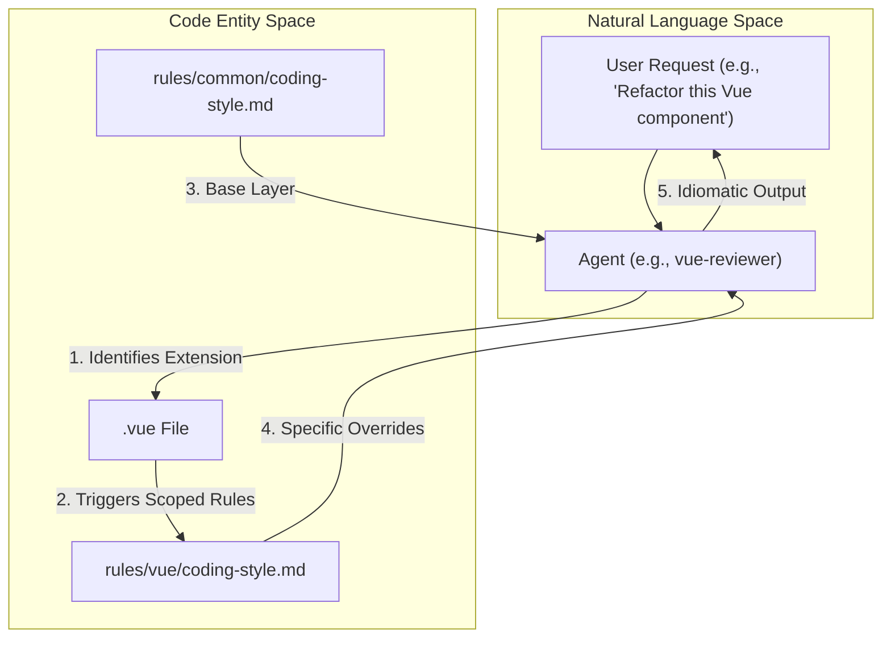
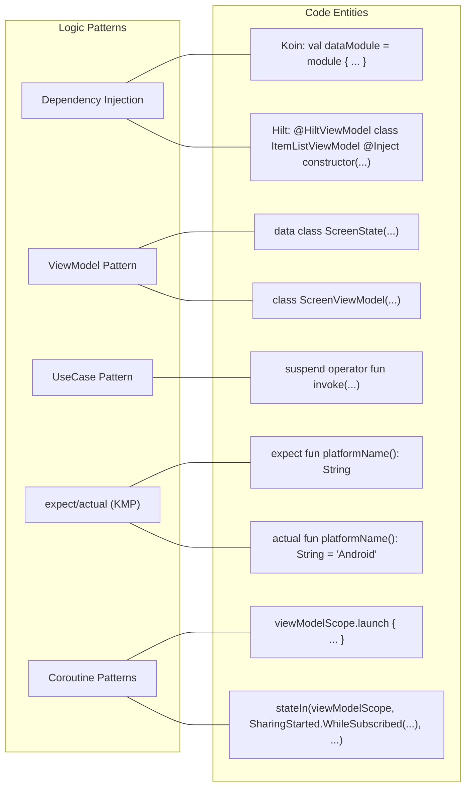

<!-- source: DeepWiki mcp.deepwiki.com · repo affaan-m/ECC · page 6.2 Language-Specific Rules · fetched 2026-10-30 -->

# Language-Specific Rules

Relevant source files

The following files were used as context for generating this wiki page:

- [agents/kotlin-reviewer.md](agents/kotlin-reviewer.md)
- [commands/gradle-build.md](commands/gradle-build.md)
- [examples/user-CLAUDE.md](examples/user-CLAUDE.md)
- [rules/common/code-review.md](rules/common/code-review.md)
- [rules/common/coding-style.md](rules/common/coding-style.md)
- [rules/common/development-workflow.md](rules/common/development-workflow.md)
- [rules/common/patterns.md](rules/common/patterns.md)
- [rules/common/security.md](rules/common/security.md)
- [rules/common/testing.md](rules/common/testing.md)
- [rules/kotlin/coding-style.md](rules/kotlin/coding-style.md)
- [rules/kotlin/patterns.md](rules/kotlin/patterns.md)
- [rules/kotlin/security.md](rules/kotlin/security.md)
- [rules/kotlin/testing.md](rules/kotlin/testing.md)
- [skills/android-clean-architecture/SKILL.md](skills/android-clean-architecture/SKILL.md)
- [skills/backend-patterns/SKILL.md](skills/backend-patterns/SKILL.md)
- [skills/clickhouse-io/SKILL.md](skills/clickhouse-io/SKILL.md)
- [skills/coding-standards/SKILL.md](skills/coding-standards/SKILL.md)
- [skills/compose-multiplatform-patterns/SKILL.md](skills/compose-multiplatform-patterns/SKILL.md)
- [skills/continuous-learning/SKILL.md](skills/continuous-learning/SKILL.md)
- [skills/django-verification/SKILL.md](skills/django-verification/SKILL.md)
- [skills/eval-harness/SKILL.md](skills/eval-harness/SKILL.md)
- [skills/frontend-patterns/SKILL.md](skills/frontend-patterns/SKILL.md)
- [skills/iterative-retrieval/SKILL.md](skills/iterative-retrieval/SKILL.md)
- [skills/kotlin-coroutines-flows/SKILL.md](skills/kotlin-coroutines-flows/SKILL.md)
- [skills/prisma-patterns/SKILL.md](skills/prisma-patterns/SKILL.md)
- [skills/search-first/SKILL.md](skills/search-first/SKILL.md)
- [skills/security-review/SKILL.md](skills/security-review/SKILL.md)

Everything Claude Code (ECC) utilizes a layered rules system designed to provide deep, idiomatic guidance for a wide array of programming languages and frameworks. While **Common Rules** (Section 6.1) provide universal standards for git, security, and general development (`[rules/common/coding-style.md:1-35]()`, `[rules/common/development-workflow.md:1-20]()`), the **Language-Specific Rules** in the `rules/` directory extend these standards with specialized knowledge for individual ecosystems.

These rules ensure that specialized agents operate with an understanding of modern idioms, such as Kotlin 1.9+ features, Vue 3.4+ reactivity macros, or Perl 5.36+ pragmas.

## Architectural Extension Model

Language rules are organized into subdirectories within `rules/` (including TS, Python, Go, Kotlin, Java, Rust, Swift, PHP, Ruby, Angular, C++, C#, Dart, F#, ArkTS, Perl, Web, Vue, Nuxt, and React Native). Each directory typically contains core rule files such as `coding-style.md`, `patterns.md`, `testing.md`, `security.md`, and `hooks.md`. These files use frontmatter `paths` to automatically scope their instructions to relevant file extensions (`[rules/kotlin/patterns.md:1-5]()`).

### Data Flow: Rule Application

The following diagram illustrates how ECC resolves language-specific rules when an agent interacts with a code entity, bridging natural language requests to specific code implementations.

**Rule Resolution and Context Injection**

Sources: `[rules/kotlin/patterns.md:1-5]()`, `[rules/common/coding-style.md:1-15]()`, `[skills/coding-standards/SKILL.md:1-20]()`

---

## Kotlin & Android/KMP Rules

Kotlin rules focus heavily on **Structured Concurrency**, **Jetpack Compose**, and **Kotlin Multiplatform (KMP)**. They extend common patterns (`[rules/common/coding-style.md:3-14]()`) to prevent platform-specific pitfalls like context leaks or recomposition traps.

### Core Patterns

ECC enforces the **ViewModel + Single State Object** pattern for UI development using a single `data class` for state exposed via `StateFlow` (`[rules/kotlin/patterns.md:29-50]()`). For KMP, rules mandate `expect`/`actual` declarations for platform-specific implementations like secure storage (`[rules/kotlin/patterns.md:84-109]()`). The `kotlin-coroutines-flows` skill provides detailed guidance on `StateFlow` usage, `SharingStarted.WhileSubscribed`, and flow composition (`[skills/kotlin-coroutines-flows/SKILL.md:88-114]()`), while `compose-multiplatform-patterns` details state management in Compose UI (`[skills/compose-multiplatform-patterns/SKILL.md:26-55]()`).

Dependency Injection via Koin modules or Hilt annotations is defined as idiomatic (`[rules/kotlin/patterns.md:10-27]()`), along with repository and UseCase patterns (`[rules/kotlin/patterns.md:52-82]`).

### Testing Standards

- **Frameworks:** Prefers `kotlin.test` for KMP and `Turbine` for testing Flows and StateFlow (`[rules/kotlin/testing.md:10-15]()`).
- **Concurrency:** Mandates `runTest` to auto-advance virtual time for coroutines (`[rules/kotlin/testing.md:57-69]()`).
- **Fakes over Mocks:** Encourages hand-written fakes over mocking frameworks for test stability (`[rules/kotlin/testing.md:35-53]()`).

**Kotlin Code Entity Mapping**

Sources: `[rules/kotlin/patterns.md:10-141]()`, `[rules/kotlin/testing.md:10-69]()`, `[skills/kotlin-coroutines-flows/SKILL.md:88-114]`, `[skills/compose-multiplatform-patterns/SKILL.md:26-55]()`

---

## Vue & Nuxt Rules

Vue rules are optimized for **Vue 3** and the **Composition API**, forbidding Options API in new code and mandating `<script setup lang="ts">`. Nuxt rules extend these with server-side routing and data fetching considerations.

### Reactivity & State

- **Reactivity Discipline:** `ref` is the primary state API, with `reactive` used for grouped object state. Destructuring reactive state without `toRefs` is disallowed.
- **Server Cache:** `@tanstack/vue-query` is mandated for server-side cached data fetching, while Pinia manages client state.
- **Composables:** Reusable logic units receive inputs as `MaybeRefOrGetter<T>` and return `toRefs(reactive(...))` to preserve reactivity.

### Security Enforcement

Security rules emphasize preventing XSS and injection attacks (`[skills/security-review/SKILL.md:202-216]()`):
- Dynamic bindings auto-escape, but `v-html` bypasses escaping and must never bind user content without sanitization via `DOMPurify`.
- Dangerous URL schemes like `javascript:` must be blocked; only `http`, `https`, and `mailto` are allowed.
- Client-side secrets must never be bundled in client JavaScript — use httpOnly cookies or server APIs instead (`[skills/security-review/SKILL.md:149-158]()`).

Sources: `[skills/security-review/SKILL.md:149-216]()`, `[skills/backend-patterns/SKILL.md:102-128]()`

---

## Perl Rules

Perl rules transition legacy codebases to **Modern Perl (5.36+)** and emphasize security, strict pragmas, and clean idioms.

### Modern Idioms

- Mandate `use v5.36` to enable strictness, warnings, and subroutine signatures.
- Prefer modern OO using `Moo` or the native `class` keyword (Perl 5.38+).
- Use postfix dereferencing (`$data->{key}->@*`) over older circumfix forms.
- Robust error handling using `Try::Tiny` or native `try/catch` instead of bare `eval/die`.

### Security & Taint Mode

Perl rules enforce **Taint Mode (`-T`)** for tracking untrusted input and require strict sanitization before usage, including `%ENV` and `PATH` cleansing. Input validation strictly prefers whitelisting accepted patterns. Safe file handling includes three-argument `open`, `realpath` path normalization, and list-form `system`/`exec` process execution.

Sources: `[skills/search-first/SKILL.md:1-52]()`, `[rules/common/coding-style.md:44-59]()`

---

## Implementation Details for Other Languages

- **TypeScript / Web:** Enforces Biome or Prettier for formatting, strict type-checking, web components accessibility, and XSS prevention (`[skills/coding-standards/SKILL.md:66-174]()`, `[skills/security-review/SKILL.md:202-236]()`).
- **Go:** Focuses on idiomatic error handling with explicit `if err != nil` checks, interface contracts, and concurrency management (`[rules/common/coding-style.md:44-51]()`).
- **Python:** Enforces PEP 8 styling, modern type hinting, and framework-specific guidelines for Django, FastAPI, and asyncio (`[skills/search-first/SKILL.md:108-123]()`).
- **C++ / Rust:** Emphasizes memory safety, ownership, RAII patterns, and idiomatic error handling (`[rules/common/coding-style.md:3-14]()`).

Sources: `[rules/common/coding-style.md:3-59]()`, `[skills/coding-standards/SKILL.md:66-174]()`, `[skills/security-review/SKILL.md:202-236]()`

---

