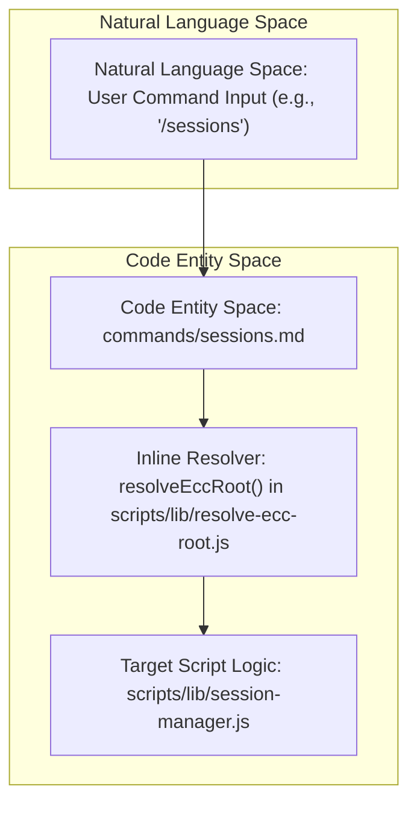
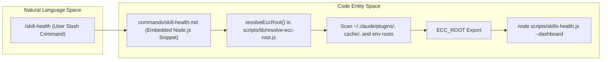

<!-- source: DeepWiki mcp.deepwiki.com · repo affaan-m/ECC · page 7 Commands · fetched 2026-10-30 -->

# Commands

Relevant source files

The following files were used as context for generating this wiki page:

- [.claude/rules/node.md](.claude/rules/node.md)
- [COMMANDS-QUICK-REF.md](COMMANDS-QUICK-REF.md)
- [agents/react-build-resolver.md](agents/react-build-resolver.md)
- [agents/react-reviewer.md](agents/react-reviewer.md)
- [agents/typescript-reviewer.md](agents/typescript-reviewer.md)
- [commands/auto-update.md](commands/auto-update.md)
- [commands/instinct-status.md](commands/instinct-status.md)
- [commands/sessions.md](commands/sessions.md)
- [commands/skill-health.md](commands/skill-health.md)
- [commands/skill-host-compat.md](commands/skill-host-compat.md)
- [docs/COMMAND-AGENT-MAP.md](docs/COMMAND-AGENT-MAP.md)
- [hooks/codex-hooks.json](hooks/codex-hooks.json)
- [hooks/hooks.metadata.json](hooks/hooks.metadata.json)
- [scripts/lib/resolve-ecc-root.js](scripts/lib/resolve-ecc-root.js)
- [skills/osint-investigation/SKILL.md](skills/osint-investigation/SKILL.md)
- [tests/lib/command-plugin-root.test.js](tests/lib/command-plugin-root.test.js)
- [tests/lib/resolve-ecc-root.test.js](tests/lib/resolve-ecc-root.test.js)

ECC provides a comprehensive suite of approximately 97 slash commands, serving as the primary user interface for interacting with the system. These commands orchestrate specialized agents and skills to execute complex software engineering, session management, and operational workflows `[COMMANDS-QUICK-REF.md:1-3]()`. 

This page outlines the high-level architecture of the `commands/` subsystem, distinguishing between canonical implementations and legacy shims, command registry generation, and how commands resolve their execution context. Detailed documentation for specific command groups is available in the child sections below.

---

## Commands Architecture and Directory Structure

### The `commands/` Directory and Frontmatter Metadata

- Each ECC command is defined by a Markdown file located in the `commands/` directory (e.g., `commands/sessions.md`, `commands/skill-health.md`) [commands/sessions.md:1-5](), [commands/skill-health.md:1-5]().
- Files use YAML frontmatter to declare metadata such as name, description, command flags, and model invocation permissions `[commands/auto-update.md:1-5]()`.
- Repository checks (`scripts/ci/validate-commands.js`) enforce that command files are non-existent or malformed, verifying structural integrity and cross-references `[tests/lib/command-plugin-root.test.js:34-76]()`.

### Canonical Implementation vs. Legacy Shims

- **Canonical Commands** leverage dynamic runtime resolution (`scripts/lib/resolve-ecc-root.js`) to locate the active plugin root, ensuring robust compatibility across standard installations, marketplace directories, and plugin caches `[scripts/lib/resolve-ecc-root.js:51-72]()`.
- **Legacy Shims** hardcode historical installation paths and are progressively deprecated in favor of canonical inline-resolver patterns `[tests/lib/command-plugin-root.test.js:44-53]()`.

Sources: `[commands/sessions.md:1-8]()`, `[scripts/lib/resolve-ecc-root.js:51-72](), [tests/lib/command-plugin-root.test.js:34-53]()`

---

## Command Registry Generation and Resolver Pipeline

Commands embed compact JavaScript resolver logic to locate the correct installation root before executing underlying Node.js scripts or shell tools `[commands/skill-health.md:16-18]`, `[commands/instinct-status.md:21-23]()`. This ensures that environment variables like `CLAUDE_PLUGIN_ROOT` or configuration directories (`CLAUDE_CONFIG_DIR`) are correctly honored.

Sources: `[commands/skill-health.md:11-18]`, `[scripts/lib/resolve-ecc-root.js:73-107]()`

---

## Command Categorization Overview

ECC commands are divided into three core operational domains, linked to dedicated child pages:

| Category | Core Focus & Responsibilities | Key Examples | Child Section Link |
| --- | --- | --- | --- |
| **Planning & Development** | Feature planning, TDD workflows, code reviews, pull requests, build error fixing | `/plan`, `/tdd`, `/code-review`, `/build-fix`, `/prp-*` | [Planning & Development Commands](#7.1) |
| **Session & Learning** | Session persistence, history browsing, learning extraction, instinct updates, skill evolution | `/save-session`, `/resume-session`, `/sessions`, `/learn`, `/instinct-status` | [Session & Learning Commands](#7.2) |
| **Operations & Tooling** | Autonomous execution loops, harness audits, quality gates, security scanning, language tool wraps | `/loop-start`, `/quality-gate`, `/security-scan`, `/skill-health` | [Operations & Tooling Commands](#7.3) |

Sources: `[COMMANDS-QUICK-REF.md:7-132]`, `[commands/skill-health.md:1-4]`, `[commands/sessions.md:1-12]()`

---

## Navigation to Command Details

For comprehensive parameter references, execution scripts, and workflow wiring, please consult the child pages:

- **Planning & Development Commands** — Covers `/plan`, `/tdd`, `/code-review`, `/orchestrate`, `/multi-*`, `/prp-*`, `/build-fix`, and plan-orchestrate skill wiring.
- **Session & Learning Commands** — Covers `/save-session`, `/resume-session`, `/sessions`, `/checkpoint`, `/learn`, `/learn-eval`, `/skill-create`, `/evolve`, `/instinct-*`, `/promote`, and `/projects`.
- **Operations & Tooling Commands** — Covers `/loop-start`, `/loop-status`, `/harness-audit`, `/quality-gate`, `/model-route`, `/security-scan`, `/skill-health`, dashboards, and language-specific build/test wrappers.

---

