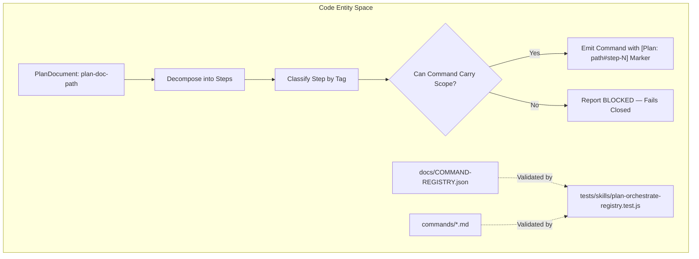
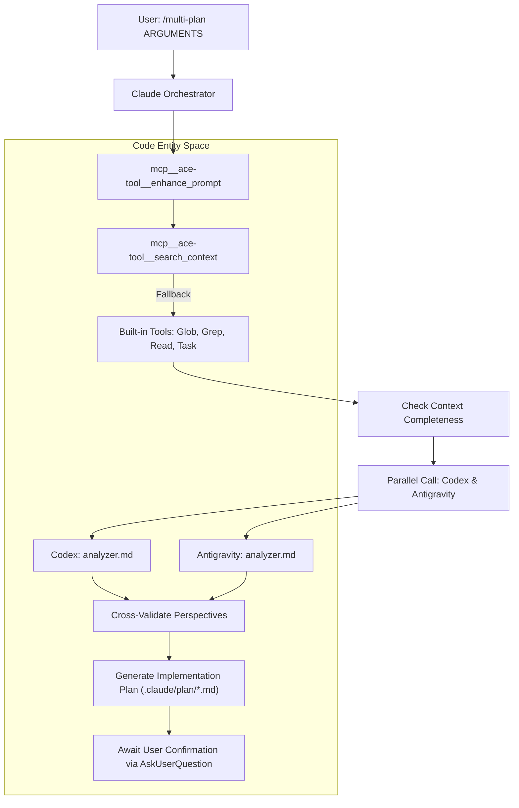

<!-- source: DeepWiki mcp.deepwiki.com · repo affaan-m/ECC · page 7.1 Planning & Development Commands · fetched 2026-10-30 -->

# Planning & Development Commands

Relevant source files

The following files were used as context for generating this wiki page:

- [.opencode/commands/security-scan.md](.opencode/commands/security-scan.md)
- [commands/multi-backend.md](commands/multi-backend.md)
- [commands/multi-execute.md](commands/multi-execute.md)
- [commands/multi-frontend.md](commands/multi-frontend.md)
- [commands/multi-plan.md](commands/multi-plan.md)
- [commands/multi-workflow.md](commands/multi-workflow.md)
- [commands/pm2.md](commands/pm2.md)
- [commands/security-scan.md](commands/security-scan.md)
- [docs/ja-JP/commands/multi-backend.md](docs/ja-JP/commands/multi-backend.md)
- [docs/ja-JP/commands/multi-execute.md](docs/ja-JP/commands/multi-execute.md)
- [docs/ja-JP/commands/multi-frontend.md](docs/ja-JP/commands/multi-frontend.md)
- [docs/ja-JP/commands/multi-plan.md](docs/ja-JP/commands/multi-plan.md)
- [docs/ja-JP/commands/multi-workflow.md](docs/ja-JP/commands/multi-workflow.md)
- [scripts/ci/check-unicode-safety.js](scripts/ci/check-unicode-safety.js)
- [skills/agent-eval/SKILL.md](skills/agent-eval/SKILL.md)
- [skills/autonomous-loops/SKILL.md](skills/autonomous-loops/SKILL.md)
- [skills/nutrient-document-processing/SKILL.md](skills/nutrient-document-processing/SKILL.md)
- [skills/plan-orchestrate/SKILL.md](skills/plan-orchestrate/SKILL.md)
- [skills/plankton-code-quality/SKILL.md](skills/plankton-code-quality/SKILL.md)
- [skills/team-builder/SKILL.md](skills/team-builder/SKILL.md)
- [tests/scripts/check-unicode-safety.test.js](tests/scripts/check-unicode-safety.test.js)
- [tests/skills/plan-orchestrate-registry.test.js](tests/skills/plan-orchestrate-registry.test.js)

This page documents the primary commands, routing skills, and execution protocols used for architectural planning, multi-model collaborative development, and automated implementation workflows within Everything Claude Code (ECC). These systems bridge natural language intent and high-level requirements to production-grade code entities via specialized agents, command registries, and external model backends.

Sources: [skills/plan-orchestrate/SKILL.md:1-11](), [commands/plan.md:1-114]()

---

## Overview of Planning & Workflow Commands

ECC provides a tiered command surface spanning requirements capture, multi-model planning, and stepwise execution. Commands are defined as markdown files inside `commands/`, specifying invocation rules, argument structures, and backing protocols.

| Command | Purpose | Primary Files |
|:---|:---|:---|
| `/plan` | Generates implementation plans without modifying code via the `planner` agent. | [commands/plan.md:1-114]() |
| `/multi-plan` | Multi-model collaborative planning; context retrieval with dual-model analysis. | [commands/multi-plan.md:1-171]() |
| `/multi-workflow` | Full multi-model workflow: Research → Ideation → Plan → Execute → Optimize → Review. | [commands/multi-workflow.md:1-159]() |
| `/multi-execute` | Executes a multi-model implementation plan while maintaining code sovereignty. | [commands/multi-execute.md:1-187]() |
| `/multi-frontend` | Frontend-focused multi-model collaborative workflow led by Antigravity. | [commands/multi-frontend.md:1-164]() |
| `/prp-*` | Stepwise Pull Request Pipeline (PRP): from PRDs to PR creation and review. | [commands/prp-prd.md:1-5](), [commands/prp-pr.md:1-184]() |
| `/build-fix` | Incremental, safe fixing of build, type, and lint errors. | [commands/build-fix.md:1-50]() |

Sources: [commands/plan.md:1-114](), [commands/multi-plan.md:1-171](), [commands/multi-workflow.md:1-159](), [commands/multi-execute.md:1-187](), [commands/multi-frontend.md:1-164](), [commands/prp-prd.md:1-5](), [commands/prp-pr.md:1-184](), [commands/build-fix.md:1-50]()

---

## Plan Orchestrate Skill Wiring (`plan-orchestrate`)

The `plan-orchestrate` skill (`skills/plan-orchestrate/SKILL.md`) acts as a generative router bridging multi-step plan documents (PRDs, RFCs) to the active ECC slash-command surface. It decomposes a plan, classifies each step, and emits ready-to-paste ECC slash commands carrying the step identifier and scope [skills/plan-orchestrate/SKILL.md:1-11]().

### Scope Rules & Fail-Closed Enforcement

Every emitted command must carry its step's identity and scope via a documented argument form. Commands are strictly categorized into:
1. **Scope-carrying commands** (e.g., `/orch-add-feature`, `/orch-fix-defect`, `/orch-change-feature`, `/orch-refine-code`, `/plan`) which accept free-form task descriptions [skills/plan-orchestrate/SKILL.md:37-46]().
2. **Fail-closed commands** (e.g., `/build-fix`, `/test-coverage`, `/update-docs`, `/code-review`, `/security-scan`, `/loop-start`) which cannot carry plan scope or lack appropriate argument forms [skills/plan-orchestrate/SKILL.md:47-53]().

The registry fixture test suite (`tests/skills/plan-orchestrate-registry.test.js`) validates the skill's declarations against `commands/*.md` and `docs/COMMAND-REGISTRY.json` to ensure consistency [tests/skills/plan-orchestrate-registry.test.js:1-25]().

Sources: [skills/plan-orchestrate/SKILL.md:1-83](), [tests/skills/plan-orchestrate-registry.test.js:1-150]()

---

## Multi-Model Orchestration (CCG Workflow)

Commands prefixed with `multi-` leverage the **Collaborative Code Generation (CCG)** runtime (`ccg-workflow`), which is external to the base ECC install and provisioned via `npx ccg-workflow` (`~/.claude/bin/codeagent-wrapper` and `~/.claude/.ccg/prompts/*`) [commands/multi-plan.md:9]().

Claude acts as an orchestrator delegating tasks to specialized backends:
- **Codex**: Backend logic, algorithms, and debugging [commands/multi-workflow.md:32-33]().
- **Antigravity**: Frontend UI/UX, interaction, and visual consistency [commands/multi-workflow.md:33]().

Both run in background threads (`run_in_background: true`), and enforcement rules dictate that external models have **zero filesystem write access**; Claude remains the sole filesystem writer [commands/multi-plan.md:18-21]().

### Multi-Model Planning Data Flow

Sources: [commands/multi-plan.md:74-170](), [commands/multi-workflow.md:120-159]()

---

## Collaborative Execution & Code Sovereignty

The `/multi-execute` command transitions approved plans into implementation by:
1. Reading the plan file and confirming user consent [commands/multi-execute.md:115-130]().
2. Retrieving targeted context using `mcp__ace-tool__search_context` or built-in fallbacks [commands/multi-execute.md:141-166]().
3. Invoking Codex and Antigravity to produce Unified Diff patches ("dirty prototypes") [commands/multi-execute.md:30-84]().
4. Claude refactoring those prototypes into production-grade code, acting as the exclusive filesystem writer [commands/multi-execute.md:18-21]().

Sources: [commands/multi-execute.md:15-187]()

---

## PRP Pipeline (PRD to PR)

The PRP (Product Requirement Plan) pipeline commands provide a stepwise development lifecycle:

| Command | Description | Source |
|:---|:---|:---|
| `/prp-prd` | Captures and validates PRD input (feature requirements). | [commands/prp-prd.md:1-5]() |
| `/prp-plan` | Creates technical plans from PRDs. | [commands/prp-plan.md:1-5]() |
| `/prp-implement` | Implements features per plan. | [commands/prp-implement.md:1-5]() |
| `/prp-commit` | Generates semantic commits based on implementation diffs. | [commands/prp-commit.md:1-5]() |
| `/prp-pr` | Pushes branches, creates PRs, and reports CI status using `gh` CLI. | [commands/prp-pr.md:1-184]() |

Sources: [commands/prp-prd.md:1-5](), [commands/prp-plan.md:1-5](), [commands/prp-implement.md:1-5](), [commands/prp-commit.md:1-5](), [commands/prp-pr.md:1-184]()

---

## Technical Validation of Commands

ECC validates all command markdown files during CI via `scripts/ci/validate-commands.js`, ensuring frontmatter validity, schema compliance, and correct referencing of underlying skills and agents.

Sources: [scripts/ci/validate-commands.js:1-188]()

---

