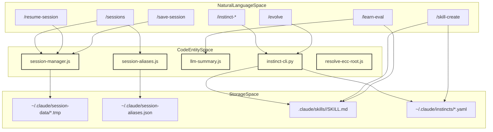
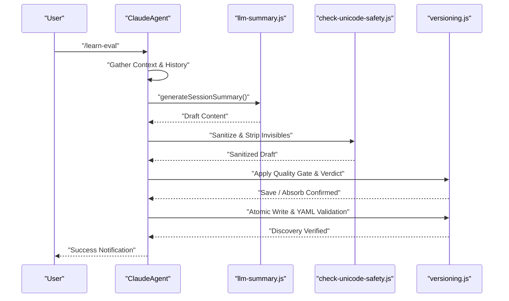

<!-- source: DeepWiki mcp.deepwiki.com · repo affaan-m/ECC · page 7.2 Session & Learning Commands · fetched 2026-10-30 -->

# Session & Learning Commands

Relevant source files

The following files were used as context for generating this wiki page:

- [.claude/commands/add-language-rules.md](.claude/commands/add-language-rules.md)
- [.claude/commands/database-migration.md](.claude/commands/database-migration.md)
- [.claude/commands/feature-development.md](.claude/commands/feature-development.md)
- [.opencode/commands/instinct-status.md](.opencode/commands/instinct-status.md)
- [agents/marketing-agent.md](agents/marketing-agent.md)
- [commands/learn-eval.md](commands/learn-eval.md)
- [commands/learn.md](commands/learn.md)
- [commands/marketing-campaign.md](commands/marketing-campaign.md)
- [commands/resume-session.md](commands/resume-session.md)
- [commands/save-session.md](commands/save-session.md)
- [commands/skill-create.md](commands/skill-create.md)
- [docs/es/commands/skill-create.md](docs/es/commands/skill-create.md)
- [docs/ja-JP/commands/auto-update.md](docs/ja-JP/commands/auto-update.md)
- [docs/ja-JP/commands/instinct-status.md](docs/ja-JP/commands/instinct-status.md)
- [docs/ja-JP/commands/learn-eval.md](docs/ja-JP/commands/learn-eval.md)
- [docs/ja-JP/commands/skill-create.md](docs/ja-JP/commands/skill-create.md)
- [docs/ja-JP/commands/skill-health.md](docs/ja-JP/commands/skill-health.md)
- [docs/tr/commands/instinct-status.md](docs/tr/commands/instinct-status.md)
- [docs/tr/commands/learn-eval.md](docs/tr/commands/learn-eval.md)
- [docs/tr/commands/skill-create.md](docs/tr/commands/skill-create.md)
- [docs/zh-CN/commands/auto-update.md](docs/zh-CN/commands/auto-update.md)
- [docs/zh-CN/commands/instinct-status.md](docs/zh-CN/commands/instinct-status.md)
- [docs/zh-CN/commands/learn-eval.md](docs/zh-CN/commands/learn-eval.md)
- [docs/zh-CN/commands/skill-create.md](docs/zh-CN/commands/skill-create.md)
- [docs/zh-CN/commands/skill-health.md](docs/zh-CN/commands/skill-health.md)
- [scripts/hooks/hook-input.js](scripts/hooks/hook-input.js)
- [scripts/hooks/lifecycle-hook-bootstrap.js](scripts/hooks/lifecycle-hook-bootstrap.js)
- [scripts/lib/llm-summary.js](scripts/lib/llm-summary.js)
- [scripts/lib/skill-evolution/versioning.js](scripts/lib/skill-evolution/versioning.js)
- [skills/continuous-learning/config.json](skills/continuous-learning/config.json)
- [skills/marketing-campaign/SKILL.md](skills/marketing-campaign/SKILL.md)
- [tests/commands/learn-skill-discovery.test.js](tests/commands/learn-skill-discovery.test.js)
- [tests/hooks/session-end.test.js](tests/hooks/session-end.test.js)
- [tests/lib/llm-summary.test.js](tests/lib/llm-summary.test.js)
- [tests/lib/skill-evolution-storage.test.js](tests/lib/skill-evolution-storage.test.js)
- [tests/scripts/instinct-cli-evolve-generate.test.js](tests/scripts/instinct-cli-evolve-generate.test.js)
- [tests/scripts/instinct-cli-evolve.test.js](tests/scripts/instinct-cli-evolve.test.js)

This page documents the commands and underlying systems for session persistence, pattern extraction, and continuous learning within Everything Claude Code (ECC). These tools allow the AI to maintain context across restarts, learn from repository history, and evolve its own internal guidance (Instincts and Skills).

## 1. Session Management

Session management commands enable capturing, resuming, tracking, and checkpointing complex development states. This supports workflows that exceed context window limits or require hand-off between work periods or agents.

### 1.1 /save-session

The `/save-session` command captures everything useful during the current session—including modified files, successes, failures, and outstanding questions—and writes it into a dated session file under `~/.claude/session-data/` [commands/save-session.md:1-206]().

#### Data Flow & Implementation Details
1. **Context Gathering:** Reviews modified files via `git diff` or conversation history, noting successes, failures, and open questions [commands/save-session.md:18-25]().
2. **Directory Initialization:** Ensures canonical paths exist under `~/.claude/session-data/` [commands/save-session.md:27-33]().
3. **Filename Generation:** Constructs filenames following `YYYY-MM-DD-<short-id>-session.tmp`, validated against `SESSION_FILENAME_REGEX` in `session-manager.js` to ensure uniqueness and prevent collisions [commands/save-session.md:35-49]().
4. **Structured Persistence:** Populates markdown sections including built features, confirmed work with evidence, failed approaches, untried ideas, file states, decisions, blockers, and next steps [commands/save-session.md:68-180]().

Sources: [commands/save-session.md:1-206](), [tests/hooks/session-end.test.js:1-170]()

### 1.2 /resume-session

The `/resume-session` command loads an existing session file from `~/.claude/session-data/` or legacy directories to restore context before initiating tasks [commands/resume-session.md:1-138]().

#### Candidate Ranking & Selection
When no explicit file path is provided, implicit or date-based discovery scans candidate session files using strict ranking criteria:
1. Rejects unreadable, empty, or placeholder-only files [commands/resume-session.md:52-58]().
2. Filters out single-message summarizer echoes lacking substantive changes [commands/resume-session.md:59-60]().
3. Prefers candidates with populated completed work, tools used, or next-session notes [commands/resume-session.md:61-63]().
4. Resolves ties using modification timestamps, section counts, and lexicographical path comparisons [commands/resume-session.md:64-68]().

Sources: [commands/resume-session.md:1-138](), [tests/lib/llm-summary.test.js:1-195]()

### 1.3 /sessions, /checkpoint, and /projects

Additional utility commands manage session lookup and state snapshots:
- **`/sessions`**: Lists, filters, and manages stored sessions with metadata such as branch, worktree, and custom aliases via `scripts/lib/session-manager.js` and `scripts/lib/session-aliases.js`.
- **`/checkpoint`**: Establishes point-in-time project snapshots for backup or rollback before risky code modifications.
- **`/projects`**: Enumerates active project contexts, inspecting worktree registration and configuration states.

Sources: [commands/save-session.md:1-206](), [commands/resume-session.md:1-138]()

---

## 2. Learning & Pattern Extraction

ECC learns from active development sessions and repository git history through extraction commands that convert raw observations into robust skills and instincts.

### 2.1 /learn and /learn-eval

The `/learn-eval` command extends basic pattern extraction by enforcing a rigorous quality gate and structured validation before writing to global or project skill directories [commands/learn-eval.md:1-144]().

#### Extraction and Quality Gates
1. **Extraction Categories:** Identifies error resolutions, debugging steps, API workarounds, and project-specific design patterns [commands/learn-eval.md:11-17]().
2. **Scope Determination:** Evaluates whether knowledge is general (`~/.claude/skills/`) or project-scoped (`.claude/skills/`) [commands/learn-eval.md:23-26]().
3. **Guarded Write Policy:** Treats content as untrusted, redacting secrets, PII, and sanitizing prompt injection attempts [commands/learn-eval.md:32-38]().
4. **Holistic Verdicts:** Evaluates candidate patterns through automated checklist verification (checking overlap with `MEMORY.md` and existing skills) resulting in a verdict of *Save*, *Improve then Save*, *Absorb*, or *Drop* [commands/learn-eval.md:80-101]().

Sources: [commands/learn-eval.md:1-144](), [scripts/lib/skill-evolution/versioning.js:1-78]()

### 2.2 /skill-create

The `/skill-create` command analyzes repository git history to discover architectural patterns, commit conventions, and workflow sequences [commands/skill-create.md:1-178]().

- **Git Analysis:** Executes git log commands to evaluate commit frequencies, co-changed files, and message formats [commands/skill-create.md:31-40]().
- **Slug Normalization:** Derives clean hyphenated slugs from repository metadata while preventing path traversal [commands/skill-create.md:56-61]().
- **Optional Instinct Generation:** Supports the `--instincts` flag to simultaneously generate YAML-backed records for the continuous-learning subsystem [commands/skill-create.md:17-25]().

Sources: [commands/skill-create.md:1-178](), [tests/lib/skill-evolution-storage.test.js:1-137]()

### 2.3 /evolve, /instinct-*, and /promote

The continuous-learning-v2 subsystem manages behavioral rule evolution using `instinct-cli.py`:
- **Evolution Engine:** Clusters raw observations and instincts into candidate command drafts.
- **Collision Management:** Automatically detects slug collisions and applies boundary-aware truncation and numeric disambiguation (e.g., `investigating.md`, `investigating-2.md`) [tests/scripts/instinct-cli-evolve-generate.test.js:121-209]().
- **Promotion:** The `/promote` command finalizes verified instincts into immutable skills.

Sources: [tests/scripts/instinct-cli-evolve-generate.test.js:1-217](), [scripts/lib/skill-evolution/versioning.js:1-124]()

---

## 3. Implementation Details & Architecture

### 3.1 Command to Code Entity Mapping

This diagram maps natural language user commands to their implementing code entities and persistence targets.

Sources: [commands/save-session.md:1-206](), [commands/resume-session.md:1-138](), [commands/learn-eval.md:1-144](), [commands/skill-create.md:1-178](), [scripts/lib/llm-summary.js:1-196]()

### 3.2 Learning Flow Sequence

This sequence details the evaluation, extraction, and validation pipeline during learning commands.

Sources: [commands/learn-eval.md:1-144](), [scripts/lib/skill-evolution/versioning.js:1-124](), [scripts/lib/llm-summary.js:1-196]()

### 3.3 Root Resolution & Security Subsystems

- **ECC Root Resolution (`resolve-ecc-root.js`):** Dynamically locates configuration directories via environment overrides (`CLAUDE_PLUGIN_ROOT`) or standard user paths (`~/.claude/`) to ensure scripts execute reliably.
- **Guarded Writes & Unicode Safety:** Strips dangerous control sequences and zero-width characters using `check-unicode-safety.js`, preventing prompt injection vectors within imported skill and session files.

Sources: [scripts/lib/skill-evolution/versioning.js:1-124](), [commands/learn-eval.md:32-48](), [commands/skill-create.md:78-92]()

---

