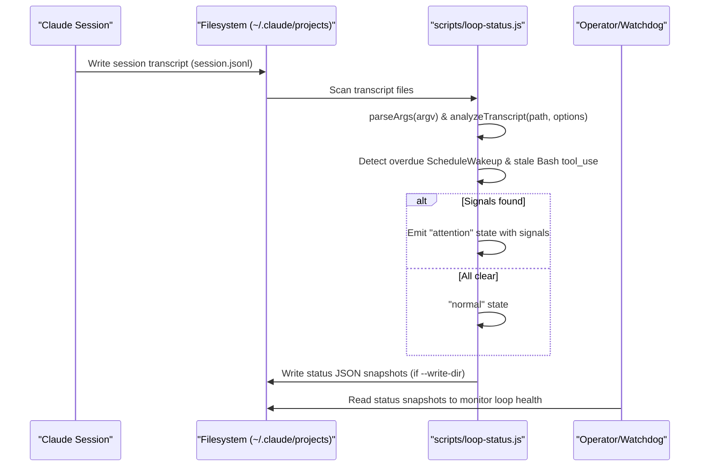
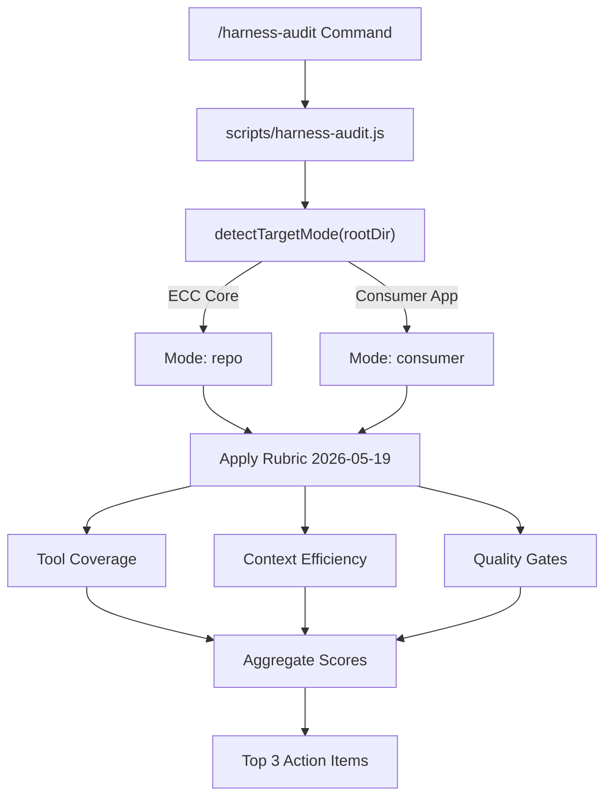

<!-- source: DeepWiki mcp.deepwiki.com · repo affaan-m/ECC · page 7.3 Operations & Tooling Commands · fetched 2026-10-30 -->

# Operations & Tooling Commands

Relevant source files

The following files were used as context for generating this wiki page:

- [.github/CODEOWNERS](.github/CODEOWNERS)
- [.opencode/commands/harness-audit.md](.opencode/commands/harness-audit.md)
- [assets/images/ecc-logo.png](assets/images/ecc-logo.png)
- [commands/auto-update.md](commands/auto-update.md)
- [commands/harness-audit.md](commands/harness-audit.md)
- [commands/instinct-status.md](commands/instinct-status.md)
- [commands/loop-start.md](commands/loop-start.md)
- [commands/loop-status.md](commands/loop-status.md)
- [commands/model-route.md](commands/model-route.md)
- [commands/sessions.md](commands/sessions.md)
- [commands/skill-health.md](commands/skill-health.md)
- [commands/skill-host-compat.md](commands/skill-host-compat.md)
- [ecc_dashboard.py](ecc_dashboard.py)
- [hooks/codex-hooks.json](hooks/codex-hooks.json)
- [hooks/hooks.metadata.json](hooks/hooks.metadata.json)
- [schemas/hooks-metadata.schema.json](schemas/hooks-metadata.schema.json)
- [scripts/dashboard-web.js](scripts/dashboard-web.js)
- [scripts/harness-audit.js](scripts/harness-audit.js)
- [scripts/lib/ecc_dashboard_runtime.py](scripts/lib/ecc_dashboard_runtime.py)
- [scripts/lib/harness-audit-consumer.js](scripts/lib/harness-audit-consumer.js)
- [scripts/lib/hooks-config.js](scripts/lib/hooks-config.js)
- [scripts/lib/install-targets/opencode-home.js](scripts/lib/install-targets/opencode-home.js)
- [scripts/lib/install/content-transform.js](scripts/lib/install/content-transform.js)
- [scripts/lib/install/plan.js](scripts/lib/install/plan.js)
- [scripts/lib/resolve-ecc-root.js](scripts/lib/resolve-ecc-root.js)
- [scripts/loop-status.js](scripts/loop-status.js)
- [skills/benchmark/SKILL.md](skills/benchmark/SKILL.md)
- [skills/browser-qa/SKILL.md](skills/browser-qa/SKILL.md)
- [skills/canary-watch/SKILL.md](skills/canary-watch/SKILL.md)
- [skills/design-system/SKILL.md](skills/design-system/SKILL.md)
- [skills/frontend-slides/scripts/export-pdf.sh](skills/frontend-slides/scripts/export-pdf.sh)
- [skills/laravel-verification/SKILL.md](skills/laravel-verification/SKILL.md)
- [skills/product-lens/SKILL.md](skills/product-lens/SKILL.md)
- [skills/safety-guard/SKILL.md](skills/safety-guard/SKILL.md)
- [tests/docs/canary-watch.test.js](tests/docs/canary-watch.test.js)
- [tests/fixtures/opencode-ts-loader.mjs](tests/fixtures/opencode-ts-loader.mjs)
- [tests/hooks/continuous-learning-observe-runner.test.js](tests/hooks/continuous-learning-observe-runner.test.js)
- [tests/lib/command-plugin-root.test.js](tests/lib/command-plugin-root.test.js)
- [tests/lib/install-plan-boundary.test.js](tests/lib/install-plan-boundary.test.js)
- [tests/lib/resolve-ecc-root.test.js](tests/lib/resolve-ecc-root.test.js)
- [tests/scripts/dashboard-web.test.js](tests/scripts/dashboard-web.test.js)
- [tests/scripts/ecc-dashboard.test.js](tests/scripts/ecc-dashboard.test.js)
- [tests/scripts/harness-audit.test.js](tests/scripts/harness-audit.test.js)
- [tests/scripts/loop-status.test.js](tests/scripts/loop-status.test.js)
- [tests/scripts/manual-claude-namespace.test.js](tests/scripts/manual-claude-namespace.test.js)
- [tests/skills/frontend-slides-export-pdf.test.js](tests/skills/frontend-slides-export-pdf.test.js)

This page documents the operational commands in Everything Claude Code (ECC). These commands provide deterministic interfaces for repository auditing, loop monitoring, security scanning, language-specific build/test cycles, and dashboard capabilities. Unlike standard chat interactions, these commands invoke specialized agents and runtime scripts to perform structured engineering and system oversight tasks.

---

## 1. Loop Management & Monitoring

Loop management commands allow operators to start, monitor, and troubleshoot autonomous agent loops. The primary engine for monitoring is `scripts/loop-status.js`, which performs static analysis on Claude transcript files to detect operational states requiring attention.

### /loop-start

The `/loop-start` command initiates an autonomous loop, typically invoking a skill like `autonomous-loops/loop-controller`. It sets up initial conditions for continuous operations involving a sequence of agent interactions and tool uses.

**Sources**: [commands/loop-start.md:1-10]()

### /loop-status

The `/loop-status` command inspects active loop states and identifies "wedged" sessions by scanning for overdue `ScheduleWakeup` calls or `Bash` tool calls without results.

- **Implementation**: `scripts/loop-status.js` contains the CLI watcher that scans JSONL session transcripts [scripts/loop-status.js:1-150]().
- **Data Flow**:
  1. Determines the home directory (`--home` flag or user home) and scans `~/.claude/projects/**` for `.jsonl` transcript files [scripts/loop-status.js:172-198, 200-213]().
  2. Parses transcripts line-by-line to extract `tool_use` events of types `ScheduleWakeup` and `Bash`, correlating them with matching `tool_result` entries [scripts/loop-status.js:267-275]().
  3. Evaluates timing thresholds to detect overdue wakeups and stale Bash commands [tests/scripts/loop-status.test.js:164-165, 206-209]().
  4. Aggregates results into status reports and emits machine-readable JSON if `--json` is passed [commands/loop-status.md:13-54]().

#### Loop Status Data Model

| Signal Type | Logic | Code Reference |
|---|---|---|
| `schedule_wakeup_overdue` | `now > timestamp + delaySeconds * graceMultiplier` | [tests/scripts/loop-status.test.js:164-165]() |
| `pending_bash_tool_result` | `Bash` command executed without matching `tool_result` entry | [tests/scripts/loop-status.test.js:206-209]() |

#### Process Flow Diagram for Loop Status

**Sources**: [scripts/loop-status.js:1-220, 520-550](), [commands/loop-status.md:1-73](), [tests/scripts/loop-status.test.js:1-233]()

---

## 2. Repository Auditing & Quality Gates

### /harness-audit

The `/harness-audit` command performs a deterministic repository audit according to a fixed rubric (`2026-05-19`), scoring projects across up to 12 categories [scripts/harness-audit.js:1-270]().

- **Implementation**: `scripts/harness-audit.js` detects whether the audited target is the ECC core repo or a consumer project via `detectTargetMode(rootDir)` [scripts/harness-audit.js:217-233]().
- **Categories Scored**: Tool Coverage, Context Efficiency, Quality Gates, Memory Persistence, Eval Coverage, Security Guardrails, Cost Efficiency, GitHub Integration, Vercel/Netlify/Cloudflare/Fly integrations [scripts/harness-audit.js:7-54]().

### /quality-gate

The `/quality-gate` command enforces predefined checks and quality gates, integrating audit scores from `/harness-audit` into CI/CD pipelines or pre-commit hooks [scripts/harness-audit.js:10-10]().

#### Harness Audit Flow

**Sources**: [scripts/harness-audit.js:1-270](), [commands/harness-audit.md:1-84](), [tests/scripts/harness-audit.test.js:100-155]()

---

## 3. Dashboards & Health Portfolios

ECC provides rich operational dashboards via both web and desktop interfaces to inspect components, capabilities, skill health, and session histories.

### Web Capabilities Dashboard (`scripts/dashboard-web.js`)
- Runs a loopback-bound HTTP server (default `127.0.0.1:3456`) providing a capability explorer for agents, skills, commands, rules, hooks, and MCP servers [scripts/dashboard-web.js:1-55]().
- Uses `resolveDashboardHost()` to enforce strict loopback bindings (`127.0.0.1`, `localhost`, or `::1`) for security [scripts/dashboard-web.js:36-46]().

### Tkinter Desktop Dashboard (`ecc_dashboard.py`)
- Provides a cross-platform Python GUI application for scanning and managing ECC agents, skills, and configuration components [ecc_dashboard.py:1-42]().
- Falls back gracefully with installation instructions if Tkinter is missing [ecc_dashboard.py:9-22]().

### /skill-health & /sessions
- **`/skill-health`**: Displays portfolio success rate sparklines, failure pattern clustering, pending amendments, and version history using `scripts/skills-health.js` [commands/skill-health.md:1-58]().
- **`/sessions`**: Manages session history, aliases, and metadata stored in `~/.claude/session-data/` via `scripts/lib/session-manager.js` and `scripts/lib/session-aliases.js` [commands/sessions.md:1-40]().

**Sources**: [scripts/dashboard-web.js:1-55](), [ecc_dashboard.py:1-42](), [commands/skill-health.md:1-58](), [commands/sessions.md:1-40]()

---

## 4. Language-Specific Operations & Tooling Commands

ECC bundles language-specific commands that wrap build, test, and code-review pipelines:

| Command | Primary Agent / Script | Underlying Tools | Sources |
|---|---|---|---|
| `/go-build` | `go-build-resolver` | `go build`, `go vet` | [agents/go-build-resolver.md:1-103]() |
| `/go-test` | `tdd-guide` | `go test -cover` | [commands/go-test.md:1-35]() |
| `/go-review` | `go-reviewer` | `go vet`, `staticcheck` | [agents/go-reviewer.md:25-67]() |
| `/kotlin-build` | `kotlin-build-resolver` | `./gradlew build`, `detekt`, `ktlintCheck` | [commands/kotlin-build.md:1-41]() |
| `/kotlin-test` | `tdd-guide` | `./gradlew test`, `kover` | [skills/kotlin-testing/SKILL.md:1-155]() |
| `/vue-review` | `vue-reviewer` | `eslint`, `vue-tsc` | [commands/vue-review.md:1-174]() |

**Sources**: [commands/go-test.md:1-35](), [agents/go-build-resolver.md:1-103](), [commands/kotlin-build.md:1-41](), [skills/kotlin-testing/SKILL.md:1-155](), [commands/vue-review.md:1-174]()

---

## 5. System & Security Commands

- **`/model-route`**: Manages dynamic task routing across AI models with different capabilities through the Rust control plane (`ecc2`) [commands/model-route.md:1-10]().
- **`/security-scan`**: Executes static AgentShield rules, supply chain IOC scanning via `scan-supply-chain-iocs.js`, and harness preflight checks [scripts/harness-audit.js:7-20](), [commands/harness-audit.md:13-15]().

**Sources**: [commands/model-route.md:1-10](), [scripts/harness-audit.js:7-20](), [commands/harness-audit.md:13-15]()

---

