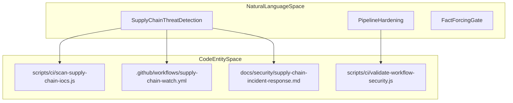
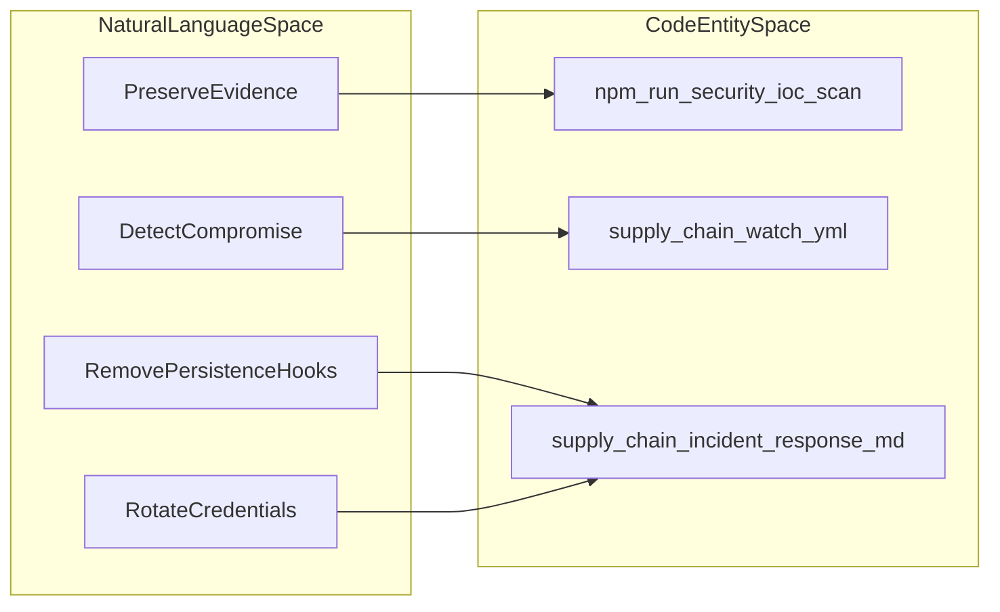

<!-- source: DeepWiki mcp.deepwiki.com · repo affaan-m/ECC · page 8 Security & Supply Chain · fetched 2026-10-30 -->

# Security & Supply Chain

Relevant source files

The following files were used as context for generating this wiki page:

- [.github/workflows/ci.yml](.github/workflows/ci.yml)
- [.github/workflows/generator-generic-ossf-slsa3-publish.yml](.github/workflows/generator-generic-ossf-slsa3-publish.yml)
- [.github/workflows/maintenance.yml](.github/workflows/maintenance.yml)
- [.github/workflows/release.yml](.github/workflows/release.yml)
- [.github/workflows/reusable-release.yml](.github/workflows/reusable-release.yml)
- [.github/workflows/reusable-test.yml](.github/workflows/reusable-test.yml)
- [.github/workflows/reusable-validate.yml](.github/workflows/reusable-validate.yml)
- [.github/workflows/supply-chain-watch.yml](.github/workflows/supply-chain-watch.yml)
- [.github/workflows/taste-skills.yml](.github/workflows/taste-skills.yml)
- [SECURITY.md](SECURITY.md)
- [docs/releases/2.0.0-rc.1/operator-readiness-dashboard-2026-05-15.md](docs/releases/2.0.0-rc.1/operator-readiness-dashboard-2026-05-15.md)
- [docs/releases/2.0.0-rc.1/publication-evidence-2026-05-15.md](docs/releases/2.0.0-rc.1/publication-evidence-2026-05-15.md)
- [docs/security/supply-chain-incident-response.md](docs/security/supply-chain-incident-response.md)
- [scripts/ci/audit-closed-references.js](scripts/ci/audit-closed-references.js)
- [scripts/ci/scan-supply-chain-iocs.js](scripts/ci/scan-supply-chain-iocs.js)
- [scripts/ci/validate-workflow-security.js](scripts/ci/validate-workflow-security.js)
- [tests/ci/audit-closed-references.test.js](tests/ci/audit-closed-references.test.js)
- [tests/ci/scan-supply-chain-iocs.test.js](tests/ci/scan-supply-chain-iocs.test.js)
- [tests/ci/supply-chain-watch-workflow.test.js](tests/ci/supply-chain-watch-workflow.test.js)
- [tests/ci/validate-workflow-security.test.js](tests/ci/validate-workflow-security.test.js)
- [tests/scripts/release-publish.test.js](tests/scripts/release-publish.test.js)
- [tests/scripts/trae-install.test.js](tests/scripts/trae-install.test.js)
- [workflows/README.md](workflows/README.md)
- [workflows/orch-review.workflow.js](workflows/orch-review.workflow.js)

## Purpose & Scope

Everything Claude Code (ECC) employs a multi-layered security architecture designed to mitigate risks from malicious code execution, credential exfiltration, and supply-chain compromises. Because ECC agents operate with broad filesystem and tool invocation privileges, security guardrails are integrated across static analysis, runtime tool enforcement, CI/CD pipelines, and incident response runbooks. 

This page serves as a high-level overview of ECC's security architecture. For deep technical implementation details, consult the child pages:
- [AgentShield & IOC Scanning](#8.1)
- [Workflow Security & CI Hardening](#8.2)
- [GateGuard Fact-Forcing Gate](#8.3)

---

### ECC Security Architecture Overview

This diagram maps natural language security concepts to their underlying code entities and enforcement boundaries:

Sources:  
[scripts/ci/scan-supply-chain-iocs.js:1-12](),  
[.github/workflows/supply-chain-watch.yml:1-65](),  
[scripts/ci/validate-workflow-security.js:1-66](),  
[docs/security/supply-chain-incident-response.md:1-140]()

---

## AgentShield & IOC Scanning

AgentShield and the supply-chain indicator of compromise (IOC) scanning engine form the primary frontline defense against repository-level threats and malicious third-party packages. 

The scanner audits package manifests, lockfiles, AI tool configurations, and installed package payloads for active incident signatures [scripts/ci/scan-supply-chain-iocs.js:1-12](). It catches compromised package versions from major supply-chain campaigns, detects persistence hooks in settings files (such as Claude Code `.claude/settings.json` or VS Code tasks), and identifies malicious network indicators [docs/security/supply-chain-incident-response.md:28-48]().

For detailed rules, fixture tests, and manual investigation steps, see [AgentShield & IOC Scanning](#8.1).

Sources:  
[scripts/ci/scan-supply-chain-iocs.js:1-156](),  
[docs/security/supply-chain-incident-response.md:8-48]()

---

## Workflow Security & CI Hardening

ECC enforces rigorous security policies within GitHub Actions workflows and local package management to prevent privilege escalation and unauthorized code execution during builds.

The CI validation tooling inspects workflow definitions to block unsafe `pull_request_target` or `workflow_run` checkouts, enforce `persist-credentials: false` on write-enabled jobs, and mandate secure installation flags like `--ignore-scripts` across `npm`, `pnpm`, and `bun` [scripts/ci/validate-workflow-security.js:12-66](), [scripts/ci/validate-workflow-security.js:166-179]().

For complete validation rules and provenance configurations, see [Workflow Security & CI Hardening](#8.2).

Sources:  
[scripts/ci/validate-workflow-security.js:1-66](),  
[scripts/ci/validate-workflow-security.js:166-179]()

---

## GateGuard Fact-Forcing Gate

GateGuard is ECC's PreToolUse subsystem designed to prevent destructive file operations, unauthorized bash commands, and unverified assumptions during agent execution. 

It evaluates intent against change profiles, enforces search-evidence credit requirements before permitting risky modifications, and provides environment kill-switches to maintain safety during autonomous loops.

For a deep dive into the decision pipeline, classification rules, and metrics, see [GateGuard Fact-Forcing Gate](#8.3).

Sources:  
[docs/releases/2.0.0-rc.1/operator-readiness-dashboard-2026-05-15.md:37-37]()

---

## Incident Response & Monitoring

ECC provides an operator-focused incident response framework supported by continuous background monitoring and structured playbooks [docs/security/supply-chain-incident-response.md:1-10]().

### Incident Response Flow

Sources:  
[docs/security/supply-chain-incident-response.md:1-140](),  
[.github/workflows/supply-chain-watch.yml:1-65]()

---

For detailed technical information on each sub-topic, refer to the child pages:
- [AgentShield & IOC Scanning](#8.1)
- [Workflow Security & CI Hardening](#8.2)
- [GateGuard Fact-Forcing Gate](#8.3)

---

