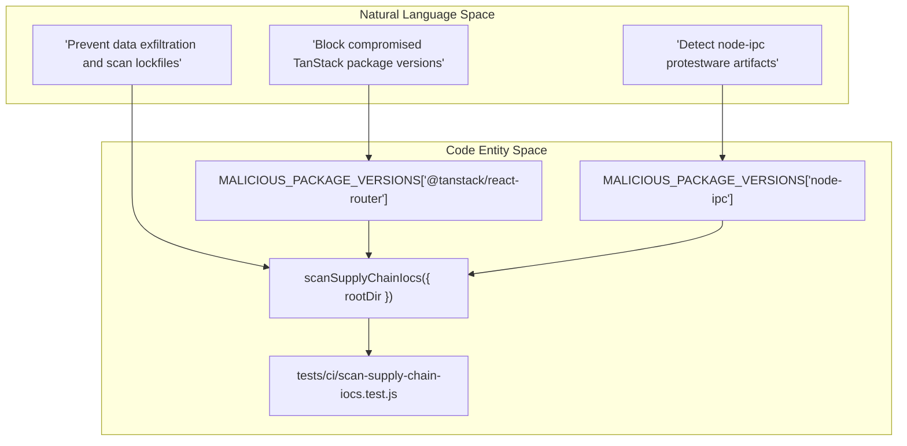
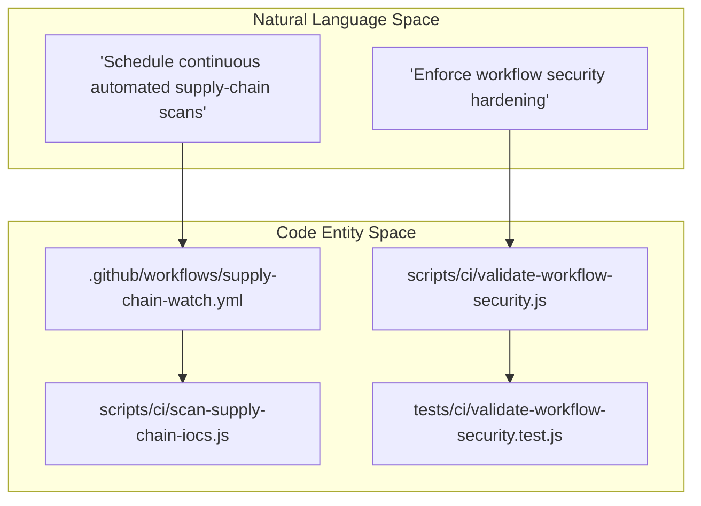

<!-- source: DeepWiki mcp.deepwiki.com · repo affaan-m/ECC · page 8.1 AgentShield & IOC Scanning · fetched 2026-10-30 -->

# AgentShield & IOC Scanning

Relevant source files

The following files were used as context for generating this wiki page:

- [.github/workflows/ci.yml](.github/workflows/ci.yml)
- [.github/workflows/generator-generic-ossf-slsa3-publish.yml](.github/workflows/generator-generic-ossf-slsa3-publish.yml)
- [.github/workflows/maintenance.yml](.github/workflows/maintenance.yml)
- [.github/workflows/release.yml](.github/workflows/release.yml)
- [.github/workflows/reusable-release.yml](.github/workflows/reusable-release.yml)
- [.github/workflows/reusable-test.yml](.github/workflows/reusable-test.yml)
- [.github/workflows/reusable-validate.yml](.github/workflows/reusable-validate.yml)
- [.github/workflows/supply-chain-watch.yml](.github/workflows/supply-chain-watch.yml)
- [.github/workflows/taste-skills.yml](.github/workflows/taste-skills.yml)
- [SECURITY.md](SECURITY.md)
- [docs/releases/2.0.0-rc.1/operator-readiness-dashboard-2026-05-15.md](docs/releases/2.0.0-rc.1/operator-readiness-dashboard-2026-05-15.md)
- [docs/releases/2.0.0-rc.1/publication-evidence-2026-05-15.md](docs/releases/2.0.0-rc.1/publication-evidence-2026-05-15.md)
- [docs/security/supply-chain-incident-response.md](docs/security/supply-chain-incident-response.md)
- [scripts/ci/audit-closed-references.js](scripts/ci/audit-closed-references.js)
- [scripts/ci/scan-supply-chain-iocs.js](scripts/ci/scan-supply-chain-iocs.js)
- [scripts/ci/validate-workflow-security.js](scripts/ci/validate-workflow-security.js)
- [tests/ci/audit-closed-references.test.js](tests/ci/audit-closed-references.test.js)
- [tests/ci/scan-supply-chain-iocs.test.js](tests/ci/scan-supply-chain-iocs.test.js)
- [tests/ci/supply-chain-watch-workflow.test.js](tests/ci/supply-chain-watch-workflow.test.js)
- [tests/ci/validate-workflow-security.test.js](tests/ci/validate-workflow-security.test.js)
- [tests/scripts/release-publish.test.js](tests/scripts/release-publish.test.js)
- [tests/scripts/trae-install.test.js](tests/scripts/trae-install.test.js)
- [workflows/README.md](workflows/README.md)
- [workflows/orch-review.workflow.js](workflows/orch-review.workflow.js)

AgentShield is the core security enforcement subsystem in Everything Claude Code (ECC), specializing in static detection of malicious code patterns, real-time scanning for supply-chain Indicators of Compromise (IOCs), and automated incident response integration. It aims to protect operator workflows and code integrity against compromised dependencies, persistence hooks, and supply-chain malware campaigns.

---

## Overview and Purpose

AgentShield mitigates risks arising from AI-assisted development and autonomous agents by providing these primary capabilities:

1. **Static Detection Rules**: Identifies malicious lifecycle scripts, persistence hooks, and anomalous package behaviors within the codebase [docs/releases/2.0.0-rc.1/operator-readiness-dashboard-2026-05-15.md:32]().
2. **Supply-Chain IOC Scanning**: Actively scans dependency manifests, lockfiles, and package payloads for known-bad package versions and runtime artifacts [scripts/ci/scan-supply-chain-iocs.js:2-5]().
3. **Persistence Hook Detection**: Watches for suspicious hooks in configuration files or OS-level persistence that attackers use for credential theft or backdoors [docs/security/supply-chain-incident-response.md:28-36]().
4. **Incident Response Playbook Integration**: Automates operator guidance and workflow gating when supply-chain threats or suspicious indicators are detected [docs/security/supply-chain-incident-response.md:3-7]().
5. **Durable Watch Workflow**: Periodically scans the full ecosystem using a scheduled GitHub Actions workflow to provide continuous protection [docs/security/supply-chain-incident-response.md:86-95]().

Sources: [docs/releases/2.0.0-rc.1/operator-readiness-dashboard-2026-05-15.md:32](), [scripts/ci/scan-supply-chain-iocs.js:2-5](), [docs/security/supply-chain-incident-response.md:3-95]()

---

## Supply-Chain IOC Scanner

At the heart of AgentShield is the `scan-supply-chain-iocs.js` script, which performs the following:

- **Scans Dependency Manifests and Lockfiles**: It analyzes files like `package.json`, `package-lock.json`, `pnpm-lock.yaml`, and `requirements.txt` [scripts/ci/scan-supply-chain-iocs.js:2-13]().
- **Matches Compromised Versions**: It compares installed or declared package versions against a curated list of malicious versions linked to known supply-chain attack campaigns [scripts/ci/scan-supply-chain-iocs.js:14-148]().
- **Detects Runtime and Persistence Artifacts**: Looks inside package payloads for suspicious files and environment settings like `__ntw` [tests/ci/scan-supply-chain-iocs.test.js:120-139]().

### Malicious Package Detection

AgentShield tracks multiple active supply-chain malware campaigns. Key examples include:

| Campaign          | Targeted Packages (Examples)                                   | Indicators                                                                                           |
|-------------------|---------------------------------------------------------------|----------------------------------------------------------------------------------------------------|
| **TanStack**      | `@tanstack/react-router`, `@tanstack/history`, `@tanstack/start` | Specific compromised versions (e.g., `1.169.5` to `1.169.8`), plus malicious `optionalDependencies` [scripts/ci/scan-supply-chain-iocs.js:87-128](). |
| **Mini Shai-Hulud** | `@opensearch-project/opensearch`, `@mistralai/mistralai`, `@squawk/mcp` | Malicious versions (e.g., `3.5.3`, `2.2.2`, `0.9.5`), and dead-man-switch tokens or domain references [scripts/ci/scan-supply-chain-iocs.js:49-74](). |
| **node-ipc Protestware** | `node-ipc`                                             | Malicious versions such as `12.0.1`, along with runtime artifacts: `node-ipc.cjs` file contents, hostnames like `sh.azurestaticprovider.net` [tests/ci/scan-supply-chain-iocs.test.js:110-139](). |

The scanner's `MALICIOUS_PACKAGE_VERSIONS` constant defines mappings from package names to arrays of compromised version strings [scripts/ci/scan-supply-chain-iocs.js:14-148]().

### Key Functions and Constants

- `scanSupplyChainIocs({ rootDir })`: Entry point scanning the filesystem rooted at `rootDir` for manifests and payload files, returning findings of suspicious packages or artifacts [tests/ci/scan-supply-chain-iocs.test.js:55-56]().  
- `MALICIOUS_PACKAGE_VERSIONS`: Object defining package name keys with arrays of compromised versions [scripts/ci/scan-supply-chain-iocs.js:14-148]().  
- Matching algorithm inspects `package-lock.json` and `package.json` dependencies recursively, and scans Python dependencies in `requirements.txt` [tests/ci/scan-supply-chain-iocs.test.js:62-104]().

Sources: [scripts/ci/scan-supply-chain-iocs.js:2-148](), [tests/ci/scan-supply-chain-iocs.test.js:55-140]()

---

## Implementation Logic

The diagram below relates overarching security policies in natural language to exact code entities involved in IOC scanning.

### System Mapping: Security Policy to Code Entity

Sources: [scripts/ci/scan-supply-chain-iocs.js:14-148](), [tests/ci/scan-supply-chain-iocs.test.js:55-140]()

---

## Persistence Hook Detection

AgentShield also focuses on detecting malicious persistence mechanisms embedded in developer environments or build processes:

- **Lifecycle Scripts:** Scans `package.json` scripts (e.g., `preinstall`, `postinstall`) for obfuscated commands or unauthorized binaries [tests/ci/scan-supply-chain-iocs.test.js:181-194]().  
- **Agent Hooks:** Validates hooks in `.claude/settings.json`, `.claude/hooks/hooks.json`, `.vscode/tasks.json`, and `.zed/tasks.json` ensuring they don’t execute malicious workflows [docs/security/supply-chain-incident-response.md:28-31]().  
- **Environment Injection:** Watches for environment variables like `__ntw` or runtime flags which change package behavior [tests/ci/scan-supply-chain-iocs.test.js:120-137]().  
- **OS-Level Persistence:** Detects LaunchAgents and systemd services (e.g., `com.user.gh-token-monitor.plist`, `gh-token-monitor.service`) used to maintain access or steal credentials [docs/security/supply-chain-incident-response.md:30-33]().

Sources: [docs/security/supply-chain-incident-response.md:28-36](), [tests/ci/scan-supply-chain-iocs.test.js:120-194]()

---

## Supply-Chain Watch Workflow

The `.github/workflows/supply-chain-watch.yml` GitHub Action automates AgentShield's IOC scanning regularly, ensuring continuous protection with minimal operator intervention.

### Execution Flow of Supply-Chain Watch Workflow

1. **Trigger**: Runs periodically and on-demand via manual dispatch [docs/security/supply-chain-incident-response.md:87-89]().  
2. **Permissions**: Runs with read-only content permissions and disallows credential persistence during checkout [docs/security/supply-chain-incident-response.md:89-90]().  
3. **Installation & Verification**:
   - Installs dependencies with `npm ci --ignore-scripts` to avoid running unsafe lifecycle scripts [docs/security/supply-chain-incident-response.md:90]().  
   - Validates `npm audit signatures` to confirm registry provenance [docs/security/supply-chain-incident-response.md:90-91]().  
4. **IOC Scanning**: Executes `scan-supply-chain-iocs.js` and related advisory source refreshes [docs/security/supply-chain-incident-response.md:91-92]().  
5. **Security Validation**: Runs workflow security validators like `scripts/ci/validate-workflow-security.js` to enforce CI system hardening [docs/security/supply-chain-incident-response.md:92-94]().

### Workflow Architecture Diagram

Sources: [docs/security/supply-chain-incident-response.md:87-95](), [scripts/ci/validate-workflow-security.js:1-184](), [tests/ci/validate-workflow-security.test.js:1-126]()

---

## Incident Response Playbook

When AgentShield detects IOCs or persistence hooks, operators are guided by a documented incident response playbook [docs/security/supply-chain-incident-response.md:3-7]():

1. **Active Incident Tracking**: ECC maintains updated threat intelligence on ongoing campaigns such as the TanStack compromise, Mini Shai-Hulud campaign, and `node-ipc` protestware [docs/security/supply-chain-incident-response.md:10-27]().  
2. **Exposure Assessment Commands**: Operators run comprehensive commands to assess exposure (`npm run security:ioc-scan`, `npm ci --ignore-scripts`, `npm audit signatures`, etc.) [docs/security/supply-chain-incident-response.md:71-81]().  
3. **Immediate Mitigation Steps**:
   - Stop publishing/deployment activity on the compromised host [docs/security/supply-chain-incident-response.md:113]().  
   - Preserve forensic evidence [docs/security/supply-chain-incident-response.md:114-119]().  
   - Remove persistence hooks (`.claude/settings.json`, `.vscode/tasks.json`, OS persistence agents, temporary payload files) [docs/security/supply-chain-incident-response.md:121-132]().  
   - Rotate all credentials accessible to the compromised process [docs/security/supply-chain-incident-response.md:133-135]().  

Sources: [docs/security/supply-chain-incident-response.md:3-135]()

---

## AgentShield Enterprise Roadmap

Future AgentShield versions plan to add:

- **Policy Promotion & Automation**: Controlled rollout of rules with runtime review UX to help operators safely evolve security policies [docs/releases/2.0.0-rc.1/operator-readiness-dashboard-2026-05-15.md:32-33]().  
- **Hosted Analysis Integration**: Hosted finding evidence paths coupled with harness-route policy linking for centralized security operations [docs/releases/2.0.0-rc.1/operator-readiness-dashboard-2026-05-15.md:33]().  

Sources: [docs/releases/2.0.0-rc.1/operator-readiness-dashboard-2026-05-15.md:32-33]()

---

## References

- `scripts/ci/scan-supply-chain-iocs.js`: Main supply-chain IOC scanner implementation.  
- `.github/workflows/supply-chain-watch.yml`: Scheduled workflow coordinating ongoing supply-chain scanning and reporting.  
- `docs/security/supply-chain-incident-response.md`: Comprehensive incident response runbook for supply-chain compromises.  
- `tests/ci/scan-supply-chain-iocs.test.js`: Unit and integration tests for IOC scanner coverage.  
- `scripts/ci/validate-workflow-security.js`: GitHub Actions workflow security validation rules.  
- `docs/releases/2.0.0-rc.1/operator-readiness-dashboard-2026-05-15.md`: Release status and enterprise roadmap for AgentShield.

Sources: [scripts/ci/scan-supply-chain-iocs.js](), [docs/security/supply-chain-incident-response.md](), [scripts/ci/validate-workflow-security.js]()

---

