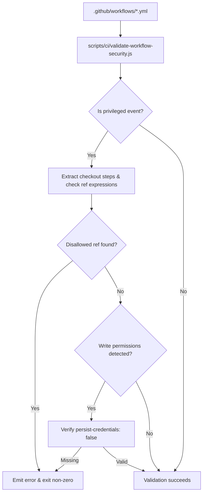
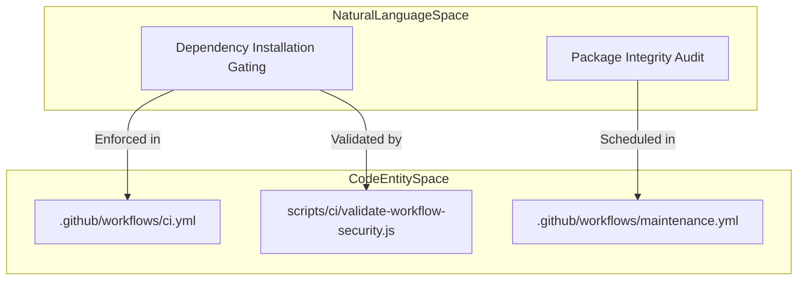
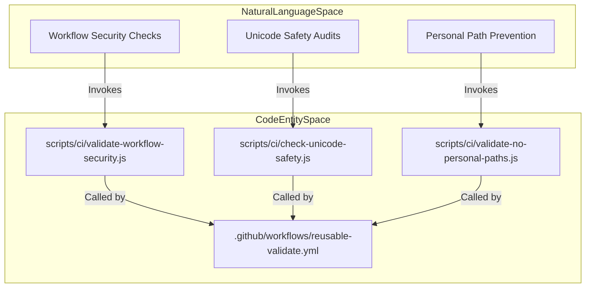

<!-- source: DeepWiki mcp.deepwiki.com · repo affaan-m/ECC · page 8.2 Workflow Security & CI Hardening · fetched 2026-10-30 -->

# Workflow Security & CI Hardening

Relevant source files

The following files were used as context for generating this wiki page:

- [.github/workflows/ci.yml](.github/workflows/ci.yml)
- [.github/workflows/generator-generic-ossf-slsa3-publish.yml](.github/workflows/generator-generic-ossf-slsa3-publish.yml)
- [.github/workflows/maintenance.yml](.github/workflows/maintenance.yml)
- [.github/workflows/release.yml](.github/workflows/release.yml)
- [.github/workflows/reusable-release.yml](.github/workflows/reusable-release.yml)
- [.github/workflows/reusable-test.yml](.github/workflows/reusable-test.yml)
- [.github/workflows/reusable-validate.yml](.github/workflows/reusable-validate.yml)
- [.github/workflows/supply-chain-watch.yml](.github/workflows/supply-chain-watch.yml)
- [.github/workflows/taste-skills.yml](.github/workflows/taste-skills.yml)
- [SECURITY.md](SECURITY.md)
- [commands/multi-backend.md](commands/multi-backend.md)
- [commands/multi-execute.md](commands/multi-execute.md)
- [commands/multi-frontend.md](commands/multi-frontend.md)
- [commands/multi-plan.md](commands/multi-plan.md)
- [commands/multi-workflow.md](commands/multi-workflow.md)
- [commands/pm2.md](commands/pm2.md)
- [docs/ja-JP/commands/multi-backend.md](docs/ja-JP/commands/multi-backend.md)
- [docs/ja-JP/commands/multi-execute.md](docs/ja-JP/commands/multi-execute.md)
- [docs/ja-JP/commands/multi-frontend.md](docs/ja-JP/commands/multi-frontend.md)
- [docs/ja-JP/commands/multi-plan.md](docs/ja-JP/commands/multi-plan.md)
- [docs/ja-JP/commands/multi-workflow.md](docs/ja-JP/commands/multi-workflow.md)
- [scripts/ci/audit-closed-references.js](scripts/ci/audit-closed-references.js)
- [scripts/ci/check-unicode-safety.js](scripts/ci/check-unicode-safety.js)
- [scripts/ci/validate-workflow-security.js](scripts/ci/validate-workflow-security.js)
- [skills/agent-eval/SKILL.md](skills/agent-eval/SKILL.md)
- [skills/autonomous-loops/SKILL.md](skills/autonomous-loops/SKILL.md)
- [skills/nutrient-document-processing/SKILL.md](skills/nutrient-document-processing/SKILL.md)
- [skills/plankton-code-quality/SKILL.md](skills/plankton-code-quality/SKILL.md)
- [tests/ci/audit-closed-references.test.js](tests/ci/audit-closed-references.test.js)
- [tests/ci/validate-workflow-security.test.js](tests/ci/validate-workflow-security.test.js)
- [tests/scripts/check-unicode-safety.test.js](tests/scripts/check-unicode-safety.test.js)
- [tests/scripts/release-publish.test.js](tests/scripts/release-publish.test.js)
- [tests/scripts/trae-install.test.js](tests/scripts/trae-install.test.js)

Everything Claude Code (ECC) implements a comprehensive security framework within its CI/CD pipelines and development workflows to prevent supply-chain threats, unauthorized code execution from untrusted sources, credential leakage, and ensure integrity in release artifacts. This page documents the key validation scripts, workflow configurations, and security controls used to enforce workflow safety and CI hardening policies.

---

## Workflow Security Validation

The core of ECC's workflow security hardening is the `validate-workflow-security.js` script, which is executed as part of the validation suite in CI workflows [scripts/ci/validate-workflow-security.js:1-5](), [.github/workflows/reusable-validate.yml:50-51](). It statically analyzes GitHub Actions workflow YAML files under `.github/workflows/` to enforce strict security policies for privileged event workflows.

### Key Security Policies Enforced

- **Pinning of GitHub Actions**: All third-party actions must use fully pinned commit SHAs rather than mutable tags to avoid tag-switching attacks [.github/workflows/ci.yml:53-58]().
- **Credential Persistence Enforcement**: Workflows granted write permissions (e.g., `contents: write` or `permissions: write-all`) must have all `actions/checkout` steps configured with `persist-credentials: false` to prevent exposing write-scoped tokens to untrusted code [scripts/ci/validate-workflow-security.js:36-43](), [scripts/ci/validate-workflow-security.js:166-177]().
- **Permission Minimization**: All workflows should explicitly declare minimal required permissions, defaulting to `contents: read` unless otherwise justified [.github/workflows/ci.yml:16-18]().
- **Untrusted Checkout Prevention**: Workflows triggered by privileged events `workflow_run` or `pull_request_target` must not checkout untrusted refs such as `${{ github.event.workflow_run.head_branch }}`, `${{ github.event.pull_request.head.sha }}`, or refs matching `refs/pull/<N>/{head,merge}` patterns to prevent injecting attacker-controlled code into workflows [scripts/ci/validate-workflow-security.js:12-33]().

### Implementation Details

The validator scans each YAML workflow file in `.github/workflows/`. It performs:

- **Event-Based Filtering**: Only workflows triggered on events deemed privileged (such as `workflow_run` and `pull_request_target`) are subject to stricter checkout rules [scripts/ci/validate-workflow-security.js:12-34]().
- **Checkout Step Extraction**: Regex parses YAML steps to identify steps using `actions/checkout` [scripts/ci/validate-workflow-security.js:83-120]().
- **Expression Matching**: Regex expression patterns identify disallowed GitHub context expressions used as checkout refs or repositories [scripts/ci/validate-workflow-security.js:17-33]().
- **Credential Persistence Check**: Workflows with write permissions require `persist-credentials: false` on checkout steps [scripts/ci/validate-workflow-security.js:166-177]().
- **Install Script Flags**: Ensures dependency installations use appropriate `--ignore-scripts` flags per package manager to prevent malicious lifecycle script execution [scripts/ci/validate-workflow-security.js:49-65]().

### Diagram: Workflow Security Validation Architecture

**Sources:**  
[scripts/ci/validate-workflow-security.js:1-184](),  
[.github/workflows/reusable-validate.yml:50-51]()

---

## Supply Chain Hardening & Dependency Gating

ECC enforces strict supply chain controls to minimize risk from malicious dependencies and installation scripts across all runner environments.

### Dependency Installation Gating

- All CI jobs install dependencies with lifecycle scripts ignored or mode-restricted, using:
  - `npm ci --ignore-scripts` [.github/workflows/ci.yml:130]()
  - `pnpm install --ignore-scripts --config.strict-dep-builds=false --no-frozen-lockfile` [.github/workflows/ci.yml:134]()
  - `yarn install --mode=skip-build` [.github/workflows/ci.yml:136]()
  - `bun install --ignore-scripts` [.github/workflows/ci.yml:137]()
- This is mandated both in workflow definitions and enforced by the workflow security validator rules [scripts/ci/validate-workflow-security.js:49-65]().

### Automated Security Audits & Signatures

- Weekly scheduled `security-audit` workflow runs `npm audit signatures` and `npm audit --omit=dev --audit-level=high` checks to ensure package integrity and reveal high severity advisories [.github/workflows/maintenance.yml:27-46]().

### Diagram: Supply Chain Security & Dependency Enforcement Space

**Sources:**  
[.github/workflows/ci.yml:122-140](),  
[.github/workflows/maintenance.yml:27-46](),  
[scripts/ci/validate-workflow-security.js:49-65]()

---

## OIDC & Publication Provenance

To eliminate risks associated with long-lived credentials during package publishing, ECC leverages GitHub’s OpenID Connect (OIDC) token issuance integrated into release workflows.

### SLSA Level 3 Provenance Generation

- The workflow `.github/workflows/generator-generic-ossf-slsa3-publish.yml` generates SLSA Level 3 provenance artifacts certifying the build environment for npm packages [/.github/workflows/generator-generic-ossf-slsa3-publish.yml:6-11]().
- It utilizes `id-token: write` permissions to authenticate the OIDC token for secure registry access [/.github/workflows/generator-generic-ossf-slsa3-publish.yml:91-94]().

### Integrity Verification of Release Artifacts

- Prior to publishing or republishing, the release workflow downloads existing artifacts from npm and compares their SHA-256/SHA-512 registry signature against the newly packed artifact to ensure exact bit-wise equivalence [.github/workflows/reusable-release.yml:157-164]().

**Sources:**  
[.github/workflows/generator-generic-ossf-slsa3-publish.yml:1-100](),  
[.github/workflows/reusable-release.yml:157-164]()

---

## Environment & Path Security

### No-Personal-Paths Validator

- The script `scripts/ci/validate-no-personal-paths.js` scans the codebase for hardcoded absolute paths containing user-specific information (e.g., `/Users/affaan/`), which can cause privacy leaks and portability issues.
- This validator is integrated into the main validation pipeline invoked by `.github/workflows/reusable-validate.yml` [.github/workflows/reusable-validate.yml:59-60]().
  
### Unicode Safety Validator

- The script `scripts/ci/check-unicode-safety.js` detects dangerous invisible Unicode characters including zero-width joiners, bidirectional controls, Unicode Tag characters, and emojis that could be exploited for homograph attacks or prompt injection.
- It supports sanitization to remove or replace such characters if run with the `--write` flag.
- This validator is tightly integrated into the CI validation workflow [.github/workflows/reusable-validate.yml:56-57]().

### Diagram: CI Validation Lifecycle Space

**Sources:**  
[.github/workflows/reusable-validate.yml:47-60](),  
[scripts/ci/check-unicode-safety.js:1-50](),  
[scripts/ci/validate-no-personal-paths.js:1-40]()

---

This comprehensive security and hardening pipeline ensures that ECC is protected against workflow manipulation, supply chain compromise, and credential leaks, with strict enforcement through automated validation and best-practice CI configurations.

---

