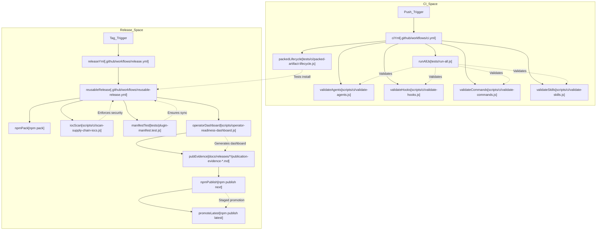

<!-- source: DeepWiki mcp.deepwiki.com · repo affaan-m/ECC · page 9 CI/CD & Release Engineering · fetched 2026-10-30 -->

# CI/CD & Release Engineering

<details>
<summary>Relevant source files</summary>

The following files were used as context for generating this wiki page:

- [.github/workflows/ci.yml](.github/workflows/ci.yml)
- [.github/workflows/generator-generic-ossf-slsa3-publish.yml](.github/workflows/generator-generic-ossf-slsa3-publish.yml)
- [.github/workflows/maintenance.yml](.github/workflows/maintenance.yml)
- [.github/workflows/release.yml](.github/workflows/release.yml)
- [.github/workflows/reusable-release.yml](.github/workflows/reusable-release.yml)
- [.github/workflows/reusable-test.yml](.github/workflows/reusable-test.yml)
- [.github/workflows/reusable-validate.yml](.github/workflows/reusable-validate.yml)
- [.github/workflows/supply-chain-watch.yml](.github/workflows/supply-chain-watch.yml)
- [.github/workflows/taste-skills.yml](.github/workflows/taste-skills.yml)
- [SECURITY.md](SECURITY.md)
- [docs/ECC-2.0-GA-ROADMAP.md](docs/ECC-2.0-GA-ROADMAP.md)
- [docs/architecture/agentshield-enterprise-research-roadmap.md](docs/architecture/agentshield-enterprise-research-roadmap.md)
- [docs/drafts/release-1.10.1-announcement.md](docs/drafts/release-1.10.1-announcement.md)
- [docs/releases/2.0.0-rc.1/naming-and-publication-matrix.md](docs/releases/2.0.0-rc.1/naming-and-publication-matrix.md)
- [docs/releases/2.0.0-rc.1/operator-readiness-dashboard-2026-05-18.md](docs/releases/2.0.0-rc.1/operator-readiness-dashboard-2026-05-18.md)
- [docs/releases/2.0.0-rc.1/operator-readiness-dashboard-2026-05-19.md](docs/releases/2.0.0-rc.1/operator-readiness-dashboard-2026-05-19.md)
- [docs/releases/2.0.0-rc.1/operator-readiness-dashboard-2026-05-20.md](docs/releases/2.0.0-rc.1/operator-readiness-dashboard-2026-05-20.md)
- [docs/releases/2.0.0-rc.1/owner-approval-packet-2026-05-19.md](docs/releases/2.0.0-rc.1/owner-approval-packet-2026-05-19.md)
- [docs/releases/2.0.0-rc.1/preview-pack-manifest.md](docs/releases/2.0.0-rc.1/preview-pack-manifest.md)
- [docs/releases/2.0.0-rc.1/publication-evidence-2026-05-16.md](docs/releases/2.0.0-rc.1/publication-evidence-2026-05-16.md)
- [docs/releases/2.0.0-rc.1/publication-evidence-2026-05-18.md](docs/releases/2.0.0-rc.1/publication-evidence-2026-05-18.md)
- [docs/releases/2.0.0-rc.1/publication-evidence-2026-05-19.md](docs/releases/2.0.0-rc.1/publication-evidence-2026-05-19.md)
- [docs/releases/2.0.0-rc.1/publication-readiness.md](docs/releases/2.0.0-rc.1/publication-readiness.md)
- [docs/releases/2.0.0-rc.1/release-name-plugin-publication-checklist-2026-05-18.md](docs/releases/2.0.0-rc.1/release-name-plugin-publication-checklist-2026-05-18.md)
- [docs/releases/2.0.0-rc.1/release-url-ledger-2026-05-18.md](docs/releases/2.0.0-rc.1/release-url-ledger-2026-05-18.md)
- [docs/releases/2.0.0-rc.1/release-url-ledger-2026-05-19.md](docs/releases/2.0.0-rc.1/release-url-ledger-2026-05-19.md)
- [scripts/ci/audit-closed-references.js](scripts/ci/audit-closed-references.js)
- [scripts/ci/validate-workflow-security.js](scripts/ci/validate-workflow-security.js)
- [scripts/operator-readiness-dashboard.js](scripts/operator-readiness-dashboard.js)
- [scripts/platform-audit.js](scripts/platform-audit.js)
- [scripts/preview-pack-smoke.js](scripts/preview-pack-smoke.js)
- [tests/ci/audit-closed-references.test.js](tests/ci/audit-closed-references.test.js)
- [tests/ci/validate-workflow-security.test.js](tests/ci/validate-workflow-security.test.js)
- [tests/docs/ecc2-release-surface.test.js](tests/docs/ecc2-release-surface.test.js)
- [tests/scripts/operator-readiness-dashboard.test.js](tests/scripts/operator-readiness-dashboard.test.js)
- [tests/scripts/platform-audit.test.js](tests/scripts/platform-audit.test.js)
- [tests/scripts/release-publish.test.js](tests/scripts/release-publish.test.js)
- [tests/scripts/trae-install.test.js](tests/scripts/trae-install.test.js)

</details>


This section provides a high-level overview of the automation pipelines and release governance frameworks that ensure the stability, security, and reliability of Everything Claude Code (ECC). The ECC release cycle follows a rigorous "Trust but Verify" approach, combining exhaustive multi-platform testing, supply-chain security scans, comprehensive release evidence, and operator readiness validation.

For detailed exploration of specific sub-topics, consult the child pages:
- **[Continuous Integration](#9.1)** — Multi-OS/package-manager matrix, reusable workflows, and component validation.
- **[Release Process & Operator Readiness](#9.2)** — Release orchestration, operator readiness dashboards, publication evidence, and staged promotions.
- **[Docker Evaluation Harnesses](#9.3)** — Docker-based evaluation labs, gateguard-effectiveness runners, and AI evaluation suites.

---

## Continuous Integration Pipeline

ECC’s CI pipeline validates the codebase across a diverse matrix of operating systems, Node.js runtimes, and package managers to guarantee a truly cross-platform universal distribution.

### Multi-Platform Test Matrix

The core CI workflow `[.github/workflows/ci.yml]()` executes tests across Ubuntu, Windows, and macOS, utilizing Node.js versions `18.x`, `20.x`, and `22.x`, alongside multiple package managers (`npm`, `pnpm`, `yarn`, `bun`) `[.github/workflows/ci.yml:28-50]()`. This matrix ensures code correctness and compatibility across diverse developer environments.

### Component Validation & Reusable Workflows

To enforce correctness and consistency, the CI pipeline triggers specialized validators and reusable workflow templates:
- **Component Validators**: Agents (`scripts/ci/validate-agents.js`), hooks (`scripts/ci/validate-hooks.js`), commands (`scripts/ci/validate-commands.js`), and skills (`scripts/ci/validate-skills.js`) are programmatically validated.
- **Reusable Workflows**: `[.github/workflows/reusable-test.yml]()` and `[.github/workflows/reusable-validate.yml]()` promote DRY practices by encapsulating test execution and validation steps for both internal CI and external consumers `[.github/workflows/reusable-test.yml:1-30]()`.

> For detailed insights into the test matrix, validation scripts, and Docker CLI testing, see the child page **[Continuous Integration](#9.1)**.

Sources: `[.github/workflows/ci.yml:28-50]()`, `[.github/workflows/reusable-test.yml:1-30]()`

---

## Release Engineering & Governance

ECC adopts a staged release process emphasizing supply-chain security, rigorous verification, and operator readiness before publishing or announcing new versions.

### Release Lifecycle & Staged Promotion

The release orchestration script synchronizes version manifests across `package.json`, plugin manifests, and catalogs `[.github/workflows/reusable-release.yml:1-40]()`. Packed artifacts (`npm pack`) are verified in a lifecycle test job across supported operating systems `[.github/workflows/ci.yml:133-177]()`. Releases are initially published under a `staged` or `next` npm dist-tag for final validation before promotion to `latest` stable `[.github/workflows/reusable-release.yml:105-130]()`. Supply-chain security scanning (`npm run security:ioc-scan`) is integrated to detect Indicators of Compromise (IOCs) and enforce AgentShield policies `[.github/workflows/reusable-release.yml:74-76]()`.

### Operator Readiness Dashboard & Publication Evidence

- **Operator Readiness Dashboard**: Aggregates repository health metrics (PR/issue queues, platform audit status, discussion engagement, local repository state) via `[scripts/operator-readiness-dashboard.js]()` to serve as a central "Prompt-To-Artifact" audit for release decisions `[scripts/operator-readiness-dashboard.js:1-40]()`.
- **Publication Evidence Framework**: Seals every release with an immutable evidence pack containing the precise source commit, platform audit outputs, threat scan results, and readiness dashboard state `[docs/releases/2.0.0-rc.1/publication-evidence-2026-05-19.md]()`.

> For an in-depth exploration of release orchestration, staged promotion, and publication evidence, see the child page **[Release Process & Operator Readiness](#9.2)**.

Sources: `[scripts/operator-readiness-dashboard.js:1-40]()`, `[.github/workflows/reusable-release.yml:1-130]()`, `[docs/releases/2.0.0-rc.1/publication-readiness.md:1-20]()`

---

## Docker Evaluation Harnesses

The `docker/` directory functions as a developer-only evaluation lab designed to test security mechanisms, contextual routing, and installer stability in isolated containers. 

Key evaluation components include:
- **GateGuard Effectiveness Scenario Runner**: Evaluates prompt-to-tool guardrails using `lib.js`, `run.js`, intent evaluation graders, and fake-claude harnesses.
- **Context Profiles AI Eval Suite**: Benchmarks context selection and token budget efficiency across models.
- **Plugin-Setup Smoke Tests**: Validates containerized installation scripts and clean-room bootstrap flows.

> For a deep dive into evaluation scenarios, graders, and container test labs, see the child page **[Docker Evaluation Harnesses](#9.3)**.

Sources: `[docs/ECC-2.0-GA-ROADMAP.md:40-52]()`, `[docs/releases/2.0.0-rc.1/preview-pack-manifest.md:1-25]()`

---

## Architecture to Code Mapping

### CI/CD Flow Diagram
This diagram bridges natural-language CI/CD activities and release stages to specific workflow files and scripts in the codebase.



Sources: `[.github/workflows/ci.yml]()`, `[.github/workflows/release.yml]()`, `[scripts/operator-readiness-dashboard.js]()`

### Release Readiness Entity Mapping
This class diagram connects conceptual release readiness artifacts to their code and document counterparts.

```mermaid
classDiagram
    class PublicationEvidence {
        +String sourceCommit
        +Boolean platformAuditReady
        +List openPrs
        +List supplyChainFindings
        +String operatorDashboardPath
    }
    class OperatorReadinessDashboard {
        +String SCHEMA_VERSION
        +Object DEFAULT_THRESHOLDS
        +buildReport()
        +renderMarkdown()
        +parseArgs()
    }
    class ReleaseManifest {
        +String version
        +List artifacts
        +String integritySHA256
        +String namingPublicationMatrixPath
    }

    PublicationEvidence --|> "docs/releases/*/publication-evidence-*.md"
    OperatorReadinessDashboard --|> "scripts/operator-readiness-dashboard.js"
    ReleaseManifest --|> "docs/releases/2.0.0-rc.1/preview-pack-manifest.md"
    PublicationEvidence "1" -- "1" OperatorReadinessDashboard : references
    PublicationEvidence "1" -- "1" ReleaseManifest : references
```

Sources: `[scripts/operator-readiness-dashboard.js:1-40]`, `[docs/releases/2.0.0-rc.1/preview-pack-manifest.md:1-25]`

---

## Summary of Release Artifacts

| Artifact | Location/Reference | Purpose |
| :--- | :--- | :--- |
| **Release Orchestration** | `scripts/release.sh` | Version manifest sync and environment preparation. |
| **Operator Readiness Dashboard** | `scripts/operator-readiness-dashboard.js` | Generates prompt-to-artifact state audits `[scripts/operator-readiness-dashboard.js:1-40]()`. |
| **Preview Pack Smoke Test** | `scripts/preview-pack-smoke.js` | Validates public launch surface assembly. |
| **Packed Artifact Lifecycle** | `tests/ci/packed-artifact-lifecycle.js` | Verifies `.tgz` installer artifact integrity across OSs `[.github/workflows/release.yml:150-157]()`. |
| **Publication Evidence** | `docs/releases/*/publication-evidence-*.md` | Immutable record of validation state `[docs/releases/2.0.0-rc.1/publication-readiness.md:1-20]()`. |
| **Naming & Publication Matrix** | `docs/releases/*/naming-and-publication-matrix.md` | Specifies naming conventions and artifact paths `[docs/releases/2.0.0-rc.1/publication-readiness.md:70-84]()`. |
| **Owner Approval Packet** | `docs/releases/*/owner-approval-packet-*.md` | Formal human decision and approval documentation `[docs/releases/2.0.0-rc.1/preview-pack-manifest.md:35-36]()`. |

Sources: `[scripts/operator-readiness-dashboard.js:1-40]()`, `[.github/workflows/release.yml:150-157]()`, `[docs/releases/2.0.0-rc.1/publication-readiness.md:1-84]()`

---

For implementation-level details and configuration files, visit the child pages:
- **[Continuous Integration](#9.1)**
- **[Release Process & Operator Readiness](#9.2)**
- **[Docker Evaluation Harnesses](#9.3)**

Sources: `[.github/workflows/ci.yml]()`, `[.github/workflows/reusable-test.yml]()`, `[.github/workflows/reusable-release.yml]()`, `[scripts/operator-readiness-dashboard.js]()`

---

