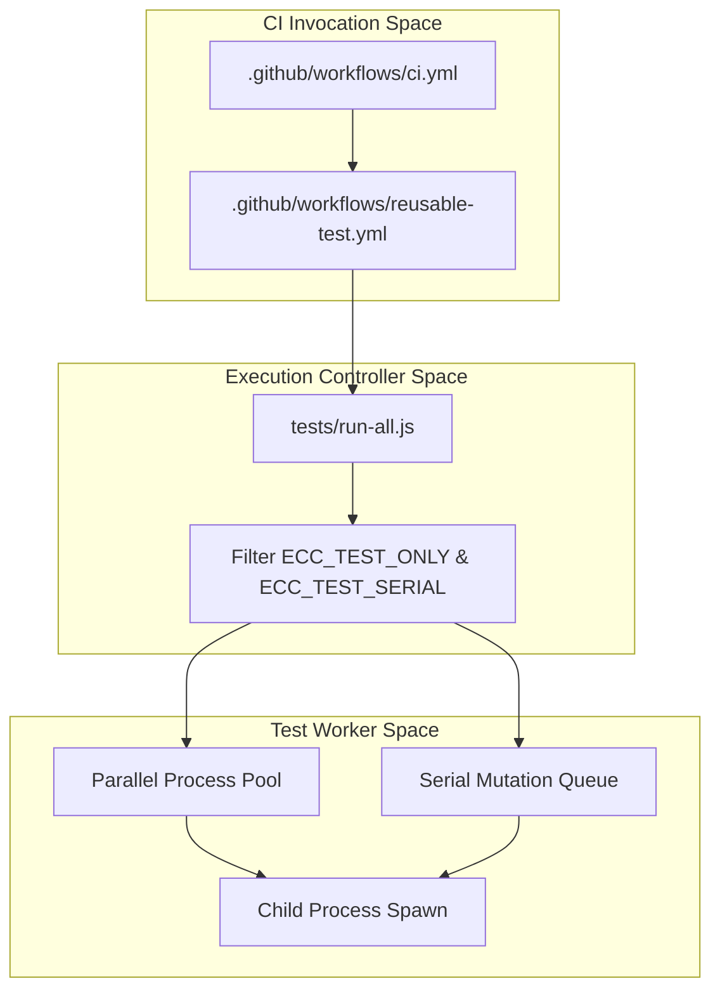
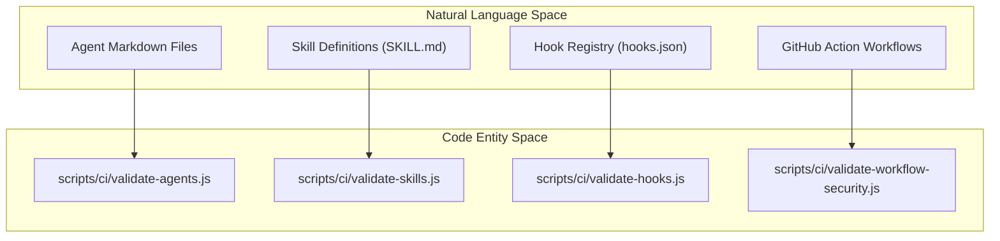
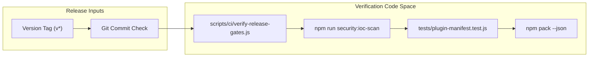

<!-- source: DeepWiki mcp.deepwiki.com · repo affaan-m/ECC · page 9.1 Continuous Integration · fetched 2026-10-30 -->

# Continuous Integration

Relevant source files

The following files were used as context for generating this wiki page:

- [.github/workflows/ci.yml](.github/workflows/ci.yml)
- [.github/workflows/generator-generic-ossf-slsa3-publish.yml](.github/workflows/generator-generic-ossf-slsa3-publish.yml)
- [.github/workflows/maintenance.yml](.github/workflows/maintenance.yml)
- [.github/workflows/release.yml](.github/workflows/release.yml)
- [.github/workflows/reusable-release.yml](.github/workflows/reusable-release.yml)
- [.github/workflows/reusable-test.yml](.github/workflows/reusable-test.yml)
- [.github/workflows/reusable-validate.yml](.github/workflows/reusable-validate.yml)
- [.github/workflows/supply-chain-watch.yml](.github/workflows/supply-chain-watch.yml)
- [.github/workflows/taste-skills.yml](.github/workflows/taste-skills.yml)
- [.gitignore](.gitignore)
- [CLAUDE.md](CLAUDE.md)
- [SECURITY.md](SECURITY.md)
- [agents/vue-reviewer.md](agents/vue-reviewer.md)
- [commands/vue-review.md](commands/vue-review.md)
- [docs/SKILL-PLACEMENT-POLICY.md](docs/SKILL-PLACEMENT-POLICY.md)
- [docs/releases/2.2.1/patch-execution.md](docs/releases/2.2.1/patch-execution.md)
- [docs/releases/2.2.1/release-notes.md](docs/releases/2.2.1/release-notes.md)
- [docs/security/ecc-039-powershell-gateguard-plan.md](docs/security/ecc-039-powershell-gateguard-plan.md)
- [hooks/README.md](hooks/README.md)
- [hooks/hooks.json](hooks/hooks.json)
- [schemas/hooks.schema.json](schemas/hooks.schema.json)
- [schemas/provenance.schema.json](schemas/provenance.schema.json)
- [scripts/ci/audit-closed-references.js](scripts/ci/audit-closed-references.js)
- [scripts/ci/catalog.js](scripts/ci/catalog.js)
- [scripts/ci/generate-command-registry.js](scripts/ci/generate-command-registry.js)
- [scripts/ci/validate-agents.js](scripts/ci/validate-agents.js)
- [scripts/ci/validate-hooks.js](scripts/ci/validate-hooks.js)
- [scripts/ci/validate-workflow-security.js](scripts/ci/validate-workflow-security.js)
- [scripts/hooks/check-console-log.js](scripts/hooks/check-console-log.js)
- [scripts/hooks/evaluate-session.js](scripts/hooks/evaluate-session.js)
- [scripts/hooks/governance-capture.js](scripts/hooks/governance-capture.js)
- [scripts/hooks/post-edit-console-warn.js](scripts/hooks/post-edit-console-warn.js)
- [scripts/hooks/post-edit-format.js](scripts/hooks/post-edit-format.js)
- [scripts/hooks/post-edit-typecheck.js](scripts/hooks/post-edit-typecheck.js)
- [scripts/hooks/session-end.js](scripts/hooks/session-end.js)
- [scripts/hooks/session-start.js](scripts/hooks/session-start.js)
- [scripts/hooks/suggest-compact.js](scripts/hooks/suggest-compact.js)
- [scripts/lib/install/ownership-guard.js](scripts/lib/install/ownership-guard.js)
- [scripts/lib/multi-harness-setup.js](scripts/lib/multi-harness-setup.js)
- [scripts/lib/package-manager.d.ts](scripts/lib/package-manager.d.ts)
- [scripts/lib/package-manager.js](scripts/lib/package-manager.js)
- [scripts/lib/powershell-destructive-command.js](scripts/lib/powershell-destructive-command.js)
- [scripts/lib/session-aliases.d.ts](scripts/lib/session-aliases.d.ts)
- [scripts/lib/session-aliases.js](scripts/lib/session-aliases.js)
- [scripts/lib/session-manager.d.ts](scripts/lib/session-manager.d.ts)
- [scripts/lib/session-manager.js](scripts/lib/session-manager.js)
- [scripts/lib/utils.d.ts](scripts/lib/utils.d.ts)
- [scripts/lib/utils.js](scripts/lib/utils.js)
- [tests/ci/audit-closed-references.test.js](tests/ci/audit-closed-references.test.js)
- [tests/ci/catalog.test.js](tests/ci/catalog.test.js)
- [tests/ci/command-registry.test.js](tests/ci/command-registry.test.js)
- [tests/ci/run-all.test.js](tests/ci/run-all.test.js)
- [tests/ci/validate-workflow-security.test.js](tests/ci/validate-workflow-security.test.js)
- [tests/ci/validators.test.js](tests/ci/validators.test.js)
- [tests/hooks/governance-capture.test.js](tests/hooks/governance-capture.test.js)
- [tests/hooks/hooks.test.js](tests/hooks/hooks.test.js)
- [tests/integration/hooks.test.js](tests/integration/hooks.test.js)
- [tests/lib/claude-settings-array.test.js](tests/lib/claude-settings-array.test.js)
- [tests/lib/install-claude-skill-migration.test.js](tests/lib/install-claude-skill-migration.test.js)
- [tests/lib/multi-harness-setup.test.js](tests/lib/multi-harness-setup.test.js)
- [tests/lib/package-manager.test.js](tests/lib/package-manager.test.js)
- [tests/lib/powershell-destructive-command.test.js](tests/lib/powershell-destructive-command.test.js)
- [tests/lib/session-aliases.test.js](tests/lib/session-aliases.test.js)
- [tests/lib/session-manager.test.js](tests/lib/session-manager.test.js)
- [tests/lib/utils.test.js](tests/lib/utils.test.js)
- [tests/run-all.js](tests/run-all.js)
- [tests/scripts/ownership-guard.test.js](tests/scripts/ownership-guard.test.js)
- [tests/scripts/release-publish.test.js](tests/scripts/release-publish.test.js)
- [tests/scripts/trae-install.test.js](tests/scripts/trae-install.test.js)

The Continuous Integration (CI) system in ECC is a validation and testing architecture designed to ensure cross-platform compatibility, package manager interoperability, entity manifest integrity, and workflow security across multiple operating systems, Node.js versions, and package managers.

Sources: [.github/workflows/ci.yml:1-50](), [.github/workflows/reusable-test.yml:1-25]()

---

## CI System Overview

The primary CI pipeline is defined in `.github/workflows/ci.yml` and triggers on pushes to `main` and `release/**` branches, version tags matching `v*`, and pull requests targeting `main`. Concurrency groups are configured to cancel in-progress runs for the same reference, avoiding redundant execution overhead [.github/workflows/ci.yml:3-13](). Jobs run with minimal permissions (`contents: read`) to enforce least-privilege security boundaries [.github/workflows/ci.yml:15-17]().

The pipeline divides responsibilities into specific workflows:
- **test**: Evaluates code correctness across a multi-dimensional matrix of operating systems, Node.js runtimes, and package managers [.github/workflows/ci.yml:20-50]().
- **validate**: Executes static validators covering component schemas, workflows, and code security rules via `.github/workflows/reusable-validate.yml` [ .github/workflows/reusable-validate.yml:1-58]().
- **pack-installer** & **packed-install-lifecycle**: Packs universal installer tarballs and tests the end-to-end installation lifecycle across clean environments.

Sources: [.github/workflows/ci.yml:1-50](), [.github/workflows/reusable-validate.yml:1-58]()

---

## Test Matrix & Infrastructure

The `test` job utilizes a matrix strategy covering multiple operating systems, Node versions, and package managers. To optimize CI duration, the matrix separates execution scopes into `full` lanes (running the entire test suite across all Node versions on Linux, plus current LTS on Windows and macOS) and `pm` package-manager compatibility lanes (running only suites sensitive to package manager configurations) [.github/workflows/ci.yml:27-50]().

| Dimension | Supported Values |
|---|---|
| **Operating Systems** | `ubuntu-latest`, `windows-latest`, `macos-latest` [.github/workflows/ci.yml:35-40]() |
| **Node.js Versions** | `18.x`, `20.x`, `22.x` [.github/workflows/ci.yml:36-38]() |
| **Package Managers** | `npm`, `pnpm`, `yarn`, `bun` [.github/workflows/ci.yml:42-49]() |

### Environment Setup & Dependencies

Before executing tests, runners provision platform-specific prerequisites:
- **Ripgrep (`rg`)**: Installed via `apt-get` on Linux, `brew` on macOS, and `chocolatey` on Windows. A PCRE2 probe test (`rg --pcre2`) is executed to ensure advanced regex pattern matching is functional [.github/workflows/ci.yml:62-92]().
- **Package Managers**: Setup steps handle `pnpm` (via action or corepack depending on Node version), `yarn` (via Corepack), and `bun` (via `oven-sh/setup-bun`) [.github/workflows/ci.yml:94-118]().
- **Dependency Installation**: Dependencies are installed with script execution ignored (`--ignore-scripts` or equivalent flags) to maintain hermetic builds across package manager variations [.github/workflows/ci.yml:122-139]().

These steps are encapsulated in `.github/workflows/reusable-test.yml` to allow reuse across workflows [.github/workflows/reusable-test.yml:1-98]().

Sources: [.github/workflows/ci.yml:27-140](), [.github/workflows/reusable-test.yml:1-98]()

---

## The Test Runner (`tests/run-all.js`)

All test files matching `tests/**/*.test.js` are discovered and orchestrated via `tests/run-all.js`. 

### Execution and Isolation Flow

1. **Environment Filtering**: Tests execute in isolated child processes with host git variables stripped (`GIT_DIR`, `GIT_WORK_TREE`) to prevent pollution.
2. **Scope Filtering (`ECC_TEST_ONLY`)**: In package-manager compatibility lanes, tests are filtered to include only suites referencing package manager variables [.github/workflows/ci.yml:149-153]().
3. **Serial Execution (`ECC_TEST_SERIAL`)**: Suites that mutate shared repository state (e.g., building OpenCode packages, backup file mutations, or wall-clock budget tests) are segregated and executed serially after parallel worker pools complete [.github/workflows/ci.yml:154-161]().

Sources: [.github/workflows/ci.yml:146-162]()

---

### Test Runner Execution Flow Diagram

Sources: [.github/workflows/ci.yml:146-162](), [.github/workflows/reusable-test.yml:86-90]()

---

## Component Validation Pipeline

Static analysis and manifest validation are executed via the `validate` job in `.github/workflows/reusable-validate.yml`. This pipeline ensures structural correctness across configuration assets and agents.

### Core Validators

- **Agents (`scripts/ci/validate-agents.js`)**: Validates frontmatter and metadata contracts in agent definition files.
- **Hooks (`scripts/ci/validate-hooks.js`)**: Validates `hooks.json` against `schemas/hooks.schema.json`.
- **Commands (`scripts/ci/validate-commands.js`)**: Verifies command declarations and syntax.
- **Skills (`scripts/ci/validate-skills.js`)**: Confirms `SKILL.md` format correctness and presence of required directories.
- **Install Manifests (`scripts/ci/validate-install-manifests.js`)**: Ensures installation module and component manifests conform to schema constraints.
- **Workflow Security (`scripts/ci/validate-workflow-security.js`)**: Scans GitHub Actions workflow files for risky patterns (such as unverified pull request head references or missing `persist-credentials: false` settings).

Sources: [.github/workflows/reusable-validate.yml:1-58](), [tests/ci/validators.test.js:1-139]()

---

## Catalog Validator

The catalog validator (`scripts/ci/catalog.js`) ensures synchronization between codebase entities and documentation files. It verifies that counts of agents, commands, and skills match documented summary counts in `README.md`, translation documents (e.g., `README.zh-CN.md`), and marketplace plugin manifests [.github/workflows/release.yml:100-105]().

Sources: [tests/ci/validators.test.js:178-195]()

---

## Natural Language to Code Entity Mapping Diagrams

### CI Validation Component Association

Sources: [.github/workflows/reusable-validate.yml:1-58](), [tests/ci/validators.test.js:1-139]()

---

### Release Verification Pipeline

Sources: [.github/workflows/release.yml:27-148](), [.github/workflows/reusable-release.yml:40-146]()

---

# Summary

ECC's Continuous Integration subsystem combines matrix testing across OSes and package managers, hermetic test execution with parallel/serial queue segregation, strict static validation pipelines, workflow security checks, and automated artifact lifecycle tests to maintain high reliability and security standards.

Sources: [.github/workflows/ci.yml:1-162](), [.github/workflows/reusable-test.yml:1-98](), [.github/workflows/reusable-validate.yml:1-58]()

---

