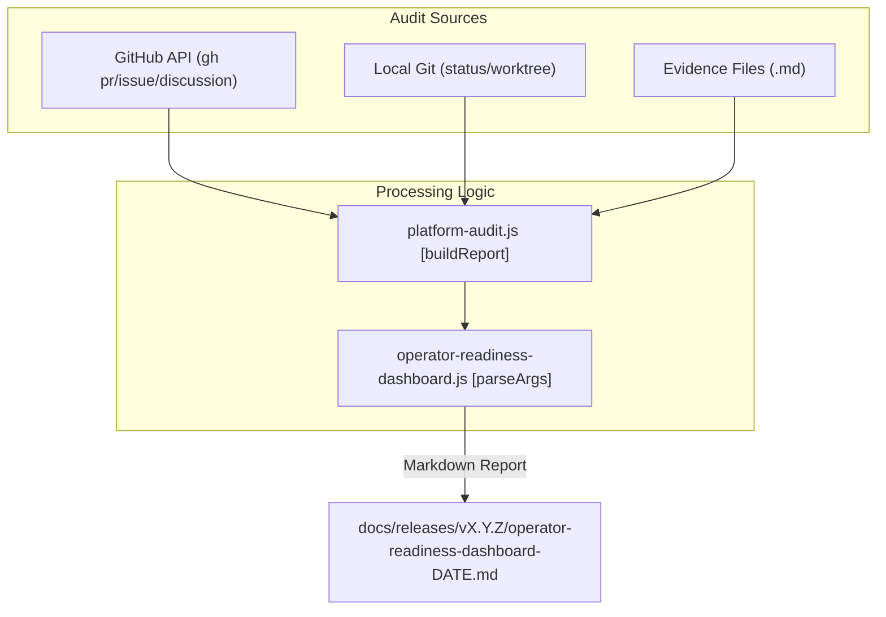
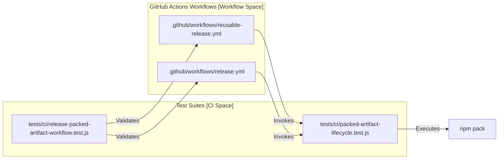
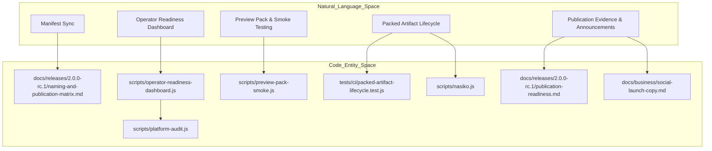

<!-- source: DeepWiki mcp.deepwiki.com · repo affaan-m/ECC · page 9.2 Release Process & Operator Readiness · fetched 2026-10-30 -->

# Release Process & Operator Readiness

Relevant source files

The following files were used as context for generating this wiki page:

- [assets/ecc-icon.svg](assets/ecc-icon.svg)
- [docs/ECC-2.0-GA-ROADMAP.md](docs/ECC-2.0-GA-ROADMAP.md)
- [docs/ECC-2.0-REFERENCE-ARCHITECTURE.md](docs/ECC-2.0-REFERENCE-ARCHITECTURE.md)
- [docs/architecture/agentshield-enterprise-research-roadmap.md](docs/architecture/agentshield-enterprise-research-roadmap.md)
- [docs/business/social-launch-copy.md](docs/business/social-launch-copy.md)
- [docs/drafts/release-1.10.1-announcement.md](docs/drafts/release-1.10.1-announcement.md)
- [docs/legacy-artifact-inventory.md](docs/legacy-artifact-inventory.md)
- [docs/releases/2.0.0-rc.1/article-outline.md](docs/releases/2.0.0-rc.1/article-outline.md)
- [docs/releases/2.0.0-rc.1/launch-checklist.md](docs/releases/2.0.0-rc.1/launch-checklist.md)
- [docs/releases/2.0.0-rc.1/linkedin-post.md](docs/releases/2.0.0-rc.1/linkedin-post.md)
- [docs/releases/2.0.0-rc.1/naming-and-publication-matrix.md](docs/releases/2.0.0-rc.1/naming-and-publication-matrix.md)
- [docs/releases/2.0.0-rc.1/operator-readiness-dashboard-2026-05-17.md](docs/releases/2.0.0-rc.1/operator-readiness-dashboard-2026-05-17.md)
- [docs/releases/2.0.0-rc.1/operator-readiness-dashboard-2026-05-18.md](docs/releases/2.0.0-rc.1/operator-readiness-dashboard-2026-05-18.md)
- [docs/releases/2.0.0-rc.1/operator-readiness-dashboard-2026-05-19.md](docs/releases/2.0.0-rc.1/operator-readiness-dashboard-2026-05-19.md)
- [docs/releases/2.0.0-rc.1/operator-readiness-dashboard-2026-05-20.md](docs/releases/2.0.0-rc.1/operator-readiness-dashboard-2026-05-20.md)
- [docs/releases/2.0.0-rc.1/owner-approval-packet-2026-05-19.md](docs/releases/2.0.0-rc.1/owner-approval-packet-2026-05-19.md)
- [docs/releases/2.0.0-rc.1/owner-queue-cleanup-2026-05-18.md](docs/releases/2.0.0-rc.1/owner-queue-cleanup-2026-05-18.md)
- [docs/releases/2.0.0-rc.1/partner-sponsor-talks-pack.md](docs/releases/2.0.0-rc.1/partner-sponsor-talks-pack.md)
- [docs/releases/2.0.0-rc.1/preview-pack-manifest.md](docs/releases/2.0.0-rc.1/preview-pack-manifest.md)
- [docs/releases/2.0.0-rc.1/publication-evidence-2026-05-16.md](docs/releases/2.0.0-rc.1/publication-evidence-2026-05-16.md)
- [docs/releases/2.0.0-rc.1/publication-evidence-2026-05-17.md](docs/releases/2.0.0-rc.1/publication-evidence-2026-05-17.md)
- [docs/releases/2.0.0-rc.1/publication-evidence-2026-05-18.md](docs/releases/2.0.0-rc.1/publication-evidence-2026-05-18.md)
- [docs/releases/2.0.0-rc.1/publication-evidence-2026-05-19.md](docs/releases/2.0.0-rc.1/publication-evidence-2026-05-19.md)
- [docs/releases/2.0.0-rc.1/publication-readiness.md](docs/releases/2.0.0-rc.1/publication-readiness.md)
- [docs/releases/2.0.0-rc.1/quickstart.md](docs/releases/2.0.0-rc.1/quickstart.md)
- [docs/releases/2.0.0-rc.1/release-name-plugin-publication-checklist-2026-05-18.md](docs/releases/2.0.0-rc.1/release-name-plugin-publication-checklist-2026-05-18.md)
- [docs/releases/2.0.0-rc.1/release-notes.md](docs/releases/2.0.0-rc.1/release-notes.md)
- [docs/releases/2.0.0-rc.1/release-url-ledger-2026-05-18.md](docs/releases/2.0.0-rc.1/release-url-ledger-2026-05-18.md)
- [docs/releases/2.0.0-rc.1/release-url-ledger-2026-05-19.md](docs/releases/2.0.0-rc.1/release-url-ledger-2026-05-19.md)
- [docs/releases/2.0.0-rc.1/telegram-handoff.md](docs/releases/2.0.0-rc.1/telegram-handoff.md)
- [docs/releases/2.0.0-rc.1/video-suite-production.md](docs/releases/2.0.0-rc.1/video-suite-production.md)
- [docs/releases/2.0.0-rc.1/x-thread.md](docs/releases/2.0.0-rc.1/x-thread.md)
- [docs/releases/2.0.0/ecc-2-hypergrowth-release-command-center.md](docs/releases/2.0.0/ecc-2-hypergrowth-release-command-center.md)
- [docs/stale-pr-salvage-ledger.md](docs/stale-pr-salvage-ledger.md)
- [examples/evaluator-rag-prototype/candidate-playbook.md](examples/evaluator-rag-prototype/candidate-playbook.md)
- [examples/evaluator-rag-prototype/report.json](examples/evaluator-rag-prototype/report.json)
- [examples/evaluator-rag-prototype/scenario.json](examples/evaluator-rag-prototype/scenario.json)
- [examples/evaluator-rag-prototype/trace.json](examples/evaluator-rag-prototype/trace.json)
- [examples/evaluator-rag-prototype/verifier-result.json](examples/evaluator-rag-prototype/verifier-result.json)
- [scripts/ci/verify-release-gates.js](scripts/ci/verify-release-gates.js)
- [scripts/lib/harness-capabilities.js](scripts/lib/harness-capabilities.js)
- [scripts/operator-readiness-dashboard.js](scripts/operator-readiness-dashboard.js)
- [scripts/platform-audit.js](scripts/platform-audit.js)
- [scripts/preview-pack-smoke.js](scripts/preview-pack-smoke.js)
- [scripts/release-video-suite.js](scripts/release-video-suite.js)
- [scripts/sync-ecc-to-codex.sh](scripts/sync-ecc-to-codex.sh)
- [tests/ci/packed-artifact-lifecycle.js](tests/ci/packed-artifact-lifecycle.js)
- [tests/ci/packed-artifact-lifecycle.test.js](tests/ci/packed-artifact-lifecycle.test.js)
- [tests/ci/release-packed-artifact-workflow.test.js](tests/ci/release-packed-artifact-workflow.test.js)
- [tests/docs/ecc2-release-surface.test.js](tests/docs/ecc2-release-surface.test.js)
- [tests/docs/legacy-artifact-inventory.test.js](tests/docs/legacy-artifact-inventory.test.js)
- [tests/docs/stale-pr-salvage-ledger.test.js](tests/docs/stale-pr-salvage-ledger.test.js)
- [tests/lib/harness-capabilities.test.js](tests/lib/harness-capabilities.test.js)
- [tests/scripts/operator-readiness-dashboard.test.js](tests/scripts/operator-readiness-dashboard.test.js)
- [tests/scripts/platform-audit.test.js](tests/scripts/platform-audit.test.js)
- [tests/scripts/release-video-suite.test.js](tests/scripts/release-video-suite.test.js)
- [tests/scripts/sync-ecc-to-codex.test.js](tests/scripts/sync-ecc-to-codex.test.js)

The ECC release process is a multi-stage, evidence-backed pipeline designed to ensure high confidence in public artifacts across multiple AI harnesses. It transitions from local validation to a staged distribution model, governed by automated readiness dashboards, platform audits, and deterministic smoke tests.

## Release Pipeline Overview

The release pipeline is structured around the "Prompt-To-Artifact" philosophy, where every change must be auditable from the initial PR to the final published npm package or plugin manifest.

### 1. Manifest Synchronization & `release.sh`

The core release logic is driven by synchronization between the repository root and harness-specific manifests.

- **Version Truth:** The version defined in `package.json` and `VERSION` acts as the single source of truth for all platforms [docs/releases/2.0.0-rc.1/publication-readiness.md:77-78](). 
- **Identity Consistency:** The release script ensures the `displayName` and product name "ECC" remain consistent across `README.md`, `.codex-plugin/plugin.json`, and `.claude-plugin/plugin.json` [docs/releases/2.0.0-rc.1/publication-readiness.md:72-84]().

This synchronization protects against discrepancies in versioning and package identity that could lead to deployment errors or broken plugin metadata.

Sources: [docs/releases/2.0.0-rc.1/publication-readiness.md:72-84]()

### 2. Operator Readiness Dashboard

The `scripts/operator-readiness-dashboard.js` script generates a comprehensive status report reflecting the repository's health and readiness for release. It aggregates data by invoking `scripts/platform-audit.js` and performing local checks such as Git worktree cleanliness [scripts/operator-readiness-dashboard.js:7]().

**Key Functions:**

- `parseArgs(argv)`: Parses CLI arguments including output format (`text|json|markdown`), thresholds for PRs/issues, repo roots, and GitHub token usage [scripts/operator-readiness-dashboard.js:67-83]().

- `buildReport()`: Calls `platformAudit.buildReport` to collect GitHub PR counts, issue counts, discussion statuses, and local dirty file states, comparing those values to thresholds to judge readiness [scripts/operator-readiness-dashboard.js:7]().

- Output Rendering: Supports multiple formats including Markdown, JSON, and plain text. Allows writing reports to files for historical evidence capture [scripts/operator-readiness-dashboard.js:23-28]().

**Data Flow: Readiness Dashboard**

Sources: [scripts/operator-readiness-dashboard.js:1-1123](), [tests/scripts/operator-readiness-dashboard.test.js:1-20]()

---

## Publication Evidence Requirements

No release is authorized without a "Publication Evidence" document that captures the exact state of the repository at release time. This document demonstrates that all gating conditions have been met.

Key components of the evidence document include:

- **Source Commit and Git Remote:** The exact upstream commit SHA and remote URL are recorded [docs/releases/2.0.0-rc.1/publication-evidence-2026-05-19.md:9-14]().

- **Queue Zero State:** Verification that all blocking PRs and issues are closed across tracked repositories, ensuring no unresolved changes are pending [docs/releases/2.0.0-rc.1/publication-evidence-2026-05-19.md:21-27]().

- **Test Matrix Success:** Confirmation that the test suite passes on all supported platforms (macOS, Ubuntu, Windows), demonstrated by CI outputs [docs/releases/2.0.0-rc.1/publication-evidence-2026-05-19.md:13-14]().

- **Supply-Chain Scan:** Output from `scripts/ci/scan-supply-chain-iocs.js`, confirming zero known malicious indicators of compromise (IOCs) or supply chain issues [docs/releases/2.0.0-rc.1/publication-evidence-2026-05-19.md:13-14]().

Sources: [docs/releases/2.0.0-rc.1/publication-evidence-2026-05-19.md:1-207]()

---

## The Preview Pack & Smoke Testing

The "Preview Pack" is a curated subset of release artifacts assembled to verify the integrity and correctness of the public launch package before official publication.

### Preview Pack Manifest

Defined in `docs/releases/2.0.0-rc.1/preview-pack-manifest.md`, this manifest lists:

- Key artifacts such as `README.md`, Hermes operator topology docs, sanitized Hermes skills, architecture docs, and scripts enforcing packaging and publication readiness [docs/releases/2.0.0-rc.1/preview-pack-manifest.md:10-25]().

- Inclusion criteria enforce that documentation is sanitized (no raw workspace/private credentials), adapter compliance is verified, and final approval gates are present [docs/releases/2.0.0-rc.1/preview-pack-manifest.md:13-21]().

### Smoke Test Script: `scripts/preview-pack-smoke.js`

This script functions as the deterministic gatekeeper for the Preview Pack, validating:

1. Presence of all required artifacts in the packed distribution.

2. Sanitization enforcement ensuring no isolated secrets or private credentials leak into public docs.

3. Compliance with the adapter matrices for supported harnesses (Claude, Codex, etc.).

4. Preservation of publication blockers and gate conditions.

It is typically invoked via `npm run preview-pack:smoke` and its success serves as evidence for readiness [docs/releases/2.0.0-rc.1/preview-pack-manifest.md:20]().

Sources: [docs/releases/2.0.0-rc.1/preview-pack-manifest.md:1-36](), [scripts/preview-pack-smoke.js]()

---

## Staged Distribution & Artifact Lifecycle

ECC adopts a staged promotion model to strengthen release reliability and avoid regression in published artifacts.

### Naming & Publication Matrix

The naming and publication matrix controls how versions and artifacts propagate:

- **npm Packages:** Release candidates are published under the `next` dist-tag. General Availability (GA) versions promote to `latest` only after full approval [docs/releases/2.0.0-rc.1/publication-readiness.md:79]().

- **Claude & Codex Plugins:** Tagged with the exact release version, validated against their manifest schemas to ensure compatibility and functional correctness [docs/releases/2.0.0-rc.1/publication-readiness.md:80-83]().

### Packed Artifact Lifecycle

The lifecycle of packed artifacts undergoes rigorous CI testing and verification, captured in:

- `tests/ci/packed-artifact-lifecycle.test.js`: Validates phases including pack, verify integrity, install cleanly on multiple OSes, and final promotion to npm registry dist-tags [tests/ci/packed-artifact-lifecycle.test.js:1-170]().

- `tests/ci/release-packed-artifact-workflow.test.js`: Checks that the release workflow triggers the packing and lifecycle validation steps properly [tests/ci/release-packed-artifact-workflow.test.js:1-763]().

**Lifecycle Phases:**

1. **Pack:** Generate `.tgz` tarball and calculate hash to verify integrity [tests/ci/release-packed-artifact-workflow.test.js:95-104]().

2. **Verify:** On retries, confirm local tarball matches the remote registry's integrity hash [tests/ci/release-packed-artifact-workflow.test.js:153-160]().

3. **Install:** Install from tarball to confirm packaging correctness on macOS, Ubuntu, and Windows [tests/ci/release-packed-artifact-workflow.test.js:162-170]().

4. **Promote:** Publish to dist-tags only after verifying all prior steps succeed [docs/releases/2.0.0-rc.1/publication-readiness.md:79]().

**Workflow Entity Association**

Sources: [tests/ci/packed-artifact-lifecycle.test.js:1-170](), [tests/ci/release-packed-artifact-workflow.test.js:1-763]()

---

## Release Artifacts (RC/2.1/2.2)

| Version        | Focus Area              | Key Artifacts                                                                                     |
|----------------|------------------------|-------------------------------------------------------------------------------------------------|
| **2.0.0-rc.1** | Platform GA Foundation  | `preview-pack-manifest.md`, `owner-approval-packet-2026-05-19.md`                               |
| **2.1.0**      | Harness Parity          | Stable `latest` tag, refined adapter compliance scorecard                                       |
| **2.2.0**      | Control Plane & Nasiko  | `scripts/nasiko.js`, native Antigravity packaging, skill-comply distribution                     |

### Nasiko CLI Lifecycle Bridge

The Nasiko CLI lifecycle bridge (`scripts/nasiko.js`) facilitates version-controlled integration with the optional pinned Nasiko CLI toolchain. Key features:

- Enforces only accepted pinned Nasiko versions; disallows `latest` to guarantee deterministic release builds.

- Uses file-based locking to prevent concurrent lifecycle mutations.

- Recovers stale locks by detecting dead PIDs.

Sources: [scripts/ecc.js:43-45]()

---

## Release Announcements, Publication & Video Suite

Final release announcements, video production manifests, and social launch content are maintained alongside the release artifacts in the repository under:

- `docs/releases/2.0.0-rc.1/linkedin-post.md` [docs/releases/2.0.0-rc.1/linkedin-post.md]()
- `docs/business/social-launch-copy.md` [docs/business/social-launch-copy.md]()
- `docs/releases/2.0.0-rc.1/video-suite-production.md` [docs/releases/2.0.0-rc.1/video-suite-production.md]()

These materials remain draft until all publication readiness gates pass, ensuring no premature claim of live release status [tests/docs/ecc2-release-surface.test.js:119-126](). Final URLs, video assets, and billing gates are verified before promoting announcements [docs/releases/2.0.0-rc.1/preview-pack-manifest.md:21-36]().

Sources: [docs/business/social-launch-copy.md](), [docs/releases/2.0.0-rc.1/video-suite-production.md]()

---

# Summary Diagram: Natural Language to Code Entities in Release Process

Sources: Complete page contents.

---

# References

- [scripts/operator-readiness-dashboard.js]()
- [scripts/platform-audit.js]()
- [docs/releases/2.0.0-rc.1/publication-readiness.md]()
- [docs/releases/2.0.0-rc.1/preview-pack-manifest.md]()
- [scripts/preview-pack-smoke.js]()
- [tests/ci/packed-artifact-lifecycle.test.js]()
- [tests/ci/release-packed-artifact-workflow.test.js]()
- [docs/releases/2.0.0-rc.1/publication-evidence-2026-05-19.md]()
- [scripts/ecc.js:43-45]()
- [tests/docs/ecc2-release-surface.test.js:1-544]()

---

