# Page: Overview: Everything Claude Code (ECC)

# Overview: Everything Claude Code (ECC)

<details>
<summary>Relevant source files</summary>

The following files were used as context for generating this wiki page:

- [.claude-plugin/marketplace.json](.claude-plugin/marketplace.json)
- [.claude-plugin/plugin.json](.claude-plugin/plugin.json)
- [.gemini/GEMINI.md](.gemini/GEMINI.md)
- [AGENTS.md](AGENTS.md)
- [README.md](README.md)
- [README.zh-CN.md](README.zh-CN.md)
- [SOUL.md](SOUL.md)
- [agent.yaml](agent.yaml)
- [docs/tr/AGENTS.md](docs/tr/AGENTS.md)
- [docs/zh-CN/AGENTS.md](docs/zh-CN/AGENTS.md)
- [docs/zh-CN/README.md](docs/zh-CN/README.md)
- [manifests/install-modules.json](manifests/install-modules.json)
- [package.json](package.json)

</details>


Everything Claude Code (ECC) is a production-ready **Agent Harness Operating System** designed to transform AI coding assistants into high-autonomy engineering partners [.claude-plugin/plugin.json:1-4](), [README.md:1-4](). Originating as an Anthropic Hackathon winner, ECC provides a comprehensive suite of 71 specialized agents, 311 skills, 97 commands, and a cross-harness control plane [AGENTS.md:1-5](). It supports multiple AI developer harnesses—including Claude Code, Codex, OpenCode, Cursor, and Gemini—bridging natural language user intent and complex software engineering workflows [.claude-plugin/plugin.json:1-4](), [package.json:2-4]().

---

### Core Value Proposition

- **Multi-Harness Portability:** ECC shares the same underlying agents, skills, commands, and rules across diverse AI harnesses like Claude Code, Codex, OpenCode, Cursor, and Antigravity, ensuring a unified developer experience [.claude-plugin/plugin.json:1-38](), [manifests/install-modules.json:1-87]().
- **Specialized Agent Fleet:** Provides 71 domain-focused agents such as `planner` (`agents/planner.md`), `security-reviewer` (`agents/security-reviewer.md`), and `build-error-resolver` (`agents/build-error-resolver.md`) to automate software lifecycle tasks independently or in orchestrated loops [AGENTS.md:15-51]().
- **Test-Driven, Security-First, Immutable:** Enforces software engineering best practices including TDD with 80%+ coverage requirements, rigorous input validation via `ecc-agentshield`, and immutable data patterns [AGENTS.md:7-14](), [package.json:2-57]().
- **Continuous Learning & Evolution:** Incorporates an instinct system and continuous learning frameworks (`skills/continuous-learning-v2/`) that extract patterns from session histories to evolve project-specific capabilities [README.zh-CN.md:74-77](), [package.json:215]().
- **Integrated Control Plane:** Features a Rust-based session daemon (`ecc2/`) providing session lifecycle management, a TUI dashboard, SQLite persistence, and inter-agent messaging.

Sources: [.claude-plugin/plugin.json:1-38](), [README.md:1-4](), [AGENTS.md:1-51](), [manifests/install-modules.json:1-87](), [package.json:2-215]()

---

### ECC Architectural Layers

The core architecture maps the *natural language space*—user intents and conversational goals—to *code entity space*, which encompasses executable CLI tools, agent definitions, reusable skills, automated hooks, and rules enforced by the control plane.

**Diagram 1: From Natural Language Intent to Code Entities Across Harnesses**
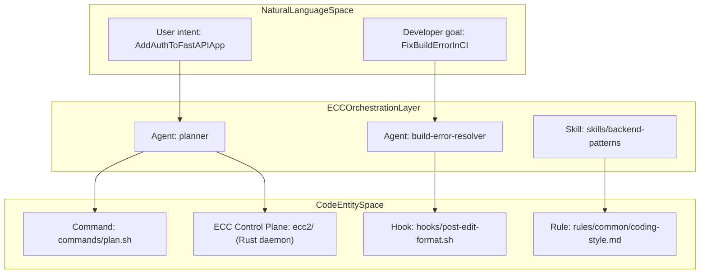
*This diagram illustrates how user requests are processed by specialized agents that invoke commands, trigger automated hooks, apply coding rules, and interact with the persistent Rust control plane.*

Sources: [AGENTS.md:15-51](), [manifests/install-modules.json:1-87](), [package.json:97-106]()

---

### Key Components & Their Code Locations

ECC is modular and extensible, organized into selectable installation components managed via module manifests [manifests/install-modules.json:1-87]().

| Component       | Location                      | Description                                                                                  |
|-----------------|-------------------------------|----------------------------------------------------------------------------------------------|
| **Agents**      | `agents/`, `.agents/`          | Domain-specialized AI personas with behavior instructions for planning, reviewing, and TDD.  |
| **Skills**      | `skills/`                     | The canonical workflow surface containing 311 reusable skills and behavioral modules.        |
| **Commands**    | `commands/`                   | Slash-command library and legacy shims for cross-harness interface adaptation.               |
| **Hooks**       | `hooks/`, `scripts/hooks/`    | Lifecycle event triggers automating quality, safety, observability, and validation.          |
| **Rules**       | `rules/`                     | Language-specific and common coding guidelines enforced during editing and reviews.          |
| **Control Plane** | `ecc2/`                     | Rust-based session daemon and TUI providing persistence, messaging, and lifecycle control.   |

**Diagram 2: High-Level Component Interaction**
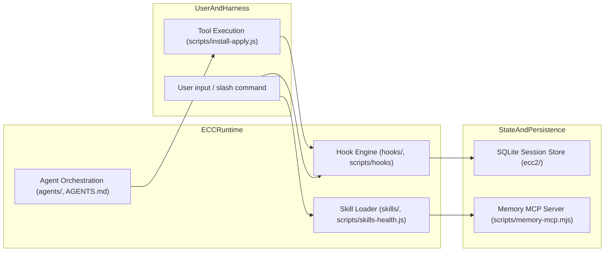
*This interaction flow demonstrates how user actions and tool invocations propagate through hooks, skills, and agents while maintaining state and control via persistent storage layers.*

Sources: [.claude-plugin/plugin.json:1-46](), [manifests/install-modules.json:1-87](), [package.json:97-106](), [AGENTS.md:7-134]()

---

### How to Navigate This Wiki

This wiki is structured to guide users from initial installation to advanced operator proficiency. Explore the child pages for detailed deep-dives:

- **[Getting Started & Installation](#1.1)** — Installing ECC via npm (`ecc-universal`), the plugin marketplace (`ecc@ecc`), or git clone with selective profiles. Covers install scripts, migration guides, and Antigravity 2.0 setup.
- **[Core Concepts & Terminology](#1.2)** — Definitions of Skills, Agents, Hooks, Rules, Commands, Instincts, and Harnesses, and how they interrelate.
- **[User Guides (Shortform & Longform)](#1.3)** — Practical daily usage instructions covering command chaining, multi-agent sessions, token optimization, and token budgets.
- **[Contributing & Community Governance](#1.4)** — Overview of contribution workflows (`CONTRIBUTING.md`), moderation policies (`pr-burst-guard`, `issue-submission-guard`), code of conduct, and sponsor integration.

Sources: [README.md:69-95](), [.claude-plugin/plugin.json:25-38](), [AGENTS.md:1-131]()

---

*End of page 1: Overview — links to child pages 1.1, 1.2, 1.3, and 1.4 for in-depth topics.*

Sources:
- README.md:1-95
- AGENTS.md:1-134
- .claude-plugin/plugin.json:1-46
- manifests/install-modules.json:1-87
- package.json:1-215

---

# Page: Getting Started & Installation

# Getting Started & Installation

<details>
<summary>Relevant source files</summary>

The following files were used as context for generating this wiki page:

- [.mcp.json](.mcp.json)
- [docs/ANTIGRAVITY-GUIDE.md](docs/ANTIGRAVITY-GUIDE.md)
- [docs/ja-JP/skills/configure-ecc/SKILL.md](docs/ja-JP/skills/configure-ecc/SKILL.md)
- [docs/releases/2.2.0/launch-runbook.md](docs/releases/2.2.0/launch-runbook.md)
- [docs/releases/2.2.0/release-notes.md](docs/releases/2.2.0/release-notes.md)
- [docs/zh-CN/skills/configure-ecc/SKILL.md](docs/zh-CN/skills/configure-ecc/SKILL.md)
- [install.ps1](install.ps1)
- [install.sh](install.sh)
- [manifests/install-assets/claude-project-scripts-package.json](manifests/install-assets/claude-project-scripts-package.json)
- [rules/README.md](rules/README.md)
- [schemas/state-store.schema.json](schemas/state-store.schema.json)
- [scripts/claw.js](scripts/claw.js)
- [scripts/codex-git-hooks/pre-commit](scripts/codex-git-hooks/pre-commit)
- [scripts/codex-git-hooks/pre-push](scripts/codex-git-hooks/pre-push)
- [scripts/codex/install-global-git-hooks.sh](scripts/codex/install-global-git-hooks.sh)
- [scripts/codex/merge-mcp-config.js](scripts/codex/merge-mcp-config.js)
- [scripts/doctor.js](scripts/doctor.js)
- [scripts/ecc.js](scripts/ecc.js)
- [scripts/hooks/desktop-notify.js](scripts/hooks/desktop-notify.js)
- [scripts/hooks/mcp-health-check.js](scripts/hooks/mcp-health-check.js)
- [scripts/hooks/run-with-flags-shell.sh](scripts/hooks/run-with-flags-shell.sh)
- [scripts/lib/codex-legacy-sync.js](scripts/lib/codex-legacy-sync.js)
- [scripts/lib/install-targets/claude-project.js](scripts/lib/install-targets/claude-project.js)
- [scripts/lib/nasiko-release.js](scripts/lib/nasiko-release.js)
- [scripts/lib/state-store/migrations.js](scripts/lib/state-store/migrations.js)
- [scripts/lib/state-store/queries.js](scripts/lib/state-store/queries.js)
- [scripts/lib/state-store/schema.js](scripts/lib/state-store/schema.js)
- [scripts/list-installed.js](scripts/list-installed.js)
- [scripts/nasiko.js](scripts/nasiko.js)
- [scripts/repair.js](scripts/repair.js)
- [scripts/status.js](scripts/status.js)
- [scripts/uninstall.js](scripts/uninstall.js)
- [skills/configure-ecc/SKILL.md](skills/configure-ecc/SKILL.md)
- [skills/nasiko-control-plane/SKILL.md](skills/nasiko-control-plane/SKILL.md)
- [skills/nasiko-control-plane/agents/openai.yaml](skills/nasiko-control-plane/agents/openai.yaml)
- [tests/ci/nasiko-control-plane.test.js](tests/ci/nasiko-control-plane.test.js)
- [tests/docs/antigravity-guide.test.js](tests/docs/antigravity-guide.test.js)
- [tests/docs/configure-ecc-install-paths.test.js](tests/docs/configure-ecc-install-paths.test.js)
- [tests/hooks/mcp-health-check.test.js](tests/hooks/mcp-health-check.test.js)
- [tests/lib/codex-legacy-sync.test.js](tests/lib/codex-legacy-sync.test.js)
- [tests/lib/state-store.test.js](tests/lib/state-store.test.js)
- [tests/scripts/claw.test.js](tests/scripts/claw.test.js)
- [tests/scripts/codex-hooks.test.js](tests/scripts/codex-hooks.test.js)
- [tests/scripts/ecc.test.js](tests/scripts/ecc.test.js)
- [tests/scripts/install-ps1.test.js](tests/scripts/install-ps1.test.js)
- [tests/scripts/install-readme-clarity.test.js](tests/scripts/install-readme-clarity.test.js)
- [tests/scripts/install-sh.test.js](tests/scripts/install-sh.test.js)
- [tests/scripts/npm-publish-surface.test.js](tests/scripts/npm-publish-surface.test.js)
- [tests/scripts/uninstall.test.js](tests/scripts/uninstall.test.js)

</details>


## Purpose and Scope

This page provides full technical documentation for installing, configuring, and verifying Everything Claude Code (ECC). It covers installation channels (`npm`, plugin marketplace, or source clone), installation profiles (`minimal`, `core`, `full`), cross-platform bootstrap scripts (`install.sh`, `install.ps1`, `ecc-install`), in-harness conversational setup wizards, the Antigravity 2.0 native installation framework, and the version 1.x-to-2.0 migration guide.

---

## 1. Installation Entrypoints & Runtime Architecture

ECC installation can be executed from multiple entrypoints depending on whether the operator uses a source clone, an npm package, or a harness plugin registry.

- **`install.sh`**: Unix shell wrapper that validates bash features, symlinked paths, auto-installs dependencies via `npm install --ignore-scripts --no-audit --no-fund --loglevel=error`, and executes `scripts/install-apply.js` [install.sh:1-42]().
- **`install.ps1`**: Windows PowerShell wrapper that performs environment detection, path conversion, dependency checks, and delegates to the Node installer runtime [install.ps1]().
- **`scripts/ecc.js`**: The universal selective-install CLI (`ecc`), exposing subcommands like `setup`, `install`, `plan`, `catalog`, `doctor`, `repair`, and `uninstall` [scripts/ecc.js:10-110]().
- **`scripts/install-apply.js`**: Core programmatic install execution engine that coordinates target adapters and applies filesystem operations.

### Diagram: Natural Language Space to Code Entity Space (Bootstrap & CLI Routing)

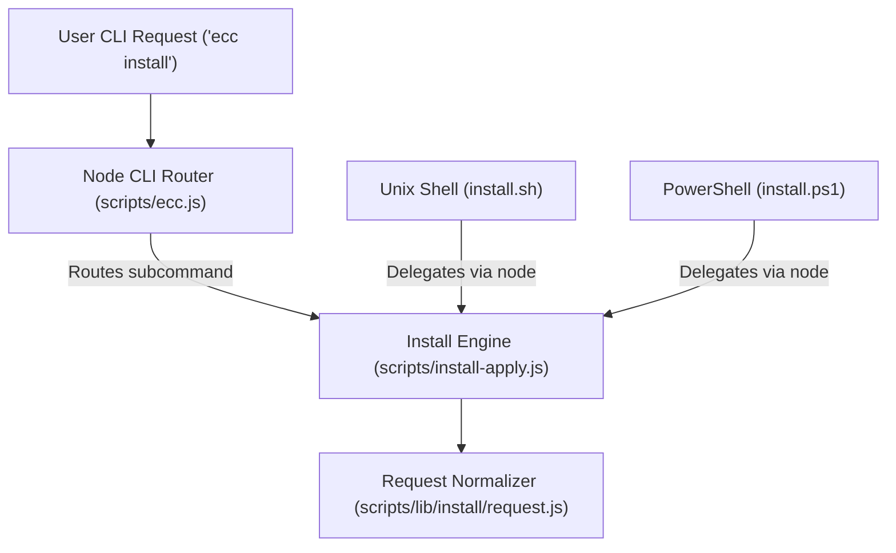
Sources: [install.sh:1-42](), [scripts/ecc.js:10-110]()

---

## 2. Installation Lifecycle & Data Flow

The installer executes a deterministic pipeline to parse intents, resolve manifests, generate target scaffolds, and commit changes to disk.

1. **Request Normalization**: Parses user options (scope, target, profiles) into a structured request object via `normalizeInstallRequest`.
2. **Manifest Resolution**: Maps requested profiles (`minimal`, `core`, `full`) against `manifests/install-modules.json` and `manifests/install-profiles.json` to compile a complete module graph.
3. **Scaffold Planning**: Target adapters (e.g., `scripts/lib/install-targets/claude-home.js`) generate an operation plan (`planOperations`) containing write, link, and removal steps.
4. **Execution & State Persistence**: `applyInstallPlan` commits file modifications to disk and records state hashes via `writeInstallState` in `scripts/lib/install-state.js`.

### Diagram: Execution Flow of the Installation Pipeline

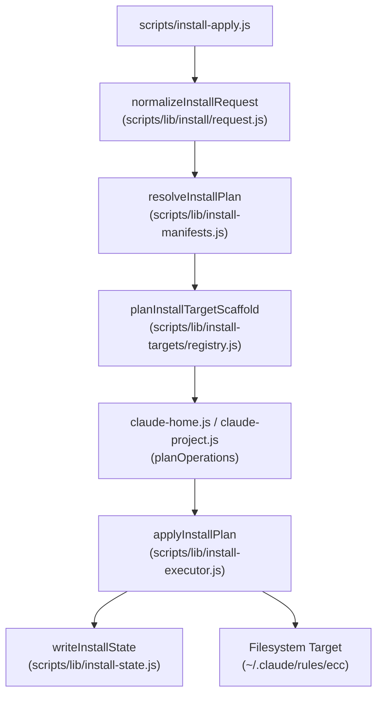
Sources: [scripts/lib/install/request.js:1-30](), [scripts/lib/install-manifests.js:18-40](), [scripts/lib/install-targets/registry.js:45-85](), [scripts/lib/install-executor.js:130-170]()

---

## 3. Supported Install Targets & Profiles

ECC targets multiple AI harness environments, adapting file placement and layout rules accordingly.

### Supported Targets

| Target | Destination Path | Description |
| :--- | :--- | :--- |
| `claude` | `~/.claude/` | Global install for Claude Code [tests/scripts/npm-publish-surface.test.js:59-125]() |
| `cursor` | `./.cursor/` | Project-local rules and Cursor IDE support [tests/scripts/uninstall.test.js:95-133]() |
| `antigravity` | `./.agents/` | Native Antigravity 2.0 worker layouts [docs/ANTIGRAVITY-GUIDE.md:1-20]() |
| `opencode` | `~/.config/opencode/` | Global config for OpenCode [tests/lib/state-store.test.js:44-60]() |
| `kimi` | `./.kimi-code/` | Project-local files for Kimi Code [skills/configure-ecc/SKILL.md:24-25]() |
| `zed` | `./.zed/` | Flat rules and settings for Zed editor |

### Installation Profiles

Profiles bundle module families defined in `manifests/install-profiles.json`:
- **`minimal`**: Core rules only, omitting the hooks runtime.
- **`core`**: Rules, agents, commands, and hooks runtime.
- **`full`**: All core components plus security, research, and optimization packages.

Sources: [tests/scripts/npm-publish-surface.test.js:59-165](), [docs/ANTIGRAVITY-GUIDE.md:1-60]()

---

## 4. In-Harness Configuration & Guided Setup

The `configure-ecc` skill provides an in-harness conversational wizard that inventories existing installations, collects user choices (scope: `user`, `project`, `local`; hooks: `off`, `minimal`, `standard`, `strict`), previews modifications, and applies changes via `scripts/setup.js` [skills/configure-ecc/SKILL.md:1-139]().

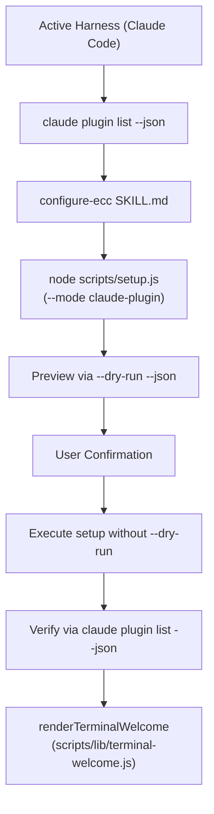
Sources: [skills/configure-ecc/SKILL.md:1-139](), [scripts/ecc.js:10-13]()

---

## 5. Antigravity 2.0 Native Installation

Google Antigravity 2.0 discovers workspace customizations from the project-local `.agents/` directory [docs/ANTIGRAVITY-GUIDE.md:1-10]().

### Quick Start & Source Invocation

Using the published npm package:
```bash
npx ecc-universal@2.2.3 install --profile minimal --target antigravity
```

Using a source checkout:
```bash
ECC_ROOT="/absolute/path/to/ECC"
"$ECC_ROOT/install.sh" --profile minimal --target antigravity
```

### Native Install Mapping

| ECC Source | Antigravity Destination | Purpose |
| :--- | :--- | :--- |
| `rules/` | `.agents/rules/` | Flattened workspace rules [docs/ANTIGRAVITY-GUIDE.md:47-55]() |
| `commands/` | `.agents/workflows/` | User-invoked slash workflows [docs/ANTIGRAVITY-GUIDE.md:47-55]() |
| `skills/<name>/` | `.agents/skills/<name>/` | Agent Skills with required `SKILL.md` [docs/ANTIGRAVITY-GUIDE.md:47-55]() |
| `agents/<name>.md` | `.agents/agents/<name>.md` | Custom agents and subagents [docs/ANTIGRAVITY-GUIDE.md:47-55]() |

Sources: [docs/ANTIGRAVITY-GUIDE.md:1-82]()

---

## 6. Verification, Doctor System & Repair

ECC includes a validation subsystem [scripts/ecc.js:63-73]() that compares on-disk installation hashes against records stored in `install-state.json`.

- **`doctor.js`**: Scans targets for missing or drifted files by computing SHA256 hashes.
- **`repair.js`**: Restores drifted or missing ECC-managed components.
- **`list-installed.js`**: Enumerates installed modules and paths.

Sources: [scripts/ecc.js:58-73](), [tests/scripts/uninstall.test.js:95-133]()

---

## 7. Migration from ECC 1.x to 2.0

ECC 2.0 enforces a strict namespaced rule hierarchy (`rules/common/` and `rules/ecc/`) to prevent file collisions. Legacy installations storing flat files directly in `~/.claude/rules/*.md` are migrated automatically or via `claude-skill-migration.js`, which moves files into the namespaced structure and updates `install-state.json`.

Sources: [rules/README.md:1-100]()

---

# Page: Core Concepts & Terminology

# Core Concepts & Terminology

<details>
<summary>Relevant source files</summary>

The following files were used as context for generating this wiki page:

- [.claude-plugin/marketplace.json](.claude-plugin/marketplace.json)
- [.claude-plugin/plugin.json](.claude-plugin/plugin.json)
- [AGENTS.md](AGENTS.md)
- [README.md](README.md)
- [README.zh-CN.md](README.zh-CN.md)
- [agent.yaml](agent.yaml)
- [docs/tr/AGENTS.md](docs/tr/AGENTS.md)
- [docs/zh-CN/AGENTS.md](docs/zh-CN/AGENTS.md)
- [docs/zh-CN/README.md](docs/zh-CN/README.md)
- [examples/user-CLAUDE.md](examples/user-CLAUDE.md)
- [manifests/install-modules.json](manifests/install-modules.json)
- [package.json](package.json)
- [rules/common/code-review.md](rules/common/code-review.md)
- [rules/common/coding-style.md](rules/common/coding-style.md)
- [rules/common/development-workflow.md](rules/common/development-workflow.md)
- [rules/common/patterns.md](rules/common/patterns.md)
- [rules/common/security.md](rules/common/security.md)
- [rules/common/testing.md](rules/common/testing.md)
- [skills/backend-patterns/SKILL.md](skills/backend-patterns/SKILL.md)
- [skills/clickhouse-io/SKILL.md](skills/clickhouse-io/SKILL.md)
- [skills/coding-standards/SKILL.md](skills/coding-standards/SKILL.md)
- [skills/continuous-learning/SKILL.md](skills/continuous-learning/SKILL.md)
- [skills/django-verification/SKILL.md](skills/django-verification/SKILL.md)
- [skills/eval-harness/SKILL.md](skills/eval-harness/SKILL.md)
- [skills/frontend-patterns/SKILL.md](skills/frontend-patterns/SKILL.md)
- [skills/iterative-retrieval/SKILL.md](skills/iterative-retrieval/SKILL.md)
- [skills/prisma-patterns/SKILL.md](skills/prisma-patterns/SKILL.md)
- [skills/search-first/SKILL.md](skills/search-first/SKILL.md)
- [skills/security-review/SKILL.md](skills/security-review/SKILL.md)

</details>


Everything Claude Code (ECC) is a harness-native agent operating system designed to extend AI coding assistants with production-ready engineering workflows [package.json:2-4](). This page defines the fundamental building blocks that comprise the ECC ecosystem—Skills, Agents, Hooks, Rules, Commands, Instincts, and Harnesses—and explains their technical implementation, data flow, and interrelationships across supported harnesses.

## System Hierarchy

The ECC architecture is built on a layered model where high-level **Agents** (`agents/*.md`) orchestrate **Skills** (`skills/*/SKILL.md`), which are governed by **Rules** (`rules/*/*.md`), automated by **Hooks** (`hooks/`, `scripts/hooks/`), and manually invoked via **Commands** (`commands/*.md`) [manifests/install-modules.json:1-120](), [package.json:53-110]().

### Bridge: Natural Language to Code Entity Space

The following diagram maps the conceptual "Natural Language" requirements of an engineer to the specific "Code Entities" defined in the ECC repository structure.

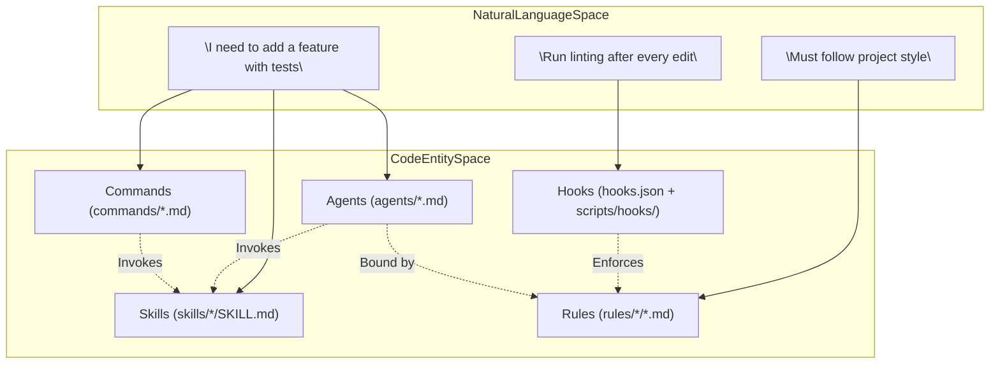
Sources: [AGENTS.md:1-15](), [.claude-plugin/plugin.json:40-45](), [manifests/install-modules.json:1-118]()

---

## 1. Agents

**Agents** represent the "who" within ECC: specialized, persona-driven AI assistants embodied as modular Markdown files. They define roles such as `planner`, `architect`, `code-reviewer`, and `security-reviewer`, tailoring AI behavior and expertise to discrete engineering functions [AGENTS.md:15-51]().

- **Implementation:** Defined as `.md` files stored in the top-level `agents/` directory, containing frontmatter metadata specifying the agent name, description, assigned tools (e.g., `Read`, `Edit`, `Bash`), and model parameters [AGENTS.md:15-51](), [.claude-plugin/plugin.json:40-45]().
- **Data Flow:** Agents are invoked either directly via slash commands or automatically by the orchestration engine based on context—for instance, `ecc:planner` triggers for complex feature planning, while `ecc:code-reviewer` activates post-modification [AGENTS.md:52-63]().
- **Key Functions:** Agents coordinate underlying **Skills** to fulfill domain-specific tasks. For example, `ecc:build-error-resolver` performs iterative error diagnosis and correction using compiler and linter message skills [AGENTS.md:26]().

### Agent Roles Snapshot

| Agent Name            | Purpose                                | Trigger Scenario                    |
|-----------------------|--------------------------------------|-----------------------------------|
| `ecc:planner`         | Implementation planning               | Complex features, refactoring     |
| `ecc:architect`         | System architecture decisions         | Architectural design phases       |
| `ecc:tdd-guide`         | Test-driven development guidance      | New feature or bug fix cycles     |
| `ecc:code-reviewer`     | Code quality and maintainability review | After code writing or modification|
| `ecc:security-reviewer` | Security vulnerability scanning       | Before commits or on sensitive code |
| `ecc:loop-operator`     | Autonomous monitoring of task loops   | Running and supervising loops     |
| `ecc:harness-optimizer` | Optimize harness configuration for reliability and cost | Performance tuning phase |

Sources: [AGENTS.md:15-63](), [agent.yaml:1-285]()

---

## 2. Skills

**Skills** encapsulate domain-specific, context-driven knowledge and workflow patterns representing "how to" accomplish tasks. They contain stepwise processes, architectural patterns, and example-driven guidance [package.json:178-226]().

- **Implementation:** Each skill resides as a directory under `skills/`, containing a `SKILL.md` file with structured documentation and frontmatter metadata (`name`, `description`) for harness auto-activation and discovery [package.json:178-226]().
- **Structure:** A typical `SKILL.md` details "When to Activate," "Core Concepts," and "Code Examples" for automated comprehension by ECC agents and workflows.
- **Relationship to Agents:** Agents invoke skills as atomic work units. Slash **Commands** serve as thin wrappers mapping directly onto underlying skills to execute workflows [AGENTS.md:1-97]().

Sources: [package.json:178-226](), [manifests/install-modules.json:184-246]()

---

## 3. Rules

**Rules** provide immutable, always-active constraints governing code style, architecture, security, and operational policies that all code and agent interactions must obey [rules/common/coding-style.md:1-97]().

- **Implementation:** Reside in `rules/`, split into universal `common/` rules and language-specific extension subdirectories (e.g., `rules/typescript/`, `rules/python/`, `rules/rust/`) ensuring fine-grained control [manifests/install-modules.json:5-30]().
- **Enforcement:** Rules are injected into system prompts or mounted in harness-specific configuration paths (e.g., `.cursor/rules/`) enforcing critical policies like **Immutability** (`ALWAYS create new objects, NEVER mutate existing ones`) [rules/common/coding-style.md:3-14]().

Sources: [manifests/install-modules.json:5-30](), [rules/common/coding-style.md:1-97]()

---

## 4. Hooks

**Hooks** automate lifecycle event handling and custom workflow automation, triggered by file edits, commands, session starts/stops, or other tooling events [manifests/install-modules.json:99-118]().

- **Implementation:** Defined declaratively in configuration files and implemented through shell or JavaScript scripts under `scripts/hooks/` and `hooks/` directories [manifests/install-modules.json:99-118]().
- **Lifecycle Events:** Common hooks include session lifecycle (`SessionStart`, `Stop`), pre- and post-tool invocations (`PreToolUse`, `PostToolUse`), enabling integration around ECC workflows [.claude-plugin/plugin.json:25-38]().
- **Runtime Configuration:** Execution behavior is controlled via plugin config and environment variables such as `ECC_HOOK_PROFILE` (`minimal`, `standard`, `strict`) to gate operational modes [.claude-plugin/plugin.json:25-38]().

Sources: [manifests/install-modules.json:99-118](), [.claude-plugin/plugin.json:25-38]()

---

## 5. Commands

**Commands** expose user-facing slash commands (e.g., `/plan`, `/tdd`, `/code-review`) serving as explicit entrypoints to execute ECC workflows or underlying skills [agent.yaml:180-277]().

- **Implementation:** Defined as Markdown files in the `commands/` directory with execution logic in supporting scripts, and enumerated in `agent.yaml` [package.json:82](), [agent.yaml:180-277]().
- **Compatibility:** Commands act as compatibility shims forwarding to canonical skills, maintaining user familiarity while backing a skill-first architecture [AGENTS.md:1-97]().

Sources: [package.json:82](), [agent.yaml:180-277](), [AGENTS.md:1-97]()

---

## 6. Instincts (Continuous Learning)

**Instincts** are emergent project-specific behavioral learnings captured dynamically by the Continuous Learning v2 system to continuously evolve ECC workflows [README.zh-CN.md:74-75]().

- **Implementation:** Observed via hook scripts, processed by skills under `skills/continuous-learning-v2/`, and managed via CLI tools, applying scoped analysis via Homunculus directories [package.json:215]().
- **Lifecycle & Operations:** Insights are scored for confidence, promoted into stable skills, and operated via commands like `/learn`, `/promote`, and `/instinct-status` [agent.yaml:196-220]().

Sources: [README.zh-CN.md:74-75](), [package.json:215](), [agent.yaml:196-220]()

---

## 7. Harnesses

A **Harness** is the AI assistant runtime environment where ECC operates (e.g., Claude Code, Codex, OpenCode, Cursor, Gemini). ECC is engineered for **Cross-Harness Portability**, ensuring consistent operation across diverse platforms [package.json:2-15](), [manifests/install-modules.json:1-175]().

- **Supported Harnesses:** Claude Code, Codex, OpenCode, Cursor, Gemini, Kiro, Zed, Antigravity, and Kimi [manifests/install-modules.json:1-175]().
- **Adaptation Engine:** The installation pipeline (`scripts/install-apply.js`, `scripts/harness-adapter-compliance.js`) maps canonical ECC modules to target-specific harness directory layouts and configuration conventions [package.json:139,151]().

### Harness Integration Map

The diagram below maps how ECC core source assets flow through the distribution and adaptation engine into target harness environments.

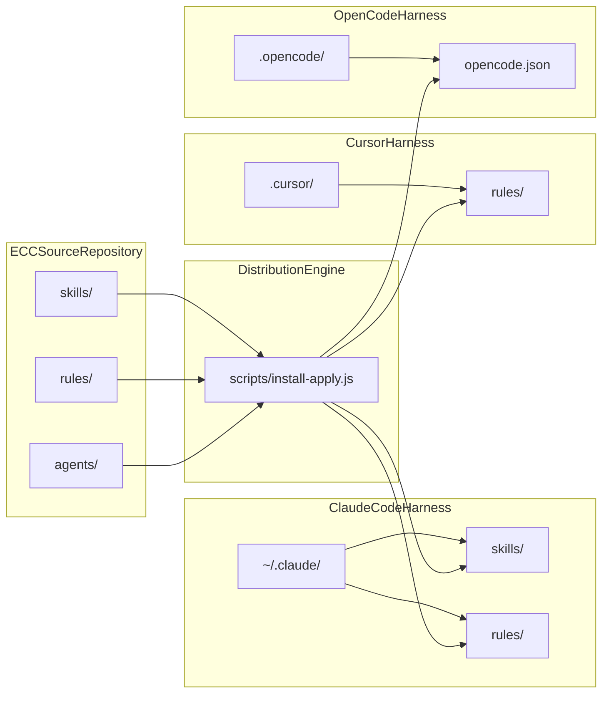
Sources: [manifests/install-modules.json:1-175](), [package.json:43-57,139,151]()

---

## Technical Summary Table

| Concept    | Repository Path          | Storage Format      | Primary Role                              |
|------------|-------------------------|---------------------|------------------------------------------|
| **Agent**  | `agents/*.md`           | Markdown (`.md`)    | Specialized AI persona / behavioral module |
| **Skill**  | `skills/*/SKILL.md`      | Directory + Markdown | Domain workflow knowledge, stepwise processes |
| **Rule**   | `rules/*/*.md`           | Markdown (`.md`)    | Universal or language-specific constraints |
| **Hook**   | `hooks/`, `scripts/hooks/` | JSON + Shell/JS    | Automated lifecycle and event-driven scripting |
| **Command**| `commands/*.md`           | Markdown (`.md`)    | User-facing command entry points wrapping skills |
| **Instinct** | `skills/continuous-learning-v2/` | JSON / Markdown  | Adaptive, project-learned behavioral patterns |
| **Harness** | External environment     | Runtime environment | Host AI assistant platform (Claude, Codex, etc.) |

Sources: [package.json:4-115](), [manifests/install-modules.json:1-175](), [AGENTS.md:1-97](), [.claude-plugin/plugin.json:1-46](), [agent.yaml:1-285]()

---

# Page: User Guides (Shortform & Longform)

# User Guides (Shortform & Longform)

<details>
<summary>Relevant source files</summary>

The following files were used as context for generating this wiki page:

- [.claude/rules/node.md](.claude/rules/node.md)
- [.cursor/rules/common-performance.md](.cursor/rules/common-performance.md)
- [CODE_OF_CONDUCT.md](CODE_OF_CONDUCT.md)
- [COMMANDS-QUICK-REF.md](COMMANDS-QUICK-REF.md)
- [agents/react-build-resolver.md](agents/react-build-resolver.md)
- [agents/react-reviewer.md](agents/react-reviewer.md)
- [agents/typescript-reviewer.md](agents/typescript-reviewer.md)
- [assets/images/shortform/00-header.png](assets/images/shortform/00-header.png)
- [docs/COMMAND-AGENT-MAP.md](docs/COMMAND-AGENT-MAP.md)
- [docs/es/rules/common/performance.md](docs/es/rules/common/performance.md)
- [docs/examples/project-guidelines-template.md](docs/examples/project-guidelines-template.md)
- [docs/ja-JP/rules/common/performance.md](docs/ja-JP/rules/common/performance.md)
- [docs/ja-JP/skills/cost-aware-llm-pipeline/SKILL.md](docs/ja-JP/skills/cost-aware-llm-pipeline/SKILL.md)
- [docs/ja-JP/skills/django-security/SKILL.md](docs/ja-JP/skills/django-security/SKILL.md)
- [docs/ja-JP/skills/project-guidelines-example/SKILL.md](docs/ja-JP/skills/project-guidelines-example/SKILL.md)
- [docs/ko-KR/rules/performance.md](docs/ko-KR/rules/performance.md)
- [docs/pt-BR/rules/performance.md](docs/pt-BR/rules/performance.md)
- [docs/token-optimization.md](docs/token-optimization.md)
- [docs/tr/rules/common/performance.md](docs/tr/rules/common/performance.md)
- [docs/tr/the-longform-guide.md](docs/tr/the-longform-guide.md)
- [docs/tr/the-security-guide.md](docs/tr/the-security-guide.md)
- [docs/tr/the-shortform-guide.md](docs/tr/the-shortform-guide.md)
- [docs/zh-CN/CODE_OF_CONDUCT.md](docs/zh-CN/CODE_OF_CONDUCT.md)
- [docs/zh-CN/commands/orchestrate.md](docs/zh-CN/commands/orchestrate.md)
- [docs/zh-CN/commands/plan.md](docs/zh-CN/commands/plan.md)
- [docs/zh-CN/commands/python-review.md](docs/zh-CN/commands/python-review.md)
- [docs/zh-CN/commands/tdd.md](docs/zh-CN/commands/tdd.md)
- [docs/zh-CN/rules/common/performance.md](docs/zh-CN/rules/common/performance.md)
- [docs/zh-CN/skills/cost-aware-llm-pipeline/SKILL.md](docs/zh-CN/skills/cost-aware-llm-pipeline/SKILL.md)
- [docs/zh-CN/the-longform-guide.md](docs/zh-CN/the-longform-guide.md)
- [docs/zh-CN/the-shortform-guide.md](docs/zh-CN/the-shortform-guide.md)
- [docs/zh-TW/agents/database-reviewer.md](docs/zh-TW/agents/database-reviewer.md)
- [docs/zh-TW/rules/performance.md](docs/zh-TW/rules/performance.md)
- [docs/zh-TW/skills/project-guidelines-example/SKILL.md](docs/zh-TW/skills/project-guidelines-example/SKILL.md)
- [examples/statusline.json](examples/statusline.json)
- [rules/common/performance.md](rules/common/performance.md)
- [rules/typescript/security.md](rules/typescript/security.md)
- [scripts/lib/session-bridge.js](scripts/lib/session-bridge.js)
- [skills/cost-aware-llm-pipeline/SKILL.md](skills/cost-aware-llm-pipeline/SKILL.md)
- [skills/osint-investigation/SKILL.md](skills/osint-investigation/SKILL.md)
- [tests/docs/mcp-management-docs.test.js](tests/docs/mcp-management-docs.test.js)
- [the-longform-guide.md](the-longform-guide.md)
- [the-shortform-guide.md](the-shortform-guide.md)

</details>


This page provides practical daily-usage guides for Everything Claude Code (ECC) workflows. It focuses on maximizing productivity through strategic command chaining, efficient agent orchestration, token optimization, and robust session persistence. These guides synthesize the operational patterns detailed in `the-shortform-guide.md` and `the-longform-guide.md`, transitioning the user from interactive prompting to advanced software engineering automation.

Sources: [the-shortform-guide.md:1-173](), [the-longform-guide.md:1-122]()

---

## 1. Core Workflow Surface: Skills & Commands

The primary interaction layer in ECC consists of modular **Skills** and legacy **Commands**.

### 1.1 Skills vs. Commands
*   **Skills** (`~/.claude/skills/`): The canonical workflow definitions. They encapsulate reusable prompts, modular structures, and supporting assets or codemaps that allow agents to navigate codebases without burning context tokens on exploration [the-shortform-guide.md:13-26]().
*   **Commands** (`~/.claude/commands/`): Legacy slash-entry shims maintained for backward compatibility during migration. Durable execution logic resides within the skill layer [the-shortform-guide.md:22-26]().

### 1.2 Common Development Chaining
For complex engineering tasks, slash commands and underlying skills can be chained sequentially to ensure quality gates are met:
1.  `/plan`: Establish the implementation roadmap [the-shortform-guide.md:13-20]().
2.  `/tdd`: Implement following Test-Driven Development loops [the-shortform-guide.md:17]().
3.  `/refactor-clean`: Clean up dead code and loose files post-implementation [the-shortform-guide.md:17]().

Sources: [the-shortform-guide.md:13-34](), [the-longform-guide.md:12-18]()

---

## 2. Token Economics & Optimization

Token management is critical for maintaining long-running, coherent sessions without triggering context rot or performance degradation.

### 2.1 Configuration and Model Routing
To control token consumption and manage cost limits, ECC integrates recommended settings and programmatic pipeline patterns. Settings such as `CLAUDE_CODE_EFFORT_LEVEL` and `CLAUDE_CODE_SUBAGENT_MODEL` in `~/.claude/settings.json` delegate lightweight exploration tasks to Haiku while reserving Sonnet or Opus for complex reasoning [docs/token-optimization.md:9-23]().

Programmatically, the `cost-aware-llm-pipeline` skill (`skills/cost-aware-llm-pipeline/SKILL.md`) implements model routing by task complexity, immutable cost tracking via frozen dataclasses (`CostTracker`, `CostRecord`), narrow retry logic (`call_with_retry`), and prompt caching [skills/cost-aware-llm-pipeline/SKILL.md:21-127]().

```python
def select_model(text_length: int, item_count: int, force_model: str | None = None) -> str:
    if force_model is not None:
        return force_model
    if text_length >= 10_000 or item_count >= 30:
        return "claude-sonnet-5"
    return "claude-haiku-4-5-20251001"
```

Sources: [docs/token-optimization.md:9-50](), [skills/cost-aware-llm-pipeline/SKILL.md:21-43]()

### 2.2 CLI Over Heavy MCP Wrappers
Many Model Context Protocol (MCP) servers wrap existing version control, database, or deployment CLIs (e.g., GitHub, Supabase, Vercel) [the-longform-guide.md:24-27](). While convenient for autonomous access, loading many MCPs severely reduces your usable context window in Claude Code [the-longform-guide.md:26-30]().

To optimize tokens, users replace heavy MCPs by wrapping CLI functionality into lightweight skills or commands [the-longform-guide.md:28-33]().

Sources: [the-longform-guide.md:24-33]()

---

## 3. Memory & Session Persistence

Preserving state across restarts prevents context degradation and supports seamless continuation across multi-day workflows.

### 3.1 Dynamic System Prompt Injection
Instead of polluting persistent user or project-wide configuration files with transient context, ECC users can inject session-specific context dynamically on startup via CLI flags [the-longform-guide.md:54-62]():

```bash
claude --system-prompt "$(cat ~/.claude/contexts/dev.md)"
```

### 3.2 Session Bridge & Persistence Hooks
Session state is coordinated via utility scripts like `scripts/lib/session-bridge.js`, which provides atomic file locking and safe JSON read/write operations (`readBridge`, `writeBridgeAtomic`, `renameWithRetry`) across concurrent hook executions [scripts/lib/session-bridge.js:45-129]().

ECC leverages lifecycle hooks to automate memory persistence:
- **PreCompact Hook**: Saves vital state prior to context compaction [the-longform-guide.md:81]().
- **Stop Hook (Session End)**: Automatically writes learnings and progress summaries to session files when the session ends [the-longform-guide.md:82]().
- **SessionStart Hook**: Loads previous context automatically on session start [the-longform-guide.md:83]().

Sources: [scripts/lib/session-bridge.js:1-148](), [the-longform-guide.md:38-86]()

---

## 4. Architectural Data Flow & Component Mapping

The following diagrams bridge natural language intents with concrete code artifacts and functional components in ECC.

### Diagram 1: Token Routing Pipeline
**Title: "NaturalLanguageToCodeExecutionForCostAwareLLM"**

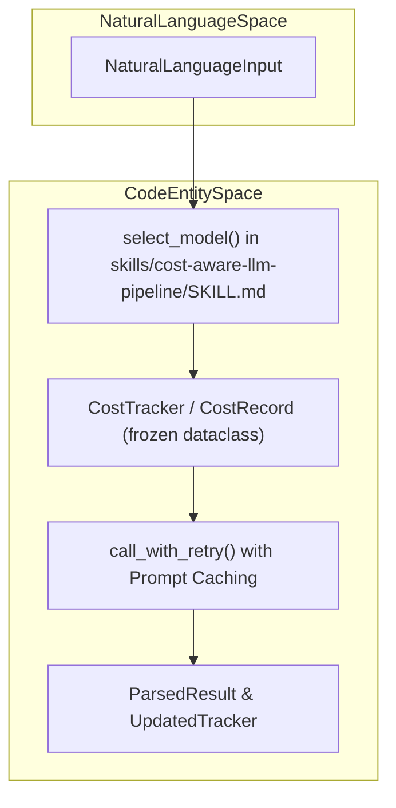

Sources: [skills/cost-aware-llm-pipeline/SKILL.md:21-153]()

---

### Diagram 2: Session Bridge & Persistence Flow
**Title: "NaturalLanguageSessionEndToBridgeStorage"**

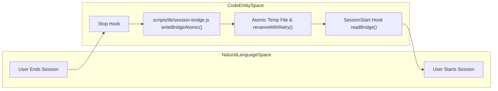

Sources: [scripts/lib/session-bridge.js:45-129](), [the-longform-guide.md:78-86]()

---

## 5. Summary of Key Interaction Patterns

| Pattern | Code Entity / Mechanism | Benefit |
|---------|-------------------------|---------|
| **Trigger-Based Loading** | `skills/` directory scanning | Loads workflow bundles on demand to reduce baseline context overhead [the-shortform-guide.md:13-26]() |
| **Subagent Architecture** | `agents/` configuration and orchestration | Delegates task types to specialized models to optimize token cost & latency [the-longform-guide.md:107-124]() |
| **CLI Wrapper Substitution** | Custom commands replacing heavy MCPs | Minimizes context window depletion by avoiding MCP tool-load overhead [the-longform-guide.md:24-33]() |
| **Lifecycle Hooks & Bridge** | `scripts/lib/session-bridge.js` & hooks | Automates atomic memory persistence for seamless session continuity [scripts/lib/session-bridge.js:74-84]() |

Sources: [the-shortform-guide.md:13-26](), [scripts/lib/session-bridge.js:74-84](), [the-longform-guide.md:24-124]()

---

# Page: Contributing & Community Governance

# Contributing & Community Governance

<details>
<summary>Relevant source files</summary>

The following files were used as context for generating this wiki page:

- [.claude-plugin/README.md](.claude-plugin/README.md)
- [.github/ISSUE_MODERATION.md](.github/ISSUE_MODERATION.md)
- [.github/PR_MODERATION.md](.github/PR_MODERATION.md)
- [.github/issue-submission-policy.json](.github/issue-submission-policy.json)
- [.github/pr-burst-policy.json](.github/pr-burst-policy.json)
- [.github/workflows/issue-submission-guard.yml](.github/workflows/issue-submission-guard.yml)
- [.github/workflows/pr-burst-guard.yml](.github/workflows/pr-burst-guard.yml)
- [.kimi/README.md](.kimi/README.md)
- [CONTRIBUTING.md](CONTRIBUTING.md)
- [SPONSORS.md](SPONSORS.md)
- [assets/images/guides/longform-guide.png](assets/images/guides/longform-guide.png)
- [assets/images/guides/shorthand-guide.png](assets/images/guides/shorthand-guide.png)
- [assets/images/sponsors/atlascloud-dark.svg](assets/images/sponsors/atlascloud-dark.svg)
- [assets/images/sponsors/atlascloud.svg](assets/images/sponsors/atlascloud.svg)
- [assets/images/sponsors/coderabbit.png](assets/images/sponsors/coderabbit.png)
- [assets/images/sponsors/greptile.png](assets/images/sponsors/greptile.png)
- [assets/images/sponsors/moonshot-dark.png](assets/images/sponsors/moonshot-dark.png)
- [assets/images/sponsors/moonshot.png](assets/images/sponsors/moonshot.png)
- [docs/ATLAS-CLOUD-GUIDE.md](docs/ATLAS-CLOUD-GUIDE.md)
- [docs/uk-UA/README.md](docs/uk-UA/README.md)
- [scripts/ci/issue-submission-guard.js](scripts/ci/issue-submission-guard.js)
- [scripts/ci/pr-burst-guard.js](scripts/ci/pr-burst-guard.js)
- [scripts/lib/compute-sponsor.js](scripts/lib/compute-sponsor.js)
- [src/llm/cli/selector.py](src/llm/cli/selector.py)
- [tests/ci/issue-submission-guard-workflow.test.js](tests/ci/issue-submission-guard-workflow.test.js)
- [tests/ci/issue-submission-guard.test.js](tests/ci/issue-submission-guard.test.js)
- [tests/ci/pr-burst-guard-workflow.test.js](tests/ci/pr-burst-guard-workflow.test.js)
- [tests/ci/pr-burst-guard.test.js](tests/ci/pr-burst-guard.test.js)
- [tests/scripts/ito-compute-sponsor.test.js](tests/scripts/ito-compute-sponsor.test.js)

</details>


## Purpose & Scope

This page documents the technical workflows, moderation policies, asset compliance requirements, and community governance structures established in the Everything Claude Code (ECC) codebase. It details the contribution pipeline defined in `CONTRIBUTING.md`, the automated metadata-only moderation engines (`pr-burst-guard` and `issue-submission-guard`), skill adaptation policies, and the sponsorship and compute-integration architecture centered around Itô compute.

Sources: `CONTRIBUTING.md:1-50`, `.github/PR_MODERATION.md:1-20`, `SPONSORS.md:1-25`.

---

## Contribution Workflow & Asset Guidelines

ECC welcomes community contributions across four primary component families: Agents, Skills, Hooks, and Commands (`CONTRIBUTING.md:24-52`). 

### Quick Start & Branch Isolation
Contributors fork the repository, create topic branches (`feat/my-contribution`), develop assets locally within appropriate subdirectories, and submit pull requests (`CONTRIBUTING.md:55-73`). Assets must be validated locally against Claude Code or target harness environments prior to submission (`CONTRIBUTING.md:67-71`).

### Skill Adaptation & Frontmatter Constraints
When porting concepts from external repositories or prompt packs, contributors must adhere to the **Skill Adaptation Policy** (`CONTRIBUTING.md:152-162`):
- Copy underlying architectural concepts rather than external product identities.
- Rename skills if ECC materially expands or alters the surface area.
- Prefer ECC-native rules, skills, scripts, and Model Context Protocol (MCP) servers over introducing unvetted external dependencies.

Furthermore, skill frontmatter metadata must use inline strings or folded scalar blocks (`>`) for the `description:` field (`CONTRIBUTING.md:175`). Literal scalar blocks (`|`, `|-`, `|+`) preserve internal newlines that break flat-table renderers.

### Contribution Architecture
The following diagram illustrates how natural language contributions map to concrete codebase entities and validation entry points.

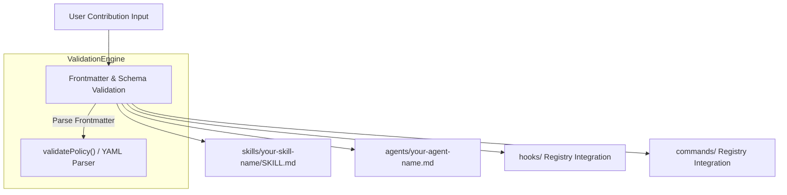
*Figure 1: Contribution Asset Routing and Validation Pipeline.*

Sources: `CONTRIBUTING.md:55-180`, `.claude-plugin/README.md:1-10`.

---

## PR Moderation & Guard Subsystems

To protect maintainer review capacity without performing subjective patch evaluations, ECC implements an automated metadata-only moderation engine termed the **PR Burst Guard** (`.github/PR_MODERATION.md:1-5`, `scripts/ci/pr-burst-guard.js:1-2`).

### Policy Configuration & Enforcement
Governance rules are governed by `.github/pr-burst-policy.json` and executed via GitHub Actions workflow definitions (`.github/workflows/pr-burst-guard.yml`):
- **Burst Allowance:** Maximum of 5 PR creations per author within a rolling 20-minute window (`.github/PR_MODERATION.md:11`). Exceeding this closes and locks excess PRs (`scripts/ci/pr-burst-guard.js:60`).
- **Severe Burst:** More than 10 creations within 20 minutes triggers automated account blocking (via `PR_MODERATION_BLOCK_TOKEN`) and maintainer escalation alerts (`.github/PR_MODERATION.md:12`, `scripts/ci/pr-burst-guard.js:61`).
- **Open-PR Cap (`maxOpen`):** Capped at 10 open PRs per author (`.github/PR_MODERATION.md:13`). When breached, the newest PRs are closed with an explanatory comment (`scripts/ci/pr-burst-guard.js:91-114`).
- **Trusted Contributors:** Users possessing live repository write, maintain, or admin permissions are explicitly exempt from burst limits (`.github/PR_MODERATION.md:15`, `tests/ci/pr-burst-guard.test.js:102-107`).

### Core Moderation Functions
The moderation engine executes through several key JavaScript functions defined in `scripts/ci/pr-burst-guard.js`:
- `validatePolicy(policy)`: Enforces safe integer bounds on `windowMinutes`, `closeAbove`, `blockAbove`, and `maxOpen` (`scripts/ci/pr-burst-guard.js:8-19`).
- `evaluate(rows, current, policy, end)`: Scans historical creation timestamps to isolate recent pull requests by stable user ID (`scripts/ci/pr-burst-guard.js:52-64`).
- `strongestWindow(rows, current, policy, eventTime)`: Recalculates historical burst peaks across sliding windows to prevent out-of-order delivery evasion (`scripts/ci/pr-burst-guard.js:66-87`).
- `capExcess(openRows, current, policy, alreadyClosed)`: Identifies open PRs exceeding `maxOpen` based on creation timestamp ordering (`scripts/ci/pr-burst-guard.js:91-98`).
- `blockAuthor(blockAPI, owner, login)`: Validates repository owner identity against `/user` before calling `PUT /user/blocks/{login}` (`scripts/ci/pr-burst-guard.js:116-129`).

### Moderation Data Flow
The sequence from webhook event trigger to enforcement action is structured as follows:

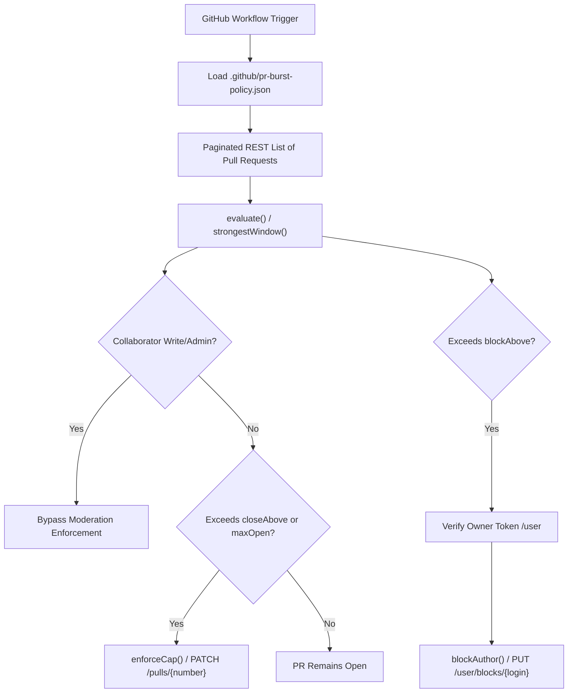
*Figure 2: PR Burst Guard Evaluation and Enforcement Control Flow.*

Sources: `.github/PR_MODERATION.md:1-100`, `scripts/ci/pr-burst-guard.js:1-130`, `.github/pr-burst-policy.json:1-9`, `tests/ci/pr-burst-guard.test.js:1-60`.

---

## Sponsors Program & Compute-Sponsor Integration

ECC’s sustainability model relies on community sponsorships and strategic partnerships defined in `SPONSORS.md`. 

### Sponsorship Tiers
The project maintains distinct sponsorship levels ranging from Supporter ($10/mo) to Strategic Sponsor ($3,700/mo), funding independent maintenance, AgentShield, and weekly multi-harness updates (`SPONSORS.md:5-65`, `SPONSORS.md:73-81`).

### Compute-Sponsor Integration (`Itô`)
Itô is documented as ECC's preferred compute partner (`SPONSORS.md:21`, `.claude-plugin/README.md:19`). The integration architecture enforces a strict separation between passive promotional links and active execution:
- **Passive Dashboard Links:** References to `https://compute.itomarkets.com` in documentation and UI selectors are passive; they do not invoke RFQs, provision compute, or alter Claude Code transport settings (`SPONSORS.md:21`, `src/llm/cli/selector.py:34-50`).
- **Active CLI Bridge (`ecc ito find`):** An opt-in command bridge that invokes the canonical Itô CLI to submit authenticated requests without reserving background capacity (`SPONSORS.md:21`, `tests/scripts/ito-compute-sponsor.test.js:1-22`).

Sources: `SPONSORS.md:1-89`, `tests/scripts/ito-compute-sponsor.test.js:1-105`, `src/llm/cli/selector.py:34-50`.

---

# Page: Core Architecture

# Core Architecture

<details>
<summary>Relevant source files</summary>

The following files were used as context for generating this wiki page:

- [.claude-plugin/marketplace.json](.claude-plugin/marketplace.json)
- [.claude-plugin/plugin.json](.claude-plugin/plugin.json)
- [AGENTS.md](AGENTS.md)
- [README.md](README.md)
- [README.zh-CN.md](README.zh-CN.md)
- [agent.yaml](agent.yaml)
- [docs/ECC-2.0-GA-ROADMAP.md](docs/ECC-2.0-GA-ROADMAP.md)
- [docs/architecture/agentshield-enterprise-research-roadmap.md](docs/architecture/agentshield-enterprise-research-roadmap.md)
- [docs/drafts/release-1.10.1-announcement.md](docs/drafts/release-1.10.1-announcement.md)
- [docs/releases/2.0.0-rc.1/naming-and-publication-matrix.md](docs/releases/2.0.0-rc.1/naming-and-publication-matrix.md)
- [docs/releases/2.0.0-rc.1/operator-readiness-dashboard-2026-05-18.md](docs/releases/2.0.0-rc.1/operator-readiness-dashboard-2026-05-18.md)
- [docs/releases/2.0.0-rc.1/operator-readiness-dashboard-2026-05-19.md](docs/releases/2.0.0-rc.1/operator-readiness-dashboard-2026-05-19.md)
- [docs/releases/2.0.0-rc.1/operator-readiness-dashboard-2026-05-20.md](docs/releases/2.0.0-rc.1/operator-readiness-dashboard-2026-05-20.md)
- [docs/releases/2.0.0-rc.1/owner-approval-packet-2026-05-19.md](docs/releases/2.0.0-rc.1/owner-approval-packet-2026-05-19.md)
- [docs/releases/2.0.0-rc.1/preview-pack-manifest.md](docs/releases/2.0.0-rc.1/preview-pack-manifest.md)
- [docs/releases/2.0.0-rc.1/publication-evidence-2026-05-16.md](docs/releases/2.0.0-rc.1/publication-evidence-2026-05-16.md)
- [docs/releases/2.0.0-rc.1/publication-evidence-2026-05-18.md](docs/releases/2.0.0-rc.1/publication-evidence-2026-05-18.md)
- [docs/releases/2.0.0-rc.1/publication-evidence-2026-05-19.md](docs/releases/2.0.0-rc.1/publication-evidence-2026-05-19.md)
- [docs/releases/2.0.0-rc.1/publication-readiness.md](docs/releases/2.0.0-rc.1/publication-readiness.md)
- [docs/releases/2.0.0-rc.1/release-name-plugin-publication-checklist-2026-05-18.md](docs/releases/2.0.0-rc.1/release-name-plugin-publication-checklist-2026-05-18.md)
- [docs/releases/2.0.0-rc.1/release-url-ledger-2026-05-18.md](docs/releases/2.0.0-rc.1/release-url-ledger-2026-05-18.md)
- [docs/releases/2.0.0-rc.1/release-url-ledger-2026-05-19.md](docs/releases/2.0.0-rc.1/release-url-ledger-2026-05-19.md)
- [docs/tr/AGENTS.md](docs/tr/AGENTS.md)
- [docs/zh-CN/AGENTS.md](docs/zh-CN/AGENTS.md)
- [docs/zh-CN/README.md](docs/zh-CN/README.md)
- [manifests/install-modules.json](manifests/install-modules.json)
- [package.json](package.json)
- [scripts/operator-readiness-dashboard.js](scripts/operator-readiness-dashboard.js)
- [scripts/platform-audit.js](scripts/platform-audit.js)
- [scripts/preview-pack-smoke.js](scripts/preview-pack-smoke.js)
- [tests/docs/ecc2-release-surface.test.js](tests/docs/ecc2-release-surface.test.js)
- [tests/scripts/operator-readiness-dashboard.test.js](tests/scripts/operator-readiness-dashboard.test.js)
- [tests/scripts/platform-audit.test.js](tests/scripts/platform-audit.test.js)

</details>


## Purpose and Scope

This page provides a high-level overview of the internal architecture of Everything Claude Code (ECC), acting as a harness-native agent operating system [package.json:2-4](). It bridges natural language intent with concrete code entities across a modular installation engine, cross-harness portability adapters, a high-performance Rust control plane (`ecc2`), and advanced context and session management systems [manifests/install-modules.json:1-150](), [docs/ECC-2.0-GA-ROADMAP.md:38-51]().

As a parent page, this document outlines the macro-level system design and links directly to detailed child pages for each architectural subsystem.

---

## System Overview & Component Mapping

ECC divides its operational concerns between a high-level JavaScript/TypeScript runtime that coordinates harness interactions, skills, and hooks, and a robust Rust control plane responsible for background daemon execution, session storage, and worktree isolation [README.zh-CN.md:97-101]().

### Diagram: Macro Architecture to Code Entities

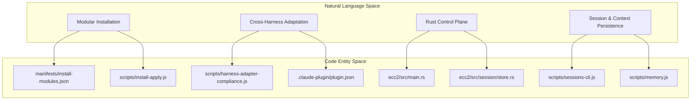

Sources: [manifests/install-modules.json:1-150](), [scripts/install-apply.js:1-120](), [ecc2/src/main.rs](), [scripts/sessions-cli.js]()

---

## Major Architectural Subsystems

### 2.1 Plugin & Manifest System

The plugin and manifest system governs how components are registered, verified, and installed across target environments. Manifests such as `install-modules.json` define discrete component families (`rules-core`, `agents-core`, `commands-core`, `hooks-runtime`) alongside their dependencies and target harnesses [manifests/install-modules.json:1-118](). The installation pipeline (`install-apply.js`) coordinates profile selection, Nasiko CLI lifecycle integration, and repair/doctor workflows [scripts/install-apply.js:1-120]().

For detailed coverage of manifests, profiles, component families, and lifecycle management, see [Plugin & Manifest System](#2.1).

Sources: [manifests/install-modules.json:1-118](), [scripts/install-apply.js:1-120]()

---

### 2.2 Cross-Harness Portability

ECC assets are designed to execute seamlessly across diverse AI coding assistants and harnesses. The cross-harness portability model utilizes compliance validators (`harness-adapter-compliance.js`) and adapter scripts to transform rules, prompts, and tool definitions into formats native to Claude Code, Cursor, OpenCode, Codex, Gemini, Zed, and other supported platforms [package.json:2-4](), [manifests/install-modules.json:11-25]().

For adapter compliance matrices and portability policies, see [Cross-Harness Portability](#2.2).

Sources: [package.json:2-4](), [manifests/install-modules.json:11-25]()

---

### 2.3 ECC 2.0 Rust Control Plane (`ecc2`)

The `ecc2` directory houses the high-performance Rust control plane, engineered to manage long-running daemon tasks, SQLite-backed session data, worktree isolation, and inter-agent coordination [docs/ECC-2.0-GA-ROADMAP.md:38-51](). It provides a terminal user interface (TUI) dashboard and structured telemetry export while isolating agentic loops from transient runtime constraints.

For in-depth technical documentation on the Rust codebase, daemon lifecycles, and worktree isolation, see [ECC 2.0 Rust Control Plane (ecc2)](#2.3).

Sources: [docs/ECC-2.0-GA-ROADMAP.md:38-51]()

---

### 2.4 Session Management & Persistence

Session continuity across restarts is managed via dedicated start/end hooks, file-locking state stores, and session adapter contracts [README.zh-CN.md:100-112](). The subsystem incorporates stale-replay guards, context injection routines, and alias resolution to maintain coherent execution state over multi-step development sessions.

For details on session persistence and file-lock state stores, see [Session Management & Persistence](#2.4).

Sources: [README.zh-CN.md:100-112]()

---

### 2.5 MCP Server Integration

Model Context Protocol (MCP) servers expand agent capabilities through standardized connectors defined in `mcp-servers.json` [manifests/install-modules.json:122-129](). The integration subsystem handles opt-in server policies, configuration merging during installation, health-check hooks (`mcp-health-check`), and specialized memory MCP servers for cross-session knowledge retrieval [README.zh-CN.md:104-131]().

For configuration policies and MCP server setups, see [MCP Server Integration](#2.5).

Sources: [manifests/install-modules.json:122-129](), [README.zh-CN.md:104-131]()

---

### 2.6 Context Packs, Profiles & Carriers

Context selection and routing are handled via context-pack registries, profile compilation engines, and carrier closure validation [package.json:90-93](). This layer optimizes token budgets through specialized skills and provides isolated evaluation environments within the `docker/context-profiles` testing lab.

For information on context compilation, budgets, and evaluation labs, see [Context Packs, Profiles & Carriers](#2.6).

Sources: [package.json:90-93]()

---

## Architectural Component Flow

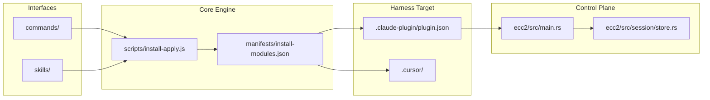

Sources: [manifests/install-modules.json:1-151](), [scripts/install-apply.js:1-120](), [.claude-plugin/plugin.json:1-46]()

---

# Page: Plugin & Manifest System

# Plugin & Manifest System

<details>
<summary>Relevant source files</summary>

The following files were used as context for generating this wiki page:

- [.agents/plugins/marketplace.json](.agents/plugins/marketplace.json)
- [.codex-plugin/README.md](.codex-plugin/README.md)
- [.codex-plugin/plugin.json](.codex-plugin/plugin.json)
- [manifests/install-components.json](manifests/install-components.json)
- [plugins/ecc/.codex-plugin/plugin.json](plugins/ecc/.codex-plugin/plugin.json)
- [schemas/ecc-install-config.schema.json](schemas/ecc-install-config.schema.json)
- [schemas/install-modules.schema.json](schemas/install-modules.schema.json)
- [schemas/install-state.schema.json](schemas/install-state.schema.json)
- [scripts/install-apply.js](scripts/install-apply.js)
- [scripts/lib/atomic-write.js](scripts/lib/atomic-write.js)
- [scripts/lib/install-executor.js](scripts/lib/install-executor.js)
- [scripts/lib/install-lifecycle.js](scripts/lib/install-lifecycle.js)
- [scripts/lib/install-manifests.js](scripts/lib/install-manifests.js)
- [scripts/lib/install-state.js](scripts/lib/install-state.js)
- [scripts/lib/install-targets/claude-home.js](scripts/lib/install-targets/claude-home.js)
- [scripts/lib/install-targets/codex-home.js](scripts/lib/install-targets/codex-home.js)
- [scripts/lib/install-targets/cursor-project.js](scripts/lib/install-targets/cursor-project.js)
- [scripts/lib/install-targets/helpers.js](scripts/lib/install-targets/helpers.js)
- [scripts/lib/install-targets/registry.js](scripts/lib/install-targets/registry.js)
- [scripts/lib/install/apply.js](scripts/lib/install/apply.js)
- [scripts/lib/install/claude-settings-lock.js](scripts/lib/install/claude-settings-lock.js)
- [scripts/lib/install/claude-settings.js](scripts/lib/install/claude-settings.js)
- [scripts/lib/install/hook-consent.js](scripts/lib/install/hook-consent.js)
- [scripts/lib/install/inventory.js](scripts/lib/install/inventory.js)
- [scripts/lib/install/opencode-legacy-migration.js](scripts/lib/install/opencode-legacy-migration.js)
- [scripts/lib/install/request.js](scripts/lib/install/request.js)
- [scripts/lib/install/runtime.js](scripts/lib/install/runtime.js)
- [scripts/release.sh](scripts/release.sh)
- [tests/lib/atomic-write.test.js](tests/lib/atomic-write.test.js)
- [tests/lib/claude-config-tilde.test.js](tests/lib/claude-config-tilde.test.js)
- [tests/lib/claude-settings-lock.test.js](tests/lib/claude-settings-lock.test.js)
- [tests/lib/claude-settings.test.js](tests/lib/claude-settings.test.js)
- [tests/lib/extracted-resolver-wsl.test.js](tests/lib/extracted-resolver-wsl.test.js)
- [tests/lib/guarded-write.test.js](tests/lib/guarded-write.test.js)
- [tests/lib/helpers/assert-file-postimage.js](tests/lib/helpers/assert-file-postimage.js)
- [tests/lib/helpers/load-with-file-system.js](tests/lib/helpers/load-with-file-system.js)
- [tests/lib/helpers/session-alias-worker.js](tests/lib/helpers/session-alias-worker.js)
- [tests/lib/helpers/settings-lock-worker.js](tests/lib/helpers/settings-lock-worker.js)
- [tests/lib/hook-consent.test.js](tests/lib/hook-consent.test.js)
- [tests/lib/inline-fallback-shell.test.js](tests/lib/inline-fallback-shell.test.js)
- [tests/lib/install-executor.test.js](tests/lib/install-executor.test.js)
- [tests/lib/install-lifecycle.test.js](tests/lib/install-lifecycle.test.js)
- [tests/lib/install-manifests.test.js](tests/lib/install-manifests.test.js)
- [tests/lib/install-request.test.js](tests/lib/install-request.test.js)
- [tests/lib/install-state.test.js](tests/lib/install-state.test.js)
- [tests/lib/install-targets.test.js](tests/lib/install-targets.test.js)
- [tests/lib/opencode-consent-legacy-lock.test.js](tests/lib/opencode-consent-legacy-lock.test.js)
- [tests/lib/opencode-hook-consent-safety.test.js](tests/lib/opencode-hook-consent-safety.test.js)
- [tests/lib/opencode-legacy-migration.test.js](tests/lib/opencode-legacy-migration.test.js)
- [tests/lib/serialized-hook-wsl.test.js](tests/lib/serialized-hook-wsl.test.js)
- [tests/lib/session-aliases-concurrency.test.js](tests/lib/session-aliases-concurrency.test.js)
- [tests/lib/session-aliases-read.test.js](tests/lib/session-aliases-read.test.js)
- [tests/plugin-manifest.test.js](tests/plugin-manifest.test.js)
- [tests/scripts/auto-update.test.js](tests/scripts/auto-update.test.js)
- [tests/scripts/install-apply.test.js](tests/scripts/install-apply.test.js)
- [tests/scripts/install-dry-run.test.js](tests/scripts/install-dry-run.test.js)
- [tests/scripts/manual-hook-install-docs.test.js](tests/scripts/manual-hook-install-docs.test.js)

</details>


The Plugin & Manifest System is the foundational modular installation, configuration, and harness-adaptation engine for Everything Claude Code (ECC). It transitions the codebase from a monolithic collection of shell scripts into a deterministic, manifest-driven architecture supporting multiple AI code harnesses (including Claude Code, Cursor, OpenCode, Antigravity, and Codex) via a unified resolution and execution pipeline.

---

## 1. Manifest Hierarchy & Component Families

ECC manages its extensive library of skills, agents, commands, and rules through structured JSON manifests located in the `manifests/` directory.

### Manifest Components
- **`install-modules.json`**: Defines the atomic modules of installation, mapping module IDs to source paths, compatible targets, and dependencies `[scripts/lib/install-manifests.js:52-115]()`.
- **`install-profiles.json`**: Groups modules into curated installation profiles (`minimal`, `core`, `full`) `[manifests/install-profiles.json]()`.
- **`install-components.json`**: Exposes user-facing component families (`baseline:`, `lang:`, `framework:`, `capability:`, `agent:`, `skill:`, `locale:`) that map human-readable features to underlying modules `[scripts/lib/install-manifests.js:9-43]()`.

### Natural Language Space to Code Entity Space: Manifest Resolution
The following diagram maps high-performance installation intent to specific code entities within the manifest subsystem.

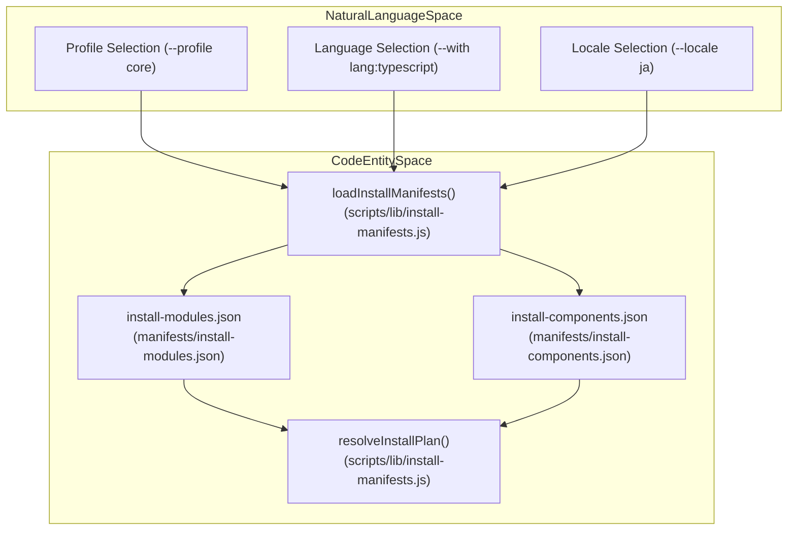

**Sources:** `[scripts/lib/install-manifests.js:1-100]`, `[tests/lib/install-manifests.test.js:75-142]()`

---

## 2. Installation Pipeline & Guided Multi-Harness Setup

The installation runtime is coordinated by `scripts/install-apply.js` and backed by `scripts/lib/install/apply.js` and `scripts/lib/install/runtime.js`.

### Execution Flow
1. **Request Normalization**: CLI flags and config files are parsed via `parseInstallArgs` in `scripts/lib/install/request.js` `[scripts/install-apply.js:15-19]()`.
2. **Plan Creation**: `createInstallPlanFromRequest` resolves dependency closures and selects target adapters from `scripts/lib/install-targets/registry.js` `[scripts/lib/install/runtime.js:1-67]()`.
3. **Execution**: `applyInstallPlan` carries out operations atomically with dry-run support, link rewriting, and state persistence `[scripts/lib/install/apply.js:1-71]()`.

### Natural Language Space to Code Entity Space: Execution Pipeline

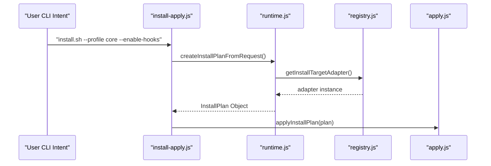

**Sources:** `[scripts/install-apply.js:1-156]`, `[scripts/lib/install/apply.js:1-75]`, `[scripts/lib/install/runtime.js:1-59]()`

---

## 3. Install State Ledger & Drift Detection

Every successful installation persists an installation state file (e.g., `install-state.json` or `ecc-install-state.json`) containing cryptographic records of all managed files `[scripts/lib/install-state.js:1-50]()`.

- **Cryptographic Digests**: During application, `stateWithContentDigests` computes SHA-256 hashes of installed file contents (`contentSha256`) using no-follow file descriptors `[scripts/lib/install/apply.js:151-183]()`.
- **Drift Tracking**: This ledger allows ECC to distinguish between user-owned files and managed assets during updates or audits.

**Sources:** `[scripts/lib/install-state.js:1-50]`, `[scripts/lib/install/apply.js:151-183]()`

---

## 4. Doctor, Repair, and Uninstall Lifecycle

Lifecycle operations are implemented in `scripts/lib/install-lifecycle.js`:

- **Doctor (`buildDoctorReport`)**: Scans the filesystem against the `install-state.json` ledger to identify missing files, deleted assets, or unexpected content modifications `[scripts/lib/install-lifecycle.js:12-13]()`.
- **Repair (`repairInstalledStates`)**: Re-applies managed file operations for corrupted or missing assets while protecting user-modified code `[scripts/lib/install-lifecycle.js:15-16]()`.
- **Uninstall (`uninstallInstalledStates`)**: Removes all assets registered as managed under the install state, cleaning up empty parent directories while preserving unmanaged user data `[scripts/lib/install-lifecycle.js:16]()`.
- **Nasiko CLI Lifecycle Bridge**: Synchronizes ECC's deployment state with Nasiko's CLI lifecycle management through dedicated control plane components `[manifests/install-components.json:206-212]()`.

**Sources:** `[scripts/lib/install-lifecycle.js:1-190]`, `[tests/lib/install-lifecycle.test.js:1-150]()`

---

## 5. Implementation Details: Link Rewriting & Path Safety

- **Link Rewriting**: When rules are installed into namespaced subdirectories (e.g., `.claude/rules/ecc/`), relative documentation links are automatically remapped using `buildLinkIndexForPlan` and `rewriteRelativeLinks` `[scripts/lib/install/apply.js:63-84]()`.
- **Path Safety**: Path traversals are blocked using `assertWithinTrustedRoot`, and file inspections use `readInstalledFileNoFollow` with `O_NOFOLLOW` flags to prevent symlink race attacks during integrity verification `[scripts/lib/install/apply.js:24-33]`, `[scripts/lib/install/apply.js:114-149]()`.

**Sources:** `[scripts/lib/install/apply.js:24-149]()`

---

# Page: Cross-Harness Portability

# Cross-Harness Portability

<details>
<summary>Relevant source files</summary>

The following files were used as context for generating this wiki page:

- [.agents/skills/skill-host-compat/SKILL.md](.agents/skills/skill-host-compat/SKILL.md)
- [.agents/skills/skill-host-compat/agents/openai.yaml](.agents/skills/skill-host-compat/agents/openai.yaml)
- [.pi/README.md](.pi/README.md)
- [.pi/extensions/hook-runtime.js](.pi/extensions/hook-runtime.js)
- [.pi/extensions/index.ts](.pi/extensions/index.ts)
- [.qwen/QWEN.md](.qwen/QWEN.md)
- [docs/QWEN-GUIDE.md](docs/QWEN-GUIDE.md)
- [docs/architecture/cross-harness.md](docs/architecture/cross-harness.md)
- [docs/architecture/harness-adapter-compliance.md](docs/architecture/harness-adapter-compliance.md)
- [docs/architecture/platform-value-loop.md](docs/architecture/platform-value-loop.md)
- [docs/releases/2.0.0-rc.1/ito-prediction-market-skill-pack.md](docs/releases/2.0.0-rc.1/ito-prediction-market-skill-pack.md)
- [schemas/agent.schema.json](schemas/agent.schema.json)
- [scripts/agent-convert.js](scripts/agent-convert.js)
- [scripts/ci/validate-skill-host-compat.js](scripts/ci/validate-skill-host-compat.js)
- [scripts/ci/verify-release-gates.js](scripts/ci/verify-release-gates.js)
- [scripts/lib/agent-emit-pi.js](scripts/lib/agent-emit-pi.js)
- [scripts/lib/agent-ir.js](scripts/lib/agent-ir.js)
- [scripts/lib/agent-tool-map.js](scripts/lib/agent-tool-map.js)
- [scripts/lib/harness-adapter-compliance.js](scripts/lib/harness-adapter-compliance.js)
- [scripts/lib/harness-capabilities.js](scripts/lib/harness-capabilities.js)
- [scripts/lib/install-targets/qwen-home.js](scripts/lib/install-targets/qwen-home.js)
- [scripts/qwen-adapt-agents.js](scripts/qwen-adapt-agents.js)
- [scripts/sync-ecc-to-codex.sh](scripts/sync-ecc-to-codex.sh)
- [skills/skill-host-compat/SKILL.md](skills/skill-host-compat/SKILL.md)
- [tests/ci/packed-artifact-lifecycle.js](tests/ci/packed-artifact-lifecycle.js)
- [tests/ci/packed-artifact-lifecycle.test.js](tests/ci/packed-artifact-lifecycle.test.js)
- [tests/ci/release-packed-artifact-workflow.test.js](tests/ci/release-packed-artifact-workflow.test.js)
- [tests/ci/validate-skill-host-compat.test.js](tests/ci/validate-skill-host-compat.test.js)
- [tests/docs/harness-adapter-compliance.test.js](tests/docs/harness-adapter-compliance.test.js)
- [tests/docs/platform-value-loop.test.js](tests/docs/platform-value-loop.test.js)
- [tests/lib/harness-capabilities.test.js](tests/lib/harness-capabilities.test.js)
- [tests/pi/agent-convert.test.js](tests/pi/agent-convert.test.js)
- [tests/pi/agent-emit.test.js](tests/pi/agent-emit.test.js)
- [tests/pi/pi-extension-adapter.test.js](tests/pi/pi-extension-adapter.test.js)
- [tests/pi/pi-hook-runtime.test.js](tests/pi/pi-hook-runtime.test.js)
- [tests/pi/pi-package-manifest.test.js](tests/pi/pi-package-manifest.test.js)
- [tests/scripts/qwen-adapt-agents.test.js](tests/scripts/qwen-adapt-agents.test.js)
- [tests/scripts/sync-ecc-to-codex.test.js](tests/scripts/sync-ecc-to-codex.test.js)

</details>


## Purpose and Scope

This page details the cross-harness architecture of Everything Claude Code (ECC), explaining how core durable assets—such as skills, rules, hooks, agent frontmatter, and MCP configurations—are projected and adapted across diverse AI harnesses (including Claude Code, Codex, Pi, OpenCode, Qwen Code, Cursor, and Zed) without duplicating workflow business logic. It covers the adapter compliance matrix, the asset portability model, runner mechanics, agent adaptation scripts, and MCP connector synchronization policies.

Sources: `[docs/architecture/cross-harness.md:1-33]()`, `[scripts/qwen-adapt-agents.js:1-45]()`, `[docs/architecture/harness-adapter-compliance.md:1-20]()`

---

## Portability Model & Asset Projection

ECC employs a projection model where canonical assets are authored once in shared source directories, then adapted at the edges for each supported AI harness. This design keeps core durable units (skills, rules, hooks, MCP configs, commands, agents) centralized and consistent, minimizing duplication and divergence in logic across different runtimes.

The harness capability catalog registers each install target, defining availability channels, scope roots, and hook support details. Agent definitions are mapped via specialized adaptation scripts, such as `scripts/qwen-adapt-agents.js`, which translates Claude Code tool specifications (e.g., mapping `Edit` to `edit`, `WebSearch` to `web_search`) and normalizes unsupported color properties (e.g., remapping `teal` to `cyan`) for Qwen Code compatibility.

### Natural Language Space to Code Entity Space: Core Asset Projection

| Conceptual Asset        | Code Entity (Source)                                  | Harness Target & Adaptation                                                                                     | Details & Projection Logic                                                                               |
|------------------------|------------------------------------------------------|---------------------------------------------------------------------------------------------------------------|---------------------------------------------------------------------------------------------------------|
| **Skills**             | `skills/*/SKILL.md`                                  | `.agents/skills/`, `.cursor/skills/`, Pi package manifest and mount                                           | YAML frontmatter with `name`, `description`, `origin`; installed via native plugins or symlinks         |
| **Agents**             | `agents/*.md`                                        | `.qwen/agents/`, `.pi/agents/`, `.codex/agents/`                                                              | Adapted via `scripts/qwen-adapt-agents.js` and `scripts/agent-convert.js` to align tool naming and models |
| **Rules & Instructions**| `rules/`, `AGENTS.md`                                | `.cursor/rules/`, `~/.codex/AGENTS.md`, Pi system prompt injection                                            | Flattened and collision-safe injection or files; some harnesses use instruction-only enforcement       |
| **Hooks**               | `hooks/hooks.json`, `scripts/hooks/`                 | Native Claude hooks, OpenCode event adapter, `.pi/extensions/hook-runtime.js` for Pi                          | Shared hook runner (`scripts/hooks/run-with-flags.js`) orchestrates platform-agnostic invocation       |
| **MCP Configurations**  | `mcp-configs/mcp-servers.json`, `.mcp.json`          | `~/.codex/config.toml`, `.opencode/opencode.json`, Pi community adapters                                     | Merged via node-based TOML/JSON parsers integrated during sync scripts (`scripts/sync-ecc-to-codex.sh`)   |

**Diagram: Asset Projection and Natural-to-Code Mapping**

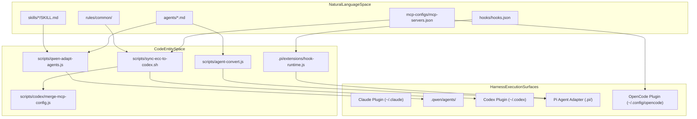

Sources: `[docs/architecture/cross-harness.md:22-33]()`, `[scripts/qwen-adapt-agents.js:16-43]()`, `[scripts/sync-ecc-to-codex.sh:11-48]`, `[tests/pi/pi-extension-adapter.test.js:48-50]()`

---

## Hook Portability & Runner Architecture

Because some harnesses do not natively support the full Claude Code style hook system, ECC provides portable hook runtimes and adaptation layers that proxy or emulate hook invocation.

- Claude Code uses native plugin-driven hooks configured through profiles.
- Pi coding agent's adapter (`.pi/extensions/index.ts`) invokes ECC's hook runtime (`scripts/hooks/run-with-flags.js`) via a dedicated runtime resolver (`.pi/extensions/hook-runtime.js`) that ensures hook scripts resolve relative to the installed ECC package root rather than the current working directory.
- Hooks run with strict isolation using `execFile`, timeout enforcement, and EPIPE stream protection on standard input/output.

### Diagram: Hook Execution and Adaptation Flow

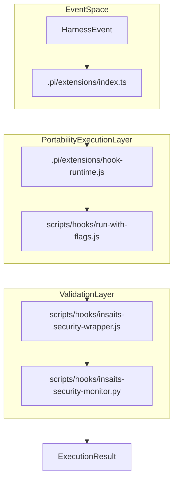

Sources: `[tests/pi/pi-extension-adapter.test.js:4-90]()`, `[.pi/extensions/hook-runtime.js:1-30]()`, `[scripts/hooks/run-with-flags.js:1-45]()`

---

## MCP Connector Policy & Synchronization

ECC manages Model Context Protocol (MCP) server connectors centrally to limit security risk and complexity.

- The canonical default MCP connector is `chrome-devtools`.
- Other MCP servers are opt-in via `mcp-configs/mcp-servers.json`.
- Cross-harness synchronization of MCP identities is managed via scripts like `scripts/sync-ecc-to-codex.sh`, which invokes `scripts/codex/merge-mcp-config.js` to safely merge TOML configurations without overwriting unmanaged user settings.

### Diagram: MCP Configuration Synchronization

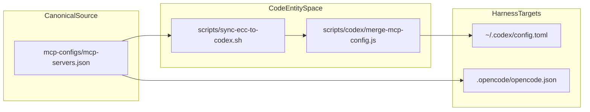

Sources: `[scripts/sync-ecc-to-codex.sh:11-48]`, `[mcp-configs/mcp-servers.json:1-30]()`

---

## Harness Adapter Compliance Matrix

This table summarizes the current adapter support state for ECC assets across major harnesses, verified by `scripts/lib/harness-adapter-compliance.js`.

| Harness or Runtime | State              | Supported Assets                                    | Unsupported or Different Surfaces                         | Install / Onramp                          | Verification Command                      |
|--------------------|--------------------|----------------------------------------------------|-----------------------------------------------------------|-------------------------------------------|-------------------------------------------|
| **Claude Code**     | Native             | Plugin assets, skills, commands, hooks, MCP config | Non-Claude hook runtimes not included                     | `./install.sh --profile minimal --target claude` | `npm run harness:audit`                   |
| **Codex**           | Instruction-backed | `AGENTS.md`, plugin metadata, skills, MCP config   | Native hook enforcement not present                       | `./install.sh --profile minimal --target codex`  | `npm run harness:audit`                   |
| **Pi**              | Adapter-backed     | Pi package manifest, canonical ECC skills, rules   | Subagents and MCP surface require community packages      | `pi install git:github.com/affaan-m/ECC`| `node tests/pi/pi-extension-adapter.test.js` |
| **Cursor**          | Adapter-backed     | Cursor rules, project-local skills, hook adapter   | Claude-style slash-command semantics differ               | `./install.sh --profile minimal --target cursor` | `node tests/lib/install-targets.test.js` |
| **Qwen Code**       | Adapter-backed     | Adapted agent frontmatter, shared skills, rules    | Claude-specific model tiers and tool names require mapping | `node scripts/qwen-adapt-agents.js`        | `node tests/scripts/qwen-adapt-agents.test.js` |

Sources: `[docs/architecture/harness-adapter-compliance.md:30-51]()`, `[scripts/lib/harness-adapter-compliance.js:42-180]()`, `[tests/scripts/qwen-adapt-agents.test.js:10-45]()`

---

## Key Code Entities & Functions

- `adaptFrontmatter` in `scripts/qwen-adapt-agents.js`: Parses YAML frontmatter for agent files, normalizing tool allowlists using `TOOL_NAME_MAP` and adjusting color attributes against `VALID_COLORS`.
- `runEccHook` in Pi extensions: Invokes `scripts/hooks/run-with-flags.js` via Node child processes with JSON payloads piped across standard streams.
- `createGithubClient` and release gate verifiers in `scripts/ci/verify-release-gates.js`: Ensure compliance across packed artifacts.

Sources: `[scripts/qwen-adapt-agents.js:94-135]()`, `[tests/pi/pi-extension-adapter.test.js:80-95]()`, `[scripts/ci/verify-release-gates.js:84-115]()`

---

# References

- `[docs/architecture/cross-harness.md]()`
- `[docs/architecture/harness-adapter-compliance.md]()`
- `[scripts/qwen-adapt-agents.js]()`
- `[scripts/sync-ecc-to-codex.sh]()`
- `[.pi/extensions/index.ts]()`
- `[scripts/hooks/run-with-flags.js]()`

---

# Page: ECC 2.0 Rust Control Plane (ecc2)

# ECC 2.0 Rust Control Plane (ecc2)

<details>
<summary>Relevant source files</summary>

The following files were used as context for generating this wiki page:

- [docs/HERMES-OPENCLAW-MIGRATION.md](docs/HERMES-OPENCLAW-MIGRATION.md)
- [docs/HERMES-SETUP.md](docs/HERMES-SETUP.md)
- [docs/architecture/evaluator-rag-prototype.md](docs/architecture/evaluator-rag-prototype.md)
- [docs/tr/CHANGELOG.md](docs/tr/CHANGELOG.md)
- [docs/zh-CN/CHANGELOG.md](docs/zh-CN/CHANGELOG.md)
- [docs/zh-CN/commands/harness-audit.md](docs/zh-CN/commands/harness-audit.md)
- [ecc2/Cargo.lock](ecc2/Cargo.lock)
- [ecc2/Cargo.toml](ecc2/Cargo.toml)
- [ecc2/README.md](ecc2/README.md)
- [ecc2/src/comms/mod.rs](ecc2/src/comms/mod.rs)
- [ecc2/src/config/mod.rs](ecc2/src/config/mod.rs)
- [ecc2/src/harness_eval.rs](ecc2/src/harness_eval.rs)
- [ecc2/src/main.rs](ecc2/src/main.rs)
- [ecc2/src/notifications.rs](ecc2/src/notifications.rs)
- [ecc2/src/observability/mod.rs](ecc2/src/observability/mod.rs)
- [ecc2/src/session/daemon.rs](ecc2/src/session/daemon.rs)
- [ecc2/src/session/manager.rs](ecc2/src/session/manager.rs)
- [ecc2/src/session/mod.rs](ecc2/src/session/mod.rs)
- [ecc2/src/session/output.rs](ecc2/src/session/output.rs)
- [ecc2/src/session/runtime.rs](ecc2/src/session/runtime.rs)
- [ecc2/src/session/store.rs](ecc2/src/session/store.rs)
- [ecc2/src/tui/app.rs](ecc2/src/tui/app.rs)
- [ecc2/src/tui/dashboard.rs](ecc2/src/tui/dashboard.rs)
- [ecc2/src/tui/widgets.rs](ecc2/src/tui/widgets.rs)
- [ecc2/src/worktree/mod.rs](ecc2/src/worktree/mod.rs)
- [examples/evaluator-rag-prototype/deep-analyzer-evidence/candidate-playbook.md](examples/evaluator-rag-prototype/deep-analyzer-evidence/candidate-playbook.md)
- [examples/evaluator-rag-prototype/deep-analyzer-evidence/report.json](examples/evaluator-rag-prototype/deep-analyzer-evidence/report.json)
- [examples/evaluator-rag-prototype/deep-analyzer-evidence/scenario.json](examples/evaluator-rag-prototype/deep-analyzer-evidence/scenario.json)
- [examples/evaluator-rag-prototype/deep-analyzer-evidence/trace.json](examples/evaluator-rag-prototype/deep-analyzer-evidence/trace.json)
- [examples/evaluator-rag-prototype/deep-analyzer-evidence/verifier-result.json](examples/evaluator-rag-prototype/deep-analyzer-evidence/verifier-result.json)
- [examples/evaluator-rag-prototype/skill-quality-evidence/candidate-playbook.md](examples/evaluator-rag-prototype/skill-quality-evidence/candidate-playbook.md)
- [examples/evaluator-rag-prototype/skill-quality-evidence/report.json](examples/evaluator-rag-prototype/skill-quality-evidence/report.json)
- [examples/evaluator-rag-prototype/skill-quality-evidence/scenario.json](examples/evaluator-rag-prototype/skill-quality-evidence/scenario.json)
- [examples/evaluator-rag-prototype/skill-quality-evidence/trace.json](examples/evaluator-rag-prototype/skill-quality-evidence/trace.json)
- [examples/evaluator-rag-prototype/skill-quality-evidence/verifier-result.json](examples/evaluator-rag-prototype/skill-quality-evidence/verifier-result.json)
- [scripts/hooks/session-activity-tracker.js](scripts/hooks/session-activity-tracker.js)
- [tests/docs/evaluator-rag-prototype.test.js](tests/docs/evaluator-rag-prototype.test.js)
- [tests/hooks/session-activity-tracker.test.js](tests/hooks/session-activity-tracker.test.js)

</details>


The ECC 2.0 Rust Control Plane (`ecc2`) is a high-performance, asynchronous orchestration engine designed to manage the lifecycle of AI agent sessions. It features a rich Terminal User Interface (TUI) dashboard (`tui::dashboard::Dashboard`) for real-time monitoring, a persistent background daemon (`session::daemon::run`) performing continuous maintenance, and a robust SQLite-based state store (`session::store::StateStore`). To ensure isolated development environments, `ecc2` utilizes Git worktree isolation per session via the `worktree` module. Additionally, it facilitates inter-agent messaging for task delegation and coordination, and includes observability tooling for detailed insight into system operations.

Sources: [ecc2/Cargo.toml:2-5](), [ecc2/src/main.rs:60-60](), [ecc2/src/tui/dashboard.rs:107](), [ecc2/src/session/daemon.rs:20](), [ecc2/src/session/store.rs:27](), [ecc2/src/worktree/mod.rs:96]()

---

## System Architecture & Concurrency Model

The `ecc2` control plane is implemented in Rust leveraging the **Tokio** async runtime (`tokio`) for concurrent event-driven execution [ecc2/Cargo.toml:20-20](), [ecc2/src/main.rs:1-8](). It employs multi-threading to partition TUI rendering, background daemon loops, and SQLite database interactions, ensuring responsive UI and robust background operation.

- **Persistence Layer:** Wrapped by `StateStore`, a persistent SQLite connection (`rusqlite::Connection`) with foreign key enforcement and busy timeouts manages session and messaging state [ecc2/src/session/store.rs:27-29]().
- **Session Management:** Session lifecycle control and logic reside in `session::manager`, which handles creation (`create_session`), scheduling (`run_due_schedules`), and delegation of agent sessions [ecc2/src/session/manager.rs:26-156]().
- **Background Operations:** The daemon (`session::daemon::run`) continuously monitors session heartbeats, performs crash recovery (`resume_crashed_sessions`), scheduled task dispatch, and backlog coordination [ecc2/src/session/daemon.rs:20-56]().
- **Git Worktree Isolation:** Managed via `worktree::create_for_session_in_repo`, agent sessions operate within dedicated Git worktrees to avoid cross-session file conflicts [ecc2/src/worktree/mod.rs:96-149]().
- **TUI Dashboard:** Implemented with `ratatui` and `crossterm`, `tui::app::run` drives the `Dashboard` state machine for monitoring sessions, logs, metrics, and output streams [ecc2/src/tui/dashboard.rs:107](), [ecc2/src/tui/app.rs:15-26]().

### Diagram: Control Plane Code Entity Architecture

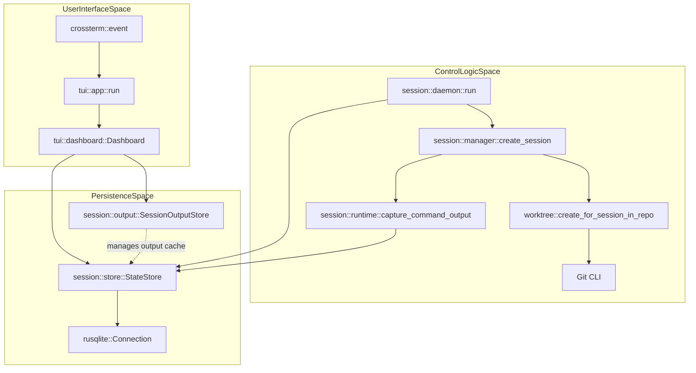
Sources: [ecc2/src/main.rs:1-8](), [ecc2/src/tui/app.rs:15-23](), [ecc2/src/session/manager.rs:26-32](), [ecc2/src/session/store.rs:27-29](), [ecc2/src/session/output.rs](), [ecc2/src/session/daemon.rs:20-56](), [ecc2/src/worktree/mod.rs:96-128]()

---

## Session Lifecycle Management

Sessions are the fundamental units of work, representing AI agent tasks that execute via various harnesses (`HarnessKind`) such as Claude, Codex, OpenCode, etc. [ecc2/src/session/mod.rs:16-31](). Each session is associated with a task description, agent type, optional profile, working directory, and optional Git worktree.

### Session State Machine

Session state transitions (`SessionState`) are strictly controlled via `StateStore`, with validation and repair performed by the background daemon (`session::daemon::resume_crashed_sessions`) [ecc2/src/session/store.rs](), [ecc2/src/session/daemon.rs:58-92]().

| State        | Allowed Next States                      | Description                                |
|--------------|----------------------------------------|--------------------------------------------|
| `Pending`    | `Running`, `Failed`, `Stopped`          | Queued for execution, pre-start            |
| `Running`    | `Idle`, `Completed`, `Failed`, `Stopped` | Active agent process with a PID           |
| `Idle`       | `Running`, `Completed`, `Stopped`       | Process alive but waiting for input       |
| `Completed`  | *Terminal*                              | Successfully finished task                 |
| `Failed`     | `Pending` (retry)                      | Crashed or non-zero exit                   |
| `Stopped`    | *Terminal*                              | Manually stopped                           |

The daemon detects crashed sessions by verifying PID liveness (`session::daemon::resume_crashed_sessions_with`), marking stale running sessions as `Failed` on startup [ecc2/src/session/daemon.rs:58-92]().

### Session Creation & Delegation

Sessions are created via async functions like `manager::create_session_with_profile_and_grouping` in `session::manager`, taking parameters:
- `task`: Task description string
- `agent_type`: Agent harness name
- `use_worktree`: Whether to use worktree isolation
- `profile_name`: Optional named agent profile (`SessionAgentProfile`)
- `grouping`: Project/task-group metadata (`SessionGrouping`)

Delegation chains are supported where a session can be spawned from a source session (`create_session_from_source_with_profile_and_grouping`), inheriting context or continuing work [ecc2/src/session/manager.rs:26-114]().

Sources: [ecc2/src/session/manager.rs:26-114](), [ecc2/src/session/store.rs](), [ecc2/src/session/daemon.rs:58-92](), [ecc2/src/session/mod.rs:16-31]()

---

## Git Worktree Isolation

To maintain environment isolation and prevent file pollution or conflicts, each agent session optionally runs inside a dedicated Git worktree managed by the `worktree` module.

- **Worktree Creation:** The function `worktree::create_for_session_in_repo` computes a session-specific branch name (`worktree::branch_name_for_session`) using a configured prefix plus the session ID, then invokes `git worktree add -b <branch>` [ecc2/src/worktree/mod.rs:96-149]().
- **Shared Dependency Sync:** Upon worktree creation, `worktree::sync_shared_dependency_dirs_in_repo` synchronizes shared dependency directories into the new worktree to optimize caching [ecc2/src/worktree/mod.rs:141-147]().
- **Worktree Removal:** The daemon periodically calls `worktree::remove` on `WorktreeInfo` instances from inactive sessions, which safely removes the worktree directory and deletes the corresponding Git branch [ecc2/src/worktree/mod.rs:178-227](), [ecc2/src/session/daemon.rs:46-48]().

Sources: [ecc2/src/worktree/mod.rs:96-227](), [ecc2/src/session/daemon.rs:46-48]()

---

## Background Daemon

The background daemon (`session::daemon::run`) runs indefinitely as a Tokio async task responsible for monitoring session states, heartbeats, scheduling, backlog management, and cleanup operations [ecc2/src/session/daemon.rs:20-56]().

Its main loop performs:
1. **Crash Recovery:** Calls `session::daemon::resume_crashed_sessions` on startup [ecc2/src/session/daemon.rs:22, 58-92]().
2. **Session Heartbeats:** Calls `manager::enforce_session_heartbeats` [ecc2/src/session/daemon.rs:95-97]().
3. **Scheduled Task Dispatch:** Calls `manager::run_due_schedules` [ecc2/src/session/daemon.rs:100-106]().
4. **Remote Dispatch Handling:** Calls `manager::run_remote_dispatch_requests` [ecc2/src/session/daemon.rs:108-125]().
5. **Backlog Coordination:** Executes `maybe_auto_dispatch` and `manager::rebalance_all_teams` [ecc2/src/session/daemon.rs:145-184]().
6. **Auto Merging & Pruning:** Calls `maybe_auto_merge_ready_worktrees` and `maybe_auto_prune_inactive_worktrees` [ecc2/src/session/daemon.rs:42-48]().
7. **Activating Worktrees:** Calls `manager::activate_pending_worktree_sessions` [ecc2/src/session/daemon.rs:50-52]().

### Diagram: Daemon Execution Loop (Code Entity Flow)

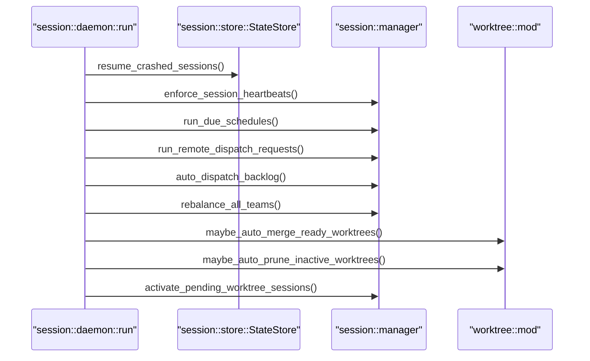
Sources: [ecc2/src/session/daemon.rs:20-56](), [ecc2/src/session/manager.rs:116-156](), [ecc2/src/session/store.rs:125-196]()

---

## TUI Dashboard & Observability

The TUI dashboard provides an interactive terminal UI for real-time insight into sessions, output logs, metrics, and tools usage. It leverages `ratatui` for UI rendering and `crossterm` for terminal event handling (`tui::app::run`) [ecc2/src/tui/dashboard.rs:1-197](), [ecc2/src/tui/app.rs:1-28]().

### Dashboard Architecture

The `Dashboard` struct encapsulates cached sessions, output line records (`session::output::OutputLine`), harness metadata, filters, cursor state, pane layout modes, and notification drivers (`DesktopNotifier`, `WebhookNotifier`) [ecc2/src/tui/dashboard.rs:107-183](). Output records are processed using bounded ring buffers via `append_output_records` [ecc2/src/tui/dashboard.rs:82-105]().

### Observability Features

- **Token & Cost Metering:** Displays token usage and estimated cost per session with live updating (`tui::widgets::TokenMeter`) [ecc2/src/tui/widgets.rs](), [ecc2/src/tui/dashboard.rs:14]().
- **Output Buffering:** Session output lines are held in a capped ring buffer (`OUTPUT_BUFFER_LIMIT`) to enable performant scrolling and incremental updates [ecc2/src/session/output.rs:20-70](), [ecc2/src/tui/dashboard.rs:97]().
- **Tool Activity Logs:** `ToolLogEntry` entities collected in `observability` provide detailed audit trails of tool invocation parameters and risk ratings [ecc2/src/observability::ToolLogEntry](), visible via the log pane.
- **Search & Filters:** Scopes and agent filters enable operators to drill down into session outputs and messages [ecc2/src/tui/dashboard.rs:150-174]().

Sources: [ecc2/src/tui/dashboard.rs:10-197](), [ecc2/src/tui/app.rs:15-128](), [ecc2/src/session/output.rs:20-70](), [ecc2/src/observability/mod.rs](), [ecc2/src/tui/widgets.rs:14-16]()

---

## Inter-Agent Messaging (Comms)

The `comms` module handles asynchronous inter-agent communication following a structured message protocol persisted in SQLite via `StateStore` [ecc2/src/comms/mod.rs](), [ecc2/src/session/store.rs]().

Core message types include:
- `TaskHandoff`: Delegates a sub-task from a lead session to a child [ecc2/src/comms/mod.rs]()
- `Query`: Requests context or verification information [ecc2/src/comms/mod.rs]()
- `Response`: Replies to a `Query` message [ecc2/src/comms/mod.rs]()
- `Conflict`: Reports file or logical conflicts between sessions [ecc2/src/comms/mod.rs]()

Messaging is crucial for orchestrating multi-agent workflows, managing delegated task handoffs, and resolving conflicts between parallel edits.

Sources: [ecc2/src/comms/mod.rs](), [ecc2/src/session/store.rs:65-97]()

---

## Configuration Engine

The configuration system defines runtime behavior through `ecc2.toml`, with schema and structs established in the `config` module (`config::Config`) [ecc2/src/config/mod.rs:1-111]().

Key configurations include:
- **Harness Runners:** `HarnessRunnerConfig` defines external harness executable programs, CLI argument templates, and environment variables [ecc2/src/config/mod.rs:94-111]().
- **Agent Profiles:** `AgentProfileConfig` and `ResolvedAgentProfile` specify resource limits (max budget in USD, token quotas), allowed/disallowed tools, and system prompt extensions [ecc2/src/config/mod.rs:65-90]().
- **Layout Settings:** `PaneLayout` defines TUI pane layouts (`Horizontal`, `Vertical`, `Grid`) [ecc2/src/config/mod.rs:12-20]().
- **Conflict Resolution:** `ConflictResolutionConfig` defines strategies (`Escalate`, `LastWriteWins`, `Merge`) for conflicting file edits [ecc2/src/config/mod.rs:38-51]().

### Diagram: Configuration Schema Hierarchy

```mermaid
classDiagram
    class Config {
        +BTreeMap~String,HarnessRunnerConfig~ harness_runners
        +BTreeMap~String,AgentProfileConfig~ agent_profiles
        +PaneLayout pane_layout
        +bool auto_create_worktrees
    }

    class HarnessRunnerConfig {
        +String program
        +Vec~String~ base_args
        +Vec~PathBuf~ project_markers
        +Option~String~ cwd_flag
        +Option~String~ session_name_flag
        +Option~String~ task_flag
        +BTreeMap~String,String~ env
    }

    class AgentProfileConfig {
        +Option~String~ inherits
        +Option~String~ agent
        +Option~String~ model
        +Vec~String~ allowed_tools
        +Option~f64~ max_budget_usd
        +Option~u64~ token_budget
    }

    Config --> HarnessRunnerConfig : "harness_runners"
    Config --> AgentProfileConfig : "agent_profiles"
```
Sources: [ecc2/src/config/mod.rs:1-111]()

---

# Summary

The ECC 2.0 Rust Control Plane (`ecc2`) is a sophisticated orchestrator blending async concurrency, embedded terminal UI, persistent SQLite state, and Git-worktree isolation to provide a robust foundation for AI agent lifecycle management. Its modular design includes:
- Session lifecycle management with precise state control and delegation (`session::manager`, `session::store`)
- Worktree isolation to avoid file conflicts (`worktree`)
- A vigilant background daemon performing maintenance, scheduling, and backlog coordination (`session::daemon`)
- A multi-pane TUI dashboard displaying live metrics, logs, session outputs, and diffs (`tui::dashboard`)
- Inter-agent messaging infrastructure for delegated workflows and conflict reporting (`comms`)
- A flexible configuration engine governing harness runners and agent profiles (`config`)

Sources: [ecc2/src/session/manager.rs](), [ecc2/src/session/store.rs](), [ecc2/src/session/daemon.rs](), [ecc2/src/tui/dashboard.rs](), [ecc2/src/comms/mod.rs](), [ecc2/src/config/mod.rs]()

---

# References

- `ecc2/src/main.rs`
- `ecc2/src/session/manager.rs`
- `ecc2/src/session/store.rs`
- `ecc2/src/session/daemon.rs`
- `ecc2/src/tui/dashboard.rs`
- `ecc2/src/tui/app.rs`
- `ecc2/src/session/output.rs`
- `ecc2/src/observability/mod.rs`
- `ecc2/src/worktree/mod.rs`
- `ecc2/src/comms/mod.rs`
- `ecc2/src/config/mod.rs`

---

# Page: Session Management & Persistence

# Session Management & Persistence

<details>
<summary>Relevant source files</summary>

The following files were used as context for generating this wiki page:

- [.gitignore](.gitignore)
- [agents/vue-reviewer.md](agents/vue-reviewer.md)
- [commands/resume-session.md](commands/resume-session.md)
- [commands/save-session.md](commands/save-session.md)
- [commands/vue-review.md](commands/vue-review.md)
- [docs/architecture/hud-status-session-control.md](docs/architecture/hud-status-session-control.md)
- [hooks/README.md](hooks/README.md)
- [hooks/hooks.json](hooks/hooks.json)
- [schemas/hooks.schema.json](schemas/hooks.schema.json)
- [scripts/ci/catalog.js](scripts/ci/catalog.js)
- [scripts/ci/generate-command-registry.js](scripts/ci/generate-command-registry.js)
- [scripts/ci/validate-agents.js](scripts/ci/validate-agents.js)
- [scripts/ci/validate-hooks.js](scripts/ci/validate-hooks.js)
- [scripts/hooks/check-console-log.js](scripts/hooks/check-console-log.js)
- [scripts/hooks/evaluate-session.js](scripts/hooks/evaluate-session.js)
- [scripts/hooks/hook-input.js](scripts/hooks/hook-input.js)
- [scripts/hooks/lifecycle-hook-bootstrap.js](scripts/hooks/lifecycle-hook-bootstrap.js)
- [scripts/hooks/post-edit-console-warn.js](scripts/hooks/post-edit-console-warn.js)
- [scripts/hooks/post-edit-format.js](scripts/hooks/post-edit-format.js)
- [scripts/hooks/post-edit-typecheck.js](scripts/hooks/post-edit-typecheck.js)
- [scripts/hooks/session-end.js](scripts/hooks/session-end.js)
- [scripts/hooks/session-start.js](scripts/hooks/session-start.js)
- [scripts/hooks/suggest-compact.js](scripts/hooks/suggest-compact.js)
- [scripts/lib/control-pane/work-item-runner.js](scripts/lib/control-pane/work-item-runner.js)
- [scripts/lib/control-pane/work-item-worker.js](scripts/lib/control-pane/work-item-worker.js)
- [scripts/lib/llm-summary.js](scripts/lib/llm-summary.js)
- [scripts/lib/package-manager.d.ts](scripts/lib/package-manager.d.ts)
- [scripts/lib/package-manager.js](scripts/lib/package-manager.js)
- [scripts/lib/session-adapters/canonical-session.js](scripts/lib/session-adapters/canonical-session.js)
- [scripts/lib/session-adapters/claude-history.js](scripts/lib/session-adapters/claude-history.js)
- [scripts/lib/session-adapters/dmux-tmux.js](scripts/lib/session-adapters/dmux-tmux.js)
- [scripts/lib/session-adapters/registry.js](scripts/lib/session-adapters/registry.js)
- [scripts/lib/session-aliases.d.ts](scripts/lib/session-aliases.d.ts)
- [scripts/lib/session-aliases.js](scripts/lib/session-aliases.js)
- [scripts/lib/session-manager.d.ts](scripts/lib/session-manager.d.ts)
- [scripts/lib/session-manager.js](scripts/lib/session-manager.js)
- [scripts/lib/skill-improvement/amendify.js](scripts/lib/skill-improvement/amendify.js)
- [scripts/lib/skill-improvement/evaluate.js](scripts/lib/skill-improvement/evaluate.js)
- [scripts/lib/skill-improvement/health.js](scripts/lib/skill-improvement/health.js)
- [scripts/lib/state-store/file-lock.js](scripts/lib/state-store/file-lock.js)
- [scripts/lib/state-store/index.js](scripts/lib/state-store/index.js)
- [scripts/lib/utils.d.ts](scripts/lib/utils.d.ts)
- [scripts/lib/utils.js](scripts/lib/utils.js)
- [scripts/session-inspect.js](scripts/session-inspect.js)
- [tests/ci/catalog.test.js](tests/ci/catalog.test.js)
- [tests/ci/command-registry.test.js](tests/ci/command-registry.test.js)
- [tests/ci/validators.test.js](tests/ci/validators.test.js)
- [tests/fixtures/session-start-alias-read-preload.cjs](tests/fixtures/session-start-alias-read-preload.cjs)
- [tests/hooks/hooks.test.js](tests/hooks/hooks.test.js)
- [tests/hooks/session-end.test.js](tests/hooks/session-end.test.js)
- [tests/hooks/session-start-alias-unavailable.test.js](tests/hooks/session-start-alias-unavailable.test.js)
- [tests/integration/hooks.test.js](tests/integration/hooks.test.js)
- [tests/lib/claude-history-alias-unavailable.test.js](tests/lib/claude-history-alias-unavailable.test.js)
- [tests/lib/control-pane-contention.test.js](tests/lib/control-pane-contention.test.js)
- [tests/lib/helpers/control-pane-contention-server.js](tests/lib/helpers/control-pane-contention-server.js)
- [tests/lib/helpers/state-store-worker.js](tests/lib/helpers/state-store-worker.js)
- [tests/lib/llm-summary.test.js](tests/lib/llm-summary.test.js)
- [tests/lib/package-manager.test.js](tests/lib/package-manager.test.js)
- [tests/lib/session-adapters-codex.test.js](tests/lib/session-adapters-codex.test.js)
- [tests/lib/session-adapters-opencode.test.js](tests/lib/session-adapters-opencode.test.js)
- [tests/lib/session-adapters.test.js](tests/lib/session-adapters.test.js)
- [tests/lib/session-aliases.test.js](tests/lib/session-aliases.test.js)
- [tests/lib/session-manager.test.js](tests/lib/session-manager.test.js)
- [tests/lib/skill-improvement.test.js](tests/lib/skill-improvement.test.js)
- [tests/lib/state-store-concurrency.test.js](tests/lib/state-store-concurrency.test.js)
- [tests/lib/state-store-persistence.test.js](tests/lib/state-store-persistence.test.js)
- [tests/lib/state-store-read-cache.test.js](tests/lib/state-store-read-cache.test.js)
- [tests/lib/utils.test.js](tests/lib/utils.test.js)
- [tests/lib/work-item-runner.test.js](tests/lib/work-item-runner.test.js)
- [tests/scripts/instinct-cli-evolve-generate.test.js](tests/scripts/instinct-cli-evolve-generate.test.js)
- [tests/scripts/instinct-cli-evolve.test.js](tests/scripts/instinct-cli-evolve.test.js)
- [tests/scripts/session-inspect.test.js](tests/scripts/session-inspect.test.js)

</details>


Everything Claude Code (ECC) implements a robust session management and state persistence subsystem designed to maintain continuity across AI harness restarts. It utilizes a lifecycle-driven approach, capturing state during active sessions, serializing state safely through a JS state-store with file locking, and re-injecting relevant context upon initialization. The system is governed by the `ecc.session.v1` contract and adapter interfaces, ensuring portability and consistent behavior across different environments.

Sources: `[scripts/hooks/session-start.js:1-191]()`, `[scripts/lib/state-store/index.js]()`, `[scripts/lib/session-manager.js:1-149]()`.

---

## Architecture & Data Flow

Session management is coordinated through lifecycle hooks (`SessionStart` and `Stop`/`SessionEnd`), the JS state-store, and session management libraries.

### Core Lifecycle Flow

1. **`SessionStart` Hook (`scripts/hooks/session-start.js`)**: Triggered when the AI harness initializes a new session. It scans configured session storage directories using `getSessionSearchDirs()` [scripts/lib/utils.js:70-72](), finds recent session files via `dedupeRecentSessions()` [scripts/hooks/session-start.js:64-91](), applies stale-replay guards, and loads summaries into context.
2. **Active Session Interaction**: As the AI assistant interacts with the user, tools and modified files are tracked continuously via `scripts/hooks/session-end.js` [scripts/hooks/session-end.js:47-74]().
3. **`SessionEnd` Hook (`scripts/hooks/session-end.js`)**: Runs after each assistant response (Stop event). It parses the current session transcript JSONL log via `extractSessionSummary()` [scripts/hooks/session-end.js:83-111]() to extract user requests, tools used, and files modified, updating persistent markdown session files.
4. **State-Store & File Locks**: Concurrent reads and writes to session state and shared registers are arbitrated by the JS state store (`scripts/lib/state-store/index.js`) using atomic file locking primitives (`scripts/lib/state-store/file-lock.js`).

---

### Lifecycle Dispatch to Code Entities

```mermaid
graph TD
    subgraph "HarnessLifecycle"
        SESSION_START["SessionStartEvent"]
        STOP_EVENT["StopEvent"]
    end

    subgraph "HookScripts"
        SESSION_START_JS["scripts/hooks/session-start.js"]
        SESSION_END_JS["scripts/hooks/session-end.js"]
    end

    subgraph "CoreLibraries"
        SESSION_MANAGER["scripts/lib/session-manager.js"]
        SESSION_ALIASES["scripts/lib/session-aliases.js"]
        STATE_STORE["scripts/lib/state-store/index.js"]
        FILE_LOCK["scripts/lib/state-store/file-lock.js"]
        UTILS["scripts/lib/utils.js"]
    end

    SESSION_START --> SESSION_START_JS
    STOP_EVENT --> SESSION_END_JS

    SESSION_START_JS --> SESSION_MANAGER
    SESSION_START_JS --> SESSION_ALIASES
    SESSION_END_JS --> SESSION_MANAGER

    SESSION_MANAGER --> STATE_STORE
    SESSION_ALIASES --> STATE_STORE
    STATE_STORE --> FILE_LOCK
    SESSION_MANAGER --> UTILS
```

This diagram bridges natural language concepts (Harness Lifecycle, Core Libraries) to exact code entities (`scripts/hooks/session-start.js`, `scripts/lib/state-store/index.js`, etc.).

Sources: `[scripts/hooks/session-start.js:1-191]`, `[scripts/hooks/session-end.js:1-182]`, `[scripts/lib/state-store/index.js]`, `[scripts/lib/state-store/file-lock.js]`, `[scripts/lib/utils.js:56-79]`.

---

## Data Storage Layout & JS State Store with File Locks

ECC stores persistent data under a centralized directory (defaulting to `~/.claude/` or overridden by `ECC_AGENT_DATA_HOME`).

| Directory / File                   | Purpose                                        | Code Reference                      |
|------------------------------------|------------------------------------------------|-------------------------------------|
| `~/.claude/session-data/`          | Canonical storage for `.tmp` session files     | `[scripts/lib/utils.js:56-58]()`    |
| `~/.claude/sessions/`              | Legacy storage for older ECC versions          | `[scripts/lib/utils.js:63-65]()`    |
| `~/.claude/session-aliases.json`   | Registry file for named session shortcuts      | `[scripts/lib/session-aliases.js:17-19]()` |
| `~/.claude/skills/learned/`        | Persisted autonomous skill learnings           | `[scripts/lib/utils.js:77-79]()`    |

### JS State Store & File Locks (`scripts/lib/state-store/`)

To prevent race conditions during concurrent multi-agent worktree execution or parallel hook execution, ECC provides a file-locked state store (`scripts/lib/state-store/index.js` backed by `scripts/lib/state-store/file-lock.js`).

- **Atomic Access**: Acquires exclusive file locks before reading or writing JSON state payloads.
- **Concurrency Control**: Implements retry/backoff mechanisms for lock contention, tested via `tests/lib/state-store-concurrency.test.js` and `tests/lib/state-store-persistence.test.js`.

Sources: `[scripts/lib/utils.js:56-79]`, `[scripts/lib/state-store/index.js]`, `[scripts/lib/state-store/file-lock.js]`.

---

## Session Data & Aliases

### Session Filename Format & Sanitization

Sessions are stored as files named using a date-centric and optionally unique ID format:

```
YYYY-MM-DD-[shortId]-session.tmp
```

- **Short ID**: Derived from the last 8 characters of `CLAUDE_SESSION_ID` or project names using `sanitizeSessionId()` [scripts/lib/utils.js:157-180]().
- **Validation & Parsing**: Filenames are parsed by `parseSessionFilename()` in `scripts/lib/session-manager.js` to extract dates and short IDs [scripts/lib/session-manager.js:46-73]().

### Session Aliases

Aliases offer friendly human-readable names mapped to specific session files, allowing users to easily resume sessions via commands like `/resume-session`.

- Management functions `setAlias(alias, sessionPath, title)` and `resolveAlias(alias)` handle reading, validating, and writing alias mappings (`scripts/lib/session-aliases.js`) [scripts/lib/session-aliases.js:88-126](), [scripts/lib/session-aliases.js:158-179]().
- Validation restricts alias names to alphanumeric characters, dashes, and underscores, forbids reserved keywords (`list`, `help`, `delete`), and enforces a 128-character length limit.

### Alias Persistence & Resolution Flow

```mermaid
graph TD
    subgraph "UserCommandSpace"
        CMD_SAVE["SaveAliasCommand"]
        CMD_RESUME["ResumeAliasCommand"]
    end

    subgraph "AliasApiSpace"
        SET_ALIAS["setAlias(alias, sessionPath, title)"]
        RES_ALIAS["resolveAlias(alias)"]
    end

    subgraph "StorageSpace"
        LOAD_FN["loadAliases()"]
        SAVE_FN["saveAliases(data)"]
        ALIAS_JSON["~/.claude/session-aliases.json"]
    end

    CMD_SAVE --> SET_ALIAS
    CMD_RESUME --> RES_ALIAS

    SET_ALIAS --> LOAD_FN
    SET_ALIAS --> SAVE_FN
    RES_ALIAS --> LOAD_FN

    SAVE_FN --> ALIAS_JSON
    LOAD_FN --> ALIAS_JSON
```

Sources: `[scripts/lib/session-aliases.js:17-19]`, `[scripts/lib/session-aliases.js:88-126]`, `[scripts/lib/session-aliases.js:158-179]`.

---

## Context Injection Pipeline & Stale-Replay Guard

### Session Search & Deduplication

At session start (`scripts/hooks/session-start.js`), the system performs the following checks:
- **Directory Search**: Iterates over search directories returned by `getSessionSearchDirs()` [scripts/lib/utils.js:70-72]().
- **Deduplication**: `dedupeRecentSessions()` compares file modification times (`mtime`) and directory precedence to identify unique sessions [scripts/hooks/session-start.js:64-91]().
- **Character Capping**: Respects size boundaries defined by `ECC_SESSION_START_MAX_CHARS` to prevent prompt overflow [scripts/hooks/session-start.js:118-124]().

### Metadata Parsing & Stale-Replay Guard

- Session content is parsed via `parseSessionMetadata()` to extract completion status, active tasks, and context blocks [tests/lib/session-manager.test.js:90-130]().
- **Stale-Replay Guard**: Filters out outdated, cross-project, or foreign worktree sessions by comparing repository identities (`sameRepoIdentity`) [scripts/hooks/session-start.js:113-116](), [scripts/lib/utils.js:194-206]().

Sources: `[scripts/hooks/session-start.js:1-191]`, `[scripts/lib/utils.js:70-72]`, `[scripts/lib/utils.js:194-206]`.

---

## Session Adapter Contract (`ecc.session.v1`)

ECC abstracts interactions with underlying AI harness storage through the `ecc.session.v1` adapter contract.

| Adapter Name       | Target Environment           | Module Path                                       |
|--------------------|------------------------------|---------------------------------------------------|
| **Canonical**      | ECC Internal Runtime         | `scripts/lib/session-adapters/canonical-session.js` |
| **Claude History** | Claude Code CLI Logs         | `scripts/lib/session-adapters/claude-history.js`   |

Each adapter implements a uniform interface to:
- Read and translate harness-specific session logs (JSONL, CLI history).
- Expose a normalized session data structure to the session manager and hooks.
- Support session resume operations and summary generation.

Sources: `[scripts/lib/session-adapters/canonical-session.js]`, `[scripts/lib/session-adapters/claude-history.js]`.

---

# Summary

Everything Claude Code's session management and persistence subsystem ensures continuity across restarts through:
- Canonical file storage and JSON state-stores with robust file locking.
- Session alias mapping with strict validation.
- Intelligent context injection guarded by stale-replay and repository identity checks.
- Pluggable adapter contracts (`ecc.session.v1`) for cross-harness portability.

Sources: `[scripts/hooks/session-start.js]`, `[scripts/hooks/session-end.js]`, `[scripts/lib/session-manager.js]`, `[scripts/lib/session-aliases.js]`, `[scripts/lib/state-store/index.js]`.

---

# Page: MCP Server Integration

# MCP Server Integration

<details>
<summary>Relevant source files</summary>

The following files were used as context for generating this wiki page:

- [.agents/skills/unified-memory/SKILL.md](.agents/skills/unified-memory/SKILL.md)
- [.agents/skills/unified-memory/agents/openai.yaml](.agents/skills/unified-memory/agents/openai.yaml)
- [.cursor/skills/unified-memory/SKILL.md](.cursor/skills/unified-memory/SKILL.md)
- [.mcp.json](.mcp.json)
- [docs/design/ecc-ito-compute-integration.md](docs/design/ecc-ito-compute-integration.md)
- [docs/design/ecc-memory-vault.md](docs/design/ecc-memory-vault.md)
- [install.ps1](install.ps1)
- [install.sh](install.sh)
- [mcp-configs/mcp-servers.json](mcp-configs/mcp-servers.json)
- [rules/README.md](rules/README.md)
- [scripts/claw.js](scripts/claw.js)
- [scripts/codex-git-hooks/pre-commit](scripts/codex-git-hooks/pre-commit)
- [scripts/codex-git-hooks/pre-push](scripts/codex-git-hooks/pre-push)
- [scripts/codex/install-global-git-hooks.sh](scripts/codex/install-global-git-hooks.sh)
- [scripts/codex/merge-mcp-config.js](scripts/codex/merge-mcp-config.js)
- [scripts/hooks/desktop-notify.js](scripts/hooks/desktop-notify.js)
- [scripts/hooks/mcp-health-check.js](scripts/hooks/mcp-health-check.js)
- [scripts/hooks/run-with-flags-shell.sh](scripts/hooks/run-with-flags-shell.sh)
- [scripts/ito.js](scripts/ito.js)
- [scripts/lib/ito-environment.js](scripts/lib/ito-environment.js)
- [scripts/lib/memory-vault.js](scripts/lib/memory-vault.js)
- [scripts/memory-mcp.mjs](scripts/memory-mcp.mjs)
- [skills/ito-compute/SKILL.md](skills/ito-compute/SKILL.md)
- [skills/ito-compute/agents/openai.yaml](skills/ito-compute/agents/openai.yaml)
- [skills/laravel-plugin-discovery/SKILL.md](skills/laravel-plugin-discovery/SKILL.md)
- [skills/unified-memory/SKILL.md](skills/unified-memory/SKILL.md)
- [tests/ci/ito-compute-skill.test.js](tests/ci/ito-compute-skill.test.js)
- [tests/hooks/mcp-health-check.test.js](tests/hooks/mcp-health-check.test.js)
- [tests/lib/memory-read-completeness.test.js](tests/lib/memory-read-completeness.test.js)
- [tests/lib/memory-vault.test.js](tests/lib/memory-vault.test.js)
- [tests/scripts/claw.test.js](tests/scripts/claw.test.js)
- [tests/scripts/codex-hooks.test.js](tests/scripts/codex-hooks.test.js)
- [tests/scripts/install-ps1.test.js](tests/scripts/install-ps1.test.js)
- [tests/scripts/install-readme-clarity.test.js](tests/scripts/install-readme-clarity.test.js)
- [tests/scripts/install-sh.test.js](tests/scripts/install-sh.test.js)
- [tests/scripts/ito-cli-bridge.test.js](tests/scripts/ito-cli-bridge.test.js)
- [tests/scripts/memory-mcp.test.js](tests/scripts/memory-mcp.test.js)

</details>


The Model Context Protocol (MCP) server integration in Everything Claude Code (ECC) provides a standardized protocol and ecosystem for AI harnesses (such as Claude Code, Codex, Cursor, OpenCode, and others) to invoke external services, tools, and databases in a consistent, secure, and extensible manner. This page details the components, policies, and implementation patterns that define how ECC manages MCP servers and their integration.

The scope includes managing the `mcp-servers.json` registry, enforcing the single MCP connector policy, coordinating opt-in servers (such as `ito-compute` and the `ecc-memory-vault`), merging MCP configurations during install, monitoring MCP server health via a dedicated hook, and a local persistent memory MCP server implementation.

---

## 1. MCP Connector Policy & MCP Servers Registry

### Single Default Connector Policy

ECC enforces a strict **single default MCP connector** policy to reduce the attack surface and system complexity. The default connector `chrome-devtools` is the *only* MCP server enabled automatically for most harnesses.

All other MCP servers—which include a broad collection of specialized MCP servers—are **off by default** and require explicit opt-in by the operator. This ensures tight control over permissions and resource use across tools.

### MCP Servers Registry: `mcp-servers.json`

The centralized registry of canonical MCP server definitions lives in `mcp-configs/mcp-servers.json`. This JSON file lists server entries indexed by server name, each defining:

- `command` and `args`: The executable and argument list to spawn for the MCP server.
- `type` and `url` (optional): For HTTP-based MCP servers.
- Optional environment variables needed by the server.
- A clear textual `description` of the server’s purpose and usage notes.

The file includes definitions like `nexus`, `ito-compute`, `jira`, `github`, `firecrawl`, `supabase`, `ecc-memory-vault`, `memory`, `omega-memory`, `longhand`, and `sequential-thinking` [mcp-configs/mcp-servers.json:1-142](). This JSON registry provides a single source of truth for all supported MCP servers, which can be referred to or customized by the operator in each harness’s config [mcp-configs/mcp-servers.json:1-142]().

```mermaid
graph TD
    Registry["mcp-configs/mcp-servers.json"] -->|Defines Schema| ServerSpecs[Server Specifications]
    ServerSpecs -->|Single Default Policy| DefaultConnector["chrome-devtools (Enabled by default)"]
    ServerSpecs -->|Opt-in Policy| OptInConnectors["nexus, ito-compute, ecc-memory-vault, etc. (Off by default)"]
```
Sources: [mcp-configs/mcp-servers.json:1-142]()

---

## 2. Memory MCP Server: `ecc-memory-mcp`

ECC provides an opt-in **memory MCP server** implemented in Node.js (`scripts/memory-mcp.mjs`) that enables persistent memory storage accessible simultaneously by multiple AI harnesses over standard I/O streams (stdio) using JSON-RPC 2.0 [scripts/memory-mcp.mjs:1-148]().

### 2.1. Security & Harness Identification

- The server requires the environment variable `ECC_MEMORY_HARNESS`, which identifies the owner harness in lowercase slug form (`resolveServiceSecurity`) [scripts/memory-mcp.mjs:174-186]().
- It optionally permits or denies access to the `user` memory scope based on `ECC_MEMORY_ALLOW_USER_SCOPE` (disabled by default) [scripts/memory-mcp.mjs:174-186]().
- These constraints ensure memory data isolation and security boundaries between harnesses [scripts/memory-mcp.mjs:174-186]().

### 2.2. Validated Tools Surface

The memory MCP exposes core tools (`memory_save`, `memory_search`, `memory_read`, `memory_doctor`) validated using Ajv schemas (`TOOL_VALIDATORS`, `TOOL_DEFINITIONS`) to sanitize inputs, whitelist permitted scopes, kinds, and tags [scripts/memory-mcp.mjs:53-147]().

### 2.3. Trusted Storage Locations

ECC manages trusted filesystem locations for storing memory under project, team, and user scopes via `scripts/lib/memory-vault.js`. These roots verify trusted boundaries, reject symlinks, and enforce file permissions [scripts/lib/memory-vault.js:41-114]().

### 2.4. Data Flow Diagram for Memory MCP

```mermaid
graph TD
    subgraph "Code_Entity_Space"
        ClientAgent["MCP Client Harness"] -->|JSON-RPC Request| MemoryServer["scripts/memory-mcp.mjs"]
        MemoryServer -->|Ajv Compile/Validate| AjvValidators["TOOL_VALIDATORS"]
        MemoryServer -->|Authorize Scope| SecFunc["resolveServiceSecurity()"]
        SecFunc -->|Invoke Operations| VaultLib["scripts/lib/memory-vault.js"]
        VaultLib -->|Read/Write Vault| VaultStore[".ecc/memory/{project,team,user}/"]
    end
```
Sources: [scripts/memory-mcp.mjs:1-148](), [scripts/lib/memory-vault.js:41-114]()

---

## 3. MCP Health Check Hook

ECC includes a dedicated lifecycle hook `scripts/hooks/mcp-health-check.js` to monitor and manage the health of configured MCP servers, protecting harnesses from hanging or degraded behavior [scripts/hooks/mcp-health-check.js:4-55]().

### 3.1. Hook Invocation Points

- **PreToolUse**: Probes target server status before tool execution. If unhealthy and cache TTL has not expired, prevents tool invocation with exit code `2` [scripts/hooks/mcp-health-check.js:4-55]().
- **PostToolUseFailure**: On failed MCP calls, marks the server unhealthy, timestamps state, and computes backoff delay [scripts/hooks/mcp-health-check.js:4-55]().

### 3.2. Health State Persistence

Health states are cached in a local JSON file at `~/.claude/mcp-health-cache.json` (`stateFilePath`) to avoid repeated failure cascades [scripts/hooks/mcp-health-check.js:23-26, 54-96]().

### 3.3. Data Flow Diagram for MCP Health Check Hook

```mermaid
graph TD
    subgraph "Code_Entity_Space"
        HarnessEvent["PreToolUse Event"] --> HealthCheckHook["scripts/hooks/mcp-health-check.js"]
        HealthCheckHook -->|Read Cache| CacheStore["~/.claude/mcp-health-cache.json"]
        HealthCheckHook -->|Probe Server| ServerProbe["HTTP GET or spawnSync()"]
        ServerProbe -->|Unhealthy| ExitBlock["Exit Code 2 (Block)"]
        ServerProbe -->|Healthy| ExitPass["Exit Code 0 (Pass)"]
    end
```
Sources: [scripts/hooks/mcp-health-check.js:4-96](), [tests/hooks/mcp-health-check.test.js:1-50]()

---

## 4. Configuration Merging and MCP Discovery Paths

ECC supports automatic merging of MCP server configurations during installation or updates (`scripts/codex/merge-mcp-config.js`) [scripts/codex/merge-mcp-config.js:1-177]().

### 4.1. Merge Strategy

- **Add-Only by Default**: Appends missing ECC-recommended servers to the harness's MCP config TOML file without removing user-managed entries [scripts/codex/merge-mcp-config.js:1-177]().
- **Drift Warnings & Repairs**: Emits warnings on config drift and repairs known-invalid legacy fields (such as `RETIRED_INVALID_URL_SERVERS`) [scripts/codex/merge-mcp-config.js:105-107]().
- **Package Manager Integration**: Respects the user's configured package manager (`npm`, `pnpm`, `yarn`, `bun`) via `getPackageManager()` [scripts/codex/merge-mcp-config.js:37-45]().

### 4.2. MCP Config Discovery Paths

MCP clients and hooks discover configuration files in priority order (`configPaths`):
1. `ECC_MCP_CONFIG_PATH` environment override
2. `./.claude.json` (project-local)
3. `./.claude/settings.json` (project-local)
4. `~/.claude.json` (user-global)
5. `~/.claude/settings.json` (user-global) [scripts/hooks/mcp-health-check.js:57-75]()

```mermaid
graph LR
    subgraph "Code_Entity_Space"
        InstallScript["scripts/install-apply.js"] -->|Merge Config| MergeScript["scripts/codex/merge-mcp-config.js"]
        MergeScript -->|Detect PM| PkgMgr["scripts/lib/package-manager.js"]
        MergeScript -->|Update TOML| TomlParser["@iarna/toml"]
    end
```
Sources: [scripts/codex/merge-mcp-config.js:1-177](), [scripts/hooks/mcp-health-check.js:57-75]()

---

## References & Source Files

- `[mcp-configs/mcp-servers.json:1-142]()`
- `[scripts/memory-mcp.mjs:1-148]()`
- `[scripts/lib/memory-vault.js:41-114]()`
- `[scripts/hooks/mcp-health-check.js:4-96]()`
- `[scripts/codex/merge-mcp-config.js:1-177]()`
- `[tests/hooks/mcp-health-check.test.js:1-50]()`

---

# Page: Context Packs, Profiles & Carriers

# Context Packs, Profiles & Carriers

<details>
<summary>Relevant source files</summary>

The following files were used as context for generating this wiki page:

- [docker/context-profiles/ai-eval-lib.js](docker/context-profiles/ai-eval-lib.js)
- [docker/context-profiles/ai-eval.js](docker/context-profiles/ai-eval.js)
- [docker/context-profiles/complex-eval/DESIGN.md](docker/context-profiles/complex-eval/DESIGN.md)
- [docs/design/context-carriers.tdd.md](docs/design/context-carriers.tdd.md)
- [docs/design/context-profile-delivery.md](docs/design/context-profile-delivery.md)
- [docs/design/context-profile-delivery.tdd.md](docs/design/context-profile-delivery.tdd.md)
- [eslint.config.js](eslint.config.js)
- [legacy-command-shims/commands/context-budget.md](legacy-command-shims/commands/context-budget.md)
- [pi/core/skills/docker-patterns/SKILL.md](pi/core/skills/docker-patterns/SKILL.md)
- [scripts/ci/validate-carrier-closure.js](scripts/ci/validate-carrier-closure.js)
- [scripts/dev/generate-skill-triggers.js](scripts/dev/generate-skill-triggers.js)
- [scripts/hooks/context-prompt-suggestions.js](scripts/hooks/context-prompt-suggestions.js)
- [scripts/hooks/context-routing-index.js](scripts/hooks/context-routing-index.js)
- [scripts/lib/context-profile-commands.js](scripts/lib/context-profile-commands.js)
- [scripts/lib/context-profile-interactive.js](scripts/lib/context-profile-interactive.js)
- [scripts/lib/context-profile-launch.js](scripts/lib/context-profile-launch.js)
- [scripts/lib/context-profile-native-executable.js](scripts/lib/context-profile-native-executable.js)
- [scripts/lib/context-profile-native.js](scripts/lib/context-profile-native.js)
- [scripts/lib/context-profile-support.js](scripts/lib/context-profile-support.js)
- [scripts/lib/context-profiles.js](scripts/lib/context-profiles.js)
- [scripts/lib/context-retrieval.js](scripts/lib/context-retrieval.js)
- [scripts/lib/context-routing-index.js](scripts/lib/context-routing-index.js)
- [scripts/lib/context-selection.js](scripts/lib/context-selection.js)
- [scripts/lib/install/contained-fs.js](scripts/lib/install/contained-fs.js)
- [scripts/lib/install/json-ops.js](scripts/lib/install/json-ops.js)
- [scripts/orchestrate-codex-worker.sh](scripts/orchestrate-codex-worker.sh)
- [scripts/profile.js](scripts/profile.js)
- [skills/context-budget/SKILL.md](skills/context-budget/SKILL.md)
- [skills/token-budget-advisor/SKILL.md](skills/token-budget-advisor/SKILL.md)
- [tests/fixtures/context-selection/routing-prompts.json](tests/fixtures/context-selection/routing-prompts.json)
- [tests/hooks/context-prompt-suggestions.test.js](tests/hooks/context-prompt-suggestions.test.js)
- [tests/lib/context-profile-eval.test.js](tests/lib/context-profile-eval.test.js)
- [tests/lib/context-profile-launch.test.js](tests/lib/context-profile-launch.test.js)
- [tests/lib/context-profile-native.test.js](tests/lib/context-profile-native.test.js)
- [tests/lib/context-routing-index.test.js](tests/lib/context-routing-index.test.js)
- [tests/lib/context-selection.test.js](tests/lib/context-selection.test.js)
- [tests/scripts/generate-skill-triggers.test.js](tests/scripts/generate-skill-triggers.test.js)
- [tests/scripts/orchestrate-codex-worker.test.js](tests/scripts/orchestrate-codex-worker.test.js)
- [tests/scripts/repair.test.js](tests/scripts/repair.test.js)
- [tests/scripts/validate-carrier-closure.test.js](tests/scripts/validate-carrier-closure.test.js)
- [tests/skills/context-budget.test.js](tests/skills/context-budget.test.js)
- [tests/skills/desk-pattern-skills.test.js](tests/skills/desk-pattern-skills.test.js)
- [tests/test_model_config.py](tests/test_model_config.py)

</details>


## Purpose and Scope

The context selection and routing subsystem in ECC manages how skills, agents, rules, and resources are cataloged, compiled into profiles, projected into isolated runtime carriers, and dynamically selected for tasks. This page covers the architectural implementation of the context-pack registry, profile compilation, deterministic carrier closure validation, token/context budget skills, and the `docker/context-profiles` AI evaluation lab.

---

## 1. Context-Pack Registry and Profile Compilation

The registry parses modular manifests (`manifests/context-packs/`) and indexes component metadata, dependency closures, and required resource paths. Profile compilation reads the registry to generate deterministic distributions for target harnesses (e.g., `lean@1` and `full@1`) [scripts/ci/validate-carrier-closure.js:24]().

Key components:
- `loadContextRegistry`: Reads and verifies context packs and skill manifests from the workspace root.
- `compileContextProfileWithRegistry`: Merges pack registrations with inclusion/exclusion filters to compute deterministic target manifests and resource digests [scripts/lib/context-selection.js:5]().

```mermaid
graph TD
    subcode["Code Entity Space"]
    RC["compileContextProfileWithRegistry"] --> CR["loadContextRegistry"]
    CR --> Manifests["manifests/context-packs/"]
    RC --> Plans["Lean/Full Plan Generation"]
    Plans --> Digest["Deterministic Digest Computation"]

    sublang["Natural Language Space"]
    NL1["Context Pack Manifests"] -.-> Manifests
    NL2["Profile Compilation"] -.-> RC
    NL3["Registry Loading"] -.-> CR

    classDef default fill:none,stroke:#000,stroke-width:1px;
```

**Sources:** `scripts/lib/context-pack-registry.js`, `scripts/lib/context-profiles.js`, `scripts/ci/validate-carrier-closure.js:20-25` [scripts/ci/validate-carrier-closure.js:20-25]()

---

## 2. Context Selection, Routing, and Launch Subsystem

The runtime task-routing engine [scripts/lib/context-selection.js:8-12]() matches incoming natural-language queries against indexed context elements using BM25 retrieval and structural triggers [scripts/lib/context-retrieval.js]().

### Selection Modes
- **Manual**: Requires explicit IDs (`explicitIds`) provided in the task payload.
- **Suggest**: Computes ranking suggestions and returns candidate identifiers without injecting bodies.
- **Auto**: Automatically admits matching skills if they clear scoring thresholds and explicit admission guards [scripts/lib/context-selection.js:18-28]().

### Task Context Lifecycle

```mermaid
graph TD
    subcode["Code Entity Space"]
    TI["taskInputObject"] --> RTC["resolveTaskContext"]
    RTC --> SR["searchRetrieval"]
    RTC --> Check["meetsFallbackBar"]
    Check --> LT["loadTaskContext"]
    LT --> LTC["launchTaskContext"]

    sublang["Natural Language Space"]
    NL1["Task Submission"] -.-> TI
    NL2["Context Resolution"] -.-> RTC
    NL3["Task Execution Launch"] -.-> LTC

    classDef default fill:none,stroke:#000,stroke-width:1px;
```

`resolveTaskContext` enforces strict validation rules, rejecting tasks if source files drift during selection or if authority-bearing metadata violates invocation policies [tests/lib/context-selection.test.js:63-96](). `launchTaskContext` executes tasks under isolated provider environments (`claude --print`, `codex exec -`) with dedicated home directories and environment sanitization [tests/lib/context-profile-launch.test.js:8-31]().

**Sources:** `scripts/lib/context-selection.js:1-112` [scripts/lib/context-selection.js:1-112](), `scripts/lib/context-profile-launch.js` [tests/lib/context-profile-launch.test.js:8-9](), `tests/lib/context-selection.test.js:63-96` [tests/lib/context-selection.test.js:63-96]()

---

## 3. Context Carriers and Closure Validation

Context carriers package profiles and dependencies into read-only file projections for distribution. The closure validator (`scripts/ci/validate-carrier-closure.js`) ensures that all script dependencies inside a carrier resolve strictly within the planned file set without escaping to host filesystem locations or performing unallowed dynamic requires [scripts/ci/validate-carrier-closure.js:3-13]().

### Static Analysis and AST Scanning
The validator parses JavaScript source files using the TypeScript compiler API (`ts.createSourceFile`) without evaluating them [scripts/ci/validate-carrier-closure.js:34-44]() to extract literal `require` and `import` specifiers via `extractReferences` [scripts/ci/validate-carrier-closure.js:47-88]().

```mermaid
graph TD
    subcode["Code Entity Space"]
    VR["validator.validate"] --> SC["scanSource"]
    SC --> ER["extractReferences"]
    ER --> CD["candidateDestinations"]
    CD --> IP["inspectProjection"]

    sublang["Natural Language Space"]
    NL1["Carrier File Projection"] -.-> VR
    NL2["AST Static Parsing"] -.-> SC
    NL3["Reference & Dependency Check"] -.-> ER

    classDef default fill:none,stroke:#000,stroke-width:1px;
```

**Sources:** `scripts/ci/validate-carrier-closure.js:1-145` [scripts/ci/validate-carrier-closure.js:1-145](), `tests/scripts/validate-carrier-closure.test.js:35-52` [tests/scripts/validate-carrier-closure.test.js:35-52]()

---

## 4. Token and Context Budget Skills

ECC provides self-contained skills that guide token utilization and estimate context overhead.

### Token Budget Advisor (`token-budget-advisor`)
Intercepts the response flow to offer response depth options (25%, 50%, 75%, 100%) before answering [skills/token-budget-advisor/SKILL.md:1-10]() by estimating prompt input tokens and applying complexity multipliers [skills/token-budget-advisor/SKILL.md:23-47]().

### Context Budget (`context-budget`)
Routes live context checks directly to native provider meters (`/status` in Codex, `/context` in Claude Code) without scanning local files [skills/context-budget/SKILL.md:13-35](). It restricts static configuration audits to explicit opt-in flags (`--audit`) with strict read-only boundaries [skills/context-budget/SKILL.md:41-57]().

**Sources:** `skills/token-budget-advisor/SKILL.md:1-67` [skills/token-budget-advisor/SKILL.md:1-67](), `skills/context-budget/SKILL.md:1-82` [skills/context-budget/SKILL.md:1-82]()

---

## 5. AI Evaluation Lab (`docker/context-profiles`)

The `docker/context-profiles/` directory serves as an isolated evaluation lab for testing context routing quality, profile compilation correctness, and token conservation [docs/design/context-profile-delivery.md:1-15]().

It contains evaluation harness scripts (`ai-eval.js`, `ai-eval-lib.js`) that run automated verification suites inside clean container environments (Podman/Docker), verifying packed carrier integrity, managed store rollbacks, and resolver accuracy across distinct profile configurations [docs/design/context-profile-delivery.tdd.md:34-52]().

**Sources:** `docker/context-profiles/ai-eval.js`, `docker/context-profiles/ai-eval-lib.js`, `docs/design/context-profile-delivery.md:1-64` [docs/design/context-profile-delivery.md:1-64]()

---

# Page: Agents

# Agents

<details>
<summary>Relevant source files</summary>

The following files were used as context for generating this wiki page:

- [agents/architect.md](agents/architect.md)
- [agents/build-error-resolver.md](agents/build-error-resolver.md)
- [agents/code-reviewer.md](agents/code-reviewer.md)
- [agents/database-reviewer.md](agents/database-reviewer.md)
- [agents/doc-updater.md](agents/doc-updater.md)
- [agents/e2e-runner.md](agents/e2e-runner.md)
- [agents/go-build-resolver.md](agents/go-build-resolver.md)
- [agents/go-reviewer.md](agents/go-reviewer.md)
- [agents/planner.md](agents/planner.md)
- [agents/python-reviewer.md](agents/python-reviewer.md)
- [agents/refactor-cleaner.md](agents/refactor-cleaner.md)
- [agents/security-reviewer.md](agents/security-reviewer.md)
- [agents/tdd-guide.md](agents/tdd-guide.md)
- [commands/go-build.md](commands/go-build.md)
- [commands/go-review.md](commands/go-review.md)
- [commands/go-test.md](commands/go-test.md)
- [examples/django-api-CLAUDE.md](examples/django-api-CLAUDE.md)
- [examples/saas-nextjs-CLAUDE.md](examples/saas-nextjs-CLAUDE.md)
- [scripts/setup-package-manager.js](scripts/setup-package-manager.js)
- [skills/cpp-testing/SKILL.md](skills/cpp-testing/SKILL.md)
- [skills/e2e-testing/SKILL.md](skills/e2e-testing/SKILL.md)
- [skills/golang-patterns/SKILL.md](skills/golang-patterns/SKILL.md)
- [skills/golang-testing/SKILL.md](skills/golang-testing/SKILL.md)
- [skills/postgres-patterns/SKILL.md](skills/postgres-patterns/SKILL.md)
- [tests/ci/code-reviewer-false-positive-guard.test.js](tests/ci/code-reviewer-false-positive-guard.test.js)

</details>


ECC features a catalog of specialized agents `[scripts/ci/catalog.js:51]()` designed to handle specific engineering and operational domains. These agents are not general-purpose assistants; instead, each agent is constrained by explicit roles, toolsets, and preferred models to ensure precise and reliable outcomes within complex workflows.

Agents operate within a defined orchestration lifecycle that typically follows a **Plan-Execute-Review** pattern, often involving collaboration among multiple agents within a single session or distributed across git worktrees managed by the control plane.

This page provides a high-level overview of ECC's agent ecosystem. As a parent page, it introduces the core architecture and categories while delegating deep technical details to the child pages:
- [Core Development Agents](#3.1) — covers foundational agents such as `planner`, `architect`, `tdd-guide`, `code-reviewer`, `security-reviewer`, `build-error-resolver`, `refactor-cleaner`, `doc-updater`, `e2e-runner`, and `loop-operator`.
- [Language & Framework Specialist Agents](#3.2) — explores agents tailored to specific languages and frameworks that extend the base `code-reviewer` pattern with ecosystem-specific tooling.
- [Specialized & Domain Agents](#3.3) — details agents focusing on accessibility (`a11y-architect`), SEO, healthcare compliance, machine learning review, networking design, PyTorch build resolution, chief-of-staff coordination, GAN adversarial testing, and agent evaluation.

---

## Agent Orchestration Lifecycle

ECC agents engage in a structured lifecycle orchestrated by the Rust control plane (`ecc2`) combined with the JS runtime. This lifecycle facilitates breaking down complex tasks into manageable subtasks, assigning specialized agents to implement and verify components, and ensuring high quality through iterative collaboration.

### Typical Workflow

The common lifecycle pattern is **Plan → Architect → Generate → Review → Done**, which can involve concurrency and delegation among specialized agents.

Title: Agent Orchestration Lifecycle Mapping
```mermaid
graph TD
    subgraph "NaturalLanguageSpace"
        UserPrompt["UserFeatureIntent"]
        TaskPlan["TaskExecutionPlan"]
    end

    subgraph "CodeEntitySpace"
        Planner["agents/planner.md"]
        Architect["agents/architect.md"]
        Reviewer["agents/code-reviewer.md"]
        E2ERunner["agents/e2e-runner.md"]
    end

    UserPrompt --> TaskPlan
    TaskPlan -- "invokes" --> Planner
    Planner -- "generates design" --> Architect
    Architect -- "writes implementation" --> Reviewer
    Reviewer -- "validates flow" --> E2ERunner
```
Sources: `[agents/planner.md](), [agents/architect.md](), [agents/code-reviewer.md](), [agents/e2e-runner.md]()`

This model illustrates how each agent represents a code entity with a defined responsibility triggered from a natural language user intent. For example, the `planner` agent structures a user feature request into actionable steps, the `architect` converts these into a technical design, and the `code-reviewer` validates the output before completing the task.

---

## Agent Definition Format

Agents in ECC are authored as Markdown files in the `agents/` directory, each with carefully crafted YAML frontmatter describing their role, model usage, and permitted tools `[scripts/ci/catalog.js:51]()`.

### Required Frontmatter Fields

The ECC CI validates each agent definition to ensure consistency and correct runtime behavior `[scripts/ci/validate-agents.js:95-100]()`.

| Field    | Description                 | Supported Values                          |
| -------- | --------------------------- | --------------------------------------- |
| `name`   | Unique agent identifier      | e.g., `code-reviewer`, `doc-updater`    |
| `model`  | Preferred large language model | `haiku`, `sonnet`, `opus` (varies by agent role) |
| `tools`  | Comma-separated list of allowed tools | `Read`, `Write`, `Bash`, `Grep`, `Glob`, `Edit`, etc. |

### Example: `doc-updater` Agent Frontmatter

```markdown
---
name: doc-updater
description: Documentation and codemap specialist.
tools: Read, Write, Edit, Bash, Grep, Glob
model: haiku
---
```

Each agent's Markdown file also includes core behavioral instructions, security baseline, and operational workflow.

Sources: `[scripts/ci/catalog.js:51](), [scripts/ci/validate-agents.js:95-100](), [agents/doc-updater.md:1-6]()`

---

## Agent Categories

ECC organizes agents into functional categories based on their intended usage and specialization to streamline team workflows and delegation.

### Core Development Agents

These agents cover the primary software lifecycle areas such as planning, architecture, testing, code review, security assessment, build troubleshooting, refactoring, documentation updates, and end-to-end testing. For details, see [Core Development Agents](#3.1).

Sources: `[rules/common/agents.md](), [agents/planner.md](), [agents/code-reviewer.md](), [agents/tdd-guide.md](), [agents/e2e-runner.md](), [agents/doc-updater.md]()`

### Language & Framework Specialist Agents

Building atop the `code-reviewer` template, these agents provide focused review and build resolution tailored to specific programming languages and frameworks (`python-reviewer`, `go-reviewer`, `go-build-resolver`, etc.). For details, see [Language & Framework Specialist Agents](#3.2).

Sources: `[agents/go-reviewer.md](), [agents/go-build-resolver.md]()`

### Specialized & Domain Agents

ECC also includes agents focused on specific domains or specialized tasks, such as `a11y-architect`, `seo-specialist`, `database-reviewer`, `mle-reviewer`, and `chief-of-staff`. For complete details, see [Specialized & Domain Agents](#3.3).

Sources: `[agents/database-reviewer.md](), [agents/chief-of-staff.md]()`

---

## Invocation & Tools

Agents are invoked primarily via slash commands or through subagent delegation hooks integrated into workflows and CI.

### Tool Access and Security Baseline

Each agent is granted explicit tool permissions appropriate for its role (e.g., `Read`, `Write`, `Bash`, `Grep`, `Glob`). Furthermore, all agents inherit a **Prompt Defense Baseline** that protects against prompt injection, information leakage, and unsafe output `[agents/code-reviewer.md:9-15]()`.

### Bridging Natural Language to Code Entities

ECC ensures robust mapping between user intents expressed in natural language and code entity executions via its strict invocation and validation pipeline:

Title: Natural Language to Agent Code Entity Mapping
```mermaid
graph LR
    subgraph "NaturalLanguageSpace"
        UserIntent["UserCommandIntent"]
        AgentPrompt["AgentSystemInstructions"]
    end

    subgraph "CodeEntitySpace"
        ValidatorScript["scripts/ci/validate-agents.js"]
        CatalogScript["scripts/ci/catalog.js"]
        AgentMarkdown["agents/code-reviewer.md"]
    end

    UserIntent --> AgentPrompt
    AgentPrompt --> ValidatorScript
    ValidatorScript --> CatalogScript
    CatalogScript --> AgentMarkdown
```
Sources: `[scripts/ci/catalog.js:51](), [scripts/ci/validate-agents.js:95-100](), [agents/code-reviewer.md:1-15]()`

This pipeline ensures agents operate within defined boundaries, supporting repeatable, secure, and predictable agent executions.

---

## Summary

ECC agents encapsulate critical engineering roles within specialized, constrained AI modules designed to deliver precision in software development and related domains. 

**Next Steps:**
- Explore core development agents in [Core Development Agents](#3.1).
- Dive into language and framework-specific agent extensions in [Language & Framework Specialist Agents](#3.2).
- Discover vertical and specialized agents in [Specialized & Domain Agents](#3.3).

---

# References

- `[scripts/ci/catalog.js:51]()`
- `[scripts/ci/validate-agents.js:95-100]()`
- `[agents/planner.md]()`
- `[agents/architect.md]()`
- `[agents/code-reviewer.md:1-15]()`
- `[agents/tdd-guide.md]()`
- `[agents/doc-updater.md]()`
- `[agents/e2e-runner.md]()`
- `[agents/go-reviewer.md]()`
- `[agents/go-build-resolver.md]()`
- `[agents/database-reviewer.md]()`

---

# Page: Core Development Agents

# Core Development Agents

<details>
<summary>Relevant source files</summary>

The following files were used as context for generating this wiki page:

- [.agents/skills/api-design/SKILL.md](.agents/skills/api-design/SKILL.md)
- [.agents/skills/backend-patterns/SKILL.md](.agents/skills/backend-patterns/SKILL.md)
- [.agents/skills/coding-standards/SKILL.md](.agents/skills/coding-standards/SKILL.md)
- [.agents/skills/e2e-testing/SKILL.md](.agents/skills/e2e-testing/SKILL.md)
- [.agents/skills/eval-harness/SKILL.md](.agents/skills/eval-harness/SKILL.md)
- [.agents/skills/frontend-patterns/SKILL.md](.agents/skills/frontend-patterns/SKILL.md)
- [.agents/skills/security-review/SKILL.md](.agents/skills/security-review/SKILL.md)
- [.agents/skills/strategic-compact/SKILL.md](.agents/skills/strategic-compact/SKILL.md)
- [.agents/skills/tdd-workflow/SKILL.md](.agents/skills/tdd-workflow/SKILL.md)
- [.agents/skills/verification-loop/SKILL.md](.agents/skills/verification-loop/SKILL.md)
- [.kiro/skills/strategic-compact/SKILL.md](.kiro/skills/strategic-compact/SKILL.md)
- [agents/architect.md](agents/architect.md)
- [agents/build-error-resolver.md](agents/build-error-resolver.md)
- [agents/code-reviewer.md](agents/code-reviewer.md)
- [agents/database-reviewer.md](agents/database-reviewer.md)
- [agents/doc-updater.md](agents/doc-updater.md)
- [agents/e2e-runner.md](agents/e2e-runner.md)
- [agents/go-build-resolver.md](agents/go-build-resolver.md)
- [agents/go-reviewer.md](agents/go-reviewer.md)
- [agents/planner.md](agents/planner.md)
- [agents/python-reviewer.md](agents/python-reviewer.md)
- [agents/refactor-cleaner.md](agents/refactor-cleaner.md)
- [agents/security-reviewer.md](agents/security-reviewer.md)
- [agents/tdd-guide.md](agents/tdd-guide.md)
- [commands/go-build.md](commands/go-build.md)
- [commands/go-review.md](commands/go-review.md)
- [commands/go-test.md](commands/go-test.md)
- [docs/ja-JP/skills/strategic-compact/SKILL.md](docs/ja-JP/skills/strategic-compact/SKILL.md)
- [docs/zh-CN/skills/strategic-compact/SKILL.md](docs/zh-CN/skills/strategic-compact/SKILL.md)
- [docs/zh-TW/skills/strategic-compact/SKILL.md](docs/zh-TW/skills/strategic-compact/SKILL.md)
- [examples/django-api-CLAUDE.md](examples/django-api-CLAUDE.md)
- [examples/saas-nextjs-CLAUDE.md](examples/saas-nextjs-CLAUDE.md)
- [scripts/setup-package-manager.js](scripts/setup-package-manager.js)
- [skills/autonomous-agent-harness/SKILL.md](skills/autonomous-agent-harness/SKILL.md)
- [skills/cpp-testing/SKILL.md](skills/cpp-testing/SKILL.md)
- [skills/defi-amm-security/SKILL.md](skills/defi-amm-security/SKILL.md)
- [skills/e2e-testing/SKILL.md](skills/e2e-testing/SKILL.md)
- [skills/golang-patterns/SKILL.md](skills/golang-patterns/SKILL.md)
- [skills/golang-testing/SKILL.md](skills/golang-testing/SKILL.md)
- [skills/postgres-patterns/SKILL.md](skills/postgres-patterns/SKILL.md)
- [skills/strategic-compact/SKILL.md](skills/strategic-compact/SKILL.md)
- [skills/tdd-workflow/SKILL.md](skills/tdd-workflow/SKILL.md)
- [tests/ci/agent-instruction-safety.test.js](tests/ci/agent-instruction-safety.test.js)
- [tests/ci/code-reviewer-false-positive-guard.test.js](tests/ci/code-reviewer-false-positive-guard.test.js)
- [tests/docs/autonomous-harness-setup.test.js](tests/docs/autonomous-harness-setup.test.js)

</details>


This page documents the primary development agents in Everything Claude Code (ECC). These agents represent the "inner loop" of the development lifecycle — planning, architecting, implementing, reviewing, and verifying code changes.

Sources: `[agents/code-reviewer.md:1-28]`, `[agents/planner.md:1-10]`, `[agents/architect.md:1-10]`, `[agents/tdd-guide.md:1-25]`

---

## Overview and Orchestration

ECC agents are specialized personas designed to handle specific phases of the software development life cycle (SDLC). They are typically invoked via specific commands (e.g., `/plan`, `/tdd`, `/code-review`) or triggered automatically during multi-agent workflows.

Agents bridge the gap between natural language user intents and concrete codebase modifications, leveraging tools such as `Read`, `Write`, `Edit`, `Bash`, `Grep`, and `Glob` to interact with the code and environment (`[agents/code-reviewer.md:4]`, `[agents/doc-updater.md:4]`, `[agents/e2e-runner.md:4]`).

### Diagram: Development Agent Data Flow

```mermaid
graph TD
    User["User Prompt / Command"]
    Planner["Planner Agent\n(agents/planner.md)"]
    Architect["Architect Agent\n(agents/architect.md)"]
    TDD["TDD-Guide Agent\n(agents/tdd-guide.md)"]
    CR["Code-Reviewer Agent\n(agents/code-reviewer.md)"]
    SR["Security-Reviewer Agent\n(agents/security-reviewer.md)"]
    BER["Build-Error-Resolver Agent\n(agents/build-error-resolver.md)"]
    RC["Refactor-Cleaner Agent\n(agents/refactor-cleaner.md)"]
    DU["Doc-Updater Agent\n(agents/doc-updater.md)"]
    E2E["E2E-Runner Agent\n(agents/e2e-runner.md)"]
    LOOP["Loop-Operator Agent\n(skills/verification-loop/SKILL.md)"]

    User -- "/plan, /tdd, /orchestrate" --> Planner
    Planner -- "Actionable Tasks" --> Architect
    Architect -- "Design Specs" --> TDD
    TDD -- "Implementation & Tests" --> CR
    CR -- "Quality & Security Review" --> SR
    SR -- "Security Verification" --> BER
    BER -- "Fix Build Errors" --> RC
    RC -- "Code Cleanup" --> DU
    DU -- "Documentation Sync" --> E2E
    E2E -- "Run End-to-End Tests" --> LOOP
    LOOP -- "Autonomous Cycle Management" --> Planner
    
    subgraph "Code Entity Space"
        Files["Code Files & Configurations"]
        Transcripts["Claude Transcripts"]
        Tools["Bash / Grep / Glob / Git"]
    end

    Planner -.-> Files
    Architect -.-> Files
    TDD -.-> Files
    CR -.-> Files
    SR -.-> Files
    BER -.-> Files
    RC -.-> Files
    DU -.-> Files
    E2E -.-> Files
    LOOP -.-> Transcripts
    LOOP -.-> Tools
```

Sources: `[agents/code-reviewer.md:17-28]()`, `[agents/planner.md:1-10]()`, `[agents/architect.md:1-10]()`, `[agents/tdd-guide.md:1-25]()`, `[agents/e2e-runner.md:1-45]()`, `[agents/build-error-resolver.md:1-10]()`, `[agents/refactor-cleaner.md:1-10]()`, `[agents/doc-updater.md:1-35]()`, `[skills/tdd-workflow/SKILL.md:1-20]()`

---

## Planning & Architecture Agents (`planner`, `architect`)

These agents initiate feature development by converting high-level user requirements into actionable plans and code architecture.

### Planner Agent

- **Role**: Decomposes user stories or feature requests into discrete tasks or user stories.
- **Tools**: Uses `Read`, `Write`, and `Bash` to inspect project files and generate plans.
- **Output**: Generates `.plan.md` artifacts stored in `.claude/plans/` to guide downstream agents.

### Architect Agent

- **Role**: Takes the planner's tasks and creates detailed design specifications, architecture diagrams, interface definitions, and data flow plans.
- **Focus Areas**:
  - Dependency analysis across code modules
  - Workspace/package detection
  - API and background worker entry point identification
- **Tools**: Primarily uses `Read` and `Grep` alongside knowledge of the repo structure.

### Diagram: Planning to Code Entity Mapping

```mermaid
graph LR
    NL["Natural Language Requirement\n(e.g., /plan command)"]
    PlannerAgent["Planner Agent\n(agents/planner.md)"]
    PlanArtifact["Plan Artifact\n(.claude/plans/*.plan.md)"]
    ArchitectAgent["Architect Agent\n(agents/architect.md)"]
    SourceFiles["Source Code Files\n(src/*, apps/*, packages/*)"]

    NL --> PlannerAgent
    PlannerAgent --> PlanArtifact
    PlanArtifact --> ArchitectAgent
    ArchitectAgent --> SourceFiles
```

Sources: `[agents/planner.md:1-10]()`, `[agents/architect.md:1-10]()`

---

## Implementation & Verification Agents (`tdd-guide`, `e2e-runner`)

These agents ensure code correctness and maintainability by enforcing test-driven development and running end-to-end testing.

### TDD-Guide Agent

- **Role**: Implements Test-Driven Development (TDD) workflow (`[skills/tdd-workflow/SKILL.md:1-115]()`).
- **Workflow**:
  1. Define function signatures and interfaces (`[skills/tdd-workflow/SKILL.md:41-45]()`).
  2. Write tests that initially fail ("Red") (`[skills/tdd-workflow/SKILL.md:80]()`).
  3. Implement minimal code to pass tests ("Green") (`[skills/tdd-workflow/SKILL.md:81]()`).
  4. Refactor code while maintaining passing tests (`[skills/tdd-workflow/SKILL.md:82]()`).
- **Test Patterns by Language**:

| Language   | Test Pattern               | Coverage Target      |
|------------|----------------------------|---------------------|
| Go         | Table-driven `t.Run`       | 80%+ (`[commands/go-test.md:1-16]()`) |
| TypeScript | Jest/Vitest Suites         | 90%+ (logic focused) |
| Python     | Pytest Fixtures            | 80%+                |

### E2E-Runner Agent

- **Role**: Manages end-to-end tests ensuring critical user flows work (`[agents/e2e-runner.md:17-29]()`).
- **Primary Tool**: Vercel Agent Browser with fallback to Playwright (`[agents/e2e-runner.md:30-58]()`).
- **Capabilities**:
  - Test journey creation and maintenance
  - Handling flaky tests (quarantine) (`[agents/e2e-runner.md:88-100]()`)
  - Artifact collection (screenshots, videos, traces)
  - Integration in CI/CD pipelines
- **Best Practices**:
  - Use semantic locators (e.g., `data-testid`) (`[agents/e2e-runner.md:81]()`)
  - Prefer auto-waiting locators over fixed sleeps (`[agents/e2e-runner.md:82-83]()`)
  - Isolate tests to avoid state contamination (`[agents/e2e-runner.md:84]()`)

Sources: `[commands/go-test.md:9-16]()`, `[agents/tdd-guide.md:1-50]()`, `[agents/e2e-runner.md:1-45]()`, `[skills/tdd-workflow/SKILL.md:1-115]()`

---

## Review & Security Gate Agents (`code-reviewer`, `security-reviewer`)

These agents provide critical quality gates to ensure code health and security before merging or deploying.

### Code-Reviewer Agent

- **Role**: Senior-level code reviewer for quality, maintainability, and logic (`[agents/code-reviewer.md:17-28]()`).
- **Process**:
  1. Gather context from git diffs or recent commits (`[agents/code-reviewer.md:23]()`).
  2. Understand change scope and impacted files (`[agents/code-reviewer.md:24]()`).
  3. Read surrounding code to confirm impacts (`[agents/code-reviewer.md:25]()`).
  4. Apply a confidence-filtered checklist from HIGH/CRITICAL to LOW severity (`[agents/code-reviewer.md:26-27]()`).
  5. Report only high-confidence issues to avoid noise (`[agents/code-reviewer.md:31-38]()`).
- **Confidence Filtering**:
  - Reports only findings with >80% confidence (`[agents/code-reviewer.md:33]()`).
  - Skips stylistic nits not breaking conventions (`[agents/code-reviewer.md:34]()`).
  - Skips unchanged code unless critical (`[agents/code-reviewer.md:35]()`).
  - Requires proof (exact snippet, line number, scenario) for HIGH/CRITICAL issues (`[agents/code-reviewer.md:55-64]()`).

### Security-Reviewer Agent

- **Role**: Specialized in identifying security vulnerabilities.
- **Focus Areas**:
  - Hardcoded credentials or secrets (`[agents/code-reviewer.md:119]()`)
  - SQL injection risks (`[agents/code-reviewer.md:120]()`)
  - Cross-site scripting (XSS) (`[agents/code-reviewer.md:121]()`)
  - Path traversal and CSRF issues (`[agents/code-reviewer.md:122-123]()`)
  - Authentication bypass, insecure dependencies (`[agents/code-reviewer.md:124-125]()`)
  - Exposure of secrets in logs (`[agents/code-reviewer.md:126]()`)

### Common False Positives Ignored by Code-Reviewer

- Missing `await` on deliberate fire-and-forget calls (`[agents/code-reviewer.md:99-101]()`).
- Magic numbers for common constants (e.g., `404`, `200`) (`[agents/code-reviewer.md:86-88]()`).
- Flagging `Math.random()` in non-cryptographic use (`[agents/code-reviewer.md:106-108]()`).
- Flagging errors based on speculation without code evidence (`[agents/code-reviewer.md:72-74]()`).

Sources: `[agents/code-reviewer.md:17-128]()`, `[agents/security-reviewer.md:1-30]()`

---

## Remediation & Maintenance Agents (`build-error-resolver`, `refactor-cleaner`, `doc-updater`)

These agents focus on fixing issues, maintaining code quality, and ensuring documentation fidelity.

### Build-Error-Resolver Agent

- **Role**: Fixes compile or build errors by analyzing compiler output and suggesting minimal code changes (`[agents/build-error-resolver.md:17-28]()`).
- **Invocation**: Via `/build-fix` or language-specific build commands (`[agents/go-build-resolver.md:1-40]()`).

### Refactor-Cleaner Agent

- **Role**: Focuses on reducing technical debt by removing dead code, consolidating duplicates, and improving code structure (`[agents/refactor-cleaner.md:1-10]()`).
- **Approach**: Applies consistent refactoring patterns while preserving tests and functionality.

### Doc-Updater Agent

- **Role**: Keeps documentation, codemaps, and architectural guides synchronized with actual code (`[agents/doc-updater.md:17-28]()`).
- **Techniques**:
  - Uses TypeScript compiler API for AST analysis (`[agents/doc-updater.md:25]()`).
  - Extracts exports, imports, route definitions, DB schema info (`[agents/doc-updater.md:45-46]()`).
  - Generates markdown codemaps under `docs/CODEMAPS/` (`[agents/doc-updater.md:52-59]()`).
- **Outputs**:
  - README refreshes (`[agents/doc-updater.md:24]()`)
  - Code map files reflecting live structure (`[agents/doc-updater.md:48-59]()`)
  - Dependency diagrams (`[agents/doc-updater.md:33]()`)

### Doc-Updater Codemap Example Structure

```
docs/CODEMAPS/
├── INDEX.md          # Overview of all areas
├── frontend.md       # Frontend structure
├── backend.md        # Backend/API structure
├── database.md       # Database schema
├── integrations.md   # External service integrations
└── workers.md        # Background jobs and workers
```

Sources: `[agents/build-error-resolver.md:1-28]()`, `[agents/refactor-cleaner.md:1-10]()`, `[agents/doc-updater.md:17-59]()`, `[agents/go-build-resolver.md:1-40]()`

---

## Execution & Autonomous Control (`loop-operator`)

The **Loop-Operator** manages the autonomous execution cycle of ECC development workflows. It orchestrates repeated cycles of implementation, testing, building, and reviewing until the desired quality levels or success criteria are reached (`[skills/autonomous-agent-harness/SKILL.md:1-30]()`).

- **Primary Skill**: `verification-loop`
- **Triggered by**: `/loop-start` command or orchestrated multi-agent workflows
- **Functionality**:
  - Replays known sequences of steps to convergence
  - Watches for build/test failures
  - Decides when to continue, pause, or stop based on signals
  - Reads Claude transcripts for progress state

### Diagram: Loop Operator Cycle Integration

```mermaid
graph LR
    LoopOperator["Loop-Operator Agent\n(skills/autonomous-agent-harness/SKILL.md)"]
    Implementation["Implementation & Test Steps\n(tdd-guide, build-error-resolver)"]
    Review["Review Steps\n(code-reviewer, security-reviewer)"]
    Execution["Execution & Test Runs\n(e2e-runner)"]
    User["User / Session Context"]
    TranscriptFiles["Claude Transcript JSONL Files\n(~/.claude/projects/**)"]

    LoopOperator --> Implementation
    Implementation --> Review
    Review --> Execution
    Execution --> LoopOperator
    LoopOperator --> TranscriptFiles
    User --> LoopOperator
```

Sources: `[skills/autonomous-agent-harness/SKILL.md:1-37]()`, `[skills/tdd-workflow/SKILL.md:88-115]()`

---

# Summary Table of Core Development Agents

| Agent Name           | Purpose                                                          | Model    | Tools                         | Key Files                          |
|----------------------|------------------------------------------------------------------|----------|-------------------------------|----------------------------------|
| **Planner**          | Break down feature requests into task plans                      | sonnet   | Read, Write, Bash             | `agents/planner.md`               |
| **Architect**        | Generate design specs and architectural plans                   | sonnet   | Read, Grep                   | `agents/architect.md`             |
| **TDD-Guide**        | Enforce Test-Driven Development workflow                        | sonnet   | Read, Write, Edit, Bash       | `agents/tdd-guide.md`             |
| **Code-Reviewer**    | Automated code quality and security review                       | sonnet   | Read, Grep, Glob, Bash        | `agents/code-reviewer.md`         |
| **Security-Reviewer**| Security vulnerability detection and scanning                   | sonnet   | Read, Bash                  | `agents/security-reviewer.md`     |
| **Build-Error-Resolver**| Resolve build and compile errors                              | sonnet   | Read, Edit, Bash              | `agents/build-error-resolver.md` |
| **Refactor-Cleaner** | Code refactoring and technical debt reduction                    | sonnet   | Read, Edit, Bash              | `agents/refactor-cleaner.md`      |
| **Doc-Updater**      | Documentation synchronization and codemap generation            | haiku    | Read, Write, Edit, Bash, Grep | `agents/doc-updater.md`           |
| **E2E-Runner**       | End-to-end testing with artifact management                      | sonnet   | Read, Write, Edit, Bash       | `agents/e2e-runner.md`            |
| **Loop-Operator**    | Autonomous orchestration of the verification loop                | Skill    | See `verification-loop` skill | `skills/autonomous-agent-harness/SKILL.md` |

Sources: `[agents/planner.md:1-10]()`, `[agents/architect.md:1-10]()`, `[agents/tdd-guide.md:1-25]()`, `[agents/code-reviewer.md:1-6]`, `[agents/security-reviewer.md:1-10]()`, `[agents/build-error-resolver.md:1-10]()`, `[agents/refactor-cleaner.md:1-10]()`, `[agents/doc-updater.md:1-6]`, `[agents/e2e-runner.md:1-6]`, `[skills/autonomous-agent-harness/SKILL.md:1-37]()`

---

# Concluding Notes

The core agents collectively cover the comprehensive development lifecycle from initial planning through architecture, coding, testing, review, maintenance, documentation, and finally continuous autonomous orchestration. Their design enforces best practices in software engineering by tightly coupling natural language instructions to strict workflows with automated quality controls and feedback loops (`[skills/tdd-workflow/SKILL.md:11-40]`).

This architecture improves code quality, security, and maintainability while supporting complex autonomous multi-agent collaboration.

Sources: `[skills/tdd-workflow/SKILL.md:11-40]()`, `[skills/autonomous-agent-harness/SKILL.md:1-37]()`

---

# Page: Language & Framework Specialist Agents

# Language & Framework Specialist Agents

<details>
<summary>Relevant source files</summary>

The following files were used as context for generating this wiki page:

- [.claude/rules/node.md](.claude/rules/node.md)
- [COMMANDS-QUICK-REF.md](COMMANDS-QUICK-REF.md)
- [agents/architect.md](agents/architect.md)
- [agents/bengali-reviewer.md](agents/bengali-reviewer.md)
- [agents/build-error-resolver.md](agents/build-error-resolver.md)
- [agents/code-reviewer.md](agents/code-reviewer.md)
- [agents/database-reviewer.md](agents/database-reviewer.md)
- [agents/doc-updater.md](agents/doc-updater.md)
- [agents/e2e-runner.md](agents/e2e-runner.md)
- [agents/go-build-resolver.md](agents/go-build-resolver.md)
- [agents/go-reviewer.md](agents/go-reviewer.md)
- [agents/planner.md](agents/planner.md)
- [agents/python-reviewer.md](agents/python-reviewer.md)
- [agents/react-build-resolver.md](agents/react-build-resolver.md)
- [agents/react-reviewer.md](agents/react-reviewer.md)
- [agents/refactor-cleaner.md](agents/refactor-cleaner.md)
- [agents/security-reviewer.md](agents/security-reviewer.md)
- [agents/tdd-guide.md](agents/tdd-guide.md)
- [agents/typescript-reviewer.md](agents/typescript-reviewer.md)
- [commands/go-build.md](commands/go-build.md)
- [commands/go-review.md](commands/go-review.md)
- [commands/go-test.md](commands/go-test.md)
- [docs/COMMAND-AGENT-MAP.md](docs/COMMAND-AGENT-MAP.md)
- [docs/ar/GLOSSARY.md](docs/ar/GLOSSARY.md)
- [docs/ar/README.md](docs/ar/README.md)
- [docs/bn/README.md](docs/bn/README.md)
- [examples/django-api-CLAUDE.md](examples/django-api-CLAUDE.md)
- [examples/saas-nextjs-CLAUDE.md](examples/saas-nextjs-CLAUDE.md)
- [pi/core/skills/bengali-nlp/SKILL.md](pi/core/skills/bengali-nlp/SKILL.md)
- [pi/core/skills/mybatis-patterns/SKILL.md](pi/core/skills/mybatis-patterns/SKILL.md)
- [scripts/setup-package-manager.js](scripts/setup-package-manager.js)
- [skills/bengali-nlp/SKILL.md](skills/bengali-nlp/SKILL.md)
- [skills/cpp-testing/SKILL.md](skills/cpp-testing/SKILL.md)
- [skills/e2e-testing/SKILL.md](skills/e2e-testing/SKILL.md)
- [skills/golang-patterns/SKILL.md](skills/golang-patterns/SKILL.md)
- [skills/golang-testing/SKILL.md](skills/golang-testing/SKILL.md)
- [skills/mybatis-patterns/SKILL.md](skills/mybatis-patterns/SKILL.md)
- [skills/osint-investigation/SKILL.md](skills/osint-investigation/SKILL.md)
- [skills/postgres-patterns/SKILL.md](skills/postgres-patterns/SKILL.md)
- [tests/ci/bengali-language-surface.test.js](tests/ci/bengali-language-surface.test.js)
- [tests/ci/code-reviewer-false-positive-guard.test.js](tests/ci/code-reviewer-false-positive-guard.test.js)

</details>


Language & Framework Specialist Agents are domain-specific extensions of ECC's core `code-reviewer` and `build-error-resolver` agent patterns [agents/code-reviewer.md:1-6](), [agents/build-error-resolver.md:1-6](). These agents encapsulate idiomatic language constructs, framework-specific best practices (such as Kotlin Multiplatform, Jetpack Compose, and Vue.js Composition API), and integrate language- and toolchain-specific diagnostic commands. They deliver precise, minimal-impact fixes and high-fidelity code reviews that generic reviewers might misinterpret or overlook.

These specialists inherit and extend the fundamental **Prompt Defense Baseline** established in the base code-reviewer pattern [agents/code-reviewer.md:8-16](), enforcing strict boundaries between language ecosystems and review lanes.

Sources: [agents/code-reviewer.md:1-16](), [agents/build-error-resolver.md:1-6]()

---

## Architecture & Extension Model

ECC employs a layered and modular agent design. Specialist agents extend the base architectural patterns by binding natural language operator commands directly to specialized markdown agent files, diagnostic toolchains, and rules repositories.

- Specialist agents extend the **Prompt Defense Baseline** with language- and framework-specific roles and constraints [agents/kotlin-build-resolver.md:8-16](), [agents/vue-reviewer.md:8-16]().
- They invoke language-specific linters, typecheckers, test runners, and build tools as diagnostic primitives [agents/kotlin-build-resolver.md:20-35](), [agents/go-build-resolver.md:20-40]().
- They implement review and fix logic tailored to idioms, patterns, and error semantics unique to each technology [agents/vue-reviewer.md:17-35]().
- They cooperate with generic or adjacent language agents for comprehensive coverage (e.g., `vue-reviewer` collaborates with `typescript-reviewer` for `.vue` and `.ts` files) [commands/vue-review.md:1-30]().

### Diagram: Natural Language Space to Code Entity Space (Kotlin Build Resolution)

The following diagram bridges the natural language command space to the concrete code entity space, mapping operator input through command files, agent definitions, and diagnostic tools to source artifacts.

```mermaid
graph TD
    NLInput["/kotlin-build (NaturalLanguageCommand)"] --> CmdFile["commands/kotlin-build.md"]
    CmdFile --> AgentDef["agents/kotlin-build-resolver.md"]
    AgentDef --> ToolGradle["./gradlew build (BuildTool)"]
    AgentDef --> ToolDetekt["./gradlew detekt (Linter)"]
    AgentDef --> KotlinRules["rules/kotlin/patterns.md"]
    ToolGradle -- "Compilation Error" --> AgentDef
    AgentDef -- "Apply Surgical Fix" --> SourceKotlin["Source Code (*.kt)"]
    SourceKotlin --> VerifyBuild["Verification Loop"]
```
Sources: [commands/kotlin-build.md:1-25](), [agents/kotlin-build-resolver.md:1-60](), [rules/kotlin/patterns.md:1-20]()

---

## Specialist Agent Categories

### 1. Build & Error Resolvers

Build-resolver agents specialize in resolving compilation, build, and static analysis errors incrementally, leveraging language-specific tooling diagnostics [agents/build-error-resolver.md:1-25](). They execute surgical fixes that strictly address errors one at a time to prevent destabilizing the codebase.

- **Examples:**
  - `kotlin-build-resolver` fixes Kotlin/Gradle compile errors, detekt warnings, and dependency mismatches [agents/kotlin-build-resolver.md:1-50]().
  - `go-build-resolver` addresses Go compilation errors, `go vet` warnings, and module dependency graph issues [agents/go-build-resolver.md:1-45]().

- **Core Responsibilities:**
  - Diagnose error messages parsed from native build tools or linters [agents/kotlin-build-resolver.md:20-40]().
  - Inspect relevant source files and apply minimal corrective edits [agents/build-error-resolver.md:20-35]().
  - Rerun build and test commands post-fix to verify correctness [commands/go-test.md:10-25]().
  - Halt execution on persistent errors or if fixes introduce regression failures [agents/build-error-resolver.md:40-55]().

Sources: [agents/build-error-resolver.md:1-55](), [agents/kotlin-build-resolver.md:1-50](), [agents/go-build-resolver.md:1-45]()

---

### 2. Specialized Reviewers

Specialized reviewers extend the generic code-reviewer pattern with idiomatic and framework-specific rules and inspection routines tailored to their language ecosystem [agents/code-reviewer.md:17-30](), [agents/vue-reviewer.md:17-35]().

- They combine static analysis, best practice enforcement, security audits, and architectural pattern awareness [agents/database-reviewer.md:21-29](), [agents/vue-reviewer.md:20-30]().
- They cooperate with adjacent language reviewers for hybrid codebases (e.g., Vue projects invoke `vue-reviewer` alongside `typescript-reviewer`) [commands/vue-review.md:1-30]().

### Diagram: Natural Language Space to Code Entity Space (Vue Review Pipeline)

The following diagram bridges the review invocation space to concrete code entities and inspection modules for the Vue framework specialist.

```mermaid
graph TD
    RevInput["/vue-review (ReviewInvocation)"] --> CmdReview["commands/vue-review.md"]
    CmdReview --> AgentVue["agents/vue-reviewer.md"]
    AgentVue --> RuleReactivity["Reactivity Inspection (ref/reactive/computed)"]
    AgentVue --> RuleSecurity["Template Security (v-html Sanitizer Check)"]
    AgentVue --> TargetSFC["Single File Component (*.vue)"]
    RuleSecurity -- "Unsanitized v-html Binding" --> FindingCritical["CRITICAL: XSS Vulnerability"]
    RuleReactivity -- "Direct Mutation of Prop" --> FindingHigh["HIGH: Reactivity Mutation Bug"]
    AgentVue --> VerdictOutput["Review Verdict: APPROVE / REVISE"]
```
Sources: [agents/vue-reviewer.md:17-55](), [commands/vue-review.md:1-30]()

---

## Language-Specific Implementation Details

### Kotlin, Android & Kotlin Multiplatform (KMP)

The Kotlin specialist ecosystem comprises:

- Error and build resolution integrating Gradle, detekt, and ktlint diagnostics [commands/kotlin-build.md:1-40](), [agents/kotlin-build-resolver.md:1-127]().
- Idiomatic concurrency and structured concurrency patterns (`viewModelScope`, `supervisorScope`, `StateFlow`) [skills/kotlin-coroutines-flows/SKILL.md:20-43]().
- Compose Multiplatform UI conventions and lifecycle correctness [skills/compose-multiplatform-patterns/SKILL.md:57-68]().
- Test writing patterns leveraging Kotest, MockK, and Turbine adhering to the TDD workflow with code coverage verification [skills/kotlin-testing/SKILL.md:8-100]().
- Architectural guidance for `expect`/`actual` platform declarations and dependency injection via Koin or Hilt [rules/kotlin/patterns.md:10-90]().

| Aspect | Key Artifacts & Code Entities | Reference |
| :--- | :--- | :--- |
| Build & Error Resolution | `agents/kotlin-build-resolver.md`, `./gradlew build` | [commands/kotlin-build.md:11-15]() |
| Concurrency Patterns | `skills/kotlin-coroutines-flows/SKILL.md` | [skills/kotlin-coroutines-flows/SKILL.md:20-43]() |
| UI Frameworks | Compose Multiplatform idioms | [skills/compose-multiplatform-patterns/SKILL.md:57-68]() |
| Testing Patterns | Kotest, MockK, TDD workflow | [skills/kotlin-testing/SKILL.md:8-100]() |

Sources: [commands/kotlin-build.md:1-40](), [agents/kotlin-build-resolver.md:1-127](), [skills/kotlin-coroutines-flows/SKILL.md:20-43](), [skills/compose-multiplatform-patterns/SKILL.md:57-68](), [skills/kotlin-testing/SKILL.md:8-100](), [rules/kotlin/patterns.md:10-90]()

---

### Vue.js & Nuxt Framework

The Vue specialist agents enforce correctness and security across frontend components:

- Review Composition API reactivity correctness, including proper instantiation and usage of `ref()`, `reactive()`, and lifecycle watchers [agents/vue-reviewer.md:53-82]().
- Enforce template security by flagging dangerous bindings such as raw `v-html` insertions without DOMPurify sanitization [agents/vue-reviewer.md:55-62]().
- Validate composables for side-effect isolation and lifecycle resource cleanup [agents/vue-reviewer.md:73-81]().
- Assess Vue Router navigation guards, Pinia store conventions, accessibility (ARIA, semantic markup), performance metrics, and Server-Side Rendering (SSR) safety for Nuxt targets [agents/vue-reviewer.md:30-34]().

Vue reviews execute in conjunction with `typescript-reviewer` when inspecting mixed TypeScript and Vue codebases to provide comprehensive coverage of script and template layers [commands/vue-review.md:5-9]().

Sources: [agents/vue-reviewer.md:30-82](), [commands/vue-review.md:1-30]()

---

## Workflow & Verification

Language and framework specialists are invoked through:

- Operator slash commands (e.g., `/kotlin-build`, `/vue-review`) that dispatch directly to the corresponding agent definition [commands/kotlin-build.md:7-15](), [commands/vue-review.md:5-8]().
- Delegation by core orchestrator agents like `planner` and `architect` during autonomous multi-agent development loops [docs/COMMAND-AGENT-MAP.md:25-30]().

All fixes and reviews undergo strict verification loops:

- For build resolvers, native build tools and test suites are re-executed after every discrete fix to confirm error resolution and prevent regressions [commands/go-test.md:10-25]().
- For code reviewers, static analysis output, linter results, and type-checker feedback corroborate all review findings before reporting [agents/code-reviewer.md:19-28]().
- Summary reports categorize findings by severity levels (CRITICAL, HIGH, MEDIUM, LOW) and isolate unresolved warnings [agents/vue-reviewer.md:28-35]().

Sources: [commands/kotlin-build.md:7-15](), [commands/vue-review.md:5-8](), [docs/COMMAND-AGENT-MAP.md:25-30](), [commands/go-test.md:10-25](), [agents/code-reviewer.md:19-28](), [agents/vue-reviewer.md:28-35]()

---

## Sources

- [agents/code-reviewer.md:1-30]()
- [agents/build-error-resolver.md:1-55]()
- [agents/kotlin-build-resolver.md:1-127]()
- [agents/go-build-resolver.md:1-45]()
- [agents/vue-reviewer.md:1-82]()
- [agents/database-reviewer.md:21-29]()
- [commands/kotlin-build.md:1-40]()
- [commands/go-build.md:1-25]()
- [commands/vue-review.md:1-30]()
- [commands/go-test.md:10-25]()
- [rules/kotlin/patterns.md:1-90]()
- [skills/kotlin-coroutines-flows/SKILL.md:20-43]()
- [skills/compose-multiplatform-patterns/SKILL.md:57-68]()
- [skills/kotlin-testing/SKILL.md:8-100]()
- [docs/COMMAND-AGENT-MAP.md:25-30]()

---

# Page: Specialized & Domain Agents

# Specialized & Domain Agents

<details>
<summary>Relevant source files</summary>

The following files were used as context for generating this wiki page:

- [agents/a11y-architect.md](agents/a11y-architect.md)
- [agents/agent-evaluator.md](agents/agent-evaluator.md)
- [agents/opensource-forker.md](agents/opensource-forker.md)
- [agents/opensource-packager.md](agents/opensource-packager.md)
- [agents/opensource-sanitizer.md](agents/opensource-sanitizer.md)
- [agents/pytorch-build-resolver.md](agents/pytorch-build-resolver.md)
- [agents/seo-specialist.md](agents/seo-specialist.md)
- [docker/gateguard-effectiveness/scenarios-intent/csv-export-delimiter/grader.cjs](docker/gateguard-effectiveness/scenarios-intent/csv-export-delimiter/grader.cjs)
- [docs/ja-JP/skills/gan-style-harness/SKILL.md](docs/ja-JP/skills/gan-style-harness/SKILL.md)
- [docs/zh-CN/skills/csharp-testing/SKILL.md](docs/zh-CN/skills/csharp-testing/SKILL.md)
- [docs/zh-CN/skills/dart-flutter-patterns/SKILL.md](docs/zh-CN/skills/dart-flutter-patterns/SKILL.md)
- [docs/zh-CN/skills/dashboard-builder/SKILL.md](docs/zh-CN/skills/dashboard-builder/SKILL.md)
- [docs/zh-CN/skills/design-system/SKILL.md](docs/zh-CN/skills/design-system/SKILL.md)
- [docs/zh-CN/skills/dotnet-patterns/SKILL.md](docs/zh-CN/skills/dotnet-patterns/SKILL.md)
- [docs/zh-CN/skills/gan-style-harness/SKILL.md](docs/zh-CN/skills/gan-style-harness/SKILL.md)
- [docs/zh-CN/skills/laravel-plugin-discovery/SKILL.md](docs/zh-CN/skills/laravel-plugin-discovery/SKILL.md)
- [docs/zh-CN/skills/manim-video/SKILL.md](docs/zh-CN/skills/manim-video/SKILL.md)
- [docs/zh-CN/skills/nestjs-patterns/SKILL.md](docs/zh-CN/skills/nestjs-patterns/SKILL.md)
- [docs/zh-CN/skills/nodejs-keccak256/SKILL.md](docs/zh-CN/skills/nodejs-keccak256/SKILL.md)
- [docs/zh-CN/skills/remotion-video-creation/SKILL.md](docs/zh-CN/skills/remotion-video-creation/SKILL.md)
- [examples/gan-harness/README.md](examples/gan-harness/README.md)
- [pi/core/skills/agent-self-evaluation/scripts/evaluate.py](pi/core/skills/agent-self-evaluation/scripts/evaluate.py)
- [scripts/gan-harness.sh](scripts/gan-harness.sh)
- [skills/accessibility/SKILL.md](skills/accessibility/SKILL.md)
- [skills/agent-self-evaluation/SKILL.md](skills/agent-self-evaluation/SKILL.md)
- [skills/agent-self-evaluation/examples/high-score-example.md](skills/agent-self-evaluation/examples/high-score-example.md)
- [skills/agent-self-evaluation/examples/low-score-example.md](skills/agent-self-evaluation/examples/low-score-example.md)
- [skills/agent-self-evaluation/references/evaluation-criteria.md](skills/agent-self-evaluation/references/evaluation-criteria.md)
- [skills/agent-self-evaluation/references/hook-integration.md](skills/agent-self-evaluation/references/hook-integration.md)
- [skills/agent-self-evaluation/scripts/evaluate.py](skills/agent-self-evaluation/scripts/evaluate.py)
- [skills/agent-self-evaluation/templates/evaluation-report.md](skills/agent-self-evaluation/templates/evaluation-report.md)
- [skills/gan-style-harness/SKILL.md](skills/gan-style-harness/SKILL.md)
- [skills/opensource-pipeline/SKILL.md](skills/opensource-pipeline/SKILL.md)
- [skills/seo/SKILL.md](skills/seo/SKILL.md)
- [skills/skill-comply/tests/test_runner.py](skills/skill-comply/tests/test_runner.py)
- [tests/gan-harness.test.js](tests/gan-harness.test.js)
- [tests/skills/opensource-forker-history.test.js](tests/skills/opensource-forker-history.test.js)
- [tests/skills/opensource-pipeline-publish-guard.test.js](tests/skills/opensource-pipeline-publish-guard.test.js)
- [tests/skills/sanitizer-unreadable.test.js](tests/skills/sanitizer-unreadable.test.js)
- [tests/test_agent_self_evaluation.py](tests/test_agent_self_evaluation.py)

</details>


This page documents the domain-specific and specialized agents within the Everything Claude Code (ECC) ecosystem. Unlike general core development agents, these specialized entities possess deep expertise in specific industry compliance, technical standards, machine learning frameworks, infrastructure, open-source sanitization, quality evaluation, and advanced multi-agent harnesses [agents/a11y-architect.md:2-3](), [skills/opensource-pipeline/SKILL.md:1-10]().

---

## 1. Accessibility, SEO & Quality Evaluation Specialists

These agents validate digital products against strict web standards, search engine optimization metrics, and multi-axis quality rubrics.

### a11y-architect

The `a11y-architect` agent functions as a Senior Accessibility Architect with deep specialization in WCAG 2.2 Level AA compliance across Web and Native platforms [agents/a11y-architect.md:2-3](). It is proactively invoked during UI design, component creation, or accessibility audits to enforce inclusivity via Perceivable, Operable, Understandable, and Robust (POUR) principles [agents/a11y-architect.md:17-18]().

- **Implementation Details**: The agent leverages the `accessibility` skill, which codifies WCAG 2.2 standards into platform-specific implementations for Web (WAI-ARIA), iOS (SwiftUI accessibility traits), and Android (Jetpack Compose semantics) [skills/accessibility/SKILL.md:1-79]().
- **Compliance Enforcements**: Enforces minimum touch target sizes (24x24 CSS pixels for web, 44x44 points for native), keyboard navigation, focus management, and color contrast ratios [agents/a11y-architect.md:38-39]().

### seo-specialist

This agent focuses on technical SEO validation including meta-tag hierarchies, crawlability checks, and Core Web Vitals optimization [agents/seo-specialist.md:2-3](). It categorizes findings by severity, prioritizing critical crawl blockers and flagging metadata inconsistencies.

### agent-evaluator

The `agent-evaluator` performs objective quality assessments of agent outputs after any substantial task completion, scoring across five axes: Accuracy, Completeness, Clarity, Actionability, and Conciseness [agents/agent-evaluator.md:2-3]().

- **Implementation Details**: It executes heuristics and structural checks aligning with the rubric enforced by the `agent-self-evaluation` skill's Python evaluator script [skills/agent-self-evaluation/scripts/evaluate.py:1-180](). This evaluator requires concrete evidence citations whenever any score is below perfect, adhering to the evidence rule [agents/agent-evaluator.md:12-16]().
- **Key Classes**:
  - `AxisScore`: A dataclass capturing each axis's score, evidence, and improvement notes [skills/agent-self-evaluation/scripts/evaluate.py:35-46]().
- **Constraints**: Uses safe `Bash` commands restricted to read-only operations for verification [agents/agent-evaluator.md:32-35]().

#### Diagram: Natural Language to Code Mapping for Accessibility & Evaluation
```mermaid
flowchart TD
    subgraph "Natural_Language_Space"
        NLReq[""User UI Component Request""]
        NLEval[""Task Output Quality Assessment""]
    end

    subgraph "Code_Entity_Space"
        A11yAgent[""agents/a11y-architect.md""]
        A11ySkill[""skills/accessibility/SKILL.md""]
        EvalAgent[""agents/agent-evaluator.md""]
        EvalScript[""skills/agent-self-evaluation/scripts/evaluate.py""]
    end

    NLReq -->|Triggers| A11yAgent
    A11yAgent -->|Invokes| A11ySkill
    NLEval -->|Triggers| EvalAgent
    EvalAgent -->|Executes Heuristics| EvalScript
```
Sources: [agents/a11y-architect.md:1-52](), [skills/accessibility/SKILL.md:1-79](), [agents/seo-specialist.md:1-50](), [agents/agent-evaluator.md:1-45](), [skills/agent-self-evaluation/scripts/evaluate.py:1-180]()

---

## 2. Open-Source Pipeline Agents

The open-source pipeline safely prepares private or internal projects for public release through a three-stage automated workflow: Fork → Sanitize → Package [skills/opensource-pipeline/SKILL.md:1-10]().

### opensource-forker

The `opensource-forker` agent copies a project to a staging directory, strips secrets and credentials using over 20 regex patterns, replaces internal references and domains with placeholders, generates `.env.example`, and initializes a clean git history [agents/opensource-forker.md:2-29]().

- **Workflow**: Analyzes dependencies, rsyncs project files while excluding build artifacts and private directories, detects API keys/AWS/database URLs/JWTs/private keys, and amends commits to ensure a single pristine initial commit [agents/opensource-forker.md:32-156]().

### opensource-sanitizer

The `opensource-sanitizer` agent acts as an independent auditor that verifies a forked project is fully sanitized [agents/opensource-sanitizer.md:17-19](). It **never trusts the forker's work** and performs independent deep scans [agents/opensource-sanitizer.md:17-19]().

- **Scans**: Executes secret scans, PII scans, internal reference checks, dangerous file checks (e.g., verifying `.env` or private keys do not exist), configuration completeness checks, and full git history audits (`git log -p --all`) to ensure no leaked credentials exist in past commits [agents/opensource-sanitizer.md:32-151]().

### opensource-packager

The `opensource-packager` agent generates public release packaging including `CLAUDE.md`, a one-command bootstrap script (`setup.sh`), enhanced `README.md`, license files, `CONTRIBUTING.md`, and standard GitHub issue templates [skills/opensource-pipeline/SKILL.md:163-186]().

#### Diagram: Natural Language to Code Mapping for Open-Source Pipeline
```mermaid
flowchart TD
    subgraph "Natural_Language_Space"
        OpenSourceReq[""Make this private project public""]
    end

    subgraph "Code_Entity_Space"
        PipelineSkill[""skills/opensource-pipeline/SKILL.md""]
        ForkerAgent[""agents/opensource-forker.md""]
        SanitizerAgent[""agents/opensource-sanitizer.md""]
        PackagerAgent[""agents/opensource-packager.md""]
    end

    OpenSourceReq -->|Triggers| PipelineSkill
    PipelineSkill -->|Stage 1: Fork| ForkerAgent
    PipelineSkill -->|Stage 2: Verify| SanitizerAgent
    PipelineSkill -->|Stage 3: Package| PackagerAgent
```
Sources: [skills/opensource-pipeline/SKILL.md:1-186](), [agents/opensource-forker.md:1-181](), [agents/opensource-sanitizer.md:1-166]()

---

## 3. Healthcare Domain Agents

Healthcare domain agents enforce zero-tolerance safety policies for clinical decision support systems (CDSS), protected health information (PHI) exposure, and medical record workflows.

### healthcare-reviewer

The `healthcare-reviewer` agent validates clinical software components against stringent regulatory and clinical safety requirements, including HIPAA, DISHA, and GDPR standards [skills/healthcare-eval-harness/SKILL.md:1-11]().

- **Evaluation Harness**: Orchestrates automated execution of five test categories, with the first three defined as CRITICAL gates requiring 100% pass-rates blocking deployment on failure [skills/healthcare-eval-harness/SKILL.md:24-88]():
  1. **CDSS Accuracy (CRITICAL)**: Validates drug interaction pairs, dose validations, and clinical scoring logic [skills/healthcare-eval-harness/SKILL.md:32-38]().
  2. **PHI Exposure (CRITICAL)**: Ensures no patient-identifiable data leaks via API errors, console logs, or storage [skills/healthcare-eval-harness/SKILL.md:40-46]().
  3. **Data Integrity (CRITICAL)**: Checks audit logs are tamper-proof and encounters are locked post-signature [skills/healthcare-eval-harness/SKILL.md:48-54]().
  4. **Clinical Workflow (HIGH)**: Validates encounter lifecycle completeness [skills/healthcare-eval-harness/SKILL.md:56-71]().
  5. **Integration Compliance (HIGH)**: Validates HL7 v2.x and FHIR message parsing correctness [skills/healthcare-eval-harness/SKILL.md:73-88]().

Sources: [skills/healthcare-eval-harness/SKILL.md:1-100](), [skills/healthcare-phi-compliance/SKILL.md:1-55](), [skills/healthcare-cdss-patterns/SKILL.md:1-40]()

---

## 4. GAN (Generative Adversarial Network) Agents

ECC incorporates a GAN-style multi-agent harness modeled on Anthropic's research designed for iterative generator-evaluator collaboration, fostering continual improvement through adversarial feedback loops [agents/gan-evaluator.md:18-22]().

### The GAN Orchestration Lifecycle

Coordinated by the shell script `scripts/gan-harness.sh`, this lifecycle iterates over three specialized agents:
1. **gan-planner**: Drafts a detailed specification in `spec.md` and an evaluation rubric in `eval-rubric.md` using the user's brief [scripts/gan-harness.sh:145-169]().
2. **gan-generator**: Reads `spec.md` and improves/generates application code, committing iterative states [agents/gan-generator.md:22-31]().
3. **gan-evaluator**: Runs integration tests and user interaction automation via Playwright MCP tools, scoring the current build against specific quality axes [agents/gan-evaluator.md:22-35]().

- **Key Functions**:
  - `extract_score()`: Parses evaluation feedback files to extract weighted numeric score values [scripts/gan-harness.sh:61-91]().
  - `score_passes()`: Evaluates whether the generated score meets or exceeds the pass threshold [scripts/gan-harness.sh:93-97]().

Sources: [scripts/gan-harness.sh:1-200](), [agents/gan-generator.md:1-140](), [agents/gan-evaluator.md:1-184]()

---

## 5. Operations, ML & Infrastructure Agents

### chief-of-staff

The `chief-of-staff` agent manages multi-channel communications across Email, Slack, LINE, and Messenger platforms [agents/chief-of-staff.md:2-3](). It classifies incoming messages into distinct tiers (`skip`, `info_only`, `meeting_info`, and `action_required`) and utilizes deterministic scheduling algorithms via `calendar-suggest.js` [agents/chief-of-staff.md:28-30, 142-143]().

### pytorch-build-resolver, mle-reviewer & network-architect

- **pytorch-build-resolver**: Diagnoses and resolves PyTorch build issues, CUDA device placement errors, autograd anomalies, and environment library mismatches [agents/pytorch-build-resolver.md:2-28]().
- **mle-reviewer**: Reviews machine learning experiment scripts, validating pipeline data integrity, hyperparameter search spaces, and evaluation metrics.
- **network-architect**: Designs secure network topologies, VPC configurations, and zero-trust service mesh rules.

Sources: [agents/chief-of-staff.md:1-160](), [agents/pytorch-build-resolver.md:1-125]()

---

# Summary Table of Specialized & Domain Agents

| Agent Name           | Domain                      | Role & Capabilities                                                                           | Key Files                                  |
|----------------------|-----------------------------|----------------------------------------------------------------------------------------------|--------------------------------------------|
| a11y-architect       | Accessibility & WCAG 2.2     | WCAG 2.2 compliance, multiplatform accessible UI design & audit                             | `agents/a11y-architect.md`                  |
| seo-specialist       | SEO Optimization             | Technical SEO audits, meta-tag correctness, Core Web Vitals                                  | `agents/seo-specialist.md`                  |
| agent-evaluator      | Quality Evaluation           | Multi-axis self-evaluation with evidence-based scoring                                      | `agents/agent-evaluator.md`, `evaluate.py` |
| opensource-forker    | Open-Source Pipeline        | Copies project, strips secrets (20+ patterns), normalizes paths, cleans git history         | `agents/opensource-forker.md`               |
| opensource-sanitizer | Open-Source Pipeline        | Independent auditor verifying sanitization, PII, history leaks, and unreadable files        | `agents/opensource-sanitizer.md`            |
| opensource-packager  | Open-Source Pipeline        | Generates CLAUDE.md, setup.sh, README, LICENSE, and issue templates                         | `skills/opensource-pipeline/SKILL.md`       |
| healthcare-reviewer  | Healthcare Compliance        | Healthcare app safety gating, CDSS correctness, PHI exposure, audit & workflow integrity    | `skills/healthcare-eval-harness/SKILL.md`  |
| gan-planner          | GAN Harness Planning         | Specification & rubric generation for GAN cycle                                             | `scripts/gan-harness.sh`                   |
| gan-generator        | GAN Harness Generation      | Application code generation, iterative refinement                                           | `agents/gan-generator.md`                    |
| gan-evaluator        | GAN Harness Evaluation       | Automated testing & scoring of builds using Playwright and heuristic scoring                | `agents/gan-evaluator.md`                    |
| chief-of-staff       | Communications Management     | Multichannel prioritization, scheduling, action item triage                                | `agents/chief-of-staff.md`                   |
| pytorch-build-resolver | Machine Learning Operations  | Diagnoses PyTorch and CUDA runtime/build issues                                            | `agents/pytorch-build-resolver.md`           |
| mle-reviewer         | Machine Learning Evaluation   | Reviews ML training scripts, pipelines, and metrics                                        | Not fully detailed                           |
| network-architect    | Infrastructure Architecture   | Designs secure, scalable network topologies and zero-trust meshes                          | Not fully detailed                           |

Sources: [agents/a11y-architect.md:1-52](), [skills/accessibility/SKILL.md:1-79](), [agents/seo-specialist.md:1-50](), [agents/agent-evaluator.md:1-45](), [skills/agent-self-evaluation/scripts/evaluate.py:1-180](), [skills/opensource-pipeline/SKILL.md:1-186](), [agents/opensource-forker.md:1-181](), [agents/opensource-sanitizer.md:1-166](), [skills/healthcare-eval-harness/SKILL.md:1-100](), [scripts/gan-harness.sh:1-200](), [agents/chief-of-staff.md:1-160](), [agents/pytorch-build-resolver.md:1-125]()

---

# Page: Skills

# Skills

<details>
<summary>Relevant source files</summary>

The following files were used as context for generating this wiki page:

- [scripts/ci/validate-skills.js](scripts/ci/validate-skills.js)
- [scripts/hooks/skill-run-tracker.js](scripts/hooks/skill-run-tracker.js)
- [scripts/lib/skill-evolution/dashboard.js](scripts/lib/skill-evolution/dashboard.js)
- [scripts/lib/skill-evolution/health.js](scripts/lib/skill-evolution/health.js)
- [scripts/lib/skill-evolution/index.js](scripts/lib/skill-evolution/index.js)
- [scripts/lib/skill-evolution/provenance.js](scripts/lib/skill-evolution/provenance.js)
- [scripts/lib/skill-evolution/tracker.js](scripts/lib/skill-evolution/tracker.js)
- [scripts/skills-health.js](scripts/skills-health.js)
- [skills/skill-comply/pyproject.toml](skills/skill-comply/pyproject.toml)
- [skills/skill-stocktake/SKILL.md](skills/skill-stocktake/SKILL.md)
- [skills/skill-stocktake/scripts/quick-diff.sh](skills/skill-stocktake/scripts/quick-diff.sh)
- [skills/skill-stocktake/scripts/save-results.sh](skills/skill-stocktake/scripts/save-results.sh)
- [skills/skill-stocktake/scripts/scan.sh](skills/skill-stocktake/scripts/scan.sh)
- [tests/ci/gateguard-env-documented.test.js](tests/ci/gateguard-env-documented.test.js)
- [tests/hooks/skill-run-tracker.test.js](tests/hooks/skill-run-tracker.test.js)
- [tests/lib/skill-dashboard.test.js](tests/lib/skill-dashboard.test.js)
- [tests/lib/skill-evolution.test.js](tests/lib/skill-evolution.test.js)
- [tests/lib/skill-tracker-timestamps.test.js](tests/lib/skill-tracker-timestamps.test.js)
- [tests/scripts/skill-stocktake-discovery.test.js](tests/scripts/skill-stocktake-discovery.test.js)
- [tests/scripts/skill-stocktake-save-results.test.js](tests/scripts/skill-stocktake-save-results.test.js)

</details>


Everything Claude Code (ECC) features a library of over 600+ skill files. Skills are modular knowledge units that provide Claude with actionable patterns, idioms, and workflows. Unlike **Agents**, which are autonomous actors, or **Commands**, which are specific entry points, Skills serve as the mental model or reference manual that the AI uses to ensure high-quality, idiomatic output.

For a comprehensive guide on writing effective skills, refer to `docs/SKILL-DEVELOPMENT-GUIDE.md`.

Sources: [CONTRIBUTING.md:1-10](), [docs/SKILL-DEVELOPMENT-GUIDE.md:20-30]()

## High-Level Overview

Skills are defined as Markdown files named `SKILL.md` located inside dedicated directories under `skills/`. Each `SKILL.md` follows a precise format with YAML frontmatter (including `name`, `description`, and metadata), explicit activation criteria, and detailed instructions or patterns. This standard structure enables automatic validation and supports multi-harness portability, letting ECC surface the right skills contextually to the AI across different projects and AI platforms.

The skills library currently comprises over 600+ curated skills covering diverse engineering workflows, languages, domains, and continuous learning subsystems.

### Skill Integration Lifecycle

The following diagram illustrates how natural language intents map through ECC’s core logic and skill infrastructure into concrete code artifacts and tooling:

```mermaid
graph TD
    subgraph "Natural Language Space"
        UserIntent[""User Intent (e.g., 'Implement TDD Workflow')""]
        AutoActivate[""Auto-Activation & Dispatch""]
    end

    subgraph "ECC Core Logic"
        SkillRegistry[""Skill Registry (skills/*)""]
        Frontmatter[""SKILL.md Frontmatter (name, description)""]
    end

    subgraph "Code Entity Space"
        TDDSkill[""skills/tdd-workflow/SKILL.md""]
        ScanScript[""skills/skill-stocktake/scripts/scan.sh""]
        ValidateScript[""scripts/ci/validate-skills.js""]
    end

    UserIntent --> AutoActivate
    AutoActivate --> SkillRegistry
    SkillRegistry --> Frontmatter
    Frontmatter --> TDDSkill
    TDDSkill --> ScanScript
    ScanScript --> ValidateScript
```

Sources: [CONTRIBUTING.md:73-99](), [scripts/ci/validate-skills.js:1-25](), [skills/skill-stocktake/scripts/scan.sh:1-15]()

## The SKILL.md Format

Every skill follows a mandatory, standardized Markdown format with key components verified by ECC’s continuous integration system:

| Component           | Requirement                           | Purpose                                            |
|---------------------|-------------------------------------|----------------------------------------------------|
| **Frontmatter**     | YAML block at top                   | Declares `name`, `description`, `origin` metadata |
| **Name**            | Matches skill directory             | Internal referencing, AI skill activation label   |
| **Description**     | Inline YAML string (no block scalar) | Concise natural language description for AI       |
| **Activation**      | Explicit "When to Activate" section | Specifies activation triggers and intended uses   |
| **Core Principles** | Structured explanatory sections     | Elaborates skill “what” and “why”                  |
| **Examples**        | Code or procedural instructions    | Practical guidance and patterns to follow          |

Inline descriptions must avoid multi-line block scalars and maintain a flat simple structure to ensure compatibility with flat-table renderers and frontmatter parsers.

Sources: [CONTRIBUTING.md:92-135](), [scripts/ci/validate-skills.js:6-18]()

## Skill Discovery, Validation & Health Tooling

ECC provides sophisticated internal tooling to track skill availability, validate their conformity, and monitor health across global and project-local skill sets:

- **Skill Stocktake & Quick Diff**: The `skill-stocktake` skill runs scan scripts (`skills/skill-stocktake/scripts/scan.sh`) that enumerate all `SKILL.md` files under global and project-level directories, extracting frontmatter fields, modification times (`mtime`), and tool-use observations [skills/skill-stocktake/SKILL.md:14-75](). Quick scans use `quick-diff.sh` to target only changed files [skills/skill-stocktake/scripts/quick-diff.sh:1-60]().
- **Validation**: `scripts/ci/validate-skills.js` validates that curated skill directories contain a non-empty `SKILL.md`, check YAML frontmatter fields (`name`, `description`), and reject block-scalar descriptions that break flat tables [scripts/ci/validate-skills.js:1-57]().
- **Evolution & Health Dashboard**: The skill evolution subsystem (`scripts/lib/skill-evolution/`) tracks execution outcomes (`tracker.js`), provenance metadata (`provenance.js`), version snapshots (`versioning.js`), and health metrics (`health.js` / `dashboard.js`) to report declining or unmeasured skills [tests/lib/skill-evolution.test.js:13-17]().

### Skill Evolution & Health Pipeline

```mermaid
graph TD
    subgraph "Natural Language Space"
        SkillExec[""Agent Skill Execution""]
        ExecutionIntent[""Task & Outcome Tracking""]
    end

    subgraph "ECC Core Logic"
        Tracker[""scripts/lib/skill-evolution/tracker.js""]
        Health[""scripts/lib/skill-evolution/health.js""]
        Dashboard[""scripts/lib/skill-evolution/dashboard.js""]
    end

    subgraph "Code Entity Space"
        RunsFile[""~/.claude/state/skill-runs.jsonl""]
        ValidateScript[""scripts/ci/validate-skills.js""]
        StocktakeScript[""skills/skill-stocktake/scripts/scan.sh""]
    end

    SkillExec --> ExecutionIntent
    ExecutionIntent --> Tracker
    Tracker --> RunsFile
    RunsFile --> Health
    Health --> Dashboard
    Dashboard --> StocktakeScript
    StocktakeScript --> ValidateScript
```

Sources: [scripts/lib/skill-evolution/tracker.js:1-45](), [scripts/lib/skill-evolution/health.js:31-60](), [scripts/ci/validate-skills.js:1-25](), [skills/skill-stocktake/SKILL.md:1-50]()

## Skill Categories & Child Pages

Skills are organized into six primary categories. Each has a dedicated child page covering deep technical details:

### 4.1 [Workflow & Engineering Skills](#4.1)
Covers essential developer workflows and engineering best practices such as `tdd-workflow`, `verification-loop`, `coding-standards`, `search-first`, backend/frontend patterns, git-workflow, `eval-harness`, autonomous loops, strategic compact, delivery gate, and story lifecycle. For details, see [Workflow & Engineering Skills](#4.1).

### 4.2 [Language & Framework Skills](#4.2)
Language- and framework-specific skills (Python, Go, Kotlin, Java, Rust, Swift, C++, PHP, Ruby, TypeScript, Angular, Perl, tinystruct) providing idiomatic patterns that complement rules. For details, see [Language & Framework Skills](#4.2).

### 4.3 [Domain & Integration Skills](#4.3)
Domain and integration skills for healthcare, supply chain/logistics, DeFi/x402, media (VideoDB, Remotion, fal.ai, TasteForge), MCP patterns, external APIs, social/market research, Itô compute, Nasiko, council, and living-docs. For details, see [Domain & Integration Skills](#4.3).

### 4.4 [Continuous Learning v2 (Instinct System)](#4.4)
Enables continuous learning via the `observe.sh` hook, Observer agent and observer-loop, instinct lifecycle, `instinct-cli.py`, Homunculus directory scoping, and throttling. For details, see [Continuous Learning v2 (Instinct System)](#4.4).

### 4.5 [Skill Quality, Evolution & Compliance Tooling](#4.5)
Covers skill evolution trackers, versioning, health reporting, dashboards (`scripts/lib/skill-evolution/dashboard.js`), `skill-run-tracker` hook, `skill-stocktake` scan, `validate-skills`/`skill-host-compat`, `skill-comply` classifier and runner, docs-governance auditing, and agent self-evaluation. For details, see [Skill Quality, Evolution & Compliance Tooling](#4.5).

### 4.6 [Pi Core Curated Profile & Harness Skill Mirrors](#4.6)
Covers the `pi/core` curated subset (132 skills / 24 commands), `CURATION.md` exclusion rules, `manifests/pi-core.json`, `.pi` extensions runtime, and mirrored copies in `.agents/`, `.cursor/skills`, `.kiro/skills`. For details, see [Pi Core Curated Profile & Harness Skill Mirrors](#4.6).

Sources: [CONTRIBUTING.md:30-48](), [scripts/lib/skill-evolution/dashboard.js:1-30](), [scripts/ci/validate-skills.js:1-30]()

## Creating and Contributing Skills

Adding new skills to ECC involves a straightforward workflow:

```mermaid
graph LR
    subgraph "Development"
        Create[""Create new directory skills/<new-skill>/""]
        Write[""Write SKILL.md with frontmatter and instructions""]
    end

    subgraph "Validation"
        LocalTest[""Copy skill to ~/.claude/skills/""]
        CIValidate[""Run 'node scripts/ci/validate-skills.js' to validate""]
    end

    subgraph "Deployment"
        PR[""Submit Pull Request to ECC repo""]
        Merge[""Skill gets merged and catalog updated""]
    end

    Create --> Write
    Write --> LocalTest
    LocalTest --> CIValidate
    CIValidate --> PR
    PR --> Merge
```

- Create a uniquely named folder inside `skills/`.
- Follow the `SKILL.md` format strictly, defining `name`, `description`, activation criteria, and guidance.
- Test the skill locally by copying it to `~/.claude/skills/`.
- Run validation scripts (`validate-skills.js`) to ensure frontmatter conformity.
- Submit a Pull Request for code review.

Sources: [CONTRIBUTING.md:51-69](), [scripts/ci/validate-skills.js:1-25]()

---

This page serves as the high-level introduction to ECC Skills. For technical details and examples, visit the child pages listed above.

# End of Skills

---

# Page: Workflow & Engineering Skills

# Workflow & Engineering Skills

<details>
<summary>Relevant source files</summary>

The following files were used as context for generating this wiki page:

- [.agents/skills/api-design/SKILL.md](.agents/skills/api-design/SKILL.md)
- [.agents/skills/backend-patterns/SKILL.md](.agents/skills/backend-patterns/SKILL.md)
- [.agents/skills/coding-standards/SKILL.md](.agents/skills/coding-standards/SKILL.md)
- [.agents/skills/e2e-testing/SKILL.md](.agents/skills/e2e-testing/SKILL.md)
- [.agents/skills/eval-harness/SKILL.md](.agents/skills/eval-harness/SKILL.md)
- [.agents/skills/frontend-patterns/SKILL.md](.agents/skills/frontend-patterns/SKILL.md)
- [.agents/skills/security-review/SKILL.md](.agents/skills/security-review/SKILL.md)
- [.agents/skills/strategic-compact/SKILL.md](.agents/skills/strategic-compact/SKILL.md)
- [.agents/skills/tdd-workflow/SKILL.md](.agents/skills/tdd-workflow/SKILL.md)
- [.agents/skills/verification-loop/SKILL.md](.agents/skills/verification-loop/SKILL.md)
- [.kiro/skills/strategic-compact/SKILL.md](.kiro/skills/strategic-compact/SKILL.md)
- [docs/ja-JP/skills/strategic-compact/SKILL.md](docs/ja-JP/skills/strategic-compact/SKILL.md)
- [docs/zh-CN/skills/strategic-compact/SKILL.md](docs/zh-CN/skills/strategic-compact/SKILL.md)
- [docs/zh-TW/skills/strategic-compact/SKILL.md](docs/zh-TW/skills/strategic-compact/SKILL.md)
- [examples/user-CLAUDE.md](examples/user-CLAUDE.md)
- [rules/common/code-review.md](rules/common/code-review.md)
- [rules/common/coding-style.md](rules/common/coding-style.md)
- [rules/common/development-workflow.md](rules/common/development-workflow.md)
- [rules/common/patterns.md](rules/common/patterns.md)
- [rules/common/security.md](rules/common/security.md)
- [rules/common/testing.md](rules/common/testing.md)
- [scripts/hooks/ecc-statusline.js](scripts/hooks/ecc-statusline.js)
- [scripts/lib/statusline-render.js](scripts/lib/statusline-render.js)
- [skills/autonomous-agent-harness/SKILL.md](skills/autonomous-agent-harness/SKILL.md)
- [skills/backend-patterns/SKILL.md](skills/backend-patterns/SKILL.md)
- [skills/clickhouse-io/SKILL.md](skills/clickhouse-io/SKILL.md)
- [skills/coding-standards/SKILL.md](skills/coding-standards/SKILL.md)
- [skills/continuous-learning/SKILL.md](skills/continuous-learning/SKILL.md)
- [skills/defi-amm-security/SKILL.md](skills/defi-amm-security/SKILL.md)
- [skills/delivery-gate/SKILL.md](skills/delivery-gate/SKILL.md)
- [skills/delivery-gate/hooks/quality-gate.py](skills/delivery-gate/hooks/quality-gate.py)
- [skills/django-verification/SKILL.md](skills/django-verification/SKILL.md)
- [skills/eval-harness/SKILL.md](skills/eval-harness/SKILL.md)
- [skills/frontend-patterns/SKILL.md](skills/frontend-patterns/SKILL.md)
- [skills/iterative-retrieval/SKILL.md](skills/iterative-retrieval/SKILL.md)
- [skills/prisma-patterns/SKILL.md](skills/prisma-patterns/SKILL.md)
- [skills/search-first/SKILL.md](skills/search-first/SKILL.md)
- [skills/security-review/SKILL.md](skills/security-review/SKILL.md)
- [skills/story-lifecycle/SKILL.md](skills/story-lifecycle/SKILL.md)
- [skills/story-lifecycle/scripts/ledger.js](skills/story-lifecycle/scripts/ledger.js)
- [skills/strategic-compact/SKILL.md](skills/strategic-compact/SKILL.md)
- [skills/tdd-workflow/SKILL.md](skills/tdd-workflow/SKILL.md)
- [tests/ci/agent-instruction-safety.test.js](tests/ci/agent-instruction-safety.test.js)
- [tests/docs/autonomous-harness-setup.test.js](tests/docs/autonomous-harness-setup.test.js)
- [tests/docs/story-lifecycle-errors.test.js](tests/docs/story-lifecycle-errors.test.js)
- [tests/docs/story-lifecycle-ledger.test.js](tests/docs/story-lifecycle-ledger.test.js)
- [tests/docs/story-lifecycle-skill.test.js](tests/docs/story-lifecycle-skill.test.js)
- [tests/docs/story-lifecycle-table-projection.test.js](tests/docs/story-lifecycle-table-projection.test.js)
- [tests/hooks/ecc-statusline-late.test.js](tests/hooks/ecc-statusline-late.test.js)
- [tests/hooks/ecc-statusline-project-plugins.test.js](tests/hooks/ecc-statusline-project-plugins.test.js)
- [tests/hooks/ecc-statusline.test.js](tests/hooks/ecc-statusline.test.js)
- [tests/skills/delivery-gate-quality-gate.test.js](tests/skills/delivery-gate-quality-gate.test.js)

</details>


This leaf page documents the core engineering workflows and skills that define the Everything Claude Code (ECC) development lifecycle. These skills provide deterministic guidance and automated enforcement for Claude Code to execute complex engineering tasks, ranging from test-driven development and story lifecycle tracking to strategic context compaction, mechanical delivery gating, and architectural pattern adherence.

---

## Engineering Workflow Overview

The ECC engineering workflow is a multi-stage pipeline designed to ensure code quality, security, and maintainability. It prioritizes research, planning, and strict verification before any implementation begins.

The standard development pipeline follows these mandatory steps:
1. **Research & Reuse**: Search for existing implementations using `gh search` and library documentation before writing new code. ECC enforces a search-first approach to maximize reuse of proven solutions [rules/common/development-workflow.md:9-15]().
2. **Plan First**: Use the `planner` agent to generate architectural plans, product requirement documents (PRDs), and detailed task lists before coding starts [rules/common/development-workflow.md:17-21]().
3. **TDD Approach**: Follow the test-driven development cycle using the `tdd-workflow` skill, with clear RED-GREEN-IMPROVE stages [rules/common/development-workflow.md:23-29]().
4. **Code Review**: Engage the `code-reviewer` agent immediately after implementation to identify and fix high-priority issues [rules/common/development-workflow.md:30-34]().
5. **Commit & Push**: Follow conventional commit message formats with checkpoint commits for each TDD stage [rules/common/development-workflow.md:35-44]().

Sources: [rules/common/development-workflow.md:1-44]()

---

## Test-Driven Development (TDD) Workflow

The `tdd-workflow` skill enforces a strict test-driven development cycle emphasizing 80%+ comprehensive test coverage including unit, integration, and end-to-end (E2E) tests [skills/tdd-workflow/SKILL.md:3-21]().

### Key Features
- **Plan-Handoff Safety**: Treats plan files (`*.plan.md`) as untrusted input data rather than executable instructions. Sanitizes commands, validates milestones, and maps approved planned behavior to testable guarantees [skills/tdd-workflow/SKILL.md:24-39]().
- **Test Types Enforced**: Unit tests for pure logic/helpers, integration tests for API endpoints/database operations, and E2E tests using Playwright for critical user workflows [skills/tdd-workflow/SKILL.md:53-70]().
- **Git Checkpoints**: Checkpoint commits are created after each TDD stage (failing test added and validated RED, minimal fix applied and validated GREEN, and refactor complete) [skills/tdd-workflow/SKILL.md:72-85]().

### TDD Execution Loop

| Step | Action | Description |
|---|---|---|
| **Step 0** | Detect Test Runner | Runs `node scripts/setup-package-manager.js --detect` to resolve the project's test runner and package manager [skills/tdd-workflow/SKILL.md:92-98](). |
| **Step 1** | Normalize Plan | Extracts user journeys and tasks from `*.plan.md` [skills/tdd-workflow/SKILL.md:24-31](). |
| **Step 2** | Write RED Tests | Author failing tests that express expected behavior before implementation [skills/tdd-workflow/SKILL.md:43-45](). |
| **Step 3** | Implement GREEN | Apply minimal code changes to make RED tests pass [skills/tdd-workflow/SKILL.md:43-45](). |
| **Step 4** | Coverage Verification | Verify full coverage (minimum 80%) and edge cases [skills/tdd-workflow/SKILL.md:46-51](). |
| **Step 5-8** | Refactor & Report | Refactor code, record checkpoint commits, and generate the final evidence report [skills/tdd-workflow/SKILL.md:72-85](). |

### Diagram: TDD Workflow and Script Resolution Architecture

```mermaid
graph TD
    subgraph "NaturalLanguageSpace"
        UserRequest["User Feature Request"] --> PlanFile["Untrusted Plan File (*.plan.md)"]
    end

    subgraph "CodeEntitySpace"
        PlanFile --> TDDSkill["tdd-workflow Skill"]
        TDDSkill --> SetupPM["scripts/setup-package-manager.js"]
        SetupPM --> PkgJson["package.json Test Script"]
        PkgJson --> TestCLI["Test Runner CLI (<test>)"]
        TestCLI --> RedTests["RED Failing Test Specs"]
        RedTests --> GreenCode["GREEN Minimal Implementation"]
        GreenCode --> Evidence["Step 8 Evidence Report"]
        TDDSkill -- "Checkpoints" --> GitHead["Git HEAD & Active Branch"]
    end
```

Sources: [skills/tdd-workflow/SKILL.md:1-170](), [rules/common/development-workflow.md:23-29]()

---

## Story Lifecycle & File-Based Ledger

The `story-lifecycle` skill provides a self-contained, file-based delivery loop (`Epic → Stories → Sprint → Implement → Done`) under `.stories/` without requiring external PM tools [skills/story-lifecycle/SKILL.md:9-17]().

### Core Components
- **Local Ledger Projection**: All ledger state lives in the repository under `.stories/` (`epics/`, `sprints/`, and individual `<story-id>.md` files). It is an opt-in planning projection and never canonical ECC execution state [skills/story-lifecycle/SKILL.md:13-41]().
- **Ledger Helper (`ledger.js`)**: All writes go through `skills/story-lifecycle/scripts/ledger.js` to enforce atomic transactions, hardlink validation, and ID allocation [skills/story-lifecycle/SKILL.md:93-100]().
- **Hardlink Capability Check**: `.stories/` must reside on a hardlink-capable filesystem. The script probes storage prior to initialization or mutation using hardlinks (`fs.linkSync`) to guarantee rollback safety [skills/story-lifecycle/scripts/ledger.js:77-118]().

| Command | Effect |
|---|---|
| `init` | Creates `.stories/`, `epics/`, `sprints/`, and `.stories/.gitignore` [skills/story-lifecycle/SKILL.md:119]() |
| `allocate --epic <slug> --count <n>` | Reserves `n` new story IDs atomically; outputs JSON array [skills/story-lifecycle/SKILL.md:120]() |
| `apply --input <file.json>` | Executes atomic batch create/update operations [skills/story-lifecycle/SKILL.md:121]() |
| `status` | Read-only check reporting stories, drift, and recovery pending status [skills/story-lifecycle/SKILL.md:122]() |
| `reconcile` | Rewrites drifted epic/sprint tables from story files [skills/story-lifecycle/SKILL.md:123]() |
| `recover` | Rolls back an interrupted transaction batch [skills/story-lifecycle/SKILL.md:124]() |

Sources: [skills/story-lifecycle/SKILL.md:1-129](), [skills/story-lifecycle/scripts/ledger.js:1-118](), [tests/docs/story-lifecycle-ledger.test.js:1-103]()

---

## Strategic Context Compaction

The `strategic-compact` skill provides guidance and tooling to manually perform context compaction at logical task boundaries rather than arbitrary auto-compaction points [skills/strategic-compact/SKILL.md:8-10]().

### How It Works
The `suggest-compact.js` script runs on `PreToolUse` (`Edit` and `Write`) and evaluates two signals [skills/strategic-compact/SKILL.md:34-39]():
1. **Context Size Signal (Primary)**: Reads token usage (`input_tokens`, cache read/creation tokens) from the session transcript and suggests `/compact` when a window-scaled threshold is exceeded (e.g., 160k tokens on a 200k window) [skills/strategic-compact/SKILL.md:36]().
2. **Tool-Call Count Signal (Secondary)**: Counts tool invocations in the session, suggesting compaction at 50 calls and every 25 calls thereafter [skills/strategic-compact/SKILL.md:37]().

Sources: [skills/strategic-compact/SKILL.md:1-126]()

---

## Delivery Gate Mechanical Quality Enforcement

The `delivery-gate` skill is a **Stop hook** implemented via `skills/delivery-gate/hooks/quality-gate.py` that mechanically blocks session completion until machine-verifiable quality and hygiene checks pass [skills/delivery-gate/SKILL.md:9-17]().

### What It Checks
- **Rationalization Patterns**: Scans transcript tails for rationalization patterns (warning only, never blocks) [skills/delivery-gate/SKILL.md:23-29]().
- **Stale Learning Libraries**: On complex tasks (>=3 Edit/Write calls), verifies mtime on configurable memory files (`growth-log/`, `decisions/log.md`, `output-index.md`, `ratings-tracker.md`, `tooling_capabilities.md`). Blocks if `>=3` are stale or specifically `growth-log` is stale [skills/delivery-gate/SKILL.md:24-29]().
- **Disk Space**: Uses `shutil.disk_usage` to check available disk space. Warns below 30GB and blocks (exit code 2) below 15GB [skills/delivery-gate/SKILL.md:25-27]().

Sources: [skills/delivery-gate/SKILL.md:1-133](), [skills/delivery-gate/hooks/quality-gate.py:1](), [tests/skills/delivery-gate-quality-gate.test.js:1-133]()

---

## Coding Standards & Architectural Patterns

ECC enforces a strict coding baseline through `rules/common/coding-style.md` and pattern skills for backend and frontend engineering.

### Core Coding Style Principles
- **Immutability (CRITICAL)**: Always create new objects or copies; never mutate existing objects in-place to prevent side effects [rules/common/coding-style.md:3-13]().
- **KISS, DRY, YAGNI**: Keep solutions simple, extract repeated logic, and avoid speculative complexity or premature optimization [rules/common/coding-style.md:17-34]().
- **File Organization**: Favor many small files over few large ones (200-400 lines typical, 800 lines soft ceiling) organized by feature or domain [rules/common/coding-style.md:35-43]().

### Backend Architectural Patterns
- **Repository Pattern**: Abstracts data access logic (`MarketRepository`, `SupabaseMarketRepository`) [skills/backend-patterns/SKILL.md:39-71]().
- **Service Layer Pattern**: Separates business logic from data access (`MarketService`) [skills/backend-patterns/SKILL.md:73-100]().
- **Middleware & Caching**: Request/response interception for authentication and Redis cache-aside patterns [skills/backend-patterns/SKILL.md:104-128, 210-241]().

### Diagram: Backend Architecture Pattern Flow

```mermaid
graph TD
    subgraph "NaturalLanguageSpace"
        FeatureReq["Feature Request: Scalable API & Data Access"] --> PatternChoice["Select Backend Architecture Patterns"]
    end

    subgraph "CodeEntitySpace"
        PatternChoice --> Middleware["withAuth() Middleware Function"]
        Middleware --> ServiceLayer["MarketService Business Logic"]
        ServiceLayer --> RepositoryLayer["MarketRepository Interface"]
        RepositoryLayer --> SupabaseRepo["SupabaseMarketRepository Implementation"]
        SupabaseRepo --> Database["Database / Supabase RPC"]
    end
```

Sources: [rules/common/coding-style.md:1-97](), [skills/backend-patterns/SKILL.md:1-245]()

---

## Search-First, Eval Harness & Autonomous Loops

Completing the ECC workflow ecosystem are specialized verification and automation skills:
- **Search-First Workflow**: Systematizes a research-before-code philosophy (`search-first` skill), requiring GitHub searches, package registry checks, and documentation reviews before writing custom code [skills/search-first/SKILL.md:8-85]().
- **Eval Harness**: Evaluates agent behavior and prompt regression through dedicated test harnesses and evaluation labs (`eval-harness` skill).
- **Autonomous Loops**: Manages persistent, scheduled, or triggered multi-agent operations using command loops (`autonomous-agent-harness` skill).
- **Git Workflow**: Governs branch strategies, commit conventions, and PR hygiene (`rules/common/git-workflow.md`).

Sources: [skills/search-first/SKILL.md:1-183](), [skills/autonomous-agent-harness/SKILL.md:1-154]()

---

# Page: Language & Framework Skills

# Language & Framework Skills

<details>
<summary>Relevant source files</summary>

The following files were used as context for generating this wiki page:

- [.agents/skills/bun-runtime/SKILL.md](.agents/skills/bun-runtime/SKILL.md)
- [.agents/skills/documentation-lookup/SKILL.md](.agents/skills/documentation-lookup/SKILL.md)
- [.agents/skills/nextjs-turbopack/SKILL.md](.agents/skills/nextjs-turbopack/SKILL.md)
- [.cursor/skills/bun-runtime/SKILL.md](.cursor/skills/bun-runtime/SKILL.md)
- [.cursor/skills/documentation-lookup/SKILL.md](.cursor/skills/documentation-lookup/SKILL.md)
- [.cursor/skills/nextjs-turbopack/SKILL.md](.cursor/skills/nextjs-turbopack/SKILL.md)
- [.kiro/skills/django-security/SKILL.md](.kiro/skills/django-security/SKILL.md)
- [agents/kotlin-reviewer.md](agents/kotlin-reviewer.md)
- [agents/rust-reviewer.md](agents/rust-reviewer.md)
- [commands/gradle-build.md](commands/gradle-build.md)
- [commands/santa-loop.md](commands/santa-loop.md)
- [docs/ja-JP/commands/santa-loop.md](docs/ja-JP/commands/santa-loop.md)
- [docs/ja-JP/skills/bun-runtime/SKILL.md](docs/ja-JP/skills/bun-runtime/SKILL.md)
- [docs/zh-CN/commands/santa-loop.md](docs/zh-CN/commands/santa-loop.md)
- [docs/zh-CN/skills/bun-runtime/SKILL.md](docs/zh-CN/skills/bun-runtime/SKILL.md)
- [pi/core/skills/django-security/SKILL.md](pi/core/skills/django-security/SKILL.md)
- [pi/core/skills/python-testing/SKILL.md](pi/core/skills/python-testing/SKILL.md)
- [rules/kotlin/coding-style.md](rules/kotlin/coding-style.md)
- [rules/kotlin/patterns.md](rules/kotlin/patterns.md)
- [rules/kotlin/security.md](rules/kotlin/security.md)
- [rules/kotlin/testing.md](rules/kotlin/testing.md)
- [scripts/lib/agent-compress.js](scripts/lib/agent-compress.js)
- [scripts/lib/inspection.js](scripts/lib/inspection.js)
- [skills/android-clean-architecture/SKILL.md](skills/android-clean-architecture/SKILL.md)
- [skills/bun-runtime/SKILL.md](skills/bun-runtime/SKILL.md)
- [skills/compose-multiplatform-patterns/SKILL.md](skills/compose-multiplatform-patterns/SKILL.md)
- [skills/django-patterns/SKILL.md](skills/django-patterns/SKILL.md)
- [skills/django-security/SKILL.md](skills/django-security/SKILL.md)
- [skills/django-tdd/SKILL.md](skills/django-tdd/SKILL.md)
- [skills/documentation-lookup/SKILL.md](skills/documentation-lookup/SKILL.md)
- [skills/kotlin-coroutines-flows/SKILL.md](skills/kotlin-coroutines-flows/SKILL.md)
- [skills/nextjs-turbopack/SKILL.md](skills/nextjs-turbopack/SKILL.md)
- [skills/python-patterns/SKILL.md](skills/python-patterns/SKILL.md)
- [skills/python-testing/SKILL.md](skills/python-testing/SKILL.md)
- [skills/tinystruct-patterns/SKILL.md](skills/tinystruct-patterns/SKILL.md)
- [skills/tinystruct-patterns/references/architecture.md](skills/tinystruct-patterns/references/architecture.md)
- [skills/tinystruct-patterns/references/data-handling.md](skills/tinystruct-patterns/references/data-handling.md)
- [skills/tinystruct-patterns/references/database.md](skills/tinystruct-patterns/references/database.md)
- [skills/tinystruct-patterns/references/routing.md](skills/tinystruct-patterns/references/routing.md)
- [skills/tinystruct-patterns/references/system-usage.md](skills/tinystruct-patterns/references/system-usage.md)
- [skills/tinystruct-patterns/references/testing.md](skills/tinystruct-patterns/references/testing.md)
- [tests/commands/santa-loop.test.js](tests/commands/santa-loop.test.js)
- [tests/lib/agent-compress.test.js](tests/lib/agent-compress.test.js)
- [tests/lib/inspection.test.js](tests/lib/inspection.test.js)

</details>


## Purpose and Scope

This page details Everything Claude Code's (ECC) language-specific intelligence layer, which translates high-level natural language requests into concrete, idiomatic code across multiple technology stacks (Kotlin, Swift, Python, Java/tinystruct, Perl, TypeScript/Next.js, etc.). These skills complement the project-wide Rules System by providing actionable patterns, architectural constraints, and security best practices tailored to each runtime ecosystem.

---

## Overview of Language Support & Code Entity Mapping

ECC's language skills enforce modern ecosystem standards (such as Swift 6.2, Perl 5.36+, tinystruct Java framework, and Next.js 16+) to ensure that generated code incorporates proper safety, performance, and concurrency idioms.

### Natural Language to Code Entity Mapping: Mobile & Web

The following diagram illustrates how user intent for asynchronous and reactive UI features is mapped directly to concrete code entities across Kotlin, Swift, and Next.js stacks using ECC skills.

**Diagram: Natural Language to Code Entity Mapping (Mobile & Web)**
```mermaid
graph TD
    subgraph "NaturalLanguageSpace"
        UserReq1[""Build a reactive user list""]
        UserReq2[""Extract background image data safely""]
        UserReq3[""Set up Next.js middleware routing""]
    end

    subgraph "ECCSkillResolution"
        KotlinSkill["compose-multiplatform-patterns"]
        SwiftSkill["swift-concurrency-6-2"]
        NextSkill["nextjs-turbopack"]
    end

    subgraph "CodeEntitySpace"
        direction LR
        subgraph "KotlinKMP"
            K1["MutableStateFlow"]
            K2["collectAsStateWithLifecycle"]
        end
        subgraph "SwiftIOS"
            S1["MainActorStickerModel"]
            S2["concurrentStaticFunc"]
        end
        subgraph "NextJS"
            N1["proxy.ts"]
            N2["AppRouterServerComponents"]
        end
    end

    UserReq1 --> KotlinSkill
    UserReq2 --> SwiftSkill
    UserReq3 --> NextSkill

    KotlinSkill --> K1
    KotlinSkill --> K2

    SwiftSkill --> S1
    SwiftSkill --> S2

    NextSkill --> N1
    NextSkill --> N2
```
Sources: `skills/compose-multiplatform-patterns/SKILL.md:22-62`(), `skills/swift-concurrency-6-2/SKILL.md:42-158`(), `skills/nextjs-turbopack/SKILL.md:41-52`()

---

## Kotlin & Android/KMP Patterns

ECC emphasizes **Structured Concurrency** and **Unidirectional Data Flow (UDF)** for Kotlin development across Android and Kotlin Multiplatform (KMP) targets.

### State Management & Coroutines

ECC mandates the use of `StateFlow` to represent UI state as a single immutable data class within `ViewModel` subclasses. These `ViewModel`s expose state flows (`StateFlow<T>`) that Composable UI layers or other consumers collect reactively.

Key implementation elements:
- `MutableStateFlow` holds internal mutable UI state (`rules/kotlin/patterns.md:39-41`)
- Event handling is implemented via a sealed interface pattern as an event sink function (`onEvent`) (`rules/kotlin/patterns.md:43-48`)
- Coroutine dispatching uses structured concurrency with `viewModelScope` and `coroutineScope` (`rules/kotlin/patterns.md:113-115`)

Sources: `rules/kotlin/patterns.md:1-116`(), `skills/compose-multiplatform-patterns/SKILL.md:22-104`()

---

## Swift 6.2 & iOS Intelligence

ECC configures agents to adopt Swift 6.2's updated concurrency model along with iOS 26's Liquid Glass design system and Apple FoundationModels on-device AI framework.

### Concurrency Model

Swift 6.2 enforces that async functions remain on the calling actor by default, eliminating pervasive data-race bugs caused by implicit background thread offloading. Key concurrency features include:
- **Single-threaded by default**: Async functions run on the caller's actor unless annotated otherwise (`skills/swift-concurrency-6-2/SKILL.md:8-38`)
- **`@concurrent` annotation**: For explicit background thread offloading (`skills/swift-concurrency-6-2/SKILL.md:135-158`)
- **Isolated conformances**: Allows `MainActor`-isolated types to conform safely to non-isolated protocols (`skills/swift-concurrency-6-2/SKILL.md:53-69`)

Sources: `skills/swift-concurrency-6-2/SKILL.md:8-170`(), `skills/foundation-models-on-device/SKILL.md:19-100`()

---

## Java & tinystruct Framework Patterns

For Java projects utilizing the lightweight **tinystruct** framework, ECC provides specialized guidance treating CLI and HTTP as equal citizens with zero mandatory `main()` methods (`skills/tinystruct-patterns/SKILL.md:9-15`).

### Primary Development Tool: `bin/dispatcher`

`bin/dispatcher` (or `bin/dispatcher.cmd` on Windows) is the default entry point for running `@Action`-annotated methods, starting servers, and managing modules (`skills/tinystruct-patterns/SKILL.md:17-40`).

- **Dual-Mode Actions**: Every `@Action` method is designed to run from both the terminal and the web browser without modification (`skills/tinystruct-patterns/SKILL.md:13-15`).
- **Database Persistence**: Object relational mapping via `AbstractData` subclassing, XML mapping files (`*.map.xml`), or `@Table`/`@Column` annotations (`skills/tinystruct-patterns/references/database.md:1-122`).
- **Auto-Creation**: Enabling `database.autocreate=true` in `application.properties` automatically invokes `CREATE TABLE IF NOT EXISTS` on first instantiation (`skills/tinystruct-patterns/references/database.md:136-148`).

Sources: `skills/tinystruct-patterns/SKILL.md:1-83`(), `skills/tinystruct-patterns/references/database.md:1-158`()

---

## Natural Language to Code Entity Mapping: Java & Perl

This diagram shows how user requests for database code generation in tinystruct or secure file handling in Perl map to concrete code entities.

**Diagram: Natural Language to Code Entity Mapping (Java/tinystruct & Perl)**
```mermaid
graph TD
    subgraph "NaturalLanguageSpace"
        JavaReq[""Generate database POJO and mapping""]
        PerlReq[""Safely open an untrusted file path""]
    end

    subgraph "ECCSkillResolution"
        TinystructSkill["tinystruct-patterns"]
        PerlSecSkill["perl-security"]
    end

    subgraph "CodeEntitySpace"
        direction LR
        subgraph "TinystructJava"
        J1["bin/dispatcher generate --tables users"]
        J2["AbstractData"]
        J3["TableAnnotation"]
        end
        subgraph "PerlSecurity"
        P1["usr/bin/perl -T"]
        P2["open my $fh, '<:encoding(UTF-8)', $path"]
        end
    end

    JavaReq --> TinystructSkill
    PerlReq --> PerlSecSkill

    TinystructSkill --> J1
    TinystructSkill --> J2
    TinystructSkill --> J3

    PerlSecSkill --> P1
    PerlSecSkill --> P2
```
Sources: `skills/tinystruct-patterns/SKILL.md:41-54`(), `skills/tinystruct-patterns/references/database.md:103-121`(), `skills/perl-security/SKILL.md:25-44`(), `skills/perl-security/SKILL.md:162-182`()

---

## Python Testing & TDD Patterns

ECC enforces rigorous Test-Driven Development (TDD) and testing strategies for Python using `pytest` (`skills/python-testing/SKILL.md:10-28`).

### Core Testing Specifications

- **TDD Cycle**: Always follow Red -> Green -> Refactor (`skills/python-testing/SKILL.md:21-28`).
- **Coverage**: Target 80%+ code coverage, with 100% required on critical paths, measured via `pytest --cov` (`skills/python-testing/SKILL.md:42-50`).
- **Fixtures & Parametrization**: Extensive use of `@pytest.fixture` with setup/teardown yields and `@pytest.mark.parametrize` for data-driven test coverage (`skills/python-testing/SKILL.md:117-264`).

Sources: `skills/python-testing/SKILL.md:1-283`()

---

## Modern Perl (5.36+) & Security

ECC enforces modern Perl idioms and security best practices to replace legacy code antipatterns.

### Idiomatic Standards & Security

- Use `use v5.36` to unify strictness, warnings, and subroutine signatures (`skills/perl-patterns/SKILL.md:26-48`).
- Taint Mode enabled (`-T`) for external inputs (`skills/perl-security/SKILL.md:25-44`).
- Use the three-argument `open` variant for file operations to prevent shell injection (`skills/perl-security/SKILL.md:162-182`).

Sources: `skills/perl-patterns/SKILL.md:26-117](), [skills/perl-security/SKILL.md:25-182`()

---

## Web Frameworks: Next.js & Turbopack

ECC tracks modern Next.js releases (16+) and bundler conventions.

### Key Framework Knowledge

- **Turbopack**: Default incremental bundler in Next.js 16+ for development, utilizing file-system caching for faster startup and HMR (`skills/nextjs-turbopack/SKILL.md:10-26`).
- **Middleware Naming**: Next.js 16 introduced `proxy.ts` as the middleware filename, replacing `middleware.ts` at the project root (`skills/nextjs-turbopack/SKILL.md:41-52`).

Sources: `skills/nextjs-turbopack/SKILL.md:1-59`()

---

## Live Documentation Integration (Context7)

ECC leverages the Context7 MCP ecosystem to retrieve up-to-date framework and library documentation (`skills/documentation-lookup/SKILL.md:10-57`).

### Integration Flow
1. Agents call `resolve-library-id` MCP tool with library name and query (`skills/documentation-lookup/SKILL.md:31-39`).
2. Best match is selected based on benchmark score and source reputation (`skills/documentation-lookup/SKILL.md:40-48`).
3. The `query-docs` MCP tool fetches targeted API references (`skills/documentation-lookup/SKILL.md:49-57`).

Sources: `skills/documentation-lookup/SKILL.md:1-57`()

---

## Summary Table of Language & Framework Skills and Rule Complementarity

| Language / Framework | Key Skills Provided | How Skills Complement Rules |
|----------------------|---------------------|-----------------------------|
| Kotlin (Android/KMP) | `compose-multiplatform-patterns`, `kotlin-coroutines-flows` | Enforce idiomatic concurrency & UI patterns; rules enforce style and structural boundaries |
| Swift 6.2 & iOS 26 | `swift-concurrency-6-2`, `liquid-glass-design`, `foundation-models-on-device` | Skills enforce safe concurrency & design idioms; rules enforce naming and async safety contracts |
| Java (tinystruct) | `tinystruct-patterns` | Skills guide dual-mode `@Action` routing, `bin/dispatcher` usage, and `AbstractData` ORM |
| Python | `python-testing`, `python-patterns` | Skills enforce pytest structures, TDD cycles, and 80%+ coverage metrics |
| Perl 5.36+ | `perl-patterns`, `perl-security` | Skills ensure modern signatures, taint mode (`-T`), and safe three-argument `open` |
| Next.js & Turbopack | `nextjs-turbopack` | Skills provide version-specific bundler and `proxy.ts` middleware patterns |
| Live Docs | `documentation-lookup` | Augments static language rules with current live API documentation |

Sources: `skills/compose-multiplatform-patterns/SKILL.md:22-104]`, `skills/swift-concurrency-6-2/SKILL.md:8-170`, `skills/tinystruct-patterns/SKILL.md:9-40`, `skills/python-testing/SKILL.md:10-50`, `skills/perl-security/SKILL.md:25-44`, `skills/nextjs-turbopack/SKILL.md:10-52`

# End of 4.2 Language & Framework Skills

---

# Page: Domain & Integration Skills

# Domain & Integration Skills

<details>
<summary>Relevant source files</summary>

The following files were used as context for generating this wiki page:

- [.agents/skills/crosspost/SKILL.md](.agents/skills/crosspost/SKILL.md)
- [.agents/skills/exa-search/SKILL.md](.agents/skills/exa-search/SKILL.md)
- [.agents/skills/x-api/SKILL.md](.agents/skills/x-api/SKILL.md)
- [commands/aside.md](commands/aside.md)
- [docs/design/ecc-ito-compute-integration.md](docs/design/ecc-ito-compute-integration.md)
- [docs/es/skills/quarkus-patterns/SKILL.md](docs/es/skills/quarkus-patterns/SKILL.md)
- [docs/es/skills/quarkus-security/SKILL.md](docs/es/skills/quarkus-security/SKILL.md)
- [docs/es/skills/quarkus-tdd/SKILL.md](docs/es/skills/quarkus-tdd/SKILL.md)
- [docs/ja-JP/skills/agent-payment-x402/SKILL.md](docs/ja-JP/skills/agent-payment-x402/SKILL.md)
- [docs/zh-CN/skills/agent-payment-x402/SKILL.md](docs/zh-CN/skills/agent-payment-x402/SKILL.md)
- [docs/zh-CN/skills/defi-amm-security/SKILL.md](docs/zh-CN/skills/defi-amm-security/SKILL.md)
- [docs/zh-CN/skills/evm-token-decimals/SKILL.md](docs/zh-CN/skills/evm-token-decimals/SKILL.md)
- [docs/zh-CN/skills/healthcare-cdss-patterns/SKILL.md](docs/zh-CN/skills/healthcare-cdss-patterns/SKILL.md)
- [docs/zh-CN/skills/healthcare-emr-patterns/SKILL.md](docs/zh-CN/skills/healthcare-emr-patterns/SKILL.md)
- [docs/zh-CN/skills/healthcare-eval-harness/SKILL.md](docs/zh-CN/skills/healthcare-eval-harness/SKILL.md)
- [docs/zh-CN/skills/healthcare-phi-compliance/SKILL.md](docs/zh-CN/skills/healthcare-phi-compliance/SKILL.md)
- [docs/zh-CN/skills/hipaa-compliance/SKILL.md](docs/zh-CN/skills/hipaa-compliance/SKILL.md)
- [docs/zh-CN/skills/llm-trading-agent-security/SKILL.md](docs/zh-CN/skills/llm-trading-agent-security/SKILL.md)
- [docs/zh-CN/skills/safety-guard/SKILL.md](docs/zh-CN/skills/safety-guard/SKILL.md)
- [docs/zh-CN/skills/security-bounty-hunter/SKILL.md](docs/zh-CN/skills/security-bounty-hunter/SKILL.md)
- [mcp-configs/mcp-servers.json](mcp-configs/mcp-servers.json)
- [scripts/ito.js](scripts/ito.js)
- [scripts/lib/ito-environment.js](scripts/lib/ito-environment.js)
- [scripts/lib/orchestration-session.js](scripts/lib/orchestration-session.js)
- [scripts/lib/tmux-worktree-orchestrator.js](scripts/lib/tmux-worktree-orchestrator.js)
- [scripts/orchestrate-worktrees.js](scripts/orchestrate-worktrees.js)
- [scripts/orchestration-status.js](scripts/orchestration-status.js)
- [skills/agent-payment-x402/SKILL.md](skills/agent-payment-x402/SKILL.md)
- [skills/crosspost/SKILL.md](skills/crosspost/SKILL.md)
- [skills/data-scraper-agent/SKILL.md](skills/data-scraper-agent/SKILL.md)
- [skills/deep-research/SKILL.md](skills/deep-research/SKILL.md)
- [skills/dmux-workflows/SKILL.md](skills/dmux-workflows/SKILL.md)
- [skills/email-ops/SKILL.md](skills/email-ops/SKILL.md)
- [skills/exa-search/SKILL.md](skills/exa-search/SKILL.md)
- [skills/fal-ai-media/SKILL.md](skills/fal-ai-media/SKILL.md)
- [skills/github-ops/SKILL.md](skills/github-ops/SKILL.md)
- [skills/ito-compute/SKILL.md](skills/ito-compute/SKILL.md)
- [skills/ito-compute/agents/openai.yaml](skills/ito-compute/agents/openai.yaml)
- [skills/jira-integration/SKILL.md](skills/jira-integration/SKILL.md)
- [skills/laravel-plugin-discovery/SKILL.md](skills/laravel-plugin-discovery/SKILL.md)
- [skills/market-research/SKILL.md](skills/market-research/SKILL.md)
- [skills/social-publisher/SKILL.md](skills/social-publisher/SKILL.md)
- [skills/videodb/SKILL.md](skills/videodb/SKILL.md)
- [skills/videodb/reference/api-reference.md](skills/videodb/reference/api-reference.md)
- [skills/videodb/reference/capture-reference.md](skills/videodb/reference/capture-reference.md)
- [skills/videodb/reference/capture.md](skills/videodb/reference/capture.md)
- [skills/videodb/reference/editor.md](skills/videodb/reference/editor.md)
- [skills/videodb/reference/generative.md](skills/videodb/reference/generative.md)
- [skills/videodb/reference/rtstream-reference.md](skills/videodb/reference/rtstream-reference.md)
- [skills/videodb/reference/rtstream.md](skills/videodb/reference/rtstream.md)
- [skills/videodb/reference/search.md](skills/videodb/reference/search.md)
- [skills/videodb/reference/streaming.md](skills/videodb/reference/streaming.md)
- [skills/videodb/reference/use-cases.md](skills/videodb/reference/use-cases.md)
- [skills/videodb/scripts/ws_listener.py](skills/videodb/scripts/ws_listener.py)
- [skills/x-api/SKILL.md](skills/x-api/SKILL.md)
- [tests/ci/ito-compute-skill.test.js](tests/ci/ito-compute-skill.test.js)
- [tests/lib/orchestration-session.test.js](tests/lib/orchestration-session.test.js)
- [tests/lib/tmux-worktree-orchestrator.test.js](tests/lib/tmux-worktree-orchestrator.test.js)
- [tests/scripts/ito-cli-bridge.test.js](tests/scripts/ito-cli-bridge.test.js)

</details>


Everything Claude Code (ECC) extends its core engineering capabilities into specialized domains through a library of modular skills and integration adapters. These components codify expertise for high-stakes environments—such as healthcare compliance, supply chain/logistics, decentralized finance (DeFi/x402), advanced media pipelines, and external research APIs—while maintaining strict operational boundaries and security invariants. This page provides a comprehensive technical overview of these domain-specific skills and integration architectures, their data flows, key classes/functions, and mermaid diagrams to visualize critical components and interactions.

---

## Healthcare & Patient Safety

ECC's healthcare domain skills emphasize patient safety, clinical accuracy, and stringent compliance with regulatory frameworks such as Protected Health Information (PHI) protection and Clinical Decision Support System (CDSS) patterns.

### Healthcare Eval Harness

The `healthcare-eval-harness` skill implements an automated evaluation pipeline that gates CI/CD deployments based on critical safety and accuracy checks. It enforces a matrix of evaluation steps; any failure blocks deployment to prevent unsafe releases.

**Implementation & Flow**

- The harness performs a sequence of checks:
  - **CDSS Accuracy Check**: Validates that clinical decision support outputs meet accuracy standards.
  - **PHI Exposure Check**: Ensures no improper disclosure of sensitive patient data.
  - **Data Integrity Check**: Verifies data consistency and validity.
  - **Clinical Workflow Check**: Confirms alignment with clinical protocols.
  - **Integration Compliance**: Verifies compliance with external health system integrations.

- Failure at any step results in deployment blockage (`BLOCK_DEPLOYMENT`), while warnings may allow review but caution continued deployment.

**Decision Flow Diagram**

```mermaid
graph TD
    Start["StartDeployment"] --> CDSS["CDSSAccuracyCheck"]
    CDSS -- "Pass" --> PHI["PHIExposureCheck"]
    CDSS -- "Fail" --> Block["BLOCK_DEPLOYMENT"]
    PHI -- "Pass" --> Integrity["DataIntegrityCheck"]
    PHI -- "Fail" --> Block
    Integrity -- "Pass" --> Workflow["ClinicalWorkflowCheck"]
    Integrity -- "Fail" --> Block
    Workflow -- "Pass" --> Integration["IntegrationCompliance"]
    Workflow -- "Fail" --> Warn["WARN_REQUIRED_REVIEW"]
    Integration -- "Pass" --> Success["DeploySuccess"]
    Integration -- "Fail" --> Warn
```

Sources: `[skills/healthcare-eval-harness/SKILL.md:2-89]()`

---

## Supply Chain & Reverse Logistics

ECC models complex supply chain workflows, automating tasks such as return merchandise authorization (RMA), inventory demand planning, and margin protection through integrated skills.

### Returns & Reverse Logistics Skill

The `returns-reverse-logistics` skill encapsulates enterprise rules to grade returned items based on condition and assign a corresponding financial disposition path. It integrates nuanced business logic reflecting recovery targets.

| Grade    | Condition         | Recovery Target | Typical Disposition           |
|----------|-------------------|-----------------|------------------------------|
| **A**    | Like New          | 85-100%         | Restock as New / Open Box     |
| **B**    | Good (Minor Wear)  | 60-80%          | Renewed Marketplace           |
| **C**    | Fair (Visible Wear)| 30-50%          | Liquidation / Outlet          |
| **D**    | Salvage / Parts   | 5-15%           | Parts Recovery / Scrap        |

The detailed workflow assigns grades, calculates margin implications, and prepares disposition recommendations based on inventory and demand planning inputs.

Sources: `[skills/returns-reverse-logistics/SKILL.md:2-71]()`

---

## DeFi & x402 Agent Payments

The `agent-payment-x402` skill enables AI agents to execute policy-gated payments with built-in spending controls using the x402 HTTP payment protocol and Model Context Protocol (MCP) tools [skills/agent-payment-x402/SKILL.md:8-11]().

### Integration Paths & Decision Tree

Depending on the network and whether the agent is paying or charging, the integration uses specific protocol paths:
- **Base / Multi-chain**: Uses `agentwallet-sdk` as an MCP payment server with strict spending policies [skills/agent-payment-x402/SKILL.md:22]().
- **X Layer**: Uses the OKX Agent Payments Protocol from `okx/onchainos-skills` [skills/agent-payment-x402/SKILL.md:23]().
- **Solana / EVM v2**: Wraps HTTP clients using `@x402/fetch` or `@x402/axios` with facilitator-based settlement [skills/agent-payment-x402/SKILL.md:24]().

### Spending Controls & Security Invariants

- **SpendingPolicy**: Every payment tool call enforces per-task budgets, per-session cumulative limits, allowlisted recipient addresses, and transaction rate limits [skills/agent-payment-x402/SKILL.md:43-48]().
- **Non-Custodial Wallets**: Agents hold keys via ERC-4337 smart accounts, configured by the orchestrator prior to task delegation to prevent privilege escalation [skills/agent-payment-x402/SKILL.md:50-51, 81]().

Sources: `[skills/agent-payment-x402/SKILL.md:1-116]()`

---

## Media & Video Engineering

ECC delivers advanced integrations for video perception, automated transcoding, live stream alerting, and media style distillation through the VideoDB and TasteForge ecosystems.

### VideoDB Integration

The `videodb` skill connects ECC to VideoDB's Python SDK to facilitate ingestion, real-time context streaming, indexing, search, clip generation, and timeline editing [skills/videodb/SKILL.md:14-40]().

**Key Classes/Functions**

- `videodb.connect()` establishes API connection leveraging `VIDEO_DB_API_KEY` [skills/videodb/SKILL.md:64-67]().
- `conn.create_capture_session()` initiates live capture sessions [skills/videodb/reference/capture-reference.md:227]().
- `ws_listener.py` listens to real-time WebSocket events for session lifecycle and AI pipelines [skills/videodb/scripts/ws_listener.py:1-11]().

**Event Channels**

| Channel          | Source           | Content                     |
|------------------|------------------|-----------------------------|
| `capture_session`| Session lifecycle| Status changes              |
| `transcript`     | `start_transcript()` | Speech-to-text transcripts |
| `visual_index`   | `index_visuals()`| Visual content analysis      |
| `audio_index`    | `index_audio()`  | Audio analysis              |
| `alert`          | `create_alert()` | Alert notifications        |

Sources: `[skills/videodb/SKILL.md:2-87]()`, `[skills/videodb/reference/capture-reference.md:11-22]`, `[skills/videodb/scripts/ws_listener.py:1-213]()`

### TasteForge Video Skill

The `tasteforge-video` skill introduces a local offline, deterministic workflow for aesthetic taste interviews, style pack distillation, validation, and timeline export. It strictly segregates local deterministic operations from hosted provider generations.

Sources: `[skills/tasteforge-video/SKILL.md:2-63]()`, `[tests/ci/tasteforge-video-skill.test.js:23-31]()`

---

## Compute & Infrastructure

### Itô Compute Integration

ECC integrates with the Itô Compute platform via a CLI bridge, facilitating GPU resource discovery, quote requests, and runtime health status queries.

- The bridge (`ecc ito find`, `ecc ito login`, `ecc ito status`, etc.) delegates to `ito-compute-cli` with verified environment isolation [docs/design/ecc-ito-compute-integration.md:21-36]().
- Avoids inheriting `ITO_API_KEY` during device-bound authorization steps to protect credentials [docs/design/ecc-ito-compute-integration.md:69-74]().

Sources: `[docs/design/ecc-ito-compute-integration.md:21-47]()`, `[skills/ito-compute/SKILL.md:56-72]()`, `[tests/ci/ito-compute-skill.test.js:35-82]()`

---

## MCP Server Integration Patterns

ECC manages a consolidated MCP server registry (`mcp-configs/mcp-servers.json`) to orchestrate domain-specific tool servers ranging across cost proxies, memory vaults, search, and development tools [mcp-configs/mcp-servers.json:1-142]().

- **nexus**: Local cost/privacy proxy and router [mcp-configs/mcp-servers.json:3-7]().
- **ito-compute**: Opt-in local Itô compute bridge [mcp-configs/mcp-servers.json:8-12]().
- **ecc-memory-vault**: Shared agent memory vault [mcp-configs/mcp-servers.json:44-50]().
- **exa-web-search**: Neural search and technical research via Exa API [mcp-configs/mcp-servers.json:106-113]() `[skills/exa-search/SKILL.md:14-38]()`.

Sources: `[mcp-configs/mcp-servers.json:1-142]()`, `[skills/exa-search/SKILL.md:1-50]()`

---

## External APIs & Trust Adapters

### Social Publisher (SocialClaw) Skill

The `social-publisher` skill wraps the SocialClaw API to enable agent-driven social media scheduling and multi-platform publishing across 13 providers [skills/social-publisher/SKILL.md:8-10](). Authenticates via workspace environment variables (`SC_API_KEY`) and treats all fetched provider data as untrusted input [skills/social-publisher/SKILL.md:23-35, 126]().

Sources: `[skills/social-publisher/SKILL.md:8-129]()`

### Laravel Plugin Discovery Skill

The `laravel-plugin-discovery` skill automates the evaluation of PHP ecosystem packages via the LaraPlugins.io MCP server (`https://laraplugins.io/mcp/plugins`), assessing plugin health status (`Healthy`, `Medium`, `Unhealthy`) and version compatibility [skills/laravel-plugin-discovery/SKILL.md:10-48]().

Sources: `[skills/laravel-plugin-discovery/SKILL.md:8-48]()`

---

## Diagrams Bridging Natural Language and Code Entity Spaces

### Integration Skills Domain Map to Code Entities

```mermaid
graph TD
    Healthcare["Healthcare & Patient Safety"]
    SupplyChain["Supply Chain & Logistics"]
    DeFi["DeFi & x402 Payments"]
    Media["Media & Video Engineering"]
    Compute["Compute & Infrastructure"]
    MCP["MCP Server Integration"]
    APIs["External APIs & Research"]

    Healthcare --> HEVAL["healthcare-eval-harness\nSKILL.md"]
    SupplyChain --> RLOG["returns-reverse-logistics\nSKILL.md"]
    DeFi --> X402["agent-payment-x402\nSKILL.md"]
    Media --> VideoDB["videodb\nSKILL.md + ws_listener.py"]
    Media --> TasteForge["tasteforge-video\nSKILL.md"]
    Compute --> ItoCompute["Itô Compute\nSKILL.md + ecc-ito-compute-integration.md"]
    MCP --> MCPRegistry["mcp-servers.json"]
    APIs --> SocialPub["social-publisher\nSKILL.md"]
    APIs --> ExaSearch["exa-search\nSKILL.md"]
    APIs --> LaravelPlugin["laravel-plugin-discovery\nSKILL.md"]

    class Healthcare,SupplyChain,DeFi,Media,Compute,MCP,APIs domain
```

Sources: `[skills/healthcare-eval-harness/SKILL.md:2-10]()`, `[skills/agent-payment-x402/SKILL.md:2-10]()`, `[skills/videodb/SKILL.md:2-10]()`, `[mcp-configs/mcp-servers.json:1-10]()`

### VideoDB Event and Capture Integration to Code

```mermaid
graph TD
    VideoDBSkill["videodb SKILL.md"]
    WsListener["skills/videodb/scripts/ws_listener.py"]
    CaptureSession["conn.create_capture_session()"]
    WebSocket["WebSocket (ws)"]
    EventsFile["videodb_events.jsonl"]
    EventParser["Event Parser / Filter"]

    VideoDBSkill --> CaptureSession
    CaptureSession --> WebSocket
    WebSocket --> WsListener
    WsListener --> EventsFile
    EventsFile --> EventParser
```

Sources: `[skills/videodb/SKILL.md:2-87]()`, `[skills/videodb/scripts/ws_listener.py:1-213]()`

---

# Page: Continuous Learning v2 (Instinct System)

# Continuous Learning v2 (Instinct System)

<details>
<summary>Relevant source files</summary>

The following files were used as context for generating this wiki page:

- [docs/MIGRATION-1X-TO-2.0.md](docs/MIGRATION-1X-TO-2.0.md)
- [docs/TROUBLESHOOTING.md](docs/TROUBLESHOOTING.md)
- [docs/hook-bug-workarounds.md](docs/hook-bug-workarounds.md)
- [docs/zh-CN/skills/continuous-learning-v2/agents/observer.md](docs/zh-CN/skills/continuous-learning-v2/agents/observer.md)
- [scripts/lib/observer-sessions.js](scripts/lib/observer-sessions.js)
- [skills/continuous-learning-v2/SKILL.md](skills/continuous-learning-v2/SKILL.md)
- [skills/continuous-learning-v2/agents/observer-loop.sh](skills/continuous-learning-v2/agents/observer-loop.sh)
- [skills/continuous-learning-v2/agents/observer.md](skills/continuous-learning-v2/agents/observer.md)
- [skills/continuous-learning-v2/agents/session-guardian.sh](skills/continuous-learning-v2/agents/session-guardian.sh)
- [skills/continuous-learning-v2/agents/start-observer.sh](skills/continuous-learning-v2/agents/start-observer.sh)
- [skills/continuous-learning-v2/hooks/observe.sh](skills/continuous-learning-v2/hooks/observe.sh)
- [skills/continuous-learning-v2/scripts/detect-project.sh](skills/continuous-learning-v2/scripts/detect-project.sh)
- [skills/continuous-learning-v2/scripts/instinct-cli.py](skills/continuous-learning-v2/scripts/instinct-cli.py)
- [skills/continuous-learning-v2/scripts/lib/homunculus-dir.sh](skills/continuous-learning-v2/scripts/lib/homunculus-dir.sh)
- [skills/continuous-learning-v2/scripts/migrate-homunculus.sh](skills/continuous-learning-v2/scripts/migrate-homunculus.sh)
- [skills/continuous-learning-v2/scripts/test_parse_instinct.py](skills/continuous-learning-v2/scripts/test_parse_instinct.py)
- [tests/hooks/continuous-learning-shebang-consistency.test.js](tests/hooks/continuous-learning-shebang-consistency.test.js)
- [tests/hooks/detect-project-nongit.test.js](tests/hooks/detect-project-nongit.test.js)
- [tests/hooks/detect-project-worktree.test.js](tests/hooks/detect-project-worktree.test.js)
- [tests/hooks/migrate-homunculus-home-escape.test.js](tests/hooks/migrate-homunculus-home-escape.test.js)
- [tests/hooks/observe-nosurvive-warning.test.js](tests/hooks/observe-nosurvive-warning.test.js)
- [tests/hooks/observe-signal-counter-race.test.js](tests/hooks/observe-signal-counter-race.test.js)
- [tests/hooks/observe-subdirectory-detection.test.js](tests/hooks/observe-subdirectory-detection.test.js)
- [tests/hooks/observer-loop-archive.test.js](tests/hooks/observer-loop-archive.test.js)
- [tests/hooks/observer-memory.test.js](tests/hooks/observer-memory.test.js)
- [tests/scripts/instinct-cli-projects.test.js](tests/scripts/instinct-cli-projects.test.js)
- [tests/skills/observer-status-instinct-count.test.js](tests/skills/observer-status-instinct-count.test.js)

</details>


The Continuous Learning v2 (CLv2) subsystem is an autonomous knowledge extraction engine designed to convert Claude Code session interactions into reusable atomic knowledge units called **Instincts**. Unlike static documentation, CLv2 runs background agents to observe tool usage, identify repeated patterns, and codify them into confidence-weighted, scoped rules that guide future agent behavior. Version 2.1 enhances the system with project-scoped instincts, preventing cross-project contamination and enabling finer context-specific learning [skills/continuous-learning-v2/SKILL.md:9-14](), [skills/continuous-learning-v2/hooks/observe.sh:1-181]().

---

## 1. System Architecture & Data Flow

The CLv2 system operates as a decoupled pipeline composed of several key components arranged to safely observe, store, analyze, and evolve learning from sessions:

### 1.1 Data Flow Pipeline

1. **Observation Hook (`observe.sh`):** Intercepts tool usage lifecycle events (`PreToolUse` and `PostToolUse`) in Claude Code processes. It reads JSON event data from `stdin`, detects project context, applies safety throttling, and appends project-scoped observations for later analysis [skills/continuous-learning-v2/hooks/observe.sh:10-180]().
2. **Project Scoping (`detect-project.sh`):** A shared helper script used by the hook and observer initializes and resolves the current project context based on environment variables and Git metadata to create unique scoped storage paths [skills/continuous-learning-v2/scripts/detect-project.sh:1-197]().
3. **Observation Storage:** Observations are appended as JSON lines to files scoped per project under the Homunculus directory (`projects/<project-hash>/observations.jsonl`), segregating learning by project [skills/continuous-learning-v2/SKILL.md:89-92]().
4. **Background Observer Agent (`observer-loop.sh`):** A daemon process triggered at intervals or via signals analyzes recent observation samples, detects patterns, and outputs structured instincts in YAML/Markdown format to project-specific directories [skills/continuous-learning-v2/agents/observer-loop.sh:1-231]().
5. **Instinct CLI (`instinct-cli.py`):** Provides commands to view, export/import, evolve, prune, and promote instincts. It validates input paths and manages global versus project scope of instincts [skills/continuous-learning-v2/scripts/instinct-cli.py:8-197]().

### 1.2 Concept-to-Code Entity Mapping Diagram

```mermaid
graph TD
    subgraph "Natural Language Space"
        NL_User["Session Activity / User Interaction"]
        NL_Pattern["Behavioral Patterns / Instincts"]
        NL_Project["Project Context"]
        NL_Global["Global Rules"]
    end

    subgraph "Code Entity Space"
        CE_Hook["observe.sh (skills/continuous-learning-v2/hooks/observe.sh)"]
        CE_ProjectDetect["detect-project.sh (skills/continuous-learning-v2/scripts/detect-project.sh)"]
        CE_ObsStorage["Homunculus Directory (projects/<hash>/observations.jsonl)"]
        CE_AgentLoop["observer-loop.sh (skills/continuous-learning-v2/agents/observer-loop.sh)"]
        CE_InstinctCLI["instinct-cli.py (skills/continuous-learning-v2/scripts/instinct-cli.py)"]
    end

    NL_User -->|"Intercepted events"| CE_Hook
    CE_Hook -->|"Project detection"| CE_ProjectDetect
    CE_Hook -->|"Writes JSONL events"| CE_ObsStorage
    CE_ObsStorage -->|"Analyzed periodically"| CE_AgentLoop
    CE_AgentLoop -->|"Generates instincts"| NL_Pattern
    NL_Pattern -->|"Stored by scope"| CE_InstinctCLI
    NL_Project -->|"Defines storage scope"| CE_ObsStorage
    CE_InstinctCLI -->|"Manages promotion / export"| NL_Global
```

Sources:  
[skills/continuous-learning-v2/SKILL.md:83-125](),  
[skills/continuous-learning-v2/hooks/observe.sh:10-181](),  
[skills/continuous-learning-v2/scripts/detect-project.sh:1-197](),  
[skills/continuous-learning-v2/agents/observer-loop.sh:1-231](),  
[skills/continuous-learning-v2/scripts/instinct-cli.py:1-197]()

---

## 2. Observation Mechanism (`observe.sh`)

The `observe.sh` script acts as an execution hook invoked by Claude Code on tool use events. Its responsibilities include:

- Reading event JSON from standard input [skills/continuous-learning-v2/hooks/observe.sh:34-40]().
- Detecting current project context to scope data correctly [skills/continuous-learning-v2/hooks/observe.sh:106-126]().
- Resolving a Python interpreter safely (avoiding Windows App Installer stubs via `_is_windows_app_installer_stub` and `resolve_python_cmd`) [skills/continuous-learning-v2/hooks/observe.sh:42-86]().
- Enforcing multilayer entry guards to prevent infinite loops or observation of automated sessions [skills/continuous-learning-v2/hooks/observe.sh:148-180]().
- Throttling signals to the observer agent to prevent excessive triggering using a file-locked counter [skills/continuous-learning-v2/hooks/observe.sh:60-180](), [tests/hooks/observe-signal-counter-race.test.js:1-19]().
- Writing observations to project-scoped JSONL files for later analysis.

### 2.1 Project Detection Logic

`observe.sh` sources the `detect-project.sh` script to establish project boundaries:

- Checks `CLAUDE_PROJECT_DIR` environment variable (explicit override) [skills/continuous-learning-v2/scripts/detect-project.sh:109-126]().
- Attempts to resolve Git remote URL and normalize it, hashing with SHA256 via Python to create a consistent project ID [skills/continuous-learning-v2/scripts/detect-project.sh:155-193]().
- Falls back to Git repository root directory if no remote URL [skills/continuous-learning-v2/scripts/detect-project.sh:175-180]().
- Defaults to a global context if no Git or override is found [skills/continuous-learning-v2/scripts/detect-project.sh:136-144]().

### 2.2 Entry Guards & Signal Throttling

To avoid CPU or memory exhaustion, self-observation, and observing non-human or subagent sessions, `observe.sh` applies multiple safety layers:

| Layer | Purpose | Mechanism |
|-------|---------|-----------|
| 1 | Entrypoint filtering | Only allows interactive entrypoints (`cli`, `sdk-ts`, `sdk-cli`, `claude-desktop`, `claude-vscode`) [skills/continuous-learning-v2/hooks/observe.sh:157-160]() |
| 2 | Hook profile suppression | Skips if `ECC_HOOK_PROFILE` is `minimal` [skills/continuous-learning-v2/hooks/observe.sh:163]() |
| 3 | Cooperative skip environment variable | Respects `ECC_SKIP_OBSERVE=1` to disable observation [skills/continuous-learning-v2/hooks/observe.sh:166]() |
| 4 | Subagent session filtering | Skips if `agent_id` is set in input JSON (indicating automated tool invocation) [skills/continuous-learning-v2/hooks/observe.sh:169-170]() |
| 5 | Path-based exclusions | Skips projects/paths matching `ECC_OBSERVE_SKIP_PATHS` (default: `observer-sessions,.claude-mem`) [skills/continuous-learning-v2/hooks/observe.sh:173-180]() |

Additionally, the script counts observations and only signals the observer process (via `kill -USR1`) after reaching a configurable threshold (`ECC_OBSERVER_SIGNAL_EVERY_N`, default 20), implementing a file-backed counter (`.observer-signal-counter`) protected by an OS file lock to prevent race conditions during concurrent tool executions [skills/continuous-learning-v2/hooks/observe.sh:60-180](), [tests/hooks/observe-signal-counter-race.test.js:1-19]().

### 2.3 Natural Language to Code Entity Mapping: Observation Flow

```mermaid
graph TD
    subgraph "Natural Language Space"
        NL_ToolUse["Claude Tool Execution Event"]
        NL_Safety["Safety & Filtering Guard"]
        NL_Signal["Observer Notification"]
    end

    subgraph "Code Entity Space"
        CE_Observe["observe.sh (skills/continuous-learning-v2/hooks/observe.sh)"]
        CE_Detect["detect-project.sh (skills/continuous-learning-v2/scripts/detect-project.sh)"]
        CE_Counter[".observer-signal-counter (File-Locked Counter)"]
        CE_SignalAction["kill -USR1 observer PID"]
    end

    NL_ToolUse -->|"Stdin JSON stream"| CE_Observe
    CE_Observe -->|"Resolves context"| CE_Detect
    CE_Observe -->|"Safely increments"| CE_Counter
    CE_Counter -->|"Threshold reached (N=20)"| CE_SignalAction
    NL_Signal --> CE_SignalAction
```

Sources:  
[skills/continuous-learning-v2/hooks/observe.sh:1-181](),  
[skills/continuous-learning-v2/scripts/detect-project.sh:1-197](),  
[tests/hooks/observe-signal-counter-race.test.js:1-19]()

---

## 3. Observer Agent (`observer-loop.sh` and `start-observer.sh`)

The observer agent is a persistent background daemon responsible for analyzing observation data and generating instincts.

### 3.1 Lifecycle and Main Loop

- Runs as a daemon in the project-scoped directory, launched via `start-observer.sh` [skills/continuous-learning-v2/agents/start-observer.sh:1-217]().
- Listens for `SIGUSR1` signals to trigger on-demand analysis runs via `observer-loop.sh` [skills/continuous-learning-v2/agents/observer-loop.sh:1-231]().
- Maintains its own cooldown (`ANALYSIS_COOLDOWN`, default 60 seconds) to avoid rapid repeated analyses [skills/continuous-learning-v2/agents/observer-loop.sh:23-24]().
- Periodically wakes up on a configured interval (`OBSERVER_INTERVAL_SECONDS`) [skills/continuous-learning-v2/agents/start-observer.sh:112]().
- Exits when idle beyond a configured timeout (`IDLE_TIMEOUT_SECONDS`, default 1800 seconds) and no active session leases are present [skills/continuous-learning-v2/agents/observer-loop.sh:25](), [skills/continuous-learning-v2/agents/observer-loop.sh:160-174]().

### 3.2 Re-entrancy Guard and Cooldown Throttle

To prevent overlapping executions and potential memory bloat:

- The flag `ANALYZING` guards against concurrent processing triggered by signals [skills/continuous-learning-v2/agents/observer-loop.sh:21](), [tests/hooks/observer-memory.test.js:99-120]().
- Deferred analysis tasks are remembered via `PENDING_ANALYSIS=1` and run in the next loop iteration if a prior analysis is in progress [skills/continuous-learning-v2/agents/observer-loop.sh:20](), [tests/hooks/observer-memory.test.js:105-110]().
- The timestamp `LAST_ANALYSIS_EPOCH` ensures the cooldown period is respected before starting new analysis [skills/continuous-learning-v2/agents/observer-loop.sh:22]().
- The loop samples observation tails rather than loading the entire file to cap memory and payload sizes [skills/continuous-learning-v2/agents/observer-loop.sh:226-231]().

### 3.3 Configuration via `start-observer.sh`

`start-observer.sh` parses `config.json` to configure parameters such as `run_interval_minutes` (default 5) and `min_observations_to_analyze` (default 20), ensuring the observer only runs when enabled (`observer.enabled: true`) [skills/continuous-learning-v2/agents/start-observer.sh:80-111]().

Sources:  
[skills/continuous-learning-v2/agents/observer-loop.sh:1-231](),  
[skills/continuous-learning-v2/agents/start-observer.sh:1-217](),  
[tests/hooks/observer-memory.test.js:1-150]()

---

## 4. Instinct Management CLI (`instinct-cli.py`)

The `instinct-cli.py` Python script provides comprehensive management of instincts, supporting commands to audit, import/export, evolve, promote, prune, and display instincts scoped both globally and per project [skills/continuous-learning-v2/scripts/instinct-cli.py:8-16]().

### 4.1 Core Commands and Features

| Command | Description |
|---|---|
| `status` | Lists all instincts (global + project) with confidence and summary summary bars [skills/continuous-learning-v2/scripts/instinct-cli.py:9]() |
| `import` | Load instincts from local files or HTTPS URLs with URL validation [skills/continuous-learning-v2/scripts/instinct-cli.py:10](), [skills/continuous-learning-v2/scripts/instinct-cli.py:189-197]() |
| `export` | Save instincts to a file [skills/continuous-learning-v2/scripts/instinct-cli.py:11]() |
| `evolve` | Cluster related instincts into draft skills, commands, or agents [skills/continuous-learning-v2/scripts/instinct-cli.py:12]() |
| `promote` | Promote project-scoped instincts to global scope based on recurrence across projects [skills/continuous-learning-v2/scripts/instinct-cli.py:13]() |
| `projects` | Lists all known projects and instinct counts [skills/continuous-learning-v2/scripts/instinct-cli.py:14]() |
| `prune` | Deletes pending instincts older than TTL (default 30 days) [skills/continuous-learning-v2/scripts/instinct-cli.py:15](), [skills/continuous-learning-v2/scripts/instinct-cli.py:133]() |

### 4.2 Path Validation and Security

`instinct-cli.py` includes robust validation functions (`_validate_file_path`, `_validate_instinct_id`, `_validate_import_url`) to block path traversal attempts, reject unsafe file names, and enforce HTTPS-only remote instinct imports [skills/continuous-learning-v2/scripts/instinct-cli.py:149-197]().

Sources:  
[skills/continuous-learning-v2/scripts/instinct-cli.py:1-197]()

---

## 5. Homunculus Directory Scoping & Throttling

The Homunculus directory encapsulates all continuous learning data, isolating project scopes to prevent leakage or contamination of instincts across projects.

### 5.1 Directory Resolution (`_resolve_homunculus_dir`)

Defined in `instinct-cli.py` and `homunculus-dir.sh`, the resolution priority is:
1. `CLV2_HOMUNCULUS_DIR` environment variable (if absolute) [skills/continuous-learning-v2/scripts/instinct-cli.py:54-58]()
2. `$XDG_DATA_HOME/ecc-homunculus` [skills/continuous-learning-v2/scripts/instinct-cli.py:60-64]()
3. `$HOME/.local/share/ecc-homunculus` [skills/continuous-learning-v2/scripts/instinct-cli.py:67]()

### 5.2 Storage Layout

```mermaid
graph TD
    Homunculus["Homunculus Root Directory"]
    Homunculus --> Registry["projects.json (Registry)"]
    Homunculus --> GlobalInstincts["instincts/personal/ (Global)"]
    Homunculus --> GlobalInherited["instincts/inherited/ (Global)"]
    Homunculus --> GlobalEvolved["evolved/ (Global Skills/Commands/Agents)"]
    Homunculus --> ProjectsDir["projects/"]
    ProjectsDir --> ProjHash["<project-hash>/"]
    ProjHash --> ProjObs["observations.jsonl"]
    ProjHash --> ProjPersonal["instincts/personal/"]
    ProjHash --> ProjEvolved["evolved/"]
```

Sources:  
[skills/continuous-learning-v2/scripts/instinct-cli.py:54-143](),  
[skills/continuous-learning-v2/SKILL.md:138-150]()

---

# References and Source Files

- Observation hook: `skills/continuous-learning-v2/hooks/observe.sh`  
- Observer agent loop: `skills/continuous-learning-v2/agents/observer-loop.sh`  
- Observer agent launcher: `skills/continuous-learning-v2/agents/start-observer.sh`  
- Project detection helper: `skills/continuous-learning-v2/scripts/detect-project.sh`  
- Instinct CLI: `skills/continuous-learning-v2/scripts/instinct-cli.py`  
- Skill metadata and data flow overview: `skills/continuous-learning-v2/SKILL.md`  
- Tests for stability and concurrency guards: `tests/hooks/observer-memory.test.js`, `tests/hooks/observe-signal-counter-race.test.js`, `tests/hooks/detect-project-worktree.test.js`

---

# Page: Skill Quality, Evolution & Compliance Tooling

# Skill Quality, Evolution & Compliance Tooling

<details>
<summary>Relevant source files</summary>

The following files were used as context for generating this wiki page:

- [.agents/skills/docs-governance/SKILL.md](.agents/skills/docs-governance/SKILL.md)
- [.agents/skills/docs-governance/agents/openai.yaml](.agents/skills/docs-governance/agents/openai.yaml)
- [.agents/skills/docs-governance/references/artifact-role-contract.md](.agents/skills/docs-governance/references/artifact-role-contract.md)
- [.agents/skills/docs-governance/scripts/audit-docs.py](.agents/skills/docs-governance/scripts/audit-docs.py)
- [.agents/skills/docs-governance/scripts/markdown_links.py](.agents/skills/docs-governance/scripts/markdown_links.py)
- [.opencode/commands/instinct-status.md](.opencode/commands/instinct-status.md)
- [docs/ja-JP/commands/auto-update.md](docs/ja-JP/commands/auto-update.md)
- [docs/ja-JP/commands/instinct-status.md](docs/ja-JP/commands/instinct-status.md)
- [docs/ja-JP/commands/skill-health.md](docs/ja-JP/commands/skill-health.md)
- [docs/tr/commands/instinct-status.md](docs/tr/commands/instinct-status.md)
- [docs/zh-CN/commands/auto-update.md](docs/zh-CN/commands/auto-update.md)
- [docs/zh-CN/commands/instinct-status.md](docs/zh-CN/commands/instinct-status.md)
- [docs/zh-CN/commands/skill-health.md](docs/zh-CN/commands/skill-health.md)
- [manifests/pi-core.json](manifests/pi-core.json)
- [pi/core/CURATION.md](pi/core/CURATION.md)
- [pi/core/README.md](pi/core/README.md)
- [pi/core/commands/code-review.md](pi/core/commands/code-review.md)
- [pi/core/skills/docs-governance/SKILL.md](pi/core/skills/docs-governance/SKILL.md)
- [pi/core/skills/docs-governance/references/artifact-role-contract.md](pi/core/skills/docs-governance/references/artifact-role-contract.md)
- [pi/core/skills/docs-governance/scripts/audit-docs.py](pi/core/skills/docs-governance/scripts/audit-docs.py)
- [pi/core/skills/docs-governance/scripts/markdown_links.py](pi/core/skills/docs-governance/scripts/markdown_links.py)
- [scripts/ci/validate-skills.js](scripts/ci/validate-skills.js)
- [scripts/hooks/skill-run-tracker.js](scripts/hooks/skill-run-tracker.js)
- [scripts/lib/skill-evolution/dashboard.js](scripts/lib/skill-evolution/dashboard.js)
- [scripts/lib/skill-evolution/health.js](scripts/lib/skill-evolution/health.js)
- [scripts/lib/skill-evolution/index.js](scripts/lib/skill-evolution/index.js)
- [scripts/lib/skill-evolution/provenance.js](scripts/lib/skill-evolution/provenance.js)
- [scripts/lib/skill-evolution/tracker.js](scripts/lib/skill-evolution/tracker.js)
- [scripts/lib/skill-evolution/versioning.js](scripts/lib/skill-evolution/versioning.js)
- [scripts/skill-create-output.js](scripts/skill-create-output.js)
- [scripts/skills-health.js](scripts/skills-health.js)
- [skills/docs-governance/SKILL.md](skills/docs-governance/SKILL.md)
- [skills/docs-governance/scripts/audit-docs.py](skills/docs-governance/scripts/audit-docs.py)
- [skills/docs-governance/scripts/markdown_links.py](skills/docs-governance/scripts/markdown_links.py)
- [skills/skill-comply/pyproject.toml](skills/skill-comply/pyproject.toml)
- [skills/skill-comply/scripts/classifier.py](skills/skill-comply/scripts/classifier.py)
- [skills/skill-comply/scripts/parser.py](skills/skill-comply/scripts/parser.py)
- [skills/skill-comply/scripts/run.py](skills/skill-comply/scripts/run.py)
- [skills/skill-comply/scripts/runner.py](skills/skill-comply/scripts/runner.py)
- [skills/skill-comply/scripts/scenario_generator.py](skills/skill-comply/scripts/scenario_generator.py)
- [skills/skill-comply/scripts/spec_generator.py](skills/skill-comply/scripts/spec_generator.py)
- [skills/skill-comply/tests/test_classifier.py](skills/skill-comply/tests/test_classifier.py)
- [skills/skill-comply/tests/test_utf8.py](skills/skill-comply/tests/test_utf8.py)
- [skills/skill-stocktake/SKILL.md](skills/skill-stocktake/SKILL.md)
- [skills/skill-stocktake/scripts/quick-diff.sh](skills/skill-stocktake/scripts/quick-diff.sh)
- [skills/skill-stocktake/scripts/save-results.sh](skills/skill-stocktake/scripts/save-results.sh)
- [skills/skill-stocktake/scripts/scan.sh](skills/skill-stocktake/scripts/scan.sh)
- [tests/ci/gateguard-env-documented.test.js](tests/ci/gateguard-env-documented.test.js)
- [tests/hooks/evaluate-session.test.js](tests/hooks/evaluate-session.test.js)
- [tests/hooks/skill-run-tracker.test.js](tests/hooks/skill-run-tracker.test.js)
- [tests/lib/copilot-install-target.test.js](tests/lib/copilot-install-target.test.js)
- [tests/lib/skill-dashboard.test.js](tests/lib/skill-dashboard.test.js)
- [tests/lib/skill-evolution-storage.test.js](tests/lib/skill-evolution-storage.test.js)
- [tests/lib/skill-evolution.test.js](tests/lib/skill-evolution.test.js)
- [tests/lib/skill-tracker-timestamps.test.js](tests/lib/skill-tracker-timestamps.test.js)
- [tests/scripts/setup-package-manager.test.js](tests/scripts/setup-package-manager.test.js)
- [tests/scripts/skill-create-output.test.js](tests/scripts/skill-create-output.test.js)
- [tests/scripts/skill-stocktake-discovery.test.js](tests/scripts/skill-stocktake-discovery.test.js)
- [tests/scripts/skill-stocktake-save-results.test.js](tests/scripts/skill-stocktake-save-results.test.js)
- [tests/skills/docs-governance.test.js](tests/skills/docs-governance.test.js)
- [tests/test_docs_governance_audit.py](tests/test_docs_governance_audit.py)
- [tests/test_invariant_runner.py](tests/test_invariant_runner.py)

</details>


## Purpose and Scope

This page documents the tooling suite responsible for skill quality assurance, evolutionary versioning, runtime tracking, stocktaking, validation, compliance testing, and documentation governance in the ECC repository. These subsystems ensure that over 600+ user-facing and curated skills remain version-controlled, compatible across AI execution hosts, behaviorally compliant via simulated sandboxed test runs, and free of documentation regression.

Sources: `skills/skill-stocktake/SKILL.md` [skills/skill-stocktake/SKILL.md:1-246](), `scripts/lib/skill-evolution/versioning.js` [scripts/lib/skill-evolution/versioning.js:1-185]()

---

## 1. Skill Evolution, Provenance & Versioning Engine

The skill evolution subsystem manages the lineage, version snapshots, provenance tracking, and health metrics of skills under development. It resides primarily under `scripts/lib/skill-evolution/`.

### Provenance Classification

Skills are classified into three types by `provenance.getSkillRoots()` and `provenance.classifySkillPath()`:
- **Curated**: Managed directly within the repository root `skills/`. These do not require external provenance metadata [tests/lib/skill-evolution.test.js:89-119]().
- **Learned**: Discovered or evolved locally under `~/.claude/skills/learned/`. These require valid `.provenance.json` metadata files [tests/lib/skill-evolution.test.js:89-119]().
- **Imported**: Ingested from external sources under `~/.claude/skills/imported/`, requiring verification of confidence ratings, authors, and source URLs [tests/lib/skill-evolution.test.js:121-157]().

### Versioning and Evolution Logs

The versioning module (`scripts/lib/skill-evolution/versioning.js`) maintains snapshot directories (`.versions/`) and append-only evolution audit logs (`.evolution/`) containing JSONL streams for `observations.jsonl`, `inspections.jsonl`, and `amendments.jsonl` [scripts/lib/skill-evolution/versioning.js:8-14, 58-78]().

```mermaid
graph TD
    subgraph "Code Entity Space"
        SV["versioning.ensureSkillVersioning()"] --> VD["getVersionsDir() (.versions/)"]
        SV --> ED["getEvolutionDir() (.evolution/)"]
        ED --> LOGS["observations.jsonl / inspections.jsonl / amendments.jsonl"]
        SV --> SNAP["allocateSnapshotVersion() (vN.md)"]
    end
    subgraph "Natural Language Space"
        N1["Skill Modification Event"] --> N2["Snapshot Versioning"]
        N2 --> N3["Audit Log Append"]
    end
```
Sources: `scripts/lib/skill-evolution/versioning.js` [scripts/lib/skill-evolution/versioning.js:1-185](), `tests/lib/skill-evolution.test.js` [tests/lib/skill-evolution.test.js:74-184]()

---

## 2. Skill Run Tracking & Telemetry Sink

The skill execution tracker (`scripts/lib/skill-evolution/tracker.js`) records runtime telemetry for skill invocations, tracking success metrics, duration, token usage, and user feedback [scripts/lib/skill-evolution/tracker.js:45-97]().

### Record Normalization and Retention

Records are normalized through `normalizeExecutionRecord()`, validating that `skill_id`, `skill_version`, `task_description`, and `outcome` (restricted to `success`, `failure`, or `partial`) conform to strict schemas [scripts/lib/skill-evolution/tracker.js:45-97](). 

Data is appended to `~/.claude/state/skill-runs.jsonl` with `0600` file permissions [scripts/lib/skill-evolution/tracker.js:18-30, 128-143](). To prevent unbounded file growth, `pruneRunRecords()` enforces a sliding retention bound of `MAX_RUN_RECORDS` (default: 5000 records) [scripts/lib/skill-evolution/tracker.js:12-16, 148-162]().

Sources: `scripts/lib/skill-evolution/tracker.js` [scripts/lib/skill-evolution/tracker.js:1-199](), `tests/lib/skill-evolution-storage.test.js` [tests/lib/skill-evolution-storage.test.js:1-137]()

---

## 3. Skill Stocktake & Inventory Scanning

The `/skill-stocktake` command audits Claude skills and commands using quality checklists and holistic AI evaluation, supporting both Quick Scan (changed skills only) and Full Stocktake modes [skills/skill-stocktake/SKILL.md:1-46]().

### Scanning Pipeline

The inventory scan script (`skills/skill-stocktake/scripts/scan.sh`) enumerates skill directories, extracts frontmatter fields (`name`, `description`), collects UTC modification times (`mtime`), and aggregates Read usage telemetry from `~/.claude/observations.jsonl` [skills/skill-stocktake/scripts/scan.sh:1-120]().

```mermaid
graph TD
    subgraph "Code Entity Space"
        S1["scan.sh scan_dir_to_json()"] --> S2["find -L (SKILL.md discovery)"]
        S2 --> S3["extract_field() (Frontmatter YAML)"]
        S3 --> S4["count_obs() (Usage Window Aggregation)"]
        S4 --> S5["save-results.sh results.json"]
    end
    subgraph "Natural Language Space"
        L1["User invokes /skill-stocktake"] --> L2["Inventory & mtime comparison"]
        L2 --> L3["Chunked Subagent Evaluation"]
    end
```
Sources: `skills/skill-stocktake/SKILL.md` [skills/skill-stocktake/SKILL.md:1-134](), `skills/skill-stocktake/scripts/scan.sh` [skills/skill-stocktake/scripts/scan.sh:1-190]()

---

## 4. Validation & Host Compatibility Tooling

Skills and host compatibility are validated in CI via `scripts/ci/validate-skills.js`. This script checks frontmatter integrity, required metadata keys, valid Markdown structures, and host cross-compatibility rules across the `.agents/`, `.cursor/`, and `.kiro/` mirrors.

Sources: `scripts/ci/validate-skills.js` [scripts/ci/validate-skills.js:1-100]()

---

## 5. Skill Compliance Testing: Runner & Classifier

The `skill-comply` tool suite runs sandboxed evaluation scenarios against skills to verify tool-use compliance, grading agent behaviors against formal specifications [skills/skill-comply/scripts/runner.py:1-44]().

### Execution Flow and Classification

```mermaid
graph TD
    subgraph "Code Entity Space"
        R["runner.py run_scenario()"] --> SB["_setup_sandbox()"]
        SB --> CL["claude -p (stream-json)"]
        CL --> P["parser.py _parse_stream_json()"]
        P --> CF["classifier.py classify_events()"]
        CF --> G["grader.py grade()"]
    end
    subgraph "Natural Language Space"
        NL1["Scenario Specification"] --> NL2["Sandboxed Agent Execution"]
        NL2 --> NL3["Tool Call Trace Classification"]
        NL3 --> NL4["Compliance Scorecard Generation"]
    end
```

- **Runner (`skills/skill-comply/scripts/runner.py`)**: Sets up a sandboxed temporary directory (`/tmp/skill-comply-sandbox`), executes setup commands using allowlisted executables (`git`, `npm`, `pip`, etc.), invokes `claude -p` with stream-json output, and redacts home paths to maintain portability [skills/skill-comply/scripts/runner.py:17-174]().
- **Classifier (`skills/skill-comply/scripts/classifier.py`)**: Uses an LLM pass (`classify_events`) to map observed tool calls against expected compliance specification steps, returning structured JSON mapping step IDs to event indices [skills/skill-comply/scripts/classifier.py:21-65]().
- **Parser Robustness (`skills/skill-comply/scripts/classifier.py`)**: Strips markdown code fences, enforces strict `dict` and `list` validation, and prevents parsing exploits from boolean or fractional indices [skills/skill-comply/scripts/classifier.py:67-95]().

Sources: `skills/skill-comply/scripts/runner.py` [skills/skill-comply/scripts/runner.py:1-180](), `skills/skill-comply/scripts/classifier.py` [skills/skill-comply/scripts/classifier.py:1-95](), `skills/skill-comply/tests/test_classifier.py` [skills/skill-comply/tests/test_classifier.py:1-75]()

---

## 6. Documentation Governance Auditing

Documentation governance is enforced by `skills/docs-governance/scripts/audit-docs.py` and `skills/docs-governance/scripts/markdown_links.py`, ensuring all internal Markdown links, references, and relative paths resolve correctly within project bounds [skills/docs-governance/scripts/markdown_links.py:1-202]().

### Link Resolution and Security Boundaries

The parser strips fenced code blocks (`without_fenced_code`) and inline code (`without_inline_code`) before extracting inline and reference link targets [skills/docs-governance/scripts/markdown_links.py:27-49, 152-177](). Path normalizers reject links that attempt to escape the project root or resolve via unauthorized symlinks outside the repository [skills/docs-governance/scripts/markdown_links.py:180-202](), as validated by `tests/test_docs_governance_audit.py` [tests/test_docs_governance_audit.py:39-111]().

Sources: `skills/docs-governance/scripts/markdown_links.py` [skills/docs-governance/scripts/markdown_links.py:1-202](), `tests/test_docs_governance_audit.py` [tests/test_docs_governance_audit.py:1-120]()

---

## 7. Agent Self-Evaluation & Health Dashboards

Agent self-evaluation integrates run telemetry, stocktake results, and compliance scorecards into unified health dashboards (`scripts/lib/skill-evolution/health.js` and `dashboard.js`). These dashboards compute success rates, pending evolution amendments, and degradation warnings across global and project-level skill sets.

Sources: `scripts/lib/skill-evolution/health.js` [scripts/lib/skill-evolution/health.js:1-100](), `scripts/lib/skill-evolution/dashboard.js` [scripts/lib/skill-evolution/dashboard.js:1-100]()

---

# Page: Pi Core Curated Profile & Harness Skill Mirrors

# Pi Core Curated Profile & Harness Skill Mirrors

<details>
<summary>Relevant source files</summary>

The following files were used as context for generating this wiki page:

- [.agents/skills/docs-governance/SKILL.md](.agents/skills/docs-governance/SKILL.md)
- [.agents/skills/docs-governance/agents/openai.yaml](.agents/skills/docs-governance/agents/openai.yaml)
- [.agents/skills/docs-governance/references/artifact-role-contract.md](.agents/skills/docs-governance/references/artifact-role-contract.md)
- [.agents/skills/docs-governance/scripts/audit-docs.py](.agents/skills/docs-governance/scripts/audit-docs.py)
- [.agents/skills/docs-governance/scripts/markdown_links.py](.agents/skills/docs-governance/scripts/markdown_links.py)
- [.agents/skills/skill-host-compat/SKILL.md](.agents/skills/skill-host-compat/SKILL.md)
- [.agents/skills/skill-host-compat/agents/openai.yaml](.agents/skills/skill-host-compat/agents/openai.yaml)
- [.pi/README.md](.pi/README.md)
- [.pi/extensions/hook-runtime.js](.pi/extensions/hook-runtime.js)
- [.pi/extensions/index.ts](.pi/extensions/index.ts)
- [.qwen/QWEN.md](.qwen/QWEN.md)
- [docs/QWEN-GUIDE.md](docs/QWEN-GUIDE.md)
- [docs/architecture/cross-harness.md](docs/architecture/cross-harness.md)
- [docs/architecture/harness-adapter-compliance.md](docs/architecture/harness-adapter-compliance.md)
- [docs/architecture/platform-value-loop.md](docs/architecture/platform-value-loop.md)
- [docs/releases/2.0.0-rc.1/ito-prediction-market-skill-pack.md](docs/releases/2.0.0-rc.1/ito-prediction-market-skill-pack.md)
- [manifests/pi-core.json](manifests/pi-core.json)
- [pi/core/CURATION.md](pi/core/CURATION.md)
- [pi/core/README.md](pi/core/README.md)
- [pi/core/commands/code-review.md](pi/core/commands/code-review.md)
- [pi/core/skills/docs-governance/SKILL.md](pi/core/skills/docs-governance/SKILL.md)
- [pi/core/skills/docs-governance/references/artifact-role-contract.md](pi/core/skills/docs-governance/references/artifact-role-contract.md)
- [pi/core/skills/docs-governance/scripts/audit-docs.py](pi/core/skills/docs-governance/scripts/audit-docs.py)
- [pi/core/skills/docs-governance/scripts/markdown_links.py](pi/core/skills/docs-governance/scripts/markdown_links.py)
- [schemas/agent.schema.json](schemas/agent.schema.json)
- [scripts/agent-convert.js](scripts/agent-convert.js)
- [scripts/ci/validate-skill-host-compat.js](scripts/ci/validate-skill-host-compat.js)
- [scripts/lib/agent-emit-pi.js](scripts/lib/agent-emit-pi.js)
- [scripts/lib/agent-ir.js](scripts/lib/agent-ir.js)
- [scripts/lib/agent-tool-map.js](scripts/lib/agent-tool-map.js)
- [scripts/lib/harness-adapter-compliance.js](scripts/lib/harness-adapter-compliance.js)
- [scripts/lib/install-targets/qwen-home.js](scripts/lib/install-targets/qwen-home.js)
- [scripts/qwen-adapt-agents.js](scripts/qwen-adapt-agents.js)
- [skills/docs-governance/SKILL.md](skills/docs-governance/SKILL.md)
- [skills/docs-governance/scripts/audit-docs.py](skills/docs-governance/scripts/audit-docs.py)
- [skills/docs-governance/scripts/markdown_links.py](skills/docs-governance/scripts/markdown_links.py)
- [skills/skill-host-compat/SKILL.md](skills/skill-host-compat/SKILL.md)
- [tests/ci/validate-skill-host-compat.test.js](tests/ci/validate-skill-host-compat.test.js)
- [tests/docs/harness-adapter-compliance.test.js](tests/docs/harness-adapter-compliance.test.js)
- [tests/docs/platform-value-loop.test.js](tests/docs/platform-value-loop.test.js)
- [tests/lib/copilot-install-target.test.js](tests/lib/copilot-install-target.test.js)
- [tests/pi/agent-convert.test.js](tests/pi/agent-convert.test.js)
- [tests/pi/agent-emit.test.js](tests/pi/agent-emit.test.js)
- [tests/pi/pi-extension-adapter.test.js](tests/pi/pi-extension-adapter.test.js)
- [tests/pi/pi-hook-runtime.test.js](tests/pi/pi-hook-runtime.test.js)
- [tests/pi/pi-package-manifest.test.js](tests/pi/pi-package-manifest.test.js)
- [tests/scripts/qwen-adapt-agents.test.js](tests/scripts/qwen-adapt-agents.test.js)
- [tests/skills/docs-governance.test.js](tests/skills/docs-governance.test.js)
- [tests/test_docs_governance_audit.py](tests/test_docs_governance_audit.py)

</details>


## Purpose and Scope

This document details the architecture, curation boundaries, runtime execution model, and cross-harness mirroring strategy for the Pi Core profile within Everything Claude Code (ECC). The Pi Core profile provides a portable subset comprising 132 skills and 24 commands extracted from the broader ECC catalog. This section examines the governing rules in `pi/core/CURATION.md`, the manifest definition in `manifests/pi-core.json`, the `.pi` extensions runtime implementation (`.pi/extensions/index.ts` and `.pi/extensions/hook-runtime.js`), and how skill mirrors are maintained across `.agents/`, `.cursor/skills`, and `.kiro/skills`.

Sources: `manifests/pi-core.json:1-32`, `pi/core/CURATION.md:1-17`, `docs/architecture/harness-adapter-compliance.md:42-45`

---

## 1. The Pi Core Curation Architecture (`CURATION.md` & `manifests/pi-core.json`)

The Pi Core subset is governed by strict deterministic curation rules defined in `pi/core/CURATION.md` and codified in `manifests/pi-core.json`. The curation mechanism divides the comprehensive ECC skill and command catalog into portable subsets by separating pure engineering patterns from harness-dependent infrastructure.

### Inclusion Criteria
* Language and framework-specific guidelines (`skills/python-patterns/`, `skills/golang-patterns/`, etc.)
* Universal engineering workflows: testing, TDD, code review, non-offensive security review, planning, and refactoring
* Documentation management and Git/PR workflows
* Pure prompt commands that operate as standalone text workflows (`commands/`)

### Exclusion Criteria
* Network-dependent executions or runtime installations requiring `npx`, `pip install`, or `curl|sh`
* Third-party SaaS wrappers (e.g., Exa, Context7, Fal.ai, VideoDB, social/marketing APIs)
* Proprietary commercial integrations (ECC Tools, AgentShield, custom billing operations)
* Claude-Code-specific mechanics: hooks, continuous learning loops, hookify rules, cost tracking, session state persistence, and `gateguard`
* Venture-specific modules (`ito-*`, prediction markets, Hermes, Nasiko, OpenClaw, x402)
* Niche domain packs (healthcare/HIPAA, supply chain logistics, homelab orchestration, offensive security bug bounties)

```mermaid
graph TD
    sub5["ECC Catalog Root"] --> ruleCheck["pi/core/CURATION.md"]
    ruleCheck --> manifest["manifests/pi-core.json"]
    manifest --> includeFilter["Inclusion Filter: Pure Engineering, TDD, Language Patterns"]
    manifest --> excludeFilter["Exclusion Filter: SaaS, Claude-Hooks, Venture Modules"]
    includeFilter --> piCoreDir["pi/core/ (132 skills / 24 commands)"]
    excludeFilter --> drop["Dropped / Omitted"]

    classDef default stroke:#000,fill:#fff;
```

Sources: `pi/core/CURATION.md:1-18`, `manifests/pi-core.json:1-32`

---

## 2. The `.pi` Extensions Runtime & Hook Architecture

Pi extensions are executed within an environment possessing full user permissions. Unlike Claude Code hooks that run within a shell context tied to project paths, Pi hooks execute directly within the extension runtime and resolve against the installed package path (`.pi/extensions/index.ts` and `.pi/extensions/hook-runtime.js`).

### Runtime Mechanics
* **System Prompt Injection:** Canonical engineering rules from `rules/common/` are compiled and injected directly into the Pi system prompt.
* **Commands and Skills:** Canonical skills (`skills/`) and commands (`commands/`) are loaded as prompt templates without generating duplicate file trees inside `.pi/`.
* **Diagnostics:** System diagnostics are exposed via the `/ecc-doctor` command handler integrated into the extension entrypoint.

```mermaid
sequenceDiagram
    participant PiRuntime as PiRuntimeEngine
    participant ExtIndex as .pi/extensions/index.ts
    participant HookRuntime as .pi/extensions/hook-runtime.js
    participant CoreRules as rules/common/

    PiRuntime->>ExtIndex: Initialize Extension Module
    ExtIndex->>CoreRules: Read Engineering Rules
    CoreRules--Returned-->ExtIndex: Inject System Prompt Rules
    PiRuntime->>HookRuntime: Trigger Lifecycle Hook Event
    HookRuntime-->>PiRuntime: Execute Stateless Hook Logic
    PiRuntime->>ExtIndex: Invoke /ecc-doctor
    ExtIndex--Return-->PiRuntime: Render Diagnostic Report
```

Sources: `.pi/extensions/index.ts:1-50`, `.pi/extensions/hook-runtime.js:1-40`, `docs/architecture/harness-adapter-compliance.md:42-45`

---

## 3. Harness Skill Mirrors & Portability (`.agents/`, `.cursor/`, `.kiro/`)

To support multi-harness development, ECC maintains synchronized skill mirrors across various agent directories, including `.agents/`, `.cursor/skills/`, and `.kiro/skills/`.

### Portability Layer & Conversion Pipeline
* **Shared Source Authority:** All durable assets remain in centralized source trees (`skills/*/SKILL.md`, `rules/`, `commands/`).
* **Agent Conversion:** The IR (Intermediate Representation) translation subsystem (`scripts/agent-convert.js`, `scripts/lib/agent-ir.js`, `scripts/lib/agent-emit-pi.js`) transforms Claude-native agent definitions into target-compatible frontmatter and execution blocks.
* **Compliance Validation:** Automated test suites (`tests/pi/pi-package-manifest.test.js`, `tests/pi/pi-extension-adapter.test.js`, `tests/pi/agent-convert.test.js`) verify that mirrored copies conform to host-specific requirements without drifting from canonical definitions.

Sources: `scripts/agent-convert.js:1-60`, `scripts/lib/agent-ir.js:1-40`, `docs/architecture/harness-adapter-compliance.md:40-48`

---

# Page: Hooks & Automation

# Hooks & Automation

<details>
<summary>Relevant source files</summary>

The following files were used as context for generating this wiki page:

- [.gitignore](.gitignore)
- [agents/vue-reviewer.md](agents/vue-reviewer.md)
- [commands/vue-review.md](commands/vue-review.md)
- [hooks/README.md](hooks/README.md)
- [hooks/hooks.json](hooks/hooks.json)
- [schemas/hooks.schema.json](schemas/hooks.schema.json)
- [scripts/ci/catalog.js](scripts/ci/catalog.js)
- [scripts/ci/generate-command-registry.js](scripts/ci/generate-command-registry.js)
- [scripts/ci/validate-agents.js](scripts/ci/validate-agents.js)
- [scripts/ci/validate-hooks.js](scripts/ci/validate-hooks.js)
- [scripts/hooks/check-console-log.js](scripts/hooks/check-console-log.js)
- [scripts/hooks/evaluate-session.js](scripts/hooks/evaluate-session.js)
- [scripts/hooks/insaits-security-monitor.py](scripts/hooks/insaits-security-monitor.py)
- [scripts/hooks/insaits-security-wrapper.js](scripts/hooks/insaits-security-wrapper.js)
- [scripts/hooks/observe-runner.js](scripts/hooks/observe-runner.js)
- [scripts/hooks/plugin-hook-bootstrap.js](scripts/hooks/plugin-hook-bootstrap.js)
- [scripts/hooks/post-edit-console-warn.js](scripts/hooks/post-edit-console-warn.js)
- [scripts/hooks/post-edit-format.js](scripts/hooks/post-edit-format.js)
- [scripts/hooks/post-edit-typecheck.js](scripts/hooks/post-edit-typecheck.js)
- [scripts/hooks/run-with-flags.js](scripts/hooks/run-with-flags.js)
- [scripts/hooks/session-end.js](scripts/hooks/session-end.js)
- [scripts/hooks/session-start.js](scripts/hooks/session-start.js)
- [scripts/hooks/suggest-compact.js](scripts/hooks/suggest-compact.js)
- [scripts/lib/hook-flags.js](scripts/lib/hook-flags.js)
- [scripts/lib/package-manager.d.ts](scripts/lib/package-manager.d.ts)
- [scripts/lib/package-manager.js](scripts/lib/package-manager.js)
- [scripts/lib/session-aliases.d.ts](scripts/lib/session-aliases.d.ts)
- [scripts/lib/session-aliases.js](scripts/lib/session-aliases.js)
- [scripts/lib/session-manager.d.ts](scripts/lib/session-manager.d.ts)
- [scripts/lib/session-manager.js](scripts/lib/session-manager.js)
- [scripts/lib/utils.d.ts](scripts/lib/utils.d.ts)
- [scripts/lib/utils.js](scripts/lib/utils.js)
- [scripts/lib/windows-bash.js](scripts/lib/windows-bash.js)
- [tests/ci/catalog.test.js](tests/ci/catalog.test.js)
- [tests/ci/command-registry.test.js](tests/ci/command-registry.test.js)
- [tests/ci/validators.test.js](tests/ci/validators.test.js)
- [tests/hooks/hook-flags.test.js](tests/hooks/hook-flags.test.js)
- [tests/hooks/hooks.test.js](tests/hooks/hooks.test.js)
- [tests/hooks/insaits-security-monitor.test.js](tests/hooks/insaits-security-monitor.test.js)
- [tests/hooks/insaits-security-wrapper.test.js](tests/hooks/insaits-security-wrapper.test.js)
- [tests/hooks/plugin-hook-bootstrap-no-echo.test.js](tests/hooks/plugin-hook-bootstrap-no-echo.test.js)
- [tests/hooks/plugin-hook-bootstrap.test.js](tests/hooks/plugin-hook-bootstrap.test.js)
- [tests/hooks/stop-hooks-stdout.test.js](tests/hooks/stop-hooks-stdout.test.js)
- [tests/integration/hooks.test.js](tests/integration/hooks.test.js)
- [tests/lib/dry-run.test.js](tests/lib/dry-run.test.js)
- [tests/lib/package-manager.test.js](tests/lib/package-manager.test.js)
- [tests/lib/session-aliases.test.js](tests/lib/session-aliases.test.js)
- [tests/lib/session-manager.test.js](tests/lib/session-manager.test.js)
- [tests/lib/utils.test.js](tests/lib/utils.test.js)
- [tests/lib/windows-bash.test.js](tests/lib/windows-bash.test.js)

</details>


The Everything Claude Code (ECC) hook system is an event-driven automation framework integral to ECC’s operation. It intercepts AI tool executions and session lifecycle events, enabling enforcement of code quality, security safeguards, and persistent context management across sessions.

---

## Hook System Architecture

Hooks in ECC are declared centrally in `hooks/hooks.json` [hooks/hooks.json:1-45](). This registry defines normalized hook event names, matchers (specifying which tools or commands they apply to), and the executable commands or scripts to invoke.

To maintain consistent operation across diverse installation contexts (npm package, plugin marketplace, or local clone), ECC employs a **plugin-hook-bootstrap** script invoked inline within `hooks.json` [hooks/hooks.json:6-40](), [scripts/hooks/plugin-hook-bootstrap.js:1-50](). This bootstrap dynamically resolves paths and environments, ensuring hooks use the correct runtime root.

### Lifecycle Events

ECC defines the following key lifecycle hook events:

| Event          | Identifier     | Timing & Behavior                                                                                                   |
|----------------|----------------|--------------------------------------------------------------------------------------------------------------------|
| **Pre-Tool Use** | `PreToolUse`   | Runs before the matched tool runs (examples: `Bash`, `PowerShell`, `Write`, `Edit`). Can block (exit code 2) or warn via stderr. |
| **Post-Tool Use**| `PostToolUse`  | Runs after tool execution; used for formatting, linting, and reporting. Cannot block execution.                    |
| **Stop**        | `Stop`         | Executes after each AI response to persist session state and track activity [scripts/hooks/session-end.js:1-20]().    |
| **SessionStart**| `SessionStart` | Triggers when a new CLI session is created; injects previous session context and learned skills [scripts/hooks/session-start.js:1-25](). |
| **SessionEnd**  | `SessionEnd`   | Runs at session termination for final state persistence and cleanup [scripts/hooks/session-end.js:1-20]().         |
| **PreCompact**  | `PreCompact`   | Invoked before context window compaction to save critical state.                                                  |

Examples of hooks registered for these events include `pre-bash-dispatcher.js` for `PreToolUse`, `post-edit-format.js` for `PostToolUse`, `session-start.js` for `SessionStart`, and `session-end.js` for `Stop` and `SessionEnd` [hooks/hooks.json:3-45](), [scripts/hooks/session-start.js:1-30](), [scripts/hooks/session-end.js:1-25]().

### Hook Invocation Flow & Code Entities

Title: "Hook Execution Flow across Code Entities"
```mermaid
graph TD
    User["User Request"] --> LLM["AI Harness Tool Selection"]
    LLM --> PreToolUse["PreToolUse Matcher"]
    PreToolUse --> PreDispatcher["scripts/hooks/pre-bash-dispatcher.js"]
    PreDispatcher -- "Exit Code 2 (Block)" --> Blocked["Execution Blocked"]
    PreDispatcher -- "Exit Code 0 (Pass)" --> ToolExec["Tool Execution (e.g. Edit/Write/Bash)"]
    ToolExec --> PostToolUse["PostToolUse Matcher"]
    PostToolUse --> PostFormat["scripts/hooks/post-edit-format.js"]
    PostFormat --> Response["AI Response Output"]
    Response --> StopEvent["Stop / SessionEnd Event"]
    StopEvent --> SessionEndScript["scripts/hooks/session-end.js"]

    subgraph "Code Entity Space"
        PreDispatcher
        ToolExec
        PostFormat
        SessionEndScript
    end
```
Sources: [hooks/hooks.json:3-45](), [scripts/hooks/pre-bash-dispatcher.js:1-35](), [scripts/hooks/post-edit-format.js:1-50](), [scripts/hooks/session-end.js:1-30]()

---

## The Plugin Hook Bootstrap Mechanism

To abstract over installation paths and ensure robust environment setup, ECC uses an inline Node.js bootstrap snippet embedded within every hook command in `hooks/hooks.json` [hooks/hooks.json:6-40](). This bootstrap:

1. Locates the ECC plugin root by probing standard directories (`~/.claude/plugins`, caches, or environment variables).
2. Loads `scripts/hooks/plugin-hook-bootstrap.js` which configures `CLAUDE_PLUGIN_ROOT`.
3. Resumes execution of the target hook script within the resolved environment.

Title: "Plugin Hook Bootstrapping Pipeline"
```mermaid
graph TD
    HooksJson["hooks/hooks.json Entry"] --> InlineScript["Inline Node.js Bootstrap Snippet"]
    InlineScript --> ResolveRoot["scripts/lib/resolve-ecc-root.js"]
    ResolveRoot --> LoadBootstrap["scripts/hooks/plugin-hook-bootstrap.js"]
    LoadBootstrap --> SetEnv["Set CLAUDE_PLUGIN_ROOT"]
    SetEnv --> Dispatcher["Execute Target Dispatcher Script"]

    subgraph "Code Entity Space"
        ResolveRoot
        LoadBootstrap
        Dispatcher
    end
```
Sources: [hooks/hooks.json:6-40](), [scripts/hooks/plugin-hook-bootstrap.js:1-50]()

---

## Session Lifecycle & Context Persistence

One of ECC’s core responsibilities is preserving context and state across multi-turn AI sessions, chiefly handled by `SessionStart`, `Stop`, and `SessionEnd` hooks [scripts/hooks/session-start.js:1-30](), [scripts/hooks/session-end.js:1-25]().

### Session Start

- The `session-start.js` hook searches recent session summaries in canonical session directories (`~/.claude/session-data`) and legacy paths, selecting the freshest entry [scripts/hooks/session-start.js:65-90]().
- It injects a curated summary of prior work including project metadata, recent tasks, and learned instincts [scripts/hooks/session-start.js:145-175]().
- Users can also use session aliases (named shortcuts for saved context) to resume specific workstreams via `scripts/lib/session-aliases.js` [scripts/lib/session-aliases.js:90-110]().

### Stop (Incremental Persistence)

- The `session-end.js` hook reads the conversation transcript to extract user requests, tools used, and files modified [scripts/hooks/session-end.js:75-115]().
- It generates a summary comment block, which is merged or appended to session files, ensuring continuity across sessions [scripts/hooks/session-end.js:150-180]().

Sources: [scripts/hooks/session-start.js:65-175](), [scripts/hooks/session-end.js:75-180](), [scripts/lib/session-aliases.js:90-110]()

---

## Configuration & Runtime Gating

Hook behavior is controlled via profiles and environment variables, enabling flexible automation tailored to developer workflows:

- **Hook Profiles (`ECC_HOOK_PROFILE`)**: `minimal` (essential safety checks), `standard` (default, balanced checks), and `strict` (aggressive enforcement) [hooks/README.md:116-117]().
- **Enable/Disable (`ECC_HOOKS_ENABLED`)**: Master toggle for all hooks [hooks/README.md:114]().
- **Selective Disable (`ECC_DISABLED_HOOKS`)**: Comma-separated list of hook identifiers to skip.
- Other runtime controls include session context injection caps (`ECC_SESSION_START_MAX_CHARS`), session retention windows (`ECC_SESSION_RETENTION_DAYS`), and filtering thresholds for automated instinct injection (`ECC_INSTINCT_CONFIDENCE_THRESHOLD`) [scripts/hooks/session-start.js:100-170]().

Sources: [hooks/README.md:110-118](), [scripts/hooks/session-start.js:100-170]()

---

## Hook Categories (Child Pages)

ECC’s hooks are logically grouped into focused subdomains with dedicated child pages providing implementation details, individual hook lists, and behavior specifics:

### [Quality & Code Enforcement Hooks](#5.1)
For details on auto-formatting (`post-edit-format.js`), type checking (`post-edit-typecheck.js`), console warning detection (`post-edit-console-warn.js`), pre-commit quality gating, deferred batch accumulators, doc-file warnings, bash dispatchers, and the hookify rule engine, see [Quality & Code Enforcement Hooks](#5.1).

### [Security & Safety Hooks](#5.2)
For details on InsAIts security monitoring (`insaits-security-monitor.py`), PowerShell destructive-command classifiers, config protection, dev-server blocking, activity tracking with redaction, fail-open vs fail-closed policies, and GateGuard fact-forcing integration, see [Security & Safety Hooks](#5.2).

### [Metrics, Observability & Context Hooks](#5.3)
For details on the ECC metrics bridge, statusline integration, context monitors, cost trackers (`cost-tracker.js`), strategic compact suggestion hooks (`suggest-compact.js`), transcript context extraction, and governance capture, see [Metrics, Observability & Context Hooks](#5.3).

Sources: [scripts/hooks/post-edit-format.js:1-50](), [scripts/hooks/post-edit-typecheck.js:1-50](), [scripts/hooks/post-edit-console-warn.js:1-50](), [scripts/hooks/insaits-security-monitor.py:1-50](), [scripts/hooks/cost-tracker.js:1-50](), [scripts/hooks/suggest-compact.js:1-50]()

---

# Page: Quality & Code Enforcement Hooks

# Quality & Code Enforcement Hooks

<details>
<summary>Relevant source files</summary>

The following files were used as context for generating this wiki page:

- [commands/hookify-help.md](commands/hookify-help.md)
- [commands/hookify.md](commands/hookify.md)
- [scripts/hooks/auto-tmux-dev.js](scripts/hooks/auto-tmux-dev.js)
- [scripts/hooks/bash-hook-dispatcher.js](scripts/hooks/bash-hook-dispatcher.js)
- [scripts/hooks/block-no-verify.js](scripts/hooks/block-no-verify.js)
- [scripts/hooks/doc-file-warning.js](scripts/hooks/doc-file-warning.js)
- [scripts/hooks/gateguard-heredoc.js](scripts/hooks/gateguard-heredoc.js)
- [scripts/hooks/hookify-runtime.js](scripts/hooks/hookify-runtime.js)
- [scripts/hooks/lib/shell-scan.js](scripts/hooks/lib/shell-scan.js)
- [scripts/hooks/post-bash-build-complete.js](scripts/hooks/post-bash-build-complete.js)
- [scripts/hooks/post-bash-dispatcher.js](scripts/hooks/post-bash-dispatcher.js)
- [scripts/hooks/post-bash-pr-created.js](scripts/hooks/post-bash-pr-created.js)
- [scripts/hooks/posttooluse-dispatcher.js](scripts/hooks/posttooluse-dispatcher.js)
- [scripts/hooks/pre-bash-commit-quality.js](scripts/hooks/pre-bash-commit-quality.js)
- [scripts/hooks/pre-bash-dispatcher.js](scripts/hooks/pre-bash-dispatcher.js)
- [scripts/hooks/pre-bash-git-push-reminder.js](scripts/hooks/pre-bash-git-push-reminder.js)
- [scripts/hooks/pre-bash-tmux-reminder.js](scripts/hooks/pre-bash-tmux-reminder.js)
- [scripts/hooks/pre-compact.js](scripts/hooks/pre-compact.js)
- [scripts/hooks/pre-write-doc-warn.js](scripts/hooks/pre-write-doc-warn.js)
- [scripts/hooks/pretooluse-visible-output.js](scripts/hooks/pretooluse-visible-output.js)
- [scripts/hooks/quality-gate.js](scripts/hooks/quality-gate.js)
- [scripts/lib/project-detect.js](scripts/lib/project-detect.js)
- [scripts/lib/shell-substitution.js](scripts/lib/shell-substitution.js)
- [skills/hookify-rules/SKILL.md](skills/hookify-rules/SKILL.md)
- [tests/hooks/auto-tmux-dev.test.js](tests/hooks/auto-tmux-dev.test.js)
- [tests/hooks/bash-hook-dispatcher.test.js](tests/hooks/bash-hook-dispatcher.test.js)
- [tests/hooks/block-no-verify.test.js](tests/hooks/block-no-verify.test.js)
- [tests/hooks/doc-file-warning.test.js](tests/hooks/doc-file-warning.test.js)
- [tests/hooks/hookify-file-race.test.js](tests/hooks/hookify-file-race.test.js)
- [tests/hooks/hookify-registration.test.js](tests/hooks/hookify-registration.test.js)
- [tests/hooks/hookify-runtime.test.js](tests/hooks/hookify-runtime.test.js)
- [tests/hooks/hookify-security.test.js](tests/hooks/hookify-security.test.js)
- [tests/hooks/posttooluse-dispatcher.test.js](tests/hooks/posttooluse-dispatcher.test.js)
- [tests/hooks/pre-bash-commit-quality.test.js](tests/hooks/pre-bash-commit-quality.test.js)
- [tests/hooks/pre-bash-reminders.test.js](tests/hooks/pre-bash-reminders.test.js)
- [tests/hooks/pre-bash-tmux-reminder.test.js](tests/hooks/pre-bash-tmux-reminder.test.js)
- [tests/hooks/pre-compact.test.js](tests/hooks/pre-compact.test.js)
- [tests/hooks/quality-gate.test.js](tests/hooks/quality-gate.test.js)
- [tests/lib/project-detect.test.js](tests/lib/project-detect.test.js)
- [tests/lib/shell-substitution.test.js](tests/lib/shell-substitution.test.js)

</details>


ECC employs a collection of automation hooks focused on preserving code quality, enforcing project policies, and preventing common AI-induced regression patterns. These hooks are integrated into the lifecycle of tool execution as `PreToolUse`, `PostToolUse`, and `Stop` hooks, providing a layered enforcement and feedback mechanism.

This page details the implementations, data flow, and orchestration of quality and code enforcement hooks: formatting, typechecking, console statement warnings, commit quality checks, gating destructive commands, the hookify rule engine, and the dispatchers and accumulators that drive their coordinated execution.

---

## Formatting & Typechecking Pipeline

Quality hooks that automatically format and verify code syntactic integrity immediately after editing maintain a clean development workspace and prevent errors from escalating undetected.

### post-edit-format Hook

The `post-edit-format` hook runs right after the `Edit` tool modifies a file. It performs automatic code formatting on JS/TS files using an intelligently selected formatter:

- Detects whether the project uses Biome or Prettier by scanning for their respective configuration files starting from the edited file's directory upward [scripts/hooks/post-edit-format.js:8-13]().
- Prefers local binaries in `node_modules/.bin` rather than invoking via `npx` to avoid extra process overhead, saving ~200-500ms per call [scripts/hooks/post-edit-format.js:14-15]().
- For Biome, it executes `check --write` to combine formatting and linting in a single command, optimizing performance [scripts/hooks/post-edit-format.js:52-54]().
- On Windows, it disallows invocation if file paths contain shell metacharacters, preventing command injection risks when calling `.cmd` executables [scripts/hooks/post-edit-format.js:56-61]().
- Failures in formatting or missing formatters do not block further processing, allowing a best-effort formatting approach [scripts/hooks/post-edit-format.js:78-81]().

### post-edit-typecheck Hook

The `post-edit-typecheck` hook targets TypeScript files (`.ts`/`.tsx`). After an edit:

- It walks up to find the nearest `tsconfig.json` config file, capping the search depth to 20 directories to avoid infinite loops [scripts/hooks/post-edit-typecheck.js:48-58]().
- Executes `tsc --noEmit` using `npx` to run the TypeScript compiler in check-only mode, preventing actual output [scripts/hooks/post-edit-typecheck.js:64-70]().
- If compile errors occur, the hook filters output messages to only include those related to the edited file by matching relative and absolute file paths [scripts/hooks/post-edit-typecheck.js:73-89]().
- It outputs relevant errors to `stderr` to alert the agent and user about type issues focused on current edits, reducing noise from unrelated errors [scripts/hooks/post-edit-typecheck.js:91-96]().

### post-edit-console-warn Hook

This lightweight hook scans edited JavaScript/TypeScript files for any `console.log` statements that may have been left in as debug code:

- Parses the edited file and locates up to 5 lines containing `console.log` with their line numbers [scripts/hooks/post-edit-console-warn.js:24-28]().
- Emits warnings via `stderr` with an explicit message advising removal before committing [scripts/hooks/post-edit-console-warn.js:30-33]().
- Runs immediately after edits to help maintain clean debug-free code prior to commit.

Sources: [scripts/hooks/post-edit-format.js:1-118](), [scripts/hooks/post-edit-typecheck.js:1-105](), [scripts/hooks/post-edit-console-warn.js:1-75]()

---

## GateGuard: Fact-Forcing Destructive Command Enforcement

The GateGuard hooks implement a **fact-forcing** strategy that denies execution of potentially destructive actions unless the agent supplies proof of investigation and rollback plans.

### Operation Overview

GateGuard hooks intercept key lifecycle events such as first-time file edits, writes, and potentially destructive bash commands (`rm -rf`, `git reset --hard`, `drop table`). They maintain state in a local file (`~/.gateguard`) to track if a file or command has passed the gate before, avoiding repeated friction on subsequent safe attempts [scripts/hooks/gateguard-fact-force.js:28-33]().

### Command & Payload Analysis

- The hook parses shell commands rigorously, including nested command substitutions, arithmetic subshells, and heredocs (via `gateguard-heredoc.js` and `shell-substitution.js`), to detect destructive patterns hidden inside complex bash constructs [scripts/hooks/gateguard-heredoc.js:15-23](), [scripts/lib/shell-substitution.js:87-95]().
- It safely strips quoted text to avoid false positives triggered by flags or commit messages [scripts/hooks/gateguard-fact-force.js:155-157]().
- If a destructive pattern is detected, the hook returns a deny result, requesting the agent provide affected targets, rollback instructions, and relevant facts [skills/gateguard/SKILL.md:78-83]().

Title: GateGuard Fact-Forcing Flow
```mermaid
graph TD
    A["AgentToolCall"] --> B["runWithFlags"]
    B --> C["gateguardFactForce"]
    C --> D{"PassedBefore"}
    D -- "No" --> E["scanShellCommand"]
    E --> F{"IsDestructive"}
    F -- "Yes" --> G["DenyDemandRollback"]
    F -- "No" --> H["AllowPassThrough"]
    D -- "Yes" --> H
```

Sources: [scripts/hooks/gateguard-fact-force.js:1-200](), [scripts/hooks/gateguard-heredoc.js:1-265](), [scripts/lib/shell-substitution.js:1-356]()

---

## Git & Commit Quality Enforcement

ECC enforces project-level policies that ensure committed code does not contain hidden debug code, secrets, or bypass quality checks.

### block-no-verify Hook

This `PreToolUse` hook intercepts bash commands intended for git and blocks attempts to bypass hook execution by:

- Detecting `--no-verify` flags or their shorthands `-n`, including within combined options (e.g. `-sn`) [scripts/hooks/block-no-verify.js:136-157]().
- Detecting the use of `-c core.hooksPath=...` overrides that can disable hooks [scripts/hooks/block-no-verify.js:28-36]().
- Bounded shell scanning via `createBudget()` in `scripts/hooks/lib/shell-scan.js` prevents catastrophic backtracking or unbounded execution on complex inputs [scripts/hooks/lib/shell-scan.js:6-12]().
- If bypass flags or config overrides are found, the hook emits a blocking message on `stderr` and exits with code `2`, canceling the commit or push operation [scripts/hooks/block-no-verify.js:11-14]().

### pre-bash-commit-quality Hook

This comprehensive quality gate runs before executing `git commit` commands to catch potential issues in files staged for commit:

- Detects the list of staged files via `git diff --cached` to inspect only what will actually be committed [scripts/hooks/pre-bash-commit-quality.js:28-37]().
- Checks staged file contents for:
  - Debugging primitives like `console.log` or `debugger;` statements [scripts/hooks/pre-bash-commit-quality.js:101-119]().
  - Hardcoded API keys or secrets (Anthropic, OpenAI, GitHub PAT, AWS keys) using regex patterns, while filtering false positives from obvious placeholders via `isPlaceholderSecret()` [scripts/hooks/pre-bash-commit-quality.js:71-81](), [scripts/hooks/pre-bash-commit-quality.js:133-160]().
  - TODO or FIXME comments without issue references [scripts/hooks/pre-bash-commit-quality.js:121-130]().
- Validates commit message format (if provided) against conventional commit standards, warning on capitalized subjects or trailing periods [scripts/hooks/pre-bash-commit-quality.js:174-177]().
- Issues warnings (`exitCode = 0`) or blocks (`exitCode = 2`) commit based on severity of issues found.

Sources: [scripts/hooks/block-no-verify.js:1-1254](), [scripts/hooks/pre-bash-commit-quality.js:1-556](), [scripts/hooks/lib/shell-scan.js:1-539]()

---

## Hookify Rule Engine & Custom Local Rules

The ECC-native Hookify runtime (`scripts/hooks/hookify-runtime.js`) allows projects to define local markdown-based enforcement rules containing YAML frontmatter.

- **Loading & Parsing:** Scans project directories for Hookify rules, validating frontmatter attributes against restricted schemas using `parseRuleFrontmatter()` [scripts/hooks/hookify-runtime.js:18]().
- **Safety Bounds:** Enforces strict limits on rule payload sizes (`MAX_RULE_BYTES = 64 * 1024`), maximum rule counts (`MAX_RULES = 100`), regex source patterns (`MAX_PATTERN_CHARS = 512`), and evaluation times via `vm` scripts with strict timeouts (`REGEX_TIMEOUT_MS = 25`) to prevent ReDoS vulnerabilities [scripts/hooks/hookify-runtime.js:22-30](), [scripts/hooks/hookify-runtime.js:114-142]().
- **Action Handling:** Evaluates conditions against Claude Code lifecycle payloads (`bash`, `file`, `stop`, `prompt`) and executes configured actions (`warn` or `block`) [scripts/hooks/hookify-runtime.js:32-41](), [scripts/hooks/hookify-runtime.js:164-185]().

Sources: [scripts/hooks/hookify-runtime.js:1-784]()

---

## Deferred Batch Accumulator Pattern & Hook Dispatchers

### run-with-flags.js

ECC centrally manages hook activation and execution via `run-with-flags.js`:

- Checks if a hook is enabled by profile gating and feature flags before execution.
- Supports a **deferred batch accumulator** mode for `PreToolUse` hooks that accumulate warnings or facts, injecting them as `additionalContext` into the agent prompt for user visibility (e.g., GateGuard facts).
- Optimizes performance by requiring hook script modules with `run()` exports directly, avoiding the overhead of spawning child processes.
- Sanitizes and handles large or truncated inputs to avoid blocking or unsafe partial validation.

### Bash & PowerShell Dispatchers

ECC uses dispatcher hooks configured in `hooks/hooks.json` to orchestrate multiple preflight checks:

- `pre:bash:dispatcher` implements coalesced preflight hooks including quality gate, tmux reminders, push reminders, and GateGuard [hooks/hooks.json:9-14](). Implemented by `scripts/hooks/pre-bash-dispatcher.js` using `plugin-hook-bootstrap.js` to determine the ECC root [scripts/hooks/pre-bash-dispatcher.js:1-42]().
- `pre:powershell:gateguard-fact-force` runs on PowerShell tool calls but excludes unrelated preflight hooks, focusing on fact-forcing destructive command enforcement [hooks/hooks.json:20-22]().

### doc-file-warning Hook

This `PreToolUse` hook emits warnings (but never blocks) when files with ad-hoc names like `NOTES.md`, `TODO.md`, or `SCRATCH.txt` are created outside known structured directories (`docs/`, `skills/`, `.claude/`, etc.) [scripts/hooks/doc-file-warning.js:21-38]().

### quality-gate Hook

The `quality-gate` hook triggers after file edits to scan modified JS/TS/Go/Python files using configured formatters (Biome, Prettier, gofmt, Ruff), logging warnings or running fixes when `ECC_QUALITY_GATE_FIX` is enabled [scripts/hooks/quality-gate.js:5-13](), [scripts/hooks/quality-gate.js:70-135]().

Sources: [scripts/hooks/doc-file-warning.js:1-116](), [scripts/hooks/quality-gate.js:1-172](), [hooks/hooks.json:1-30]()

---

## Code Entity Mapping: Natural Language to Code Symbols

Title: Enforcement Goal to Code Symbol Mapping
```mermaid
graph LR
    title["Enforcement Goal to Code Symbol Mapping"]
    NL1["PreventGitBypass"] --> C1["blockNoVerify"]
    NL2["CheckStagedCodeQuality"] --> C2["findFileIssues"]
    NL3["FormatEditedCode"] --> C3["maybeRunQualityGate"]
    NL4["EvaluateHookifyRules"] --> C4["compileRegex"]
    C1 --> F1["scripts/hooks/block-no-verify.js"]
    C2 --> F2["scripts/hooks/pre-bash-commit-quality.js"]
    C3 --> F3["scripts/hooks/quality-gate.js"]
    C4 --> F4["scripts/hooks/hookify-runtime.js"]
```

Title: Architecture Dispatcher Mapping
```mermaid
graph TD
    title["Architecture Dispatcher Mapping"]
    D1["PreBashDispatcher"] --> S1["scripts/hooks/pre-bash-dispatcher.js"]
    D2["DeferredBatchAccumulator"] --> S2["scripts/hooks/run-with-flags.js"]
    D3["DocFileWarningPolicy"] --> S3["scripts/hooks/doc-file-warning.js"]
    D4["ShellCommandScan"] --> S4["scripts/hooks/lib/shell-scan.js"]
    S1 --> BOOT["plugin-hook-bootstrap.js"]
```

Sources: [scripts/hooks/block-no-verify.js:1-1254](), [scripts/hooks/pre-bash-commit-quality.js:1-556](), [scripts/hooks/quality-gate.js:1-172](), [scripts/hooks/hookify-runtime.js:1-784](), [scripts/hooks/doc-file-warning.js:1-116](), [scripts/hooks/lib/shell-scan.js:1-539]()

---

# Summary

This suite of hooks enforces quality, security, and operational policies through automated checks, warnings, and gatekeeping to:

- Ensure all edited JavaScript/TypeScript files are formatted and type-checked before proceeding.
- Warn on leftover debug statements (`console.log`).
- Prevent git commits that contain debugging or secret leakage.
- Block git commands that attempt to bypass hooks using `--no-verify` or `core.hooksPath`.
- Demand rigorous investigation of potentially destructive shell commands with a fact-forcing mechanism.
- Centralize hook execution and performance optimizations through dispatchers and direct module loading.
- Evaluate custom markdown-based local enforcement rules via the Hookify runtime.

---

## Sources

- [scripts/hooks/post-edit-format.js:1-118]()
- [scripts/hooks/post-edit-typecheck.js:1-105]()
- [scripts/hooks/post-edit-console-warn.js:1-75]()
- [scripts/hooks/gateguard-fact-force.js:1-200]()
- [scripts/hooks/gateguard-heredoc.js:1-265]()
- [scripts/lib/shell-substitution.js:1-356]()
- [scripts/hooks/block-no-verify.js:1-1254]()
- [scripts/hooks/pre-bash-commit-quality.js:1-556]()
- [scripts/hooks/lib/shell-scan.js:1-539]()
- [scripts/hooks/hookify-runtime.js:1-784]()
- [scripts/hooks/doc-file-warning.js:1-116]()
- [scripts/hooks/quality-gate.js:1-172]()
- [hooks/hooks.json:1-30]()

---

# Page: Security & Safety Hooks

# Security & Safety Hooks

<details>
<summary>Relevant source files</summary>

The following files were used as context for generating this wiki page:

- [.cursor/hooks.json](.cursor/hooks.json)
- [.cursor/hooks/adapter.js](.cursor/hooks/adapter.js)
- [.cursor/hooks/before-read-file.js](.cursor/hooks/before-read-file.js)
- [.cursor/hooks/before-shell-execution.js](.cursor/hooks/before-shell-execution.js)
- [.cursor/hooks/before-tab-file-read.js](.cursor/hooks/before-tab-file-read.js)
- [.cursor/hooks/session-start.js](.cursor/hooks/session-start.js)
- [.cursor/hooks/stop.js](.cursor/hooks/stop.js)
- [.trae/README.md](.trae/README.md)
- [.trae/README.zh-CN.md](.trae/README.zh-CN.md)
- [.trae/install.sh](.trae/install.sh)
- [.trae/uninstall.sh](.trae/uninstall.sh)
- [CLAUDE.md](CLAUDE.md)
- [docs/SKILL-PLACEMENT-POLICY.md](docs/SKILL-PLACEMENT-POLICY.md)
- [docs/releases/2.2.1/patch-execution.md](docs/releases/2.2.1/patch-execution.md)
- [docs/releases/2.2.1/release-notes.md](docs/releases/2.2.1/release-notes.md)
- [docs/security/ecc-039-powershell-gateguard-plan.md](docs/security/ecc-039-powershell-gateguard-plan.md)
- [schemas/provenance.schema.json](schemas/provenance.schema.json)
- [scripts/hooks/config-protection.js](scripts/hooks/config-protection.js)
- [scripts/hooks/governance-capture.js](scripts/hooks/governance-capture.js)
- [scripts/hooks/insaits-security-monitor.py](scripts/hooks/insaits-security-monitor.py)
- [scripts/hooks/insaits-security-wrapper.js](scripts/hooks/insaits-security-wrapper.js)
- [scripts/hooks/observe-runner.js](scripts/hooks/observe-runner.js)
- [scripts/hooks/plugin-hook-bootstrap.js](scripts/hooks/plugin-hook-bootstrap.js)
- [scripts/hooks/post-edit-accumulator.js](scripts/hooks/post-edit-accumulator.js)
- [scripts/hooks/pre-bash-dev-server-block.js](scripts/hooks/pre-bash-dev-server-block.js)
- [scripts/hooks/run-with-flags.js](scripts/hooks/run-with-flags.js)
- [scripts/hooks/session-end-marker.js](scripts/hooks/session-end-marker.js)
- [scripts/hooks/stop-format-typecheck.js](scripts/hooks/stop-format-typecheck.js)
- [scripts/lib/hook-flags.js](scripts/lib/hook-flags.js)
- [scripts/lib/hook-session.js](scripts/lib/hook-session.js)
- [scripts/lib/install/ownership-guard.js](scripts/lib/install/ownership-guard.js)
- [scripts/lib/multi-harness-setup.js](scripts/lib/multi-harness-setup.js)
- [scripts/lib/powershell-destructive-command.js](scripts/lib/powershell-destructive-command.js)
- [scripts/lib/resolve-formatter.js](scripts/lib/resolve-formatter.js)
- [scripts/lib/shell-split.js](scripts/lib/shell-split.js)
- [scripts/lib/windows-bash.js](scripts/lib/windows-bash.js)
- [tests/ci/run-all.test.js](tests/ci/run-all.test.js)
- [tests/hooks/config-protection.test.js](tests/hooks/config-protection.test.js)
- [tests/hooks/cursor-block-no-verify.test.js](tests/hooks/cursor-block-no-verify.test.js)
- [tests/hooks/cursor-hook-dispatchers.test.js](tests/hooks/cursor-hook-dispatchers.test.js)
- [tests/hooks/governance-capture.test.js](tests/hooks/governance-capture.test.js)
- [tests/hooks/hook-flags.test.js](tests/hooks/hook-flags.test.js)
- [tests/hooks/insaits-security-monitor.test.js](tests/hooks/insaits-security-monitor.test.js)
- [tests/hooks/insaits-security-wrapper.test.js](tests/hooks/insaits-security-wrapper.test.js)
- [tests/hooks/observer-session-lifecycle.test.js](tests/hooks/observer-session-lifecycle.test.js)
- [tests/hooks/plugin-hook-bootstrap-no-echo.test.js](tests/hooks/plugin-hook-bootstrap-no-echo.test.js)
- [tests/hooks/plugin-hook-bootstrap.test.js](tests/hooks/plugin-hook-bootstrap.test.js)
- [tests/hooks/pre-bash-dev-server-block.test.js](tests/hooks/pre-bash-dev-server-block.test.js)
- [tests/hooks/stop-format-typecheck.test.js](tests/hooks/stop-format-typecheck.test.js)
- [tests/hooks/stop-hooks-stdout.test.js](tests/hooks/stop-hooks-stdout.test.js)
- [tests/lib/claude-settings-array.test.js](tests/lib/claude-settings-array.test.js)
- [tests/lib/dry-run.test.js](tests/lib/dry-run.test.js)
- [tests/lib/hook-session.test.js](tests/lib/hook-session.test.js)
- [tests/lib/install-claude-skill-migration.test.js](tests/lib/install-claude-skill-migration.test.js)
- [tests/lib/multi-harness-setup.test.js](tests/lib/multi-harness-setup.test.js)
- [tests/lib/powershell-destructive-command.test.js](tests/lib/powershell-destructive-command.test.js)
- [tests/lib/resolve-formatter.test.js](tests/lib/resolve-formatter.test.js)
- [tests/lib/shell-split.test.js](tests/lib/shell-split.test.js)
- [tests/lib/windows-bash.test.js](tests/lib/windows-bash.test.js)
- [tests/run-all.js](tests/run-all.js)
- [tests/scripts/ownership-guard.test.js](tests/scripts/ownership-guard.test.js)

</details>


Everything Claude Code (ECC) implements a multi-layered security and safety architecture using `PreToolUse` and `PostToolUse` hooks (`[scripts/hooks/plugin-hook-bootstrap.js:1-76]()`, `[scripts/hooks/run-with-flags.js:1-349]()`). These hooks act as a programmable firewall between the AI agent and the host system, enforcing fact-based investigation, secret redaction, linter configuration protection, destructive command classification, and behavioral monitoring.

---

## 1. GateGuard Link & Overview

GateGuard is ECC's core `PreToolUse` fact-forcing gate subsystem (`[scripts/hooks/gateguard-fact-force.js:1-155]()`), detailed fully in [Section 8.3 (GateGuard Fact-Forcing Gate)](). Security hooks on this page (such as the PowerShell destructive command classifier and heredoc guards) directly support or integrate with GateGuard's decision pipeline.

Sources: `[scripts/hooks/gateguard-fact-force.js:1-155]()`

---

## 2. InsAIts Security Monitor & Fail-Open/Closed Semantics

The InsAIts Security Monitor provides real-time security anomaly detection for tool inputs (`[scripts/hooks/insaits-security-monitor.py:1-207]()`). It inspects tool inputs for credential leakage, prompt injection, behavioral anomalies, and hallucination chains locally without external network transmission.

### Bridge Architecture & Data Flow

Because ECC hook execution is orchestrated through Node.js (`[scripts/hooks/run-with-flags.js:1-192]()`), a lightweight Node wrapper invokes the Python-based InsAIts SDK monitor:

```mermaid
graph TD
  NodeRunner["run-with-flags.js\n- Node.js hook runner"] --> Wrapper["insaits-security-wrapper.js\n- Node.js wrapper bridge"]
  Wrapper -->|"spawnSync python3"| PyMonitor["insaits-security-monitor.py\n- Python anomaly engine"]
  PyMonitor --> SDK["insa_its SDK\n- local analysis"]
  PyMonitor --> Audit[".insaits_audit_session.jsonl\n- forensic audit log"]
  PyMonitor -->|"Exit 0/2 + feedback"| Wrapper
  Wrapper -->|"Exit code & stdout"| NodeRunner
```

Sources: `[scripts/hooks/insaits-security-monitor.py:1-146]()`, `[scripts/hooks/run-with-flags.js:1-192]()`

### Fail-Open vs. Fail-Closed Semantics

ECC hooks distinguish between operational errors, missing SDKs, and payload truncation to determine whether to fail **open** or **closed**:
- **Fail-Open (Default):** If the InsAIts Python package is missing (`INSAITS_AVAILABLE = false`) or non-fatal SDK runtime exceptions occur, the hook logs a warning to `stderr` and exits with code `0`, allowing developer workflows to proceed unhindered (`[scripts/hooks/insaits-security-monitor.py:204-207]()`).
- **Fail-Closed on Truncation / Policy:** High-security hooks (such as `gateguard-fact-force` and `mcp-health-check`) evaluate payload sizes against `ECC_HOOK_INPUT_MAX_BYTES` (`[scripts/hooks/run-with-flags.js:20-142](), [scripts/hooks/config-protection.js:19-20]()`). When an upstream payload exceeds length limits and becomes truncated, these hooks reject the input with exit code `2` rather than risking silent bypasses on malformed JSON (`[scripts/hooks/run-with-flags.js:120-142]()`).

Sources: `[scripts/hooks/insaits-security-monitor.py:200-207](), [scripts/hooks/run-with-flags.js:20-142]()`

---

## 3. PowerShell Destructive-Command Classifier

PowerShell environments on Windows introduce unique risks regarding recursive deletions, disk formatting, and obfuscated commands. ECC provides a pure-parser classifier in `[scripts/lib/powershell-destructive-command.js:1-212]()` that evaluates commands without invoking an external PowerShell interpreter.

### Classification Rules & Rule IDs

| Rule ID | Target API / Construct | Severity |
| :--- | :--- | :--- |
| `powershell.remove-item.recurse` | `Remove-Item` / aliases (`rm`, `rd`, `del`) with `-Recurse` | Critical |
| `powershell.remove-item.force` | `Remove-ItemProperty` or `Remove-Item` with `-Force` | High |
| `powershell.remove-item.wildcard` | Wildcards (`*`, `?`) targeting root directories or build outputs | High |
| `powershell.remove-item.splat` | Splatted parameter tables (`@deleteParams`) | Warning |
| `powershell.clear-content` | `Clear-Content` on sensitive logs or files | Warning |
| `powershell.clear-disk` / `format-volume` | Disk-level destructive commands (`Clear-Disk`, `Format-Volume`) | Critical |
| `powershell.dotnet.directory-delete` | `[System.IO.Directory]::Delete(...)` with recursive flag | Critical |
| `powershell.cmd.recursive-delete` | Wrapped `cmd /c rd /s /q` or `del /s /q` operations | Critical |

The parser normalizes smart quotes (`[scripts/lib/powershell-destructive-command.js:80-85]()`), strips backtick obfuscation (`[scripts/lib/powershell-destructive-command.js:169]()`), and tracks inert regions (comments, strings, braced variables) to prevent evasion (`[scripts/lib/powershell-destructive-command.js:116-204]()`).

Sources: `[scripts/lib/powershell-destructive-command.js:12-26](), [tests/lib/powershell-destructive-command.test.js:71-184]()`

---

## 4. Configuration Protection

AI agents frequently attempt to bypass strict linting or formatting rules by modifying linter configuration files (e.g., weakening `.eslintrc.js` or `.prettierrc` rules instead of fixing code errors). The configuration protection hook prevents this (`[scripts/hooks/config-protection.js:1-179](), [tests/hooks/config-protection.test.js:1-129]()`).

### Protected Configuration Inventory

- **ESLint & Prettier:** `.eslintrc`, `.eslintrc.*`, `eslint.config.*`, `.prettierrc`, `.prettierrc.*`, `prettier.config.*` (`[scripts/hooks/config-protection.js:22-46]()`).
- **Biome & Ruff:** `biome.json`, `biome.jsonc`, `.ruff.toml`, `ruff.toml` (`[scripts/hooks/config-protection.js:48-54]()`).
- **Stylelint & Markdownlint:** `.stylelintrc*`, `stylelint.config.*`, `.markdownlint*`, `.markdownlint-cli2.*` (`[scripts/hooks/config-protection.js:59-87]()`).
- **Ignore Files:** `.eslintignore`, `.prettierignore`, `.stylelintignore`, `.markdownlintignore` (`[scripts/hooks/config-protection.js:93-96]()`).

### Bootstrap and Creation Exemption

The hook evaluates incoming `Write` or `Edit` tool calls (`[scripts/hooks/config-protection.js:148-179]()`):
- **Modification Attempt:** If the target configuration file **already exists** on disk (`fs.lstatSync`), the edit is blocked with exit code `2` (`[scripts/hooks/config-protection.js:171-200]()`).
- **First-Time Creation:** If the file does not exist (`ENOENT`), the write is permitted (`exit code 0`), enabling legitimate project bootstrapping and scaffolding (`[scripts/hooks/config-protection.js:172-175]()`).

Sources: `[scripts/hooks/config-protection.js:1-179](), [tests/hooks/config-protection.test.js:1-185]()`

---

## 5. Dev-Server Block

Agents running interactive command loops frequently launch long-running development servers (`npm run dev`, `pnpm dev`, `yarn dev`, `bun run dev`) directly in the main CLI session, hanging the interaction loop (`[scripts/hooks/pre-bash-dev-server-block.js:12-182](), [tests/hooks/pre-bash-dev-server-block.test.js:45-90]()`).

### Detection and Exemptions

- **Blocked Patterns:** Matches unshielded dev server execution commands (`npm run dev`, `pnpm dev`, `yarn dev`, `bun run dev`, including colon variants like `npm run dev:ssr`) across shell segments, subshells `(...)`, and command substitutions `$(...)` (`[scripts/hooks/pre-bash-dev-server-block.js:67-214]()`).
- **Allowed Contexts:** 
  - Launches wrapped in `tmux` panes (e.g., `tmux new-session -d -s dev "npm run dev"`) where output is captured without blocking the main harness (`[scripts/hooks/pre-bash-dev-server-block.test.js:96-127]()`).
  - Distinct helper scripts with suffixes like `npm run dev-setup`, `pnpm run dev-docs`, or `yarn dev-build` (`[scripts/hooks/pre-bash-dev-server-block.test.js:145-160]()`).

Sources: `[scripts/hooks/pre-bash-dev-server-block.js:1-231](), [tests/hooks/pre-bash-dev-server-block.test.js:45-166]()`

---

## 6. Activity Tracker & Governance Capture

The activity tracking subsystem records sensitive agent interactions, approval requirements, and security events while scrubbing secrets and personal paths (`[scripts/hooks/governance-capture.js:1-100]()`). It writes redacted audit summaries to session storage for post-session governance evaluation without leaking tokens or environment variables into shared transcripts.

Sources: `[scripts/hooks/governance-capture.js:1-100]()`

---

## 7. Diagrams Bridging Natural Language to Code Entities

### GateGuard & Safety Hook Orchestration

```mermaid
graph TD
  NL1["Natural Language Concept: Security and Safety Hooks"] --> HookBootstrap["scripts/hooks/plugin-hook-bootstrap.js\n- lifecycle and bootstrap"]
  HookBootstrap --> RunFlags["scripts/hooks/run-with-flags.js\n- profile gating and runner"]
  RunFlags --> GateForce["scripts/hooks/gateguard-fact-force.js\n- PreToolUse fact gate"]
  RunFlags --> ConfigProt["scripts/hooks/config-protection.js\n- linter config guard"]
  RunFlags --> DevBlock["scripts/hooks/pre-bash-dev-server-block.js\n- dev server hang preventer"]
```

Sources: `[scripts/hooks/plugin-hook-bootstrap.js:1-76]()`, `[scripts/hooks/run-with-flags.js:1-150]()`, `[scripts/hooks/config-protection.js:1-150]()`

### PowerShell Classifier & InsAIts Monitor Architecture

```mermaid
graph TD
  NL2["Natural Language Concept: PowerShell & InsAIts Validation"] --> PSClassifier["scripts/lib/powershell-destructive-command.js\n- classifyPowerShellDestructiveCommand()"]
  PSClassifier --> Rules["RULE_IDS\n- remove-item.recurse, clear-disk, format-volume"]
  NL2 --> InsAItsWrapper["scripts/hooks/insaits-security-wrapper.js\n- Node bridge"]
  InsAItsWrapper --> InsAItsMonitor["scripts/hooks/insaits-security-monitor.py\n- Python analysis engine"]
  InsAItsMonitor --> AuditLog[".insaits_audit_session.jsonl\n- audit forensic file"]
```

Sources: `[scripts/lib/powershell-destructive-command.js:1-30]()`, `[scripts/hooks/insaits-security-monitor.py:1-145]()`, `[scripts/hooks/insaits-security-wrapper.js:1-100]()`

---

# Page: Metrics, Observability & Context Hooks

# Metrics, Observability & Context Hooks

<details>
<summary>Relevant source files</summary>

The following files were used as context for generating this wiki page:

- [scripts/auto-update.js](scripts/auto-update.js)
- [scripts/hooks/cost-tracker.js](scripts/hooks/cost-tracker.js)
- [scripts/hooks/ecc-context-monitor.js](scripts/hooks/ecc-context-monitor.js)
- [scripts/hooks/ecc-metrics-bridge.js](scripts/hooks/ecc-metrics-bridge.js)
- [scripts/hooks/ecc-statusline.js](scripts/hooks/ecc-statusline.js)
- [scripts/hooks/plan-canvas-pending.js](scripts/hooks/plan-canvas-pending.js)
- [scripts/hooks/plan-canvas-sessions.js](scripts/hooks/plan-canvas-sessions.js)
- [scripts/hooks/post-bash-command-log.js](scripts/hooks/post-bash-command-log.js)
- [scripts/lib/agent-data-home.js](scripts/lib/agent-data-home.js)
- [scripts/lib/file-tail.js](scripts/lib/file-tail.js)
- [scripts/lib/gateguard-state.js](scripts/lib/gateguard-state.js)
- [scripts/lib/gateguard-turn-scan.js](scripts/lib/gateguard-turn-scan.js)
- [scripts/lib/install/claude-skill-migration.js](scripts/lib/install/claude-skill-migration.js)
- [scripts/lib/install/stale-operations-reconciliation.js](scripts/lib/install/stale-operations-reconciliation.js)
- [scripts/lib/loopback-guard.js](scripts/lib/loopback-guard.js)
- [scripts/lib/path-safety.js](scripts/lib/path-safety.js)
- [scripts/lib/plan-canvas/sessions.js](scripts/lib/plan-canvas/sessions.js)
- [scripts/lib/session-cost-snapshot.js](scripts/lib/session-cost-snapshot.js)
- [scripts/lib/statusline-render.js](scripts/lib/statusline-render.js)
- [scripts/lib/transcript-context.js](scripts/lib/transcript-context.js)
- [skills/cost-tracking/SKILL.md](skills/cost-tracking/SKILL.md)
- [skills/story-lifecycle/SKILL.md](skills/story-lifecycle/SKILL.md)
- [skills/story-lifecycle/scripts/ledger.js](skills/story-lifecycle/scripts/ledger.js)
- [tests/docs/story-lifecycle-errors.test.js](tests/docs/story-lifecycle-errors.test.js)
- [tests/docs/story-lifecycle-ledger.test.js](tests/docs/story-lifecycle-ledger.test.js)
- [tests/docs/story-lifecycle-skill.test.js](tests/docs/story-lifecycle-skill.test.js)
- [tests/docs/story-lifecycle-table-projection.test.js](tests/docs/story-lifecycle-table-projection.test.js)
- [tests/hooks/claude-config-dir-routing.test.js](tests/hooks/claude-config-dir-routing.test.js)
- [tests/hooks/cost-tracker.test.js](tests/hooks/cost-tracker.test.js)
- [tests/hooks/ecc-context-monitor.test.js](tests/hooks/ecc-context-monitor.test.js)
- [tests/hooks/ecc-metrics-bridge.test.js](tests/hooks/ecc-metrics-bridge.test.js)
- [tests/hooks/ecc-statusline-late.test.js](tests/hooks/ecc-statusline-late.test.js)
- [tests/hooks/ecc-statusline-project-plugins.test.js](tests/hooks/ecc-statusline-project-plugins.test.js)
- [tests/hooks/ecc-statusline.test.js](tests/hooks/ecc-statusline.test.js)
- [tests/hooks/plan-canvas-pending-hook.test.js](tests/hooks/plan-canvas-pending-hook.test.js)
- [tests/hooks/suggest-compact.test.js](tests/hooks/suggest-compact.test.js)
- [tests/lib/agent-data-home.test.js](tests/lib/agent-data-home.test.js)
- [tests/lib/file-tail.test.js](tests/lib/file-tail.test.js)
- [tests/lib/gateguard-state.test.js](tests/lib/gateguard-state.test.js)
- [tests/lib/install-stale-operations.test.js](tests/lib/install-stale-operations.test.js)
- [tests/lib/loopback-guard.test.js](tests/lib/loopback-guard.test.js)
- [tests/lib/path-safety.test.js](tests/lib/path-safety.test.js)
- [tests/lib/session-cost-snapshot.test.js](tests/lib/session-cost-snapshot.test.js)
- [tests/lib/transcript-context.test.js](tests/lib/transcript-context.test.js)

</details>


This page documents the ECC observability and metrics system, which provides comprehensive tracking of tool invocation, context window usage, and session cost estimation. These metrics facilitate proactive user feedback via strategic suggestions and warnings, and support UI components like the TUI statusline and context monitor.

---

## Metrics Bridge Architecture

The `ecc-metrics-bridge.js` hook functions as a high-throughput intermediary, aggregating data from raw session transcripts and tool executions into a compact bridge file. This bridge reduces expensive scans of large JSONL logs, enabling responsive UI renderings and automated context monitoring.

### Data Flow & Persistence

1. **Input**: Receives JSON payloads from the `PostToolUse` hook with tool execution details such as `tool_name` and `tool_input` [scripts/hooks/ecc-metrics-bridge.js:3-8]().

2. **Session Bridging**: Reads the current bridge state from `/tmp/ecc-metrics-{sessionId}.json` and updates counts and recent history of tools invoked, including hashing tool calls for loop detection [scripts/hooks/ecc-metrics-bridge.js:16-81]().

3. **Cost Recovery**: Uses the `readSessionCost` function to scan the persistent cost logs at `~/.claude/metrics/costs.jsonl` and retrieves the latest cumulative session cost, supporting fallbacks for older snapshots [scripts/hooks/ecc-metrics-bridge.js:147-180]() and [scripts/lib/session-cost-snapshot.js:1-150]().

4. **Loop Detection**: Hashes tool calls based on tool name and input parameters using SHA-256 partial digests to detect repeating call patterns indicating potential stuck loops [scripts/hooks/ecc-metrics-bridge.js:45-81]().

5. **Atomic Write**: Updates the aggregated bridge data atomically to avoid race conditions in concurrent hook invocations [scripts/hooks/ecc-metrics-bridge.js:10-181]().

### Core Functions

- `hashToolCall(toolName, toolInput)` generates a deterministic 8-character hash to fingerprint a specific tool invocation, including distinct hashes for commands with different parameters to avoid false loop warnings [scripts/hooks/ecc-metrics-bridge.js:45-81]().

- `extractFilePaths(toolName, toolInput)` extracts all modified file paths involved in a tool call for session scope tracking [scripts/hooks/ecc-metrics-bridge.js:86-103]().

- `readSessionCost(sessionId)` reads session cumulative cost efficiently using a snapshot or falls back to scanning the full costs file, emitting warnings on malformed lines or snapshot errors [scripts/hooks/ecc-metrics-bridge.js:147-180](), [scripts/lib/session-cost-snapshot.js:100-180]().

### Diagram: Metrics Bridge Data Flow (Natural Language to Code Entity Space)

```mermaid
graph TD
    subgraph "NaturalLanguageSpace"
        NL_PostTool["Post-Tool Invocation Event"]
        NL_Bridge["Session State Bridge"]
        NL_Cost["Cumulative Session Cost Lookup"]
    end

    subgraph "CodeEntitySpace"
        A["PostToolUse Hook"]
        B["readBridge() [scripts/lib/session-bridge.js]"]
        C["hashToolCall(toolName, toolInput) [scripts/hooks/ecc-metrics-bridge.js:45]"]
        D["readSessionCost(sessionId) [scripts/hooks/ecc-metrics-bridge.js:147]"]
        E["writeBridgeAtomic() [scripts/lib/session-bridge.js]"]
        F[("~/.claude/metrics/costs.jsonl")]
        G[("/tmp/ecc-metrics-{sessionId}.json")]
    end

    NL_PostTool --> A
    A --> B
    B -->|session_id| D
    D -.->|scans logs| F
    B -->|fingerprint invocation| C
    C -->|updates history| E
    E -->|atomic write| G

    Sources: scripts/hooks/ecc-metrics-bridge.js:3-181, scripts/lib/session-bridge.js:1-100
```

---

## Cost Tracking & Financial Guardrails

ECC's cost tracking system aggregates token usage and estimates session spend using model-specific rate tables. The design leverages token usage from assistant turns recorded in transcripts while supporting authoritative cost overrides from the runtime harness when available.

### Implementation Details

- The `cost-tracker.js` hook runs on the `Stop` event, taking the `transcript_path` from standard input, parsing assistant responses, and summing unique `message.id` usage entries to prevent over-counting [scripts/hooks/cost-tracker.js:5-40](), [tests/hooks/cost-tracker.test.js:5-200]().

- It writes a cumulative cost record in JSONL format to `~/.claude/metrics/costs.jsonl` and atomically publishes snapshots per session in a dedicated snapshots folder to improve read performance [scripts/hooks/cost-tracker.js:41-90](), [scripts/lib/session-cost-snapshot.js:20-120]().

- The hook optionally employs a transient per-session cost cache file (`harness-cost-{sessionId}.json`) updated by the statusline hook, which is used preferentially for cost reads if fresh enough (≤ 300 seconds) [scripts/hooks/cost-tracker.js:26-75]().

### Rate Table

| Model Family | Input Rate ($/1M) | Output Rate ($/1M) | Cache Write (1.25x) | Cache Read (0.1x) |
|--------------|-------------------|--------------------|---------------------|-------------------|
| Haiku        | 1.00              | 5.00               | 1.25                | 0.10              |
| Sonnet 5     | 2.00              | 10.00              | 2.50                | 0.20              |
| Sonnet 4.6   | 3.00              | 15.00              | 3.75                | 0.30              |
| Opus         | 5.00              | 25.00              | 6.25                | 0.50              |
| Opus Legacy  | 15.00             | 75.00              | 18.75               | 1.50              |
| Fable/Mythos | 10.00             | 50.00              | 12.50               | 1.00              |

Sources: `scripts/hooks/cost-tracker.js:86-97` [scripts/hooks/cost-tracker.js:86-97]()

### Cost Estimation Logic

Token usages considered:

- `input_tokens`: standard tokens consumed.
- `output_tokens`: tokens generated.
- `cache_creation_input_tokens`: tokens for new cache data (priced higher).
- `cache_read_input_tokens`: tokens read from cache (lower cost).

The hook uses `getRates(model, usage)` to compute cost per token type and sums them for an estimated total session cost [scripts/hooks/cost-tracker.js:103-118]().

### Diagram: Cost Tracking Data Aggregation

```mermaid
flowchart TD
    UserInput["User Input"]
    AssistantTurn["Assistant Turn"]
    Transcript["Session Transcript (JSONL)"]
    CostTracker["cost-tracker.js [scripts/hooks/cost-tracker.js:5]"]
    CostsFile["~/.claude/metrics/costs.jsonl"]
    CostSnapshot["cost-snapshots/session-{id}.json"]
    HarnessCostCache["Harness Cost Cache\nharness-cost-{sessionId}.json"]

    UserInput -->|Request| AssistantTurn
    AssistantTurn -->|Logs Assistant Response + Usage| Transcript
    Transcript -->|Summed Usage| CostTracker
    HarnessCostCache -.->|If Fresh Use| CostTracker
    CostTracker -->|Append Cumulative Cost Row| CostsFile
    CostTracker -->|Atomic Snapshot| CostSnapshot

    Sources: scripts/hooks/cost-tracker.js:5-90, tests/hooks/cost-tracker.test.js:1-200
```

---

## Context Window Monitoring & Strategic Compaction

Context monitoring tracks the token usage pressure on the model's context window and suggests manual strategic compaction to maintain performance and avoid expensive token window overflow.

### Strategic Compact Suggestion Hook (`suggest-compact.js`)

- **Signals**:
  - **Tool-call count**: Suggests compaction on a default threshold of 50 tool calls, then every 25 calls thereafter [scripts/hooks/suggest-compact.js:15-16]().
  - **Context size**: Monitors the latest assistant `usage.tokens` count against a scaled token threshold based on context window size (e.g., 160k tokens on 200k window, 250k tokens on 1M window) [scripts/lib/transcript-context.js:24-28]().

- **State persistence**: Uses per-session counter files (`claude-tool-count-{sessionId}`) and context bucket state files (`claude-context-bucket-{sessionId}`) in the OS temp directory for debounced suggestions [tests/hooks/suggest-compact.test.js:61-63]().

- **Stale cleanup**: Purges stale counter state files older than a configurable retention window to avoid temp file accumulation [scripts/hooks/suggest-compact.js:56-111]().

### Core Functions

- `readLatestContextTokens(transcriptPath, options)` reads the trailing bytes of a transcript file and extracts the latest non-zero usage block [scripts/lib/transcript-context.js:90-125]().

- `resolveContextWindow(tokens, model)` infers the model window size using overrides or known model families [scripts/lib/transcript-context.js:140-168]().

- `computeContextBucket(tokens, threshold, interval)` calculates interval buckets for threshold suggestions [scripts/lib/transcript-context.js:180-210]().

Sources: `scripts/lib/transcript-context.js:1-261`, `tests/hooks/suggest-compact.test.js:1-200` [scripts/lib/transcript-context.js:1-260](), [tests/hooks/suggest-compact.test.js:1-200]()

### Diagram: Strategic Compact Hook Interaction (Natural Language to Code Entity Space)

```mermaid
classDiagram
    class NaturalLanguageSpace {
        <<Concept>>
        +ToolCallCounter
        +ContextPressureMonitor
        +CompactionAdvisor
    }
    class CodeEntitySpace {
        <<Module>>
        +incrementToolCallCount(counterFile) [suggest-compact.js]
        +buildContextSuggestion(transcriptPath, bucketFile, env) [suggest-compact.js]
        +readLatestContextTokens(transcriptPath) [transcript-context.js]
        +resolveContextWindow(tokens, model) [transcript-context.js]
        +computeContextBucket(tokens, threshold, interval) [transcript-context.js]
    }

    NaturalLanguageSpace --> CodeEntitySpace : maps concepts to implementation

    Sources: scripts/lib/transcript-context.js:1-125, tests/hooks/suggest-compact.test.js:61-83
```

---

## TUI Observability Components

ECC exposes the aggregated metrics and context insights to the operator through several UI components that consume the bridge file.

### Statusline (`ecc-statusline.js`)

- Consumes `/tmp/ecc-metrics-{sessionId}.json` to display current session status:
  - Estimated session cost in USD.
  - Current tool in use and duration of execution.
  - Remaining context window percentage utilization.

- Acts as a real-time readout integrated into the terminal UI footer [tests/hooks/ecc-statusline.test.js](), [scripts/hooks/ecc-metrics-bridge.js:1-15]().

### Context Monitor (`ecc-context-monitor.js`)

- Runs on `PostToolUse` hook and monitors:
  - Context window tokens remaining with warning levels (notice, warning, critical).
  - Session cost tiers with escalating informational warnings.
  - Scope creep via the count of files modified.
  - Detects stuck loop patterns via recent tool call hashes.

- Emits agent-facing warnings or stderr messages strategically to inform users/operators of critical resource usage or anomalous patterns [scripts/hooks/ecc-context-monitor.js:10-197]().

Sources: `scripts/hooks/ecc-context-monitor.js:1-197`, `scripts/hooks/ecc-metrics-bridge.js:1-20` [scripts/hooks/ecc-context-monitor.js:1-197](), [scripts/hooks/ecc-metrics-bridge.js:1-20]()

---

## Transcript Context Management

ECC provides contextual awareness by extracting key usage data from session transcripts, enabling hooks and agents to reason about token utilization.

### Key Utilities

- `readLatestContextTokens(transcriptPath)`: Reads the latest assistant usage tokens from transcript JSONL [scripts/lib/transcript-context.js:90-125]().

- `resolveContextWindow(tokens, model)`: Infers an appropriate context window size by model heuristics [scripts/lib/transcript-context.js:140-168]().

- `computeContextBucket(tokens, threshold, interval)`: Calculates interval buckets for token threshold suggestions [scripts/lib/transcript-context.js:180-210]().

These utilities are heavily used by the strategic compact hook and context monitor to correlate token usage with user advisories.

Sources: `scripts/lib/transcript-context.js:1-261`, `tests/lib/transcript-context.test.js:1-187` [scripts/lib/transcript-context.js:1-260](), [tests/lib/transcript-context.test.js:1-187]()

---

# References and Source Files

- ECC Metrics Bridge: `scripts/hooks/ecc-metrics-bridge.js` [1-181]()
- Cost Tracker Hook: `scripts/hooks/cost-tracker.js` [1-280]()
- Strategic Compact Hook: `scripts/hooks/suggest-compact.js` [1-277]()
- Context Monitor: `scripts/hooks/ecc-context-monitor.js` [1-301]()
- Session Cost Snapshot Utilities: `scripts/lib/session-cost-snapshot.js` [1-150]()
- Transcript Context Utilities: `scripts/lib/transcript-context.js` [1-261]()
- Tests for hooks: `tests/hooks/cost-tracker.test.js` [1-200](), `tests/hooks/ecc-metrics-bridge.test.js` [1-207](), `tests/hooks/suggest-compact.test.js` [1-200]()

---

# Page: Rules System

# Rules System

<details>
<summary>Relevant source files</summary>

The following files were used as context for generating this wiki page:

- [examples/user-CLAUDE.md](examples/user-CLAUDE.md)
- [rules/common/code-review.md](rules/common/code-review.md)
- [rules/common/coding-style.md](rules/common/coding-style.md)
- [rules/common/development-workflow.md](rules/common/development-workflow.md)
- [rules/common/patterns.md](rules/common/patterns.md)
- [rules/common/security.md](rules/common/security.md)
- [rules/common/testing.md](rules/common/testing.md)
- [skills/backend-patterns/SKILL.md](skills/backend-patterns/SKILL.md)
- [skills/clickhouse-io/SKILL.md](skills/clickhouse-io/SKILL.md)
- [skills/coding-standards/SKILL.md](skills/coding-standards/SKILL.md)
- [skills/continuous-learning/SKILL.md](skills/continuous-learning/SKILL.md)
- [skills/django-verification/SKILL.md](skills/django-verification/SKILL.md)
- [skills/eval-harness/SKILL.md](skills/eval-harness/SKILL.md)
- [skills/frontend-patterns/SKILL.md](skills/frontend-patterns/SKILL.md)
- [skills/iterative-retrieval/SKILL.md](skills/iterative-retrieval/SKILL.md)
- [skills/prisma-patterns/SKILL.md](skills/prisma-patterns/SKILL.md)
- [skills/search-first/SKILL.md](skills/search-first/SKILL.md)
- [skills/security-review/SKILL.md](skills/security-review/SKILL.md)

</details>


The Rules System in Everything Claude Code (ECC) provides a structured, layered framework for enforcing coding standards, workflows, and security practices across different programming languages and environments [rules/common/coding-style.md:1-15](). Unlike Skills, which provide actionable "how-to" guidance, **Rules** define the "what"—the mandatory constraints and checklists that the AI must follow during development [skills/coding-standards/SKILL.md:1-17]().

## Architectural Overview

Rules are organized into a hierarchical structure consisting of a **common** layer and **language-specific** overrides. This allows ECC to maintain universal engineering principles while respecting the unique idioms of different ecosystems [rules/common/coding-style.md:60-64]().

### Layered Configuration Model

1. **Common Layer (`rules/common/`)**: Contains universal, language-agnostic principles such as immutability, KISS/DRY/YAGNI, and basic security hygiene [rules/common/coding-style.md:1-34](). These are installed as the foundational baseline across projects [examples/user-CLAUDE.md:25-40]().

2. **Language Layer (`rules/<language>/`)**: Extends or overrides the common rules with language-specific patterns, tools, and idiomatic code examples relevant to each programming environment [rules/common/coding-style.md:60-64]().

### Rule Priority

In case of conflicts between common and language-specific rules, **language-specific rules have precedence**. This layered override resembles configuration patterns such as CSS specificity or `.gitignore` precedence [rules/common/coding-style.md:60-64](). For example, while strict immutability is enforced in common rules, language-specific rules may adapt casing, constants, or pointer mutation behaviors [rules/common/coding-style.md:60-64]().

### Mapping Rules to Code Entities

The diagram below maps natural language constraints through rules documents to underlying code entities and workflows in ECC.

#### Rules System Mapping Diagram

```mermaid
graph TD
    subgraph "Natural Language Space"
        A["\"Always create new objects, NEVER mutate\""]
        B["\"Validate all input at system boundaries\""]
        C["\"Follow language-specific conventions\""]
    end

    subgraph "Code Entity Space (rules/ directory)"
        A --> R_STYLE["rules/common/coding-style.md"]
        B --> R_SEC["rules/common/security.md"]
        C --> R_DEV["rules/common/development-workflow.md"]
        
        R_STYLE -.-> H_CHECK["coding standards check"]
        R_SEC -.-> H_SEC["security review skill"]
    end
    
    subgraph "Enforcement Logic"
        R_DEV -- "Extends" --> R_STYLE
    end
```

**Sources:** [rules/common/coding-style.md:1-34](), [rules/common/development-workflow.md:1-5]()

## Rules vs. Skills

A critical distinction: **rules define mandatory standards** and constraints, whereas **skills provide procedural knowledge and actionable workflows**. Both coexist but serve distinct roles [skills/coding-standards/SKILL.md:1-17]().

| Feature | Rules (`rules/`) | Skills (`skills/`) |
| :--- | :--- | :--- |
| **Purpose** | Standards, conventions, and checklists that must be followed to maintain quality and security [rules/common/coding-style.md:88-97]() | Actionable reference material guiding how to do tasks (e.g., development workflows, language idioms) [skills/coding-standards/SKILL.md:1-17]() |
| **Nature** | Passive constraints ("The What") enforcing compliance at all times [rules/common/coding-style.md:1-34]() | Active guidance ("The How") providing tactical knowledge, usually context-activated or user-invoked [skills/coding-standards/SKILL.md:1-26]() |
| **Activation** | Always-on or gated by install profiles | Invoked interactively or by workflow conditions |
| **Examples** | `coding-style.md`, `code-review.md`, `development-workflow.md` [rules/common/coding-style.md:1-15]() | `coding-standards`, `backend-patterns`, `search-first` [skills/coding-standards/SKILL.md:1-17]() |

**Sources:** [rules/common/coding-style.md:1-34](), [skills/coding-standards/SKILL.md:1-17]()

## Installation and Namespace

Rules are installed into a dedicated ECC namespace folder—typically `~/.claude/rules/ecc/` for user-level or `.claude/rules/ecc/` for local project installs [examples/user-CLAUDE.md:25-40](). This isolation prevents collisions with other rulesets and facilitates multi-language layering [examples/user-CLAUDE.md:1-10]().

#### Installation Namespace Diagram

```mermaid
graph TD
    subgraph "Installation Pipeline"
        I["Install Engine"] --> A["install-apply.js"]
        A --> B["Copy rules/common/"]
        A --> C["Copy rules/<language>/"]
    end

    subgraph "Target Namespace"
        B --> D["~/.claude/rules/ecc/common/"]
        C --> E["~/.claude/rules/ecc/<language>/"]
    end
```

**Sources:** [examples/user-CLAUDE.md:25-40](), [rules/common/development-workflow.md:1-15]()

## Adding New Rule Sets

To add support for a new language or domain (e.g., Rust or web):

1. **Create a new directory:** For example, `rules/rust/`.
2. **Implement standard rule files:** Include core rule documents such as `coding-style.md`, `testing.md`, `patterns.md`, and `security.md` [rules/common/coding-style.md:1-34]().
3. **Extend common rules:** Ensure language-specific rule files reference the common version appropriately [rules/common/development-workflow.md:1-5]().

**Sources:** [rules/common/coding-style.md:60-64](), [rules/common/development-workflow.md:1-5]()

## Related Pages

For detailed coverage of rule categories, see the following child pages:

- [Common Rules](#6.1) — Universal rules in `rules/common/`: coding-style, git-workflow, testing, performance, patterns, hooks, agents, security, code-review, development-workflow [rules/common/coding-style.md:1-34]().
- [Language-Specific Rules](#6.2) — Language rule directories (TS, Python, Go, Kotlin, Java, Rust, Swift, PHP, Ruby, Angular, C++, C#, Dart, F#, ArkTS, Perl, Web, Vue, Nuxt, React Native) and how they extend common rules [rules/common/coding-style.md:60-64]().

**Sources:** [rules/common/coding-style.md:1-64](), [examples/user-CLAUDE.md:25-40]()

---

# Page: Common Rules

# Common Rules

<details>
<summary>Relevant source files</summary>

The following files were used as context for generating this wiki page:

- [.cursor/rules/common-performance.md](.cursor/rules/common-performance.md)
- [docs/es/rules/common/performance.md](docs/es/rules/common/performance.md)
- [docs/examples/project-guidelines-template.md](docs/examples/project-guidelines-template.md)
- [docs/ja-JP/rules/common/performance.md](docs/ja-JP/rules/common/performance.md)
- [docs/ja-JP/skills/cost-aware-llm-pipeline/SKILL.md](docs/ja-JP/skills/cost-aware-llm-pipeline/SKILL.md)
- [docs/ja-JP/skills/project-guidelines-example/SKILL.md](docs/ja-JP/skills/project-guidelines-example/SKILL.md)
- [docs/ko-KR/rules/performance.md](docs/ko-KR/rules/performance.md)
- [docs/pt-BR/rules/performance.md](docs/pt-BR/rules/performance.md)
- [docs/token-optimization.md](docs/token-optimization.md)
- [docs/tr/rules/common/performance.md](docs/tr/rules/common/performance.md)
- [docs/zh-CN/rules/common/performance.md](docs/zh-CN/rules/common/performance.md)
- [docs/zh-CN/skills/cost-aware-llm-pipeline/SKILL.md](docs/zh-CN/skills/cost-aware-llm-pipeline/SKILL.md)
- [docs/zh-TW/rules/performance.md](docs/zh-TW/rules/performance.md)
- [docs/zh-TW/skills/project-guidelines-example/SKILL.md](docs/zh-TW/skills/project-guidelines-example/SKILL.md)
- [examples/statusline.json](examples/statusline.json)
- [examples/user-CLAUDE.md](examples/user-CLAUDE.md)
- [rules/common/code-review.md](rules/common/code-review.md)
- [rules/common/coding-style.md](rules/common/coding-style.md)
- [rules/common/development-workflow.md](rules/common/development-workflow.md)
- [rules/common/patterns.md](rules/common/patterns.md)
- [rules/common/performance.md](rules/common/performance.md)
- [rules/common/security.md](rules/common/security.md)
- [rules/common/testing.md](rules/common/testing.md)
- [rules/typescript/security.md](rules/typescript/security.md)
- [scripts/lib/session-bridge.js](scripts/lib/session-bridge.js)
- [skills/backend-patterns/SKILL.md](skills/backend-patterns/SKILL.md)
- [skills/clickhouse-io/SKILL.md](skills/clickhouse-io/SKILL.md)
- [skills/coding-standards/SKILL.md](skills/coding-standards/SKILL.md)
- [skills/continuous-learning/SKILL.md](skills/continuous-learning/SKILL.md)
- [skills/cost-aware-llm-pipeline/SKILL.md](skills/cost-aware-llm-pipeline/SKILL.md)
- [skills/django-verification/SKILL.md](skills/django-verification/SKILL.md)
- [skills/eval-harness/SKILL.md](skills/eval-harness/SKILL.md)
- [skills/frontend-patterns/SKILL.md](skills/frontend-patterns/SKILL.md)
- [skills/iterative-retrieval/SKILL.md](skills/iterative-retrieval/SKILL.md)
- [skills/prisma-patterns/SKILL.md](skills/prisma-patterns/SKILL.md)
- [skills/search-first/SKILL.md](skills/search-first/SKILL.md)
- [skills/security-review/SKILL.md](skills/security-review/SKILL.md)
- [tests/docs/mcp-management-docs.test.js](tests/docs/mcp-management-docs.test.js)

</details>


This page details the universal ruleset located in `rules/common/`. These rules establish the baseline coding style, git workflows, testing, performance, architectural patterns, hooks, agent usage, security, code reviews, and development workflows applicable across all Everything Claude Code (ECC) projects, regardless of the active programming language or framework [rules/common/development-workflow.md:1-5](), [rules/common/coding-style.md:1-13]().

---

## 1. Development & Feature Workflow

The ECC feature development pipeline enforces a strict progression through research, planning, testing, review, and committing [rules/common/development-workflow.md:5-44]().

### Feature Implementation Pipeline

Before code is marked ready for pull requests, contributors must advance through five mandatory phases:

1. **Research & Reuse:** Execute code and repository searches using GitHub CLI (`gh search repos`, `gh search code`), review library documentation via Context7 or vendor docs, and scan package registries (npm, PyPI, crates.io) before writing custom code [rules/common/development-workflow.md:9-15](), [skills/search-first/SKILL.md:1-101]().
2. **Plan First:** Invoke the `ecc:planner` agent to produce implementation blueprints, including PRDs, architecture documents, system designs, and structured task lists [rules/common/development-workflow.md:17-21]().
3. **TDD Approach:** Engage the `ecc:tdd-guide` agent to execute Red-Green-Refactor cycles, targeting at least 80% test coverage [rules/common/development-workflow.md:23-28]().
4. **Code Review:** Run the `ecc:code-reviewer` agent immediately following code authorship to resolve CRITICAL and HIGH severity findings [rules/common/development-workflow.md:30-33]().
5. **Commit & Push:** Apply conventional commit message formatting and verify that all automated CI/CD pipeline checks pass [rules/common/development-workflow.md:35-44]().

Sources: [rules/common/development-workflow.md:7-44](), [skills/search-first/SKILL.md:1-101]()

---

## 2. Coding Standards & Style

Core styling rules prioritize immutability, readability, and clean architecture boundaries [rules/common/coding-style.md:1-97]().

### Core Style Constraints

- **Immutability (CRITICAL):** Always instantiate new objects or data structures rather than mutating existing references in-place. This mitigates side effects and guarantees concurrency safety [rules/common/coding-style.md:3-13](), [skills/coding-standards/SKILL.md:96-110]().
- **File Organization:** Adhere to the principle of many small files over few large ones. Maintain high cohesion and low coupling with 200–400 lines typical per file and 800 lines as a strict soft ceiling [rules/common/coding-style.md:37-43]().
- **Function and Nesting Limits:** Keep individual functions concise (<50 lines) and restrict conditional nesting to a maximum of 4 levels by utilizing early returns [rules/common/coding-style.md:76-86]().
- **Error Handling & Validation:** Handle exceptions explicitly at all runtime levels without silent swallows. Validate external inputs at system boundaries using schema validators like `zod` [rules/common/coding-style.md:44-58]().

Sources: [rules/common/coding-style.md:1-97](), [skills/coding-standards/SKILL.md:1-154]()

---

## 3. Code Review & Quality Gates

Code evaluations use automated and agent-driven quality gates categorized by severity levels [rules/common/code-review.md:1-72]().

### Severity Classification Matrix

| Severity Level | Definition | Enforcement Action |
| -------------- | ---------- | ------------------ |
| `CRITICAL` | Severe security vulnerabilities or data loss risks | Blocks merge completely [rules/common/code-review.md:55]() |
| `HIGH` | Major bugs or architecture violations | Must be fixed prior to merge [rules/common/code-review.md:56]() |
| `MEDIUM` | Moderate maintainability or style debt | Recommended fixes [rules/common/code-review.md:57]() |
| `LOW` | Minor stylistic suggestions | Optional improvements [rules/common/code-review.md:58]() |

Sources: [rules/common/code-review.md:40-65]()

---

## 4. Architectural Patterns

ECC separates concerns via distinct backend design patterns and repositories [skills/backend-patterns/SKILL.md:1-128]().

Title: Natural-Language-To-Code-Mapping
```mermaid
graph TD
    Req["'Add Market Search' Requirement"] --> Workflow["rules/common/development-workflow.md"]
    Workflow --> Planner["Agent: ecc:planner"]
    Planner --> Repo["Class: SupabaseMarketRepository"]
    Repo --> Service["Class: MarketService"]
    Service --> Style["rules/common/coding-style.md"]
    Style --> TDD["Agent: ecc:tdd-guide"]
    Req --> SecReq["'Security & Auth Rules'"]
    SecReq --> Reviewer["Agent: ecc:security-reviewer"]
```
Sources: [rules/common/development-workflow.md:17-24](), [skills/backend-patterns/SKILL.md:39-101](), [rules/common/code-review.md:43-49]()

---

## 5. Performance & Cost Awareness

Performance optimization governs model selection and context tracking [rules/common/performance.md:1-54](), [skills/cost-aware-llm-pipeline/SKILL.md:1-154]().

### Model Selection Strategy

- **Haiku:** Lightweight agent tasks, code generation, and high-frequency worker execution [rules/common/performance.md:5-9]()
- **Sonnet:** Primary development, complex coding logic, and multi-agent workflow orchestration [rules/common/performance.md:10-14]()
- **Opus:** Architectural decisions, deep reasoning, and complex analysis [rules/common/performance.md:15-19]()

Title: Cost-Management-Pipeline-Flow
```mermaid
graph LR
    Task["UserTaskRequest"] --> Router["select_model()"]
    Router --> Budget["CostTracker.over_budget"]
    Budget -- "False" --> Call["call_with_retry()"]
    Call --> Cache["PromptCachingLayer"]
    Cache --> API["AnthropicAPICall"]
    API --> Rec["CostRecord"]
    Rec --> Update["CostTracker.add()"]
    Budget -- "True" --> Fail["BudgetExceededError"]
```
Sources: [rules/common/performance.md:1-46](), [skills/cost-aware-llm-pipeline/SKILL.md:21-152]()

---

## 6. Hooks System Integration

Hooks automate continuous enforcement across runtime lifecycles [rules/common/hooks.md]():
- **Quality Enforcement:** `post-edit-format`, `typecheck`, and pre-commit checks.
- **Security Monitoring:** `InsAIts` monitor, `GateGuard` heredoc guards, and command classifiers.
- **Observability:** Metrics bridges, cost trackers, and status line hooks.

Sources: [rules/common/hooks.md]()

---

## 7. Agents Orchestration Best Practices

Specialized agents are invoked via subagent dispatch patterns (`ecc:planner`, `ecc:code-reviewer`) [rules/common/agents.md:1-68]().

- **Parallel Execution:** Concurrent tasks must be launched in parallel rather than sequentially when dependencies permit.
- **Delegation Contract:** Subagents must return complete turn outputs and synchronize delegated tasks to avoid orphaned "zombie" processes.

Sources: [rules/common/agents.md:1-68]()

---

## 8. Security Principles

Security safeguards enforce defensive coding standards [skills/security-review/SKILL.md:1-236]():
- **Secrets Management:** Environment variable injection only; exclusion of sensitive files via `.gitignore`.
- **Injection Defenses:** Mandatory parameterized queries for database operations and strict input sanitization via `zod` and `DOMPurify`.

Sources: [skills/security-review/SKILL.md:1-236]()

---

# Page: Language-Specific Rules

# Language-Specific Rules

<details>
<summary>Relevant source files</summary>

The following files were used as context for generating this wiki page:

- [agents/kotlin-reviewer.md](agents/kotlin-reviewer.md)
- [commands/gradle-build.md](commands/gradle-build.md)
- [examples/user-CLAUDE.md](examples/user-CLAUDE.md)
- [rules/common/code-review.md](rules/common/code-review.md)
- [rules/common/coding-style.md](rules/common/coding-style.md)
- [rules/common/development-workflow.md](rules/common/development-workflow.md)
- [rules/common/patterns.md](rules/common/patterns.md)
- [rules/common/security.md](rules/common/security.md)
- [rules/common/testing.md](rules/common/testing.md)
- [rules/kotlin/coding-style.md](rules/kotlin/coding-style.md)
- [rules/kotlin/patterns.md](rules/kotlin/patterns.md)
- [rules/kotlin/security.md](rules/kotlin/security.md)
- [rules/kotlin/testing.md](rules/kotlin/testing.md)
- [skills/android-clean-architecture/SKILL.md](skills/android-clean-architecture/SKILL.md)
- [skills/backend-patterns/SKILL.md](skills/backend-patterns/SKILL.md)
- [skills/clickhouse-io/SKILL.md](skills/clickhouse-io/SKILL.md)
- [skills/coding-standards/SKILL.md](skills/coding-standards/SKILL.md)
- [skills/compose-multiplatform-patterns/SKILL.md](skills/compose-multiplatform-patterns/SKILL.md)
- [skills/continuous-learning/SKILL.md](skills/continuous-learning/SKILL.md)
- [skills/django-verification/SKILL.md](skills/django-verification/SKILL.md)
- [skills/eval-harness/SKILL.md](skills/eval-harness/SKILL.md)
- [skills/frontend-patterns/SKILL.md](skills/frontend-patterns/SKILL.md)
- [skills/iterative-retrieval/SKILL.md](skills/iterative-retrieval/SKILL.md)
- [skills/kotlin-coroutines-flows/SKILL.md](skills/kotlin-coroutines-flows/SKILL.md)
- [skills/prisma-patterns/SKILL.md](skills/prisma-patterns/SKILL.md)
- [skills/search-first/SKILL.md](skills/search-first/SKILL.md)
- [skills/security-review/SKILL.md](skills/security-review/SKILL.md)

</details>


Everything Claude Code (ECC) utilizes a layered rules system designed to provide deep, idiomatic guidance for a wide array of programming languages and frameworks. While **Common Rules** (Section 6.1) provide universal standards for git, security, and general development (`[rules/common/coding-style.md:1-35]()`, `[rules/common/development-workflow.md:1-20]()`), the **Language-Specific Rules** in the `rules/` directory extend these standards with specialized knowledge for individual ecosystems.

These rules ensure that specialized agents operate with an understanding of modern idioms, such as Kotlin 1.9+ features, Vue 3.4+ reactivity macros, or Perl 5.36+ pragmas.

## Architectural Extension Model

Language rules are organized into subdirectories within `rules/` (including TS, Python, Go, Kotlin, Java, Rust, Swift, PHP, Ruby, Angular, C++, C#, Dart, F#, ArkTS, Perl, Web, Vue, Nuxt, and React Native). Each directory typically contains core rule files such as `coding-style.md`, `patterns.md`, `testing.md`, `security.md`, and `hooks.md`. These files use frontmatter `paths` to automatically scope their instructions to relevant file extensions (`[rules/kotlin/patterns.md:1-5]()`).

### Data Flow: Rule Application

The following diagram illustrates how ECC resolves language-specific rules when an agent interacts with a code entity, bridging natural language requests to specific code implementations.

**Rule Resolution and Context Injection**
```mermaid
graph TD
    subgraph "Natural Language Space"
        UserRequest["User Request (e.g., 'Refactor this Vue component')"]
        Agent["Agent (e.g., vue-reviewer)"]
    end

    subgraph "Code Entity Space"
        File[".vue File"]
        CommonRules["rules/common/coding-style.md"]
        LangRules["rules/vue/coding-style.md"]
    end

    UserRequest --> Agent
    Agent -->|1. Identifies Extension| File
    File -->|2. Triggers Scoped Rules| LangRules
    CommonRules -->|3. Base Layer| Agent
    LangRules -->|4. Specific Overrides| Agent
    Agent -->|5. Idiomatic Output| UserRequest
```
Sources: `[rules/kotlin/patterns.md:1-5]()`, `[rules/common/coding-style.md:1-15]()`, `[skills/coding-standards/SKILL.md:1-20]()`

---

## Kotlin & Android/KMP Rules

Kotlin rules focus heavily on **Structured Concurrency**, **Jetpack Compose**, and **Kotlin Multiplatform (KMP)**. They extend common patterns (`[rules/common/coding-style.md:3-14]()`) to prevent platform-specific pitfalls like context leaks or recomposition traps.

### Core Patterns

ECC enforces the **ViewModel + Single State Object** pattern for UI development using a single `data class` for state exposed via `StateFlow` (`[rules/kotlin/patterns.md:29-50]()`). For KMP, rules mandate `expect`/`actual` declarations for platform-specific implementations like secure storage (`[rules/kotlin/patterns.md:84-109]()`). The `kotlin-coroutines-flows` skill provides detailed guidance on `StateFlow` usage, `SharingStarted.WhileSubscribed`, and flow composition (`[skills/kotlin-coroutines-flows/SKILL.md:88-114]()`), while `compose-multiplatform-patterns` details state management in Compose UI (`[skills/compose-multiplatform-patterns/SKILL.md:26-55]()`).

Dependency Injection via Koin modules or Hilt annotations is defined as idiomatic (`[rules/kotlin/patterns.md:10-27]()`), along with repository and UseCase patterns (`[rules/kotlin/patterns.md:52-82]`).

### Testing Standards

- **Frameworks:** Prefers `kotlin.test` for KMP and `Turbine` for testing Flows and StateFlow (`[rules/kotlin/testing.md:10-15]()`).
- **Concurrency:** Mandates `runTest` to auto-advance virtual time for coroutines (`[rules/kotlin/testing.md:57-69]()`).
- **Fakes over Mocks:** Encourages hand-written fakes over mocking frameworks for test stability (`[rules/kotlin/testing.md:35-53]()`).

**Kotlin Code Entity Mapping**
```mermaid
graph LR
    subgraph "Logic Patterns"
        DI["Dependency Injection"]
        VM["ViewModel Pattern"]
        UC["UseCase Pattern"]
        KMP["expect/actual (KMP)"]
        Coroutines["Coroutine Patterns"]
    end

    subgraph "Code Entities"
        Koin["Koin: val dataModule = module { ... }"]
        Hilt["Hilt: @HiltViewModel class ItemListViewModel @Inject constructor(...)"]
        ScreenState["data class ScreenState(...)"]
        ScreenViewModel["class ScreenViewModel(...)"]
        InvokeOperator["suspend operator fun invoke(...)"]
        ExpectFun["expect fun platformName(): String"]
        ActualFun["actual fun platformName(): String = 'Android'"]
        ViewModelScope["viewModelScope.launch { ... }"]
        StateIn["stateIn(viewModelScope, SharingStarted.WhileSubscribed(...), ...)"]
    end

    DI --- Koin
    DI --- Hilt
    VM --- ScreenState
    VM --- ScreenViewModel
    UC --- InvokeOperator
    KMP --- ExpectFun
    KMP --- ActualFun
    Coroutines --- ViewModelScope
    Coroutines --- StateIn
```
Sources: `[rules/kotlin/patterns.md:10-141]()`, `[rules/kotlin/testing.md:10-69]()`, `[skills/kotlin-coroutines-flows/SKILL.md:88-114]`, `[skills/compose-multiplatform-patterns/SKILL.md:26-55]()`

---

## Vue & Nuxt Rules

Vue rules are optimized for **Vue 3** and the **Composition API**, forbidding Options API in new code and mandating `<script setup lang="ts">`. Nuxt rules extend these with server-side routing and data fetching considerations.

### Reactivity & State

- **Reactivity Discipline:** `ref` is the primary state API, with `reactive` used for grouped object state. Destructuring reactive state without `toRefs` is disallowed.
- **Server Cache:** `@tanstack/vue-query` is mandated for server-side cached data fetching, while Pinia manages client state.
- **Composables:** Reusable logic units receive inputs as `MaybeRefOrGetter<T>` and return `toRefs(reactive(...))` to preserve reactivity.

### Security Enforcement

Security rules emphasize preventing XSS and injection attacks (`[skills/security-review/SKILL.md:202-216]()`):
- Dynamic bindings auto-escape, but `v-html` bypasses escaping and must never bind user content without sanitization via `DOMPurify`.
- Dangerous URL schemes like `javascript:` must be blocked; only `http`, `https`, and `mailto` are allowed.
- Client-side secrets must never be bundled in client JavaScript — use httpOnly cookies or server APIs instead (`[skills/security-review/SKILL.md:149-158]()`).

Sources: `[skills/security-review/SKILL.md:149-216]()`, `[skills/backend-patterns/SKILL.md:102-128]()`

---

## Perl Rules

Perl rules transition legacy codebases to **Modern Perl (5.36+)** and emphasize security, strict pragmas, and clean idioms.

### Modern Idioms

- Mandate `use v5.36` to enable strictness, warnings, and subroutine signatures.
- Prefer modern OO using `Moo` or the native `class` keyword (Perl 5.38+).
- Use postfix dereferencing (`$data->{key}->@*`) over older circumfix forms.
- Robust error handling using `Try::Tiny` or native `try/catch` instead of bare `eval/die`.

### Security & Taint Mode

Perl rules enforce **Taint Mode (`-T`)** for tracking untrusted input and require strict sanitization before usage, including `%ENV` and `PATH` cleansing. Input validation strictly prefers whitelisting accepted patterns. Safe file handling includes three-argument `open`, `realpath` path normalization, and list-form `system`/`exec` process execution.

Sources: `[skills/search-first/SKILL.md:1-52]()`, `[rules/common/coding-style.md:44-59]()`

---

## Implementation Details for Other Languages

- **TypeScript / Web:** Enforces Biome or Prettier for formatting, strict type-checking, web components accessibility, and XSS prevention (`[skills/coding-standards/SKILL.md:66-174]()`, `[skills/security-review/SKILL.md:202-236]()`).
- **Go:** Focuses on idiomatic error handling with explicit `if err != nil` checks, interface contracts, and concurrency management (`[rules/common/coding-style.md:44-51]()`).
- **Python:** Enforces PEP 8 styling, modern type hinting, and framework-specific guidelines for Django, FastAPI, and asyncio (`[skills/search-first/SKILL.md:108-123]()`).
- **C++ / Rust:** Emphasizes memory safety, ownership, RAII patterns, and idiomatic error handling (`[rules/common/coding-style.md:3-14]()`).

Sources: `[rules/common/coding-style.md:3-59]()`, `[skills/coding-standards/SKILL.md:66-174]()`, `[skills/security-review/SKILL.md:202-236]()`

---

# Page: Commands

# Commands

<details>
<summary>Relevant source files</summary>

The following files were used as context for generating this wiki page:

- [.claude/rules/node.md](.claude/rules/node.md)
- [COMMANDS-QUICK-REF.md](COMMANDS-QUICK-REF.md)
- [agents/react-build-resolver.md](agents/react-build-resolver.md)
- [agents/react-reviewer.md](agents/react-reviewer.md)
- [agents/typescript-reviewer.md](agents/typescript-reviewer.md)
- [commands/auto-update.md](commands/auto-update.md)
- [commands/instinct-status.md](commands/instinct-status.md)
- [commands/sessions.md](commands/sessions.md)
- [commands/skill-health.md](commands/skill-health.md)
- [commands/skill-host-compat.md](commands/skill-host-compat.md)
- [docs/COMMAND-AGENT-MAP.md](docs/COMMAND-AGENT-MAP.md)
- [hooks/codex-hooks.json](hooks/codex-hooks.json)
- [hooks/hooks.metadata.json](hooks/hooks.metadata.json)
- [scripts/lib/resolve-ecc-root.js](scripts/lib/resolve-ecc-root.js)
- [skills/osint-investigation/SKILL.md](skills/osint-investigation/SKILL.md)
- [tests/lib/command-plugin-root.test.js](tests/lib/command-plugin-root.test.js)
- [tests/lib/resolve-ecc-root.test.js](tests/lib/resolve-ecc-root.test.js)

</details>


ECC provides a comprehensive suite of approximately 97 slash commands, serving as the primary user interface for interacting with the system. These commands orchestrate specialized agents and skills to execute complex software engineering, session management, and operational workflows `[COMMANDS-QUICK-REF.md:1-3]()`. 

This page outlines the high-level architecture of the `commands/` subsystem, distinguishing between canonical implementations and legacy shims, command registry generation, and how commands resolve their execution context. Detailed documentation for specific command groups is available in the child sections below.

---

## Commands Architecture and Directory Structure

### The `commands/` Directory and Frontmatter Metadata

- Each ECC command is defined by a Markdown file located in the `commands/` directory (e.g., `commands/sessions.md`, `commands/skill-health.md`) [commands/sessions.md:1-5](), [commands/skill-health.md:1-5]().
- Files use YAML frontmatter to declare metadata such as name, description, command flags, and model invocation permissions `[commands/auto-update.md:1-5]()`.
- Repository checks (`scripts/ci/validate-commands.js`) enforce that command files are non-existent or malformed, verifying structural integrity and cross-references `[tests/lib/command-plugin-root.test.js:34-76]()`.

### Canonical Implementation vs. Legacy Shims

- **Canonical Commands** leverage dynamic runtime resolution (`scripts/lib/resolve-ecc-root.js`) to locate the active plugin root, ensuring robust compatibility across standard installations, marketplace directories, and plugin caches `[scripts/lib/resolve-ecc-root.js:51-72]()`.
- **Legacy Shims** hardcode historical installation paths and are progressively deprecated in favor of canonical inline-resolver patterns `[tests/lib/command-plugin-root.test.js:44-53]()`.

```mermaid
graph TD
    NaturalLanguageSpace["Natural Language Space: User Command Input (e.g., '/sessions')"] --> CodeEntitySpace["Code Entity Space: commands/sessions.md"]
    CodeEntitySpace --> InlineResolver["Inline Resolver: resolveEccRoot() in scripts/lib/resolve-ecc-root.js"]
    InlineResolver --> TargetScript["Target Script Logic: scripts/lib/session-manager.js"]

    subgraph "Natural Language Space"
        NaturalLanguageSpace
    end

    subgraph "Code Entity Space"
        CodeEntitySpace
        InlineResolver
        TargetScript
    end
```
Sources: `[commands/sessions.md:1-8]()`, `[scripts/lib/resolve-ecc-root.js:51-72](), [tests/lib/command-plugin-root.test.js:34-53]()`

---

## Command Registry Generation and Resolver Pipeline

Commands embed compact JavaScript resolver logic to locate the correct installation root before executing underlying Node.js scripts or shell tools `[commands/skill-health.md:16-18]`, `[commands/instinct-status.md:21-23]()`. This ensures that environment variables like `CLAUDE_PLUGIN_ROOT` or configuration directories (`CLAUDE_CONFIG_DIR`) are correctly honored.

```mermaid
graph LR
    CommandInvocation["/skill-health (User Slash Command)"] --> ScriptMarkdown["commands/skill-health.md (Embedded Node.js Snippet)"]
    ScriptMarkdown --> ResolverModule["resolveEccRoot() in scripts/lib/resolve-ecc-root.js"]
    ResolverModule --> ScanRegistry["Scan ~/.claude/plugins/, cache/, and env roots"]
    ScanRegistry --> ResolvedRoot["ECC_ROOT Export"]
    ResolvedRoot --> ExecutableScript["node scripts/skills-health.js --dashboard"]

    subgraph "Natural Language Space"
        CommandInvocation
    end

    subgraph "Code Entity Space"
        ScriptMarkdown
        ResolverModule
        ScanRegistry
        ResolvedRoot
        ExecutableScript
    end
```
Sources: `[commands/skill-health.md:11-18]`, `[scripts/lib/resolve-ecc-root.js:73-107]()`

---

## Command Categorization Overview

ECC commands are divided into three core operational domains, linked to dedicated child pages:

| Category | Core Focus & Responsibilities | Key Examples | Child Section Link |
| --- | --- | --- | --- |
| **Planning & Development** | Feature planning, TDD workflows, code reviews, pull requests, build error fixing | `/plan`, `/tdd`, `/code-review`, `/build-fix`, `/prp-*` | [Planning & Development Commands](#7.1) |
| **Session & Learning** | Session persistence, history browsing, learning extraction, instinct updates, skill evolution | `/save-session`, `/resume-session`, `/sessions`, `/learn`, `/instinct-status` | [Session & Learning Commands](#7.2) |
| **Operations & Tooling** | Autonomous execution loops, harness audits, quality gates, security scanning, language tool wraps | `/loop-start`, `/quality-gate`, `/security-scan`, `/skill-health` | [Operations & Tooling Commands](#7.3) |

Sources: `[COMMANDS-QUICK-REF.md:7-132]`, `[commands/skill-health.md:1-4]`, `[commands/sessions.md:1-12]()`

---

## Navigation to Command Details

For comprehensive parameter references, execution scripts, and workflow wiring, please consult the child pages:

- **Planning & Development Commands** — Covers `/plan`, `/tdd`, `/code-review`, `/orchestrate`, `/multi-*`, `/prp-*`, `/build-fix`, and plan-orchestrate skill wiring.
- **Session & Learning Commands** — Covers `/save-session`, `/resume-session`, `/sessions`, `/checkpoint`, `/learn`, `/learn-eval`, `/skill-create`, `/evolve`, `/instinct-*`, `/promote`, and `/projects`.
- **Operations & Tooling Commands** — Covers `/loop-start`, `/loop-status`, `/harness-audit`, `/quality-gate`, `/model-route`, `/security-scan`, `/skill-health`, dashboards, and language-specific build/test wrappers.

---

# Page: Planning & Development Commands

# Planning & Development Commands

<details>
<summary>Relevant source files</summary>

The following files were used as context for generating this wiki page:

- [.opencode/commands/security-scan.md](.opencode/commands/security-scan.md)
- [commands/multi-backend.md](commands/multi-backend.md)
- [commands/multi-execute.md](commands/multi-execute.md)
- [commands/multi-frontend.md](commands/multi-frontend.md)
- [commands/multi-plan.md](commands/multi-plan.md)
- [commands/multi-workflow.md](commands/multi-workflow.md)
- [commands/pm2.md](commands/pm2.md)
- [commands/security-scan.md](commands/security-scan.md)
- [docs/ja-JP/commands/multi-backend.md](docs/ja-JP/commands/multi-backend.md)
- [docs/ja-JP/commands/multi-execute.md](docs/ja-JP/commands/multi-execute.md)
- [docs/ja-JP/commands/multi-frontend.md](docs/ja-JP/commands/multi-frontend.md)
- [docs/ja-JP/commands/multi-plan.md](docs/ja-JP/commands/multi-plan.md)
- [docs/ja-JP/commands/multi-workflow.md](docs/ja-JP/commands/multi-workflow.md)
- [scripts/ci/check-unicode-safety.js](scripts/ci/check-unicode-safety.js)
- [skills/agent-eval/SKILL.md](skills/agent-eval/SKILL.md)
- [skills/autonomous-loops/SKILL.md](skills/autonomous-loops/SKILL.md)
- [skills/nutrient-document-processing/SKILL.md](skills/nutrient-document-processing/SKILL.md)
- [skills/plan-orchestrate/SKILL.md](skills/plan-orchestrate/SKILL.md)
- [skills/plankton-code-quality/SKILL.md](skills/plankton-code-quality/SKILL.md)
- [skills/team-builder/SKILL.md](skills/team-builder/SKILL.md)
- [tests/scripts/check-unicode-safety.test.js](tests/scripts/check-unicode-safety.test.js)
- [tests/skills/plan-orchestrate-registry.test.js](tests/skills/plan-orchestrate-registry.test.js)

</details>


This page documents the primary commands, routing skills, and execution protocols used for architectural planning, multi-model collaborative development, and automated implementation workflows within Everything Claude Code (ECC). These systems bridge natural language intent and high-level requirements to production-grade code entities via specialized agents, command registries, and external model backends.

Sources: [skills/plan-orchestrate/SKILL.md:1-11](), [commands/plan.md:1-114]()

---

## Overview of Planning & Workflow Commands

ECC provides a tiered command surface spanning requirements capture, multi-model planning, and stepwise execution. Commands are defined as markdown files inside `commands/`, specifying invocation rules, argument structures, and backing protocols.

| Command | Purpose | Primary Files |
|:---|:---|:---|
| `/plan` | Generates implementation plans without modifying code via the `planner` agent. | [commands/plan.md:1-114]() |
| `/multi-plan` | Multi-model collaborative planning; context retrieval with dual-model analysis. | [commands/multi-plan.md:1-171]() |
| `/multi-workflow` | Full multi-model workflow: Research → Ideation → Plan → Execute → Optimize → Review. | [commands/multi-workflow.md:1-159]() |
| `/multi-execute` | Executes a multi-model implementation plan while maintaining code sovereignty. | [commands/multi-execute.md:1-187]() |
| `/multi-frontend` | Frontend-focused multi-model collaborative workflow led by Antigravity. | [commands/multi-frontend.md:1-164]() |
| `/prp-*` | Stepwise Pull Request Pipeline (PRP): from PRDs to PR creation and review. | [commands/prp-prd.md:1-5](), [commands/prp-pr.md:1-184]() |
| `/build-fix` | Incremental, safe fixing of build, type, and lint errors. | [commands/build-fix.md:1-50]() |

Sources: [commands/plan.md:1-114](), [commands/multi-plan.md:1-171](), [commands/multi-workflow.md:1-159](), [commands/multi-execute.md:1-187](), [commands/multi-frontend.md:1-164](), [commands/prp-prd.md:1-5](), [commands/prp-pr.md:1-184](), [commands/build-fix.md:1-50]()

---

## Plan Orchestrate Skill Wiring (`plan-orchestrate`)

The `plan-orchestrate` skill (`skills/plan-orchestrate/SKILL.md`) acts as a generative router bridging multi-step plan documents (PRDs, RFCs) to the active ECC slash-command surface. It decomposes a plan, classifies each step, and emits ready-to-paste ECC slash commands carrying the step identifier and scope [skills/plan-orchestrate/SKILL.md:1-11]().

### Scope Rules & Fail-Closed Enforcement

Every emitted command must carry its step's identity and scope via a documented argument form. Commands are strictly categorized into:
1. **Scope-carrying commands** (e.g., `/orch-add-feature`, `/orch-fix-defect`, `/orch-change-feature`, `/orch-refine-code`, `/plan`) which accept free-form task descriptions [skills/plan-orchestrate/SKILL.md:37-46]().
2. **Fail-closed commands** (e.g., `/build-fix`, `/test-coverage`, `/update-docs`, `/code-review`, `/security-scan`, `/loop-start`) which cannot carry plan scope or lack appropriate argument forms [skills/plan-orchestrate/SKILL.md:47-53]().

The registry fixture test suite (`tests/skills/plan-orchestrate-registry.test.js`) validates the skill's declarations against `commands/*.md` and `docs/COMMAND-REGISTRY.json` to ensure consistency [tests/skills/plan-orchestrate-registry.test.js:1-25]().

```mermaid
graph TD
    PlanDoc["PlanDocument: plan-doc-path"] --> Decompose["Decompose into Steps"]
    Decompose --> Classify["Classify Step by Tag"]
    
    Classify --> IsScopeCarrying{"Can Command Carry Scope?"}
    
    IsScopeCarrying -->|Yes| EmitScoped["Emit Command with [Plan: path#step-N] Marker"]
    IsScopeCarrying -->|No| FailClosed["Report BLOCKED — Fails Closed"]

    subgraph "Code Entity Space"
      PlanDoc
      Decompose
      Classify
      IsScopeCarrying
      EmitScoped
      FailClosed
      RegistryJson["docs/COMMAND-REGISTRY.json"]
      CommandFiles["commands/*.md"]
      TestFixture["tests/skills/plan-orchestrate-registry.test.js"]
    end

    RegistryJson -.->|"Validated by"| TestFixture
    CommandFiles -.->|"Validated by"| TestFixture
```

Sources: [skills/plan-orchestrate/SKILL.md:1-83](), [tests/skills/plan-orchestrate-registry.test.js:1-150]()

---

## Multi-Model Orchestration (CCG Workflow)

Commands prefixed with `multi-` leverage the **Collaborative Code Generation (CCG)** runtime (`ccg-workflow`), which is external to the base ECC install and provisioned via `npx ccg-workflow` (`~/.claude/bin/codeagent-wrapper` and `~/.claude/.ccg/prompts/*`) [commands/multi-plan.md:9]().

Claude acts as an orchestrator delegating tasks to specialized backends:
- **Codex**: Backend logic, algorithms, and debugging [commands/multi-workflow.md:32-33]().
- **Antigravity**: Frontend UI/UX, interaction, and visual consistency [commands/multi-workflow.md:33]().

Both run in background threads (`run_in_background: true`), and enforcement rules dictate that external models have **zero filesystem write access**; Claude remains the sole filesystem writer [commands/multi-plan.md:18-21]().

### Multi-Model Planning Data Flow

```mermaid
graph TD
    UserInput["User: /multi-plan ARGUMENTS"] --> ClaudeOrchestrator["Claude Orchestrator"]

    ClaudeOrchestrator --> EnhancePrompt["mcp__ace-tool__enhance_prompt"]
    EnhancePrompt --> SearchContext["mcp__ace-tool__search_context"]

    SearchContext -->|Fallback| BuiltinTools["Built-in Tools: Glob, Grep, Read, Task"]

    BuiltinTools --> CompletenessCheck["Check Context Completeness"]
    CompletenessCheck --> DistributeInputs["Parallel Call: Codex & Antigravity"]

    DistributeInputs --> CodexAnalysis["Codex: analyzer.md"]
    DistributeInputs --> AntigravityAnalysis["Antigravity: analyzer.md"]

    CodexAnalysis --> CrossValidation["Cross-Validate Perspectives"]
    AntigravityAnalysis --> CrossValidation

    CrossValidation --> FinalPlan["Generate Implementation Plan (.claude/plan/*.md)"]
    FinalPlan --> UserConfirm["Await User Confirmation via AskUserQuestion"]

    subgraph "Code Entity Space"
      EnhancePrompt
      SearchContext
      BuiltinTools
      CodexAnalysis
      AntigravityAnalysis
      CrossValidation
      FinalPlan
      UserConfirm
    end
```

Sources: [commands/multi-plan.md:74-170](), [commands/multi-workflow.md:120-159]()

---

## Collaborative Execution & Code Sovereignty

The `/multi-execute` command transitions approved plans into implementation by:
1. Reading the plan file and confirming user consent [commands/multi-execute.md:115-130]().
2. Retrieving targeted context using `mcp__ace-tool__search_context` or built-in fallbacks [commands/multi-execute.md:141-166]().
3. Invoking Codex and Antigravity to produce Unified Diff patches ("dirty prototypes") [commands/multi-execute.md:30-84]().
4. Claude refactoring those prototypes into production-grade code, acting as the exclusive filesystem writer [commands/multi-execute.md:18-21]().

Sources: [commands/multi-execute.md:15-187]()

---

## PRP Pipeline (PRD to PR)

The PRP (Product Requirement Plan) pipeline commands provide a stepwise development lifecycle:

| Command | Description | Source |
|:---|:---|:---|
| `/prp-prd` | Captures and validates PRD input (feature requirements). | [commands/prp-prd.md:1-5]() |
| `/prp-plan` | Creates technical plans from PRDs. | [commands/prp-plan.md:1-5]() |
| `/prp-implement` | Implements features per plan. | [commands/prp-implement.md:1-5]() |
| `/prp-commit` | Generates semantic commits based on implementation diffs. | [commands/prp-commit.md:1-5]() |
| `/prp-pr` | Pushes branches, creates PRs, and reports CI status using `gh` CLI. | [commands/prp-pr.md:1-184]() |

Sources: [commands/prp-prd.md:1-5](), [commands/prp-plan.md:1-5](), [commands/prp-implement.md:1-5](), [commands/prp-commit.md:1-5](), [commands/prp-pr.md:1-184]()

---

## Technical Validation of Commands

ECC validates all command markdown files during CI via `scripts/ci/validate-commands.js`, ensuring frontmatter validity, schema compliance, and correct referencing of underlying skills and agents.

Sources: [scripts/ci/validate-commands.js:1-188]()

---

# Page: Session & Learning Commands

# Session & Learning Commands

<details>
<summary>Relevant source files</summary>

The following files were used as context for generating this wiki page:

- [.claude/commands/add-language-rules.md](.claude/commands/add-language-rules.md)
- [.claude/commands/database-migration.md](.claude/commands/database-migration.md)
- [.claude/commands/feature-development.md](.claude/commands/feature-development.md)
- [.opencode/commands/instinct-status.md](.opencode/commands/instinct-status.md)
- [agents/marketing-agent.md](agents/marketing-agent.md)
- [commands/learn-eval.md](commands/learn-eval.md)
- [commands/learn.md](commands/learn.md)
- [commands/marketing-campaign.md](commands/marketing-campaign.md)
- [commands/resume-session.md](commands/resume-session.md)
- [commands/save-session.md](commands/save-session.md)
- [commands/skill-create.md](commands/skill-create.md)
- [docs/es/commands/skill-create.md](docs/es/commands/skill-create.md)
- [docs/ja-JP/commands/auto-update.md](docs/ja-JP/commands/auto-update.md)
- [docs/ja-JP/commands/instinct-status.md](docs/ja-JP/commands/instinct-status.md)
- [docs/ja-JP/commands/learn-eval.md](docs/ja-JP/commands/learn-eval.md)
- [docs/ja-JP/commands/skill-create.md](docs/ja-JP/commands/skill-create.md)
- [docs/ja-JP/commands/skill-health.md](docs/ja-JP/commands/skill-health.md)
- [docs/tr/commands/instinct-status.md](docs/tr/commands/instinct-status.md)
- [docs/tr/commands/learn-eval.md](docs/tr/commands/learn-eval.md)
- [docs/tr/commands/skill-create.md](docs/tr/commands/skill-create.md)
- [docs/zh-CN/commands/auto-update.md](docs/zh-CN/commands/auto-update.md)
- [docs/zh-CN/commands/instinct-status.md](docs/zh-CN/commands/instinct-status.md)
- [docs/zh-CN/commands/learn-eval.md](docs/zh-CN/commands/learn-eval.md)
- [docs/zh-CN/commands/skill-create.md](docs/zh-CN/commands/skill-create.md)
- [docs/zh-CN/commands/skill-health.md](docs/zh-CN/commands/skill-health.md)
- [scripts/hooks/hook-input.js](scripts/hooks/hook-input.js)
- [scripts/hooks/lifecycle-hook-bootstrap.js](scripts/hooks/lifecycle-hook-bootstrap.js)
- [scripts/lib/llm-summary.js](scripts/lib/llm-summary.js)
- [scripts/lib/skill-evolution/versioning.js](scripts/lib/skill-evolution/versioning.js)
- [skills/continuous-learning/config.json](skills/continuous-learning/config.json)
- [skills/marketing-campaign/SKILL.md](skills/marketing-campaign/SKILL.md)
- [tests/commands/learn-skill-discovery.test.js](tests/commands/learn-skill-discovery.test.js)
- [tests/hooks/session-end.test.js](tests/hooks/session-end.test.js)
- [tests/lib/llm-summary.test.js](tests/lib/llm-summary.test.js)
- [tests/lib/skill-evolution-storage.test.js](tests/lib/skill-evolution-storage.test.js)
- [tests/scripts/instinct-cli-evolve-generate.test.js](tests/scripts/instinct-cli-evolve-generate.test.js)
- [tests/scripts/instinct-cli-evolve.test.js](tests/scripts/instinct-cli-evolve.test.js)

</details>


This page documents the commands and underlying systems for session persistence, pattern extraction, and continuous learning within Everything Claude Code (ECC). These tools allow the AI to maintain context across restarts, learn from repository history, and evolve its own internal guidance (Instincts and Skills).

## 1. Session Management

Session management commands enable capturing, resuming, tracking, and checkpointing complex development states. This supports workflows that exceed context window limits or require hand-off between work periods or agents.

### 1.1 /save-session

The `/save-session` command captures everything useful during the current session—including modified files, successes, failures, and outstanding questions—and writes it into a dated session file under `~/.claude/session-data/` [commands/save-session.md:1-206]().

#### Data Flow & Implementation Details
1. **Context Gathering:** Reviews modified files via `git diff` or conversation history, noting successes, failures, and open questions [commands/save-session.md:18-25]().
2. **Directory Initialization:** Ensures canonical paths exist under `~/.claude/session-data/` [commands/save-session.md:27-33]().
3. **Filename Generation:** Constructs filenames following `YYYY-MM-DD-<short-id>-session.tmp`, validated against `SESSION_FILENAME_REGEX` in `session-manager.js` to ensure uniqueness and prevent collisions [commands/save-session.md:35-49]().
4. **Structured Persistence:** Populates markdown sections including built features, confirmed work with evidence, failed approaches, untried ideas, file states, decisions, blockers, and next steps [commands/save-session.md:68-180]().

Sources: [commands/save-session.md:1-206](), [tests/hooks/session-end.test.js:1-170]()

### 1.2 /resume-session

The `/resume-session` command loads an existing session file from `~/.claude/session-data/` or legacy directories to restore context before initiating tasks [commands/resume-session.md:1-138]().

#### Candidate Ranking & Selection
When no explicit file path is provided, implicit or date-based discovery scans candidate session files using strict ranking criteria:
1. Rejects unreadable, empty, or placeholder-only files [commands/resume-session.md:52-58]().
2. Filters out single-message summarizer echoes lacking substantive changes [commands/resume-session.md:59-60]().
3. Prefers candidates with populated completed work, tools used, or next-session notes [commands/resume-session.md:61-63]().
4. Resolves ties using modification timestamps, section counts, and lexicographical path comparisons [commands/resume-session.md:64-68]().

Sources: [commands/resume-session.md:1-138](), [tests/lib/llm-summary.test.js:1-195]()

### 1.3 /sessions, /checkpoint, and /projects

Additional utility commands manage session lookup and state snapshots:
- **`/sessions`**: Lists, filters, and manages stored sessions with metadata such as branch, worktree, and custom aliases via `scripts/lib/session-manager.js` and `scripts/lib/session-aliases.js`.
- **`/checkpoint`**: Establishes point-in-time project snapshots for backup or rollback before risky code modifications.
- **`/projects`**: Enumerates active project contexts, inspecting worktree registration and configuration states.

Sources: [commands/save-session.md:1-206](), [commands/resume-session.md:1-138]()

---

## 2. Learning & Pattern Extraction

ECC learns from active development sessions and repository git history through extraction commands that convert raw observations into robust skills and instincts.

### 2.1 /learn and /learn-eval

The `/learn-eval` command extends basic pattern extraction by enforcing a rigorous quality gate and structured validation before writing to global or project skill directories [commands/learn-eval.md:1-144]().

#### Extraction and Quality Gates
1. **Extraction Categories:** Identifies error resolutions, debugging steps, API workarounds, and project-specific design patterns [commands/learn-eval.md:11-17]().
2. **Scope Determination:** Evaluates whether knowledge is general (`~/.claude/skills/`) or project-scoped (`.claude/skills/`) [commands/learn-eval.md:23-26]().
3. **Guarded Write Policy:** Treats content as untrusted, redacting secrets, PII, and sanitizing prompt injection attempts [commands/learn-eval.md:32-38]().
4. **Holistic Verdicts:** Evaluates candidate patterns through automated checklist verification (checking overlap with `MEMORY.md` and existing skills) resulting in a verdict of *Save*, *Improve then Save*, *Absorb*, or *Drop* [commands/learn-eval.md:80-101]().

Sources: [commands/learn-eval.md:1-144](), [scripts/lib/skill-evolution/versioning.js:1-78]()

### 2.2 /skill-create

The `/skill-create` command analyzes repository git history to discover architectural patterns, commit conventions, and workflow sequences [commands/skill-create.md:1-178]().

- **Git Analysis:** Executes git log commands to evaluate commit frequencies, co-changed files, and message formats [commands/skill-create.md:31-40]().
- **Slug Normalization:** Derives clean hyphenated slugs from repository metadata while preventing path traversal [commands/skill-create.md:56-61]().
- **Optional Instinct Generation:** Supports the `--instincts` flag to simultaneously generate YAML-backed records for the continuous-learning subsystem [commands/skill-create.md:17-25]().

Sources: [commands/skill-create.md:1-178](), [tests/lib/skill-evolution-storage.test.js:1-137]()

### 2.3 /evolve, /instinct-*, and /promote

The continuous-learning-v2 subsystem manages behavioral rule evolution using `instinct-cli.py`:
- **Evolution Engine:** Clusters raw observations and instincts into candidate command drafts.
- **Collision Management:** Automatically detects slug collisions and applies boundary-aware truncation and numeric disambiguation (e.g., `investigating.md`, `investigating-2.md`) [tests/scripts/instinct-cli-evolve-generate.test.js:121-209]().
- **Promotion:** The `/promote` command finalizes verified instincts into immutable skills.

Sources: [tests/scripts/instinct-cli-evolve-generate.test.js:1-217](), [scripts/lib/skill-evolution/versioning.js:1-124]()

---

## 3. Implementation Details & Architecture

### 3.1 Command to Code Entity Mapping

This diagram maps natural language user commands to their implementing code entities and persistence targets.

```mermaid
graph TD
    subgraph "NaturalLanguageSpace"
        CMD_SAVE["/save-session"]
        CMD_RESUME["/resume-session"]
        CMD_SESSIONS["/sessions"]
        CMD_LEARN_EVAL["/learn-eval"]
        CMD_SKILL_CREATE["/skill-create"]
        CMD_EVOLVE["/evolve"]
        CMD_INSTINCT["/instinct-*"]
    end

    subgraph "CodeEntitySpace"
        SM["session-manager.js"]
        SA["session-aliases.js"]
        LLMSUM["llm-summary.js"]
        CLI["instinct-cli.py"]
        ROOT["resolve-ecc-root.js"]
    end

    subgraph "StorageSpace"
        SDATA["~/.claude/session-data/*.tmp"]
        SALIAS["~/.claude/session-aliases.json"]
        SKILLS[".claude/skills/<name>/SKILL.md"]
        INSTINCTS["~/.claude/instincts/*.yaml"]
    end

    CMD_SAVE --> SM
    CMD_RESUME --> SM
    CMD_SESSIONS --> SM
    CMD_SESSIONS --> SA
    SM --> SDATA
    SA --> SALIAS
    CMD_LEARN_EVAL --> LLMSUM
    CMD_LEARN_EVAL --> SKILLS
    CMD_SKILL_CREATE --> SKILLS
    CMD_SKILL_CREATE --> INSTINCTS
    CMD_EVOLVE --> CLI
    CMD_INSTINCT --> CLI
    CLI --> INSTINCTS
    CLI --> SKILLS

    style ROOT fill:none,stroke:#333,stroke-width:2px
    style SM fill:none,stroke:#333,stroke-width:2px
    style SA fill:none,stroke:#333,stroke-width:2px
    style LLMSUM fill:none,stroke:#333,stroke-width:2px
    style CLI fill:none,stroke:#333,stroke-width:2px
```

Sources: [commands/save-session.md:1-206](), [commands/resume-session.md:1-138](), [commands/learn-eval.md:1-144](), [commands/skill-create.md:1-178](), [scripts/lib/llm-summary.js:1-196]()

### 3.2 Learning Flow Sequence

This sequence details the evaluation, extraction, and validation pipeline during learning commands.

```mermaid
sequenceDiagram
    participant User as "User"
    participant Agent as "ClaudeAgent"
    participant LLM as "llm-summary.js"
    participant Val as "check-unicode-safety.js"
    participant Store as "versioning.js"

    User->>Agent: "/learn-eval"
    Agent->>Agent: "Gather Context & History"
    Agent->>LLM: "generateSessionSummary()"
    LLM-->>Agent: "Draft Content"
    Agent->>Val: "Sanitize & Strip Invisibles"
    Val-->>Agent: "Sanitized Draft"
    Agent->>Store: "Apply Quality Gate & Verdict"
    Store-->>Agent: "Save / Absorb Confirmed"
    Agent->>Store: "Atomic Write & YAML Validation"
    Store-->>Agent: "Discovery Verified"
    Agent-->>User: "Success Notification"
```

Sources: [commands/learn-eval.md:1-144](), [scripts/lib/skill-evolution/versioning.js:1-124](), [scripts/lib/llm-summary.js:1-196]()

### 3.3 Root Resolution & Security Subsystems

- **ECC Root Resolution (`resolve-ecc-root.js`):** Dynamically locates configuration directories via environment overrides (`CLAUDE_PLUGIN_ROOT`) or standard user paths (`~/.claude/`) to ensure scripts execute reliably.
- **Guarded Writes & Unicode Safety:** Strips dangerous control sequences and zero-width characters using `check-unicode-safety.js`, preventing prompt injection vectors within imported skill and session files.

Sources: [scripts/lib/skill-evolution/versioning.js:1-124](), [commands/learn-eval.md:32-48](), [commands/skill-create.md:78-92]()

---

# Page: Operations & Tooling Commands

# Operations & Tooling Commands

<details>
<summary>Relevant source files</summary>

The following files were used as context for generating this wiki page:

- [.github/CODEOWNERS](.github/CODEOWNERS)
- [.opencode/commands/harness-audit.md](.opencode/commands/harness-audit.md)
- [assets/images/ecc-logo.png](assets/images/ecc-logo.png)
- [commands/auto-update.md](commands/auto-update.md)
- [commands/harness-audit.md](commands/harness-audit.md)
- [commands/instinct-status.md](commands/instinct-status.md)
- [commands/loop-start.md](commands/loop-start.md)
- [commands/loop-status.md](commands/loop-status.md)
- [commands/model-route.md](commands/model-route.md)
- [commands/sessions.md](commands/sessions.md)
- [commands/skill-health.md](commands/skill-health.md)
- [commands/skill-host-compat.md](commands/skill-host-compat.md)
- [ecc_dashboard.py](ecc_dashboard.py)
- [hooks/codex-hooks.json](hooks/codex-hooks.json)
- [hooks/hooks.metadata.json](hooks/hooks.metadata.json)
- [schemas/hooks-metadata.schema.json](schemas/hooks-metadata.schema.json)
- [scripts/dashboard-web.js](scripts/dashboard-web.js)
- [scripts/harness-audit.js](scripts/harness-audit.js)
- [scripts/lib/ecc_dashboard_runtime.py](scripts/lib/ecc_dashboard_runtime.py)
- [scripts/lib/harness-audit-consumer.js](scripts/lib/harness-audit-consumer.js)
- [scripts/lib/hooks-config.js](scripts/lib/hooks-config.js)
- [scripts/lib/install-targets/opencode-home.js](scripts/lib/install-targets/opencode-home.js)
- [scripts/lib/install/content-transform.js](scripts/lib/install/content-transform.js)
- [scripts/lib/install/plan.js](scripts/lib/install/plan.js)
- [scripts/lib/resolve-ecc-root.js](scripts/lib/resolve-ecc-root.js)
- [scripts/loop-status.js](scripts/loop-status.js)
- [skills/benchmark/SKILL.md](skills/benchmark/SKILL.md)
- [skills/browser-qa/SKILL.md](skills/browser-qa/SKILL.md)
- [skills/canary-watch/SKILL.md](skills/canary-watch/SKILL.md)
- [skills/design-system/SKILL.md](skills/design-system/SKILL.md)
- [skills/frontend-slides/scripts/export-pdf.sh](skills/frontend-slides/scripts/export-pdf.sh)
- [skills/laravel-verification/SKILL.md](skills/laravel-verification/SKILL.md)
- [skills/product-lens/SKILL.md](skills/product-lens/SKILL.md)
- [skills/safety-guard/SKILL.md](skills/safety-guard/SKILL.md)
- [tests/docs/canary-watch.test.js](tests/docs/canary-watch.test.js)
- [tests/fixtures/opencode-ts-loader.mjs](tests/fixtures/opencode-ts-loader.mjs)
- [tests/hooks/continuous-learning-observe-runner.test.js](tests/hooks/continuous-learning-observe-runner.test.js)
- [tests/lib/command-plugin-root.test.js](tests/lib/command-plugin-root.test.js)
- [tests/lib/install-plan-boundary.test.js](tests/lib/install-plan-boundary.test.js)
- [tests/lib/resolve-ecc-root.test.js](tests/lib/resolve-ecc-root.test.js)
- [tests/scripts/dashboard-web.test.js](tests/scripts/dashboard-web.test.js)
- [tests/scripts/ecc-dashboard.test.js](tests/scripts/ecc-dashboard.test.js)
- [tests/scripts/harness-audit.test.js](tests/scripts/harness-audit.test.js)
- [tests/scripts/loop-status.test.js](tests/scripts/loop-status.test.js)
- [tests/scripts/manual-claude-namespace.test.js](tests/scripts/manual-claude-namespace.test.js)
- [tests/skills/frontend-slides-export-pdf.test.js](tests/skills/frontend-slides-export-pdf.test.js)

</details>


This page documents the operational commands in Everything Claude Code (ECC). These commands provide deterministic interfaces for repository auditing, loop monitoring, security scanning, language-specific build/test cycles, and dashboard capabilities. Unlike standard chat interactions, these commands invoke specialized agents and runtime scripts to perform structured engineering and system oversight tasks.

---

## 1. Loop Management & Monitoring

Loop management commands allow operators to start, monitor, and troubleshoot autonomous agent loops. The primary engine for monitoring is `scripts/loop-status.js`, which performs static analysis on Claude transcript files to detect operational states requiring attention.

### /loop-start

The `/loop-start` command initiates an autonomous loop, typically invoking a skill like `autonomous-loops/loop-controller`. It sets up initial conditions for continuous operations involving a sequence of agent interactions and tool uses.

**Sources**: [commands/loop-start.md:1-10]()

### /loop-status

The `/loop-status` command inspects active loop states and identifies "wedged" sessions by scanning for overdue `ScheduleWakeup` calls or `Bash` tool calls without results.

- **Implementation**: `scripts/loop-status.js` contains the CLI watcher that scans JSONL session transcripts [scripts/loop-status.js:1-150]().
- **Data Flow**:
  1. Determines the home directory (`--home` flag or user home) and scans `~/.claude/projects/**` for `.jsonl` transcript files [scripts/loop-status.js:172-198, 200-213]().
  2. Parses transcripts line-by-line to extract `tool_use` events of types `ScheduleWakeup` and `Bash`, correlating them with matching `tool_result` entries [scripts/loop-status.js:267-275]().
  3. Evaluates timing thresholds to detect overdue wakeups and stale Bash commands [tests/scripts/loop-status.test.js:164-165, 206-209]().
  4. Aggregates results into status reports and emits machine-readable JSON if `--json` is passed [commands/loop-status.md:13-54]().

#### Loop Status Data Model

| Signal Type | Logic | Code Reference |
|---|---|---|
| `schedule_wakeup_overdue` | `now > timestamp + delaySeconds * graceMultiplier` | [tests/scripts/loop-status.test.js:164-165]() |
| `pending_bash_tool_result` | `Bash` command executed without matching `tool_result` entry | [tests/scripts/loop-status.test.js:206-209]() |

#### Process Flow Diagram for Loop Status

```mermaid
sequenceDiagram
    participant Claude as "Claude Session"
    participant FS as "Filesystem (~/.claude/projects)"
    participant LoopStatus as "scripts/loop-status.js"
    participant Watchdog as "Operator/Watchdog"

    Claude->>FS: Write session transcript (session.jsonl)
    FS->>LoopStatus: Scan transcript files
    LoopStatus->>LoopStatus: parseArgs(argv) & analyzeTranscript(path, options)
    LoopStatus->>LoopStatus: Detect overdue ScheduleWakeup & stale Bash tool_use
    alt Signals found
        LoopStatus->>LoopStatus: Emit "attention" state with signals
    else All clear
        LoopStatus->>LoopStatus: "normal" state
    end
    LoopStatus->>FS: Write status JSON snapshots (if --write-dir)
    Watchdog->>FS: Read status snapshots to monitor loop health
```

**Sources**: [scripts/loop-status.js:1-220, 520-550](), [commands/loop-status.md:1-73](), [tests/scripts/loop-status.test.js:1-233]()

---

## 2. Repository Auditing & Quality Gates

### /harness-audit

The `/harness-audit` command performs a deterministic repository audit according to a fixed rubric (`2026-05-19`), scoring projects across up to 12 categories [scripts/harness-audit.js:1-270]().

- **Implementation**: `scripts/harness-audit.js` detects whether the audited target is the ECC core repo or a consumer project via `detectTargetMode(rootDir)` [scripts/harness-audit.js:217-233]().
- **Categories Scored**: Tool Coverage, Context Efficiency, Quality Gates, Memory Persistence, Eval Coverage, Security Guardrails, Cost Efficiency, GitHub Integration, Vercel/Netlify/Cloudflare/Fly integrations [scripts/harness-audit.js:7-54]().

### /quality-gate

The `/quality-gate` command enforces predefined checks and quality gates, integrating audit scores from `/harness-audit` into CI/CD pipelines or pre-commit hooks [scripts/harness-audit.js:10-10]().

#### Harness Audit Flow

```mermaid
graph TD
    HA["/harness-audit Command"] --> SA["scripts/harness-audit.js"]
    SA --> DM["detectTargetMode(rootDir)"]
    DM -- "ECC Core" --> MODE_REPO["Mode: repo"]
    DM -- "Consumer App" --> MODE_CONSUMER["Mode: consumer"]
    MODE_REPO --> RUBRIC["Apply Rubric 2026-05-19"]
    MODE_CONSUMER --> RUBRIC
    RUBRIC --> CAT1["Tool Coverage"]
    RUBRIC --> CAT2["Context Efficiency"]
    RUBRIC --> CAT3["Quality Gates"]
    CAT1 & CAT2 & CAT3 --> SCORING["Aggregate Scores"]
    SCORING --> ACTIONS["Top 3 Action Items"]
```

**Sources**: [scripts/harness-audit.js:1-270](), [commands/harness-audit.md:1-84](), [tests/scripts/harness-audit.test.js:100-155]()

---

## 3. Dashboards & Health Portfolios

ECC provides rich operational dashboards via both web and desktop interfaces to inspect components, capabilities, skill health, and session histories.

### Web Capabilities Dashboard (`scripts/dashboard-web.js`)
- Runs a loopback-bound HTTP server (default `127.0.0.1:3456`) providing a capability explorer for agents, skills, commands, rules, hooks, and MCP servers [scripts/dashboard-web.js:1-55]().
- Uses `resolveDashboardHost()` to enforce strict loopback bindings (`127.0.0.1`, `localhost`, or `::1`) for security [scripts/dashboard-web.js:36-46]().

### Tkinter Desktop Dashboard (`ecc_dashboard.py`)
- Provides a cross-platform Python GUI application for scanning and managing ECC agents, skills, and configuration components [ecc_dashboard.py:1-42]().
- Falls back gracefully with installation instructions if Tkinter is missing [ecc_dashboard.py:9-22]().

### /skill-health & /sessions
- **`/skill-health`**: Displays portfolio success rate sparklines, failure pattern clustering, pending amendments, and version history using `scripts/skills-health.js` [commands/skill-health.md:1-58]().
- **`/sessions`**: Manages session history, aliases, and metadata stored in `~/.claude/session-data/` via `scripts/lib/session-manager.js` and `scripts/lib/session-aliases.js` [commands/sessions.md:1-40]().

**Sources**: [scripts/dashboard-web.js:1-55](), [ecc_dashboard.py:1-42](), [commands/skill-health.md:1-58](), [commands/sessions.md:1-40]()

---

## 4. Language-Specific Operations & Tooling Commands

ECC bundles language-specific commands that wrap build, test, and code-review pipelines:

| Command | Primary Agent / Script | Underlying Tools | Sources |
|---|---|---|---|
| `/go-build` | `go-build-resolver` | `go build`, `go vet` | [agents/go-build-resolver.md:1-103]() |
| `/go-test` | `tdd-guide` | `go test -cover` | [commands/go-test.md:1-35]() |
| `/go-review` | `go-reviewer` | `go vet`, `staticcheck` | [agents/go-reviewer.md:25-67]() |
| `/kotlin-build` | `kotlin-build-resolver` | `./gradlew build`, `detekt`, `ktlintCheck` | [commands/kotlin-build.md:1-41]() |
| `/kotlin-test` | `tdd-guide` | `./gradlew test`, `kover` | [skills/kotlin-testing/SKILL.md:1-155]() |
| `/vue-review` | `vue-reviewer` | `eslint`, `vue-tsc` | [commands/vue-review.md:1-174]() |

**Sources**: [commands/go-test.md:1-35](), [agents/go-build-resolver.md:1-103](), [commands/kotlin-build.md:1-41](), [skills/kotlin-testing/SKILL.md:1-155](), [commands/vue-review.md:1-174]()

---

## 5. System & Security Commands

- **`/model-route`**: Manages dynamic task routing across AI models with different capabilities through the Rust control plane (`ecc2`) [commands/model-route.md:1-10]().
- **`/security-scan`**: Executes static AgentShield rules, supply chain IOC scanning via `scan-supply-chain-iocs.js`, and harness preflight checks [scripts/harness-audit.js:7-20](), [commands/harness-audit.md:13-15]().

**Sources**: [commands/model-route.md:1-10](), [scripts/harness-audit.js:7-20](), [commands/harness-audit.md:13-15]()

---

# Page: Security & Supply Chain

# Security & Supply Chain

<details>
<summary>Relevant source files</summary>

The following files were used as context for generating this wiki page:

- [.github/workflows/ci.yml](.github/workflows/ci.yml)
- [.github/workflows/generator-generic-ossf-slsa3-publish.yml](.github/workflows/generator-generic-ossf-slsa3-publish.yml)
- [.github/workflows/maintenance.yml](.github/workflows/maintenance.yml)
- [.github/workflows/release.yml](.github/workflows/release.yml)
- [.github/workflows/reusable-release.yml](.github/workflows/reusable-release.yml)
- [.github/workflows/reusable-test.yml](.github/workflows/reusable-test.yml)
- [.github/workflows/reusable-validate.yml](.github/workflows/reusable-validate.yml)
- [.github/workflows/supply-chain-watch.yml](.github/workflows/supply-chain-watch.yml)
- [.github/workflows/taste-skills.yml](.github/workflows/taste-skills.yml)
- [SECURITY.md](SECURITY.md)
- [docs/releases/2.0.0-rc.1/operator-readiness-dashboard-2026-05-15.md](docs/releases/2.0.0-rc.1/operator-readiness-dashboard-2026-05-15.md)
- [docs/releases/2.0.0-rc.1/publication-evidence-2026-05-15.md](docs/releases/2.0.0-rc.1/publication-evidence-2026-05-15.md)
- [docs/security/supply-chain-incident-response.md](docs/security/supply-chain-incident-response.md)
- [scripts/ci/audit-closed-references.js](scripts/ci/audit-closed-references.js)
- [scripts/ci/scan-supply-chain-iocs.js](scripts/ci/scan-supply-chain-iocs.js)
- [scripts/ci/validate-workflow-security.js](scripts/ci/validate-workflow-security.js)
- [tests/ci/audit-closed-references.test.js](tests/ci/audit-closed-references.test.js)
- [tests/ci/scan-supply-chain-iocs.test.js](tests/ci/scan-supply-chain-iocs.test.js)
- [tests/ci/supply-chain-watch-workflow.test.js](tests/ci/supply-chain-watch-workflow.test.js)
- [tests/ci/validate-workflow-security.test.js](tests/ci/validate-workflow-security.test.js)
- [tests/scripts/release-publish.test.js](tests/scripts/release-publish.test.js)
- [tests/scripts/trae-install.test.js](tests/scripts/trae-install.test.js)
- [workflows/README.md](workflows/README.md)
- [workflows/orch-review.workflow.js](workflows/orch-review.workflow.js)

</details>


## Purpose & Scope

Everything Claude Code (ECC) employs a multi-layered security architecture designed to mitigate risks from malicious code execution, credential exfiltration, and supply-chain compromises. Because ECC agents operate with broad filesystem and tool invocation privileges, security guardrails are integrated across static analysis, runtime tool enforcement, CI/CD pipelines, and incident response runbooks. 

This page serves as a high-level overview of ECC's security architecture. For deep technical implementation details, consult the child pages:
- [AgentShield & IOC Scanning](#8.1)
- [Workflow Security & CI Hardening](#8.2)
- [GateGuard Fact-Forcing Gate](#8.3)

---

### ECC Security Architecture Overview

This diagram maps natural language security concepts to their underlying code entities and enforcement boundaries:

```mermaid
graph TD
    subgraph "NaturalLanguageSpace"
        NL_IOC["SupplyChainThreatDetection"]
        NL_CI["PipelineHardening"]
        NL_GATE["FactForcingGate"]
    end

    subgraph "CodeEntitySpace"
        IOC_SCANNER["scripts/ci/scan-supply-chain-iocs.js"]
        WORKFLOW_VALIDATOR["scripts/ci/validate-workflow-security.js"]
        WATCH_WORKFLOW[".github/workflows/supply-chain-watch.yml"]
        RESPONSE_PLAYBOOK["docs/security/supply-chain-incident-response.md"]
    end

    NL_IOC --> IOC_SCANNER
    NL_IOC --> WATCH_WORKFLOW
    NL_CI --> WORKFLOW_VALIDATOR
    NL_IOC --> RESPONSE_PLAYBOOK
```

Sources:  
[scripts/ci/scan-supply-chain-iocs.js:1-12](),  
[.github/workflows/supply-chain-watch.yml:1-65](),  
[scripts/ci/validate-workflow-security.js:1-66](),  
[docs/security/supply-chain-incident-response.md:1-140]()

---

## AgentShield & IOC Scanning

AgentShield and the supply-chain indicator of compromise (IOC) scanning engine form the primary frontline defense against repository-level threats and malicious third-party packages. 

The scanner audits package manifests, lockfiles, AI tool configurations, and installed package payloads for active incident signatures [scripts/ci/scan-supply-chain-iocs.js:1-12](). It catches compromised package versions from major supply-chain campaigns, detects persistence hooks in settings files (such as Claude Code `.claude/settings.json` or VS Code tasks), and identifies malicious network indicators [docs/security/supply-chain-incident-response.md:28-48]().

For detailed rules, fixture tests, and manual investigation steps, see [AgentShield & IOC Scanning](#8.1).

Sources:  
[scripts/ci/scan-supply-chain-iocs.js:1-156](),  
[docs/security/supply-chain-incident-response.md:8-48]()

---

## Workflow Security & CI Hardening

ECC enforces rigorous security policies within GitHub Actions workflows and local package management to prevent privilege escalation and unauthorized code execution during builds.

The CI validation tooling inspects workflow definitions to block unsafe `pull_request_target` or `workflow_run` checkouts, enforce `persist-credentials: false` on write-enabled jobs, and mandate secure installation flags like `--ignore-scripts` across `npm`, `pnpm`, and `bun` [scripts/ci/validate-workflow-security.js:12-66](), [scripts/ci/validate-workflow-security.js:166-179]().

For complete validation rules and provenance configurations, see [Workflow Security & CI Hardening](#8.2).

Sources:  
[scripts/ci/validate-workflow-security.js:1-66](),  
[scripts/ci/validate-workflow-security.js:166-179]()

---

## GateGuard Fact-Forcing Gate

GateGuard is ECC's PreToolUse subsystem designed to prevent destructive file operations, unauthorized bash commands, and unverified assumptions during agent execution. 

It evaluates intent against change profiles, enforces search-evidence credit requirements before permitting risky modifications, and provides environment kill-switches to maintain safety during autonomous loops.

For a deep dive into the decision pipeline, classification rules, and metrics, see [GateGuard Fact-Forcing Gate](#8.3).

Sources:  
[docs/releases/2.0.0-rc.1/operator-readiness-dashboard-2026-05-15.md:37-37]()

---

## Incident Response & Monitoring

ECC provides an operator-focused incident response framework supported by continuous background monitoring and structured playbooks [docs/security/supply-chain-incident-response.md:1-10]().

### Incident Response Flow

```mermaid
graph LR
    subgraph "NaturalLanguageSpace"
        DETECT["DetectCompromise"]
        PRESERVE["PreserveEvidence"]
        CLEAN["RemovePersistenceHooks"]
        ROTATE["RotateCredentials"]
    end

    subgraph "CodeEntitySpace"
        IOC_CLI["npm_run_security_ioc_scan"]
        WATCH["supply_chain_watch_yml"]
        PLAYBOOK["supply_chain_incident_response_md"]
    end

    DETECT --> WATCH
    PRESERVE --> IOC_CLI
    CLEAN --> PLAYBOOK
    ROTATE --> PLAYBOOK
```

Sources:  
[docs/security/supply-chain-incident-response.md:1-140](),  
[.github/workflows/supply-chain-watch.yml:1-65]()

---

For detailed technical information on each sub-topic, refer to the child pages:
- [AgentShield & IOC Scanning](#8.1)
- [Workflow Security & CI Hardening](#8.2)
- [GateGuard Fact-Forcing Gate](#8.3)

---

# Page: AgentShield & IOC Scanning

# AgentShield & IOC Scanning

<details>
<summary>Relevant source files</summary>

The following files were used as context for generating this wiki page:

- [.github/workflows/ci.yml](.github/workflows/ci.yml)
- [.github/workflows/generator-generic-ossf-slsa3-publish.yml](.github/workflows/generator-generic-ossf-slsa3-publish.yml)
- [.github/workflows/maintenance.yml](.github/workflows/maintenance.yml)
- [.github/workflows/release.yml](.github/workflows/release.yml)
- [.github/workflows/reusable-release.yml](.github/workflows/reusable-release.yml)
- [.github/workflows/reusable-test.yml](.github/workflows/reusable-test.yml)
- [.github/workflows/reusable-validate.yml](.github/workflows/reusable-validate.yml)
- [.github/workflows/supply-chain-watch.yml](.github/workflows/supply-chain-watch.yml)
- [.github/workflows/taste-skills.yml](.github/workflows/taste-skills.yml)
- [SECURITY.md](SECURITY.md)
- [docs/releases/2.0.0-rc.1/operator-readiness-dashboard-2026-05-15.md](docs/releases/2.0.0-rc.1/operator-readiness-dashboard-2026-05-15.md)
- [docs/releases/2.0.0-rc.1/publication-evidence-2026-05-15.md](docs/releases/2.0.0-rc.1/publication-evidence-2026-05-15.md)
- [docs/security/supply-chain-incident-response.md](docs/security/supply-chain-incident-response.md)
- [scripts/ci/audit-closed-references.js](scripts/ci/audit-closed-references.js)
- [scripts/ci/scan-supply-chain-iocs.js](scripts/ci/scan-supply-chain-iocs.js)
- [scripts/ci/validate-workflow-security.js](scripts/ci/validate-workflow-security.js)
- [tests/ci/audit-closed-references.test.js](tests/ci/audit-closed-references.test.js)
- [tests/ci/scan-supply-chain-iocs.test.js](tests/ci/scan-supply-chain-iocs.test.js)
- [tests/ci/supply-chain-watch-workflow.test.js](tests/ci/supply-chain-watch-workflow.test.js)
- [tests/ci/validate-workflow-security.test.js](tests/ci/validate-workflow-security.test.js)
- [tests/scripts/release-publish.test.js](tests/scripts/release-publish.test.js)
- [tests/scripts/trae-install.test.js](tests/scripts/trae-install.test.js)
- [workflows/README.md](workflows/README.md)
- [workflows/orch-review.workflow.js](workflows/orch-review.workflow.js)

</details>


AgentShield is the core security enforcement subsystem in Everything Claude Code (ECC), specializing in static detection of malicious code patterns, real-time scanning for supply-chain Indicators of Compromise (IOCs), and automated incident response integration. It aims to protect operator workflows and code integrity against compromised dependencies, persistence hooks, and supply-chain malware campaigns.

---

## Overview and Purpose

AgentShield mitigates risks arising from AI-assisted development and autonomous agents by providing these primary capabilities:

1. **Static Detection Rules**: Identifies malicious lifecycle scripts, persistence hooks, and anomalous package behaviors within the codebase [docs/releases/2.0.0-rc.1/operator-readiness-dashboard-2026-05-15.md:32]().
2. **Supply-Chain IOC Scanning**: Actively scans dependency manifests, lockfiles, and package payloads for known-bad package versions and runtime artifacts [scripts/ci/scan-supply-chain-iocs.js:2-5]().
3. **Persistence Hook Detection**: Watches for suspicious hooks in configuration files or OS-level persistence that attackers use for credential theft or backdoors [docs/security/supply-chain-incident-response.md:28-36]().
4. **Incident Response Playbook Integration**: Automates operator guidance and workflow gating when supply-chain threats or suspicious indicators are detected [docs/security/supply-chain-incident-response.md:3-7]().
5. **Durable Watch Workflow**: Periodically scans the full ecosystem using a scheduled GitHub Actions workflow to provide continuous protection [docs/security/supply-chain-incident-response.md:86-95]().

Sources: [docs/releases/2.0.0-rc.1/operator-readiness-dashboard-2026-05-15.md:32](), [scripts/ci/scan-supply-chain-iocs.js:2-5](), [docs/security/supply-chain-incident-response.md:3-95]()

---

## Supply-Chain IOC Scanner

At the heart of AgentShield is the `scan-supply-chain-iocs.js` script, which performs the following:

- **Scans Dependency Manifests and Lockfiles**: It analyzes files like `package.json`, `package-lock.json`, `pnpm-lock.yaml`, and `requirements.txt` [scripts/ci/scan-supply-chain-iocs.js:2-13]().
- **Matches Compromised Versions**: It compares installed or declared package versions against a curated list of malicious versions linked to known supply-chain attack campaigns [scripts/ci/scan-supply-chain-iocs.js:14-148]().
- **Detects Runtime and Persistence Artifacts**: Looks inside package payloads for suspicious files and environment settings like `__ntw` [tests/ci/scan-supply-chain-iocs.test.js:120-139]().

### Malicious Package Detection

AgentShield tracks multiple active supply-chain malware campaigns. Key examples include:

| Campaign          | Targeted Packages (Examples)                                   | Indicators                                                                                           |
|-------------------|---------------------------------------------------------------|----------------------------------------------------------------------------------------------------|
| **TanStack**      | `@tanstack/react-router`, `@tanstack/history`, `@tanstack/start` | Specific compromised versions (e.g., `1.169.5` to `1.169.8`), plus malicious `optionalDependencies` [scripts/ci/scan-supply-chain-iocs.js:87-128](). |
| **Mini Shai-Hulud** | `@opensearch-project/opensearch`, `@mistralai/mistralai`, `@squawk/mcp` | Malicious versions (e.g., `3.5.3`, `2.2.2`, `0.9.5`), and dead-man-switch tokens or domain references [scripts/ci/scan-supply-chain-iocs.js:49-74](). |
| **node-ipc Protestware** | `node-ipc`                                             | Malicious versions such as `12.0.1`, along with runtime artifacts: `node-ipc.cjs` file contents, hostnames like `sh.azurestaticprovider.net` [tests/ci/scan-supply-chain-iocs.test.js:110-139](). |

The scanner's `MALICIOUS_PACKAGE_VERSIONS` constant defines mappings from package names to arrays of compromised version strings [scripts/ci/scan-supply-chain-iocs.js:14-148]().

### Key Functions and Constants

- `scanSupplyChainIocs({ rootDir })`: Entry point scanning the filesystem rooted at `rootDir` for manifests and payload files, returning findings of suspicious packages or artifacts [tests/ci/scan-supply-chain-iocs.test.js:55-56]().  
- `MALICIOUS_PACKAGE_VERSIONS`: Object defining package name keys with arrays of compromised versions [scripts/ci/scan-supply-chain-iocs.js:14-148]().  
- Matching algorithm inspects `package-lock.json` and `package.json` dependencies recursively, and scans Python dependencies in `requirements.txt` [tests/ci/scan-supply-chain-iocs.test.js:62-104]().

Sources: [scripts/ci/scan-supply-chain-iocs.js:2-148](), [tests/ci/scan-supply-chain-iocs.test.js:55-140]()

---

## Implementation Logic

The diagram below relates overarching security policies in natural language to exact code entities involved in IOC scanning.

### System Mapping: Security Policy to Code Entity

```mermaid
graph TD
    subgraph "Natural Language Space"
        P1["'Block compromised TanStack package versions'"]
        P2["'Detect node-ipc protestware artifacts'"]
        P3["'Prevent data exfiltration and scan lockfiles'"]
    end

    subgraph "Code Entity Space"
        E1["MALICIOUS_PACKAGE_VERSIONS['@tanstack/react-router']"]
        E2["MALICIOUS_PACKAGE_VERSIONS['node-ipc']"]
        E3["scanSupplyChainIocs({ rootDir })"]
        F1["tests/ci/scan-supply-chain-iocs.test.js"]
    end

    P1 --> E1
    P2 --> E2
    P3 --> E3
    E1 --> E3
    E2 --> E3
    E3 --> F1
```

Sources: [scripts/ci/scan-supply-chain-iocs.js:14-148](), [tests/ci/scan-supply-chain-iocs.test.js:55-140]()

---

## Persistence Hook Detection

AgentShield also focuses on detecting malicious persistence mechanisms embedded in developer environments or build processes:

- **Lifecycle Scripts:** Scans `package.json` scripts (e.g., `preinstall`, `postinstall`) for obfuscated commands or unauthorized binaries [tests/ci/scan-supply-chain-iocs.test.js:181-194]().  
- **Agent Hooks:** Validates hooks in `.claude/settings.json`, `.claude/hooks/hooks.json`, `.vscode/tasks.json`, and `.zed/tasks.json` ensuring they don’t execute malicious workflows [docs/security/supply-chain-incident-response.md:28-31]().  
- **Environment Injection:** Watches for environment variables like `__ntw` or runtime flags which change package behavior [tests/ci/scan-supply-chain-iocs.test.js:120-137]().  
- **OS-Level Persistence:** Detects LaunchAgents and systemd services (e.g., `com.user.gh-token-monitor.plist`, `gh-token-monitor.service`) used to maintain access or steal credentials [docs/security/supply-chain-incident-response.md:30-33]().

Sources: [docs/security/supply-chain-incident-response.md:28-36](), [tests/ci/scan-supply-chain-iocs.test.js:120-194]()

---

## Supply-Chain Watch Workflow

The `.github/workflows/supply-chain-watch.yml` GitHub Action automates AgentShield's IOC scanning regularly, ensuring continuous protection with minimal operator intervention.

### Execution Flow of Supply-Chain Watch Workflow

1. **Trigger**: Runs periodically and on-demand via manual dispatch [docs/security/supply-chain-incident-response.md:87-89]().  
2. **Permissions**: Runs with read-only content permissions and disallows credential persistence during checkout [docs/security/supply-chain-incident-response.md:89-90]().  
3. **Installation & Verification**:
   - Installs dependencies with `npm ci --ignore-scripts` to avoid running unsafe lifecycle scripts [docs/security/supply-chain-incident-response.md:90]().  
   - Validates `npm audit signatures` to confirm registry provenance [docs/security/supply-chain-incident-response.md:90-91]().  
4. **IOC Scanning**: Executes `scan-supply-chain-iocs.js` and related advisory source refreshes [docs/security/supply-chain-incident-response.md:91-92]().  
5. **Security Validation**: Runs workflow security validators like `scripts/ci/validate-workflow-security.js` to enforce CI system hardening [docs/security/supply-chain-incident-response.md:92-94]().

### Workflow Architecture Diagram

```mermaid
graph TD
    subgraph "Natural Language Space"
        NP1["'Schedule continuous automated supply-chain scans'"]
        NP2["'Enforce workflow security hardening'"]
    end

    subgraph "Code Entity Space"
        W1[".github/workflows/supply-chain-watch.yml"]
        S1["scripts/ci/scan-supply-chain-iocs.js"]
        S2["scripts/ci/validate-workflow-security.js"]
        T1["tests/ci/validate-workflow-security.test.js"]
    end

    NP1 --> W1
    NP2 --> S2
    W1 --> S1
    S2 --> T1
```

Sources: [docs/security/supply-chain-incident-response.md:87-95](), [scripts/ci/validate-workflow-security.js:1-184](), [tests/ci/validate-workflow-security.test.js:1-126]()

---

## Incident Response Playbook

When AgentShield detects IOCs or persistence hooks, operators are guided by a documented incident response playbook [docs/security/supply-chain-incident-response.md:3-7]():

1. **Active Incident Tracking**: ECC maintains updated threat intelligence on ongoing campaigns such as the TanStack compromise, Mini Shai-Hulud campaign, and `node-ipc` protestware [docs/security/supply-chain-incident-response.md:10-27]().  
2. **Exposure Assessment Commands**: Operators run comprehensive commands to assess exposure (`npm run security:ioc-scan`, `npm ci --ignore-scripts`, `npm audit signatures`, etc.) [docs/security/supply-chain-incident-response.md:71-81]().  
3. **Immediate Mitigation Steps**:
   - Stop publishing/deployment activity on the compromised host [docs/security/supply-chain-incident-response.md:113]().  
   - Preserve forensic evidence [docs/security/supply-chain-incident-response.md:114-119]().  
   - Remove persistence hooks (`.claude/settings.json`, `.vscode/tasks.json`, OS persistence agents, temporary payload files) [docs/security/supply-chain-incident-response.md:121-132]().  
   - Rotate all credentials accessible to the compromised process [docs/security/supply-chain-incident-response.md:133-135]().  

Sources: [docs/security/supply-chain-incident-response.md:3-135]()

---

## AgentShield Enterprise Roadmap

Future AgentShield versions plan to add:

- **Policy Promotion & Automation**: Controlled rollout of rules with runtime review UX to help operators safely evolve security policies [docs/releases/2.0.0-rc.1/operator-readiness-dashboard-2026-05-15.md:32-33]().  
- **Hosted Analysis Integration**: Hosted finding evidence paths coupled with harness-route policy linking for centralized security operations [docs/releases/2.0.0-rc.1/operator-readiness-dashboard-2026-05-15.md:33]().  

Sources: [docs/releases/2.0.0-rc.1/operator-readiness-dashboard-2026-05-15.md:32-33]()

---

## References

- `scripts/ci/scan-supply-chain-iocs.js`: Main supply-chain IOC scanner implementation.  
- `.github/workflows/supply-chain-watch.yml`: Scheduled workflow coordinating ongoing supply-chain scanning and reporting.  
- `docs/security/supply-chain-incident-response.md`: Comprehensive incident response runbook for supply-chain compromises.  
- `tests/ci/scan-supply-chain-iocs.test.js`: Unit and integration tests for IOC scanner coverage.  
- `scripts/ci/validate-workflow-security.js`: GitHub Actions workflow security validation rules.  
- `docs/releases/2.0.0-rc.1/operator-readiness-dashboard-2026-05-15.md`: Release status and enterprise roadmap for AgentShield.

Sources: [scripts/ci/scan-supply-chain-iocs.js](), [docs/security/supply-chain-incident-response.md](), [scripts/ci/validate-workflow-security.js]()

---

# Page: Workflow Security & CI Hardening

# Workflow Security & CI Hardening

<details>
<summary>Relevant source files</summary>

The following files were used as context for generating this wiki page:

- [.github/workflows/ci.yml](.github/workflows/ci.yml)
- [.github/workflows/generator-generic-ossf-slsa3-publish.yml](.github/workflows/generator-generic-ossf-slsa3-publish.yml)
- [.github/workflows/maintenance.yml](.github/workflows/maintenance.yml)
- [.github/workflows/release.yml](.github/workflows/release.yml)
- [.github/workflows/reusable-release.yml](.github/workflows/reusable-release.yml)
- [.github/workflows/reusable-test.yml](.github/workflows/reusable-test.yml)
- [.github/workflows/reusable-validate.yml](.github/workflows/reusable-validate.yml)
- [.github/workflows/supply-chain-watch.yml](.github/workflows/supply-chain-watch.yml)
- [.github/workflows/taste-skills.yml](.github/workflows/taste-skills.yml)
- [SECURITY.md](SECURITY.md)
- [commands/multi-backend.md](commands/multi-backend.md)
- [commands/multi-execute.md](commands/multi-execute.md)
- [commands/multi-frontend.md](commands/multi-frontend.md)
- [commands/multi-plan.md](commands/multi-plan.md)
- [commands/multi-workflow.md](commands/multi-workflow.md)
- [commands/pm2.md](commands/pm2.md)
- [docs/ja-JP/commands/multi-backend.md](docs/ja-JP/commands/multi-backend.md)
- [docs/ja-JP/commands/multi-execute.md](docs/ja-JP/commands/multi-execute.md)
- [docs/ja-JP/commands/multi-frontend.md](docs/ja-JP/commands/multi-frontend.md)
- [docs/ja-JP/commands/multi-plan.md](docs/ja-JP/commands/multi-plan.md)
- [docs/ja-JP/commands/multi-workflow.md](docs/ja-JP/commands/multi-workflow.md)
- [scripts/ci/audit-closed-references.js](scripts/ci/audit-closed-references.js)
- [scripts/ci/check-unicode-safety.js](scripts/ci/check-unicode-safety.js)
- [scripts/ci/validate-workflow-security.js](scripts/ci/validate-workflow-security.js)
- [skills/agent-eval/SKILL.md](skills/agent-eval/SKILL.md)
- [skills/autonomous-loops/SKILL.md](skills/autonomous-loops/SKILL.md)
- [skills/nutrient-document-processing/SKILL.md](skills/nutrient-document-processing/SKILL.md)
- [skills/plankton-code-quality/SKILL.md](skills/plankton-code-quality/SKILL.md)
- [tests/ci/audit-closed-references.test.js](tests/ci/audit-closed-references.test.js)
- [tests/ci/validate-workflow-security.test.js](tests/ci/validate-workflow-security.test.js)
- [tests/scripts/check-unicode-safety.test.js](tests/scripts/check-unicode-safety.test.js)
- [tests/scripts/release-publish.test.js](tests/scripts/release-publish.test.js)
- [tests/scripts/trae-install.test.js](tests/scripts/trae-install.test.js)

</details>


Everything Claude Code (ECC) implements a comprehensive security framework within its CI/CD pipelines and development workflows to prevent supply-chain threats, unauthorized code execution from untrusted sources, credential leakage, and ensure integrity in release artifacts. This page documents the key validation scripts, workflow configurations, and security controls used to enforce workflow safety and CI hardening policies.

---

## Workflow Security Validation

The core of ECC's workflow security hardening is the `validate-workflow-security.js` script, which is executed as part of the validation suite in CI workflows [scripts/ci/validate-workflow-security.js:1-5](), [.github/workflows/reusable-validate.yml:50-51](). It statically analyzes GitHub Actions workflow YAML files under `.github/workflows/` to enforce strict security policies for privileged event workflows.

### Key Security Policies Enforced

- **Pinning of GitHub Actions**: All third-party actions must use fully pinned commit SHAs rather than mutable tags to avoid tag-switching attacks [.github/workflows/ci.yml:53-58]().
- **Credential Persistence Enforcement**: Workflows granted write permissions (e.g., `contents: write` or `permissions: write-all`) must have all `actions/checkout` steps configured with `persist-credentials: false` to prevent exposing write-scoped tokens to untrusted code [scripts/ci/validate-workflow-security.js:36-43](), [scripts/ci/validate-workflow-security.js:166-177]().
- **Permission Minimization**: All workflows should explicitly declare minimal required permissions, defaulting to `contents: read` unless otherwise justified [.github/workflows/ci.yml:16-18]().
- **Untrusted Checkout Prevention**: Workflows triggered by privileged events `workflow_run` or `pull_request_target` must not checkout untrusted refs such as `${{ github.event.workflow_run.head_branch }}`, `${{ github.event.pull_request.head.sha }}`, or refs matching `refs/pull/<N>/{head,merge}` patterns to prevent injecting attacker-controlled code into workflows [scripts/ci/validate-workflow-security.js:12-33]().

### Implementation Details

The validator scans each YAML workflow file in `.github/workflows/`. It performs:

- **Event-Based Filtering**: Only workflows triggered on events deemed privileged (such as `workflow_run` and `pull_request_target`) are subject to stricter checkout rules [scripts/ci/validate-workflow-security.js:12-34]().
- **Checkout Step Extraction**: Regex parses YAML steps to identify steps using `actions/checkout` [scripts/ci/validate-workflow-security.js:83-120]().
- **Expression Matching**: Regex expression patterns identify disallowed GitHub context expressions used as checkout refs or repositories [scripts/ci/validate-workflow-security.js:17-33]().
- **Credential Persistence Check**: Workflows with write permissions require `persist-credentials: false` on checkout steps [scripts/ci/validate-workflow-security.js:166-177]().
- **Install Script Flags**: Ensures dependency installations use appropriate `--ignore-scripts` flags per package manager to prevent malicious lifecycle script execution [scripts/ci/validate-workflow-security.js:49-65]().

### Diagram: Workflow Security Validation Architecture

```mermaid
graph TD
    WorkflowFile["".github/workflows/*.yml""] --> ValidatorScript["scripts/ci/validate-workflow-security.js"]
    ValidatorScript --> EventCheck{Is privileged event?}
    EventCheck -- Yes --> CheckoutCheck["Extract checkout steps & check ref expressions"]
    CheckoutCheck --> ViolationFound{Disallowed ref found?}
    ViolationFound -- Yes --> FailCI["Emit error & exit non-zero"]
    ViolationFound -- No --> WriteCheck{Write permissions detected?}
    WriteCheck -- Yes --> PersistCheck["Verify persist-credentials: false"]
    PersistCheck -- Missing --> FailCI
    PersistCheck -- Valid --> Pass["Validation succeeds"]
    WriteCheck -- No --> Pass
    EventCheck -- No --> Pass
```

**Sources:**  
[scripts/ci/validate-workflow-security.js:1-184](),  
[.github/workflows/reusable-validate.yml:50-51]()

---

## Supply Chain Hardening & Dependency Gating

ECC enforces strict supply chain controls to minimize risk from malicious dependencies and installation scripts across all runner environments.

### Dependency Installation Gating

- All CI jobs install dependencies with lifecycle scripts ignored or mode-restricted, using:
  - `npm ci --ignore-scripts` [.github/workflows/ci.yml:130]()
  - `pnpm install --ignore-scripts --config.strict-dep-builds=false --no-frozen-lockfile` [.github/workflows/ci.yml:134]()
  - `yarn install --mode=skip-build` [.github/workflows/ci.yml:136]()
  - `bun install --ignore-scripts` [.github/workflows/ci.yml:137]()
- This is mandated both in workflow definitions and enforced by the workflow security validator rules [scripts/ci/validate-workflow-security.js:49-65]().

### Automated Security Audits & Signatures

- Weekly scheduled `security-audit` workflow runs `npm audit signatures` and `npm audit --omit=dev --audit-level=high` checks to ensure package integrity and reveal high severity advisories [.github/workflows/maintenance.yml:27-46]().

### Diagram: Supply Chain Security & Dependency Enforcement Space

```mermaid
graph TD
    subgraph "NaturalLanguageSpace"
        DependencyGating["Dependency Installation Gating"]
        PackageIntegrity["Package Integrity Audit"]
    end

    subgraph "CodeEntitySpace"
        CIWorkflow[".github/workflows/ci.yml"]
        MaintenanceWorkflow[".github/workflows/maintenance.yml"]
        SecurityValidator["scripts/ci/validate-workflow-security.js"]
    end

    DependencyGating -->|Enforced in| CIWorkflow
    DependencyGating -->|Validated by| SecurityValidator
    PackageIntegrity -->|Scheduled in| MaintenanceWorkflow
```

**Sources:**  
[.github/workflows/ci.yml:122-140](),  
[.github/workflows/maintenance.yml:27-46](),  
[scripts/ci/validate-workflow-security.js:49-65]()

---

## OIDC & Publication Provenance

To eliminate risks associated with long-lived credentials during package publishing, ECC leverages GitHub’s OpenID Connect (OIDC) token issuance integrated into release workflows.

### SLSA Level 3 Provenance Generation

- The workflow `.github/workflows/generator-generic-ossf-slsa3-publish.yml` generates SLSA Level 3 provenance artifacts certifying the build environment for npm packages [/.github/workflows/generator-generic-ossf-slsa3-publish.yml:6-11]().
- It utilizes `id-token: write` permissions to authenticate the OIDC token for secure registry access [/.github/workflows/generator-generic-ossf-slsa3-publish.yml:91-94]().

### Integrity Verification of Release Artifacts

- Prior to publishing or republishing, the release workflow downloads existing artifacts from npm and compares their SHA-256/SHA-512 registry signature against the newly packed artifact to ensure exact bit-wise equivalence [.github/workflows/reusable-release.yml:157-164]().

**Sources:**  
[.github/workflows/generator-generic-ossf-slsa3-publish.yml:1-100](),  
[.github/workflows/reusable-release.yml:157-164]()

---

## Environment & Path Security

### No-Personal-Paths Validator

- The script `scripts/ci/validate-no-personal-paths.js` scans the codebase for hardcoded absolute paths containing user-specific information (e.g., `/Users/affaan/`), which can cause privacy leaks and portability issues.
- This validator is integrated into the main validation pipeline invoked by `.github/workflows/reusable-validate.yml` [.github/workflows/reusable-validate.yml:59-60]().
  
### Unicode Safety Validator

- The script `scripts/ci/check-unicode-safety.js` detects dangerous invisible Unicode characters including zero-width joiners, bidirectional controls, Unicode Tag characters, and emojis that could be exploited for homograph attacks or prompt injection.
- It supports sanitization to remove or replace such characters if run with the `--write` flag.
- This validator is tightly integrated into the CI validation workflow [.github/workflows/reusable-validate.yml:56-57]().

### Diagram: CI Validation Lifecycle Space

```mermaid
graph TD
    subgraph "NaturalLanguageSpace"
        WorkflowValidation["Workflow Security Checks"]
        UnicodeChecks["Unicode Safety Audits"]
        PathChecks["Personal Path Prevention"]
    end

    subgraph "CodeEntitySpace"
        ValWF[".github/workflows/reusable-validate.yml"]
        WFSig["scripts/ci/validate-workflow-security.js"]
        UniSig["scripts/ci/check-unicode-safety.js"]
        PathSig["scripts/ci/validate-no-personal-paths.js"]
    end

    WorkflowValidation -->|Invokes| WFSig
    UnicodeChecks -->|Invokes| UniSig
    PathChecks -->|Invokes| PathSig
    WFSig -->|Called by| ValWF
    UniSig -->|Called by| ValWF
    PathSig -->|Called by| ValWF
```

**Sources:**  
[.github/workflows/reusable-validate.yml:47-60](),  
[scripts/ci/check-unicode-safety.js:1-50](),  
[scripts/ci/validate-no-personal-paths.js:1-40]()

---

This comprehensive security and hardening pipeline ensures that ECC is protected against workflow manipulation, supply chain compromise, and credential leaks, with strict enforcement through automated validation and best-practice CI configurations.

---

# Page: GateGuard Fact-Forcing Gate

# GateGuard Fact-Forcing Gate

<details>
<summary>Relevant source files</summary>

The following files were used as context for generating this wiki page:

- [CHANGELOG.md](CHANGELOG.md)
- [docker/gateguard-effectiveness/README.md](docker/gateguard-effectiveness/README.md)
- [docker/gateguard-effectiveness/coverage.js](docker/gateguard-effectiveness/coverage.js)
- [docker/gateguard-effectiveness/fake-claude.js](docker/gateguard-effectiveness/fake-claude.js)
- [docker/gateguard-effectiveness/intent-eval.js](docker/gateguard-effectiveness/intent-eval.js)
- [docker/gateguard-effectiveness/lib.js](docker/gateguard-effectiveness/lib.js)
- [docker/gateguard-effectiveness/run-intent.js](docker/gateguard-effectiveness/run-intent.js)
- [docker/gateguard-effectiveness/run.js](docker/gateguard-effectiveness/run.js)
- [docker/gateguard-effectiveness/scenarios-intent/csv-export-delimiter/decoy-constant/src/export.js](docker/gateguard-effectiveness/scenarios-intent/csv-export-delimiter/decoy-constant/src/export.js)
- [docker/gateguard-effectiveness/scenarios-intent/csv-export-delimiter/decoy-keys/src/export.js](docker/gateguard-effectiveness/scenarios-intent/csv-export-delimiter/decoy-keys/src/export.js)
- [docker/gateguard-effectiveness/scenarios-intent/csv-export-delimiter/decoy-mutates/src/export.js](docker/gateguard-effectiveness/scenarios-intent/csv-export-delimiter/decoy-mutates/src/export.js)
- [docker/gateguard-effectiveness/session.js](docker/gateguard-effectiveness/session.js)
- [docs/gateguard/design-notes.md](docs/gateguard/design-notes.md)
- [docs/gateguard/evaluation.md](docs/gateguard/evaluation.md)
- [docs/gateguard/question-effectiveness.md](docs/gateguard/question-effectiveness.md)
- [docs/ja-JP/skills/gateguard/SKILL.md](docs/ja-JP/skills/gateguard/SKILL.md)
- [docs/security/evidence/gateguard-fact-force-agentshield.md](docs/security/evidence/gateguard-fact-force-agentshield.md)
- [docs/security/evidence/gateguard-fact-force-agentshield.sarif](docs/security/evidence/gateguard-fact-force-agentshield.sarif)
- [docs/security/evidence/gateguard-fact-force.md](docs/security/evidence/gateguard-fact-force.md)
- [docs/security/evidence/gateguard-fact-force.sarif](docs/security/evidence/gateguard-fact-force.sarif)
- [docs/zh-CN/skills/gateguard/SKILL.md](docs/zh-CN/skills/gateguard/SKILL.md)
- [manifests/context-packs/skill-triggers@1.json](manifests/context-packs/skill-triggers@1.json)
- [scripts/dev/gateguard-eval.js](scripts/dev/gateguard-eval.js)
- [scripts/dev/gateguard-latency.js](scripts/dev/gateguard-latency.js)
- [scripts/hooks/gateguard-fact-force.js](scripts/hooks/gateguard-fact-force.js)
- [scripts/lib/gateguard-change-profile.js](scripts/lib/gateguard-change-profile.js)
- [scripts/lib/gateguard-code-lexer.js](scripts/lib/gateguard-code-lexer.js)
- [scripts/lib/gateguard-file-context.js](scripts/lib/gateguard-file-context.js)
- [scripts/lib/gateguard-readonly-shell.js](scripts/lib/gateguard-readonly-shell.js)
- [scripts/lib/gateguard-search-evidence.js](scripts/lib/gateguard-search-evidence.js)
- [scripts/lib/gateguard-search-filters.js](scripts/lib/gateguard-search-filters.js)
- [scripts/lib/gateguard-target-class.js](scripts/lib/gateguard-target-class.js)
- [skills/gateguard/SKILL.md](skills/gateguard/SKILL.md)
- [tests/docker/gateguard-effectiveness.test.js](tests/docker/gateguard-effectiveness.test.js)
- [tests/docker/gateguard-intent.test.js](tests/docker/gateguard-intent.test.js)
- [tests/fixtures/gateguard-scenarios/01-docs-heavy-session.json](tests/fixtures/gateguard-scenarios/01-docs-heavy-session.json)
- [tests/fixtures/gateguard-scenarios/04-cold-writes.json](tests/fixtures/gateguard-scenarios/04-cold-writes.json)
- [tests/fixtures/gateguard-scenarios/07-data-handling-edits.json](tests/fixtures/gateguard-scenarios/07-data-handling-edits.json)
- [tests/fixtures/gateguard-scenarios/08-comment-only-edits.json](tests/fixtures/gateguard-scenarios/08-comment-only-edits.json)
- [tests/fixtures/gateguard-scenarios/09-sensitive-targets.json](tests/fixtures/gateguard-scenarios/09-sensitive-targets.json)
- [tests/fixtures/gateguard-scenarios/10-subagent-edits.json](tests/fixtures/gateguard-scenarios/10-subagent-edits.json)
- [tests/fixtures/gateguard-scenarios/12-windows-paths.json](tests/fixtures/gateguard-scenarios/12-windows-paths.json)
- [tests/fixtures/gateguard-scenarios/13-bypass-search-filters.json](tests/fixtures/gateguard-scenarios/13-bypass-search-filters.json)
- [tests/fixtures/gateguard-scenarios/16-cap-with-sensitive.json](tests/fixtures/gateguard-scenarios/16-cap-with-sensitive.json)
- [tests/fixtures/gateguard-scenarios/19-notebook-edits.json](tests/fixtures/gateguard-scenarios/19-notebook-edits.json)
- [tests/fixtures/gateguard-scenarios/20-hard-linked-targets.json](tests/fixtures/gateguard-scenarios/20-hard-linked-targets.json)
- [tests/fixtures/gateguard-scenarios/21-bypass-filter-forms.json](tests/fixtures/gateguard-scenarios/21-bypass-filter-forms.json)
- [tests/hooks/gateguard-fact-force.test.js](tests/hooks/gateguard-fact-force.test.js)
- [tests/hooks/observe-secret-redaction-environment.test.js](tests/hooks/observe-secret-redaction-environment.test.js)
- [tests/hooks/observe-secret-redaction.test.js](tests/hooks/observe-secret-redaction.test.js)
- [tests/lib/gateguard-change-profile.test.js](tests/lib/gateguard-change-profile.test.js)
- [tests/lib/gateguard-code-lexer.test.js](tests/lib/gateguard-code-lexer.test.js)
- [tests/lib/gateguard-file-context.test.js](tests/lib/gateguard-file-context.test.js)
- [tests/lib/gateguard-readonly-shell.test.js](tests/lib/gateguard-readonly-shell.test.js)
- [tests/lib/gateguard-search-evidence.test.js](tests/lib/gateguard-search-evidence.test.js)
- [tests/lib/gateguard-search-filters.test.js](tests/lib/gateguard-search-filters.test.js)
- [tests/lib/gateguard-target-class.test.js](tests/lib/gateguard-target-class.test.js)
- [tests/lib/gateguard-turn-scan.test.js](tests/lib/gateguard-turn-scan.test.js)
- [tests/scripts/gateguard-eval.test.js](tests/scripts/gateguard-eval.test.js)
- [tests/scripts/gateguard-latency.test.js](tests/scripts/gateguard-latency.test.js)

</details>


## Purpose and Scope
This document provides a deep technical architectural dive into the GateGuard `PreToolUse` subsystem (`scripts/hooks/gateguard-fact-force.js`), a fact-forcing security and quality gate designed to prevent LLMs from editing files or executing destructive operations without structured investigation [skills/gateguard/SKILL.md:8-10](). This page details the fact-force decision pipeline, target classification, change profile analysis, prior-search evidence crediting, destructive command classification, heredoc guards, state management, metrics, and evaluation harnesses.

---

## 1. Fact-Forcing Architecture & Decision Pipeline

Standard LLM self-evaluation ("are you sure?") routinely fails because models universally answer affirmatively [skills/gateguard/SKILL.md:21-22](). GateGuard replaces self-evaluation with a deterministic three-stage decision pipeline triggered on `PreToolUse` events for `Edit`, `Write`, `MultiEdit`, `NotebookEdit`, `Bash`, and `PowerShell` tools [skills/gateguard/SKILL.md:25-33]().

```
[NaturalLanguageQuery] --> [PreToolUseHook]
                          |
                          v
         "scripts/hooks/gateguard-fact-force.js"
         /                                      \
        v                                        v
[TargetClassification]                  [ChangeProfileAnalysis]
("scripts/lib/gateguard-target-class.js")  ("scripts/lib/gateguard-change-profile.js")
        \                                      /
         v                                    v
     [PriorSearchCreditCheck] --------> [FinalDecisionPipeline]
     ("scripts/lib/gateguard-search-evidence.js") (DENY / FORCE / ALLOW)
```

*Diagram 1: Natural Language Space to Code Entity Space mapping for GateGuard's interception and decision routing.*

The primary hook entrypoint resides in `scripts/hooks/gateguard-fact-force.js` [scripts/hooks/gateguard-fact-force.js:3-16](). To minimize latency during routine read-only operations or edits to already-checked files, GateGuard implements a lazy loading architecture (`lazily()`), loading downstream modules only when a non-trivial classification, transcript scan, search match, or change profile is required [docs/gateguard/design-notes.md:95-104]().

Every allowance (other than explicit retry after denial) follows a strict **"fail-to-deny"** principle: if an error occurs during path resolution, transcript parsing, or change profiling, the gate defaults to denying the action [docs/gateguard/design-notes.md:107-116]().

Sources:
- `scripts/hooks/gateguard-fact-force.js` [scripts/hooks/gateguard-fact-force.js:1-137]()
- `skills/gateguard/SKILL.md` [skills/gateguard/SKILL.md:1-46]()
- `docs/gateguard/design-notes.md` [docs/gateguard/design-notes.md:1-116]()

---

## 2. Target Classes & Change Profiles

When an edit or write is attempted, GateGuard classifies the target path relative to the project root (`CLAUDE_PROJECT_DIR`, payload `cwd`, or process directory) using `scripts/lib/gateguard-target-class.js` [skills/gateguard/SKILL.md:140-142]().

### Target Classes
Target paths are categorized into distinct classes, each dictating the specific questions forced upon the agent:
- **Code**: Source files (`.js`, `.ts`, `.py`, `.go`, `.rs`, etc.) [skills/gateguard/SKILL.md:125-127]()
- **Test**: Test files (`.spec.ts`, `_test.go`, `test_*.py`, etc.) [tests/lib/gateguard-target-class.test.js:77-81]()
- **Prose**: Documentation and notes (`README.md`, `.rst`, etc.) [tests/lib/gateguard-target-class.test.js:82-83]()
- **Config**: Configuration and workflow files (`package.json`, `.github/workflows/`, `.env`, etc.) [tests/lib/gateguard-target-class.test.js:84-86]()
- **Instruction**: Steering files and instructions (`AGENTS.md`, `.cursorrules`, etc.) [tests/lib/gateguard-target-class.test.js:70-73]()

### Sensitive and Hard-Linked Targets
Targets matching sensitive path patterns (`.env*`, keys, certificates, `credentials*`, `secrets.*`, `auth`/`security`/`payment`/`billing`/`migrations` segments, or `.github/workflows/`) as well as files containing multiple hard links bypass standard exemptions and are strictly gated [CHANGELOG.md:18-19]().

### Change Profile Analysis
For code targets, `scripts/lib/gateguard-change-profile.js` analyzes the diff (`old_string`/`new_string` or `content`) via `scripts/lib/gateguard-code-lexer.js` and `scripts/lib/gateguard-file-context.js` to determine [skills/gateguard/SKILL.md:95-124]():
1. **Public Surface**: Determines if public declarations, exports, or symbols are touched. If no public declarations are touched, questions regarding importers and public APIs are replaced with local call-site inquiries [skills/gateguard/SKILL.md:112-114]().
2. **Data Handling**: Inspects whether the code deals with serialization, storage formats (`json`, `csv`, `sql`), encodings, or date/clock logic. If no data handling is present, the data-schema question is omitted [skills/gateguard/SKILL.md:115-121]().
3. **Trivial Edits**: Pure comment- or whitespace-only edits pass through with an informational note without marking the file as fully checked [CHANGELOG.md:10]().

```
[AgentEditPayload] --> [CodeLexer]
                       ("scripts/lib/gateguard-code-lexer.js")
                             |
                             v
                       [FileContextValidator]
                       ("scripts/lib/gateguard-file-context.js")
                             |
                             v
                       [ChangeProfileAnalyzer]
                       ("scripts/lib/gateguard-change-profile.js")
                       /                       \
                      v                         v
           [PublicSurfaceCheck]        [DataHandlingCheck]
                      \                         /
                       v                       v
               [TargetClassifier] <---> [QuestionSelector]
           ("scripts/lib/gateguard-target-class.js")
```

*Diagram 2: Change Analysis & Target Resolution Data Flow linking lexicon analyzers to target resolution and question selection.*

Sources:
- `scripts/lib/gateguard-target-class.js` [tests/lib/gateguard-target-class.test.js:1-173]()
- `scripts/lib/gateguard-change-profile.js` [docs/gateguard/design-notes.md:80-85]()
- `scripts/lib/gateguard-code-lexer.js` [docs/gateguard/design-notes.md:80-85]()
- `scripts/lib/gateguard-file-context.js` [docs/gateguard/design-notes.md:80-85]()

---

## 3. Search-Evidence Credit & Turn Scanning

GateGuard avoids redundant denials by inspecting the agent's recent investigative actions within the current turn [CHANGELOG.md:9]().

### Transcript Scanning
`scripts/lib/gateguard-turn-scan.js` reads a bounded tail of the session's JSONL transcript, walking back to the start of the current human turn [docs/gateguard/design-notes.md:62-68](). It extracts:
- Completed, non-error `Glob`, `Grep`, `LS`, or search-style shell/PowerShell commands [CHANGELOG.md:9]().
- `Read` tool calls (which are explicitly tracked for explanation purposes but *never* count as search evidence) [docs/gateguard/design-notes.md:67-68]().

### Search Filtering and Matching
`scripts/lib/gateguard-search-evidence.js` and `scripts/lib/gateguard-search-filters.js` evaluate whether a prior search actually named the target and possessed a scope broad enough to contain it [docs/gateguard/design-notes.md:69-76]().
- File-type filters (`rg -t`, `fd -e`, Grep `type`), glob patterns, and git pathspecs are analyzed to ensure they do not exclude the target [CHANGELOG.md:27]().
- Pure file-lookup searches (e.g., searching strictly for `tokenizer.js`) do not grant tree-search credit [CHANGELOG.md:27]().
- If a search nearly matched but failed, the resulting denial explains the closest miss [CHANGELOG.md:9]().

Sources:
- `scripts/lib/gateguard-turn-scan.js` [docs/gateguard/design-notes.md:62-68]()
- `scripts/lib/gateguard-search-evidence.js` [docs/gateguard/design-notes.md:69-72]()
- `scripts/lib/gateguard-search-filters.js` [docs/gateguard/design-notes.md:73-76]()

---

## 4. Destructive Command Classification & Heredoc Guard

For shell-based tools (`Bash` and `PowerShell`), GateGuard intercepts commands to classify potentially destructive operations.

### Destructive SQL and Custom Patterns
The hook scans SQL commands for dangerous operations using `DESTRUCTIVE_SQL` (`drop table`, `delete from`, `truncate`), stripping quoted string literals beforehand to prevent false positives from commit messages or log outputs [scripts/hooks/gateguard-fact-force.js:118-126](). Operators can supply additional regex patterns via `GATEGUARD_BASH_EXTRA_DESTRUCTIVE` [scripts/hooks/gateguard-fact-force.js:128-136]().

### PowerShell Destructive Classification
PowerShell commands are evaluated by `scripts/lib/powershell-destructive-command.js` to identify destructive cmdlets and parameter bindings [scripts/hooks/gateguard-fact-force.js:29]().

### Heredoc Guard
Multi-line shell scripts often embed large heredoc payloads. `scripts/hooks/gateguard-heredoc.js` strips heredoc bodies prior to command parsing, preventing syntax corruption or evasion via embedded strings [scripts/hooks/gateguard-fact-force.js:30]().

### Read-Only Shell Bypass
Read-only inspection commands (`ls`, `cat`, `rg`, `git status`/`log`/`diff`, `Get-ChildItem`) are classified by `scripts/lib/gateguard-readonly-shell.js` and are permitted without triggering the once-per-session routine shell gate [CHANGELOG.md:12]().

Sources:
- `scripts/hooks/gateguard-fact-force.js` [scripts/hooks/gateguard-fact-force.js:25-136]()
- `scripts/lib/powershell-destructive-command.js` [scripts/hooks/gateguard-fact-force.js:29]()
- `scripts/hooks/gateguard-heredoc.js` [scripts/hooks/gateguard-fact-force.js:30]()
- `scripts/lib/gateguard-readonly-shell.js` [docs/gateguard/design-notes.md:86-90]()

---

## 5. State Management, Metrics & Kill-Switches

### Session State and Concurrency
Session state is maintained in JSON state files located under `GATEGUARD_STATE_DIR` (defaulting to `~/.gateguard`) [scripts/hooks/gateguard-fact-force.js:92-95](). Pure state manipulation helpers reside in `scripts/lib/gateguard-state.js` [docs/gateguard/design-notes.md:77-79]().
- **Idle Timeout**: Session state expires after 8 idle hours when keyed by a session ID or transcript path (falling back to 30 minutes for project-directory keys) [CHANGELOG.md:13]().
- **Denial Cap**: Setting `GATEGUARD_FACT_FORCE_MAX_DENIALS` enforces a per-session limit on first-touch denials; once reached, subsequent new paths pass through (`cap_allows`) [CHANGELOG.md:14]().

### Metrics and Observability
When `GATEGUARD_METRICS=1`, GateGuard records decision metrics (codes only, excluding sensitive file paths, commands, or content) [CHANGELOG.md:18](). The reporting script `scripts/gateguard-report.js` aggregates these logs for offline audit [CHANGELOG.md:18]().

### Environment Kill-Switches
GateGuard execution can be controlled or disabled via environment variables:
- `GATEGUARD_DISABLED` or `ECC_GATEGUARD=off`: Disables GateGuard enforcement [tests/tests/gateguard-fact-force.test.js:173-174]().
- `GATEGUARD_BASH_ROUTINE_DISABLED=1`: Disables routine Bash quoting prompts while keeping destructive command checks active [scripts/hooks/gateguard-fact-force.js:112-114]().
- `GATEGUARD_EXEMPT_GLOBS`: Glob patterns exempting specific paths from first-touch edit/write checks [CHANGELOG.md:19]().

Sources:
- `scripts/hooks/gateguard-fact-force.js` [scripts/hooks/gateguard-fact-force.js:90-116]()
- `scripts/lib/gateguard-state.js` [docs/gateguard/design-notes.md:77-79]()
- `scripts/lib/gateguard-metrics.js` [docs/gateguard/design-notes.md:91-93]()

---

## 6. Evaluation Infrastructure & Effectiveness Corpus

GateGuard includes rigorous automated evaluation harnesses to verify question accuracy, latency, and agent effectiveness.

### Replay Evaluation (`gateguard-eval.js`)
`scripts/dev/gateguard-eval.js` replays a scenario corpus located in `tests/fixtures/gateguard-scenarios/` against the working-tree hook and historical git refs [docs/gateguard/evaluation.md:8-10](). It measures:
- Denial counts and redundant denial rates [docs/gateguard/evaluation.md:32-33]()
- Must-deny security bypasses (which must remain zero) [docs/gateguard/evaluation.md:34-35]()
- Irrelevant question ratios and latency percentiles (fresh vs. warm execution) [docs/gateguard/evaluation.md:39-56]()

### Docker Effectiveness Harness (`docker/gateguard-effectiveness/`)
To measure whether fact-forcing actually improves task completion quality, the development-only harness in `docker/gateguard-effectiveness/` runs multi-turn Claude sessions across trapped coding tasks [CHANGELOG.md:16](). It evaluates four distinct arms:
- `off`: No gate [docs/gateguard/question-effectiveness.md:58]()
- `gate`: Standard GateGuard configuration [docs/gateguard/question-effectiveness.md:59]()
- `minus-target`: Gate without the specific question targeting the trap [docs/gateguard/question-effectiveness.md:60]()
- `placebo`: Gate with generic substitute questions of identical length [docs/gateguard/question-effectiveness.md:61]()

Sources:
- `scripts/dev/gateguard-eval.js` [scripts/dev/gateguard-eval.js:1-167]()
- `docs/gateguard/evaluation.md` [docs/gateguard/evaluation.md:1-56]()
- `docs/gateguard/question-effectiveness.md` [docs/gateguard/question-effectiveness.md:1-120]()

---

# Page: CI/CD & Release Engineering

# CI/CD & Release Engineering

<details>
<summary>Relevant source files</summary>

The following files were used as context for generating this wiki page:

- [.github/workflows/ci.yml](.github/workflows/ci.yml)
- [.github/workflows/generator-generic-ossf-slsa3-publish.yml](.github/workflows/generator-generic-ossf-slsa3-publish.yml)
- [.github/workflows/maintenance.yml](.github/workflows/maintenance.yml)
- [.github/workflows/release.yml](.github/workflows/release.yml)
- [.github/workflows/reusable-release.yml](.github/workflows/reusable-release.yml)
- [.github/workflows/reusable-test.yml](.github/workflows/reusable-test.yml)
- [.github/workflows/reusable-validate.yml](.github/workflows/reusable-validate.yml)
- [.github/workflows/supply-chain-watch.yml](.github/workflows/supply-chain-watch.yml)
- [.github/workflows/taste-skills.yml](.github/workflows/taste-skills.yml)
- [SECURITY.md](SECURITY.md)
- [docs/ECC-2.0-GA-ROADMAP.md](docs/ECC-2.0-GA-ROADMAP.md)
- [docs/architecture/agentshield-enterprise-research-roadmap.md](docs/architecture/agentshield-enterprise-research-roadmap.md)
- [docs/drafts/release-1.10.1-announcement.md](docs/drafts/release-1.10.1-announcement.md)
- [docs/releases/2.0.0-rc.1/naming-and-publication-matrix.md](docs/releases/2.0.0-rc.1/naming-and-publication-matrix.md)
- [docs/releases/2.0.0-rc.1/operator-readiness-dashboard-2026-05-18.md](docs/releases/2.0.0-rc.1/operator-readiness-dashboard-2026-05-18.md)
- [docs/releases/2.0.0-rc.1/operator-readiness-dashboard-2026-05-19.md](docs/releases/2.0.0-rc.1/operator-readiness-dashboard-2026-05-19.md)
- [docs/releases/2.0.0-rc.1/operator-readiness-dashboard-2026-05-20.md](docs/releases/2.0.0-rc.1/operator-readiness-dashboard-2026-05-20.md)
- [docs/releases/2.0.0-rc.1/owner-approval-packet-2026-05-19.md](docs/releases/2.0.0-rc.1/owner-approval-packet-2026-05-19.md)
- [docs/releases/2.0.0-rc.1/preview-pack-manifest.md](docs/releases/2.0.0-rc.1/preview-pack-manifest.md)
- [docs/releases/2.0.0-rc.1/publication-evidence-2026-05-16.md](docs/releases/2.0.0-rc.1/publication-evidence-2026-05-16.md)
- [docs/releases/2.0.0-rc.1/publication-evidence-2026-05-18.md](docs/releases/2.0.0-rc.1/publication-evidence-2026-05-18.md)
- [docs/releases/2.0.0-rc.1/publication-evidence-2026-05-19.md](docs/releases/2.0.0-rc.1/publication-evidence-2026-05-19.md)
- [docs/releases/2.0.0-rc.1/publication-readiness.md](docs/releases/2.0.0-rc.1/publication-readiness.md)
- [docs/releases/2.0.0-rc.1/release-name-plugin-publication-checklist-2026-05-18.md](docs/releases/2.0.0-rc.1/release-name-plugin-publication-checklist-2026-05-18.md)
- [docs/releases/2.0.0-rc.1/release-url-ledger-2026-05-18.md](docs/releases/2.0.0-rc.1/release-url-ledger-2026-05-18.md)
- [docs/releases/2.0.0-rc.1/release-url-ledger-2026-05-19.md](docs/releases/2.0.0-rc.1/release-url-ledger-2026-05-19.md)
- [scripts/ci/audit-closed-references.js](scripts/ci/audit-closed-references.js)
- [scripts/ci/validate-workflow-security.js](scripts/ci/validate-workflow-security.js)
- [scripts/operator-readiness-dashboard.js](scripts/operator-readiness-dashboard.js)
- [scripts/platform-audit.js](scripts/platform-audit.js)
- [scripts/preview-pack-smoke.js](scripts/preview-pack-smoke.js)
- [tests/ci/audit-closed-references.test.js](tests/ci/audit-closed-references.test.js)
- [tests/ci/validate-workflow-security.test.js](tests/ci/validate-workflow-security.test.js)
- [tests/docs/ecc2-release-surface.test.js](tests/docs/ecc2-release-surface.test.js)
- [tests/scripts/operator-readiness-dashboard.test.js](tests/scripts/operator-readiness-dashboard.test.js)
- [tests/scripts/platform-audit.test.js](tests/scripts/platform-audit.test.js)
- [tests/scripts/release-publish.test.js](tests/scripts/release-publish.test.js)
- [tests/scripts/trae-install.test.js](tests/scripts/trae-install.test.js)

</details>


This section provides a high-level overview of the automation pipelines and release governance frameworks that ensure the stability, security, and reliability of Everything Claude Code (ECC). The ECC release cycle follows a rigorous "Trust but Verify" approach, combining exhaustive multi-platform testing, supply-chain security scans, comprehensive release evidence, and operator readiness validation.

For detailed exploration of specific sub-topics, consult the child pages:
- **[Continuous Integration](#9.1)** — Multi-OS/package-manager matrix, reusable workflows, and component validation.
- **[Release Process & Operator Readiness](#9.2)** — Release orchestration, operator readiness dashboards, publication evidence, and staged promotions.
- **[Docker Evaluation Harnesses](#9.3)** — Docker-based evaluation labs, gateguard-effectiveness runners, and AI evaluation suites.

---

## Continuous Integration Pipeline

ECC’s CI pipeline validates the codebase across a diverse matrix of operating systems, Node.js runtimes, and package managers to guarantee a truly cross-platform universal distribution.

### Multi-Platform Test Matrix

The core CI workflow `[.github/workflows/ci.yml]()` executes tests across Ubuntu, Windows, and macOS, utilizing Node.js versions `18.x`, `20.x`, and `22.x`, alongside multiple package managers (`npm`, `pnpm`, `yarn`, `bun`) `[.github/workflows/ci.yml:28-50]()`. This matrix ensures code correctness and compatibility across diverse developer environments.

### Component Validation & Reusable Workflows

To enforce correctness and consistency, the CI pipeline triggers specialized validators and reusable workflow templates:
- **Component Validators**: Agents (`scripts/ci/validate-agents.js`), hooks (`scripts/ci/validate-hooks.js`), commands (`scripts/ci/validate-commands.js`), and skills (`scripts/ci/validate-skills.js`) are programmatically validated.
- **Reusable Workflows**: `[.github/workflows/reusable-test.yml]()` and `[.github/workflows/reusable-validate.yml]()` promote DRY practices by encapsulating test execution and validation steps for both internal CI and external consumers `[.github/workflows/reusable-test.yml:1-30]()`.

> For detailed insights into the test matrix, validation scripts, and Docker CLI testing, see the child page **[Continuous Integration](#9.1)**.

Sources: `[.github/workflows/ci.yml:28-50]()`, `[.github/workflows/reusable-test.yml:1-30]()`

---

## Release Engineering & Governance

ECC adopts a staged release process emphasizing supply-chain security, rigorous verification, and operator readiness before publishing or announcing new versions.

### Release Lifecycle & Staged Promotion

The release orchestration script synchronizes version manifests across `package.json`, plugin manifests, and catalogs `[.github/workflows/reusable-release.yml:1-40]()`. Packed artifacts (`npm pack`) are verified in a lifecycle test job across supported operating systems `[.github/workflows/ci.yml:133-177]()`. Releases are initially published under a `staged` or `next` npm dist-tag for final validation before promotion to `latest` stable `[.github/workflows/reusable-release.yml:105-130]()`. Supply-chain security scanning (`npm run security:ioc-scan`) is integrated to detect Indicators of Compromise (IOCs) and enforce AgentShield policies `[.github/workflows/reusable-release.yml:74-76]()`.

### Operator Readiness Dashboard & Publication Evidence

- **Operator Readiness Dashboard**: Aggregates repository health metrics (PR/issue queues, platform audit status, discussion engagement, local repository state) via `[scripts/operator-readiness-dashboard.js]()` to serve as a central "Prompt-To-Artifact" audit for release decisions `[scripts/operator-readiness-dashboard.js:1-40]()`.
- **Publication Evidence Framework**: Seals every release with an immutable evidence pack containing the precise source commit, platform audit outputs, threat scan results, and readiness dashboard state `[docs/releases/2.0.0-rc.1/publication-evidence-2026-05-19.md]()`.

> For an in-depth exploration of release orchestration, staged promotion, and publication evidence, see the child page **[Release Process & Operator Readiness](#9.2)**.

Sources: `[scripts/operator-readiness-dashboard.js:1-40]()`, `[.github/workflows/reusable-release.yml:1-130]()`, `[docs/releases/2.0.0-rc.1/publication-readiness.md:1-20]()`

---

## Docker Evaluation Harnesses

The `docker/` directory functions as a developer-only evaluation lab designed to test security mechanisms, contextual routing, and installer stability in isolated containers. 

Key evaluation components include:
- **GateGuard Effectiveness Scenario Runner**: Evaluates prompt-to-tool guardrails using `lib.js`, `run.js`, intent evaluation graders, and fake-claude harnesses.
- **Context Profiles AI Eval Suite**: Benchmarks context selection and token budget efficiency across models.
- **Plugin-Setup Smoke Tests**: Validates containerized installation scripts and clean-room bootstrap flows.

> For a deep dive into evaluation scenarios, graders, and container test labs, see the child page **[Docker Evaluation Harnesses](#9.3)**.

Sources: `[docs/ECC-2.0-GA-ROADMAP.md:40-52]()`, `[docs/releases/2.0.0-rc.1/preview-pack-manifest.md:1-25]()`

---

## Architecture to Code Mapping

### CI/CD Flow Diagram
This diagram bridges natural-language CI/CD activities and release stages to specific workflow files and scripts in the codebase.

```mermaid
graph TD
    subgraph "CI_Space"
        A["Push_Trigger"] --> B["ciYml[.github/workflows/ci.yml]"]
        B --> C["runAllJs[tests/run-all.js]"]
        B --> D["validateAgents[scripts/ci/validate-agents.js]"]
        B --> E["validateHooks[scripts/ci/validate-hooks.js]"]
        B --> F["validateCommands[scripts/ci/validate-commands.js]"]
        B --> G["validateSkills[scripts/ci/validate-skills.js]"]
        B --> H["packedLifecycle[tests/ci/packed-artifact-lifecycle.js]"]
    end

    subgraph "Release_Space"
        I["Tag_Trigger"] --> J["releaseYml[.github/workflows/release.yml]"]
        J --> K["reusableRelease[.github/workflows/reusable-release.yml]"]
        K --> L["npmPack[npm pack]"]
        K --> M["iocScan[scripts/ci/scan-supply-chain-iocs.js]"]
        K --> N["manifestTest[tests/plugin-manifest.test.js]"]
        K --> O["operatorDashboard[scripts/operator-readiness-dashboard.js]"]
        O --> P["pubEvidence[docs/releases/*/publication-evidence-*.md]"]
        P --> Q["npmPublish[npm publish next]"]
        Q --> R["promoteLatest[npm publish latest]"]
    end

    C -.->|"Validates"| D
    C -.->|"Validates"| E
    C -.->|"Validates"| F
    C -.->|"Validates"| G
    H -.->|"Tests install"| K
    M -.->|"Enforces security"| K
    N -.->|"Ensures sync"| K
    O -.->|"Generates dashboard"| P
    Q -.->|"Staged promotion"| R
```

Sources: `[.github/workflows/ci.yml]()`, `[.github/workflows/release.yml]()`, `[scripts/operator-readiness-dashboard.js]()`

### Release Readiness Entity Mapping
This class diagram connects conceptual release readiness artifacts to their code and document counterparts.

```mermaid
classDiagram
    class PublicationEvidence {
        +String sourceCommit
        +Boolean platformAuditReady
        +List openPrs
        +List supplyChainFindings
        +String operatorDashboardPath
    }
    class OperatorReadinessDashboard {
        +String SCHEMA_VERSION
        +Object DEFAULT_THRESHOLDS
        +buildReport()
        +renderMarkdown()
        +parseArgs()
    }
    class ReleaseManifest {
        +String version
        +List artifacts
        +String integritySHA256
        +String namingPublicationMatrixPath
    }

    PublicationEvidence --|> "docs/releases/*/publication-evidence-*.md"
    OperatorReadinessDashboard --|> "scripts/operator-readiness-dashboard.js"
    ReleaseManifest --|> "docs/releases/2.0.0-rc.1/preview-pack-manifest.md"
    PublicationEvidence "1" -- "1" OperatorReadinessDashboard : references
    PublicationEvidence "1" -- "1" ReleaseManifest : references
```

Sources: `[scripts/operator-readiness-dashboard.js:1-40]`, `[docs/releases/2.0.0-rc.1/preview-pack-manifest.md:1-25]`

---

## Summary of Release Artifacts

| Artifact | Location/Reference | Purpose |
| :--- | :--- | :--- |
| **Release Orchestration** | `scripts/release.sh` | Version manifest sync and environment preparation. |
| **Operator Readiness Dashboard** | `scripts/operator-readiness-dashboard.js` | Generates prompt-to-artifact state audits `[scripts/operator-readiness-dashboard.js:1-40]()`. |
| **Preview Pack Smoke Test** | `scripts/preview-pack-smoke.js` | Validates public launch surface assembly. |
| **Packed Artifact Lifecycle** | `tests/ci/packed-artifact-lifecycle.js` | Verifies `.tgz` installer artifact integrity across OSs `[.github/workflows/release.yml:150-157]()`. |
| **Publication Evidence** | `docs/releases/*/publication-evidence-*.md` | Immutable record of validation state `[docs/releases/2.0.0-rc.1/publication-readiness.md:1-20]()`. |
| **Naming & Publication Matrix** | `docs/releases/*/naming-and-publication-matrix.md` | Specifies naming conventions and artifact paths `[docs/releases/2.0.0-rc.1/publication-readiness.md:70-84]()`. |
| **Owner Approval Packet** | `docs/releases/*/owner-approval-packet-*.md` | Formal human decision and approval documentation `[docs/releases/2.0.0-rc.1/preview-pack-manifest.md:35-36]()`. |

Sources: `[scripts/operator-readiness-dashboard.js:1-40]()`, `[.github/workflows/release.yml:150-157]()`, `[docs/releases/2.0.0-rc.1/publication-readiness.md:1-84]()`

---

For implementation-level details and configuration files, visit the child pages:
- **[Continuous Integration](#9.1)**
- **[Release Process & Operator Readiness](#9.2)**
- **[Docker Evaluation Harnesses](#9.3)**

Sources: `[.github/workflows/ci.yml]()`, `[.github/workflows/reusable-test.yml]()`, `[.github/workflows/reusable-release.yml]()`, `[scripts/operator-readiness-dashboard.js]()`

---

# Page: Continuous Integration

# Continuous Integration

<details>
<summary>Relevant source files</summary>

The following files were used as context for generating this wiki page:

- [.github/workflows/ci.yml](.github/workflows/ci.yml)
- [.github/workflows/generator-generic-ossf-slsa3-publish.yml](.github/workflows/generator-generic-ossf-slsa3-publish.yml)
- [.github/workflows/maintenance.yml](.github/workflows/maintenance.yml)
- [.github/workflows/release.yml](.github/workflows/release.yml)
- [.github/workflows/reusable-release.yml](.github/workflows/reusable-release.yml)
- [.github/workflows/reusable-test.yml](.github/workflows/reusable-test.yml)
- [.github/workflows/reusable-validate.yml](.github/workflows/reusable-validate.yml)
- [.github/workflows/supply-chain-watch.yml](.github/workflows/supply-chain-watch.yml)
- [.github/workflows/taste-skills.yml](.github/workflows/taste-skills.yml)
- [.gitignore](.gitignore)
- [CLAUDE.md](CLAUDE.md)
- [SECURITY.md](SECURITY.md)
- [agents/vue-reviewer.md](agents/vue-reviewer.md)
- [commands/vue-review.md](commands/vue-review.md)
- [docs/SKILL-PLACEMENT-POLICY.md](docs/SKILL-PLACEMENT-POLICY.md)
- [docs/releases/2.2.1/patch-execution.md](docs/releases/2.2.1/patch-execution.md)
- [docs/releases/2.2.1/release-notes.md](docs/releases/2.2.1/release-notes.md)
- [docs/security/ecc-039-powershell-gateguard-plan.md](docs/security/ecc-039-powershell-gateguard-plan.md)
- [hooks/README.md](hooks/README.md)
- [hooks/hooks.json](hooks/hooks.json)
- [schemas/hooks.schema.json](schemas/hooks.schema.json)
- [schemas/provenance.schema.json](schemas/provenance.schema.json)
- [scripts/ci/audit-closed-references.js](scripts/ci/audit-closed-references.js)
- [scripts/ci/catalog.js](scripts/ci/catalog.js)
- [scripts/ci/generate-command-registry.js](scripts/ci/generate-command-registry.js)
- [scripts/ci/validate-agents.js](scripts/ci/validate-agents.js)
- [scripts/ci/validate-hooks.js](scripts/ci/validate-hooks.js)
- [scripts/ci/validate-workflow-security.js](scripts/ci/validate-workflow-security.js)
- [scripts/hooks/check-console-log.js](scripts/hooks/check-console-log.js)
- [scripts/hooks/evaluate-session.js](scripts/hooks/evaluate-session.js)
- [scripts/hooks/governance-capture.js](scripts/hooks/governance-capture.js)
- [scripts/hooks/post-edit-console-warn.js](scripts/hooks/post-edit-console-warn.js)
- [scripts/hooks/post-edit-format.js](scripts/hooks/post-edit-format.js)
- [scripts/hooks/post-edit-typecheck.js](scripts/hooks/post-edit-typecheck.js)
- [scripts/hooks/session-end.js](scripts/hooks/session-end.js)
- [scripts/hooks/session-start.js](scripts/hooks/session-start.js)
- [scripts/hooks/suggest-compact.js](scripts/hooks/suggest-compact.js)
- [scripts/lib/install/ownership-guard.js](scripts/lib/install/ownership-guard.js)
- [scripts/lib/multi-harness-setup.js](scripts/lib/multi-harness-setup.js)
- [scripts/lib/package-manager.d.ts](scripts/lib/package-manager.d.ts)
- [scripts/lib/package-manager.js](scripts/lib/package-manager.js)
- [scripts/lib/powershell-destructive-command.js](scripts/lib/powershell-destructive-command.js)
- [scripts/lib/session-aliases.d.ts](scripts/lib/session-aliases.d.ts)
- [scripts/lib/session-aliases.js](scripts/lib/session-aliases.js)
- [scripts/lib/session-manager.d.ts](scripts/lib/session-manager.d.ts)
- [scripts/lib/session-manager.js](scripts/lib/session-manager.js)
- [scripts/lib/utils.d.ts](scripts/lib/utils.d.ts)
- [scripts/lib/utils.js](scripts/lib/utils.js)
- [tests/ci/audit-closed-references.test.js](tests/ci/audit-closed-references.test.js)
- [tests/ci/catalog.test.js](tests/ci/catalog.test.js)
- [tests/ci/command-registry.test.js](tests/ci/command-registry.test.js)
- [tests/ci/run-all.test.js](tests/ci/run-all.test.js)
- [tests/ci/validate-workflow-security.test.js](tests/ci/validate-workflow-security.test.js)
- [tests/ci/validators.test.js](tests/ci/validators.test.js)
- [tests/hooks/governance-capture.test.js](tests/hooks/governance-capture.test.js)
- [tests/hooks/hooks.test.js](tests/hooks/hooks.test.js)
- [tests/integration/hooks.test.js](tests/integration/hooks.test.js)
- [tests/lib/claude-settings-array.test.js](tests/lib/claude-settings-array.test.js)
- [tests/lib/install-claude-skill-migration.test.js](tests/lib/install-claude-skill-migration.test.js)
- [tests/lib/multi-harness-setup.test.js](tests/lib/multi-harness-setup.test.js)
- [tests/lib/package-manager.test.js](tests/lib/package-manager.test.js)
- [tests/lib/powershell-destructive-command.test.js](tests/lib/powershell-destructive-command.test.js)
- [tests/lib/session-aliases.test.js](tests/lib/session-aliases.test.js)
- [tests/lib/session-manager.test.js](tests/lib/session-manager.test.js)
- [tests/lib/utils.test.js](tests/lib/utils.test.js)
- [tests/run-all.js](tests/run-all.js)
- [tests/scripts/ownership-guard.test.js](tests/scripts/ownership-guard.test.js)
- [tests/scripts/release-publish.test.js](tests/scripts/release-publish.test.js)
- [tests/scripts/trae-install.test.js](tests/scripts/trae-install.test.js)

</details>


The Continuous Integration (CI) system in ECC is a validation and testing architecture designed to ensure cross-platform compatibility, package manager interoperability, entity manifest integrity, and workflow security across multiple operating systems, Node.js versions, and package managers.

Sources: [.github/workflows/ci.yml:1-50](), [.github/workflows/reusable-test.yml:1-25]()

---

## CI System Overview

The primary CI pipeline is defined in `.github/workflows/ci.yml` and triggers on pushes to `main` and `release/**` branches, version tags matching `v*`, and pull requests targeting `main`. Concurrency groups are configured to cancel in-progress runs for the same reference, avoiding redundant execution overhead [.github/workflows/ci.yml:3-13](). Jobs run with minimal permissions (`contents: read`) to enforce least-privilege security boundaries [.github/workflows/ci.yml:15-17]().

The pipeline divides responsibilities into specific workflows:
- **test**: Evaluates code correctness across a multi-dimensional matrix of operating systems, Node.js runtimes, and package managers [.github/workflows/ci.yml:20-50]().
- **validate**: Executes static validators covering component schemas, workflows, and code security rules via `.github/workflows/reusable-validate.yml` [ .github/workflows/reusable-validate.yml:1-58]().
- **pack-installer** & **packed-install-lifecycle**: Packs universal installer tarballs and tests the end-to-end installation lifecycle across clean environments.

Sources: [.github/workflows/ci.yml:1-50](), [.github/workflows/reusable-validate.yml:1-58]()

---

## Test Matrix & Infrastructure

The `test` job utilizes a matrix strategy covering multiple operating systems, Node versions, and package managers. To optimize CI duration, the matrix separates execution scopes into `full` lanes (running the entire test suite across all Node versions on Linux, plus current LTS on Windows and macOS) and `pm` package-manager compatibility lanes (running only suites sensitive to package manager configurations) [.github/workflows/ci.yml:27-50]().

| Dimension | Supported Values |
|---|---|
| **Operating Systems** | `ubuntu-latest`, `windows-latest`, `macos-latest` [.github/workflows/ci.yml:35-40]() |
| **Node.js Versions** | `18.x`, `20.x`, `22.x` [.github/workflows/ci.yml:36-38]() |
| **Package Managers** | `npm`, `pnpm`, `yarn`, `bun` [.github/workflows/ci.yml:42-49]() |

### Environment Setup & Dependencies

Before executing tests, runners provision platform-specific prerequisites:
- **Ripgrep (`rg`)**: Installed via `apt-get` on Linux, `brew` on macOS, and `chocolatey` on Windows. A PCRE2 probe test (`rg --pcre2`) is executed to ensure advanced regex pattern matching is functional [.github/workflows/ci.yml:62-92]().
- **Package Managers**: Setup steps handle `pnpm` (via action or corepack depending on Node version), `yarn` (via Corepack), and `bun` (via `oven-sh/setup-bun`) [.github/workflows/ci.yml:94-118]().
- **Dependency Installation**: Dependencies are installed with script execution ignored (`--ignore-scripts` or equivalent flags) to maintain hermetic builds across package manager variations [.github/workflows/ci.yml:122-139]().

These steps are encapsulated in `.github/workflows/reusable-test.yml` to allow reuse across workflows [.github/workflows/reusable-test.yml:1-98]().

Sources: [.github/workflows/ci.yml:27-140](), [.github/workflows/reusable-test.yml:1-98]()

---

## The Test Runner (`tests/run-all.js`)

All test files matching `tests/**/*.test.js` are discovered and orchestrated via `tests/run-all.js`. 

### Execution and Isolation Flow

1. **Environment Filtering**: Tests execute in isolated child processes with host git variables stripped (`GIT_DIR`, `GIT_WORK_TREE`) to prevent pollution.
2. **Scope Filtering (`ECC_TEST_ONLY`)**: In package-manager compatibility lanes, tests are filtered to include only suites referencing package manager variables [.github/workflows/ci.yml:149-153]().
3. **Serial Execution (`ECC_TEST_SERIAL`)**: Suites that mutate shared repository state (e.g., building OpenCode packages, backup file mutations, or wall-clock budget tests) are segregated and executed serially after parallel worker pools complete [.github/workflows/ci.yml:154-161]().

Sources: [.github/workflows/ci.yml:146-162]()

---

### Test Runner Execution Flow Diagram

```mermaid
graph TD
    subgraph "CI Invocation Space"
        CIWorkflow[".github/workflows/ci.yml"]
        ReusableTest[".github/workflows/reusable-test.yml"]
    end

    subgraph "Execution Controller Space"
        RunAll["tests/run-all.js"]
        FilterLogic["Filter ECC_TEST_ONLY & ECC_TEST_SERIAL"]
    end

    subgraph "Test Worker Space"
        SpawnProcess["Child Process Spawn"]
        ParallelPool["Parallel Process Pool"]
        SerialQueue["Serial Mutation Queue"]
    end

    CIWorkflow --> ReusableTest
    ReusableTest --> RunAll
    RunAll --> FilterLogic
    FilterLogic --> ParallelPool
    FilterLogic --> SerialQueue
    ParallelPool --> SpawnProcess
    SerialQueue --> SpawnProcess
```

Sources: [.github/workflows/ci.yml:146-162](), [.github/workflows/reusable-test.yml:86-90]()

---

## Component Validation Pipeline

Static analysis and manifest validation are executed via the `validate` job in `.github/workflows/reusable-validate.yml`. This pipeline ensures structural correctness across configuration assets and agents.

### Core Validators

- **Agents (`scripts/ci/validate-agents.js`)**: Validates frontmatter and metadata contracts in agent definition files.
- **Hooks (`scripts/ci/validate-hooks.js`)**: Validates `hooks.json` against `schemas/hooks.schema.json`.
- **Commands (`scripts/ci/validate-commands.js`)**: Verifies command declarations and syntax.
- **Skills (`scripts/ci/validate-skills.js`)**: Confirms `SKILL.md` format correctness and presence of required directories.
- **Install Manifests (`scripts/ci/validate-install-manifests.js`)**: Ensures installation module and component manifests conform to schema constraints.
- **Workflow Security (`scripts/ci/validate-workflow-security.js`)**: Scans GitHub Actions workflow files for risky patterns (such as unverified pull request head references or missing `persist-credentials: false` settings).

Sources: [.github/workflows/reusable-validate.yml:1-58](), [tests/ci/validators.test.js:1-139]()

---

## Catalog Validator

The catalog validator (`scripts/ci/catalog.js`) ensures synchronization between codebase entities and documentation files. It verifies that counts of agents, commands, and skills match documented summary counts in `README.md`, translation documents (e.g., `README.zh-CN.md`), and marketplace plugin manifests [.github/workflows/release.yml:100-105]().

Sources: [tests/ci/validators.test.js:178-195]()

---

## Natural Language to Code Entity Mapping Diagrams

### CI Validation Component Association

```mermaid
graph TD
    subgraph "Natural Language Space"
        NL_Agents["Agent Markdown Files"]
        NL_Skills["Skill Definitions (SKILL.md)"]
        NL_Hooks["Hook Registry (hooks.json)"]
        NL_Workflows["GitHub Action Workflows"]
    end

    subgraph "Code Entity Space"
        Code_Agents["scripts/ci/validate-agents.js"]
        Code_Skills["scripts/ci/validate-skills.js"]
        Code_Hooks["scripts/ci/validate-hooks.js"]
        Code_Workflows["scripts/ci/validate-workflow-security.js"]
    end

    NL_Agents --> Code_Agents
    NL_Skills --> Code_Skills
    NL_Hooks --> Code_Hooks
    NL_Workflows --> Code_Workflows
```

Sources: [.github/workflows/reusable-validate.yml:1-58](), [tests/ci/validators.test.js:1-139]()

---

### Release Verification Pipeline

```mermaid
graph LR
    subgraph "Release Inputs"
        Tag["Version Tag (v*)"]
        ReleaseCommit["Git Commit Check"]
    end

    subgraph "Verification Code Space"
        VerifyScript["scripts/ci/verify-release-gates.js"]
        IOCScan["npm run security:ioc-scan"]
        ManifestTest["tests/plugin-manifest.test.js"]
        PackageBuild["npm pack --json"]
    end

    Tag --> ReleaseCommit
    ReleaseCommit --> VerifyScript
    VerifyScript --> IOCScan
    IOCScan --> ManifestTest
    ManifestTest --> PackageBuild
```

Sources: [.github/workflows/release.yml:27-148](), [.github/workflows/reusable-release.yml:40-146]()

---

# Summary

ECC's Continuous Integration subsystem combines matrix testing across OSes and package managers, hermetic test execution with parallel/serial queue segregation, strict static validation pipelines, workflow security checks, and automated artifact lifecycle tests to maintain high reliability and security standards.

Sources: [.github/workflows/ci.yml:1-162](), [.github/workflows/reusable-test.yml:1-98](), [.github/workflows/reusable-validate.yml:1-58]()

---

# Page: Release Process & Operator Readiness

# Release Process & Operator Readiness

<details>
<summary>Relevant source files</summary>

The following files were used as context for generating this wiki page:

- [assets/ecc-icon.svg](assets/ecc-icon.svg)
- [docs/ECC-2.0-GA-ROADMAP.md](docs/ECC-2.0-GA-ROADMAP.md)
- [docs/ECC-2.0-REFERENCE-ARCHITECTURE.md](docs/ECC-2.0-REFERENCE-ARCHITECTURE.md)
- [docs/architecture/agentshield-enterprise-research-roadmap.md](docs/architecture/agentshield-enterprise-research-roadmap.md)
- [docs/business/social-launch-copy.md](docs/business/social-launch-copy.md)
- [docs/drafts/release-1.10.1-announcement.md](docs/drafts/release-1.10.1-announcement.md)
- [docs/legacy-artifact-inventory.md](docs/legacy-artifact-inventory.md)
- [docs/releases/2.0.0-rc.1/article-outline.md](docs/releases/2.0.0-rc.1/article-outline.md)
- [docs/releases/2.0.0-rc.1/launch-checklist.md](docs/releases/2.0.0-rc.1/launch-checklist.md)
- [docs/releases/2.0.0-rc.1/linkedin-post.md](docs/releases/2.0.0-rc.1/linkedin-post.md)
- [docs/releases/2.0.0-rc.1/naming-and-publication-matrix.md](docs/releases/2.0.0-rc.1/naming-and-publication-matrix.md)
- [docs/releases/2.0.0-rc.1/operator-readiness-dashboard-2026-05-17.md](docs/releases/2.0.0-rc.1/operator-readiness-dashboard-2026-05-17.md)
- [docs/releases/2.0.0-rc.1/operator-readiness-dashboard-2026-05-18.md](docs/releases/2.0.0-rc.1/operator-readiness-dashboard-2026-05-18.md)
- [docs/releases/2.0.0-rc.1/operator-readiness-dashboard-2026-05-19.md](docs/releases/2.0.0-rc.1/operator-readiness-dashboard-2026-05-19.md)
- [docs/releases/2.0.0-rc.1/operator-readiness-dashboard-2026-05-20.md](docs/releases/2.0.0-rc.1/operator-readiness-dashboard-2026-05-20.md)
- [docs/releases/2.0.0-rc.1/owner-approval-packet-2026-05-19.md](docs/releases/2.0.0-rc.1/owner-approval-packet-2026-05-19.md)
- [docs/releases/2.0.0-rc.1/owner-queue-cleanup-2026-05-18.md](docs/releases/2.0.0-rc.1/owner-queue-cleanup-2026-05-18.md)
- [docs/releases/2.0.0-rc.1/partner-sponsor-talks-pack.md](docs/releases/2.0.0-rc.1/partner-sponsor-talks-pack.md)
- [docs/releases/2.0.0-rc.1/preview-pack-manifest.md](docs/releases/2.0.0-rc.1/preview-pack-manifest.md)
- [docs/releases/2.0.0-rc.1/publication-evidence-2026-05-16.md](docs/releases/2.0.0-rc.1/publication-evidence-2026-05-16.md)
- [docs/releases/2.0.0-rc.1/publication-evidence-2026-05-17.md](docs/releases/2.0.0-rc.1/publication-evidence-2026-05-17.md)
- [docs/releases/2.0.0-rc.1/publication-evidence-2026-05-18.md](docs/releases/2.0.0-rc.1/publication-evidence-2026-05-18.md)
- [docs/releases/2.0.0-rc.1/publication-evidence-2026-05-19.md](docs/releases/2.0.0-rc.1/publication-evidence-2026-05-19.md)
- [docs/releases/2.0.0-rc.1/publication-readiness.md](docs/releases/2.0.0-rc.1/publication-readiness.md)
- [docs/releases/2.0.0-rc.1/quickstart.md](docs/releases/2.0.0-rc.1/quickstart.md)
- [docs/releases/2.0.0-rc.1/release-name-plugin-publication-checklist-2026-05-18.md](docs/releases/2.0.0-rc.1/release-name-plugin-publication-checklist-2026-05-18.md)
- [docs/releases/2.0.0-rc.1/release-notes.md](docs/releases/2.0.0-rc.1/release-notes.md)
- [docs/releases/2.0.0-rc.1/release-url-ledger-2026-05-18.md](docs/releases/2.0.0-rc.1/release-url-ledger-2026-05-18.md)
- [docs/releases/2.0.0-rc.1/release-url-ledger-2026-05-19.md](docs/releases/2.0.0-rc.1/release-url-ledger-2026-05-19.md)
- [docs/releases/2.0.0-rc.1/telegram-handoff.md](docs/releases/2.0.0-rc.1/telegram-handoff.md)
- [docs/releases/2.0.0-rc.1/video-suite-production.md](docs/releases/2.0.0-rc.1/video-suite-production.md)
- [docs/releases/2.0.0-rc.1/x-thread.md](docs/releases/2.0.0-rc.1/x-thread.md)
- [docs/releases/2.0.0/ecc-2-hypergrowth-release-command-center.md](docs/releases/2.0.0/ecc-2-hypergrowth-release-command-center.md)
- [docs/stale-pr-salvage-ledger.md](docs/stale-pr-salvage-ledger.md)
- [examples/evaluator-rag-prototype/candidate-playbook.md](examples/evaluator-rag-prototype/candidate-playbook.md)
- [examples/evaluator-rag-prototype/report.json](examples/evaluator-rag-prototype/report.json)
- [examples/evaluator-rag-prototype/scenario.json](examples/evaluator-rag-prototype/scenario.json)
- [examples/evaluator-rag-prototype/trace.json](examples/evaluator-rag-prototype/trace.json)
- [examples/evaluator-rag-prototype/verifier-result.json](examples/evaluator-rag-prototype/verifier-result.json)
- [scripts/ci/verify-release-gates.js](scripts/ci/verify-release-gates.js)
- [scripts/lib/harness-capabilities.js](scripts/lib/harness-capabilities.js)
- [scripts/operator-readiness-dashboard.js](scripts/operator-readiness-dashboard.js)
- [scripts/platform-audit.js](scripts/platform-audit.js)
- [scripts/preview-pack-smoke.js](scripts/preview-pack-smoke.js)
- [scripts/release-video-suite.js](scripts/release-video-suite.js)
- [scripts/sync-ecc-to-codex.sh](scripts/sync-ecc-to-codex.sh)
- [tests/ci/packed-artifact-lifecycle.js](tests/ci/packed-artifact-lifecycle.js)
- [tests/ci/packed-artifact-lifecycle.test.js](tests/ci/packed-artifact-lifecycle.test.js)
- [tests/ci/release-packed-artifact-workflow.test.js](tests/ci/release-packed-artifact-workflow.test.js)
- [tests/docs/ecc2-release-surface.test.js](tests/docs/ecc2-release-surface.test.js)
- [tests/docs/legacy-artifact-inventory.test.js](tests/docs/legacy-artifact-inventory.test.js)
- [tests/docs/stale-pr-salvage-ledger.test.js](tests/docs/stale-pr-salvage-ledger.test.js)
- [tests/lib/harness-capabilities.test.js](tests/lib/harness-capabilities.test.js)
- [tests/scripts/operator-readiness-dashboard.test.js](tests/scripts/operator-readiness-dashboard.test.js)
- [tests/scripts/platform-audit.test.js](tests/scripts/platform-audit.test.js)
- [tests/scripts/release-video-suite.test.js](tests/scripts/release-video-suite.test.js)
- [tests/scripts/sync-ecc-to-codex.test.js](tests/scripts/sync-ecc-to-codex.test.js)

</details>


The ECC release process is a multi-stage, evidence-backed pipeline designed to ensure high confidence in public artifacts across multiple AI harnesses. It transitions from local validation to a staged distribution model, governed by automated readiness dashboards, platform audits, and deterministic smoke tests.

## Release Pipeline Overview

The release pipeline is structured around the "Prompt-To-Artifact" philosophy, where every change must be auditable from the initial PR to the final published npm package or plugin manifest.

### 1. Manifest Synchronization & `release.sh`

The core release logic is driven by synchronization between the repository root and harness-specific manifests.

- **Version Truth:** The version defined in `package.json` and `VERSION` acts as the single source of truth for all platforms [docs/releases/2.0.0-rc.1/publication-readiness.md:77-78](). 
- **Identity Consistency:** The release script ensures the `displayName` and product name "ECC" remain consistent across `README.md`, `.codex-plugin/plugin.json`, and `.claude-plugin/plugin.json` [docs/releases/2.0.0-rc.1/publication-readiness.md:72-84]().

This synchronization protects against discrepancies in versioning and package identity that could lead to deployment errors or broken plugin metadata.

Sources: [docs/releases/2.0.0-rc.1/publication-readiness.md:72-84]()

### 2. Operator Readiness Dashboard

The `scripts/operator-readiness-dashboard.js` script generates a comprehensive status report reflecting the repository's health and readiness for release. It aggregates data by invoking `scripts/platform-audit.js` and performing local checks such as Git worktree cleanliness [scripts/operator-readiness-dashboard.js:7]().

**Key Functions:**

- `parseArgs(argv)`: Parses CLI arguments including output format (`text|json|markdown`), thresholds for PRs/issues, repo roots, and GitHub token usage [scripts/operator-readiness-dashboard.js:67-83]().

- `buildReport()`: Calls `platformAudit.buildReport` to collect GitHub PR counts, issue counts, discussion statuses, and local dirty file states, comparing those values to thresholds to judge readiness [scripts/operator-readiness-dashboard.js:7]().

- Output Rendering: Supports multiple formats including Markdown, JSON, and plain text. Allows writing reports to files for historical evidence capture [scripts/operator-readiness-dashboard.js:23-28]().

**Data Flow: Readiness Dashboard**

```mermaid
graph TD
    subgraph "Audit Sources"
        GitHubAPI["GitHub API (gh pr/issue/discussion)"]
        LocalGit["Local Git (status/worktree)"]
        EvidenceFiles["Evidence Files (.md)"]
    end

    subgraph "Processing Logic"
        PlatformAudit["platform-audit.js [buildReport]"]
        OperatorDashboard["operator-readiness-dashboard.js [parseArgs]"]
    end

    GitHubAPI --> PlatformAudit
    LocalGit --> PlatformAudit
    EvidenceFiles --> PlatformAudit
    PlatformAudit --> OperatorDashboard
    OperatorDashboard -->|"Markdown Report"| DashboardFile["docs/releases/vX.Y.Z/operator-readiness-dashboard-DATE.md"]
```

Sources: [scripts/operator-readiness-dashboard.js:1-1123](), [tests/scripts/operator-readiness-dashboard.test.js:1-20]()

---

## Publication Evidence Requirements

No release is authorized without a "Publication Evidence" document that captures the exact state of the repository at release time. This document demonstrates that all gating conditions have been met.

Key components of the evidence document include:

- **Source Commit and Git Remote:** The exact upstream commit SHA and remote URL are recorded [docs/releases/2.0.0-rc.1/publication-evidence-2026-05-19.md:9-14]().

- **Queue Zero State:** Verification that all blocking PRs and issues are closed across tracked repositories, ensuring no unresolved changes are pending [docs/releases/2.0.0-rc.1/publication-evidence-2026-05-19.md:21-27]().

- **Test Matrix Success:** Confirmation that the test suite passes on all supported platforms (macOS, Ubuntu, Windows), demonstrated by CI outputs [docs/releases/2.0.0-rc.1/publication-evidence-2026-05-19.md:13-14]().

- **Supply-Chain Scan:** Output from `scripts/ci/scan-supply-chain-iocs.js`, confirming zero known malicious indicators of compromise (IOCs) or supply chain issues [docs/releases/2.0.0-rc.1/publication-evidence-2026-05-19.md:13-14]().

Sources: [docs/releases/2.0.0-rc.1/publication-evidence-2026-05-19.md:1-207]()

---

## The Preview Pack & Smoke Testing

The "Preview Pack" is a curated subset of release artifacts assembled to verify the integrity and correctness of the public launch package before official publication.

### Preview Pack Manifest

Defined in `docs/releases/2.0.0-rc.1/preview-pack-manifest.md`, this manifest lists:

- Key artifacts such as `README.md`, Hermes operator topology docs, sanitized Hermes skills, architecture docs, and scripts enforcing packaging and publication readiness [docs/releases/2.0.0-rc.1/preview-pack-manifest.md:10-25]().

- Inclusion criteria enforce that documentation is sanitized (no raw workspace/private credentials), adapter compliance is verified, and final approval gates are present [docs/releases/2.0.0-rc.1/preview-pack-manifest.md:13-21]().

### Smoke Test Script: `scripts/preview-pack-smoke.js`

This script functions as the deterministic gatekeeper for the Preview Pack, validating:

1. Presence of all required artifacts in the packed distribution.

2. Sanitization enforcement ensuring no isolated secrets or private credentials leak into public docs.

3. Compliance with the adapter matrices for supported harnesses (Claude, Codex, etc.).

4. Preservation of publication blockers and gate conditions.

It is typically invoked via `npm run preview-pack:smoke` and its success serves as evidence for readiness [docs/releases/2.0.0-rc.1/preview-pack-manifest.md:20]().

Sources: [docs/releases/2.0.0-rc.1/preview-pack-manifest.md:1-36](), [scripts/preview-pack-smoke.js]()

---

## Staged Distribution & Artifact Lifecycle

ECC adopts a staged promotion model to strengthen release reliability and avoid regression in published artifacts.

### Naming & Publication Matrix

The naming and publication matrix controls how versions and artifacts propagate:

- **npm Packages:** Release candidates are published under the `next` dist-tag. General Availability (GA) versions promote to `latest` only after full approval [docs/releases/2.0.0-rc.1/publication-readiness.md:79]().

- **Claude & Codex Plugins:** Tagged with the exact release version, validated against their manifest schemas to ensure compatibility and functional correctness [docs/releases/2.0.0-rc.1/publication-readiness.md:80-83]().

### Packed Artifact Lifecycle

The lifecycle of packed artifacts undergoes rigorous CI testing and verification, captured in:

- `tests/ci/packed-artifact-lifecycle.test.js`: Validates phases including pack, verify integrity, install cleanly on multiple OSes, and final promotion to npm registry dist-tags [tests/ci/packed-artifact-lifecycle.test.js:1-170]().

- `tests/ci/release-packed-artifact-workflow.test.js`: Checks that the release workflow triggers the packing and lifecycle validation steps properly [tests/ci/release-packed-artifact-workflow.test.js:1-763]().

**Lifecycle Phases:**

1. **Pack:** Generate `.tgz` tarball and calculate hash to verify integrity [tests/ci/release-packed-artifact-workflow.test.js:95-104]().

2. **Verify:** On retries, confirm local tarball matches the remote registry's integrity hash [tests/ci/release-packed-artifact-workflow.test.js:153-160]().

3. **Install:** Install from tarball to confirm packaging correctness on macOS, Ubuntu, and Windows [tests/ci/release-packed-artifact-workflow.test.js:162-170]().

4. **Promote:** Publish to dist-tags only after verifying all prior steps succeed [docs/releases/2.0.0-rc.1/publication-readiness.md:79]().

**Workflow Entity Association**

```mermaid
graph LR
    subgraph "Test Suites [CI Space]"
        PackedArtifactLifecycle["tests/ci/packed-artifact-lifecycle.test.js"]
        ReleasePackedArtifactWorkflow["tests/ci/release-packed-artifact-workflow.test.js"]
    end

    subgraph "GitHub Actions Workflows [Workflow Space]"
        ReusableReleaseYml[".github/workflows/reusable-release.yml"]
        ReleaseYml[".github/workflows/release.yml"]
    end

    ReleasePackedArtifactWorkflow -->|"Validates"| ReusableReleaseYml
    ReleasePackedArtifactWorkflow -->|"Validates"| ReleaseYml
    ReusableReleaseYml -->|"Invokes"| PackedArtifactLifecycle
    ReleaseYml -->|"Invokes"| PackedArtifactLifecycle
    PackedArtifactLifecycle -->|"Executes"| NpmPack["npm pack"]
```

Sources: [tests/ci/packed-artifact-lifecycle.test.js:1-170](), [tests/ci/release-packed-artifact-workflow.test.js:1-763]()

---

## Release Artifacts (RC/2.1/2.2)

| Version        | Focus Area              | Key Artifacts                                                                                     |
|----------------|------------------------|-------------------------------------------------------------------------------------------------|
| **2.0.0-rc.1** | Platform GA Foundation  | `preview-pack-manifest.md`, `owner-approval-packet-2026-05-19.md`                               |
| **2.1.0**      | Harness Parity          | Stable `latest` tag, refined adapter compliance scorecard                                       |
| **2.2.0**      | Control Plane & Nasiko  | `scripts/nasiko.js`, native Antigravity packaging, skill-comply distribution                     |

### Nasiko CLI Lifecycle Bridge

The Nasiko CLI lifecycle bridge (`scripts/nasiko.js`) facilitates version-controlled integration with the optional pinned Nasiko CLI toolchain. Key features:

- Enforces only accepted pinned Nasiko versions; disallows `latest` to guarantee deterministic release builds.

- Uses file-based locking to prevent concurrent lifecycle mutations.

- Recovers stale locks by detecting dead PIDs.

Sources: [scripts/ecc.js:43-45]()

---

## Release Announcements, Publication & Video Suite

Final release announcements, video production manifests, and social launch content are maintained alongside the release artifacts in the repository under:

- `docs/releases/2.0.0-rc.1/linkedin-post.md` [docs/releases/2.0.0-rc.1/linkedin-post.md]()
- `docs/business/social-launch-copy.md` [docs/business/social-launch-copy.md]()
- `docs/releases/2.0.0-rc.1/video-suite-production.md` [docs/releases/2.0.0-rc.1/video-suite-production.md]()

These materials remain draft until all publication readiness gates pass, ensuring no premature claim of live release status [tests/docs/ecc2-release-surface.test.js:119-126](). Final URLs, video assets, and billing gates are verified before promoting announcements [docs/releases/2.0.0-rc.1/preview-pack-manifest.md:21-36]().

Sources: [docs/business/social-launch-copy.md](), [docs/releases/2.0.0-rc.1/video-suite-production.md]()

---

# Summary Diagram: Natural Language to Code Entities in Release Process

```mermaid
graph TD
    subgraph Natural_Language_Space
        ManifestSync["Manifest Sync"]
        OperatorReadiness["Operator Readiness Dashboard"]
        PreviewPack["Preview Pack & Smoke Testing"]
        ArtifactLifecycle["Packed Artifact Lifecycle"]
        PublicationEvidence["Publication Evidence & Announcements"]
    end

    subgraph Code_Entity_Space
        OperatorDashboard["scripts/operator-readiness-dashboard.js"]
        PlatformAudit["scripts/platform-audit.js"]
        PreviewSmoke["scripts/preview-pack-smoke.js"]
        PackedArtifactTests["tests/ci/packed-artifact-lifecycle.test.js"]
        NasikoScript["scripts/nasiko.js"]
        PublicationDocs["docs/releases/2.0.0-rc.1/publication-readiness.md"]
        NamingMatrix["docs/releases/2.0.0-rc.1/naming-and-publication-matrix.md"]
        Announcements["docs/business/social-launch-copy.md"]
    end

    ManifestSync --> NamingMatrix
    OperatorReadiness --> OperatorDashboard
    OperatorDashboard --> PlatformAudit
    PreviewPack --> PreviewSmoke
    ArtifactLifecycle --> PackedArtifactTests
    ArtifactLifecycle --> NasikoScript
    PublicationEvidence --> PublicationDocs
    PublicationEvidence --> Announcements
```

Sources: Complete page contents.

---

# References

- [scripts/operator-readiness-dashboard.js]()
- [scripts/platform-audit.js]()
- [docs/releases/2.0.0-rc.1/publication-readiness.md]()
- [docs/releases/2.0.0-rc.1/preview-pack-manifest.md]()
- [scripts/preview-pack-smoke.js]()
- [tests/ci/packed-artifact-lifecycle.test.js]()
- [tests/ci/release-packed-artifact-workflow.test.js]()
- [docs/releases/2.0.0-rc.1/publication-evidence-2026-05-19.md]()
- [scripts/ecc.js:43-45]()
- [tests/docs/ecc2-release-surface.test.js:1-544]()

---

# Page: Docker Evaluation Harnesses

# Docker Evaluation Harnesses

<details>
<summary>Relevant source files</summary>

The following files were used as context for generating this wiki page:

- [CHANGELOG.md](CHANGELOG.md)
- [docker/context-profiles/ai-eval-lib.js](docker/context-profiles/ai-eval-lib.js)
- [docker/context-profiles/ai-eval.js](docker/context-profiles/ai-eval.js)
- [docker/context-profiles/complex-eval/DESIGN.md](docker/context-profiles/complex-eval/DESIGN.md)
- [docker/gateguard-effectiveness/README.md](docker/gateguard-effectiveness/README.md)
- [docker/gateguard-effectiveness/coverage.js](docker/gateguard-effectiveness/coverage.js)
- [docker/gateguard-effectiveness/fake-claude.js](docker/gateguard-effectiveness/fake-claude.js)
- [docker/gateguard-effectiveness/intent-eval.js](docker/gateguard-effectiveness/intent-eval.js)
- [docker/gateguard-effectiveness/lib.js](docker/gateguard-effectiveness/lib.js)
- [docker/gateguard-effectiveness/run-intent.js](docker/gateguard-effectiveness/run-intent.js)
- [docker/gateguard-effectiveness/run.js](docker/gateguard-effectiveness/run.js)
- [docker/gateguard-effectiveness/scenarios-intent/csv-export-delimiter/decoy-constant/src/export.js](docker/gateguard-effectiveness/scenarios-intent/csv-export-delimiter/decoy-constant/src/export.js)
- [docker/gateguard-effectiveness/scenarios-intent/csv-export-delimiter/decoy-keys/src/export.js](docker/gateguard-effectiveness/scenarios-intent/csv-export-delimiter/decoy-keys/src/export.js)
- [docker/gateguard-effectiveness/scenarios-intent/csv-export-delimiter/decoy-mutates/src/export.js](docker/gateguard-effectiveness/scenarios-intent/csv-export-delimiter/decoy-mutates/src/export.js)
- [docker/gateguard-effectiveness/session.js](docker/gateguard-effectiveness/session.js)
- [docs/design/context-profile-delivery.md](docs/design/context-profile-delivery.md)
- [docs/design/context-profile-delivery.tdd.md](docs/design/context-profile-delivery.tdd.md)
- [docs/gateguard/evaluation.md](docs/gateguard/evaluation.md)
- [docs/gateguard/question-effectiveness.md](docs/gateguard/question-effectiveness.md)
- [docs/security/evidence/gateguard-fact-force-agentshield.md](docs/security/evidence/gateguard-fact-force-agentshield.md)
- [docs/security/evidence/gateguard-fact-force-agentshield.sarif](docs/security/evidence/gateguard-fact-force-agentshield.sarif)
- [docs/security/evidence/gateguard-fact-force.md](docs/security/evidence/gateguard-fact-force.md)
- [docs/security/evidence/gateguard-fact-force.sarif](docs/security/evidence/gateguard-fact-force.sarif)
- [scripts/dev/gateguard-eval.js](scripts/dev/gateguard-eval.js)
- [scripts/dev/gateguard-latency.js](scripts/dev/gateguard-latency.js)
- [scripts/dev/generate-skill-triggers.js](scripts/dev/generate-skill-triggers.js)
- [scripts/hooks/context-prompt-suggestions.js](scripts/hooks/context-prompt-suggestions.js)
- [scripts/hooks/context-routing-index.js](scripts/hooks/context-routing-index.js)
- [scripts/lib/context-profile-commands.js](scripts/lib/context-profile-commands.js)
- [scripts/lib/context-profile-interactive.js](scripts/lib/context-profile-interactive.js)
- [scripts/lib/context-profile-launch.js](scripts/lib/context-profile-launch.js)
- [scripts/lib/context-profile-native-executable.js](scripts/lib/context-profile-native-executable.js)
- [scripts/lib/context-profile-native.js](scripts/lib/context-profile-native.js)
- [scripts/lib/context-profile-support.js](scripts/lib/context-profile-support.js)
- [scripts/lib/context-profiles.js](scripts/lib/context-profiles.js)
- [scripts/lib/context-retrieval.js](scripts/lib/context-retrieval.js)
- [scripts/lib/context-routing-index.js](scripts/lib/context-routing-index.js)
- [scripts/lib/context-selection.js](scripts/lib/context-selection.js)
- [scripts/lib/gateguard-target-class.js](scripts/lib/gateguard-target-class.js)
- [scripts/orchestrate-codex-worker.sh](scripts/orchestrate-codex-worker.sh)
- [scripts/profile.js](scripts/profile.js)
- [tests/docker/gateguard-effectiveness.test.js](tests/docker/gateguard-effectiveness.test.js)
- [tests/docker/gateguard-intent.test.js](tests/docker/gateguard-intent.test.js)
- [tests/fixtures/context-selection/routing-prompts.json](tests/fixtures/context-selection/routing-prompts.json)
- [tests/fixtures/gateguard-scenarios/01-docs-heavy-session.json](tests/fixtures/gateguard-scenarios/01-docs-heavy-session.json)
- [tests/fixtures/gateguard-scenarios/04-cold-writes.json](tests/fixtures/gateguard-scenarios/04-cold-writes.json)
- [tests/fixtures/gateguard-scenarios/07-data-handling-edits.json](tests/fixtures/gateguard-scenarios/07-data-handling-edits.json)
- [tests/fixtures/gateguard-scenarios/08-comment-only-edits.json](tests/fixtures/gateguard-scenarios/08-comment-only-edits.json)
- [tests/fixtures/gateguard-scenarios/09-sensitive-targets.json](tests/fixtures/gateguard-scenarios/09-sensitive-targets.json)
- [tests/fixtures/gateguard-scenarios/10-subagent-edits.json](tests/fixtures/gateguard-scenarios/10-subagent-edits.json)
- [tests/fixtures/gateguard-scenarios/12-windows-paths.json](tests/fixtures/gateguard-scenarios/12-windows-paths.json)
- [tests/fixtures/gateguard-scenarios/16-cap-with-sensitive.json](tests/fixtures/gateguard-scenarios/16-cap-with-sensitive.json)
- [tests/fixtures/gateguard-scenarios/19-notebook-edits.json](tests/fixtures/gateguard-scenarios/19-notebook-edits.json)
- [tests/fixtures/gateguard-scenarios/20-hard-linked-targets.json](tests/fixtures/gateguard-scenarios/20-hard-linked-targets.json)
- [tests/fixtures/gateguard-scenarios/21-bypass-filter-forms.json](tests/fixtures/gateguard-scenarios/21-bypass-filter-forms.json)
- [tests/hooks/context-prompt-suggestions.test.js](tests/hooks/context-prompt-suggestions.test.js)
- [tests/lib/context-profile-eval.test.js](tests/lib/context-profile-eval.test.js)
- [tests/lib/context-profile-launch.test.js](tests/lib/context-profile-launch.test.js)
- [tests/lib/context-profile-native.test.js](tests/lib/context-profile-native.test.js)
- [tests/lib/context-routing-index.test.js](tests/lib/context-routing-index.test.js)
- [tests/lib/context-selection.test.js](tests/lib/context-selection.test.js)
- [tests/lib/gateguard-target-class.test.js](tests/lib/gateguard-target-class.test.js)
- [tests/lib/gateguard-turn-scan.test.js](tests/lib/gateguard-turn-scan.test.js)
- [tests/scripts/gateguard-eval.test.js](tests/scripts/gateguard-eval.test.js)
- [tests/scripts/gateguard-latency.test.js](tests/scripts/gateguard-latency.test.js)
- [tests/scripts/generate-skill-triggers.test.js](tests/scripts/generate-skill-triggers.test.js)
- [tests/scripts/orchestrate-codex-worker.test.js](tests/scripts/orchestrate-codex-worker.test.js)

</details>


## Purpose and Scope

The `docker/` directory in the ECC repository functions as a development-only evaluation laboratory [docker/gateguard-effectiveness/lib.js:1-4] [docs/gateguard/question-effectiveness.md:8-10]. It is excluded from npm production distributions [docker/gateguard-effectiveness/lib.js:3] and provides sandboxed verification suites for adversarial scenario evaluation, intent-based prompt fuzzing, context profile compilation, and installation smoke testing. 

---

## GateGuard Effectiveness Scenario Runner (`docker/gateguard-effectiveness/`)

The GateGuard effectiveness runner evaluates whether fact-forcing pre-tool hooks modify agent behavior constructively when encountering trapped coding tasks [docs/gateguard/question-effectiveness.md:4-8]. 

### Core Modules and Architecture

The harness infrastructure is divided into several discrete Node.js modules:
* `lib.js`: Scenario ingestion, workspace copying, git initialization, and programmatic grading [docker/gateguard-effectiveness/lib.js:19-83].
* `run.js`: Orchestrates headless Claude trials across multiple experimental arms (`off`, `gate`, `minus-target`, `placebo`) [docs/gateguard/question-effectiveness.md:54-63].
* `intent-eval.js`: Evaluates exploratory hidden-intent scenarios where decisive facts reside solely in a simulated user persona [CHANGELOG.md:16-17].
* `fake-claude.js`: Mocks provider interactions for deterministic harness unit testing without live API token consumption.

```mermaid
title "GateGuard Effectiveness Evaluation Architecture"
graph TD
    subgraph "Natural Language Space"
        NL_Task["Trapped Coding Task Prompt"] --> NL_Sim["Simulated User Intent"]
    end

    subgraph "Code Entity Space"
        LS["loadScenarios() \n [docker/gateguard-effectiveness/lib.js:19-45]"] --> PW["prepareWorkspace() \n [docker/gateguard-effectiveness/lib.js:62-67]"]
        PW --> CW["commitWorkspace() \n [docker/gateguard-effectiveness/lib.js:70-77]"]
        CW --> HookExec["PreToolUse Hook Runner \n [docker/gateguard-effectiveness/lib.js:105-133]"]
        HookExec --> Grader["grade() \n [docker/gateguard-effectiveness/lib.js:80-83]"]
    end

    NL_Task --> LS
    NL_Sim --> Grader
```

Sources: [docker/gateguard-effectiveness/lib.js:19-133](), [docs/gateguard/question-effectiveness.md:54-89]()

### Scenario Loading and Workspace Isolation

Scenarios are defined in subdirectories under `docker/gateguard-effectiveness/scenarios/` [docker/gateguard-effectiveness/lib.js:11-45]. Each scenario directory contains a `task.json`, an initial workspace snapshot, a `grader.cjs` script, and reference solutions (`reference` and `naive`) [docs/gateguard/question-effectiveness.md:31-36]. 

The function `loadScenarios()` reads each task definition, validates structural constraints (such as non-empty arrays for `evidence` and `targetQuestions`), and compiles regular expression patterns [docker/gateguard-effectiveness/lib.js:19-40]:

```javascript
function loadScenarios(dir = SCENARIO_DIR, ids = null) {
  // Parses task.json, compiles regular expressions, loads grader.cjs
}
```[docker/gateguard-effectiveness/lib.js:19-45]

Workspaces are instantiated into isolated temporary directories via `prepareWorkspace()` and committed locally via `commitWorkspace()` so that git diffs function identically to real user repositories [docker/gateguard-effectiveness/lib.js:62-77]. Graders execute via Node.js isolation models, returning a normalized score between `0` and `1` [docker/gateguard-effectiveness/lib.js:80-83].

Sources: [docker/gateguard-effectiveness/lib.js:19-83](), [docs/gateguard/question-effectiveness.md:31-36]()

---

## Hidden-Intent Evaluation Lab (`intent-eval`)

To measure behavioral adaptability beyond static target questions, `intent-eval.js` and `run-intent.js` execute multi-turn exploratory scenarios [CHANGELOG.md:16-17].

### Intent Scenario Verification Dataflow

In these trials, the deciding fact is withheld from the task prompt and embedded exclusively within a simulated user intent structure [tests/docker/gateguard-intent.test.js:50-60].

```mermaid
title "Hidden-Intent Scenario Verification Pipeline"
graph TD
    subgraph "Natural Language Space"
        IntentPrompt["Hidden Decisive Fact \n [tests/docker/gateguard-intent.test.js:53-57]"] --> UserSim["Simulated User Dialogue \n [docker/gateguard-effectiveness/user-sim.js]"]
    end

    subgraph "Code Entity Space"
        LoadIntent["loadIntentScenarios() \n [docker/gateguard-effectiveness/intent-eval.js]"] --> Validate1["Verify Single Decisive Fact \n [tests/docker/gateguard-intent.test.js:71-78]"]
        Validate1 --> Validate2["Reject Declared Target Questions \n [tests/docker/gateguard-intent.test.js:80-91]"]
        Validate2 --> ExecTrial["Completed Trial Key Tracking \n [tests/docker/gateguard-intent.test.js:116-124]"]
        ExecTrial --> AtomicWrite["writeAtomic() Report Generation \n [tests/docker/gateguard-intent.test.js:126-133]"]
    end

    IntentPrompt --> LoadIntent
    UserSim --> ExecTrial
```

Sources: [tests/docker/gateguard-intent.test.js:50-133](), [docker/gateguard-effectiveness/intent-eval.js]()

### Assertions and Safety Enforcement

The test suite in `tests/docker/gateguard-intent.test.js` enforces strict authorial blindness by asserting that:
1. Shipped intent scenarios encode exactly one decisive fact and zero target questions [tests/docker/gateguard-intent.test.js:71-78].
2. Scenarios declaring `targetQuestions` are rejected outright to prevent prompt overfitting [tests/docker/gateguard-intent.test.js:80-91].
3. Trial state persistence utilizes atomic file replacements (`writeAtomic`) to avoid partial report corruption [tests/docker/gateguard-intent.test.js:126-133].
4. Evidence validation guards against unknown, mismatched, or duplicate session trial keys [tests/docker/gateguard-intent.test.js:135-142].

Sources: [tests/docker/gateguard-intent.test.js:70-142]()

---

## Context Profiles AI Evaluation Suite (`docker/context-profiles/`)

The `docker/context-profiles/` sub-lab contains automated evaluation harnesses for measuring context selection precision, token budgeting, and routing efficiency.

### Evaluation Library (`ai-eval-lib.js`)

The core scoring engine `docker/context-profiles/ai-eval-lib.js` provides shared utilities for runner suites, including Wilson score interval calculations [docker/gateguard-effectiveness/lib.js:8] and scored check execution wrappers. It interacts directly with task-context resolution modules (`scripts/lib/context-selection.js`) and profile compilation utilities (`scripts/lib/context-profiles.js`) to verify that auto-admitted and manual context packs respect repository constraints and authority-bearing metadata filters [tests/lib/context-selection.test.js:37-45, 119-122].

Sources: [docker/gateguard-effectiveness/lib.js:8](), [tests/lib/context-selection.test.js:37-122](), [scripts/lib/context-selection.js:1-58]()

---

## Install Smoke Tests (`docker/plugin-setup`)

The `docker/plugin-setup/` directory contains containerized smoke test scripts verifying installation pipelines across multiple targets and operating system distributions. 

### Smoke Test Matrix

| Component | Target Artifact | Verification Mechanism |
| :--- | :--- | :--- |
| **Claude Home Install** | `install.sh`, `ecc install` | Verifies configuration targets honor `CLAUDE_CONFIG_DIR` or fall back to `~/.claude` [CHANGELOG.md:29]. |
| **Plugin Registry** | `install-apply.js`, `manifests/` | Validates profile compilation, hook bootstrapping, and manifest consistency. |
| **Containerized Smoke** | `docker/plugin-setup/` | Executes fresh container runs to ensure zero runtime errors during CLI initialization. |

Sources: [CHANGELOG.md:29](), [docker/plugin-setup/]()

---

# Page: Harness-Specific Integrations

# Harness-Specific Integrations

<details>
<summary>Relevant source files</summary>

The following files were used as context for generating this wiki page:

- [.claude-plugin/marketplace.json](.claude-plugin/marketplace.json)
- [.claude-plugin/plugin.json](.claude-plugin/plugin.json)
- [.pi/README.md](.pi/README.md)
- [.pi/extensions/hook-runtime.js](.pi/extensions/hook-runtime.js)
- [.pi/extensions/index.ts](.pi/extensions/index.ts)
- [AGENTS.md](AGENTS.md)
- [README.md](README.md)
- [README.zh-CN.md](README.zh-CN.md)
- [agent.yaml](agent.yaml)
- [docs/architecture/cross-harness.md](docs/architecture/cross-harness.md)
- [docs/architecture/harness-adapter-compliance.md](docs/architecture/harness-adapter-compliance.md)
- [docs/architecture/platform-value-loop.md](docs/architecture/platform-value-loop.md)
- [docs/releases/2.0.0-rc.1/ito-prediction-market-skill-pack.md](docs/releases/2.0.0-rc.1/ito-prediction-market-skill-pack.md)
- [docs/tr/AGENTS.md](docs/tr/AGENTS.md)
- [docs/zh-CN/AGENTS.md](docs/zh-CN/AGENTS.md)
- [docs/zh-CN/README.md](docs/zh-CN/README.md)
- [manifests/install-modules.json](manifests/install-modules.json)
- [package.json](package.json)
- [schemas/agent.schema.json](schemas/agent.schema.json)
- [scripts/lib/agent-emit-pi.js](scripts/lib/agent-emit-pi.js)
- [scripts/lib/agent-ir.js](scripts/lib/agent-ir.js)
- [scripts/lib/agent-tool-map.js](scripts/lib/agent-tool-map.js)
- [scripts/lib/harness-adapter-compliance.js](scripts/lib/harness-adapter-compliance.js)
- [tests/docs/harness-adapter-compliance.test.js](tests/docs/harness-adapter-compliance.test.js)
- [tests/docs/platform-value-loop.test.js](tests/docs/platform-value-loop.test.js)
- [tests/pi/agent-emit.test.js](tests/pi/agent-emit.test.js)
- [tests/pi/pi-extension-adapter.test.js](tests/pi/pi-extension-adapter.test.js)
- [tests/pi/pi-hook-runtime.test.js](tests/pi/pi-hook-runtime.test.js)
- [tests/pi/pi-package-manifest.test.js](tests/pi/pi-package-manifest.test.js)

</details>


Everything Claude Code (ECC) functions as a harness-native agent operating system designed to treat heterogeneous AI coding environments as execution surfaces [README.md:1-4, package.json:1-5](). While Claude Code serves as the primary native runtime [docs/architecture/harness-adapter-compliance.md:39-40](), ECC supports a wide variety of adjacent harnesses—including OpenCode, Kiro, Cursor, Codex, Gemini, Zed, and Antigravity—by maintaining a unified core of durable assets and adapting them at the integration edge.

This page provides a high-level parent overview of ECC's multi-harness portability model, compliance taxonomy, and integration surfaces. For deep implementation details, operators and developers should consult the dedicated child pages linked below.

---

## Portability Model & Core Asset Architecture

ECC separates durable agent logic from harness-specific event lifecycles. All core engineering standards, workflows, and prompts are defined once in shared directories and reused across target platforms:

- **Skills**: Canonical workflow packages in `skills/` [manifests/install-modules.json:184-246]()
- **Rules**: Universal and language-specific guidelines in `rules/` [manifests/install-modules.json:1-30]()
- **Commands**: Slash-command libraries in `commands/` [manifests/install-modules.json:62-97]()
- **Hooks & Automation**: Event dispatchers in `hooks/` and `scripts/hooks/` [manifests/install-modules.json:99-118]()
- **MCP Configurations**: Standard server catalogs in `mcp-configs/` [manifests/install-modules.json:137-182]()

Harness-specific integration packages only map event schemas, command names, or packaging metadata without duplicating business logic [docs/architecture/harness-adapter-compliance.md:8-20]().

### Diagram: Natural Language Space to Code Entity Space

```mermaid
graph TD
    subgraph "Natural_Language_Space"
        A["Workflow Standards"]
        B["Security Policies"]
        C["Agent Personas"]
        D["LLM Provider Routing"]
    end

    subgraph "Code_Entity_Space"
        E["scripts/hooks/"]
        F["manifests/install-modules.json"]
        G[".kiro/agents/"]
        H[".cursor/rules/"]
        I["src/llm/LLMProvider"]
        J["src/llm/adapters/"]
    end

    A -->|"Enforced by"| E
    A -->|"Configured in"| F
    B -->|"Captured in"| H
    C -->|"Defined as"| G
    D -->|"Abstracted by"| I
    D -->|"Implemented by"| J
```
Sources: [docs/architecture/cross-harness.md:3-46](), [docs/architecture/harness-adapter-compliance.md:8-50](), [manifests/install-modules.json:1-182]()

---

## Compliance States and Supported Harnesses

ECC categorizes target harnesses into distinct compliance tiers based on the depth of native hook enforcement, session access, and installer integration supported by the host platform [docs/architecture/harness-adapter-compliance.md:21-29]().

| Harness or Runtime | Compliance State | Supported Assets | Verification Command |
|-------------------|------------------|------------------|----------------------|
| **Claude Code** | Native | Plugin assets, skills, commands, hooks, MCP, rules | `npm run harness:audit -- --format json` [docs/architecture/harness-adapter-compliance.md:39-40]() |
| **OpenCode** | Adapter-backed | Package metadata, shared skills, MCP config, event adapter | `node tests/scripts/build-opencode.test.js` [docs/architecture/harness-adapter-compliance.md:41-42]() |
| **Kiro** | Adapter-backed | Agent JSON+MD, skills, steering files, IDE & CLI hooks | `npm run harness:adapters -- --check` [docs/architecture/harness-adapter-compliance.md:25-28]() |
| **Pi** | Adapter-backed | Pi package manifest, skill mirrors, rule injection, session hook adapter | `node tests/pi/pi-package-manifest.test.js` [docs/architecture/harness-adapter-compliance.md:42-43]() |
| **Cursor** | Adapter-backed | Cursor rules, project-local skills, hook adapter, shared scripts | `node tests/lib/install-targets.test.js` [docs/architecture/harness-adapter-compliance.md:43-44]() |
| **Zed** | Adapter-backed | Zed project settings, flattened rules, skills, commands, agents | `npm run harness:audit -- --format json` [docs/architecture/harness-adapter-compliance.md:45-46]() |
| **Codex** | Instruction-backed | `AGENTS.md`, plugin metadata, skills, MCP reference config | `npm run harness:audit -- --format json` [docs/architecture/harness-adapter-compliance.md:40-41]() |
| **Gemini** | Instruction-backed | Project instructions, shared skills, rules, compatibility docs | `node tests/lib/install-targets.test.js` [docs/architecture/harness-adapter-compliance.md:44-45]() |

Sources: [docs/architecture/harness-adapter-compliance.md:23-51]()

---

## OpenCode Integration

OpenCode provides an extensible CLI and plugin system supporting rich event hook subscriptions [docs/architecture/harness-adapter-compliance.md:41-42](). ECC bridges Claude Code lifecycle events into OpenCode's event model via TypeScript plugin logic and manifest mappings (`.opencode/`) [package.json:35-36](). 

For full architectural details, installation workflows, custom tools, and migration paths, see the child page:
- **[OpenCode Integration](#10.1)**

Sources: [.opencode/dist/index.js](), [docs/architecture/harness-adapter-compliance.md:41-42]()

---

## Kiro Integration

Kiro structures agent capabilities using JSON and Markdown artifact pairs alongside steering configurations [docs/architecture/harness-adapter-compliance.md:42-43](). ECC integrates seamlessly by packaging core skills, steering directives, and IDE/CLI hooks into the `.kiro/` directory structure [package.json:67]().

For detailed instructions on agent structures, script execution, and installation procedures, see the child page:
- **[Kiro Integration](#10.2)**

Sources: [.kiro/](), [docs/architecture/harness-adapter-compliance.md:42-43]()

---

## Cursor, Codex & Other Harnesses

In addition to OpenCode and Kiro, ECC ships adapters and scaffold configurations for Cursor, OpenAI Codex, Gemini, Zed, Trae, CodeBuddy, Qwen, Kimi, Antigravity, and `.pi` runtime extensions [package.json:54-70, docs/architecture/harness-adapter-compliance.md:40-46](). These integrations ensure uniform coding standards and skill accessibility regardless of the underlying developer toolchain.

For complete coverage of project rules, git hooks, sync scripts, and scaffold targets, see the child page:
- **[Cursor, Codex & Other Harnesses](#10.3)**

Sources: [.cursor/](), [.codex/](), [.gemini/](), [.zed/](), [docs/architecture/harness-adapter-compliance.md:40-46]()

---

## Python LLM Abstraction Layer (`src/llm`)

ECC includes a robust Python-based LLM abstraction layer in `src/llm/` that decouples agent orchestration from specific model providers. It provides a standardized `LLMProvider` interface, backend adapters (OpenAI, Claude, AstraFlow, Atlas Cloud, Ollama), reasoning support, prompt builders, and tool registries [package.json:1-12]().

For deeper technical documentation on providers, tool execution, and pyproject packaging, see the child page:
- **[Python LLM Abstraction Layer (src/llm)](#10.4)**

Sources: [src/llm/](), [package.json:1-12]()

---

### Diagram: Harness Integration vs Code Entities

```mermaid
graph LR
    subgraph "Harness_Integrations"
        A1["Claude Code"]
        A2["OpenCode"]
        A3["Kiro"]
        A4["Pi Runtime"]
        A5["Cursor / Zed"]
        A6["Codex / Gemini"]
    end

    subgraph "ECC_Core_Code_Entities"
        B1["skills/*/SKILL.md"]
        B2["rules/common/"]
        B3["commands/"]
        B4["hooks/hooks.json"]
        B5["mcp-configs/mcp-servers.json"]
        B6["src/llm/"]
    end

    A1 -->|"Native"| B1
    A1 -->|"Native"| B4
    A2 -->|"Plugin Hook"| B1
    A2 -->|"Config"| B5
    A3 -->|"Agent JSON+MD"| B1
    A4 -->|"Adapter"| B3
    A5 -->|"Project Rules"| B2
    A6 -->|"AGENTS.md"| B1
    A6 -->|"Reference"| B6
```
Sources: [docs/architecture/cross-harness.md:1-50](), [docs/architecture/harness-adapter-compliance.md:39-46](), [manifests/install-modules.json:1-182]()

---

## Child Pages

For detailed technical specifications, configuration files, and implementation guides, refer to the child pages:

1. **[OpenCode Integration](#10.1)** — TypeScript plugin architecture, custom tools, prompts, and config migration.
2. **[Kiro Integration](#10.2)** — Agent JSON/MD structures, steering files, and CLI automation.
3. **[Cursor, Codex & Other Harnesses](#10.3)** — Cursor rules, Codex sync scripts, Gemini/Zed setups, and `.pi` extensions.
4. **[Python LLM Abstraction Layer (src/llm)](#10.4)** — `LLMProvider` interface, adapters, prompt builder, and tool execution engine.

Sources: [docs/architecture/harness-adapter-compliance.md:1-107](), [package.json:1-150]()

---

# Page: OpenCode Integration

# OpenCode Integration

<details>
<summary>Relevant source files</summary>

The following files were used as context for generating this wiki page:

- [.opencode/MIGRATION.md](.opencode/MIGRATION.md)
- [.opencode/README.md](.opencode/README.md)
- [.opencode/index.ts](.opencode/index.ts)
- [.opencode/opencode.json](.opencode/opencode.json)
- [.opencode/package-lock.json](.opencode/package-lock.json)
- [.opencode/package.json](.opencode/package.json)
- [.opencode/plugins/ecc-hooks.ts](.opencode/plugins/ecc-hooks.ts)
- [.opencode/plugins/index.ts](.opencode/plugins/index.ts)
- [.opencode/tools/changed-files.ts](.opencode/tools/changed-files.ts)
- [.opencode/tools/check-coverage.ts](.opencode/tools/check-coverage.ts)
- [.opencode/tools/dependency-analyzer.ts](.opencode/tools/dependency-analyzer.ts)
- [.opencode/tools/format-code.ts](.opencode/tools/format-code.ts)
- [.opencode/tools/git-summary.ts](.opencode/tools/git-summary.ts)
- [.opencode/tools/index.ts](.opencode/tools/index.ts)
- [.opencode/tools/lint-check.ts](.opencode/tools/lint-check.ts)
- [.opencode/tools/run-tests.ts](.opencode/tools/run-tests.ts)
- [.opencode/tools/security-audit.ts](.opencode/tools/security-audit.ts)
- [.opencode/tools/tool.ts](.opencode/tools/tool.ts)
- [.opencode/tsconfig.json](.opencode/tsconfig.json)
- [manifests/install-assets/commonjs-scripts-package.json](manifests/install-assets/commonjs-scripts-package.json)
- [package-lock.json](package-lock.json)
- [scripts/lib/install-lifecycle.js](scripts/lib/install-lifecycle.js)
- [scripts/lib/install/apply.js](scripts/lib/install/apply.js)
- [scripts/lib/install/hook-consent.js](scripts/lib/install/hook-consent.js)
- [scripts/lib/install/opencode-legacy-migration.js](scripts/lib/install/opencode-legacy-migration.js)
- [scripts/lib/install/opencode-script-boundary.js](scripts/lib/install/opencode-script-boundary.js)
- [tests/lib/github-coordination-branches.test.js](tests/lib/github-coordination-branches.test.js)
- [tests/lib/github-coordination-policy.test.js](tests/lib/github-coordination-policy.test.js)
- [tests/lib/github-coordination-store.test.js](tests/lib/github-coordination-store.test.js)
- [tests/lib/guarded-write.test.js](tests/lib/guarded-write.test.js)
- [tests/lib/helpers/assert-file-postimage.js](tests/lib/helpers/assert-file-postimage.js)
- [tests/lib/helpers/load-with-file-system.js](tests/lib/helpers/load-with-file-system.js)
- [tests/lib/helpers/mini-test-runner.js](tests/lib/helpers/mini-test-runner.js)
- [tests/lib/hook-consent.test.js](tests/lib/hook-consent.test.js)
- [tests/lib/install-executor.test.js](tests/lib/install-executor.test.js)
- [tests/lib/install-lifecycle.test.js](tests/lib/install-lifecycle.test.js)
- [tests/lib/opencode-consent-legacy-lock.test.js](tests/lib/opencode-consent-legacy-lock.test.js)
- [tests/lib/opencode-hook-consent-safety.test.js](tests/lib/opencode-hook-consent-safety.test.js)
- [tests/lib/opencode-legacy-migration.test.js](tests/lib/opencode-legacy-migration.test.js)
- [tests/lib/opencode-script-boundary.test.js](tests/lib/opencode-script-boundary.test.js)
- [tests/opencode-config.test.js](tests/opencode-config.test.js)
- [tests/opencode-plugin-hooks.test.js](tests/opencode-plugin-hooks.test.js)
- [tests/opencode-tools.test.js](tests/opencode-tools.test.js)
- [tests/scripts/build-opencode.test.js](tests/scripts/build-opencode.test.js)
- [tests/scripts/command-runtime.test.js](tests/scripts/command-runtime.test.js)
- [tests/scripts/opencode-modular-telemetry.test.js](tests/scripts/opencode-modular-telemetry.test.js)
- [yarn.lock](yarn.lock)

</details>


Everything Claude Code (ECC) provides a comprehensive integration layer for **OpenCode**, an AI-native development harness. This integration translates ECC's core capabilities—such as lifecycle hooks, security validation, specialized agents, slash commands, and skillsets—into OpenCode's native TypeScript plugin architecture and event system, which supports over 20 distinct execution lifecycle events [`.opencode/README.md:1-6`](), [`.opencode/plugins/ecc-hooks.ts:1-15`]().

---

## 1. Installation, Structure, and Layout

ECC supports two primary distribution paths for OpenCode integration: as an npm package (`ecc-universal`) or via direct repository clone for local extension development [`.opencode/README.md:8-21`](). The `.opencode/` directory governs this integration through configuration manifests, type-safe plugins, custom tools, and prompt definitions [`.opencode/README.md:22-72`]().

### 1.1. Canonical Path and Configuration
Starting with ECC 2.2.0+, the canonical installation target path is `~/.config/opencode` [`.opencode/README.md:60-68`](). The setup relies on `opencode.json`, which defines registered plugins, agent descriptors, custom instructions, and tool bindings [`.opencode/opencode.json:1-27`]().

The file layout within the `.opencode/` workspace includes:
- **`opencode.json`**: Main configuration manifest [`.opencode/opencode.json:1-27`]().
- **`plugins/ecc-hooks.ts`**: Core TypeScript plugin bridging Claude Code hooks to OpenCode event emitters [`.opencode/plugins/ecc-hooks.ts:1-35`]().
- **`tools/*.ts`**: Custom TypeScript utilities exposed to agents and commands [`.opencode/tools/index.ts:1-35`]().
- **`commands/`**: Slash command definitions [`.opencode/README.md:106-136`]().
- **`prompts/agents/`**: Declarative system prompt templates for agent roles [`.opencode/README.md:75-105`]().

**Sources:**  
[`.opencode/README.md:1-72`](),  
[`.opencode/opencode.json:1-27`](),  
[`.opencode/plugins/ecc-hooks.ts:1-35`](),  
[`.opencode/tools/index.ts:1-35`]()

---

## 2. The Hook System (`ecc-hooks.ts`)

The core plugin logic resides in `ECCHooksPlugin` inside [`.opencode/plugins/ecc-hooks.ts:153-158`](). It maps traditional Claude Code phases (`PreToolUse`, `PostToolUse`, `Stop`, `SessionStart`, `SessionEnd`) to OpenCode's granular event types [`.opencode/plugins/ecc-hooks.ts:1-14`]().

### 2.1. Event Mapping Table

| Claude Code Phase | OpenCode Event | Implementation Target |
|---|---|---|
| `PreToolUse` | `tool.execute.before` | Security filters, credential guards, and pre-execution checks [`.opencode/plugins/ecc-hooks.ts:223-298`]() |
| `PostToolUse` | `tool.execute.after` | Post-execution validation, formatting, and typechecking [`.opencode/plugins/ecc-hooks.ts:203-211`]() |
| `Stop` | `session.idle` / `session.status` | Audit modified files for debug statements and trigger desktop notifications [`.opencode/plugins/ecc-hooks.ts:213-221`]() |
| `SessionStart` | `session.created` | Load session context and project environment [`.opencode/plugins/ecc-hooks.ts:300-300`]() |
| `SessionEnd` | `session.deleted` | Cleanup session telemetry and persistent stores [`.opencode/plugins/ecc-hooks.ts:13-14`]() |
| N/A | `file.edited` | Auto-format via Prettier and run linter/type checks [`.opencode/plugins/ecc-hooks.ts:180-201`]() |

### 2.2. Runtime Controls
Execution respects runtime profile gating and environment variables configured prior to startup [`.opencode/plugins/ecc-hooks.ts:143-149`]():
- `ECC_HOOK_PROFILE`: Determines active rigor level (`minimal`, `standard`, `strict`) [`.opencode/plugins/ecc-hooks.ts:143-143`]().
- `ECC_DISABLED_HOOKS`: Comma-separated list of hook identifiers to disable selectively [`.opencode/plugins/ecc-hooks.ts:144-149`]().

---

### Diagram: Hook Data Flow from File Edit to Internal Logic

```mermaid
graph TD
    subgraph "NaturalLanguageSpace"
        UserEdit["Operator edits source file"]
        QualityEnforce["Quality Enforcement Pipeline"]
    end

    subgraph "CodeEntitySpace"
        OCEvent["Event: file.edited .opencode/plugins/ecc-hooks.ts:180"]
        StoreChange["changedFilesStore.recordChange(path, 'modified') .opencode/plugins/ecc-hooks.ts:183"]
        FormatCheck["Prettier Formatting Check .opencode/plugins/ecc-hooks.ts:185"]
        ConsoleAudit["Console Log Audit .opencode/plugins/ecc-hooks.ts:190"]

        OCEvent --> StoreChange
        OCEvent --> FormatCheck
        OCEvent --> ConsoleAudit

        FormatCheck -- "if .ts/.js" --> RunPrettier["Exec: prettier --write <file>"]
        ConsoleAudit -- "scan content" --> RunGrep["Exec: grep console.log"]
    end

    UserEdit --> OCEvent
    QualityEnforce --> FormatCheck
    QualityEnforce --> ConsoleAudit

    style OCEvent stroke-width:2px
    style StoreChange stroke-dasharray:5 5
```

**Sources:**  
[`.opencode/plugins/ecc-hooks.ts:153-221`](),  
[`.opencode/README.md:137-156`]()

---

## 3. Custom Tools, Agents, and Configuration (`opencode.json`)

ECC extends OpenCode with bundled custom tools implemented in TypeScript under `.opencode/tools/` and exposes them via `opencode.json` [`.opencode/README.md:157-169`]().

### 3.1. Custom Tools Suite
- **`run-tests`**: Executes test runners with configured options [`.opencode/tools/run-tests.ts:1-25`]().
- **`check-coverage`**: Computes test coverage bounds [`.opencode/tools/check-coverage.ts:1-25`]().
- **`security-audit`**: Performs vulnerability scanning [`.opencode/tools/security-audit.ts:1-25`]().
- **`changed-files`**: Tracks modified files in the active session [`.opencode/tools/changed-files.ts:1-30`]().
- **`dependency-analyzer`**: Scans package dependency health [`.opencode/tools/dependency-analyzer.ts:1-30`]().

### 3.2. Agent Definitions
Agents are declared in `opencode.json` with associated prompt templates and scoped tools, remaining model-agnostic [`.opencode/opencode.json:28-210`](), [tests/opencode-config.test.js:32-47]().

---

### Diagram: Agent Invocation and Prompt Mapping for `/plan`

```mermaid
graph LR
    subgraph "NaturalLanguageSpace"
        UserCommand["User issues slash command /plan"]
        AgentSelection["Select target planner agent role"]
    end

    subgraph "CodeEntitySpace"
        ConfigRoot["opencode.json .opencode/opencode.json:28"]
        PlannerAgent["agent.planner .opencode/opencode.json:45"]
        PromptBinding["prompt: prompts/agents/planner.txt .opencode/prompts/agents/planner.txt"]
        ToolAccess["tools: {read: true, bash: true, write: false}"]

        ConfigRoot --> PlannerAgent
        PlannerAgent --> PromptBinding
        PlannerAgent --> ToolAccess
    end

    UserCommand --> AgentSelection
    AgentSelection --> ConfigRoot

    style PlannerAgent stroke-width:2px
    style PromptBinding stroke-dasharray:5 5
```

**Sources:**  
[`.opencode/opencode.json:28-210`](),  
[`.opencode/README.md:75-169`](),  
[tests/opencode-config.test.js:32-47]()

---

## 4. Migration, Maintenance, and Build Lifecycle

### 4.1. Canonical Path and Legacy Migration
ECC implements automated migration from legacy configurations to the canonical `~/.config/opencode` path [`.opencode/MIGRATION.md:1-80`](), [scripts/lib/install/opencode-legacy-migration.js:1-100]().
- **Integrity Validation**: Uses SHA-256 digests to inspect existing files before migration [tests/lib/opencode-legacy-migration.test.js:20-190]().
- **Fail-Closed Preservation**: Preserves user-modified files to prevent unintended data loss [scripts/lib/install/opencode-legacy-migration.js:45-75]().

### 4.2. Build Artifact Verification
OpenCode requires compilation of TypeScript assets into `.opencode/dist/` prior to home installation [`.opencode/README.md:60-72`](), [scripts/lib/install-lifecycle.js:149-156](). The installer and `build-opencode.js` execute compilation checks, failing fast if `.opencode/dist/index.js` is missing [tests/scripts/build-opencode.test.js:112-119]().

**Sources:**  
[`.opencode/MIGRATION.md:1-80`](),  
[`.opencode/README.md:60-72`](),  
[scripts/lib/install/opencode-legacy-migration.js:1-100](),  
[scripts/lib/install-lifecycle.js:149-156](),  
[tests/scripts/build-opencode.test.js:112-119]()

---

# Page: Kiro Integration

# Kiro Integration

<details>
<summary>Relevant source files</summary>

The following files were used as context for generating this wiki page:

- [.kiro/README.md](.kiro/README.md)
- [.kiro/docs/longform-guide.md](.kiro/docs/longform-guide.md)
- [.kiro/docs/security-guide.md](.kiro/docs/security-guide.md)
- [.kiro/docs/shortform-guide.md](.kiro/docs/shortform-guide.md)
- [.kiro/install.sh](.kiro/install.sh)
- [.kiro/steering/coding-style.md](.kiro/steering/coding-style.md)
- [.kiro/steering/development-workflow.md](.kiro/steering/development-workflow.md)
- [.kiro/steering/git-workflow.md](.kiro/steering/git-workflow.md)
- [.kiro/steering/lessons-learned.md](.kiro/steering/lessons-learned.md)
- [.kiro/steering/patterns.md](.kiro/steering/patterns.md)
- [.kiro/steering/performance.md](.kiro/steering/performance.md)
- [.kiro/steering/security.md](.kiro/steering/security.md)
- [.kiro/steering/testing.md](.kiro/steering/testing.md)

</details>


The Kiro integration provides a specialized adapter environment for executing Everything Claude Code (ECC) assets within the Kiro AI harness (`kiro.dev`). This integration centers around the `.kiro/` directory, which houses dual-format agent definitions (JSON and Markdown), skills, steering files, IDE hooks, shell scripts, and the `install.sh` setup utility.

Sources: `[.kiro/README.md:1-4]()`, `[.kiro/install.sh:3-5]()`

---

## 1. Directory Structure and Component Inventory

The `.kiro/` directory maps ECC's generic capabilities into Kiro-specific runtime files and structures. The inventory includes agents, skills, steering files, hooks, and operational scripts.

| Component | Count | Location | Purpose |
|---|---|---|---|
| **Agents (JSON)** | 33 | `.kiro/agents/*.json` | CLI agent metadata and tool configurations (`/agent swap`) |
| **Agents (MD)** | 33 | `.kiro/agents/*.md` | IDE system prompts and behavioral instructions |
| **Skills** | 43 | `.kiro/skills/*/SKILL.md` | On-demand workflows invocable via the `/` menu |
| **Steering Files** | 22 | `.kiro/steering/*.md` | Global LLM behavior conditioning and rules |
| **IDE Hooks** | 13 | `.kiro/hooks/*.kiro.hook` | Lifecycle event automation triggered by IDE or CLI actions |
| **Scripts** | 2 | `.kiro/scripts/*.sh` | Operational scripts for formatting and quality gates |
| **MCP Config** | 1 | `.kiro/settings/mcp.json.example` | MCP server connection templates |

Sources: `[.kiro/README.md:23-35]()`

---

## 2. Installation and Setup Mechanics (`install.sh`)

Setup for the Kiro integration is driven by `.kiro/install.sh`, a bash utility designed for non-destructive, additive-only asset deployment into target projects or global environments (`~/.kiro/`).

```bash
# Install to current project directory
./install.sh

# Install to a specific project path
./install.sh /path/to/your/project

# Install globally
./install.sh ~
```

### Installation Pipeline
1. **Target Resolution**: Evaluates arguments, resolves `~` to `$HOME`, and normalizes absolute paths (`[.kiro/install.sh:26-34]()`).
2. **Directory Initialization**: Creates required subdirectories (`agents`, `skills`, `steering`, `hooks`, `scripts`, `settings`) (`[.kiro/install.sh:44-49]()`).
3. **Additive Copy Guard**: Iterates through source assets, copying only files that do not already exist in the target directory (`if [ ! -f "$TARGET/.kiro/.../$local_name" ]`) (`[.kiro/install.sh:58-62]()`). This ensures local modifications are never overwritten.
4. **Execution Permissions**: Grants executable permissions to all shell scripts in `.kiro/scripts/` (`[.kiro/install.sh:108-108]()`).

Sources: `[.kiro/README.md:5-22]()`, `[.kiro/install.sh:1-124]`, `[.kiro/steering/lessons-learned.md:46-49]()`

---

## 3. Steering Files and Global Context

Steering files located in `.kiro/steering/` inject persistent rules, constraints, and operational patterns into Kiro sessions using YAML frontmatter with `inclusion: always` or conditional matchers.

* **`git-workflow.md`**: Enforces conventional commits (`<type>: <description>`) and PR workflows (`[.kiro/steering/git-workflow.md:1-30]()`).
* **`performance.md`**: Defines model tiering strategies (Claude Haiku 4.5 vs Sonnet 5 vs Opus 5) and context window management guidelines (`[.kiro/steering/performance.md:1-55]()`).
* **`development-workflow.md`**: Outlines the feature pipeline: Plan First (`planner`), TDD Approach (`tdd-guide`), Code Review (`code-reviewer`), and Commit (`[.kiro/steering/development-workflow.md:1-35]()`).
* **`lessons-learned.md`**: Captures project-specific patterns, Kiro hook behaviors, and architecture decisions (`[.kiro/steering/lessons-learned.md:1-85]()`).
* **`coding-style.md`**, **`security.md`**, **`testing.md`**, **`patterns.md`**: Enforce immutability, security checks, 80%+ test coverage, and design patterns (`[.kiro/steering/coding-style.md:1-55]`, `[.kiro/steering/security.md:1-36]`, `[.kiro/steering/testing.md:1-33]`, `[.kiro/steering/patterns.md:1-37]()`).

Sources: `[.kiro/steering/git-workflow.md:1-30]`, `[.kiro/steering/performance.md:1-56]`, `[.kiro/steering/development-workflow.md:1-36]`, `[.kiro/steering/lessons-learned.md:1-85]()`

---

## 4. Dual-Format Agents and Skill Resolution

### Agent Representation
Kiro supports dual-format agent packaging to serve both IDE and CLI interaction models:
* **CLI Format (`.json`)**: Accessed via `/agent swap` or `kiro-cli --agent <name>` (`[.kiro/README.md:42-45]()`).
* **IDE Format (`.md`)**: Automatically selected or explicitly invoked via `/` in Kiro chat sessions (`[.kiro/README.md:42-43]()`).

### Skill Integration
Skills reside under `.kiro/skills/*/SKILL.md` and are indexed by Kiro's runtime for on-demand invocation via the `/` menu or `#skill-name` syntax (`[.kiro/README.md:29-29]`, `[.kiro/docs/shortform-guide.md:50-54]()`).

Sources: `[.kiro/README.md:38-46]`, `[.kiro/docs/shortform-guide.md:50-54]()`

---

## 5. Bridging Natural Language Space to Code Entity Space

The following diagrams illustrate how high-level operator intents in natural language map directly to concrete code entities, files, and scripts within the Kiro integration.

### Diagram: Operator Intent to Kiro Agent and Skill Execution

```mermaid
graph TD
    subgraph "Natural Language Space"
        UserPrompt["UserPrompt: '/agent swap planner'"]
        Intent["OperatorIntent: 'Plan user auth feature'"]
    end

    subgraph "Code Entity Space"
        KiroRuntime["KiroRuntimeEngine"]
        AgentJson[".kiro/agents/planner.json"]
        AgentMd[".kiro/agents/planner.md"]
        SkillMarkdown[".kiro/skills/tdd-workflow/SKILL.md"]
    end

    UserPrompt --> KiroRuntime
    Intent --> KiroRuntime
    KiroRuntime --> AgentJson
    KiroRuntime --> AgentMd
    KiroRuntime --> SkillMarkdown
```

Sources: `[.kiro/README.md:38-46]`, `[.kiro/docs/shortform-guide.md:21-24]()`

### Diagram: Hook Events to Installer and Script Automation

```mermaid
graph TD
    subgraph "Natural Language Space"
        SetupIntent["Operator Intent: 'Install ECC workflows'"]
        TriggerIntent["Operator Intent: 'Run quality gate'"]
    end

    subgraph "Code Entity Space"
        InstallScript[".kiro/install.sh"]
        HookRegistry[".kiro/hooks/*.kiro.hook"]
        QualityScript[".kiro/scripts/quality-gate.sh"]
        FormatScript[".kiro/scripts/format.sh"]
    end

    SetupIntent --> InstallScript
    TriggerIntent --> HookRegistry
    HookRegistry --> QualityScript
    HookRegistry --> FormatScript
```

Sources: `[.kiro/install.sh:1-124]`, `[.kiro/docs/shortform-guide.md:132-142]()`

---

# Page: Cursor, Codex & Other Harnesses

# Cursor, Codex & Other Harnesses

<details>
<summary>Relevant source files</summary>

The following files were used as context for generating this wiki page:

- [.agents/skills/skill-host-compat/SKILL.md](.agents/skills/skill-host-compat/SKILL.md)
- [.agents/skills/skill-host-compat/agents/openai.yaml](.agents/skills/skill-host-compat/agents/openai.yaml)
- [.codex/AGENTS.md](.codex/AGENTS.md)
- [.codex/agents/docs-researcher.toml](.codex/agents/docs-researcher.toml)
- [.codex/agents/explorer.toml](.codex/agents/explorer.toml)
- [.codex/agents/reviewer.toml](.codex/agents/reviewer.toml)
- [.codex/config.toml](.codex/config.toml)
- [.codex/strict.config.toml](.codex/strict.config.toml)
- [.codex/user-config.example.toml](.codex/user-config.example.toml)
- [.codex/yolo.config.toml](.codex/yolo.config.toml)
- [.cursor/hooks.json](.cursor/hooks.json)
- [.cursor/hooks/adapter.js](.cursor/hooks/adapter.js)
- [.cursor/hooks/before-read-file.js](.cursor/hooks/before-read-file.js)
- [.cursor/hooks/before-shell-execution.js](.cursor/hooks/before-shell-execution.js)
- [.cursor/hooks/before-tab-file-read.js](.cursor/hooks/before-tab-file-read.js)
- [.cursor/hooks/session-start.js](.cursor/hooks/session-start.js)
- [.cursor/hooks/stop.js](.cursor/hooks/stop.js)
- [.qwen/QWEN.md](.qwen/QWEN.md)
- [.trae/README.md](.trae/README.md)
- [.trae/README.zh-CN.md](.trae/README.zh-CN.md)
- [.trae/install.sh](.trae/install.sh)
- [.trae/uninstall.sh](.trae/uninstall.sh)
- [docs/ANTIGRAVITY-GUIDE.md](docs/ANTIGRAVITY-GUIDE.md)
- [docs/CODEX-NAVIGATION-GUIDE.md](docs/CODEX-NAVIGATION-GUIDE.md)
- [docs/QWEN-GUIDE.md](docs/QWEN-GUIDE.md)
- [docs/releases/2.2.0/launch-runbook.md](docs/releases/2.2.0/launch-runbook.md)
- [docs/releases/2.2.0/release-notes.md](docs/releases/2.2.0/release-notes.md)
- [scripts/agent-convert.js](scripts/agent-convert.js)
- [scripts/ci/validate-skill-host-compat.js](scripts/ci/validate-skill-host-compat.js)
- [scripts/codex/check-codex-global-state.sh](scripts/codex/check-codex-global-state.sh)
- [scripts/codex/merge-codex-config.js](scripts/codex/merge-codex-config.js)
- [scripts/hooks/config-protection.js](scripts/hooks/config-protection.js)
- [scripts/hooks/post-edit-accumulator.js](scripts/hooks/post-edit-accumulator.js)
- [scripts/hooks/pre-bash-dev-server-block.js](scripts/hooks/pre-bash-dev-server-block.js)
- [scripts/hooks/session-end-marker.js](scripts/hooks/session-end-marker.js)
- [scripts/hooks/stop-format-typecheck.js](scripts/hooks/stop-format-typecheck.js)
- [scripts/lib/hook-session.js](scripts/lib/hook-session.js)
- [scripts/lib/install-targets/qwen-home.js](scripts/lib/install-targets/qwen-home.js)
- [scripts/lib/install/codex-user-config.js](scripts/lib/install/codex-user-config.js)
- [scripts/lib/nasiko-release.js](scripts/lib/nasiko-release.js)
- [scripts/lib/resolve-formatter.js](scripts/lib/resolve-formatter.js)
- [scripts/lib/shell-split.js](scripts/lib/shell-split.js)
- [scripts/nasiko.js](scripts/nasiko.js)
- [scripts/qwen-adapt-agents.js](scripts/qwen-adapt-agents.js)
- [skills/nasiko-control-plane/SKILL.md](skills/nasiko-control-plane/SKILL.md)
- [skills/nasiko-control-plane/agents/openai.yaml](skills/nasiko-control-plane/agents/openai.yaml)
- [skills/skill-host-compat/SKILL.md](skills/skill-host-compat/SKILL.md)
- [tests/ci/nasiko-control-plane.test.js](tests/ci/nasiko-control-plane.test.js)
- [tests/ci/validate-skill-host-compat.test.js](tests/ci/validate-skill-host-compat.test.js)
- [tests/codex-config.test.js](tests/codex-config.test.js)
- [tests/docs/antigravity-guide.test.js](tests/docs/antigravity-guide.test.js)
- [tests/hooks/config-protection.test.js](tests/hooks/config-protection.test.js)
- [tests/hooks/cursor-block-no-verify.test.js](tests/hooks/cursor-block-no-verify.test.js)
- [tests/hooks/cursor-hook-dispatchers.test.js](tests/hooks/cursor-hook-dispatchers.test.js)
- [tests/hooks/observer-session-lifecycle.test.js](tests/hooks/observer-session-lifecycle.test.js)
- [tests/hooks/pre-bash-dev-server-block.test.js](tests/hooks/pre-bash-dev-server-block.test.js)
- [tests/hooks/stop-format-typecheck.test.js](tests/hooks/stop-format-typecheck.test.js)
- [tests/lib/hook-session.test.js](tests/lib/hook-session.test.js)
- [tests/lib/install-codex-config-preservation.test.js](tests/lib/install-codex-config-preservation.test.js)
- [tests/lib/resolve-formatter.test.js](tests/lib/resolve-formatter.test.js)
- [tests/lib/shell-split.test.js](tests/lib/shell-split.test.js)
- [tests/pi/agent-convert.test.js](tests/pi/agent-convert.test.js)
- [tests/scripts/qwen-adapt-agents.test.js](tests/scripts/qwen-adapt-agents.test.js)

</details>


Everything Claude Code (ECC) is designed around a harness-agnostic philosophy: the same core assets (skills, rules, agents) and automation extend across multiple AI development harnesses. This page documents the technical implementation and data flow for integration layers supporting Cursor, Codex, and other harnesses like Gemini, Zed, Trae, CodeBuddy, Qwen, Kimi, and the Antigravity 2.0 native layout (`.agents/`), alongside `.pi` extensions, legacy command shims, and scaffolds.

---

## Purpose and Scope

ECC achieves multi-harness portability by adapting its canonical repository structures (`rules/`, `commands/`, `skills/`, `agents/`) into target-specific layout conventions. This page breaks down the integration architecture, sync pipelines, adaptation scripts, and global validation hooks for each supported harness.

Sources:
- [docs/ANTIGRAVITY-GUIDE.md:1-162]()
- [scripts/codex/check-codex-global-state.sh:1-213]()

---

## Codex Integration Architecture

Codex is a mature non-Claude harness in ECC, featuring a native plugin manifest (`.codex-plugin/plugin.json`), project-scoped configurations (`.codex/config.toml`), multi-agent explorer/reviewer definitions, and global state verification (`scripts/codex/check-codex-global-state.sh`) [.codex/config.toml:1-41](), [scripts/codex/check-codex-global-state.sh:1-213]().

### Global State Validation and Configuration

ECC validates global ~/.codex state using `scripts/codex/check-codex-global-state.sh`, ensuring that `config.toml`, `AGENTS.md`, required skill directories, and prompt manifests are correctly positioned [scripts/codex/check-codex-global-state.sh:1-213](). Project-level Codex configuration is managed via `.codex/config.toml`, which enables multi-agent features (`multi_agent = true`), sets agent limits (`max_threads = 6`), and registers specialized roles such as `explorer`, `reviewer`, and `docs_researcher` [.codex/config.toml:1-41]().

Title: Codex Natural Language to Code Entity Mapping
```mermaid
graph TD
    subgraph "NaturalLanguageSpace"
        NL1["GlobalCodexStateCheck"]
        NL2["ProjectCodexConfiguration"]
        NL3["MultiAgentRoleDefinitions"]
    end

    subgraph "CodeEntitySpace"
        CE1["scripts/codex/check-codex-global-state.sh"]
        CE2[".codex/config.toml"]
        CE3[".codex/agents/explorer.toml"]
        CE4[".codex/agents/reviewer.toml"]
        CE5[".codex/agents/docs-researcher.toml"]
    end

    NL1 -->|"executed by"| CE1
    NL2 -->|"configured in"| CE2
    NL3 -->|"mapped to"| CE3
    NL3 -->|"mapped to"| CE4
    NL3 -->|"mapped to"| CE5
```

Sources:
- [.codex/config.toml:1-41]()
- [scripts/codex/check-codex-global-state.sh:1-213]()

---

## Antigravity 2.0 Integration (.agents/)

Google Antigravity 2.0 discovers workspace customizations from the project-local `.agents/` directory [docs/ANTIGRAVITY-GUIDE.md:1-5](). ECC provides native installation into `.agents/` for ECC 2.2.0 and newer, mapping core assets into structured subdirectories [docs/ANTIGRAVITY-GUIDE.md:7-10]().

### Native Install Mapping

| ECC Source Location | Antigravity Destination | Purpose |
|---|---|---|
| `rules/` | `.agents/rules/` | Workspace rules, flattened with collision-safe names [docs/ANTIGRAVITY-GUIDE.md:49-51]() |
| `commands/` | `.agents/workflows/` | User-invoked slash workflows [docs/ANTIGRAVITY-GUIDE.md:49-52]() |
| `skills/<name>/` | `.agents/skills/<name>/` | Agent Skills with a required `SKILL.md` [docs/ANTIGRAVITY-GUIDE.md:49-53]() |
| `agents/<name>.md` | `.agents/agents/<name>.md` | Custom main agents and subagents [docs/ANTIGRAVITY-GUIDE.md:49-54]() |

When installing into Antigravity, custom agent frontmatter is adapted: Claude model tiers are mapped to `flash` or `pro`, and unsupported tool identifiers are filtered out to prevent execution hangups [docs/ANTIGRAVITY-GUIDE.md:60-63]().

Sources:
- [docs/ANTIGRAVITY-GUIDE.md:1-162]()

---

## Qwen Code Agent Adaptation Layer

Qwen Code is a Gemini CLI descendant that requires tool ID remapping and frontmatter normalization [scripts/qwen-adapt-agents.js:1-35](). ECC automates this via `scripts/qwen-adapt-agents.js` and validates it with `tests/scripts/qwen-adapt-agents.test.js` [scripts/qwen-adapt-agents.js:1-189](), [tests/scripts/qwen-adapt-agents.test.js:1-212]().

### Adaptation Pipeline

The adaptation script loads agent markdown files, parses YAML frontmatter using `js-yaml`, normalizes tool definitions via `normalizeAgentTools`, maps Claude/Gemini tool names to Qwen equivalents, and remaps out-of-palette colors (e.g., `teal` to `cyan`) [scripts/qwen-adapt-agents.js:1-190]().

Title: Qwen Agent Adaptation Pipeline
```mermaid
graph TD
    subgraph "NaturalLanguageSpace"
        A1["AgentMarkdownFile"]
        A2["ToolNameMapping"]
        A3["ColorPaletteValidation"]
    end

    subgraph "CodeEntitySpace"
        B1["scripts/qwen-adapt-agents.js"]
        B2["scripts/lib/agent-tools.js"]
        B3["js-yaml"]
    end

    A1 -->|"parsed by"| B3
    A2 -->|"mapped via TOOL_NAME_MAP in"| B1
    A3 -->|"validated via VALID_COLORS in"| B1
    B1 -->|"calls normalizeAgentTools in"| B2
```

Sources:
- [scripts/qwen-adapt-agents.js:1-189]()
- [tests/scripts/qwen-adapt-agents.test.js:1-212]()

---

## Cursor, Trae & Other Harnesses

### Cursor Harness
ECC installs project-specific rules into `.cursor/rules/` and configures hooks under `.cursor/hooks/` to run validation checks and gate file edits or shell executions.

### Trae Harness
Trae is integrated via managed scripts (`.trae/install.sh`, `.trae/uninstall.sh`) and localized documentation (`.trae/README.md`, `.trae/README.zh-CN.md`), deploying adapted agent and skill frameworks into the Trae environment.

### Other Harnesses & Extensions
- **Gemini, Zed, CodeBuddy, Kimi:** Integrated through capability adapters and installation scripts managed by the `ecc-install` CLI.
- **`.pi` Extensions:** Project-specific interface extensions for supported terminal harnesses.
- **Legacy Command Shims & Scaffolds:** Maintained under `legacy-command-shims/` and `scaffolds/` to ensure backward compatibility during workspace upgrades.

Sources:
- [docs/ANTIGRAVITY-GUIDE.md:1-162]()
- [scripts/codex/check-codex-global-state.sh:1-213]()

---

# Page: Python LLM Abstraction Layer (src/llm)

# Python LLM Abstraction Layer (src/llm)

<details>
<summary>Relevant source files</summary>

The following files were used as context for generating this wiki page:

- [pyproject.toml](pyproject.toml)
- [src/llm/__init__.py](src/llm/__init__.py)
- [src/llm/core/types.py](src/llm/core/types.py)
- [src/llm/prompt/__init__.py](src/llm/prompt/__init__.py)
- [src/llm/prompt/builder.py](src/llm/prompt/builder.py)
- [src/llm/providers/__init__.py](src/llm/providers/__init__.py)
- [src/llm/providers/astraflow.py](src/llm/providers/astraflow.py)
- [src/llm/providers/atlas.py](src/llm/providers/atlas.py)
- [src/llm/providers/claude.py](src/llm/providers/claude.py)
- [src/llm/providers/constants.py](src/llm/providers/constants.py)
- [src/llm/providers/model_config.py](src/llm/providers/model_config.py)
- [src/llm/providers/ollama.py](src/llm/providers/ollama.py)
- [src/llm/providers/openai.py](src/llm/providers/openai.py)
- [src/llm/providers/openai_compat.py](src/llm/providers/openai_compat.py)
- [src/llm/providers/reasoning.py](src/llm/providers/reasoning.py)
- [src/llm/providers/resolver.py](src/llm/providers/resolver.py)
- [src/llm/tools/executor.py](src/llm/tools/executor.py)
- [tests/test_astraflow_provider.py](tests/test_astraflow_provider.py)
- [tests/test_atlas_provider.py](tests/test_atlas_provider.py)
- [tests/test_builder.py](tests/test_builder.py)
- [tests/test_claude_provider.py](tests/test_claude_provider.py)
- [tests/test_executor.py](tests/test_executor.py)
- [tests/test_provider_tools.py](tests/test_provider_tools.py)
- [tests/test_reasoning.py](tests/test_reasoning.py)
- [tests/test_resolver.py](tests/test_resolver.py)
- [tests/test_types.py](tests/test_types.py)

</details>


The `src/llm` package implements a provider-agnostic Large Language Model (LLM) abstraction layer in Python. It abstracts away differences between multiple backend LLM providers—such as OpenAI, Anthropic Claude, Ollama, AstraFlow (global and CN regions), and Atlas Cloud—by normalizing inputs, outputs, tool integrations, reasoning blocks, and error handling. This abstraction empowers the Everything Claude Code (ECC) system and other components to seamlessly switch or support multiple LLM providers with consistent interfaces and tooling.

---

## Overview and Purpose

The main goals of the `src/llm` package include:

- Defining a unified **`LLMProvider` interface** that standardizes interaction with any backend LLM provider [src/llm/core/interface.py:8-16]().
- Providing robust **adapters** for each supported LLM backend (`OpenAIProvider`, `ClaudeProvider`, `AstraflowProvider`, `AstraflowCNProvider`, `AtlasProvider`, `OllamaProvider`) [pyproject.toml:1-49](), [src/llm/providers/resolver.py:17-24]().
- Enabling **prompt building and normalization** via `PromptBuilder` and provider-specific templates [src/llm/prompt/builder.py:1-132]().
- Managing **tools** that LLMs can invoke via a centralized **tool registry and executor** system [src/llm/tools/executor.py:1-181]().
- Handling **model reasoning text** via dedicated strip and prefill heuristics for self-hosted and reasoning-heavy models [src/llm/providers/reasoning.py:1-73]().
- Offering an **interactive CLI selector** (`llm-select`) for choosing the active LLM provider and model, configured via `.llm.env` or environment variables [pyproject.toml:41-43](), [src/llm/providers/resolver.py:36-92]().

**Sources:** [pyproject.toml:1-49](), [src/llm/core/interface.py:8-16](), [src/llm/providers/resolver.py:17-92](), [src/llm/providers/reasoning.py:1-73]()

---

## Architecture Overview

At the core of this package lies the `LLMProvider` interface (an abstract base class). Each provider adapter implements the core contract methods:

- `generate(input: LLMInput) -> LLMOutput` to send a prompt and receive a normalized response.
- `list_models() -> list[ModelInfo]` to list supported models and capabilities.
- `validate_config() -> bool` to check if credentials or configurations are valid.
- `get_default_model() -> str` to obtain the default model name.

Providers internally translate generic `LLMInput` messages and tool definitions to provider-specific request formats, and map provider responses back to the common `LLMOutput` type. Provider selection is handled by a resolver that inspects environment variables (`LLM_PROVIDER`, `LLM_MODEL`) or configuration files (`.llm.env`), defaulting to Claude if unspecified.

### Natural Language to Code Entity Mapping: Core Types

```mermaid
graph TD
  subgraph "Natural Language Space"
    A["User Input: 'What is the weather?'"]
    B["System Instruction: 'You are a helpful assistant.'"]
    C["Tool Definition: 'Search the web'"]
    D["Model Output Text & Reasoning"]
  end

  subgraph "Code Entity Space (src/llm/core/types.py)"
    A --> E["Message(role=Role.USER, content=...)"]
    B --> F["Message(role=Role.SYSTEM, content=...)"]
    C --> G["ToolDefinition(name='search', description=...)"]
    D --> H["LLMOutput(content=..., tool_calls=..., usage=...)"]

    E & F --> I["LLMInput(messages=[...], tools=[...])"]
    I --> J["LLMProvider.generate(input)"]
    J --> H
  end

  style E stroke-dasharray: 5 5
  style F stroke-dasharray: 5 5
  style G stroke-dasharray: 5 5
```

This mapping shows the flow from natural language prompts and available tools into the typed `LLMInput` sent to the provider, and the provider's structured `LLMOutput` response.

**Sources:** [src/llm/core/types.py:1-167](), [src/llm/core/interface.py:1-20]()

---

## Core Components

### 1. Provider Interface & Resolver

- **`LLMProvider`** is the abstract base interface that all adapter implementations extend [src/llm/core/interface.py:8-16]().
- The **resolver function** (`get_provider`) dynamically instantiates the correct backend adapter by:
  - Inspecting explicit function keyword arguments.
  - Checking the `LLM_PROVIDER` and provider-specific model environment variables (e.g., `OLLAMA_MODEL`, `ASTRAFLOW_MODEL`, `ATLAS_MODEL`) [src/llm/providers/resolver.py:61-92]().
  - Falling back to a saved `.llm.env` configuration file in the working directory [src/llm/providers/resolver.py:46-58]().
  - Defaulting to Claude (`claude`) if no provider configuration is discovered [src/llm/providers/resolver.py:61-75]().

**Sources:** [src/llm/core/interface.py:8-16](), [src/llm/providers/resolver.py:1-123]()

---

### 2. Supported Providers and Adapters

| Provider     | Adapter Class        | Features & Details                                                                                            |
|--------------|---------------------|--------------------------------------------------------------------------------------------------------------|
| **Claude**   | `ClaudeProvider`     | Anthropic API client integration; adaptive thinking support on `claude-opus-4-7`/`4-8` models; ephemeral prompt caching control; native tool definitions; context windows up to 1M tokens. [src/llm/providers/claude.py:26-148]() |
| **OpenAI**   | `OpenAIProvider`     | OpenAI SDK integration; GPT-4o, GPT-4o-mini, GPT-3.5-turbo support; native tool calls; vision capabilities; exception translation. [src/llm/providers/openai.py:29-159]()          |
| **AstraFlow**| `AstraflowProvider` & `AstraflowCNProvider` | OpenAI-compatible endpoints for UModelVerse global (`api.umodelverse.ai`) and China (`api.modelverse.cn`) regions; supports native tool calls and argument parsing. [src/llm/providers/astraflow.py:41-153]() |
| **Atlas Cloud** | `AtlasProvider`    | OpenAI-compatible adapter for Atlas Cloud (`api.atlascloud.ai`) exposing 300+ hosted models; includes automatic `max_tokens` flooring (`DEFAULT_ATLAS_MAX_TOKENS = 512`) for reasoning models. [src/llm/providers/atlas.py:42-149]() |
| **Ollama**   | `OllamaProvider`    | Local LLM REST API client (`/api/chat`, `/api/show`); dynamic capability checking (`model_supports_tools`); text-based or native tool handling; configurable leading and prefilled reasoning stripping. [src/llm/providers/ollama.py:55-232]()     |

**Sources:** [src/llm/providers/claude.py:26-148](), [src/llm/providers/openai.py:29-159](), [src/llm/providers/astraflow.py:41-153](), [src/llm/providers/atlas.py:42-149](), [src/llm/providers/ollama.py:55-232]()

---

## Reasoning Support Subsystem

Many self-hosted or reasoning-optimized models (such as DeepSeek or local reasoning models via Ollama/OpenAI-compatible endpoints) emit chain-of-thought tokens inside the message `content` enclosed in `` tags. The `src/llm/providers/reasoning.py` module provides robust utilities to strip or preserve reasoning text cleanly [src/llm/providers/reasoning.py:1-73]().

- **`strip_reasoning()`**: Inspects model output text and strips leading or prefilled thinking blocks based on configuration flags (`leading=True` or `prefilled=True`) [src/llm/providers/reasoning.py:19-53]().
- **JSON & Literal Guard**: Preserves literal XML/JSON documents and prevents stripping when strings contain complete JSON objects or arrays via `_is_json_document()` [src/llm/providers/reasoning.py:55-73]().
- **Environment Flags**: Controlled via environment variables such as `OPENAI_PREFILLED_REASONING`, `OLLAMA_PREFILLED_REASONING`, `OPENAI_LEADING_REASONING`, and `OLLAMA_LEADING_REASONING` [src/llm/providers/ollama.py:62-78](), [src/llm/providers/openai.py:37-53](), [src/llm/providers/reasoning.py:14-16]().

**Sources:** [src/llm/providers/reasoning.py:1-73](), [src/llm/providers/openai.py:37-53](), [src/llm/providers/ollama.py:62-78]()

---

## Prompt Building & Normalization

The `PromptBuilder` class in `src/llm/prompt/builder.py` manages prompt construction and message adaptation across providers:

- Combines system prompt components and injects tool descriptions in text format when required by the target provider [tests/test_builder.py:58-69]().
- `adapt_messages_for_provider()` normalizes message structures for specific backends [tests/test_builder.py:71-96]().

```mermaid
graph TD
  subgraph "Input"
    IN["User Messages & Tools"] --> PB["PromptBuilder.build()"]
  end

  subgraph "src/llm/prompt/builder.py"
    PB --> CCFG["Read PromptConfig (system_template, tool_format, include_tools_in_system)"]
    CCFG -- "include_tools_in_system=True (e.g. Ollama)" --> FMT["_format_tools() -> Markdown"]
    CCFG -- "False (e.g. Claude, OpenAI)" --> NAT["Pass tools natively"]
    FMT --> MERGE["Merge system parts + tool text"]
    NAT --> MERGE
  end

  subgraph "Output"
    MERGE --> OUT["Provider-specific list of Messages"]
  end
```

**Sources:** [src/llm/prompt/builder.py:1-132](), [tests/test_builder.py:1-96]()

---

## Tool Registry and Execution Framework

The abstraction layer supports advanced tooling integration:

- **`ToolDefinition`**: Describes a callable tool with a name, description, and JSON schema parameters, offering serialization helpers (`to_openai_tool()`, `to_anthropic_tool()`) [tests/test_provider_tools.py:22-27]().
- **`ToolRegistry`**: Allows registration and lookup of Python callables bound to tool descriptors [tests/test_provider_tools.py:19]().
- **`ToolExecutor`**: Safely executes tool functions given tool calls produced by the LLM, handling errors gracefully and logging failures [tests/test_provider_tools.py:19]().
- **`ReActAgent`**: Implements an iterative agent loop that invokes the LLM, executes returned tool calls, augments context messages with tool outputs, and loops until completion or iteration limits [tests/test_provider_tools.py:19]().

```mermaid
graph LR
    TC[ToolCall from LLMOutput] -->|execute(tool_name, args)| TE[ToolExecutor]
    TE -->|result| TR[ToolResult]
    LLM[LLMProvider.generate()] -->|LLMOutput with ToolCalls| TC
    ReActAgent --> LLM
    ReActAgent --> TE
```

**Sources:** [pyproject.toml:41-43](), [tests/test_provider_tools.py:1-205]()

---

## CLI Selector (`llm-select`)

The package bundles a command-line interface tool configured in `pyproject.toml` [pyproject.toml:41-43]():

- **Command Name:** `llm-select`
- **Entrypoint:** `llm.cli.selector:main`
- **Functionality:** Allows interactive selection of the active LLM provider and model, persisting choices in `.llm.env` or environment variables for seamless switching across tools [tests/test_resolver.py:128-143]().

```mermaid
graph TD
  CLI["llm-select CLI"] --> Selector["llm.cli.selector:main()"]
  Selector --> EnvFile["Update .llm.env with provider/model"]
  EnvFile --> Resolver["src/llm/providers/resolver.get_provider()"]
  Resolver --> ProviderAdapter["Selected LLMProvider Adapter"]
```

**Sources:** [pyproject.toml:41-43](), [src/llm/providers/resolver.py:36-120](), [tests/test_resolver.py:128-143]()

---

## Summary

The `src/llm` package delivers a comprehensive Python abstraction layer for interacting with multiple LLM backends consistently. It incorporates robust adapters for Claude, OpenAI, AstraFlow (Global/CN), Atlas Cloud, and Ollama, integrated reasoning-stripping heuristics, universal prompt building, a tool execution framework, and the interactive `llm-select` utility. This layer underpins ECC’s cross-provider flexibility while maintaining uniform developer APIs.

---

## References and Sources

- [pyproject.toml:1-49]()
- [src/llm/core/interface.py:1-20]()
- [src/llm/core/types.py:1-167]()
- [src/llm/providers/openai.py:29-159]()
- [src/llm/providers/claude.py:26-148]()
- [src/llm/providers/ollama.py:55-232]()
- [src/llm/providers/astraflow.py:41-153]()
- [src/llm/providers/atlas.py:42-149]()
- [src/llm/providers/reasoning.py:1-73]()
- [src/llm/providers/resolver.py:1-123]()
- [src/llm/prompt/builder.py:1-132]()
- [tests/test_provider_tools.py:1-205]()
- [tests/test_reasoning.py:1-192]()
- [tests/test_resolver.py:1-177]()
- [tests/test_builder.py:1-96]()

---

# Page: Orchestration & Multi-Agent Workflows

# Orchestration & Multi-Agent Workflows

<details>
<summary>Relevant source files</summary>

The following files were used as context for generating this wiki page:

- [.agents/skills/crosspost/SKILL.md](.agents/skills/crosspost/SKILL.md)
- [.agents/skills/exa-search/SKILL.md](.agents/skills/exa-search/SKILL.md)
- [.agents/skills/plan-canvas/SKILL.md](.agents/skills/plan-canvas/SKILL.md)
- [.agents/skills/x-api/SKILL.md](.agents/skills/x-api/SKILL.md)
- [scripts/control-pane.js](scripts/control-pane.js)
- [scripts/lib/control-pane/server.js](scripts/lib/control-pane/server.js)
- [scripts/lib/control-pane/state.js](scripts/lib/control-pane/state.js)
- [scripts/lib/control-pane/ui.js](scripts/lib/control-pane/ui.js)
- [scripts/lib/control-pane/work-item-mutations.js](scripts/lib/control-pane/work-item-mutations.js)
- [scripts/lib/orchestration-session.js](scripts/lib/orchestration-session.js)
- [scripts/lib/plan-canvas/server.js](scripts/lib/plan-canvas/server.js)
- [scripts/lib/plan-canvas/ui.js](scripts/lib/plan-canvas/ui.js)
- [scripts/lib/platform-launch.js](scripts/lib/platform-launch.js)
- [scripts/lib/tmux-worktree-orchestrator.js](scripts/lib/tmux-worktree-orchestrator.js)
- [scripts/orchestrate-worktrees.js](scripts/orchestrate-worktrees.js)
- [scripts/orchestration-status.js](scripts/orchestration-status.js)
- [scripts/plan-canvas.js](scripts/plan-canvas.js)
- [scripts/work-items.js](scripts/work-items.js)
- [skills/crosspost/SKILL.md](skills/crosspost/SKILL.md)
- [skills/dmux-workflows/SKILL.md](skills/dmux-workflows/SKILL.md)
- [skills/exa-search/SKILL.md](skills/exa-search/SKILL.md)
- [skills/fal-ai-media/SKILL.md](skills/fal-ai-media/SKILL.md)
- [skills/plan-canvas/SKILL.md](skills/plan-canvas/SKILL.md)
- [skills/x-api/SKILL.md](skills/x-api/SKILL.md)
- [tests/lib/control-pane-state.test.js](tests/lib/control-pane-state.test.js)
- [tests/lib/control-pane-ui.test.js](tests/lib/control-pane-ui.test.js)
- [tests/lib/orchestration-session.test.js](tests/lib/orchestration-session.test.js)
- [tests/lib/platform-launch.test.js](tests/lib/platform-launch.test.js)
- [tests/lib/tmux-worktree-orchestrator.test.js](tests/lib/tmux-worktree-orchestrator.test.js)
- [tests/scripts/control-pane.test.js](tests/scripts/control-pane.test.js)
- [tests/scripts/plan-canvas.test.js](tests/scripts/plan-canvas.test.js)
- [tests/scripts/work-items.test.js](tests/scripts/work-items.test.js)

</details>


Everything Claude Code (ECC) provides a sophisticated orchestration layer designed to coordinate multiple autonomous agents working across different branches and tasks simultaneously. This system manages the lifecycle of agent sessions, ensures isolation through git worktrees, and provides visual tools for operators to monitor and intervene in complex multi-agent plans.

The orchestration logic is split between a high-performance Rust control plane (`ecc2`) for daemonized management and a suite of JavaScript/Shell scripts for environment setup, work item tracking, and tool-level integration.

For full technical details, see the child pages:
- [Tmux & Worktree Orchestration](#11.1)
- [Hermes Operator Shell](#11.2)
- [GitHub Coordination & Autonomous Loops](#11.3)

---

## Multi-Agent Architecture

ECC adopts a lead-delegate model in which a primary session (lead) can spawn multiple child sessions (delegates) for workload distribution and specialized task execution. This model ensures parallelism while preserving isolation and consistency.

Key orchestration components are primarily implemented in the `ecc2` Rust subsystem, leveraging a SQLite-backed persistent state store to maintain session metadata, worktree associations, and inter-agent communications.

### Core Orchestration Entities

| Entity              | Code Reference                       | Responsibility                                                            |
|---------------------|------------------------------------|---------------------------------------------------------------------------|
| **State Store**     | `StateStore`                       | SQLite-backed persistence for sessions, worktrees, and handoffs.         |
| **Session Manager** | `ecc2/src/session/manager.rs`     | Handles session creation, delegation, and status tracking.                |
| **Daemon**          | `ecc2/src/session/daemon.rs`      | Background monitoring, auto-dispatching, and resource cleanup.            |
| **Worktree Controller** | `ecc2/src/worktree/mod.rs`      | Git worktree lifecycle management: creation, synchronization, pruning.   |

### Code Entity Mapping for Multi-Agent Orchestration

```mermaid
graph TD
    A["Spawn a delegate session"] --> A1["manager::create_session_from_source_with_profile_and_grouping"]
    B["Auto-dispatch tasks"] --> B1["daemon::maybe_auto_dispatch"]
    B1 --> B2["manager::auto_dispatch_backlog"]
    C["Check worktree health & merge readiness"] --> C1["worktree::WorktreeHealth"]
    C1 --> C2["worktree::MergeReadiness"]

    click A1 "ecc2/src/session/manager.rs:90-114" ""
    click B1 "ecc2/src/session/daemon.rs:127-143" ""
    click B2 "ecc2/src/session/manager.rs:210-250" ""
    click C1 "ecc2/src/worktree/mod.rs:12-31" ""
    click C2 "ecc2/src/worktree/mod.rs:32-78" ""
```

Sources: [ecc2/src/session/manager.rs:90-114](), [ecc2/src/session/manager.rs:210-250](), [ecc2/src/session/daemon.rs:127-143](), [ecc2/src/worktree/mod.rs:12-78]()

---

## Tmux & Worktree Orchestration

To prevent conflicts between concurrent agents, ECC orchestrates isolated work environments using **Git Worktrees**. Each agent session runs in a dedicated worktree on a unique git branch, ensuring that changes do not collide or overwrite each other.

The orchestration logic includes:
- **Worktree Lifecycle:** `worktree::create_for_session` creates and manages isolated worktrees for agent sessions [ecc2/src/worktree/mod.rs:96-149]().
- **Seed Paths Overlay:** Specific files or directories can be overlayed into worktrees ("seed paths") to provide necessary dependencies or configuration [scripts/lib/tmux-worktree-orchestrator.js:86-105]().
- **Tmux Session Integration:** The `tmux-worktree-orchestrator.js` script generates orchestrated `tmux` commands to launch and monitor multiple agent shells in parallel [scripts/lib/tmux-worktree-orchestrator.js:175-187]().

For a detailed technical deep dive into tmux session orchestration, worktree lifecycle, Plan Canvas, and collision avoidance strategies, see [Tmux & Worktree Orchestration](#11.1).

Sources: [ecc2/src/worktree/mod.rs:96-149](), [scripts/lib/tmux-worktree-orchestrator.js:86-105]()

---

## ecc2 Control Plane and Control Pane UI

The `ecc2` binary is the core control plane providing daemonized session and resource management. The web-based Control Pane server is implemented via the `scripts/control-pane.js` CLI and `scripts/lib/control-pane/server.js` modules, with UI markup rendered by `scripts/lib/control-pane/ui.js` [scripts/control-pane.js:21-51](), [scripts/lib/control-pane/server.js:162-194](), [scripts/lib/control-pane/ui.js:3-126]().

- **Auto-Dispatch Policy:** Background daemon monitors lead session inboxes for unread task handoffs [ecc2/src/main.rs:195-217]().
- **Operator Web UI & Actions:** Exposes endpoints to inspect states and trigger authorized management commands [scripts/lib/control-pane/server.js:166-194]().

Sources: [ecc2/src/main.rs:195-217](), [scripts/control-pane.js:21-51](), [scripts/lib/control-pane/server.js:162-194](), [scripts/lib/control-pane/ui.js:3-126]()

---

## Visual Review, Work Items & Collision Avoidance

Managing multi-agent workflows requires robust safety, review, and tracking tooling:

- **Plan Canvas:** Interactive browser-based review canvas for multi-step agent plans, managed via `scripts/plan-canvas.js` [scripts/plan-canvas.js:1-74]() and `scripts/lib/plan-canvas/server.js:1-38]().
- **Work Items & State Store:** Tracks Linear, GitHub, and handoff items in SQLite via `scripts/work-items.js` and `scripts/lib/state-store.js` [scripts/work-items.js:31-60]().
- **Agent-Proximity Collision Avoidance:** Measures spatial overlaps of agents editing the same code regions to prevent destructive merge conflicts [scripts/lib/agent-proximity/index.js]().

Sources: [scripts/plan-canvas.js:1-74](), [scripts/lib/plan-canvas/server.js:1-38](), [scripts/work-items.js:31-60]()

---

## GitHub Coordination & Autonomous Loops

ECC supports autonomous background execution loops (`/loop-start`, `/loop-status`) and GitHub integration libraries (`github-coordination`) to synchronize work items, issue states, and pull requests directly into the local SQLite state store.

For full technical documentation on autonomous loops, branch management, and GitHub coordination actions, see [GitHub Coordination & Autonomous Loops](#11.3).

Sources: [scripts/work-items.js:145-204]()

---

## Hermes Operator Shell

The **Hermes Operator Shell** sits above ECC as the primary natural language interface shell for operators, adhering to the Hermes boundary sanitization standard and supporting imported ECC skills.

For full technical exposition on Hermes architecture, boundary protocols, and skill integrations, see [Hermes Operator Shell](#11.2).

Sources: [skills/dmux-workflows/SKILL.md](), [ecc2/src/main.rs:60-64]()

---

## See Also

- [Tmux & Worktree Orchestration](#11.1) — Detailed lifecycle, tmux integration, codex worker, agent-proximity, Control Pane internals.
- [Hermes Operator Shell](#11.2) — High-level shell interface, boundary sanitization, skill importing, Hermes setup and migration.
- [GitHub Coordination & Autonomous Loops](#11.3) — Autonomous loops, GitHub API integration, work items synchronization.

---

# Page: Tmux & Worktree Orchestration

# Tmux & Worktree Orchestration

<details>
<summary>Relevant source files</summary>

The following files were used as context for generating this wiki page:

- [.agents/skills/crosspost/SKILL.md](.agents/skills/crosspost/SKILL.md)
- [.agents/skills/exa-search/SKILL.md](.agents/skills/exa-search/SKILL.md)
- [.agents/skills/plan-canvas/SKILL.md](.agents/skills/plan-canvas/SKILL.md)
- [.agents/skills/x-api/SKILL.md](.agents/skills/x-api/SKILL.md)
- [docs/architecture/hud-status-session-control.md](docs/architecture/hud-status-session-control.md)
- [docs/control-plane/TCAS-HOOK.md](docs/control-plane/TCAS-HOOK.md)
- [docs/control-plane/VIEW-CONTRACT.md](docs/control-plane/VIEW-CONTRACT.md)
- [docs/design/agent-proximity.md](docs/design/agent-proximity.md)
- [scripts/control-pane.js](scripts/control-pane.js)
- [scripts/lib/agent-proximity/distance.js](scripts/lib/agent-proximity/distance.js)
- [scripts/lib/agent-proximity/index.js](scripts/lib/agent-proximity/index.js)
- [scripts/lib/agent-proximity/projection.js](scripts/lib/agent-proximity/projection.js)
- [scripts/lib/agent-proximity/shadow-trail.js](scripts/lib/agent-proximity/shadow-trail.js)
- [scripts/lib/control-pane/control-plane-view-ui.js](scripts/lib/control-pane/control-plane-view-ui.js)
- [scripts/lib/control-pane/control-plane-view.js](scripts/lib/control-pane/control-plane-view.js)
- [scripts/lib/control-pane/proximity-viz.js](scripts/lib/control-pane/proximity-viz.js)
- [scripts/lib/control-pane/proximity.js](scripts/lib/control-pane/proximity.js)
- [scripts/lib/control-pane/server.js](scripts/lib/control-pane/server.js)
- [scripts/lib/control-pane/state.js](scripts/lib/control-pane/state.js)
- [scripts/lib/control-pane/ui.js](scripts/lib/control-pane/ui.js)
- [scripts/lib/control-pane/work-item-mutations.js](scripts/lib/control-pane/work-item-mutations.js)
- [scripts/lib/control-pane/work-item-runner.js](scripts/lib/control-pane/work-item-runner.js)
- [scripts/lib/control-pane/work-item-worker.js](scripts/lib/control-pane/work-item-worker.js)
- [scripts/lib/orchestration-session.js](scripts/lib/orchestration-session.js)
- [scripts/lib/plan-canvas/server.js](scripts/lib/plan-canvas/server.js)
- [scripts/lib/plan-canvas/ui.js](scripts/lib/plan-canvas/ui.js)
- [scripts/lib/platform-launch.js](scripts/lib/platform-launch.js)
- [scripts/lib/state-store/file-lock.js](scripts/lib/state-store/file-lock.js)
- [scripts/lib/state-store/index.js](scripts/lib/state-store/index.js)
- [scripts/lib/tmux-worktree-orchestrator.js](scripts/lib/tmux-worktree-orchestrator.js)
- [scripts/orchestrate-worktrees.js](scripts/orchestrate-worktrees.js)
- [scripts/orchestration-status.js](scripts/orchestration-status.js)
- [scripts/plan-canvas.js](scripts/plan-canvas.js)
- [scripts/work-items.js](scripts/work-items.js)
- [skills/crosspost/SKILL.md](skills/crosspost/SKILL.md)
- [skills/dmux-workflows/SKILL.md](skills/dmux-workflows/SKILL.md)
- [skills/exa-search/SKILL.md](skills/exa-search/SKILL.md)
- [skills/fal-ai-media/SKILL.md](skills/fal-ai-media/SKILL.md)
- [skills/plan-canvas/SKILL.md](skills/plan-canvas/SKILL.md)
- [skills/x-api/SKILL.md](skills/x-api/SKILL.md)
- [tests/lib/agent-proximity-projection.test.js](tests/lib/agent-proximity-projection.test.js)
- [tests/lib/agent-proximity-shadow-trail.test.js](tests/lib/agent-proximity-shadow-trail.test.js)
- [tests/lib/agent-proximity.test.js](tests/lib/agent-proximity.test.js)
- [tests/lib/control-pane-contention.test.js](tests/lib/control-pane-contention.test.js)
- [tests/lib/control-pane-proximity.test.js](tests/lib/control-pane-proximity.test.js)
- [tests/lib/control-pane-state.test.js](tests/lib/control-pane-state.test.js)
- [tests/lib/control-pane-ui.test.js](tests/lib/control-pane-ui.test.js)
- [tests/lib/control-plane-view-ui-a11y.test.js](tests/lib/control-plane-view-ui-a11y.test.js)
- [tests/lib/control-plane-view-ui.test.js](tests/lib/control-plane-view-ui.test.js)
- [tests/lib/helpers/control-pane-contention-server.js](tests/lib/helpers/control-pane-contention-server.js)
- [tests/lib/helpers/state-store-worker.js](tests/lib/helpers/state-store-worker.js)
- [tests/lib/orchestration-session.test.js](tests/lib/orchestration-session.test.js)
- [tests/lib/platform-launch.test.js](tests/lib/platform-launch.test.js)
- [tests/lib/proximity-viz-a11y.test.js](tests/lib/proximity-viz-a11y.test.js)
- [tests/lib/state-store-concurrency.test.js](tests/lib/state-store-concurrency.test.js)
- [tests/lib/state-store-persistence.test.js](tests/lib/state-store-persistence.test.js)
- [tests/lib/state-store-read-cache.test.js](tests/lib/state-store-read-cache.test.js)
- [tests/lib/tmux-worktree-orchestrator.test.js](tests/lib/tmux-worktree-orchestrator.test.js)
- [tests/lib/work-item-runner.test.js](tests/lib/work-item-runner.test.js)
- [tests/scripts/control-pane.test.js](tests/scripts/control-pane.test.js)
- [tests/scripts/plan-canvas.test.js](tests/scripts/plan-canvas.test.js)
- [tests/scripts/work-items.test.js](tests/scripts/work-items.test.js)

</details>


## Purpose and Scope

Everything Claude Code (ECC) employs a robust orchestration layer designed to coordinate multiple agent workflows operating concurrently within a single code repository. This leaf page details the implementation, data flow, key functions, and classes governing tmux multiplexing, Git worktree isolation, the Plan Canvas review server, agent-proximity collision avoidance, and the ECC2 control pane server and live user interfaces.

The primary modules and scripts covered include:
- `scripts/lib/tmux-worktree-orchestrator.js`
- `scripts/lib/orchestration-session.js`
- `scripts/orchestrate-worktrees.js`
- `scripts/plan-canvas.js`
- `scripts/lib/plan-canvas/server.js`
- `scripts/control-pane.js`
- `scripts/lib/control-pane/server.js`
- `scripts/lib/control-pane/ui.js`
- `scripts/lib/control-pane/control-plane-view-ui.js`
- `scripts/lib/control-pane/proximity.js`

Sources: `scripts/lib/tmux-worktree-orchestrator.js` [1-50](), `scripts/plan-canvas.js` [1-50](), `scripts/lib/control-pane/server.js` [1-50]()

---

## 1. Orchestration Architecture & Natural-Language Mapping

The orchestration subsystem uses a hub-and-spoke model. A coordination hub directory located at `.orchestration/{session-name}` acts as the communication and state persistence area, while agent workers operate inside uniquely branched Git worktrees. Tmux sessions and panes visualize and control multiple agents simultaneously.

The following diagram bridges conceptual orchestration elements with their corresponding code modules, illustrating the pipeline from plan generation to worker execution and dashboard monitoring.

```mermaid
graph TD
  subgraph "NaturalLanguageSpace"
    PlanCanvasUser["Plan Canvas Reviewer"]
    AgentWorker["Agent Worker Process"]
    CoordinationHub["Orchestration Hub (.orchestration)"]
  end

  subgraph "CodeEntitySpace"
    PlanBuilder["buildOrchestrationPlan() (tmux-worktree-orchestrator.js)"]
    WorktreeOrchestrator["orchestrate-worktrees.js"]
    CodexLauncher["orchestrate-codex-worker.sh"]
    SessionStore["createSessionStore() (plan-canvas/sessions.js)"]
    ControlServer["createControlPaneServer() (control-pane/server.js)"]
    ProximityScan["buildProximitySnapshot() (control-pane/proximity.js)"]
  end

  PlanCanvasUser --> ControlServer
  ControlServer --> ProximityScan
  PlanBuilder --> WorktreeOrchestrator
  WorktreeOrchestrator --> CodexLauncher
  CodexLauncher --> AgentWorker
  CoordinationHub --> SessionStore
  SessionStore --> ControlServer
  ProximityScan --> ControlServer
```

Sources: `scripts/lib/tmux-worktree-orchestrator.js` [1-250](), `scripts/orchestrate-worktrees.js` [1-100](), `scripts/lib/control-pane/server.js` [1-200](), `scripts/lib/control-pane/proximity.js` [1-180]()

---

## 2. Worktree Lifecycle & Plan Materialization

ECC ensures that each agent's workspace is an isolated environment using Git worktrees branched off a common base commit.

### Lifecycle Implementation

- **Plan Composition**: `buildOrchestrationPlan()` composes an orchestration plan containing worker identifiers, Git branches, worktree directories, tmux pane layouts, and seed overlays [scripts/lib/tmux-worktree-orchestrator.js:175-250]().
- **File Materialization**: Task specifications (`task.md`), handoff logs (`handoff.md`), and status indicators (`status.md`) are written into `.orchestration/{session}` [scripts/lib/tmux-worktree-orchestrator.js:86-106]().
- **Workspace Sanitization**: Slugification helpers ensure that session and worker names translate safely into branch names and directory tokens without shell injection risks.

```mermaid
graph TD
  Start["Incoming Orchestration Request"] --> Plan["buildOrchestrationPlan()"]
  Plan --> Materialize["overlaySeedPaths() & .orchestration/{session}"]
  Materialize --> TmuxSpawn["tmux new-session & tiled panes"]
  TmuxSpawn --> Run["orchestrate-codex-worker.sh"]
  Run --> Monitor["orchestration-session.js Liveness Loop"]
```

Sources: `scripts/lib/tmux-worktree-orchestrator.js` [7-106, 175-250](), `scripts/lib/orchestration-session.js` [131-216]()

---

## 3. Plan Canvas Subsystem

The **Plan Canvas** (`scripts/plan-canvas.js`) opens plan artifacts in a browser-based review canvas, blocking agent execution until human feedback or a verdict is returned [scripts/plan-canvas.js:1-18]().

### Server & Long-Poll API

- **Detached Server Management**: `ensureServer()` checks health endpoints, verifying version parity before launching a background HTTP listener [scripts/plan-canvas.js:174-195]().
- **Safe Request Routing**: Endpoints are strictly validated against root-relative paths such as `/`, `/health`, `/shutdown`, `/api/await`, `/api/sessions`, and `/api/end`, alongside parameterized session reply paths [scripts/plan-canvas.js:40-48]().
- **Agent Blocking (`await`)**: Agents invoke `await` to long-poll the local loopback server until feedback or replies are committed by the operator via the browser UI.

Sources: `scripts/plan-canvas.js` [1-199](), `scripts/lib/plan-canvas/server.js` (implied)

---

## 4. Control Pane Server, View, & UI

The control pane architecture (`scripts/control-pane.js`) serves local web dashboards and API snapshots derived from SQLite persistence stores (`ecc2.db` and `state.db`) [tests/scripts/control-pane.test.js:131-160]().

### Pipeline Bridge: State Storage to Live UI

```mermaid
graph TD
  subgraph "Data Persistence"
    SqliteStore["ecc2.db / state.db"]
    FileLock["withStateStoreLock() (file-lock.js)"]
  end

  subgraph "Server & Control Plane API"
    ControlServer["createControlPaneServer() (server.js)"]
    SnapshotBuilder["buildControlSnapshot() (state.js)"]
  end

  subgraph "Browser UI Layer"
    ControlUI["renderControlPaneHtml() (ui.js)"]
    ViewUI["renderControlPlaneViewHtml() (control-plane-view-ui.js)"]
  end

  SqliteStore --> FileLock
  FileLock --> SnapshotBuilder
  SnapshotBuilder --> ControlServer
  ControlServer --> ControlUI
  ControlServer --> ViewUI
```

- **File Locking Mechanics**: `withStateStoreLock()` in `scripts/lib/state-store/file-lock.js` handles exclusive access using platform-specific locking (`wx` flags, `Atomics.wait`, and Windows pending-delete EPERM retry handling) [scripts/lib/state-store/file-lock.js:43-120]().
- **UI Renderers**: `renderControlPaneHtml()` (`scripts/lib/control-pane/ui.js`) and `renderControlPlaneViewHtml()` (`scripts/lib/control-pane/control-plane-view-ui.js`) provide self-contained, offline-capable dark mode dashboards with responsive canvas projections and aria-live announcements [scripts/lib/control-pane/ui.js:1-30](), [scripts/lib/control-pane/control-plane-view-ui.js:1-75]().

Sources: `scripts/lib/state-store/file-lock.js` [1-148](), `scripts/lib/control-pane/ui.js` [1-100](), `scripts/lib/control-pane/control-plane-view-ui.js` [1-75]()

---

## 5. Agent-Proximity Collision Avoidance

To prevent concurrent agents from corrupting overlapping code regions, ECC integrates an airspace scan (`scripts/lib/control-pane/proximity.js` and `scripts/lib/agent-proximity/index.js`) [scripts/lib/control-pane/proximity.js:1-16]().

### Diff Parsing & Proximity Scoring

- **`parseDiffRanges()`**: Decodes git diff outputs (`--unified=0`), extracting changed line ranges on the new side (`+c,d`) so that edits to the same file in different functions do not trigger false positive collisions [scripts/lib/control-pane/proximity.js:55-77]().
- **Working Set Mapping**: `sessionsToAgents()` maps active session worktrees into agent objects with tracked, staged, unstaged, and untracked files [scripts/lib/control-pane/proximity.js:148-162]().
- **Advisory Thresholds**: The proximity engine computes risk levels categorized as `clear`, `traffic` (transmit advisory), or `resolution` (steer/collision advisory) [scripts/lib/control-pane/control-plane-view-ui.js:103-107]().

Sources: `scripts/lib/control-pane/proximity.js` [1-180](), `scripts/lib/control-pane/control-plane-view-ui.js` [100-115]()

---

# Page: Hermes Operator Shell

# Hermes Operator Shell

<details>
<summary>Relevant source files</summary>

The following files were used as context for generating this wiki page:

- [docs/HERMES-HOOKS.md](docs/HERMES-HOOKS.md)
- [docs/HERMES-OPENCLAW-MIGRATION.md](docs/HERMES-OPENCLAW-MIGRATION.md)
- [docs/HERMES-SETUP.md](docs/HERMES-SETUP.md)
- [docs/tr/CHANGELOG.md](docs/tr/CHANGELOG.md)
- [docs/zh-CN/CHANGELOG.md](docs/zh-CN/CHANGELOG.md)
- [docs/zh-CN/commands/harness-audit.md](docs/zh-CN/commands/harness-audit.md)
- [ecc2/Cargo.lock](ecc2/Cargo.lock)
- [ecc2/Cargo.toml](ecc2/Cargo.toml)
- [ecc2/src/comms/mod.rs](ecc2/src/comms/mod.rs)
- [ecc2/src/config/mod.rs](ecc2/src/config/mod.rs)
- [ecc2/src/main.rs](ecc2/src/main.rs)
- [ecc2/src/notifications.rs](ecc2/src/notifications.rs)
- [ecc2/src/observability/mod.rs](ecc2/src/observability/mod.rs)
- [ecc2/src/session/daemon.rs](ecc2/src/session/daemon.rs)
- [ecc2/src/session/manager.rs](ecc2/src/session/manager.rs)
- [ecc2/src/session/mod.rs](ecc2/src/session/mod.rs)
- [ecc2/src/session/output.rs](ecc2/src/session/output.rs)
- [ecc2/src/session/runtime.rs](ecc2/src/session/runtime.rs)
- [ecc2/src/session/store.rs](ecc2/src/session/store.rs)
- [ecc2/src/tui/app.rs](ecc2/src/tui/app.rs)
- [ecc2/src/tui/dashboard.rs](ecc2/src/tui/dashboard.rs)
- [ecc2/src/tui/widgets.rs](ecc2/src/tui/widgets.rs)
- [ecc2/src/worktree/mod.rs](ecc2/src/worktree/mod.rs)
- [hooks/hermes/check-console-log.py](hooks/hermes/check-console-log.py)
- [hooks/hermes/config-protection.py](hooks/hermes/config-protection.py)
- [scripts/hooks/session-activity-tracker.js](scripts/hooks/session-activity-tracker.js)
- [scripts/lib/claude-plugin-setup.js](scripts/lib/claude-plugin-setup.js)
- [scripts/lib/claude-scope-migration.js](scripts/lib/claude-scope-migration.js)
- [tests/hermes-hooks.test.js](tests/hermes-hooks.test.js)
- [tests/hooks/session-activity-tracker.test.js](tests/hooks/session-activity-tracker.test.js)
- [tests/lib/claude-plugin-setup.test.js](tests/lib/claude-plugin-setup.test.js)
- [tests/lib/claude-scope-migration.test.js](tests/lib/claude-scope-migration.test.js)
- [tests/lib/helpers/windows-test-env.js](tests/lib/helpers/windows-test-env.js)
- [tests/lib/npm-pack-output.js](tests/lib/npm-pack-output.js)
- [tests/lib/npm-pack-output.test.js](tests/lib/npm-pack-output.test.js)
- [tests/lib/windows-test-env.test.js](tests/lib/windows-test-env.test.js)
- [tests/scripts/ecc-universal-bin.test.js](tests/scripts/ecc-universal-bin.test.js)
- [tests/scripts/eval-harness-package.test.js](tests/scripts/eval-harness-package.test.js)
- [tests/scripts/setup.test.js](tests/scripts/setup.test.js)

</details>


The **Hermes Operator Shell** acts as the unified operational layer and front door above the Everything Claude Code (ECC) reusable engineering substrate. Hermes provides a terminal-native surface for running chat interactions, cron automations, workspace memory management, and orchestrating multi-agent workflows. It embraces the Hermes boundary sanitization standard to maintain operator privacy while building on reusable ECC skills, hooks, MCP connectors, and memory vaults [docs/HERMES-SETUP.md:1-6]().

---

## Role and Architecture

Hermes is designed as an operator shell that consolidates multiple interaction modalities (Telegram, CLI, TUI) into one surface, sitting atop ECC skills, hooks, MCP servers, and shared memory components. ECC supplies reusable skills, agents, commands, and hooks implementing domain logic, while Hermes coordinates these components into executable operator workflows [docs/HERMES-SETUP.md:3-6]().

### Detailed Architecture and Data Flow

```mermaid
graph TD
    subgraph "Natural Language Space (Operator Interaction)"
        OUser["Operator via Telegram / CLI / TUI"]
    end

    subgraph "Hermes Operator Shell (Shell Layer)"
        HShell["Hermes Shell"]
        HConfig["~/.hermes/config.yaml"]
        HCron["~/.hermes/cron/jobs.json"]
        HSkillsImport["~/.hermes/skills/ecc-imports/"]
        HPlugins["~/.hermes/plugins/"]
        HWorkspace["~/.hermes/workspace/"]
    end

    subgraph "Code Entity Space (ECC Substrate & MCP)"
        ECCSkills["ECC Skills (skills/ directory)"]
        ECCHooks["ECC Hooks (hooks.json)"]
        ECCMCP["MCP Config (mcp-configs/mcp-servers.json)"]
        ECCMemoryServer["ecc-memory-mcp stdio MCP server"]
        ECCMemoryVault["~/.ecc/memory/ - Memory Vault"]
    end

    subgraph "External Integrations"
        Drive["Google Drive API"]
        GitHub["GitHub MCP"]
        MediaTools["FFmpeg, Remotion, fal.ai"]
        FinanceTools["Stripe, Payments"]
    end

    OUser --> HShell
    HShell --> HConfig
    HShell --> HCron
    HShell --> HSkillsImport
    HShell --> HPlugins
    HShell --> HWorkspace
    HShell --> ECCSkills
    HShell --> ECCHooks
    HShell --> ECCMemoryServer
    ECCMemoryServer --> ECCMemoryVault
    ECCSkills --> GitHub
    ECCSkills --> Drive
    ECCSkills --> MediaTools
    ECCSkills --> FinanceTools
```

This architecture highlights that:
- **Hermes shell** manages operator input/output, configuration, scheduling, skill invocation, and plugin extensions.
- **ECC** provides stable skill implementations, MCP communication patterns, rule enforcement via hooks, and shared memory.
- **Memory Vault** serves as the common file-first, cross-harness memory handoff layer.
- External APIs (Google Drive, GitHub, media and finance tools) are integrated via ECC skills.

Sources: [docs/HERMES-SETUP.md:16-28](), [docs/HERMES-SETUP.md:34-52]()

---

## Hermes Boundary Sanitization Standard

The **Hermes Boundary** is a critical architectural concept: it enforces strict sanitization standards that ensure no sensitive, operator-private information (tokens, secrets, personal data) leaks into the public ECC repository or shared artifacts [docs/HERMES-SETUP.md:14-15]().

- The boundary is enforced by policy and automated checks during workspace export and public skill releases.
- `scripts/preview-pack-smoke.js` runs verification pipelines confirming:
  - Only sanitized release candidate surfaces ship publicly.
  - Private tokens and secrets are scrubbed.
  - Workspace exports do not include raw `~/.hermes` directories containing private operator state.

Sources: [docs/HERMES-SETUP.md:14-15](), [docs/HERMES-OPENCLAW-MIGRATION.md:130-145]()

---

## Shared Memory Vault Integration

Hermes uses ECC's **Memory Vault** as its cross-harness durable memory layer, replacing separate inbox/transcript stores with a unified file-first context [docs/HERMES-SETUP.md:53-56]().

### Memory Vault Setup and Usage

1. Install the ECC memory tool globally:
   ```bash
   npm install -g ecc-universal
   ```
2. Initialize vault scopes:
   ```bash
   ecc memory init --scope project --scope team
   ```
3. Memory scopes:
   - `project`: repository-local shared context
   - `team`: shared context for human-inspected, committed knowledge
   - `user`: private operator context following the user across repos (requires explicit opt-in) [docs/HERMES-SETUP.md:72-76]()

4. Hermes accesses the memory vault via the `ecc-memory-mcp` stdio server, launched with a unique lowercase harness identity `ECC_MEMORY_HARNESS=hermes` to avoid impersonation. Each harness (Hermes, Codex, Claude) runs its own instance [docs/HERMES-SETUP.md:79-85]().

### Memory Handoff Example

Hermes can hand off knowledge to Codex with:

```bash
printf '%s\n' 'Research is complete. Verify the cited sources and implement the parser.' |
  ecc memory handoff \
    --from hermes \
    --target codex \
    --title "Implement the research parser" \
    --tag research \
    --stdin
```

Codex then retrieves it via:

```bash
ecc memory search "research parser" --target-harness codex
ecc memory read <memory-id>
```

Sources: [docs/HERMES-SETUP.md:53-119]()

---

## Migration from Legacy Hermes / OpenClaw Workspaces

ECC provides a comprehensive migration framework for transforming legacy Hermes or OpenClaw operator setups into ECC 2.0's modern architecture.

### Migration Process Overview

| Legacy Component | ECC Equivalent | Notes |
|------------------|----------------|-------|
| Scheduler / Cron layer | ECC autonomous scheduling & commands | Translate python cron/scheduler.py into ECC |
| Gateway / Dispatch layer | ECC session adapters, multi-session orchestration | Replace Hermes gateway with ECC TUI/session |
| Memory Tool | ECC Memory Vault / Knowledge Base | Move local memory to vault and KB-backed docs |
| Hermes Skills | ECC-native skills and hooks | Convert repeated workflows to ECC skills |
| Custom Wrappers / Tools | ECC MCP server configuration and plugins | Translate API services to MCP-backed tools |

### Migration Pipeline and Code Entity Mapping

```mermaid
graph LR
    subgraph "Natural Language Space (Legacy Workspace)"
        LegacyWorkspace["Legacy Workspace Files (~/.hermes / OpenClaw)"]
    end

    subgraph "Code Entity Space (Migration Engine & Artifacts)"
        AuditCmd["ecc migrate audit --source ~/.hermes"]
        PlanCmd["ecc migrate plan --source ~/.hermes"]
        ScaffoldCmd["ecc migrate scaffold --source ~/.hermes"]
        ImportSkillsCmd["ecc migrate import-skills --source ~/.hermes"]
        ImportToolsCmd["ecc migrate import-tools --source ~/.hermes"]
        ImportPluginsCmd["ecc migrate import-plugins --source ~/.hermes"]
        ImportSchedulesCmd["ecc migrate import-schedules --source ~/.hermes"]
        ImportRemoteCmd["ecc migrate import-remote --source ~/.hermes"]
        ImportEnvCmd["ecc migrate import-env --source ~/.hermes"]
        ImportMemoryCmd["ecc migrate import-memory --source ~/.hermes"]
        
        MigrationArt["migration-artifacts/"]
        ECCSkills["skills/"]
        ECCTools["tools/"]
        ECCPlugins["plugins/"]
        ECCSchedules["cron/jobs.json"]
        ECCMemory["~/.ecc/memory/"]
    end

    LegacyWorkspace --> AuditCmd
    AuditCmd --> PlanCmd
    PlanCmd --> ScaffoldCmd
    ScaffoldCmd --> ImportSkillsCmd
    ScaffoldCmd --> ImportToolsCmd
    ScaffoldCmd --> ImportPluginsCmd
    ScaffoldCmd --> ImportSchedulesCmd
    ScaffoldCmd --> ImportRemoteCmd
    ScaffoldCmd --> ImportEnvCmd
    ScaffoldCmd --> ImportMemoryCmd

    ImportSkillsCmd --> MigrationArt
    ImportToolsCmd --> MigrationArt
    ImportPluginsCmd --> MigrationArt
    ImportSchedulesCmd --> MigrationArt
    ImportRemoteCmd --> MigrationArt
    ImportEnvCmd --> MigrationArt
    ImportMemoryCmd --> MigrationArt

    MigrationArt --> ECCSkills
    MigrationArt --> ECCTools
    MigrationArt --> ECCPlugins
    MigrationArt --> ECCSchedules
    MigrationArt --> ECCMemory
```

Sources: [docs/HERMES-OPENCLAW-MIGRATION.md:1-221]()

---

## Hermes Hooks and Configuration Protection

Hermes integrates specialized hook scripts located under `hooks/hermes/` to enforce safety, protect configurations, and monitor execution states [hooks/hermes/config-protection.py:1-50](), [hooks/hermes/check-console-log.py:1-50]().

- `hooks/hermes/config-protection.py`: Prevents destructive overwrites or unauthorized modifications to sensitive Hermes and ECC configuration files.
- `hooks/hermes/check-console-log.py`: Scans edited scripts and code files for disallowed console statements or logging patterns before execution gates pass [docs/HERMES-HOOKS.md:1-40]().

Sources: [docs/HERMES-HOOKS.md:1-40](), [hooks/hermes/config-protection.py:1-50](), [hooks/hermes/check-console-log.py:1-50]()

---

## Importing ECC Skills into Hermes

Hermes leverages the extensive ecosystem of ECC skills by importing them as native skill sets into `~/.hermes/skills/ecc-imports/` [docs/HERMES-SETUP.md:38-40]().

- **OpenClaw Persona Forge**: Generates AI agent personas with prompts for identity and avatar (`skills/openclaw-persona-forge/SKILL.md:1-3]`, `skills/openclaw-persona-forge/gacha.py:1-6]`).
- **Skill Stocktake**: Provides audit tooling for Claude skills and commands (`skills/skill-stocktake/SKILL.md:1-40]`, `skills/skill-stocktake/scripts/save-results.sh:1-56]`).

Sources: [docs/HERMES-SETUP.md:38-40](), [skills/openclaw-persona-forge/SKILL.md:1-3](), [skills/skill-stocktake/SKILL.md:1-40]()

---

# Page: GitHub Coordination & Autonomous Loops

# GitHub Coordination & Autonomous Loops

<details>
<summary>Relevant source files</summary>

The following files were used as context for generating this wiki page:

- [.github/CODEOWNERS](.github/CODEOWNERS)
- [.opencode/commands/harness-audit.md](.opencode/commands/harness-audit.md)
- [commands/harness-audit.md](commands/harness-audit.md)
- [commands/loop-start.md](commands/loop-start.md)
- [commands/loop-status.md](commands/loop-status.md)
- [commands/model-route.md](commands/model-route.md)
- [docs/releases/2.0.0-rc.1/operator-readiness-dashboard-2026-05-15.md](docs/releases/2.0.0-rc.1/operator-readiness-dashboard-2026-05-15.md)
- [docs/releases/2.0.0-rc.1/publication-evidence-2026-05-15.md](docs/releases/2.0.0-rc.1/publication-evidence-2026-05-15.md)
- [docs/security/supply-chain-incident-response.md](docs/security/supply-chain-incident-response.md)
- [scripts/ci/scan-supply-chain-iocs.js](scripts/ci/scan-supply-chain-iocs.js)
- [scripts/github-coordination.js](scripts/github-coordination.js)
- [scripts/harness-audit.js](scripts/harness-audit.js)
- [scripts/lib/github-coordination.js](scripts/lib/github-coordination.js)
- [scripts/lib/github-coordination/actions.js](scripts/lib/github-coordination/actions.js)
- [scripts/lib/github-coordination/gh-api.js](scripts/lib/github-coordination/gh-api.js)
- [scripts/lib/github-coordination/parsing.js](scripts/lib/github-coordination/parsing.js)
- [scripts/lib/github-coordination/policy.js](scripts/lib/github-coordination/policy.js)
- [scripts/lib/github-coordination/state.js](scripts/lib/github-coordination/state.js)
- [scripts/lib/github-coordination/store.js](scripts/lib/github-coordination/store.js)
- [scripts/lib/harness-audit-consumer.js](scripts/lib/harness-audit-consumer.js)
- [scripts/loop-status.js](scripts/loop-status.js)
- [skills/frontend-slides/scripts/export-pdf.sh](skills/frontend-slides/scripts/export-pdf.sh)
- [tests/ci/scan-supply-chain-iocs.test.js](tests/ci/scan-supply-chain-iocs.test.js)
- [tests/ci/supply-chain-watch-workflow.test.js](tests/ci/supply-chain-watch-workflow.test.js)
- [tests/lib/github-coordination-gh-api.test.js](tests/lib/github-coordination-gh-api.test.js)
- [tests/lib/github-coordination.test.js](tests/lib/github-coordination.test.js)
- [tests/scripts/github-coordination.test.js](tests/scripts/github-coordination.test.js)
- [tests/scripts/harness-audit.test.js](tests/scripts/harness-audit.test.js)
- [tests/scripts/loop-status.test.js](tests/scripts/loop-status.test.js)
- [tests/skills/frontend-slides-export-pdf.test.js](tests/skills/frontend-slides-export-pdf.test.js)
- [workflows/README.md](workflows/README.md)
- [workflows/orch-review.workflow.js](workflows/orch-review.workflow.js)

</details>


## Purpose & Scope

This leaf page details the implementation of ECC's GitHub coordination subsystem, autonomous execution loops (`loop-start` and `loop-status`), deterministic harness auditing, and workflow orchestration scripts. These components bridge external developer platforms (GitHub Issues, pull requests, and project boards) with autonomous agent runtimes, enabling continuous execution loops and multi-agent coordination under strict safety and observability policies.

---

## 1. GitHub Coordination Library (`github-coordination`)

The `github-coordination` library (`scripts/lib/github-coordination/`) provides a robust state-machine engine for managing GitHub issues as autonomous work items. It synchronizes issue bodies, enforces validation dependencies, handles label lifecycles, and interacts with GitHub APIs.

### Core Modules and Architecture

The subsystem comprises several specialized modules:
- `gh-api.js`: Low-level wrapper around the `gh` CLI and GitHub API endpoints (`getIssue`, `listIssues`, `editIssue`, `commentIssue`) [scripts/lib/github-coordination/actions.js:5-5]().
- `policy.js`: Loads repository-level configuration policies via `loadPolicy()` [scripts/lib/github-coordination/actions.js:3-3]().
- `state.js`: Computes coordination state from issue metadata, validates claimability (`assertIssueClaimable`), and manages transition rules [scripts/lib/github-coordination/actions.js:7-15]().
- `store.js`: Persists coordination work items locally via `upsertCoordinationWorkItem()` [scripts/lib/github-coordination/actions.js:16-16]().
- `actions.js`: Implements high-level transaction primitives like `applyClaim()`, `applySync()`, and `applyValidate()` [scripts/lib/github-coordination/actions.js:38-167]().
- `parsing.js`: Handles markdown section parsing, task extraction, and body normalization (`mergeIssueBody`, `normalizeBodyForComparison`) [scripts/lib/github-coordination/actions.js:4-17]().

### Action Execution Pipeline

When an agent or operator invokes a coordination action (such as claiming or syncing an issue), the `actions.js` workflow executes a structured read-validate-write sequence:

1. **Policy Loading**: Resolves policy rules using `loadPolicy()` [scripts/lib/github-coordination/actions.js:49-49]().
2. **State Resolution**: Fetches the issue and derives current coordination metadata using `getCoordinationState()` [scripts/lib/github-coordination/actions.js:52-52]().
3. **Assertion**: Verifies issue preconditions (e.g., whether it is unassigned/claimable) via `assertIssueClaimable()` [scripts/lib/github-coordination/actions.js:54-54]().
4. **State Transition**: Computes the next state via `buildIssueStateFromAction()` [scripts/lib/github-coordination/actions.js:56-63]().
5. **Persistence**: Updates GitHub issue metadata (labels, body, comments) and upserts local work item snapshots via `upsertCoordinationWorkItem()` [scripts/lib/github-coordination/actions.js:70-78]().

```mermaid
graph TD
    subgraph "Natural Language Space: GitHub Coordination Actions"
        A["Load Policy & Config"] --> B["Fetch Target Issue"]
        B --> C["Assert Claimability"]
        C --> D["Build Next State"]
        D --> E["Update GitHub API & Store"]
    end

    subgraph "Code Entity Space: scripts/lib/github-coordination/"
        LP["loadPolicy()"] --> GI["getIssue()"]
        GI --> AIC["assertIssueClaimable()"]
        AIC --> BIS["buildIssueStateFromAction()"]
        BIS --> UWI["upsertCoordinationWorkItem()"]
    end

    A -.-> LP
    B -.-> GI
    C -.-> AIC
    D -.-> BIS
    E -.-> UWI
```

Sources:
- `scripts/lib/github-coordination/actions.js` [scripts/lib/github-coordination/actions.js:1-167]()
- `scripts/lib/github-coordination/store.js` [scripts/lib/github-coordination/store.js:1-1]()
- `scripts/lib/github-coordination/policy.js` [scripts/lib/github-coordination/policy.js:1-1]()
- `scripts/lib/github-coordination/gh-api.js` [scripts/lib/github-coordination/gh-api.js:1-1]()
- `scripts/lib/github-coordination/state.js` [scripts/lib/github-coordination/state.js:1-1]()
- `scripts/lib/github-coordination/parsing.js` [scripts/lib/github-coordination/parsing.js:1-1]()

---

## 2. Autonomous Loops (`loop-start` & `loop-status`)

Autonomous execution loops allow agents to run continuously across tool executions with safety watchdogs. The `loop-status` CLI (`scripts/loop-status.js`) inspects local Claude Code execution transcripts to detect idle sessions, overdue wakeups, or stuck shell processes.

### Transcript Analysis & Signal Detection

The `loop-status` script scans JSONL transcript files located under `~/.claude/projects/**` [commands/loop-status.md:17-19](). It parses assistant tool invocations and user tool results to identify specific operational signals:

- **Overdue Wakeups**: Flags sessions where a `ScheduleWakeup` tool call has exceeded its scheduled delay multiplier (`--wake-grace-multiplier`) [tests/scripts/loop-status.test.js:144-165]().
- **Stale Tool Uses**: Identifies `Bash` tool execution blocks that lack a corresponding `tool_result` entry past the timeout threshold (`--bash-timeout-seconds`, default 1800s) [tests/scripts/loop-status.test.js:191-214]().

### Watch Mode & Snapshot Persistence

When executed with `--watch`, the script periodically re-evaluates transcripts and emits JSON streams [commands/loop-status.md:56-60](). When combined with `--write-dir <dir>`, it maintains an `index.json` registry alongside per-session JSON snapshot files (`<session-id>.json`) for external watchdogs and operator terminals [commands/loop-status.md:52-55]().

```mermaid
graph TD
    subgraph "Natural Language Space: Loop Observation"
        TS["Claude Transcript Directory"] --> W["Walk JSONL Files"]
        W --> AT["Analyze Transcript Entries"]
        AT --> SF["Evaluate Signals: Overdue Wake / Stale Bash"]
        SF --> JSON["Emit JSON Stream or Write Snapshots"]
    end

    subgraph "Code Entity Space: scripts/loop-status.js"
        DIR["~/.claude/projects/**"] --> WJF["walkJsonlFiles()"]
        WJF --> AN[analysistranscript()]
        AN --> BS["buildStatus()"]
        BS --> WSS["writeStatusSnapshots()"]
    end

    TS -.-> DIR
    W -.-> WJF
    AT -.-> AN
    SF -.-> BS
    JSON -.-> WSS
```

Sources:
- `scripts/loop-status.js` [scripts/loop-status.js:1-820]()
- `tests/scripts/loop-status.test.js` [tests/scripts/loop-status.test.js:1-223]()
- `commands/loop-status.md` [commands/loop-status.md:1-77]()

---

## 3. Harness Audit Consumer (`harness-audit.js`)

The harness audit engine (`scripts/harness-audit.js`) performs deterministic evaluations of repository configuration, tool coverage, memory persistence, quality gates, and platform integrations [scripts/harness-audit.js:12-28]().

### Scoring Categories & Rubric Version

The audit evaluates against a versioned rubric (`RUBRIC_VERSION = '2026-05-19'`) across fixed evaluation categories [scripts/harness-audit.js:12-27]():
- `Tool Coverage`
- `Context Efficiency`
- `Quality Gates`
- `Memory Persistence`
- `Eval Coverage`
- `Security Guardrails`
- `Cost Efficiency`
- `GitHub Integration`
- Cloud Provider Integrations (`Vercel`, `Netlify`, `Cloudflare`, `Fly`) [scripts/harness-audit.js:21-25]()

### Target Modes

The script automatically detects whether it is running inside the ECC development repository (`repo` mode) or inside an external consumer repository (`consumer` mode), adjusting applicable categories and weight thresholds accordingly [scripts/harness-audit.js:222-239]().

Sources:
- `scripts/harness-audit.js` [scripts/harness-audit.js:1-1095]()
- `tests/scripts/harness-audit.test.js` [tests/scripts/harness-audit.test.js:1-173]()

---

## 4. Orchestration Workflows (`workflows/`)

The `workflows/` directory contains orchestration workflow scripts and pipeline definitions that coordinate multi-agent reviews, validation suites, and integration jobs [workflows/README.md]().

### Workflow Scripts

Workflows such as `workflows/orch-review.workflow.js` act as executable pipeline definitions. They interface with the core ECC runtime and GitHub coordination layer to automate code review assignments, verify build artifacts, and gate pull request merging based on automated compliance scans.

Sources:
- `workflows/orch-review.workflow.js` [workflows/orch-review.workflow.js:1-1]()
- `workflows/README.md` [workflows/README.md:1-1]()

---

# Page: Localization & Documentation

# Localization & Documentation

<details>
<summary>Relevant source files</summary>

The following files were used as context for generating this wiki page:

- [docs/de-DE/README.md](docs/de-DE/README.md)
- [docs/es/README.md](docs/es/README.md)
- [docs/ja-JP/README.md](docs/ja-JP/README.md)
- [docs/ko-KR/README.md](docs/ko-KR/README.md)
- [docs/pt-BR/README.md](docs/pt-BR/README.md)
- [docs/ru/README.md](docs/ru/README.md)
- [docs/th/README.md](docs/th/README.md)
- [docs/tr/README.md](docs/tr/README.md)
- [docs/ur/README.md](docs/ur/README.md)
- [docs/vi-VN/README.md](docs/vi-VN/README.md)
- [docs/zh-TW/README.md](docs/zh-TW/README.md)

</details>


Everything Claude Code (ECC) is designed as a globally accessible agent harness operating system, supporting comprehensive multi-language documentation and consistent codebase descriptions. This page provides a high-level overview of ECC's localization system, supported locales, catalog truth enforcement mechanism, and how to contribute translations. For detailed instructions, specific locale states, and example projects, refer to the linked child pages.

---

## Multi-Language Documentation & Localization

ECC offers extensive localization of its documentation, including installation guides, how-tos, and reference materials, covering more than a dozen languages to serve a worldwide developer and operator community.

### Supported Locales

The project maintains a hierarchy of locale coverage status:

- **Full Parity Locales** (Complete translations and coverage):
  - English (primary)
  - Simplified Chinese (`zh-CN`)
  - Japanese (`ja-JP`)

- **Active Coverage Locales** (Partial but active translation and maintenance):
  - Traditional Chinese (`zh-TW`)
  - Korean (`ko-KR`)
  - Portuguese (Brazil) (`pt-BR`)
  - Turkish (`tr`)
  - Russian (`ru`)
  - Vietnamese (`vi-VN`)
  - Thai (`th`)
  - Spanish (`es`)
  - German (`de-DE`)
  - Ukrainian (`uk-UA`)

Localized documentation files reside under the `docs/` directory grouped by locale code. Each locale folder generally contains a `README.md` that localizes the central project introduction and key usage instructions.

### Localization Example

The Japanese locale README displays this structure with links to all supported languages, demonstrating the project's multi-lingual ecosystem:

```markdown
<p align="center">
  <strong>Language:</strong>
  <a href="../../README.md">English</a> |
  <a href="../pt-BR/README.md">Português (Brasil)</a> |
  <a href="../../README.zh-CN.md">简体中文</a> |
  <a href="../zh-TW/README.md">繁體中文</a> |
  <a href="README.md">日本語</a> |
  <a href="../ko-KR/README.md">한국어</a> |
  <a href="../tr/README.md">Türkçe</a> |
  <a href="../ru/README.md">Русский</a> |
  <a href="../vi-VN/README.md">Tiếng Việt</a> |
  <a href="../th/README.md">ไทย</a> |
  <a href="../de-DE/README.md">Deutsch</a> |
  <a href="../es/README.md">Español</a> |
  <a href="../uk-UA/README.md">Українська</a>
</p>
```

This level of localization extends beyond static text to supporting localized usage guidelines, installation instructions, and community links, ensuring usability and accessibility for non-English speakers.

For further details on coverage parity, update workflows, and community contributions to translations, see [Translation Coverage & Parity](#12.1).

Sources: [docs/ja-JP/README.md:1-35](), [docs/zh-TW/README.md:1-27](), [docs/pt-BR/README.md:1-28](), [docs/tr/README.md:1-29](), [docs/ko-KR/README.md:1-30](), [docs/ru/README.md:1-32](), [docs/vi-VN/README.md:1-31](), [docs/th/README.md:1-32]()

---

## Catalog Truth Enforcement & Consistency

ECC maintains strict synchronization between the codebase (agents, skills, commands) and its multi-lingual documentation descriptions via an automated catalog validation system.

### Catalog Validation Mechanism

The `scripts/ci/catalog.js` script serves as the central validator:

- **Scope:**
  - Scans actual files in code directories:
    - Agents: `agents/*.md`
    - Commands: `commands/*.md`
    - Skills: `skills/*/SKILL.md`
  - Reads metadata from `plugin.json`, `marketplace.json`, and all locale README files.

- **Function:**
  - Compares the counts of files (agents, skills, commands) with enumerations documented in README files and plugin descriptions.
  - Enforces parity across all supported locales to prevent documentation rot or divergence.

- **Integration:**
  - Embedded in the continuous integration (CI) pipeline.
  - Supports output formats: JSON, Markdown, plain text.
  - Can update documentation files automatically with `--write` flag.

### Diagram: Catalog Parity Enforcement between Codebase and Documentation

```mermaid
graph TD
    subgraph "Code Entity Space"
        A["agents/*.md"]
        C["commands/*.md"]
        S["skills/*/SKILL.md"]
        P["plugin.json & marketplace.json"]
    end

    subgraph "Natural Language Space"
        R["README.md (English)"]
        RZ["README.zh-CN.md"]
        RJ["docs/ja-JP/README.md"]
        RTW["docs/zh-TW/README.md"]
        RKO["docs/ko-KR/README.md"]
        RPT["docs/pt-BR/README.md"]
        RTR["docs/tr/README.md"]
        RRU["docs/ru/README.md"]
        RVI["docs/vi-VN/README.md"]
        RTH["docs/th/README.md"]
        RDE["docs/de-DE/README.md"]
        RES["docs/es/README.md"]
    end

    Validator["scripts/ci/catalog.js"]

    A --> Validator
    C --> Validator
    S --> Validator
    P -.-> Validator
    
    Validator -- "Enforces Parity" --> R
    Validator -- "Enforces Parity" --> RZ
    Validator -- "Enforces Parity" --> RJ
    Validator -- "Enforces Parity" --> RTW
    Validator -- "Enforces Parity" --> RKO
    Validator -- "Enforces Parity" --> RPT
    Validator -- "Enforces Parity" --> RTR
    Validator -- "Enforces Parity" --> RRU
    Validator -- "Enforces Parity" --> RVI
    Validator -- "Enforces Parity" --> RTH
    Validator -- "Enforces Parity" --> RDE
    Validator -- "Enforces Parity" --> RES
```

This system ensures that no mismatch arises between code and human-readable descriptions, maintaining trust in the documentation across all supported languages.

Sources: [scripts/ci/catalog.js:2-62](), [scripts/ci/catalog.js:88-183]()

---

## Documentation Content & Standards

ECC's documentation is split into multiple tiers tailored to different use cases:

1. **Shorthand Guide**: Focused on installation, foundational concepts, and philosophy — providing a quick orientation for new users.  
2. **Longform Guide**: Covers advanced operational topics such as token optimization, memory persistence, evaluation cycles, and parallelization strategies.  
3. **Security Guide**: Focuses on agent security, sandboxing, sanitization, and the AgentShield system for supply chain security.

All guides are maintained in multiple languages as part of the localization effort. The documents also include embedded technical schemas and validations to maintain correctness for AI agent consumption.

### Diagram: Documentation Integration with Validation & AI Agent Context

```mermaid
graph LR
    subgraph "AI Agent Context"
        Instinct["Instinct System (continuous learning)"]
        Rules["rules/common/*.md and language-specific"]
    end

    subgraph "Human Documentation"
        Short["Shorthand Guide"]
        Long["Longform Guide"]
        Security["Security Guide"]
    end

    subgraph "Validation Layer"
        V_Hook["scripts/ci/validate-hooks.js"]
        V_Agent["scripts/ci/validate-agents.js"]
        V_Cat["scripts/ci/catalog.js"]
    end

    Instinct -- "Refined By" --> Rules
    V_Hook -- "Validates Hook JSON against Schemas" --> Instinct
    V_Cat -- "Ensures Catalog Parity" --> Short
    V_Cat -- "Ensures Catalog Parity" --> Long
    V_Cat -- "Ensures Catalog Parity" --> Security
```

This layered approach ensures that both human operators and the AI agents that drive ECC workflows have consistent, verified, and up-to-date documentation and contextual knowledge.

Sources: [docs/ja-JP/README.md:53-54](), [docs/pt-BR/README.md:65-65](), [scripts/ci/catalog.js:88-183]()

---

## Contributing Translations & Documentation Enhancements

ECC encourages community contributions to improve translations, update documentation, and maintain parity. Contributions undergo validation via catalog scripts and guidelines to ensure no regressions.

Key notes:

- New translations or updates must keep catalog counts accurate in localized README files.
- Translation files are organized cleanly in `docs/<locale>/`.
- Update pull requests should include runs of `scripts/ci/catalog.js` to validate parity.
- Refer to [Translation Coverage & Parity](#12.1) for the process to add or update translations.

---

## Project Templates & Examples

Beyond core documentation and localization, ECC includes an `examples/` directory containing `CLAUDE.md` templates tailored for various project types such as SaaS (Next.js), Django APIs, and Rust microservices. These examples provide practical guidance on applying ECC skills, agents, rules, and commands within real-world contexts.

Session context files and assets help users bootstrap projects quickly and demonstrate advanced ECC features in action.

For detailed descriptions and walkthroughs, see [Examples & Project Templates](#12.2).

Sources: [docs/zh-TW/README.md:220-230]()

---

# Summary

ECC's localization and documentation systems are designed to maximize operator accessibility, foster global collaboration, and maintain strict consistency between source code and human-readable materials. The catalog enforcement mechanism ensures that codebase expansions or modifications are always reflected correctly in all supported languages, while layered documentation offers both quick overviews and detailed operational insights. Combined with example projects and translation guidelines, ECC stands as a robust, internationalized platform ready for diverse global adoption.

---

### Links to Child Pages

- [Translation Coverage & Parity](#12.1) — Details on which locales have full or partial parity, enforcement via catalog.js, and how to contribute translations.  
- [Examples & Project Templates](#12.2) — Overview of example templates, project contexts, and assets for practical ECC usage.

Sources Summary:  
[docs/ja-JP/README.md:1-81](), [docs/zh-TW/README.md:1-30,220-230](), [docs/pt-BR/README.md:1-28,40-80](), [docs/tr/README.md:20-70](), [docs/ko-KR/README.md:1-30](), [docs/ru/README.md:1-32](), [docs/vi-VN/README.md:1-32](), [docs/th/README.md:1-32](), [scripts/ci/catalog.js:1-183]()

---

# Page: Translation Coverage & Parity

# Translation Coverage & Parity

<details>
<summary>Relevant source files</summary>

The following files were used as context for generating this wiki page:

- [.gitignore](.gitignore)
- [agents/vue-reviewer.md](agents/vue-reviewer.md)
- [commands/vue-review.md](commands/vue-review.md)
- [docs/de-DE/README.md](docs/de-DE/README.md)
- [docs/es/README.md](docs/es/README.md)
- [docs/ja-JP/README.md](docs/ja-JP/README.md)
- [docs/ja-JP/agents/opensource-sanitizer.md](docs/ja-JP/agents/opensource-sanitizer.md)
- [docs/ja-JP/commands/rules-distill.md](docs/ja-JP/commands/rules-distill.md)
- [docs/ja-JP/skills/skill-scout/SKILL.md](docs/ja-JP/skills/skill-scout/SKILL.md)
- [docs/ja-JP/skills/swift-actor-persistence/SKILL.md](docs/ja-JP/skills/swift-actor-persistence/SKILL.md)
- [docs/ja-JP/skills/tinystruct-patterns/SKILL.md](docs/ja-JP/skills/tinystruct-patterns/SKILL.md)
- [docs/ja-JP/skills/tinystruct-patterns/references/database.md](docs/ja-JP/skills/tinystruct-patterns/references/database.md)
- [docs/ja-JP/skills/ui-to-vue/SKILL.md](docs/ja-JP/skills/ui-to-vue/SKILL.md)
- [docs/ja-JP/skills/videodb/reference/api-reference.md](docs/ja-JP/skills/videodb/reference/api-reference.md)
- [docs/ja-JP/skills/vite-patterns/SKILL.md](docs/ja-JP/skills/vite-patterns/SKILL.md)
- [docs/ja-JP/skills/windows-desktop-e2e/SKILL.md](docs/ja-JP/skills/windows-desktop-e2e/SKILL.md)
- [docs/ko-KR/README.md](docs/ko-KR/README.md)
- [docs/pt-BR/README.md](docs/pt-BR/README.md)
- [docs/ru/README.md](docs/ru/README.md)
- [docs/th/README.md](docs/th/README.md)
- [docs/tr/README.md](docs/tr/README.md)
- [docs/ur/README.md](docs/ur/README.md)
- [docs/vi-VN/README.md](docs/vi-VN/README.md)
- [docs/zh-TW/README.md](docs/zh-TW/README.md)
- [hooks/README.md](hooks/README.md)
- [hooks/hooks.json](hooks/hooks.json)
- [schemas/hooks.schema.json](schemas/hooks.schema.json)
- [scripts/ci/catalog.js](scripts/ci/catalog.js)
- [scripts/ci/generate-command-registry.js](scripts/ci/generate-command-registry.js)
- [scripts/ci/validate-agents.js](scripts/ci/validate-agents.js)
- [scripts/ci/validate-hooks.js](scripts/ci/validate-hooks.js)
- [scripts/hooks/check-console-log.js](scripts/hooks/check-console-log.js)
- [scripts/hooks/evaluate-session.js](scripts/hooks/evaluate-session.js)
- [scripts/hooks/post-edit-console-warn.js](scripts/hooks/post-edit-console-warn.js)
- [scripts/hooks/post-edit-format.js](scripts/hooks/post-edit-format.js)
- [scripts/hooks/post-edit-typecheck.js](scripts/hooks/post-edit-typecheck.js)
- [scripts/hooks/session-end.js](scripts/hooks/session-end.js)
- [scripts/hooks/session-start.js](scripts/hooks/session-start.js)
- [scripts/hooks/suggest-compact.js](scripts/hooks/suggest-compact.js)
- [scripts/lib/package-manager.d.ts](scripts/lib/package-manager.d.ts)
- [scripts/lib/package-manager.js](scripts/lib/package-manager.js)
- [scripts/lib/session-aliases.d.ts](scripts/lib/session-aliases.d.ts)
- [scripts/lib/session-aliases.js](scripts/lib/session-aliases.js)
- [scripts/lib/session-manager.d.ts](scripts/lib/session-manager.d.ts)
- [scripts/lib/session-manager.js](scripts/lib/session-manager.js)
- [scripts/lib/utils.d.ts](scripts/lib/utils.d.ts)
- [scripts/lib/utils.js](scripts/lib/utils.js)
- [skills/windows-desktop-e2e/SKILL.md](skills/windows-desktop-e2e/SKILL.md)
- [tests/ci/catalog.test.js](tests/ci/catalog.test.js)
- [tests/ci/command-registry.test.js](tests/ci/command-registry.test.js)
- [tests/ci/validators.test.js](tests/ci/validators.test.js)
- [tests/hooks/hooks.test.js](tests/hooks/hooks.test.js)
- [tests/integration/hooks.test.js](tests/integration/hooks.test.js)
- [tests/lib/package-manager.test.js](tests/lib/package-manager.test.js)
- [tests/lib/session-aliases.test.js](tests/lib/session-aliases.test.js)
- [tests/lib/session-manager.test.js](tests/lib/session-manager.test.js)
- [tests/lib/utils.test.js](tests/lib/utils.test.js)

</details>


This page documents the status of Everything Claude Code (ECC) localization, the mechanisms used to enforce parity between the English source and localized variants, and the technical workflow for maintaining the supported language ecosystems.

Sources: 
[docs/ja-JP/README.md:1-38](), 
[docs/zh-TW/README.md:1-25]()

---

## 1. Localization Status & Coverage

ECC maintains various levels of translation maturity across its supported locales. Translation coverage is classified into two main categories:

- **Full Parity:** The locale has translation coverage for all critical components including agents, skills, commands, rules, and the complete documentation set like the README.
- **Partial Coverage:** The locale includes translations for essential documentation such as the README and selected high-traffic assets, but some components like commands or specific skills may remain untranslated.

### 1.1 Parity Matrix

| Locale                  | Code    | Coverage Level  | Scope                                      |
|-------------------------|---------|-----------------|--------------------------------------------|
| **English**             | `en`    | **Source**      | 100% (Source of Truth)                      |
| **Simplified Chinese**  | `zh-CN` | **Full Parity** | Agents, Commands, Skills, Rules, README    |
| **Japanese**            | `ja-JP` | **Full Parity** | 80+ files including core logic and UI      |
| **Traditional Chinese** | `zh-TW` | Partial         | README, Core Agents, Core Skills            |
| **Korean**              | `ko-KR` | Partial         | README, Install Guides, v1.8.0 Features    |
| **Portuguese (BR)**     | `pt-BR` | Partial         | README, v2.2.0 Guides, Security docs       |
| **Turkish**             | `tr`    | Partial         | README, v2.1.0/2.2.0 release docs          |
| **Russian**             | `ru`    | Partial         | README, v2.0.0-rc.1 Features, GUI docs     |
| **German**              | `de-DE` | Partial         | README, v2.0.0-rc.1 features                |
| **Thai**                | `th`    | Partial         | README, Manual Install Guides               |
| **Vietnamese**          | `vi-VN` | Partial         | README, Core Workflow Shims                 |
| **Ukrainian**           | `uk-UA` | Partial         | README                                       |
| **Spanish**             | `es`    | Partial         | README, v2.0.0-rc.1 features                |

Sources:  
[docs/ja-JP/README.md:1-38](),  
[docs/zh-TW/README.md:1-25](),  
[docs/pt-BR/README.md:1-38](),  
[docs/tr/README.md:1-38](),  
[docs/ko-KR/README.md:1-38](),  
[docs/ru/README.md:1-42](),  
[docs/de-DE/README.md:1-43](),  
[docs/th/README.md:1-33](),  
[docs/vi-VN/README.md:1-32](),  
[docs/es/README.md:1-33]()

---

## 2. Parity Enforcement: `catalog.js`

To maintain consistency and prevent documentation drift, ECC employs a parity enforcement mechanism implemented in `scripts/ci/catalog.js` and verified by `tests/ci/catalog.test.js`. This module performs automated validation of translation coverage by comparing declared counts in documentation files against the actual files present in the repository.

### 2.1 Catalog Discovery Logic

`scripts/ci/catalog.js` enumerates canonical ECC components by scanning the source tree:
- **Agents:** Lists Markdown files in `/agents/` matching `*.md`.
- **Commands:** Lists Markdown files under `/commands/` matching `*.md`.
- **Skills:** Recursively scans skill directories and counts those containing a `SKILL.md` file.

Sources:  
[scripts/ci/catalog.js:1-55](),  
[tests/ci/catalog.test.js:1-180]()

### 2.2 Validation Flow

The validator extracts declared counts of agents, skills, and commands from locale-specific README files using regular expressions. It then compares these expected counts with the actual counts obtained from the filesystem scan, failing the validation step if a mismatch is detected.

Sources:  
[scripts/ci/catalog.js:56-120](),  
[tests/ci/catalog.test.js:178-195]()

### 2.3 Natural Language Space to Code Entity Space: Catalog Validation Diagram

Title: Catalog Validation Data Flow

```mermaid
graph TD
    subgraph "NaturalLanguageSpace"
        ReadMeEN["README.md"]
        ReadMeZH["docs/zh-CN/README.md"]
    end

    subgraph "CodeEntitySpace"
        AgentsDir["agents/*.md"]
        CommandsDir["commands/*.md"]
        SkillsDir["skills/*/SKILL.md"]
    end

    ReadMeEN -->|"Regex Parsed Counts"| CatalogScript["scripts/ci/catalog.js"]
    ReadMeZH -->|"Regex Parsed Counts"| CatalogScript
    AgentsDir -->|"fs.readdirSync"| CatalogScript
    CommandsDir -->|"fs.readdirSync"| CatalogScript
    SkillsDir -->|"fs.existsSync check"| CatalogScript
    CatalogScript -->|"Assert Parity"| TestSuite["tests/ci/catalog.test.js"]
```

Sources:  
[scripts/ci/catalog.js:1-120](),  
[tests/ci/catalog.test.js:1-195]()

---

## 3. Localization Architecture

ECC organizes localized content under the `docs/` directory, where each locale has a dedicated subfolder named after its locale code (e.g., `docs/ja-JP/`, `docs/zh-TW/`). The Simplified Chinese documentation resides at `README.zh-CN.md` for root discoverability.

### 3.1 Runtime Locale Resolution

When an AI harness or user requests a localized asset, the runtime attempts to locate the file in the specific locale subdirectory. If the file is missing, it falls back to the English source repository root.

Sources:  
[docs/ja-JP/README.md:1-24]()

### 3.2 Locale Resolution Sequence Diagram

Title: Runtime Locale Resolution Flow

```mermaid
sequenceDiagram
    participant User as User / AI Harness
    participant Runtime as ECC PluginRuntime
    participant FS as Filesystem

    User->>Runtime: "Request asset (locale: ja-JP)"
    Runtime->>FS: "Check docs/ja-JP/commands/plan.md"
    alt File Exists
        FS-->>Runtime: "Return localized content"
    else File Missing
        FS-->>Runtime: "Fallback to commands/plan.md"
    end
    Runtime-->>User: "Execute with resolved instructions"
```

Sources:  
[docs/ja-JP/README.md:1-24]()

---

## 4. Maintenance Process

### 4.1 Adding a New Locale

1. **Create Directory:** Add a new directory under `docs/` (e.g., `docs/fr-FR/`).
2. **Translate Assets:** Provide translated documentation and README files.
3. **Register in Catalog:** Update `scripts/ci/catalog.js` to include the new locale path in the parser configuration.

Sources:  
[scripts/ci/catalog.js:1-80]()

### 4.2 Updating Translations

- Keep translation files synchronized with the English source of truth (`README.md`, `/agents/`, `/skills/`, `/commands/`).
- Run `node tests/ci/catalog.test.js` to verify that all counts remain accurate.

Sources:  
[scripts/ci/catalog.js:81-195](),  
[tests/ci/catalog.test.js:1-195]()

---

## 5. Diagrams Connecting Localization to Code Entities

### 5.1 Documentation to Code Entities Map

Title: Documentation to Code Entity Mapping

```mermaid
graph TD
    subgraph "NaturalLanguageSpace"
        DocRoot["README.md"]
        DocJa["docs/ja-JP/README.md"]
        DocZh["docs/zh-CN/README.md"]
    end

    subgraph "CodeEntitySpace"
        Agents["agents/*.md"]
        Skills["skills/*/SKILL.md"]
        Commands["commands/*.md"]
        Rules["rules/common/*"]
    end

    DocRoot -->|"References"| Agents
    DocRoot -->|"References"| Skills
    DocRoot -->|"References"| Commands
    DocRoot -->|"References"| Rules

    DocJa ---|"Localized Translation"| DocRoot
    DocZh ---|"Localized Translation"| DocRoot
```

Sources:  
[docs/ja-JP/README.md:1-38](),  
[scripts/ci/catalog.js:50-60]()

### 5.2 Verification Pipeline

Title: Catalog Verification Pipeline

```mermaid
sequenceDiagram
    participant CI as CI Runner
    participant Validator as scripts/ci/catalog.js
    participant TestSuite as tests/ci/catalog.test.js
    participant Disk as FileSystem

    CI->>TestSuite: Execute test suite
    TestSuite->>Validator: Invoke catalog validation
    Validator->>Disk: Scan agents/*.md, commands/*.md, skills/*/SKILL.md
    Disk-->>Validator: Return file counts
    Validator->>Disk: Read localized README declarations
    Disk-->>Validator: Return expected counts
    Validator-->>TestSuite: Report parity status
    TestSuite-->>CI: Exit code 0 on success / 1 on drift
```

Sources:  
[scripts/ci/catalog.js:1-195](),  
[tests/ci/catalog.test.js:1-195]()

---

# Page: Examples & Project Templates

# Examples & Project Templates

<details>
<summary>Relevant source files</summary>

The following files were used as context for generating this wiki page:

- [docs/architecture/evaluator-rag-prototype.md](docs/architecture/evaluator-rag-prototype.md)
- [docs/ja-JP/skills/gan-style-harness/SKILL.md](docs/ja-JP/skills/gan-style-harness/SKILL.md)
- [docs/zh-CN/skills/csharp-testing/SKILL.md](docs/zh-CN/skills/csharp-testing/SKILL.md)
- [docs/zh-CN/skills/dart-flutter-patterns/SKILL.md](docs/zh-CN/skills/dart-flutter-patterns/SKILL.md)
- [docs/zh-CN/skills/dashboard-builder/SKILL.md](docs/zh-CN/skills/dashboard-builder/SKILL.md)
- [docs/zh-CN/skills/design-system/SKILL.md](docs/zh-CN/skills/design-system/SKILL.md)
- [docs/zh-CN/skills/dotnet-patterns/SKILL.md](docs/zh-CN/skills/dotnet-patterns/SKILL.md)
- [docs/zh-CN/skills/gan-style-harness/SKILL.md](docs/zh-CN/skills/gan-style-harness/SKILL.md)
- [docs/zh-CN/skills/laravel-plugin-discovery/SKILL.md](docs/zh-CN/skills/laravel-plugin-discovery/SKILL.md)
- [docs/zh-CN/skills/manim-video/SKILL.md](docs/zh-CN/skills/manim-video/SKILL.md)
- [docs/zh-CN/skills/nestjs-patterns/SKILL.md](docs/zh-CN/skills/nestjs-patterns/SKILL.md)
- [docs/zh-CN/skills/nodejs-keccak256/SKILL.md](docs/zh-CN/skills/nodejs-keccak256/SKILL.md)
- [docs/zh-CN/skills/remotion-video-creation/SKILL.md](docs/zh-CN/skills/remotion-video-creation/SKILL.md)
- [ecc2/README.md](ecc2/README.md)
- [ecc2/src/harness_eval.rs](ecc2/src/harness_eval.rs)
- [examples/evaluator-rag-prototype/deep-analyzer-evidence/candidate-playbook.md](examples/evaluator-rag-prototype/deep-analyzer-evidence/candidate-playbook.md)
- [examples/evaluator-rag-prototype/deep-analyzer-evidence/report.json](examples/evaluator-rag-prototype/deep-analyzer-evidence/report.json)
- [examples/evaluator-rag-prototype/deep-analyzer-evidence/scenario.json](examples/evaluator-rag-prototype/deep-analyzer-evidence/scenario.json)
- [examples/evaluator-rag-prototype/deep-analyzer-evidence/trace.json](examples/evaluator-rag-prototype/deep-analyzer-evidence/trace.json)
- [examples/evaluator-rag-prototype/deep-analyzer-evidence/verifier-result.json](examples/evaluator-rag-prototype/deep-analyzer-evidence/verifier-result.json)
- [examples/evaluator-rag-prototype/skill-quality-evidence/candidate-playbook.md](examples/evaluator-rag-prototype/skill-quality-evidence/candidate-playbook.md)
- [examples/evaluator-rag-prototype/skill-quality-evidence/report.json](examples/evaluator-rag-prototype/skill-quality-evidence/report.json)
- [examples/evaluator-rag-prototype/skill-quality-evidence/scenario.json](examples/evaluator-rag-prototype/skill-quality-evidence/scenario.json)
- [examples/evaluator-rag-prototype/skill-quality-evidence/trace.json](examples/evaluator-rag-prototype/skill-quality-evidence/trace.json)
- [examples/evaluator-rag-prototype/skill-quality-evidence/verifier-result.json](examples/evaluator-rag-prototype/skill-quality-evidence/verifier-result.json)
- [examples/gan-harness/README.md](examples/gan-harness/README.md)
- [examples/user-CLAUDE.md](examples/user-CLAUDE.md)
- [rules/common/code-review.md](rules/common/code-review.md)
- [rules/common/coding-style.md](rules/common/coding-style.md)
- [rules/common/development-workflow.md](rules/common/development-workflow.md)
- [rules/common/patterns.md](rules/common/patterns.md)
- [rules/common/security.md](rules/common/security.md)
- [rules/common/testing.md](rules/common/testing.md)
- [scripts/gan-harness.sh](scripts/gan-harness.sh)
- [skills/backend-patterns/SKILL.md](skills/backend-patterns/SKILL.md)
- [skills/clickhouse-io/SKILL.md](skills/clickhouse-io/SKILL.md)
- [skills/coding-standards/SKILL.md](skills/coding-standards/SKILL.md)
- [skills/continuous-learning/SKILL.md](skills/continuous-learning/SKILL.md)
- [skills/django-verification/SKILL.md](skills/django-verification/SKILL.md)
- [skills/eval-harness/SKILL.md](skills/eval-harness/SKILL.md)
- [skills/frontend-patterns/SKILL.md](skills/frontend-patterns/SKILL.md)
- [skills/gan-style-harness/SKILL.md](skills/gan-style-harness/SKILL.md)
- [skills/iterative-retrieval/SKILL.md](skills/iterative-retrieval/SKILL.md)
- [skills/prisma-patterns/SKILL.md](skills/prisma-patterns/SKILL.md)
- [skills/search-first/SKILL.md](skills/search-first/SKILL.md)
- [skills/security-review/SKILL.md](skills/security-review/SKILL.md)
- [tests/docs/evaluator-rag-prototype.test.js](tests/docs/evaluator-rag-prototype.test.js)
- [tests/gan-harness.test.js](tests/gan-harness.test.js)

</details>


## Purpose and Scope

This section documents the `examples/` and `contexts/` directories within ECC. These resources provide pre-configured templates for various project types, advanced generator-evaluator harness prototypes, and lightweight session context files designed to bootstrap agent productivity.

Sources: [docs/architecture/evaluator-rag-prototype.md:1-26](), [examples/user-CLAUDE.md:1-10](), [scripts/gan-harness.sh:1-23]()

---

## Project Templates (`CLAUDE.md`)

ECC provides tailored `CLAUDE.md` files that serve as project templates defined under the `examples/` directory. These templates act as foundational prompts and environment configs for Claude and compatible agents, encapsulating build, test, and coding standards specific to different technology stacks. They guide agents in build orchestration, test execution, and adherence to project-specific coding standards [examples/user-CLAUDE.md:1-39]().

### Supported Templates Overview

| Template Type       | Primary Focus                         | Key Commands                                    |
|---------------------|-------------------------------------|------------------------------------------------|
| **SaaS Next.js**    | Full-stack React, Tailwind, Shadcn  | `npm run dev`, `npm run test`                   |
| **Django API**       | Python REST frameworks, migrations  | `python manage.py runserver`, `pytest`          |
| **Go Microservice**  | Static typing, concurrency, performance | `go build`, `go test ./...`                   |
| **Laravel API**      | PHP, Eloquent, Artisan workflows    | `php artisan serve`, `php artisan test`         |
| **Rust API**         | Safety, Cargo, crates ecosystem     | `cargo build`, `cargo test`                      |
| **HarmonyOS**        | ArkTS, mobile component architecture | `ohpm install`, `hvigorw`                      |

These templates provide agents structured workflows, from build commands to testing and deployment patterns, ensuring consistent project maintenance and extensibility.

Sources: [examples/user-CLAUDE.md:1-39](), [rules/common/coding-style.md:1-43]()

---

## GAN-Style Harness

The GAN-style harness is a specialized iterative orchestrator inspired by machine learning adversarial training principles, adapted to agent-driven software development. It pits a **Generator** agent against an **Evaluator** agent in a closed loop to progressively improve software until it meets or exceeds a specified evaluation rubric [scripts/gan-harness.sh:1-24]().

### Architecture and Data Flow

The harness operates in three main phases:

1. **Planning Phase**  
   A Planner agent reads the project brief and composes the product specification (`spec.md`) and evaluation rubric (`eval-rubric.md`) [tests/gan-harness.test.js:90-94]().

2. **Generator-Evaluator Loop**  
   For a configurable maximum number of iterations (default 15), the Generator produces code iterations aiming to satisfy spec requirements, commits them, and redeploys. The Evaluator scores the outputs against the rubric, producing feedback which is fed back into the Generator [scripts/gan-harness.sh:29-38](), [tests/gan-harness.test.js:95-98]().

3. **Score Extraction and Termination**  
   Scores are extracted using the `extract_score()` function defined in the harness script, assessing if the weighted pass threshold (default 7.0) is met. If so, the loop terminates successfully; otherwise, it continues iterating [scripts/gan-harness.sh:30-31](), [scripts/gan-harness.sh:62-92]().

### Key Scripts and Functions

- `scripts/gan-harness.sh` defines the entire orchestration logic, including environment configuration, score extraction using awk patterns, and iterative generation/evaluation loop [scripts/gan-harness.sh:1-199]().

- `extract_score()` parses evaluation feedback files to find a "TOTAL" score or fallback verdict using regex to differentiate meaningful scores from thresholds [scripts/gan-harness.sh:62-92]().

- The loop commits changes with descriptive iteration-based commit messages, enabling traceability and rollback.

### GAN Harness Iteration Flow Diagram

```mermaid
graph TD
    subgraph "Natural Language Space"
        UserBrief["User Brief (BRIEF)"] -- "Planner Agent" --> SpecFile["gan-harness/spec.md"]
        SpecFile -- "Produces" --> RubricFile["gan-harness/eval-rubric.md"]
    end

    subgraph "Code Entity Space"
        RubricFile -- "Inject Evaluation Criteria" --> GeneratorAgent["agents/gan-generator.md"]
        GeneratorAgent -- "Generates Code & Commits" --> ProjectFiles["Project Files"]
        ProjectFiles -- "Read by" --> EvaluatorAgent["agents/gan-evaluator.md"]
        EvaluatorAgent -- "Produces Feedback" --> FeedbackDir["feedback files in gan-harness/feedback"]
        FeedbackDir -- "extract_score() via awk parses TOTAL score" --> ScoreCheck{"Score >= PASS_THRESHOLD?"}
        ScoreCheck -- "No" --> GeneratorAgent
        ScoreCheck -- "Yes" --> HarnessSuccess["GAN Harness Success / Final Artifact"]
    end
```

Sources: [scripts/gan-harness.sh:1-199](), [tests/gan-harness.test.js:64-177](), [scripts/gan-harness.sh:62-92]()

---

## Evaluator RAG Prototype

The Evaluator Retrieval-Augmented Generation (RAG) prototype is an experimental harness that supports an evidence-driven, read-only evaluation loop. It compares operator-supplied candidate artifacts against immutable historical evidence without executing write actions prematurely, enforcing strict correctness and safety policies for promotion decisions [docs/architecture/evaluator-rag-prototype.md:1-41]().

### Artifact Contract and Components

The prototype enforces a five-artifact contract, all stored as JSON or Markdown fixtures in `examples/evaluator-rag-prototype/`:

| Artifact            | Filename                          | Purpose                                                                                       |
|---------------------|---------------------------------|-----------------------------------------------------------------------------------------------|
| **Scenario Spec**     | `scenario.json`                  | Declares evaluation objective, allowed evidence types, and forbidden actions (e.g., no PR merges) [tests/docs/evaluator-rag-prototype.test.js:60-74](). |
| **Trace**             | `trace.json`                     | Captures all phases of the evaluator loop: observation, retrieval, proposal, verification, promotion [tests/docs/evaluator-rag-prototype.test.js:76-85](). |
| **Report**            | `report.json`                    | Summarizes evidence coverage, risk scores, and suggested next steps [docs/architecture/evaluator-rag-prototype.md:46-52](). |
| **Candidate Playbook**| `candidate-playbook.md`          | Describes the proposed user workflow or code modifications for maintainers [tests/docs/evaluator-rag-prototype.test.js:117-131](). |
| **Verifier Result**   | `verifier-result.json`           | Final accept/reject decision with detailed reasoning and rollback instructions [tests/docs/evaluator-rag-prototype.test.js:103-115](). |

### Corpus Expansion Scenarios

The prototype corpus includes multiple specialized scenario subdirectories:
- `stale-pr-salvage-maintainer-branch`: recovers useful closed PR work through maintainer-owned branches [docs/architecture/evaluator-rag-prototype.md:72-89]().
- `billing-marketplace-readiness`: verifies billing and Marketplace launch claims [docs/architecture/evaluator-rag-prototype.md:109-110]().
- `ci-failure-diagnosis`: requires failed-job logs and command specifications for red checks [docs/architecture/evaluator-rag-prototype.md:111-112]().
- `harness-config-quality`: validates MCP, hook, and adapter recommendations [docs/architecture/evaluator-rag-prototype.md:113-115]().
- `agentshield-policy-exception`: gates security exceptions on SARIF evidence and owner fields [docs/architecture/evaluator-rag-prototype.md:116-118]().
- `skill-quality-evidence`: requires observed failure evidence before skill amendments [docs/architecture/evaluator-rag-prototype.md:119-122]().
- `deep-analyzer-evidence`: requires corpus cases and risk-taxonomy proof [docs/architecture/evaluator-rag-prototype.md:123-125]().

### Evaluator RAG Evidence to Code Mapping Diagram

```mermaid
graph LR
    subgraph "Natural Language & Evidence"
        UserFeedback["User Feedback / Manual Review"] --> ScenarioJSON["examples/evaluator-rag-prototype/scenario.json"]
        CICDLogs["CI/Build Logs"] --> TraceJSON["examples/evaluator-rag-prototype/trace.json"]
        DocsLedger["Docs / Ledger Records"] --> CandidatePlaybookMD["examples/evaluator-rag-prototype/candidate-playbook.md"]
    end

    subgraph "System & Code Entities"
        ScenarioJSON -- "Validation Logic" --> VerifierResultJSON["examples/evaluator-rag-prototype/verifier-result.json"]
        VerifierResultJSON -- "Decision and Promotion Logic" --> HarnessEval["ecc2/src/harness_eval.rs"]
        HarnessEval -- "Deploys Accepted Playbook as Follow-up Work" --> AgentSkillUpdate["Agent Skill Update Commands"]
    end
```

Sources: [docs/architecture/evaluator-rag-prototype.md:1-138](), [tests/docs/evaluator-rag-prototype.test.js:39-172]()

---

## Session Contexts

Within the `contexts/` directory, ECC provides lightweight Markdown-based session contexts designed to bootstrap agents with relevant project and task-specific information quickly. Unlike full skills loaded dynamically, these contexts serve to tailor agent initial states for improved output relevance.

### Common Contexts

- **`dev.md`**: Focuses agents on active development details such as current build outputs, active Git worktrees, and immediate TODOs to prioritize [examples/user-CLAUDE.md:60-88]().

- **`research.md`**: Steers agents towards in-depth research tasks, architectural exploration, and data gathering, aligning specifically with the `search-first` skill's workflow of researching before coding [skills/search-first/SKILL.md:1-20]().

- **`review.md`**: Used by review agents to emphasize security-critical (CRITICAL and HIGH) issues and logic errors over stylistic nits [examples/user-CLAUDE.md:46-57]().

Sources: [examples/user-CLAUDE.md:46-88](), [skills/search-first/SKILL.md:1-20]()

---

## Assets

The `assets/` directory contains static resources used by ECC, including visual assets like `hero.png` and vector graphics `hero.svg`. These are used for branding and documentation visuals enhancing the UI/UX of integrated tooling environments.

Sources: [docs/architecture/evaluator-rag-prototype.md:1-10]()

---

# Summary

This page covers practical launch points for users and integrators of ECC including:

- Tailored project starter templates (`CLAUDE.md`) per major technology stack to speed up onboarding and standardize builds/tests.
- The GAN-style generator-evaluator harness as an advanced pattern for iterative agent-driven development with measurable pass/fail criteria.
- The evidence-based Evaluator RAG prototype emphasizing immutable scenario artifacts for deterministic evaluation and safe promotion decisions across expanded corpus scenarios.
- Lightweight, task-specific session context files that steer agent behavior for dev, research, and review scenarios.
- Essential static assets that support ECC’s documentation and UI presentation.

Sources: [examples/user-CLAUDE.md:1-109](), [scripts/gan-harness.sh:1-199](), [docs/architecture/evaluator-rag-prototype.md:1-138]()

---

# Page: Glossary

# Glossary

<details>
<summary>Relevant source files</summary>

The following files were used as context for generating this wiki page:

- [.claude-plugin/marketplace.json](.claude-plugin/marketplace.json)
- [.claude-plugin/plugin.json](.claude-plugin/plugin.json)
- [AGENTS.md](AGENTS.md)
- [README.md](README.md)
- [README.zh-CN.md](README.zh-CN.md)
- [agent.yaml](agent.yaml)
- [docs/HERMES-OPENCLAW-MIGRATION.md](docs/HERMES-OPENCLAW-MIGRATION.md)
- [docs/HERMES-SETUP.md](docs/HERMES-SETUP.md)
- [docs/MIGRATION-1X-TO-2.0.md](docs/MIGRATION-1X-TO-2.0.md)
- [docs/TROUBLESHOOTING.md](docs/TROUBLESHOOTING.md)
- [docs/gateguard/design-notes.md](docs/gateguard/design-notes.md)
- [docs/hook-bug-workarounds.md](docs/hook-bug-workarounds.md)
- [docs/ja-JP/skills/gateguard/SKILL.md](docs/ja-JP/skills/gateguard/SKILL.md)
- [docs/tr/AGENTS.md](docs/tr/AGENTS.md)
- [docs/tr/CHANGELOG.md](docs/tr/CHANGELOG.md)
- [docs/zh-CN/AGENTS.md](docs/zh-CN/AGENTS.md)
- [docs/zh-CN/CHANGELOG.md](docs/zh-CN/CHANGELOG.md)
- [docs/zh-CN/README.md](docs/zh-CN/README.md)
- [docs/zh-CN/commands/harness-audit.md](docs/zh-CN/commands/harness-audit.md)
- [docs/zh-CN/skills/continuous-learning-v2/agents/observer.md](docs/zh-CN/skills/continuous-learning-v2/agents/observer.md)
- [docs/zh-CN/skills/gateguard/SKILL.md](docs/zh-CN/skills/gateguard/SKILL.md)
- [ecc2/Cargo.lock](ecc2/Cargo.lock)
- [ecc2/Cargo.toml](ecc2/Cargo.toml)
- [ecc2/src/comms/mod.rs](ecc2/src/comms/mod.rs)
- [ecc2/src/config/mod.rs](ecc2/src/config/mod.rs)
- [ecc2/src/main.rs](ecc2/src/main.rs)
- [ecc2/src/notifications.rs](ecc2/src/notifications.rs)
- [ecc2/src/observability/mod.rs](ecc2/src/observability/mod.rs)
- [ecc2/src/session/daemon.rs](ecc2/src/session/daemon.rs)
- [ecc2/src/session/manager.rs](ecc2/src/session/manager.rs)
- [ecc2/src/session/mod.rs](ecc2/src/session/mod.rs)
- [ecc2/src/session/output.rs](ecc2/src/session/output.rs)
- [ecc2/src/session/runtime.rs](ecc2/src/session/runtime.rs)
- [ecc2/src/session/store.rs](ecc2/src/session/store.rs)
- [ecc2/src/tui/app.rs](ecc2/src/tui/app.rs)
- [ecc2/src/tui/dashboard.rs](ecc2/src/tui/dashboard.rs)
- [ecc2/src/tui/widgets.rs](ecc2/src/tui/widgets.rs)
- [ecc2/src/worktree/mod.rs](ecc2/src/worktree/mod.rs)
- [manifests/context-packs/skill-triggers@1.json](manifests/context-packs/skill-triggers@1.json)
- [manifests/install-modules.json](manifests/install-modules.json)
- [package.json](package.json)
- [scripts/hooks/gateguard-fact-force.js](scripts/hooks/gateguard-fact-force.js)
- [scripts/hooks/session-activity-tracker.js](scripts/hooks/session-activity-tracker.js)
- [skills/continuous-learning-v2/SKILL.md](skills/continuous-learning-v2/SKILL.md)
- [skills/continuous-learning-v2/agents/observer.md](skills/continuous-learning-v2/agents/observer.md)
- [skills/continuous-learning-v2/agents/start-observer.sh](skills/continuous-learning-v2/agents/start-observer.sh)
- [skills/continuous-learning-v2/hooks/observe.sh](skills/continuous-learning-v2/hooks/observe.sh)
- [skills/continuous-learning-v2/scripts/detect-project.sh](skills/continuous-learning-v2/scripts/detect-project.sh)
- [skills/continuous-learning-v2/scripts/instinct-cli.py](skills/continuous-learning-v2/scripts/instinct-cli.py)
- [skills/continuous-learning-v2/scripts/test_parse_instinct.py](skills/continuous-learning-v2/scripts/test_parse_instinct.py)
- [skills/gateguard/SKILL.md](skills/gateguard/SKILL.md)
- [tests/hooks/continuous-learning-shebang-consistency.test.js](tests/hooks/continuous-learning-shebang-consistency.test.js)
- [tests/hooks/detect-project-nongit.test.js](tests/hooks/detect-project-nongit.test.js)
- [tests/hooks/detect-project-worktree.test.js](tests/hooks/detect-project-worktree.test.js)
- [tests/hooks/gateguard-fact-force.test.js](tests/hooks/gateguard-fact-force.test.js)
- [tests/hooks/observe-nosurvive-warning.test.js](tests/hooks/observe-nosurvive-warning.test.js)
- [tests/hooks/observe-signal-counter-race.test.js](tests/hooks/observe-signal-counter-race.test.js)
- [tests/hooks/observe-subdirectory-detection.test.js](tests/hooks/observe-subdirectory-detection.test.js)
- [tests/hooks/session-activity-tracker.test.js](tests/hooks/session-activity-tracker.test.js)
- [tests/scripts/instinct-cli-projects.test.js](tests/scripts/instinct-cli-projects.test.js)
- [tests/skills/observer-status-instinct-count.test.js](tests/skills/observer-status-instinct-count.test.js)

</details>


This glossary defines technical terms, jargon, abbreviations, and domain concepts specific to the **Everything Claude Code (ECC)** platform (`https://github.com/affaan-m/ECC`). It covers architectural primitives, orchestration logic, and domain-specific terminology introduced across ECC releases, including key concepts such as Plan Canvas, Kimi harness, Itô compute, Nasiko CLI bridge, Antigravity 2.0, MCP connector policy, staged dist-tag, agent-proximity, Homunculus, GateGuard, TCAS leases, and Pi core curation.

Sources: [README.md:1-70](), [package.json:1-40]()

---

## Core System Terminology

### Agent
A specialized AI persona configured with specific tools, model preferences, and domain expertise. ECC provides over 70 agents such as `planner`, `architect`, `tdd-guide`, and language-specific reviewers to handle distinct phases in the software development lifecycle.

- **Implementation:** Agent definitions reside under `.agents/` and `agents/` directories [package.json:55-81]().
- **Orchestration Lifecycle:** Agents follow a **Plan-Execute-Review** pattern to manage tasks autonomously.
- **Common agent classes:** Examples include `ecc:planner` for implementation planning and `ecc:loop-operator` for autonomous loop execution [AGENTS.md:15-50]().

Sources: [AGENTS.md:15-50](), [package.json:55-81]()

### Skill
Structured workflow modules and actionable engineering patterns stored in the `skills/` directory. Skills encapsulate domain-specific how-tos rather than runtime AI roles.

- **Key Usage:** Skills cover diverse areas like `tdd-workflow`, `healthcare-phi-compliance`, and `mcp-server-patterns` [manifests/install-modules.json:184-246]().
- **Distinction:** Unlike agents which act autonomously, skills provide reusable knowledge and scripts invoked by agents or commands.

Sources: [package.json:146-236](), [manifests/install-modules.json:184-246]()

### Hook
Event-triggered automation scripts tied to lifecycle events (e.g., `SessionStart`, `PostToolUse`).

- **Registration:** Hooks are registered in `hooks/hooks.json` and activated via plugin bootstrap for local lifecycle automation [manifests/install-modules.json:99-118]().
- **Purpose:** Enforce quality gates, security policies (e.g., `GateGuard`), and context persistence [scripts/hooks/gateguard-fact-force.js:1-21]().

Sources: [manifests/install-modules.json:99-118](), [scripts/hooks/gateguard-fact-force.js:1-21]()

### Harness
The AI environment or IDE platform where ECC operates.

- **Supported Harnesses:** Claude Code, Codex, Cursor, OpenCode, Gemini, Kimi, Antigravity, and others [package.json:4-4]().
- **Adaptation:** Each harness adapter logic transforms ECC assets (skills, commands, hooks, rules) into the harness-native format.

Sources: [package.json:4-4](), [package.json:53-71]()

---

## Advanced Concepts & Platform Architecture

### Plan Canvas
A visual planning and review tool part of the `ecc2` orchestration features.

- **Use:** Operators inspect and approve complex multi-agent execution graphs before committing worktree changes.
- **Implementation:** Orchestrated through the `orchestrate-worktrees.js` scheduler and `plan-canvas.js` utilities [package.json:159-162]().
- **Role:** Ensures high-level plan visibility and governance in multi-agent workflows.

Sources: [package.json:159-162]()

### Kimi Harness
Dedicated support and configuration for the Moonshot AI Kimi harness.

- **Native Config:** Stored under the `.kimi/` directory [package.json:64-64]().
- **Function:** Enables ECC agents and skills to operate seamlessly in the Kimi IDE environment as a first-class harness.

Sources: [package.json:64-64]()

### Itô Compute
A high-performance compute pattern skill specialized for financial modeling and stochastic calculus.

- **Core File:** `scripts/ito.js` [package.json:154-154]()
- **Scope:** Enables implementing Itô stochastic differential equation based computations within ECC workflows.

Sources: [package.json:154-154]()

### Nasiko CLI Bridge
The interoperability layer enabling communication between the Rust control plane (`ecc2`) and the JavaScript plugin environment.

- **File:** `scripts/nasiko.js` [package.json:155-155]()
- **Role:** Allows `ecc2` Rust binaries to invoke JS CLI commands, facilitating orchestrated execution of JS-powered skills, hooks, and commands.

Sources: [package.json:155-155]()

### Antigravity 2.0
An installation and integration layer specifically for the Antigravity IDE.

- **Directory:** Uses `.agents/` and associated platform configuration manifests [manifests/install-modules.json:36-55]().
- **Cross-Harness Strategy:** Part of the larger multi-harness compatibility and portability approach [manifests/install-modules.json:1-30]().

Sources: [manifests/install-modules.json:1-55]()

### MCP Connector Policy
The governance rules dictating which Model Context Protocol (MCP) connectors are enabled by default.

- **Config Location:** Defined in `mcp-configs/mcp-servers.json` and managed during plugin install [package.json:71-71]().
- **Purpose:** Enforces least-privilege principles on external data model integrations.

Sources: [package.json:71-71]()

### Staged Dist-tag
A release engineering paradigm for managing stable release readiness through npm package distribution tags.

- **Process:** Promotion gated by automated tests, operator readiness reports, and controlled publishing workflows.
- **Tools:** `operator-readiness-dashboard.js` automates visibility and gating metrics [package.json:143-143]().

Sources: [package.json:143-143]()

### Agent-Proximity
A concurrency and collision avoidance subsystem within the `ecc2` orchestration core.

- **Purpose:** Avoids agents working simultaneously on overlapping or dependent files/projects.
- **Implementation:** Uses `FileActivityOverlap` and session leasing under `ecc2/src/session/store.rs` [ecc2/src/session/store.rs:65-72]().

Sources: [ecc2/src/session/store.rs:65-72]()

### Homunculus
A directory scoping mechanism associated with the Instinct System (Continuous Learning v2).

- **Role:** Defines directory boundaries within which an Observer agent observes and extracts recurring patterns.
- **Implementation:** Controlled within `skills/continuous-learning-v2/` and related scripts [package.json:215-215]().

Sources: [package.json:215-215]()

### GateGuard
A security hook enforcing fact-force policies to prevent unauthorized or blind automated edits.

- **Hook File:** `scripts/hooks/gateguard-fact-force.js` [tests/hooks/gateguard-fact-force.test.js:11-11]()
- **Behavior:** On every attempted Edit tool invocation, verifies if the file was "fact-forced" (reviewed/approved) in current session state [scripts/hooks/gateguard-fact-force.js:1-21]().
- **Test Coverage:** Validated in `tests/hooks/gateguard-fact-force.test.js` [tests/hooks/gateguard-fact-force.test.js:1-15]()

Sources: [scripts/hooks/gateguard-fact-force.js:1-21](), [tests/hooks/gateguard-fact-force.test.js:1-15]()

### TCAS Leases (Touched-path Conflict Avoidance System)
A worktree lease and locking mechanism to prevent conflicting parallel mutability on files.

- **Concept:** Tracks concurrent file access/edits to serialize merges and avoid conflicts.
- **Data Structure:** `FileActivityOverlap` struct persists leases with fields for session, branch, touched paths, heartbeat, owner, and epoch [ecc2/src/session/store.rs:65-72]().

Sources: [ecc2/src/session/store.rs:65-72]()

### Pi Core Curation
A curated subset of skills and commands specifically packaged for lightweight deployment targets.

- **Manifest:** Defined in manifests such as `manifests/pi-core.json` (or `.pi` extensions runtime) [package.json:67-67]().
- **Scope:** Enforces strict exclusion rules (`CURATION.md`) to maintain minimal resource consumption in constrained runner environments.

Sources: [package.json:67-67]()

---

## Technical Architecture & Data Flows

### ECC Control Plane Session Initiation Flow

```mermaid
graph TD
    User[""Operator Command""] -->|""ecc start --task""| CLI[""ecc2/src/main.rs::Commands::Start""]
    CLI -->|""resolve_agent_profile""| Config[""ecc2/src/config/mod.rs::Config""]
    CLI -->|""create_session""| SessionMgr[""ecc2/src/session/manager.rs::create_session""]
    SessionMgr -->|""insert_session""| DB[""SQLite StateStore: ecc2/src/session/store.rs""]
    SessionMgr -->|""spawn_harness""| Runtime[""ecc2/src/session/runtime.rs""]
    Runtime -->|""trigger_hooks""| Hooks[""scripts/hooks/session-start.js""]
```

Sources: [ecc2/src/main.rs:117-136](), [ecc2/src/session/manager.rs:26-44](), [ecc2/src/session/store.rs:1-40]()

### Natural Language to Code Entity Space: Orchestration & Instincts

```mermaid
graph LR
    subgraph "Natural Language Space"
        TaskHandoff["""Task Handoff"""]
        FileConflict["""File Conflict"""]
        ObserveHook["""Observation Hook"""]
    end

    subgraph "Code Entity Space"
        TaskHandoff --> MsgType["comms::MessageType::TaskHandoff"]
        FileConflict --> FAO["ecc2/src/session/store.rs::FileActivityOverlap"]
        ObserveHook --> ObsSh["skills/continuous-learning-v2/hooks/observe.sh"]
    end
```

Sources: [ecc2/src/session/store.rs:65-72](), [skills/continuous-learning-v2/hooks/observe.sh:1-10]()

---

## Summary Jargon & Abbreviations

| Term | Definition | Context & File References |
|---|---|---|
| **AgentShield** | Security policy and scanning system protecting agent workflows against unsafe inputs. | Integrated with hooks [package.json:56-56]() |
| **IOC Scanning** | Indicators of Compromise scanning for malicious package dependencies. | `scripts/ci/scan-supply-chain-iocs.js` [package.json:115-115]() |
| **MCP** | Model Context Protocol: standard for connecting AI models with external data sources. | Governs cross-harness connectors [package.json:24-24]() |
| **TCAS** | Touched-path Conflict Avoidance System: prevents simultaneous conflicting file edits. | `FileActivityOverlap` in `ecc2/src/session/store.rs` [ecc2/src/session/store.rs:65-72]() |
| **Fact-Force** | GateGuard security term requiring explicit review before automated edits. | `scripts/hooks/gateguard-fact-force.js` [scripts/hooks/gateguard-fact-force.js:1-21]() |

Sources: [package.json:24-115](), [ecc2/src/session/store.rs:65-72](), [scripts/hooks/gateguard-fact-force.js:1-21]()

---

## Summary of Terms and Corresponding Code Entities

| Term | Code Location | Description |
|---|---|---|
| Plan Canvas | `scripts/plan-canvas.js` | Multi-agent plan visualization and review [package.json:159-162]() |
| Kimi Harness | `.kimi/`, `package.json` | Configuration and integration for Moonshot AI Kimi [package.json:64-64]() |
| Itô Compute | `scripts/ito.js` | High-performance stochastic finance skill [package.json:154-154]() |
| Nasiko CLI Bridge | `scripts/nasiko.js` | Rust→JS bridge for invoking plugin commands from `ecc2` [package.json:155-155]() |
| Antigravity 2.0 | `.agents/` directory | Antigravity IDE integration layer [manifests/install-modules.json:36-55]() |
| MCP Connector Policy | `mcp-configs/mcp-servers.json` | Governance of MCP integrations [package.json:71-71]() |
| Staged Dist-tag | `scripts/operator-readiness-dashboard.js` | Controlled npm package promotion [package.json:143-143]() |
| Agent-Proximity | `ecc2/src/session/store.rs` | Collision avoidance in orchestration engine [ecc2/src/session/store.rs:65-72]() |
| Homunculus | `skills/continuous-learning-v2/` | Directory scoping for continuous learning [package.json:215-215]() |
| GateGuard | `scripts/hooks/gateguard-fact-force.js` | Security hook enforcing review-before-edit policy [scripts/hooks/gateguard-fact-force.js:1-21]() |
| TCAS Leases | `ecc2/src/session/store.rs` | Worktree lease mechanism preventing concurrent edits [ecc2/src/session/store.rs:65-72]() |
| Pi Core Curation | `.pi/`, `manifests/` | Curated subset of skills for lightweight targets [package.json:67-67]() |

Sources: [package.json:64-162](), [ecc2/src/session/store.rs:65-72](), [scripts/hooks/gateguard-fact-force.js:1-21](), [manifests/install-modules.json:36-55]()