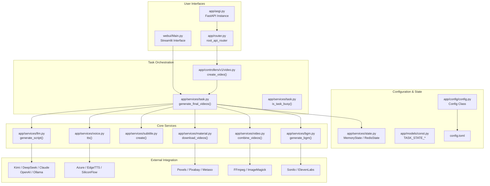

<!-- source: DeepWiki mcp.deepwiki.com · repo harry0703/MoneyPrinterTurbo · page 1 Overview · fetched 2026-10-30 -->

# Overview

Relevant source files

The following files were used as context for generating this wiki page:

- [README-en.md](README-en.md)
- [README-ja.md](README-ja.md)
- [README.md](README.md)
- [app/models/schema.py](app/models/schema.py)
- [app/services/task.py](app/services/task.py)
- [test/services/test_task.py](test/services/test_task.py)
- [webui/Main.py](webui/Main.py)

MoneyPrinterTurbo is an automated video generation system that produces high-definition short-form videos from a simple topic or keyword input. The system coordinates script generation, material acquisition, voice synthesis, subtitle generation, and video assembly through a multi-stage pipeline powered by a configuration-driven provider architecture.

## System Purpose

MoneyPrinterTurbo provides automated video creation through dual interfaces:
- **Web UI**: A Streamlit application serving as the primary user dashboard, located at [webui/Main.py:67-79]().
- **REST API**: A FastAPI service defined in [app/asgi.py:51-71]() and launched via `main.py` serving on port 8080.

Both interfaces invoke the core orchestration logic which handles the video generation pipeline. The system supports 13+ LLM providers (including Kimi, DeepSeek, and OpenAI), multiple TTS services, and various video sources via [app/config/config.py:1-10]().

Sources: [README.md:3-7](), [README-en.md:3-7](), [webui/Main.py:67-79](), [app/asgi.py:51-71](), [app/config/config.py:1-10]()

## System Architecture

### Complete System Architecture

The architecture follows a clear separation between the presentation layer (Streamlit/FastAPI), the router layer [app/router.py:17](), and the service layer. Configuration is centralized in [app/config/config.py](), which manages the application's global state. Task state management is abstracted via `MemoryState` or `RedisState` in [app/services/state.py:16](). The system also includes complex cross-posting logic in [app/services/task.py:41-69]() for social media distribution.

Sources: [app/asgi.py:65-90](), [app/services/task.py:41-69](), [app/models/const.py:25-32](), [app/config/config.py:1-20](), [app/services/state.py:16](), [test/services/test_task.py:16]()

## Key Features

| Category | Features | Implementation |
|----------|----------|----------------|
| **Dual Interfaces** | Web UI and REST API | [webui/Main.py:67-79](), [app/asgi.py:51-71]() |
| **Script Generation** | AI-automated or custom scripts | [app/services/llm.py]() supporting 13+ providers |
| **Task Lifecycle** | Status tracking (Processing, Complete, Failed) | [app/models/const.py:25-27]() |
| **Voice Synthesis** | Multi-provider support (Edge, Azure, etc.) | [app/services/voice.py]() |
| **Cross-Posting** | Automated upload to TikTok/Instagram | [app/services/task.py:53-69]() |
| **Media Sourcing** | Pexels/Pixabay/Local/AI Video | [webui/Main.py:110-121](), [app/services/material.py]() |
| **Music Generation** | Sonilo/ElevenLabs AI BGM | [app/services/task.py:73-88]() |

Sources: [webui/Main.py:110-121](), [app/services/task.py:73-88](), [app/models/const.py:25-35](), [app/asgi.py:51-71]()

## Video Generation Pipeline

The generation process is a sequential pipeline managed by the task service. The core parameters are defined in the `VideoParams` model [app/models/schema.py:73-138]().

### Pipeline Data Flow

```mermaid
graph LR
    Input["VideoParams<br/>(app/models/schema.py)"] --> LLM_S["llm.generate_script()<br/>(app/services/llm.py)"]
    LLM_S --> TTS_A["voice.tts()<br/>(app/services/voice.py)"]
    TTS_A --> SRT_G["subtitle.create()<br/>(app/services/subtitle.py)"]
    SRT_G --> MAT_D["material.download_videos()<br/>(app/services/material.py)"]
    MAT_D --> BGM_G["bgm.generate_bgm()<br/>(app/services/bgm.py)"]
    BGM_G --> V_COMBINE["video.combine_videos()<br/>(app/services/video.py)"]
    V_COMBINE --> V_GEN["video.generate_video()<br/>(app/services/video.py)"]
    V_GEN --> Final["final-*.mp4<br/>(webui/Main.py)"]
```

1.  **Scripting**: Uses LLM providers to generate video copy and extract keywords [test/services/test_task.py:65-91]().
2.  **Audio**: Converts text to speech. The system handles punctuation specifically to ensure TTS and subtitle synchronization [app/models/const.py:1-23]().
3.  **Subtitles**: Generates synchronized captions (SRT) using [app/services/subtitle.py]().
4.  **Materials**: Downloads clips or generates AI visuals based on terms [webui/Main.py:110-121]().
5.  **BGM**: Generates AI background music if configured (e.g., via Sonilo) [app/services/task.py:122-158]().
6.  **Assembly**: Combines assets into a final video file, respecting `VideoAspect` (16:9, 9:16, 1:1) [app/models/schema.py:34-46]() and `VideoFitMode` (cover/contain) [app/models/schema.py:49-53]().

Sources: [app/models/schema.py:34-138](), [app/models/const.py:1-23](), [app/services/task.py:122-158](), [test/services/test_task.py:65-91]()

## Deployment & Configuration

MoneyPrinterTurbo is designed for flexible deployment:
- **Docker**: Primary recommended method using `docker-compose`.
- **Manual**: Standard Python installation (3.11+).
- **Static Assets**: The FastAPI application mounts `/tasks` for generated content and resource directories for fonts and songs [webui/Main.py:90-93](), [app/asgi.py:84-90]().

### Configuration System
The system relies on a `config.toml` file. The application lifespan management handles task recovery, such as cleaning up interrupted social media cross-posts during startup [app/asgi.py:19-33](). WebUI configuration and locales are managed in [webui/Main.py:92-96]().

Sources: [app/asgi.py:19-33](), [app/asgi.py:84-90](), [webui/Main.py:90-96](), [README.md:11]()

---

